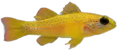
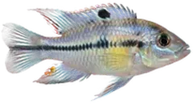

# reeftank-catalog

<!-- species:begin (generated by scripts/make_readme.py, do not edit) -->

> Teil des [**ReefTech-Projekt-Ökosystems**](https://elwinmage.github.io/reeftank/)

       

Fisch-, Korallen-, Pflanzen- und Wirbellosenarten für die Aquariumansicht von [ha-reef-card](https://github.com/Elwinmage/ha-reef-card), bereitgestellt von der [ReefTank-Integration](https://github.com/Elwinmage/ha-reeftank-component).

Die Integration lädt die Releases dieses Repositorys herunter und hält sie aktuell (`update.reeftank_catalog`, standardmäßig automatisch): in Home Assistant ist nichts zu tun.

## So funktioniert es

Jeder Fisch besteht aus einem Bilderbogen (ein WebP-Atlas) und einem Deskriptor mit seinen Clips: *schwimmen*, *ruhen* und *wenden*. Die Karte spielt sie nacheinander ab und spiegelt die Wende, damit der Fisch auf demselben Weg zurückkehrt. Hier das Schwimmen, die Wende und die Rückwende zweier Arten:

<table><tr><td align="center"> Kaiser-Kaiserfisch</td><td align="center"> Clownfisch</td></tr></table>

## Fische (102)

**HD**: eine echte Animation aus Videos. Die anderen haben eine einfache Animation aus einem Foto oder den generischen Fisch.

| &nbsp;&nbsp;&nbsp;&nbsp;&nbsp;&nbsp;&nbsp;&nbsp;&nbsp;&nbsp;&nbsp;&nbsp;&nbsp;&nbsp;&nbsp;&nbsp;&nbsp;&nbsp;&nbsp;&nbsp;&nbsp;&nbsp;&nbsp;&nbsp;&nbsp;&nbsp;&nbsp;&nbsp;&nbsp;&nbsp;&nbsp;&nbsp;&nbsp;&nbsp;&nbsp;&nbsp;&nbsp;&nbsp;&nbsp; | <small>Name</small> | <small>Wissenschaftlicher Name</small> | <small>Wasser</small> | <small>Größe</small> | <small>Verhalten</small> | HD |
|---|---|---|---|---|---|---|
|  | <small>Achter-Kugelfisch `dichotomyctere_biocellatus`</small> | <small>*Dichotomyctere biocellatus*</small> | <small>Brackwasser</small> | <small>5–6.5 cm</small> | <small>Freiwasserschwimmer · versteckt sich nachts</small> |  |
|  | <small>Anemonenfisch `amphiprion`</small> | <small>*Amphiprion sp.*</small> | <small>Meerwasser</small> | <small>7–11 cm</small> | <small>Bleibt an Ort und Stelle · schwebt nachts im Wasser</small> | ✔ |
|  | <small>Antennenwels `ancistrus`</small> | <small>*Ancistrus sp.*</small> | <small>Süßwasser</small> | <small>10–14 cm</small> | <small>Bodenbewohner · versteckt sich nachts</small> |  |
|  | <small>Argusfisch `scatophagus_argus`</small> | <small>*Scatophagus argus*</small> | <small>Brackwasser, Meerwasser</small> | <small>15–30 cm</small> | <small>Freiwasserschwimmer · versteckt sich nachts</small> |  |
|  | <small>Atlantischer Schlammspringer `periophthalmus_barbarus`</small> | <small>*Periophthalmus barbarus*</small> | <small>Brackwasser</small> | <small>10–15 cm</small> | <small>Bodenbewohner · versteckt sich nachts</small> |  |
|  | <small>Banggai-Kardinalbarsch `pterapogon_kauderni`</small> | <small>*Pterapogon kauderni*</small> | <small>Meerwasser</small> | <small>5–8 cm</small> | <small>Bleibt an Ort und Stelle · schwebt nachts im Wasser</small> | ✔ |
|  | <small>Blauer Fadenfisch `trichopodus_trichopterus`</small> | <small>*Trichopodus trichopterus*</small> | <small>Süßwasser</small> | <small>10–15 cm</small> | <small>Freiwasserschwimmer · versteckt sich nachts</small> |  |
|  | <small>Blauer Putzerfisch `labroides_dimidiatus`</small> | <small>*Labroides dimidiatus*</small> | <small>Meerwasser</small> | <small>10–12 cm</small> | <small>Freiwasserschwimmer · versteckt sich nachts</small> |  |
|  | <small>Brauner Segelflossen-Doktorfisch `zebrasoma_scopas`</small> | <small>*Zebrasoma scopas*</small> | <small>Meerwasser</small> | <small>15–20 cm</small> | <small>Freiwasserschwimmer · versteckt sich nachts</small> |  |
|  | <small>Bronzepanzerwels `corydoras_aeneus`</small> | <small>*Corydoras aeneus*</small> | <small>Süßwasser</small> | <small>6–7 cm</small> | <small>Bodenbewohner · versteckt sich nachts</small> |  |
|  | <small>Clownschmerle `chromobotia_macracanthus`</small> | <small>*Chromobotia macracanthus*</small> | <small>Süßwasser</small> | <small>15–30 cm</small> | <small>Bodenbewohner · versteckt sich nachts</small> |  |
|  | <small>Demasons Buntbarsch `pseudotropheus_demasoni`</small> | <small>*Pseudotropheus demasoni*</small> | <small>Süßwasser</small> | <small>7–8 cm</small> | <small>Freiwasserschwimmer · versteckt sich nachts</small> |  |
|  | <small>Diadem-Kaiserfisch `pygoplites_diacanthus`</small> | <small>*Pygoplites diacanthus*</small> | <small>Meerwasser</small> | <small>20–25 cm</small> | <small>Freiwasserschwimmer · versteckt sich nachts</small> |  |
|  | <small>Diskus `symphysodon_aequifasciatus`</small> | <small>*Symphysodon aequifasciatus*</small> | <small>Süßwasser</small> | <small>15–20 cm</small> | <small>Freiwasserschwimmer · versteckt sich nachts</small> |  |
|  | <small>Dreifleck-Preußenfisch `dascyllus_trimaculatus`</small> | <small>*Dascyllus trimaculatus*</small> | <small>Meerwasser</small> | <small>10–14 cm</small> | <small>Bleibt an Ort und Stelle · schwebt nachts im Wasser</small> |  |
|  | <small>Endler-Guppy `poecilia_wingei`</small> | <small>*Poecilia wingei*</small> | <small>Süßwasser</small> | <small>2–4 cm</small> | <small>Schwarmfisch · versteckt sich nachts</small> |  |
|  | <small>Fahnenbarsch `pseudanthias`</small> | <small>*Pseudanthias sp.*</small> | <small>Meerwasser</small> | <small>8–14 cm</small> | <small>Schwarmfisch · versteckt sich nachts</small> | ✔ |
|  | <small>Feuer-Schwertgrundel `nemateleotris_magnifica`</small> | <small>*Nemateleotris magnifica*</small> | <small>Meerwasser</small> | <small>8–10 cm</small> | <small>Bleibt an Ort und Stelle · schwebt nachts im Wasser</small> |  |
|  | <small>Fidschi-Riffbarsch `chrysiptera_taupou`</small> | <small>*Chrysiptera taupou*</small> | <small>Meerwasser</small> | <small>6–8 cm</small> | <small>Bleibt an Ort und Stelle · bleibt nahe seinem Unterschlupf · schwebt nachts im Wasser</small> |  |
|  | <small>Flammen-Zwergkaiserfisch `centropyge_loricula`</small> | <small>*Centropyge loricula*</small> | <small>Meerwasser</small> | <small>8–10 cm</small> | <small>Bleibt an Ort und Stelle · schwebt nachts im Wasser</small> |  |
|  | <small>Fuchsgesicht-Kaninchenfisch `siganus_vulpinus`</small> | <small>*Siganus vulpinus*</small> | <small>Meerwasser</small> | <small>15–22 cm</small> | <small>Freiwasserschwimmer · ruht nachts am Boden</small> | ✔ |
|  | <small>Gebänderte Grundel `amblygobius_phalaena`</small> | <small>*Amblygobius phalaena*</small> | <small>Meerwasser</small> | <small>8–10 cm</small> | <small>Lebt auf dem Sand · ruht nachts am Boden</small> |  |
|  | <small>Gelbe Symbiosegrundel `cryptocentrus_cinctus`</small> | <small>*Cryptocentrus cinctus*</small> | <small>Meerwasser</small> | <small>8–10 cm</small> | <small>Lebt auf dem Sand · lebt in einer Höhle im Sand · ruht nachts am Boden</small> |  |
|  | <small>Gelber Junker `halichoeres_chrysus`</small> | <small>*Halichoeres chrysus*</small> | <small>Meerwasser</small> | <small>10–12 cm</small> | <small>Freiwasserschwimmer · ruht nachts am Boden</small> |  |
|  | <small>Gelber Labidochromis `labidochromis_caeruleus`</small> | <small>*Labidochromis caeruleus*</small> | <small>Süßwasser</small> | <small>8–10 cm</small> | <small>Freiwasserschwimmer · versteckt sich nachts</small> |  |
|  | <small>Gelbkopf-Kieferfisch `opistognathus_aurifrons`</small> | <small>*Opistognathus aurifrons*</small> | <small>Meerwasser</small> | <small>10–12 cm</small> | <small>Lebt auf dem Sand · lebt in einer Höhle im Sand · ruht nachts am Boden</small> |  |
|  | <small>Gelbschwanz-Riffbarsch `chrysiptera_parasema`</small> | <small>*Chrysiptera parasema*</small> | <small>Meerwasser</small> | <small>5–6 cm</small> | <small>Bleibt an Ort und Stelle · bleibt nahe seinem Unterschlupf · schwebt nachts im Wasser</small> |  |
|  | <small>Gelbsegel-Doktorfisch `zebrasoma_flavescens`</small> | <small>*Zebrasoma flavescens*</small> | <small>Meerwasser</small> | <small>15–20 cm</small> | <small>Freiwasserschwimmer · versteckt sich nachts</small> |  |
|  | <small>Gelbstreifen-Kardinalbarsch `ostorhinchus_cyanosoma`</small> | <small>*Ostorhinchus cyanosoma*</small> | <small>Meerwasser</small> | <small>7–8 cm</small> | <small>Bleibt an Ort und Stelle · schwebt nachts im Wasser</small> |  |
|  | <small>Goldfisch `carassius_auratus`</small> | <small>*Carassius auratus*</small> | <small>Süßwasser</small> | <small>10–25 cm</small> | <small>Freiwasserschwimmer · versteckt sich nachts</small> |  |
|  | <small>Grüner Kugelfisch `dichotomyctere_nigroviridis`</small> | <small>*Dichotomyctere nigroviridis*</small> | <small>Brackwasser</small> | <small>10–17 cm</small> | <small>Freiwasserschwimmer · versteckt sich nachts</small> |  |
|  | <small>Grünes Schwalbenschwänzchen `chromis_viridis`</small> | <small>*Chromis viridis*</small> | <small>Meerwasser</small> | <small>5–8 cm</small> | <small>Schwarmfisch · versteckt sich nachts</small> | ✔ |
|  | <small>Guppy `poecilia_reticulata`</small> | <small>*Poecilia reticulata*</small> | <small>Süßwasser</small> | <small>3–6 cm</small> | <small>Schwarmfisch · versteckt sich nachts</small> |  |
|  | <small>Hummelgrundel `brachygobius_xanthozonus`</small> | <small>*Brachygobius xanthozonus*</small> | <small>Brackwasser</small> | <small>3–4 cm</small> | <small>Bodenbewohner · versteckt sich nachts</small> |  |
|  | <small>Imperator-Kaiserfisch (adult) `pomacanthus_imperator_adult`</small> | <small>*Pomacanthus imperator*</small> | <small>Meerwasser</small> | <small>25–38 cm</small> | <small>Freiwasserschwimmer · versteckt sich nachts</small> | ✔ |
|  | <small>Imperator-Kaiserfisch (Jungtier) `pomacanthus_imperator`</small> | <small>*Pomacanthus imperator*</small> | <small>Meerwasser</small> | <small>6–12 cm</small> | <small>Freiwasserschwimmer · versteckt sich nachts</small> | ✔ |
|  | <small>Kaisersalmler `nematobrycon_palmeri`</small> | <small>*Nematobrycon palmeri*</small> | <small>Süßwasser</small> | <small>4–6 cm</small> | <small>Schwarmfisch · versteckt sich nachts</small> |  |
|  | <small>Kakadu-Zwergbuntbarsch `apistogramma_cacatuoides`</small> | <small>*Apistogramma cacatuoides*</small> | <small>Süßwasser</small> | <small>5–9 cm</small> | <small>Bodenbewohner · versteckt sich nachts</small> |  |
|  | <small>Kampffisch `betta_splendens`</small> | <small>*Betta splendens*</small> | <small>Süßwasser</small> | <small>5–7 cm</small> | <small>Bleibt an Ort und Stelle · bleibt nahe seinem Unterschlupf · schwebt nachts im Wasser</small> |  |
|  | <small>Kap-Lopez-Prachtkärpfling `aphyosemion_australe`</small> | <small>*Aphyosemion australe*</small> | <small>Süßwasser</small> | <small>5–6 cm</small> | <small>Bleibt an Ort und Stelle · schwebt nachts im Wasser</small> |  |
|  | <small>Kardinalfisch `tanichthys_albonubes`</small> | <small>*Tanichthys albonubes*</small> | <small>Süßwasser</small> | <small>3–4 cm</small> | <small>Schwarmfisch · versteckt sich nachts</small> |  |
|  | <small>Keilfleckbärbling `trigonostigma_heteromorpha`</small> | <small>*Trigonostigma heteromorpha*</small> | <small>Süßwasser</small> | <small>3–4.5 cm</small> | <small>Schwarmfisch · versteckt sich nachts</small> |  |
|  | <small>Kirschbarbe `pethia_titteya`</small> | <small>*Pethia titteya*</small> | <small>Süßwasser</small> | <small>4–5 cm</small> | <small>Schwarmfisch · versteckt sich nachts</small> |  |
|  | <small>Kole-Doktorfisch `ctenochaetus_strigosus`</small> | <small>*Ctenochaetus strigosus*</small> | <small>Meerwasser</small> | <small>12–18 cm</small> | <small>Freiwasserschwimmer · versteckt sich nachts</small> |  |
|  | <small>Kuhli-Schmerle `pangio_kuhlii`</small> | <small>*Pangio kuhlii*</small> | <small>Süßwasser</small> | <small>8–12 cm</small> | <small>Bodenbewohner · versteckt sich nachts</small> |  |
|  | <small>Kupferstreifen-Pinzettfisch `chelmon_rostratus`</small> | <small>*Chelmon rostratus*</small> | <small>Meerwasser</small> | <small>15–20 cm</small> | <small>Freiwasserschwimmer · versteckt sich nachts</small> |  |
|  | <small>Königs-Gramma `gramma_loreto`</small> | <small>*Gramma loreto*</small> | <small>Meerwasser</small> | <small>7–8 cm</small> | <small>Bleibt an Ort und Stelle · schwebt nachts im Wasser</small> |  |
|  | <small>Mandarinfisch `synchiropus_splendidus`</small> | <small>*Synchiropus splendidus*</small> | <small>Meerwasser</small> | <small>5–8 cm</small> | <small>Bodenbewohner · versteckt sich nachts</small> | ✔ |
|  | <small>Marmorierter Beilbauchfisch `carnegiella_strigata`</small> | <small>*Carnegiella strigata*</small> | <small>Süßwasser</small> | <small>4–5 cm</small> | <small>Schwarmfisch · versteckt sich nachts</small> |  |
|  | <small>Mosaikfadenfisch `trichopodus_leerii`</small> | <small>*Trichopodus leerii*</small> | <small>Süßwasser</small> | <small>10–12 cm</small> | <small>Freiwasserschwimmer · versteckt sich nachts</small> |  |
|  | <small>Neon-Grundel `elacatinus_oceanops`</small> | <small>*Elacatinus oceanops*</small> | <small>Meerwasser</small> | <small>4–6 cm</small> | <small>Bodenbewohner · versteckt sich nachts</small> |  |
|  | <small>Neonsalmler `paracheirodon_innesi`</small> | <small>*Paracheirodon innesi*</small> | <small>Süßwasser</small> | <small>3–4 cm</small> | <small>Schwarmfisch · versteckt sich nachts</small> |  |
|  | <small>Nördliches Seepferdchen `hippocampus_erectus`</small> | <small>*Hippocampus erectus*</small> | <small>Meerwasser</small> | <small>10–15 cm</small> | <small>Bleibt an Ort und Stelle · schwebt nachts im Wasser</small> |  |
|  | <small>Ohrgitterwels `otocinclus_affinis`</small> | <small>*Otocinclus affinis*</small> | <small>Süßwasser</small> | <small>3–5 cm</small> | <small>Bodenbewohner · versteckt sich nachts</small> |  |
|  | <small>Okinawa-Korallengrundel `gobiodon_okinawae`</small> | <small>*Gobiodon okinawae*</small> | <small>Meerwasser</small> | <small>2.5–3.5 cm</small> | <small>Bodenbewohner · versteckt sich nachts</small> |  |
|  | <small>Orchideen-Zwergbarsch `pseudochromis_fridmani`</small> | <small>*Pseudochromis fridmani*</small> | <small>Meerwasser</small> | <small>6–7 cm</small> | <small>Bleibt an Ort und Stelle · bleibt nahe seinem Unterschlupf · schwebt nachts im Wasser</small> |  |
|  | <small>Paletten-Doktorfisch `paracanthurus_hepatus`</small> | <small>*Paracanthurus hepatus*</small> | <small>Meerwasser</small> | <small>20–30 cm</small> | <small>Freiwasserschwimmer · versteckt sich nachts</small> |  |
|  | <small>Pandapanzerwels `corydoras_panda`</small> | <small>*Corydoras panda*</small> | <small>Süßwasser</small> | <small>4–5 cm</small> | <small>Bodenbewohner · versteckt sich nachts</small> |  |
|  | <small>Pazifischer Segelflossen-Doktorfisch `zebrasoma_veliferum`</small> | <small>*Zebrasoma veliferum*</small> | <small>Meerwasser</small> | <small>25–40 cm</small> | <small>Freiwasserschwimmer · versteckt sich nachts</small> |  |
|  | <small>Perlen-Bärbling `danio_albolineatus`</small> | <small>*Danio albolineatus*</small> | <small>Süßwasser</small> | <small>4–6 cm</small> | <small>Schwarmfisch · versteckt sich nachts</small> |  |
|  | <small>Pfauenaugen-Buntbarsch `astronotus_ocellatus`</small> | <small>*Astronotus ocellatus*</small> | <small>Süßwasser</small> | <small>25–35 cm</small> | <small>Freiwasserschwimmer · versteckt sich nachts</small> |  |
|  | <small>Picasso-Drückerfisch `rhinecanthus_aculeatus`</small> | <small>*Rhinecanthus aculeatus*</small> | <small>Meerwasser</small> | <small>20–25 cm</small> | <small>Freiwasserschwimmer · versteckt sich nachts</small> |  |
|  | <small>Pixie-Korallenwächter `cirrhitichthys_oxycephalus`</small> | <small>*Cirrhitichthys oxycephalus*</small> | <small>Meerwasser</small> | <small>8–10 cm</small> | <small>Bodenbewohner · versteckt sich nachts</small> |  |
|  | <small>Psychedelischer Mandarinfisch `synchiropus_picturatus`</small> | <small>*Synchiropus picturatus*</small> | <small>Meerwasser</small> | <small>6–8 cm</small> | <small>Bodenbewohner · versteckt sich nachts</small> |  |
|  | <small>Purpur-Schwertgrundel `nemateleotris_decora`</small> | <small>*Nemateleotris decora*</small> | <small>Meerwasser</small> | <small>8–10 cm</small> | <small>Bleibt an Ort und Stelle · schwebt nachts im Wasser</small> |  |
|  | <small>Purpurprachtbarsch `pelvicachromis_pulcher`</small> | <small>*Pelvicachromis pulcher*</small> | <small>Süßwasser</small> | <small>8–10 cm</small> | <small>Bodenbewohner · versteckt sich nachts</small> |  |
|  | <small>Pyjama-Kardinalbarsch `sphaeramia_nematoptera`</small> | <small>*Sphaeramia nematoptera*</small> | <small>Meerwasser</small> | <small>8–10 cm</small> | <small>Bleibt an Ort und Stelle · schwebt nachts im Wasser</small> |  |
|  | <small>Rasenmäher-Schleimfisch `salarias_fasciatus`</small> | <small>*Salarias fasciatus*</small> | <small>Meerwasser</small> | <small>12–14 cm</small> | <small>Bodenbewohner · versteckt sich nachts</small> |  |
|  | <small>Ritter-Grundel `stigmatogobius_sadanundio`</small> | <small>*Stigmatogobius sadanundio*</small> | <small>Brackwasser</small> | <small>6–8 cm</small> | <small>Bodenbewohner · versteckt sich nachts</small> |  |
|  | <small>Roter Feuerfisch `pterois_volitans`</small> | <small>*Pterois volitans*</small> | <small>Meerwasser</small> | <small>25–35 cm</small> | <small>Freiwasserschwimmer · versteckt sich nachts</small> |  |
|  | <small>Roter Neon `paracheirodon_axelrodi`</small> | <small>*Paracheirodon axelrodi*</small> | <small>Süßwasser</small> | <small>3–5 cm</small> | <small>Schwarmfisch · versteckt sich nachts</small> |  |
|  | <small>Rotkopfsalmler `hemigrammus_bleheri`</small> | <small>*Hemigrammus bleheri*</small> | <small>Süßwasser</small> | <small>4–5 cm</small> | <small>Schwarmfisch · versteckt sich nachts</small> |  |
|  | <small>Schläfergrundel `valenciennea`</small> | <small>*Valenciennea sp.*</small> | <small>Meerwasser</small> | <small>10–16 cm</small> | <small>Lebt auf dem Sand · lebt in einer Höhle im Sand · ruht nachts am Boden</small> | ✔ |
|  | <small>Schmetterlingsbuntbarsch `mikrogeophagus_ramirezi`</small> | <small>*Mikrogeophagus ramirezi*</small> | <small>Süßwasser</small> | <small>5–7 cm</small> | <small>Bleibt an Ort und Stelle · schwebt nachts im Wasser</small> |  |
|  | <small>Schwertträger `xiphophorus_hellerii`</small> | <small>*Xiphophorus hellerii*</small> | <small>Süßwasser</small> | <small>6–12 cm</small> | <small>Schwarmfisch · versteckt sich nachts</small> |  |
|  | <small>Schützenfisch `toxotes_jaculatrix`</small> | <small>*Toxotes jaculatrix*</small> | <small>Brackwasser</small> | <small>15–25 cm</small> | <small>Freiwasserschwimmer · versteckt sich nachts</small> |  |
|  | <small>Sechsstreifen-Lippfisch `pseudocheilinus_hexataenia`</small> | <small>*Pseudocheilinus hexataenia*</small> | <small>Meerwasser</small> | <small>7–10 cm</small> | <small>Freiwasserschwimmer · versteckt sich nachts</small> |  |
|  | <small>Segelkärpfling `poecilia_velifera`</small> | <small>*Poecilia velifera*</small> | <small>Brackwasser, Süßwasser</small> | <small>10–15 cm</small> | <small>Schwarmfisch · versteckt sich nachts</small> |  |
|  | <small>Serpae-Salmler `hyphessobrycon_eques`</small> | <small>*Hyphessobrycon eques*</small> | <small>Süßwasser</small> | <small>3–4.5 cm</small> | <small>Schwarmfisch · versteckt sich nachts</small> |  |
|  | <small>Siamesische Rüsselbarbe `crossocheilus_oblongus`</small> | <small>*Crossocheilus oblongus*</small> | <small>Süßwasser</small> | <small>10–15 cm</small> | <small>Freiwasserschwimmer · versteckt sich nachts</small> |  |
|  | <small>Silberflossenblatt `monodactylus_argenteus`</small> | <small>*Monodactylus argenteus*</small> | <small>Brackwasser, Meerwasser</small> | <small>15–25 cm</small> | <small>Schwarmfisch · versteckt sich nachts</small> |  |
|  | <small>Skalar `pterophyllum_scalare`</small> | <small>*Pterophyllum scalare*</small> | <small>Süßwasser</small> | <small>12–15 cm</small> | <small>Freiwasserschwimmer · versteckt sich nachts</small> |  |
|  | <small>Solor-Feenlippfisch `cirrhilabrus_solorensis`</small> | <small>*Cirrhilabrus solorensis*</small> | <small>Meerwasser</small> | <small>10–12 cm</small> | <small>Freiwasserschwimmer · versteckt sich nachts</small> |  |
|  | <small>Spiegelkärpfling `xiphophorus_maculatus`</small> | <small>*Xiphophorus maculatus*</small> | <small>Süßwasser</small> | <small>4–6 cm</small> | <small>Schwarmfisch · versteckt sich nachts</small> |  |
|  | <small>Spitzmaulkärpfling `poecilia_sphenops`</small> | <small>*Poecilia sphenops*</small> | <small>Süßwasser, Brackwasser</small> | <small>6–10 cm</small> | <small>Schwarmfisch · versteckt sich nachts</small> |  |
|  | <small>Stachel-Anemonenfisch `premnas_biaculeatus`</small> | <small>*Premnas biaculeatus*</small> | <small>Meerwasser</small> | <small>10–15 cm</small> | <small>Bleibt an Ort und Stelle · schwebt nachts im Wasser</small> |  |
|  | <small>Sternenhimmel-Bärbling `danio_margaritatus`</small> | <small>*Danio margaritatus*</small> | <small>Süßwasser</small> | <small>2–3 cm</small> | <small>Schwarmfisch · versteckt sich nachts</small> |  |
|  | <small>Sumatrabarbe `puntigrus_tetrazona`</small> | <small>*Puntigrus tetrazona*</small> | <small>Süßwasser</small> | <small>5–7 cm</small> | <small>Schwarmfisch · versteckt sich nachts</small> |  |
|  | <small>Trauermantelsalmler `gymnocorymbus_ternetzi`</small> | <small>*Gymnocorymbus ternetzi*</small> | <small>Süßwasser</small> | <small>5–6 cm</small> | <small>Schwarmfisch · versteckt sich nachts</small> |  |
|  | <small>Türkis-Regenbogenfisch `melanotaenia_lacustris`</small> | <small>*Melanotaenia lacustris*</small> | <small>Süßwasser</small> | <small>8–12 cm</small> | <small>Schwarmfisch · versteckt sich nachts</small> |  |
|  | <small>Valentins Spitzkopf-Kugelfisch `canthigaster_valentini`</small> | <small>*Canthigaster valentini*</small> | <small>Meerwasser</small> | <small>8–10 cm</small> | <small>Freiwasserschwimmer · versteckt sich nachts</small> |  |
|  | <small>Violette Grundel `gobioides_broussonnetii`</small> | <small>*Gobioides broussonnetii*</small> | <small>Brackwasser</small> | <small>30–50 cm</small> | <small>Lebt auf dem Sand · lebt in einer Höhle im Sand · ruht nachts am Boden</small> |  |
|  | <small>Weißkehl-Doktorfisch `acanthurus_leucosternon`</small> | <small>*Acanthurus leucosternon*</small> | <small>Meerwasser</small> | <small>20–23 cm</small> | <small>Freiwasserschwimmer · versteckt sich nachts</small> |  |
|  | <small>Yasha-Symbiosegrundel `stonogobiops_yasha`</small> | <small>*Stonogobiops yasha*</small> | <small>Meerwasser</small> | <small>6–8 cm</small> | <small>Lebt auf dem Sand · lebt in einer Höhle im Sand · ruht nachts am Boden</small> |  |
|  | <small>Zebra-Harnischwels `hypancistrus_zebra`</small> | <small>*Hypancistrus zebra*</small> | <small>Süßwasser</small> | <small>7–10 cm</small> | <small>Bodenbewohner · versteckt sich nachts</small> |  |
|  | <small>Zebra-Zwergfeuerfisch `dendrochirus_zebra`</small> | <small>*Dendrochirus zebra*</small> | <small>Meerwasser</small> | <small>12–18 cm</small> | <small>Freiwasserschwimmer · versteckt sich nachts</small> |  |
|  | <small>Zebrabärbling `danio_rerio`</small> | <small>*Danio rerio*</small> | <small>Süßwasser</small> | <small>4–5 cm</small> | <small>Schwarmfisch · versteckt sich nachts</small> |  |
|  | <small>Zitronen-Korallengrundel `gobiodon_citrinus`</small> | <small>*Gobiodon citrinus*</small> | <small>Meerwasser</small> | <small>3–5 cm</small> | <small>Bodenbewohner · versteckt sich nachts</small> |  |
|  | <small>Zitronensalmler `hyphessobrycon_pulchripinnis`</small> | <small>*Hyphessobrycon pulchripinnis*</small> | <small>Süßwasser</small> | <small>3–4.5 cm</small> | <small>Schwarmfisch · versteckt sich nachts</small> |  |
|  | <small>Zweifarben-Schleimfisch `ecsenius_bicolor`</small> | <small>*Ecsenius bicolor*</small> | <small>Meerwasser</small> | <small>8–10 cm</small> | <small>Bodenbewohner · versteckt sich nachts</small> |  |
|  | <small>Zweifarben-Zwergkaiserfisch `centropyge_bicolor`</small> | <small>*Centropyge bicolor*</small> | <small>Meerwasser</small> | <small>10–15 cm</small> | <small>Bleibt an Ort und Stelle · schwebt nachts im Wasser</small> |  |
|  | <small>Zwergfadenfisch `trichogaster_lalius`</small> | <small>*Trichogaster lalius*</small> | <small>Süßwasser</small> | <small>5–8 cm</small> | <small>Freiwasserschwimmer · versteckt sich nachts</small> |  |

## Korallen (1)

| &nbsp;&nbsp;&nbsp;&nbsp;&nbsp;&nbsp;&nbsp;&nbsp;&nbsp;&nbsp;&nbsp;&nbsp;&nbsp;&nbsp;&nbsp;&nbsp;&nbsp;&nbsp;&nbsp;&nbsp;&nbsp;&nbsp;&nbsp;&nbsp;&nbsp;&nbsp;&nbsp;&nbsp;&nbsp;&nbsp;&nbsp;&nbsp;&nbsp;&nbsp;&nbsp;&nbsp;&nbsp;&nbsp;&nbsp; | <small>Name</small> | <small>Wissenschaftlicher Name</small> | <small>Wasser</small> | <small>Größe</small> |
|---|---|---|---|---|
|  | <small>Fackelkoralle `euphyllia_glabrescens`</small> | <small>*Euphyllia glabrescens*</small> | <small>Meerwasser</small> | <small>10–30 cm</small> |

## Pflanzen (29)

| &nbsp;&nbsp;&nbsp;&nbsp;&nbsp;&nbsp;&nbsp;&nbsp;&nbsp;&nbsp;&nbsp;&nbsp;&nbsp;&nbsp;&nbsp;&nbsp;&nbsp;&nbsp;&nbsp;&nbsp;&nbsp;&nbsp;&nbsp;&nbsp;&nbsp;&nbsp;&nbsp;&nbsp;&nbsp;&nbsp;&nbsp;&nbsp;&nbsp;&nbsp;&nbsp;&nbsp;&nbsp;&nbsp;&nbsp; | <small>Name</small> | <small>Wissenschaftlicher Name</small> | <small>Wasser</small> | <small>Größe</small> | <small>Zone</small> |
|---|---|---|---|---|---|
|  | <small>Amazonas-Froschbiss `limnobium_laevigatum`</small> | <small>*Limnobium laevigatum*</small> | <small>Süßwasser</small> | <small>5–10 cm</small> | <small>Schwimmpflanze</small> |
|  | <small>Amazonas-Schwertpflanze `echinodorus_bleheri`</small> | <small>*Echinodorus bleheri*</small> | <small>Süßwasser</small> | <small>30–50 cm</small> | <small>Mittelgrund</small> |
|  | <small>Ambulia `limnophila_sessiliflora`</small> | <small>*Limnophila sessiliflora*</small> | <small>Süßwasser</small> | <small>20–40 cm</small> | <small>Hintergrund</small> |
|  | <small>Anubias `anubias_barteri`</small> | <small>*Anubias barteri*</small> | <small>Süßwasser</small> | <small>10–25 cm</small> | <small>Aufsitzerpflanze</small> |
|  | <small>Bewimperter Wasserkelch `cryptocoryne_ciliata`</small> | <small>*Cryptocoryne ciliata*</small> | <small>Brackwasser, Süßwasser</small> | <small>20–40 cm</small> | <small>Mittelgrund</small> |
|  | <small>Bucephalandra `bucephalandra`</small> | <small>*Bucephalandra sp.*</small> | <small>Süßwasser</small> | <small>5–15 cm</small> | <small>Aufsitzerpflanze</small> |
|  | <small>Carolina-Haarnixe `cabomba_caroliniana`</small> | <small>*Cabomba caroliniana*</small> | <small>Süßwasser</small> | <small>30–60 cm</small> | <small>Hintergrund</small> |
|  | <small>Caulerpa `caulerpa_prolifera`</small> | <small>*Caulerpa prolifera*</small> | <small>Meerwasser</small> | <small>5–20 cm</small> | <small>Vordergrund</small> |
|  | <small>Chaetomorpha `chaetomorpha_linum`</small> | <small>*Chaetomorpha linum*</small> | <small>Meerwasser</small> | <small>5–30 cm</small> | <small>Vordergrund</small> |
|  | <small>Dichte Wasserpest `egeria_densa`</small> | <small>*Egeria densa*</small> | <small>Süßwasser</small> | <small>30–100 cm</small> | <small>Hintergrund</small> |
|  | <small>Glossostigma `glossostigma_elatinoides`</small> | <small>*Glossostigma elatinoides*</small> | <small>Süßwasser</small> | <small>2–5 cm</small> | <small>Vordergrund</small> |
|  | <small>Halimeda `halimeda_opuntia`</small> | <small>*Halimeda opuntia*</small> | <small>Meerwasser</small> | <small>5–15 cm</small> | <small>Vordergrund</small> |
|  | <small>Indischer Wasserfreund `hygrophila_polysperma`</small> | <small>*Hygrophila polysperma*</small> | <small>Süßwasser</small> | <small>20–50 cm</small> | <small>Hintergrund</small> |
|  | <small>Javafarn `microsorum_pteropus`</small> | <small>*Microsorum pteropus*</small> | <small>Süßwasser</small> | <small>20–30 cm</small> | <small>Aufsitzerpflanze</small> |
|  | <small>Javamoos `vesicularia_dubyana`</small> | <small>*Vesicularia dubyana*</small> | <small>Süßwasser</small> | <small>3–5 cm</small> | <small>Aufsitzerpflanze</small> |
|  | <small>Kleine Wasserlinse `lemna_minor`</small> | <small>*Lemna minor*</small> | <small>Süßwasser</small> | <small>0.5–1 cm</small> | <small>Schwimmpflanze</small> |
|  | <small>Kriechende Ludwigie `ludwigia_repens`</small> | <small>*Ludwigia repens*</small> | <small>Süßwasser</small> | <small>20–40 cm</small> | <small>Mittelgrund</small> |
|  | <small>Kuba-Perlenkraut `hemianthus_callitrichoides`</small> | <small>*Hemianthus callitrichoides*</small> | <small>Süßwasser</small> | <small>2–5 cm</small> | <small>Vordergrund</small> |
|  | <small>Marimo (Kugelalge) `aegagropila_linnaei`</small> | <small>*Aegagropila linnaei*</small> | <small>Süßwasser</small> | <small>3–10 cm</small> | <small>Vordergrund</small> |
|  | <small>Muschelblume `pistia_stratiotes`</small> | <small>*Pistia stratiotes*</small> | <small>Süßwasser</small> | <small>5–15 cm</small> | <small>Schwimmpflanze</small> |
|  | <small>Rote Mangrove `rhizophora_mangle`</small> | <small>*Rhizophora mangle*</small> | <small>Brackwasser, Meerwasser</small> | <small>30–100 cm</small> | <small>Mittelgrund</small> |
|  | <small>Rundblättrige Rotala `rotala_rotundifolia`</small> | <small>*Rotala rotundifolia*</small> | <small>Süßwasser</small> | <small>20–50 cm</small> | <small>Hintergrund</small> |
|  | <small>Schildkrötengras `thalassia_testudinum`</small> | <small>*Thalassia testudinum*</small> | <small>Meerwasser</small> | <small>10–30 cm</small> | <small>Vordergrund</small> |
|  | <small>Staurogyne `staurogyne_repens`</small> | <small>*Staurogyne repens*</small> | <small>Süßwasser</small> | <small>5–10 cm</small> | <small>Vordergrund</small> |
|  | <small>Wasserschraube `vallisneria_spiralis`</small> | <small>*Vallisneria spiralis*</small> | <small>Süßwasser, Brackwasser</small> | <small>30–60 cm</small> | <small>Hintergrund</small> |
|  | <small>Wendts Wasserkelch `cryptocoryne_wendtii`</small> | <small>*Cryptocoryne wendtii*</small> | <small>Süßwasser</small> | <small>10–20 cm</small> | <small>Mittelgrund</small> |
|  | <small>Zwerg-Nadelsimse `eleocharis_parvula`</small> | <small>*Eleocharis parvula*</small> | <small>Süßwasser</small> | <small>5–10 cm</small> | <small>Vordergrund</small> |
|  | <small>Zwerg-Pfeilkraut `sagittaria_subulata`</small> | <small>*Sagittaria subulata*</small> | <small>Süßwasser</small> | <small>10–30 cm</small> | <small>Vordergrund</small> |
|  | <small>Zwerg-Wasserkelch `cryptocoryne_parva`</small> | <small>*Cryptocoryne parva*</small> | <small>Süßwasser</small> | <small>5–8 cm</small> | <small>Vordergrund</small> |

## Wirbellose (32)

| &nbsp;&nbsp;&nbsp;&nbsp;&nbsp;&nbsp;&nbsp;&nbsp;&nbsp;&nbsp;&nbsp;&nbsp;&nbsp;&nbsp;&nbsp;&nbsp;&nbsp;&nbsp;&nbsp;&nbsp;&nbsp;&nbsp;&nbsp;&nbsp;&nbsp;&nbsp;&nbsp;&nbsp;&nbsp;&nbsp;&nbsp;&nbsp;&nbsp;&nbsp;&nbsp;&nbsp;&nbsp;&nbsp;&nbsp; | <small>Name</small> | <small>Wissenschaftlicher Name</small> | <small>Wasser</small> | <small>Größe</small> | <small>Rolle</small> |
|---|---|---|---|---|---|
|  | <small>Amano-Garnele `caridina_multidentata`</small> | <small>*Caridina multidentata*</small> | <small>Süßwasser</small> | <small>3–5 cm</small> | <small>Algenfresser · läuft am Boden</small> |
|  | <small>Apfelschnecke `pomacea_bridgesii`</small> | <small>*Pomacea bridgesii*</small> | <small>Süßwasser</small> | <small>4–5 cm</small> | <small>Aasfresser · läuft am Boden</small> |
|  | <small>Astraea-Schnecke `astraea_tecta`</small> | <small>*Astraea tecta*</small> | <small>Meerwasser</small> | <small>2–4 cm</small> | <small>Algenfresser · lebt auf dem Dekor</small> |
|  | <small>Bambusgarnele `atyopsis_moluccensis`</small> | <small>*Atyopsis moluccensis*</small> | <small>Süßwasser</small> | <small>6–8 cm</small> | <small>Filtrierer · lebt auf dem Dekor</small> |
|  | <small>Blaubein-Einsiedlerkrebs `clibanarius_tricolor`</small> | <small>*Clibanarius tricolor*</small> | <small>Meerwasser</small> | <small>2–3 cm</small> | <small>Aasfresser · läuft am Boden</small> |
|  | <small>Bohrende Riesenmuschel `tridacna_crocea`</small> | <small>*Tridacna crocea*</small> | <small>Meerwasser</small> | <small>5–15 cm</small> | <small>Filtrierer · festsitzend</small> |
|  | <small>Cerithium-Schnecke `cerithium`</small> | <small>*Cerithium sp.*</small> | <small>Meerwasser</small> | <small>2–3 cm</small> | <small>Detritusfresser · läuft am Boden</small> |
|  | <small>Federwurm `sabellastarte`</small> | <small>*Sabellastarte sp.*</small> | <small>Meerwasser</small> | <small>5–10 cm</small> | <small>Filtrierer · festsitzend</small> |
|  | <small>Feuergarnele `lysmata_debelius`</small> | <small>*Lysmata debelius*</small> | <small>Meerwasser</small> | <small>5–6 cm</small> | <small>Putzer · lebt auf dem Dekor</small> |
|  | <small>Griffelseeigel `prionocidaris_baculosa`</small> | <small>*Prionocidaris baculosa*</small> | <small>Meerwasser</small> | <small>8–10 cm</small> | <small>Algenfresser · lebt auf dem Dekor</small> |
|  | <small>Harlekingarnele `hymenocera_picta`</small> | <small>*Hymenocera picta*</small> | <small>Meerwasser</small> | <small>4–6 cm</small> | <small>Räuber · läuft am Boden</small> |
|  | <small>Kirschgarnele `neocaridina_davidi`</small> | <small>*Neocaridina davidi*</small> | <small>Süßwasser</small> | <small>2–3.5 cm</small> | <small>Detritusfresser · läuft am Boden</small> |
|  | <small>Malayische Turmdeckelschnecke `melanoides_tuberculata`</small> | <small>*Melanoides tuberculata*</small> | <small>Süßwasser</small> | <small>2–3 cm</small> | <small>Detritusfresser · läuft am Boden</small> |
|  | <small>Marmorgarnele `saron_marmoratus`</small> | <small>*Saron marmoratus*</small> | <small>Meerwasser</small> | <small>5–7 cm</small> | <small>Aasfresser · lebt auf dem Dekor</small> |
|  | <small>Nassa-Schnecke `nassarius`</small> | <small>*Nassarius sp.*</small> | <small>Meerwasser</small> | <small>2–4 cm</small> | <small>Aasfresser · läuft am Boden</small> |
|  | <small>Nerita-Schnecke `nerita`</small> | <small>*Nerita sp.*</small> | <small>Meerwasser</small> | <small>2–3 cm</small> | <small>Algenfresser · klettert an der Scheibe</small> |
|  | <small>Peppermint-Garnele `lysmata_wurdemanni`</small> | <small>*Lysmata wurdemanni*</small> | <small>Meerwasser</small> | <small>3–5 cm</small> | <small>Putzer · lebt auf dem Dekor</small> |
|  | <small>Posthornschnecke `planorbella_duryi`</small> | <small>*Planorbella duryi*</small> | <small>Süßwasser</small> | <small>2–3 cm</small> | <small>Detritusfresser · klettert an der Scheibe</small> |
|  | <small>Raubschnecke `clea_helena`</small> | <small>*Clea helena*</small> | <small>Süßwasser</small> | <small>2–3 cm</small> | <small>Räuber · läuft am Boden</small> |
|  | <small>Rote Kristallgarnele `caridina_cantonensis`</small> | <small>*Caridina cantonensis*</small> | <small>Süßwasser</small> | <small>2–3 cm</small> | <small>Detritusfresser · läuft am Boden</small> |
|  | <small>Sammler-Seeigel `tripneustes_gratilla`</small> | <small>*Tripneustes gratilla*</small> | <small>Meerwasser</small> | <small>10–15 cm</small> | <small>Algenfresser · lebt auf dem Dekor</small> |
|  | <small>Sand-Seestern `archaster_typicus`</small> | <small>*Archaster typicus*</small> | <small>Meerwasser</small> | <small>6–10 cm</small> | <small>Detritusfresser · läuft am Boden</small> |
|  | <small>Scharlachroter Einsiedlerkrebs `paguristes_cadenati`</small> | <small>*Paguristes cadenati*</small> | <small>Meerwasser</small> | <small>3–4 cm</small> | <small>Aasfresser · läuft am Boden</small> |
|  | <small>Scherengarnele `stenopus_hispidus`</small> | <small>*Stenopus hispidus*</small> | <small>Meerwasser</small> | <small>6–8 cm</small> | <small>Putzer · lebt auf dem Dekor</small> |
|  | <small>Schlangenstern `ophiolepis_superba`</small> | <small>*Ophiolepis superba*</small> | <small>Meerwasser</small> | <small>8–12 cm</small> | <small>Aasfresser · läuft am Boden</small> |
|  | <small>Seegurke `holothuria`</small> | <small>*Holothuria sp.*</small> | <small>Meerwasser</small> | <small>15–30 cm</small> | <small>Detritusfresser · läuft am Boden</small> |
|  | <small>Smaragdkrabbe `mithraculus_sculptus`</small> | <small>*Mithraculus sculptus*</small> | <small>Meerwasser</small> | <small>3–4 cm</small> | <small>Algenfresser · lebt auf dem Dekor</small> |
|  | <small>Trochus-Schnecke `tectus_fenestratus`</small> | <small>*Tectus fenestratus*</small> | <small>Meerwasser</small> | <small>4–6 cm</small> | <small>Algenfresser · lebt auf dem Dekor</small> |
|  | <small>Turbo-Schnecke `turbo_fluctuosus`</small> | <small>*Turbo fluctuosus*</small> | <small>Meerwasser</small> | <small>4–8 cm</small> | <small>Algenfresser · klettert an der Scheibe</small> |
|  | <small>Weihnachtsbaumwurm `spirobranchus_giganteus`</small> | <small>*Spirobranchus giganteus*</small> | <small>Meerwasser</small> | <small>3–5 cm</small> | <small>Filtrierer · festsitzend</small> |
|  | <small>Weißstreifen-Putzergarnele `lysmata_amboinensis`</small> | <small>*Lysmata amboinensis*</small> | <small>Meerwasser</small> | <small>5–6 cm</small> | <small>Putzer · lebt auf dem Dekor</small> |
|  | <small>Zebra-Rennschnecke `neritina_natalensis`</small> | <small>*Neritina natalensis*</small> | <small>Süßwasser</small> | <small>2–3 cm</small> | <small>Algenfresser · klettert an der Scheibe</small> |

Zum Hinzufügen einer Art (Erzeugen der Clips, Build, Veröffentlichung) siehe die [englische Dokumentation](README.md).

Die Art-Ressourcen stehen unter **CC BY 4.0**, die Skripte unter MIT: siehe [LICENSE.md](LICENSE.md).

<!-- species:end -->

<!-- ecosystem:start -->

## Verwandte Projekte

Die ReefTech-Projekte greifen ineinander: die Integrationen bringen Ihre Geräte in Home Assistant, die Karte zeigt und steuert sie, und das Backup hält sie bei einem Stromausfall am Laufen. Jedes funktioniert auch für sich allein.

<table>
  <tr>
    <th width="100px"></th>
    <th>Projekt</th>
    <th>Funktion</th>
    <th>Arbeitet mit</th>
  </tr>
  <tr>
    <td></td>
    <td>🐠 <a href="https://github.com/Elwinmage/ha-reefbeat-component"><b>ha-reefbeat-component</b></a></td>
    <td>Red Sea ReefBeat-Geräte, lokal gesteuert ohne Cloud: ReefATO+, ReefControl, ReefControl-Power, ReefDose, ReefLed, ReefMat, ReefRun und ReefWave. Alarm-Blueprint für abweichende Modi, Kalibrierungen und niedrigen Akkustand. </td>
    <td>ha-reef-card</td>
  </tr>
  <tr>
    <td></td>
    <td>🌊 <a href="https://github.com/Elwinmage/ha-aquamedic-component"><b>ha-aquamedic-component</b></a></td>
    <td>Aqua Medic-Pumpen über die Gizwits-Cloud-API: EcoDrift- und SmartDrift-Strömungspumpen, DC Runner Rückförder- und Abschäumerpumpen.</td>
    <td>ha-reef-card</td>
  </tr>
  <tr>
    <td></td>
    <td>🐟 <a href="https://github.com/Elwinmage/ha-vson-component"><b>ha-vson-component</b></a></td>
    <td>VSON-Futterautomaten über die VSON-Cloud-API: der WP8621 (Füttern, Akku, Warnung bei wenig Futter) und generische Erkennung jedes anderen VSON-Geräts. Der WP8621 kann auch vollständig lokal mit ESPHome laufen.</td>
    <td>ha-reef-card</td>
  </tr>
  <tr>
    <td></td>
    <td>🐙 <a href="https://github.com/Elwinmage/ha-reef-maintenance-component"><b>ha-reef-maintenance-component</b></a></td>
    <td>Reinigungs- und Verschleißverfolgung für Geräte, die Home Assistant nicht erreicht: Strömungspumpen, Rückförderpumpen, Abschäumer, Reaktoren, alles was von Hand gewartet wird.</td>
    <td>ha-reef-card</td>
  </tr>
  <tr>
    <td></td>
    <td>🪸 <a href="https://github.com/Elwinmage/ha-reef-card"><b>ha-reef-card</b></a></td>
    <td>Interaktive grafische Ansicht jedes Geräts auf Ihrem Dashboard und der einzige Weg, erweiterte Zeitpläne zu bearbeiten. Liest die vier Integrationen über den gemeinsamen <code>reef_role</code>-Vertrag, ohne Konfiguration auf Kartenseite. Zeichnet außerdem die Energieflüsse von reefbeatEnergyBackup. Ihre Aquariumkarte erweckt Ihr Becken mit ha-reeftank-component zum Leben.</td>
    <td>alle vier Integrationen und ha-reeftank-component für das Aquarium</td>
  </tr>
  <tr>
    <td></td>
    <td>🐟 <a href="https://github.com/Elwinmage/ha-reeftank-component"><b>ha-reeftank-component</b></a></td>
    <td>Ein lebendiges Bild Ihres Beckens auf dem Dashboard: Ihr Foto, beleuchtet von Ihren echten Lampen, mit animierten Fischen und Korallen und Ihren Geräten und Entitäten darauf. Speichert die Aquarien und ihren Besatz, protokolliert die Fütterungen.</td>
    <td>ha-reef-card</td>
  </tr>
  <tr>
    <td></td>
    <td>🐡 <b>reeftank-catalog</b> <i>(dieses Repository)</i></td>
    <td>Fische, Korallen und Texturen der Aquariumkarte, von ha-reeftank-component heruntergeladen und aktuell gehalten.</td>
    <td>ha-reeftank-component</td>
  </tr>
  <tr>
    <td></td>
    <td>🐬 <a href="https://github.com/Elwinmage/ha-reef-blueprints"><b>ha-reef-blueprints</b></a></td>
    <td>Automatisierungs-Blueprints für das gesamte Ökosystem: überfällige Wartungen, über den <code>reef_role</code>-Vertrag gefunden, nicht mehr erreichbare Geräte, ein regelmäßiger Heizertest und eine Relaisüberwachung. Acht Sprachen.</td>
    <td>alle vier Integrationen</td>
  </tr>
  <tr>
    <td></td>
    <td>⚡ <a href="https://github.com/Elwinmage/reefbeatEnergyBackup"><b>reefbeatEnergyBackup</b></a></td>
    <td>Batterie-Backup bei Stromausfall. Ein 24V LiFePO₄-Pack, gesteuert von einem Raspberry Pi, mit schrittweiser Reduzierung der Pumpendrehzahl je nach Ladezustand.</td>
    <td>eigenständig oder zusammen mit ha-reefbeat-component und ha-reef-card</td>
  </tr>
</table>

Alle zusammen sind auf der [ReefTech-Projektseite](https://elwinmage.github.io/reeftank/) dokumentiert.

<!-- ecosystem:end -->
