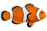
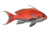
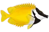
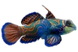
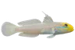

# reeftank-catalog

<!-- species:begin (generated by scripts/make_readme.py, do not edit) -->

> Teil des [**ReefTech-Projekt-Ökosystems**](https://elwinmage.github.io/reeftank/)

       

Fisch-, Korallen-, Pflanzen- und Wirbellosenarten für die Aquariumansicht von [ha-reef-card](https://github.com/Elwinmage/ha-reef-card), bereitgestellt von der [ReefTank-Integration](https://github.com/Elwinmage/ha-reeftank-component).

Die Integration lädt die Releases dieses Repositorys herunter und hält sie aktuell (`update.reeftank_catalog`, standardmäßig automatisch): in Home Assistant ist nichts zu tun.

## Fische (99)

|  | Name | Wissenschaftlicher Name | Wasser | Größe | Verhalten |
|---|---|---|---|---|---|
|  | Anemonenfisch `amphiprion` | *Amphiprion sp.* | Meerwasser | 7–11 cm | Bleibt an Ort und Stelle · schwebt nachts im Wasser |
|  | Angelfish `pterophyllum_scalare` | *Pterophyllum scalare* | Süßwasser | 12–15 cm | Freiwasserschwimmer · versteckt sich nachts |
|  | Atlantic mudskipper `periophthalmus_barbarus` | *Periophthalmus barbarus* | Brackwasser | 10–15 cm | Bodenbewohner · versteckt sich nachts |
|  | Banded archerfish `toxotes_jaculatrix` | *Toxotes jaculatrix* | Brackwasser | 15–25 cm | Freiwasserschwimmer · versteckt sich nachts |
|  | Banded goby `amblygobius_phalaena` | *Amblygobius phalaena* | Meerwasser | 8–10 cm | Lebt auf dem Sand · ruht nachts am Boden |
|  | Banggai-Kardinalbarsch `pterapogon_kauderni` | *Pterapogon kauderni* | Meerwasser | 5–8 cm | Bleibt an Ort und Stelle · schwebt nachts im Wasser |
|  | Bicolor angelfish `centropyge_bicolor` | *Centropyge bicolor* | Meerwasser | 10–15 cm | Bleibt an Ort und Stelle · schwebt nachts im Wasser |
|  | Bicolor blenny `ecsenius_bicolor` | *Ecsenius bicolor* | Meerwasser | 8–10 cm | Bodenbewohner · versteckt sich nachts |
|  | Black skirt tetra `gymnocorymbus_ternetzi` | *Gymnocorymbus ternetzi* | Süßwasser | 5–6 cm | Schwarmfisch · versteckt sich nachts |
|  | Bluestreak cleaner wrasse `labroides_dimidiatus` | *Labroides dimidiatus* | Meerwasser | 10–12 cm | Freiwasserschwimmer · versteckt sich nachts |
|  | Bristlenose pleco `ancistrus` | *Ancistrus sp.* | Süßwasser | 10–14 cm | Bodenbewohner · versteckt sich nachts |
|  | Bronze corydoras `corydoras_aeneus` | *Corydoras aeneus* | Süßwasser | 6–7 cm | Bodenbewohner · versteckt sich nachts |
|  | Bumblebee goby `brachygobius_xanthozonus` | *Brachygobius xanthozonus* | Brackwasser | 3–4 cm | Bodenbewohner · versteckt sich nachts |
|  | Cardinal tetra `paracheirodon_axelrodi` | *Paracheirodon axelrodi* | Süßwasser | 3–5 cm | Schwarmfisch · versteckt sich nachts |
|  | Celestial pearl danio `danio_margaritatus` | *Danio margaritatus* | Süßwasser | 2–3 cm | Schwarmfisch · versteckt sich nachts |
|  | Cherry barb `pethia_titteya` | *Pethia titteya* | Süßwasser | 4–5 cm | Schwarmfisch · versteckt sich nachts |
|  | Citron coral goby `gobiodon_citrinus` | *Gobiodon citrinus* | Meerwasser | 3–5 cm | Bodenbewohner · versteckt sich nachts |
|  | Clown loach `chromobotia_macracanthus` | *Chromobotia macracanthus* | Süßwasser | 15–30 cm | Bodenbewohner · versteckt sich nachts |
|  | Cockatoo dwarf cichlid `apistogramma_cacatuoides` | *Apistogramma cacatuoides* | Süßwasser | 5–9 cm | Bodenbewohner · versteckt sich nachts |
|  | Common molly `poecilia_sphenops` | *Poecilia sphenops* | Süßwasser, Brackwasser | 6–10 cm | Schwarmfisch · versteckt sich nachts |
|  | Copperband butterflyfish `chelmon_rostratus` | *Chelmon rostratus* | Meerwasser | 15–20 cm | Freiwasserschwimmer · versteckt sich nachts |
|  | Demasoni cichlid `pseudotropheus_demasoni` | *Pseudotropheus demasoni* | Süßwasser | 7–8 cm | Freiwasserschwimmer · versteckt sich nachts |
|  | Discus `symphysodon_aequifasciatus` | *Symphysodon aequifasciatus* | Süßwasser | 15–20 cm | Freiwasserschwimmer · versteckt sich nachts |
|  | Dwarf gourami `trichogaster_lalius` | *Trichogaster lalius* | Süßwasser | 5–8 cm | Freiwasserschwimmer · versteckt sich nachts |
|  | Electric yellow cichlid `labidochromis_caeruleus` | *Labidochromis caeruleus* | Süßwasser | 8–10 cm | Freiwasserschwimmer · versteckt sich nachts |
|  | Emperor tetra `nematobrycon_palmeri` | *Nematobrycon palmeri* | Süßwasser | 4–6 cm | Schwarmfisch · versteckt sich nachts |
|  | Endler's livebearer `poecilia_wingei` | *Poecilia wingei* | Süßwasser | 2–4 cm | Schwarmfisch · versteckt sich nachts |
|  | Fahnenbarsch `pseudanthias` | *Pseudanthias sp.* | Meerwasser | 8–14 cm | Schwarmfisch · versteckt sich nachts |
|  | Figure-eight puffer `dichotomyctere_biocellatus` | *Dichotomyctere biocellatus* | Brackwasser | 5–6.5 cm | Freiwasserschwimmer · versteckt sich nachts |
|  | Firefish goby `nemateleotris_magnifica` | *Nemateleotris magnifica* | Meerwasser | 8–10 cm | Bleibt an Ort und Stelle · schwebt nachts im Wasser |
|  | Flame angelfish `centropyge_loricula` | *Centropyge loricula* | Meerwasser | 8–10 cm | Bleibt an Ort und Stelle · schwebt nachts im Wasser |
|  | Fuchsgesicht-Kaninchenfisch `siganus_vulpinus` | *Siganus vulpinus* | Meerwasser | 15–22 cm | Freiwasserschwimmer · ruht nachts am Boden |
|  | Goldfish `carassius_auratus` | *Carassius auratus* | Süßwasser | 10–25 cm | Freiwasserschwimmer · versteckt sich nachts |
|  | Green spotted puffer `dichotomyctere_nigroviridis` | *Dichotomyctere nigroviridis* | Brackwasser | 10–17 cm | Freiwasserschwimmer · versteckt sich nachts |
|  | Green swordtail `xiphophorus_hellerii` | *Xiphophorus hellerii* | Süßwasser | 6–12 cm | Schwarmfisch · versteckt sich nachts |
|  | Grünes Schwalbenschwänzchen `chromis_viridis` | *Chromis viridis* | Meerwasser | 5–8 cm | Schwarmfisch · versteckt sich nachts |
|  | Guppy `poecilia_reticulata` | *Poecilia reticulata* | Süßwasser | 3–6 cm | Schwarmfisch · versteckt sich nachts |
|  | Harlequin rasbora `trigonostigma_heteromorpha` | *Trigonostigma heteromorpha* | Süßwasser | 3–4.5 cm | Schwarmfisch · versteckt sich nachts |
|  | Imperator-Kaiserfisch (adult) `pomacanthus_imperator_adult` | *Pomacanthus imperator* | Meerwasser | 25–38 cm | Freiwasserschwimmer · versteckt sich nachts |
|  | Imperator-Kaiserfisch (Jungtier) `pomacanthus_imperator` | *Pomacanthus imperator* | Meerwasser | 6–12 cm | Freiwasserschwimmer · versteckt sich nachts |
|  | Knight goby `stigmatogobius_sadanundio` | *Stigmatogobius sadanundio* | Brackwasser | 6–8 cm | Bodenbewohner · versteckt sich nachts |
|  | Kole tang `ctenochaetus_strigosus` | *Ctenochaetus strigosus* | Meerwasser | 12–18 cm | Freiwasserschwimmer · versteckt sich nachts |
|  | Kribensis `pelvicachromis_pulcher` | *Pelvicachromis pulcher* | Süßwasser | 8–10 cm | Bodenbewohner · versteckt sich nachts |
|  | Kuhli loach `pangio_kuhlii` | *Pangio kuhlii* | Süßwasser | 8–12 cm | Bodenbewohner · versteckt sich nachts |
|  | Lawnmower blenny `salarias_fasciatus` | *Salarias fasciatus* | Meerwasser | 12–14 cm | Bodenbewohner · versteckt sich nachts |
|  | Lemon tetra `hyphessobrycon_pulchripinnis` | *Hyphessobrycon pulchripinnis* | Süßwasser | 3–4.5 cm | Schwarmfisch · versteckt sich nachts |
|  | Lined seahorse `hippocampus_erectus` | *Hippocampus erectus* | Meerwasser | 10–15 cm | Bleibt an Ort und Stelle · schwebt nachts im Wasser |
|  | Lyretail killifish `aphyosemion_australe` | *Aphyosemion australe* | Süßwasser | 5–6 cm | Bleibt an Ort und Stelle · schwebt nachts im Wasser |
|  | Mandarinfisch `synchiropus_splendidus` | *Synchiropus splendidus* | Meerwasser | 5–8 cm | Bodenbewohner · versteckt sich nachts |
|  | Marbled hatchetfish `carnegiella_strigata` | *Carnegiella strigata* | Süßwasser | 4–5 cm | Schwarmfisch · versteckt sich nachts |
|  | Maroon clownfish `premnas_biaculeatus` | *Premnas biaculeatus* | Meerwasser | 10–15 cm | Bleibt an Ort und Stelle · schwebt nachts im Wasser |
|  | Neon goby `elacatinus_oceanops` | *Elacatinus oceanops* | Meerwasser | 4–6 cm | Bodenbewohner · versteckt sich nachts |
|  | Neon tetra `paracheirodon_innesi` | *Paracheirodon innesi* | Süßwasser | 3–4 cm | Schwarmfisch · versteckt sich nachts |
|  | Orchid dottyback `pseudochromis_fridmani` | *Pseudochromis fridmani* | Meerwasser | 6–7 cm | Bleibt an Ort und Stelle · bleibt nahe seinem Unterschlupf · schwebt nachts im Wasser |
|  | Oscar `astronotus_ocellatus` | *Astronotus ocellatus* | Süßwasser | 25–35 cm | Freiwasserschwimmer · versteckt sich nachts |
|  | Otocinclus `otocinclus_affinis` | *Otocinclus affinis* | Süßwasser | 3–5 cm | Bodenbewohner · versteckt sich nachts |
|  | Pajama cardinalfish `sphaeramia_nematoptera` | *Sphaeramia nematoptera* | Meerwasser | 8–10 cm | Bleibt an Ort und Stelle · schwebt nachts im Wasser |
|  | Panda corydoras `corydoras_panda` | *Corydoras panda* | Süßwasser | 4–5 cm | Bodenbewohner · versteckt sich nachts |
|  | Pearl danio `danio_albolineatus` | *Danio albolineatus* | Süßwasser | 4–6 cm | Schwarmfisch · versteckt sich nachts |
|  | Pearl gourami `trichopodus_leerii` | *Trichopodus leerii* | Süßwasser | 10–12 cm | Freiwasserschwimmer · versteckt sich nachts |
|  | Picasso triggerfish `rhinecanthus_aculeatus` | *Rhinecanthus aculeatus* | Meerwasser | 20–25 cm | Freiwasserschwimmer · versteckt sich nachts |
|  | Pixy hawkfish `cirrhitichthys_oxycephalus` | *Cirrhitichthys oxycephalus* | Meerwasser | 8–10 cm | Bodenbewohner · versteckt sich nachts |
|  | Powder blue tang `acanthurus_leucosternon` | *Acanthurus leucosternon* | Meerwasser | 20–23 cm | Freiwasserschwimmer · versteckt sich nachts |
|  | Purple firefish `nemateleotris_decora` | *Nemateleotris decora* | Meerwasser | 8–10 cm | Bleibt an Ort und Stelle · schwebt nachts im Wasser |
|  | Ram cichlid `mikrogeophagus_ramirezi` | *Mikrogeophagus ramirezi* | Süßwasser | 5–7 cm | Bleibt an Ort und Stelle · schwebt nachts im Wasser |
|  | Red lionfish `pterois_volitans` | *Pterois volitans* | Meerwasser | 25–35 cm | Freiwasserschwimmer · versteckt sich nachts |
|  | Regal angelfish `pygoplites_diacanthus` | *Pygoplites diacanthus* | Meerwasser | 20–25 cm | Freiwasserschwimmer · versteckt sich nachts |
|  | Regal blue tang `paracanthurus_hepatus` | *Paracanthurus hepatus* | Meerwasser | 20–30 cm | Freiwasserschwimmer · versteckt sich nachts |
|  | Royal gramma `gramma_loreto` | *Gramma loreto* | Meerwasser | 7–8 cm | Bleibt an Ort und Stelle · schwebt nachts im Wasser |
|  | Rummy-nose tetra `hemigrammus_bleheri` | *Hemigrammus bleheri* | Süßwasser | 4–5 cm | Schwarmfisch · versteckt sich nachts |
|  | Sailfin molly `poecilia_velifera` | *Poecilia velifera* | Brackwasser, Süßwasser | 10–15 cm | Schwarmfisch · versteckt sich nachts |
|  | Sailfin tang `zebrasoma_veliferum` | *Zebrasoma veliferum* | Meerwasser | 25–40 cm | Freiwasserschwimmer · versteckt sich nachts |
|  | Schläfergrundel `valenciennea` | *Valenciennea sp.* | Meerwasser | 10–16 cm | Lebt auf dem Sand · lebt in einer Höhle im Sand · ruht nachts am Boden |
|  | Scopas tang `zebrasoma_scopas` | *Zebrasoma scopas* | Meerwasser | 15–20 cm | Freiwasserschwimmer · versteckt sich nachts |
|  | Serpae tetra `hyphessobrycon_eques` | *Hyphessobrycon eques* | Süßwasser | 3–4.5 cm | Schwarmfisch · versteckt sich nachts |
|  | Siamese algae eater `crossocheilus_oblongus` | *Crossocheilus oblongus* | Süßwasser | 10–15 cm | Freiwasserschwimmer · versteckt sich nachts |
|  | Siamese fighting fish `betta_splendens` | *Betta splendens* | Süßwasser | 5–7 cm | Bleibt an Ort und Stelle · bleibt nahe seinem Unterschlupf · schwebt nachts im Wasser |
|  | Silver moony `monodactylus_argenteus` | *Monodactylus argenteus* | Brackwasser, Meerwasser | 15–25 cm | Schwarmfisch · versteckt sich nachts |
|  | Six line wrasse `pseudocheilinus_hexataenia` | *Pseudocheilinus hexataenia* | Meerwasser | 7–10 cm | Freiwasserschwimmer · versteckt sich nachts |
|  | Solor fairy wrasse `cirrhilabrus_solorensis` | *Cirrhilabrus solorensis* | Meerwasser | 10–12 cm | Freiwasserschwimmer · versteckt sich nachts |
|  | Southern platyfish `xiphophorus_maculatus` | *Xiphophorus maculatus* | Süßwasser | 4–6 cm | Schwarmfisch · versteckt sich nachts |
|  | Spotted mandarin `synchiropus_picturatus` | *Synchiropus picturatus* | Meerwasser | 6–8 cm | Bodenbewohner · versteckt sich nachts |
|  | Spotted scat `scatophagus_argus` | *Scatophagus argus* | Brackwasser, Meerwasser | 15–30 cm | Freiwasserschwimmer · versteckt sich nachts |
|  | Three-spot gourami `trichopodus_trichopterus` | *Trichopodus trichopterus* | Süßwasser | 10–15 cm | Freiwasserschwimmer · versteckt sich nachts |
|  | Threespot dascyllus `dascyllus_trimaculatus` | *Dascyllus trimaculatus* | Meerwasser | 10–14 cm | Bleibt an Ort und Stelle · schwebt nachts im Wasser |
|  | Tiger barb `puntigrus_tetrazona` | *Puntigrus tetrazona* | Süßwasser | 5–7 cm | Schwarmfisch · versteckt sich nachts |
|  | Turquoise rainbowfish `melanotaenia_lacustris` | *Melanotaenia lacustris* | Süßwasser | 8–12 cm | Schwarmfisch · versteckt sich nachts |
|  | Valentini puffer `canthigaster_valentini` | *Canthigaster valentini* | Meerwasser | 8–10 cm | Freiwasserschwimmer · versteckt sich nachts |
|  | Violet goby `gobioides_broussonnetii` | *Gobioides broussonnetii* | Brackwasser | 30–50 cm | Lebt auf dem Sand · lebt in einer Höhle im Sand · ruht nachts am Boden |
|  | White cloud mountain minnow `tanichthys_albonubes` | *Tanichthys albonubes* | Süßwasser | 3–4 cm | Schwarmfisch · versteckt sich nachts |
|  | Yasha goby `stonogobiops_yasha` | *Stonogobiops yasha* | Meerwasser | 6–8 cm | Lebt auf dem Sand · lebt in einer Höhle im Sand · ruht nachts am Boden |
|  | Yellow coris wrasse `halichoeres_chrysus` | *Halichoeres chrysus* | Meerwasser | 10–12 cm | Freiwasserschwimmer · ruht nachts am Boden |
|  | Yellow tang `zebrasoma_flavescens` | *Zebrasoma flavescens* | Meerwasser | 15–20 cm | Freiwasserschwimmer · versteckt sich nachts |
|  | Yellow-striped cardinalfish `ostorhinchus_cyanosoma` | *Ostorhinchus cyanosoma* | Meerwasser | 7–8 cm | Bleibt an Ort und Stelle · schwebt nachts im Wasser |
|  | Yellowhead jawfish `opistognathus_aurifrons` | *Opistognathus aurifrons* | Meerwasser | 10–12 cm | Lebt auf dem Sand · lebt in einer Höhle im Sand · ruht nachts am Boden |
|  | Yellowtail blue damselfish `chrysiptera_parasema` | *Chrysiptera parasema* | Meerwasser | 5–6 cm | Bleibt an Ort und Stelle · bleibt nahe seinem Unterschlupf · schwebt nachts im Wasser |
|  | Zebra lionfish `dendrochirus_zebra` | *Dendrochirus zebra* | Meerwasser | 12–18 cm | Freiwasserschwimmer · versteckt sich nachts |
|  | Zebra pleco `hypancistrus_zebra` | *Hypancistrus zebra* | Süßwasser | 7–10 cm | Bodenbewohner · versteckt sich nachts |
|  | Zebrafish `danio_rerio` | *Danio rerio* | Süßwasser | 4–5 cm | Schwarmfisch · versteckt sich nachts |

## Korallen (1)

|  | Name | Wissenschaftlicher Name | Wasser | Größe |
|---|---|---|---|---|
|  | Fackelkoralle `euphyllia_glabrescens` | *Euphyllia glabrescens* | Meerwasser | 10–30 cm |

## Pflanzen (29)

|  | Name | Wissenschaftlicher Name | Wasser | Größe | Zone |
|---|---|---|---|---|---|
|  | Amazon frogbit `limnobium_laevigatum` | *Limnobium laevigatum* | Süßwasser | 5–10 cm | Schwimmpflanze |
|  | Amazon sword `echinodorus_bleheri` | *Echinodorus bleheri* | Süßwasser | 30–50 cm | Mittelgrund |
|  | Ambulia `limnophila_sessiliflora` | *Limnophila sessiliflora* | Süßwasser | 20–40 cm | Hintergrund |
|  | Anubias `anubias_barteri` | *Anubias barteri* | Süßwasser | 10–25 cm | Aufsitzerpflanze |
|  | Brazilian waterweed `egeria_densa` | *Egeria densa* | Süßwasser | 30–100 cm | Hintergrund |
|  | Bucephalandra `bucephalandra` | *Bucephalandra sp.* | Süßwasser | 5–15 cm | Aufsitzerpflanze |
|  | Carolina fanwort `cabomba_caroliniana` | *Cabomba caroliniana* | Süßwasser | 30–60 cm | Hintergrund |
|  | Caulerpa `caulerpa_prolifera` | *Caulerpa prolifera* | Meerwasser | 5–20 cm | Vordergrund |
|  | Chaeto `chaetomorpha_linum` | *Chaetomorpha linum* | Meerwasser | 5–30 cm | Vordergrund |
|  | Ciliated cryptocoryne `cryptocoryne_ciliata` | *Cryptocoryne ciliata* | Brackwasser, Süßwasser | 20–40 cm | Mittelgrund |
|  | Creeping primrose willow `ludwigia_repens` | *Ludwigia repens* | Süßwasser | 20–40 cm | Mittelgrund |
|  | Duckweed `lemna_minor` | *Lemna minor* | Süßwasser | 0.5–1 cm | Schwimmpflanze |
|  | Dwarf baby tears `hemianthus_callitrichoides` | *Hemianthus callitrichoides* | Süßwasser | 2–5 cm | Vordergrund |
|  | Dwarf cryptocoryne `cryptocoryne_parva` | *Cryptocoryne parva* | Süßwasser | 5–8 cm | Vordergrund |
|  | Dwarf hairgrass `eleocharis_parvula` | *Eleocharis parvula* | Süßwasser | 5–10 cm | Vordergrund |
|  | Dwarf sagittaria `sagittaria_subulata` | *Sagittaria subulata* | Süßwasser | 10–30 cm | Vordergrund |
|  | Eelgrass `vallisneria_spiralis` | *Vallisneria spiralis* | Süßwasser, Brackwasser | 30–60 cm | Hintergrund |
|  | Halimeda `halimeda_opuntia` | *Halimeda opuntia* | Meerwasser | 5–15 cm | Vordergrund |
|  | Indian swampweed `hygrophila_polysperma` | *Hygrophila polysperma* | Süßwasser | 20–50 cm | Hintergrund |
|  | Java fern `microsorum_pteropus` | *Microsorum pteropus* | Süßwasser | 20–30 cm | Aufsitzerpflanze |
|  | Java moss `vesicularia_dubyana` | *Vesicularia dubyana* | Süßwasser | 3–5 cm | Aufsitzerpflanze |
|  | Marimo moss ball `aegagropila_linnaei` | *Aegagropila linnaei* | Süßwasser | 3–10 cm | Vordergrund |
|  | Mud mudwort `glossostigma_elatinoides` | *Glossostigma elatinoides* | Süßwasser | 2–5 cm | Vordergrund |
|  | Red mangrove `rhizophora_mangle` | *Rhizophora mangle* | Brackwasser, Meerwasser | 30–100 cm | Mittelgrund |
|  | Roundleaf toothcup `rotala_rotundifolia` | *Rotala rotundifolia* | Süßwasser | 20–50 cm | Hintergrund |
|  | Staurogyne `staurogyne_repens` | *Staurogyne repens* | Süßwasser | 5–10 cm | Vordergrund |
|  | Turtle grass `thalassia_testudinum` | *Thalassia testudinum* | Meerwasser | 10–30 cm | Vordergrund |
|  | Water lettuce `pistia_stratiotes` | *Pistia stratiotes* | Süßwasser | 5–15 cm | Schwimmpflanze |
|  | Wendt's cryptocoryne `cryptocoryne_wendtii` | *Cryptocoryne wendtii* | Süßwasser | 10–20 cm | Mittelgrund |

## Wirbellose (32)

|  | Name | Wissenschaftlicher Name | Wasser | Größe | Rolle |
|---|---|---|---|---|---|
|  | Amano shrimp `caridina_multidentata` | *Caridina multidentata* | Süßwasser | 3–5 cm | Algenfresser · läuft am Boden |
|  | Assassin snail `clea_helena` | *Clea helena* | Süßwasser | 2–3 cm | Räuber · läuft am Boden |
|  | Astraea snail `astraea_tecta` | *Astraea tecta* | Meerwasser | 2–4 cm | Algenfresser · lebt auf dem Dekor |
|  | Bamboo shrimp `atyopsis_moluccensis` | *Atyopsis moluccensis* | Süßwasser | 6–8 cm | Filtrierer · lebt auf dem Dekor |
|  | Banded coral shrimp `stenopus_hispidus` | *Stenopus hispidus* | Meerwasser | 6–8 cm | Putzer · lebt auf dem Dekor |
|  | Blue-legged hermit crab `clibanarius_tricolor` | *Clibanarius tricolor* | Meerwasser | 2–3 cm | Aasfresser · läuft am Boden |
|  | Boring giant clam `tridacna_crocea` | *Tridacna crocea* | Meerwasser | 5–15 cm | Filtrierer · festsitzend |
|  | Cerith snail `cerithium` | *Cerithium sp.* | Meerwasser | 2–3 cm | Detritusfresser · läuft am Boden |
|  | Cherry shrimp `neocaridina_davidi` | *Neocaridina davidi* | Süßwasser | 2–3.5 cm | Detritusfresser · läuft am Boden |
|  | Christmas tree worm `spirobranchus_giganteus` | *Spirobranchus giganteus* | Meerwasser | 3–5 cm | Filtrierer · festsitzend |
|  | Collector urchin `tripneustes_gratilla` | *Tripneustes gratilla* | Meerwasser | 10–15 cm | Algenfresser · lebt auf dem Dekor |
|  | Crystal red shrimp `caridina_cantonensis` | *Caridina cantonensis* | Süßwasser | 2–3 cm | Detritusfresser · läuft am Boden |
|  | Emerald crab `mithraculus_sculptus` | *Mithraculus sculptus* | Meerwasser | 3–4 cm | Algenfresser · lebt auf dem Dekor |
|  | Feather duster worm `sabellastarte` | *Sabellastarte sp.* | Meerwasser | 5–10 cm | Filtrierer · festsitzend |
|  | Fire shrimp `lysmata_debelius` | *Lysmata debelius* | Meerwasser | 5–6 cm | Putzer · lebt auf dem Dekor |
|  | Harlequin shrimp `hymenocera_picta` | *Hymenocera picta* | Meerwasser | 4–6 cm | Räuber · läuft am Boden |
|  | Malaysian trumpet snail `melanoides_tuberculata` | *Melanoides tuberculata* | Süßwasser | 2–3 cm | Detritusfresser · läuft am Boden |
|  | Marbled shrimp `saron_marmoratus` | *Saron marmoratus* | Meerwasser | 5–7 cm | Aasfresser · lebt auf dem Dekor |
|  | Marine nerite `nerita` | *Nerita sp.* | Meerwasser | 2–3 cm | Algenfresser · klettert an der Scheibe |
|  | Mystery snail `pomacea_bridgesii` | *Pomacea bridgesii* | Süßwasser | 4–5 cm | Aasfresser · läuft am Boden |
|  | Nassarius snail `nassarius` | *Nassarius sp.* | Meerwasser | 2–4 cm | Aasfresser · läuft am Boden |
|  | Pencil urchin `prionocidaris_baculosa` | *Prionocidaris baculosa* | Meerwasser | 8–10 cm | Algenfresser · lebt auf dem Dekor |
|  | Peppermint shrimp `lysmata_wurdemanni` | *Lysmata wurdemanni* | Meerwasser | 3–5 cm | Putzer · lebt auf dem Dekor |
|  | Ramshorn snail `planorbella_duryi` | *Planorbella duryi* | Süßwasser | 2–3 cm | Detritusfresser · klettert an der Scheibe |
|  | Sand-sifting starfish `archaster_typicus` | *Archaster typicus* | Meerwasser | 6–10 cm | Detritusfresser · läuft am Boden |
|  | Scarlet cleaner shrimp `lysmata_amboinensis` | *Lysmata amboinensis* | Meerwasser | 5–6 cm | Putzer · lebt auf dem Dekor |
|  | Scarlet reef hermit `paguristes_cadenati` | *Paguristes cadenati* | Meerwasser | 3–4 cm | Aasfresser · läuft am Boden |
|  | Sea cucumber `holothuria` | *Holothuria sp.* | Meerwasser | 15–30 cm | Detritusfresser · läuft am Boden |
|  | Serpent star `ophiolepis_superba` | *Ophiolepis superba* | Meerwasser | 8–12 cm | Aasfresser · läuft am Boden |
|  | Trochus snail `tectus_fenestratus` | *Tectus fenestratus* | Meerwasser | 4–6 cm | Algenfresser · lebt auf dem Dekor |
|  | Turbo snail `turbo_fluctuosus` | *Turbo fluctuosus* | Meerwasser | 4–8 cm | Algenfresser · klettert an der Scheibe |
|  | Zebra nerite `neritina_natalensis` | *Neritina natalensis* | Süßwasser | 2–3 cm | Algenfresser · klettert an der Scheibe |

Zum Hinzufügen einer Art (Erzeugen der Clips, Build, Veröffentlichung) siehe die [englische Dokumentation](README.md).

Die Art-Ressourcen stehen unter **CC BY 4.0**, die Skripte unter MIT: siehe [LICENSE.md](LICENSE.md).

<!-- species:end -->

<!-- ecosystem:start -->

## Verwandte Projekte

Die ReefTech-Projekte greifen ineinander: die Integrationen bringen Ihre Geräte in Home Assistant, die Karte zeigt und steuert sie, und das Backup hält sie bei einem Stromausfall am Laufen. Jedes funktioniert auch für sich allein.

<table>
  <tr>
    <th width="100px"></th>
    <th>Projekt</th>
    <th>Funktion</th>
    <th>Arbeitet mit</th>
  </tr>
  <tr>
    <td></td>
    <td>🐠 <a href="https://github.com/Elwinmage/ha-reefbeat-component"><b>ha-reefbeat-component</b></a></td>
    <td>Red Sea ReefBeat-Geräte, lokal gesteuert ohne Cloud: ReefATO+, ReefControl, ReefControl-Power, ReefDose, ReefLed, ReefMat, ReefRun und ReefWave. Alarm-Blueprint für abweichende Modi, Kalibrierungen und niedrigen Akkustand. </td>
    <td>ha-reef-card</td>
  </tr>
  <tr>
    <td></td>
    <td>🌊 <a href="https://github.com/Elwinmage/ha-aquamedic-component"><b>ha-aquamedic-component</b></a></td>
    <td>Aqua Medic-Pumpen über die Gizwits-Cloud-API: EcoDrift- und SmartDrift-Strömungspumpen, DC Runner Rückförder- und Abschäumerpumpen.</td>
    <td>ha-reef-card</td>
  </tr>
  <tr>
    <td></td>
    <td>🐟 <a href="https://github.com/Elwinmage/ha-vson-component"><b>ha-vson-component</b></a></td>
    <td>VSON-Futterautomaten über die VSON-Cloud-API: der WP8621 (Füttern, Akku, Warnung bei wenig Futter) und generische Erkennung jedes anderen VSON-Geräts. Der WP8621 kann auch vollständig lokal mit ESPHome laufen.</td>
    <td>ha-reef-card</td>
  </tr>
  <tr>
    <td></td>
    <td>🐙 <a href="https://github.com/Elwinmage/ha-reef-maintenance-component"><b>ha-reef-maintenance-component</b></a></td>
    <td>Reinigungs- und Verschleißverfolgung für Geräte, die Home Assistant nicht erreicht: Strömungspumpen, Rückförderpumpen, Abschäumer, Reaktoren, alles was von Hand gewartet wird.</td>
    <td>ha-reef-card</td>
  </tr>
  <tr>
    <td></td>
    <td>🪸 <a href="https://github.com/Elwinmage/ha-reef-card"><b>ha-reef-card</b></a></td>
    <td>Interaktive grafische Ansicht jedes Geräts auf Ihrem Dashboard und der einzige Weg, erweiterte Zeitpläne zu bearbeiten. Liest die vier Integrationen über den gemeinsamen <code>reef_role</code>-Vertrag, ohne Konfiguration auf Kartenseite. Zeichnet außerdem die Energieflüsse von reefbeatEnergyBackup. Ihre Aquariumkarte erweckt Ihr Becken mit ha-reeftank-component zum Leben.</td>
    <td>alle vier Integrationen und ha-reeftank-component für das Aquarium</td>
  </tr>
  <tr>
    <td></td>
    <td>🐟 <a href="https://github.com/Elwinmage/ha-reeftank-component"><b>ha-reeftank-component</b></a></td>
    <td>Ein lebendiges Bild Ihres Beckens auf dem Dashboard: Ihr Foto, beleuchtet von Ihren echten Lampen, mit animierten Fischen und Korallen und Ihren Geräten und Entitäten darauf. Speichert die Aquarien und ihren Besatz, protokolliert die Fütterungen.</td>
    <td>ha-reef-card</td>
  </tr>
  <tr>
    <td></td>
    <td>🐡 <b>reeftank-catalog</b> <i>(dieses Repository)</i></td>
    <td>Fische, Korallen und Texturen der Aquariumkarte, von ha-reeftank-component heruntergeladen und aktuell gehalten.</td>
    <td>ha-reeftank-component</td>
  </tr>
  <tr>
    <td></td>
    <td>🐬 <a href="https://github.com/Elwinmage/ha-reef-blueprints"><b>ha-reef-blueprints</b></a></td>
    <td>Automatisierungs-Blueprints für das gesamte Ökosystem: überfällige Wartungen, über den <code>reef_role</code>-Vertrag gefunden, nicht mehr erreichbare Geräte, ein regelmäßiger Heizertest und eine Relaisüberwachung. Acht Sprachen.</td>
    <td>alle vier Integrationen</td>
  </tr>
  <tr>
    <td></td>
    <td>⚡ <a href="https://github.com/Elwinmage/reefbeatEnergyBackup"><b>reefbeatEnergyBackup</b></a></td>
    <td>Batterie-Backup bei Stromausfall. Ein 24V LiFePO₄-Pack, gesteuert von einem Raspberry Pi, mit schrittweiser Reduzierung der Pumpendrehzahl je nach Ladezustand.</td>
    <td>eigenständig oder zusammen mit ha-reefbeat-component und ha-reef-card</td>
  </tr>
</table>

Alle zusammen sind auf der [ReefTech-Projektseite](https://elwinmage.github.io/reeftank/) dokumentiert.

<!-- ecosystem:end -->
