# reeftank-catalog

<!-- species:begin (generated by scripts/make_readme.py, do not edit) -->

> Teil des [**ReefTech-Projekt-Ökosystems**](https://elwinmage.github.io/reeftank/)

       

Fisch-, Korallen-, Pflanzen- und Wirbellosenarten für die Aquariumansicht von [ha-reef-card](https://github.com/Elwinmage/ha-reef-card), bereitgestellt von der [ReefTank-Integration](https://github.com/Elwinmage/ha-reeftank-component).

Die Integration lädt die Releases dieses Repositorys herunter und hält sie aktuell (`update.reeftank_catalog`, standardmäßig automatisch): in Home Assistant ist nichts zu tun.

## So funktioniert es

Jeder Fisch besteht aus einem Bilderbogen (ein WebP-Atlas) und einem Deskriptor mit seinen Clips: *schwimmen*, *ruhen* und *wenden*. Die Karte spielt sie nacheinander ab und spiegelt die Wende, damit der Fisch auf demselben Weg zurückkehrt. Hier das Schwimmen, die Wende und die Rückwende zweier Arten:

Eine Art ohne Videos erhält einen einfacheren Atlas aus einem einzigen Foto (*LD*): Der ganze Körper biegt sich, die Flossen bewegen sich nicht. Die aus Videos erstellten sind in der Spalte HD der Tabellen unten abgehakt.

<table><tr><th></th><th>Kaiser-Kaiserfisch</th><th>Clownfisch</th></tr><tr><td>HD (Videos)</td><td align="center"></td><td align="center"></td></tr><tr><td>LD (ein Foto)</td><td align="center"></td><td align="center"></td></tr></table>

## Fische (102)

**HD**: eine echte Animation aus Videos. Die anderen haben eine einfache Animation aus einem Foto oder den generischen Fisch.

| &nbsp;&nbsp;&nbsp;&nbsp;&nbsp;&nbsp;&nbsp;&nbsp;&nbsp;&nbsp;&nbsp;&nbsp;&nbsp;&nbsp;&nbsp;&nbsp;&nbsp;&nbsp;&nbsp;&nbsp;&nbsp;&nbsp;&nbsp;&nbsp;&nbsp;&nbsp;&nbsp;&nbsp;&nbsp;&nbsp;&nbsp;&nbsp;&nbsp; | Name | Wissenschaftlicher Name | Wasser | Größe | Verhalten | HD |
|---|---|---|---|---|---|---|
|  | Achter-Kugelfisch <code>dichotomyctere&#95;<wbr>biocellatus</code> | *Dichotomyctere biocellatus* | Brackwasser | 5–6.5 cm | Freiwasserschwimmer · versteckt sich nachts | ✔ |
|  | Anemonenfisch <code>amphiprion</code> | *Amphiprion sp.* | Meerwasser | 7–11 cm | Bleibt an Ort und Stelle · schwebt nachts im Wasser | ✔ |
|  | Antennenwels <code>ancistrus</code> | *Ancistrus sp.* | Süßwasser | 10–14 cm | Bodenbewohner · versteckt sich nachts | ✔ |
|  | Argusfisch <code>scatophagus&#95;<wbr>argus</code> | *Scatophagus argus* | Brackwasser, Meerwasser | 15–30 cm | Freiwasserschwimmer · versteckt sich nachts | ✔ |
|  | Atlantischer Schlammspringer <code>periophthalmus&#95;<wbr>barbarus</code> | *Periophthalmus barbarus* | Brackwasser | 10–15 cm | Bodenbewohner · versteckt sich nachts | ✔ |
|  | Banggai-Kardinalbarsch <code>pterapogon&#95;<wbr>kauderni</code> | *Pterapogon kauderni* | Meerwasser | 5–8 cm | Bleibt an Ort und Stelle · schwebt nachts im Wasser | ✔ |
|  | Blauer Fadenfisch <code>trichopodus&#95;<wbr>trichopterus</code> | *Trichopodus trichopterus* | Süßwasser | 10–15 cm | Freiwasserschwimmer · versteckt sich nachts | ✔ |
|  | Blauer Putzerfisch <code>labroides&#95;<wbr>dimidiatus</code> | *Labroides dimidiatus* | Meerwasser | 10–12 cm | Freiwasserschwimmer · versteckt sich nachts | ✔ |
|  | Brauner Segelflossen-Doktorfisch <code>zebrasoma&#95;<wbr>scopas</code> | *Zebrasoma scopas* | Meerwasser | 15–20 cm | Freiwasserschwimmer · versteckt sich nachts | ✔ |
|  | Bronzepanzerwels <code>corydoras&#95;<wbr>aeneus</code> | *Corydoras aeneus* | Süßwasser | 6–7 cm | Bodenbewohner · versteckt sich nachts | ✔ |
|  | Clownschmerle <code>chromobotia&#95;<wbr>macracanthus</code> | *Chromobotia macracanthus* | Süßwasser | 15–30 cm | Bodenbewohner · versteckt sich nachts | ✔ |
|  | Demasons Buntbarsch <code>pseudotropheus&#95;<wbr>demasoni</code> | *Pseudotropheus demasoni* | Süßwasser | 7–8 cm | Freiwasserschwimmer · versteckt sich nachts | ✔ |
|  | Diadem-Kaiserfisch <code>pygoplites&#95;<wbr>diacanthus</code> | *Pygoplites diacanthus* | Meerwasser | 20–25 cm | Freiwasserschwimmer · versteckt sich nachts | ✔ |
|  | Diskus <code>symphysodon&#95;<wbr>aequifasciatus</code> | *Symphysodon aequifasciatus* | Süßwasser | 15–20 cm | Freiwasserschwimmer · versteckt sich nachts | ✔ |
|  | Dreifleck-Preußenfisch <code>dascyllus&#95;<wbr>trimaculatus</code> | *Dascyllus trimaculatus* | Meerwasser | 10–14 cm | Bleibt an Ort und Stelle · schwebt nachts im Wasser | ✔ |
|  | Endler-Guppy <code>poecilia&#95;<wbr>wingei</code> | *Poecilia wingei* | Süßwasser | 2–4 cm | Schwarmfisch · versteckt sich nachts | ✔ |
| 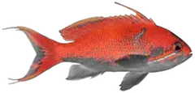 | Fahnenbarsch <code>pseudanthias</code> | *Pseudanthias sp.* | Meerwasser | 8–14 cm | Schwarmfisch · versteckt sich nachts | ✔ |
|  | Feuer-Schwertgrundel <code>nemateleotris&#95;<wbr>magnifica</code> | *Nemateleotris magnifica* | Meerwasser | 8–10 cm | Bleibt an Ort und Stelle · schwebt nachts im Wasser | ✔ |
|  | Fidschi-Riffbarsch <code>chrysiptera&#95;<wbr>taupou</code> | *Chrysiptera taupou* | Meerwasser | 6–8 cm | Bleibt an Ort und Stelle · bleibt nahe seinem Unterschlupf · schwebt nachts im Wasser | ✔ |
|  | Flammen-Zwergkaiserfisch <code>centropyge&#95;<wbr>loricula</code> | *Centropyge loricula* | Meerwasser | 8–10 cm | Bleibt an Ort und Stelle · schwebt nachts im Wasser | ✔ |
|  | Fuchsgesicht-Kaninchenfisch <code>siganus&#95;<wbr>vulpinus</code> | *Siganus vulpinus* | Meerwasser | 15–22 cm | Freiwasserschwimmer · ruht nachts am Boden | ✔ |
|  | Gebänderte Grundel <code>amblygobius&#95;<wbr>phalaena</code> | *Amblygobius phalaena* | Meerwasser | 8–10 cm | Lebt auf dem Sand · ruht nachts am Boden | ✔ |
|  | Gelbe Symbiosegrundel <code>cryptocentrus&#95;<wbr>cinctus</code> | *Cryptocentrus cinctus* | Meerwasser | 8–10 cm | Lebt auf dem Sand · lebt in einer Höhle im Sand · ruht nachts am Boden | ✔ |
|  | Gelber Junker <code>halichoeres&#95;<wbr>chrysus</code> | *Halichoeres chrysus* | Meerwasser | 10–12 cm | Freiwasserschwimmer · ruht nachts am Boden | ✔ |
|  | Gelber Labidochromis <code>labidochromis&#95;<wbr>caeruleus</code> | *Labidochromis caeruleus* | Süßwasser | 8–10 cm | Freiwasserschwimmer · versteckt sich nachts | ✔ |
|  | Gelbkopf-Kieferfisch <code>opistognathus&#95;<wbr>aurifrons</code> | *Opistognathus aurifrons* | Meerwasser | 10–12 cm | Lebt auf dem Sand · lebt in einer Höhle im Sand · ruht nachts am Boden | ✔ |
|  | Gelbschwanz-Riffbarsch <code>chrysiptera&#95;<wbr>parasema</code> | *Chrysiptera parasema* | Meerwasser | 5–6 cm | Bleibt an Ort und Stelle · bleibt nahe seinem Unterschlupf · schwebt nachts im Wasser | ✔ |
|  | Gelbsegel-Doktorfisch <code>zebrasoma&#95;<wbr>flavescens</code> | *Zebrasoma flavescens* | Meerwasser | 15–20 cm | Freiwasserschwimmer · versteckt sich nachts | ✔ |
|  | Gelbstreifen-Kardinalbarsch <code>ostorhinchus&#95;<wbr>cyanosoma</code> | *Ostorhinchus cyanosoma* | Meerwasser | 7–8 cm | Bleibt an Ort und Stelle · schwebt nachts im Wasser | ✔ |
| 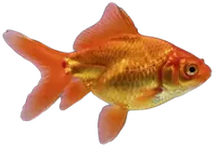 | Goldfisch <code>carassius&#95;<wbr>auratus</code> | *Carassius auratus* | Süßwasser | 10–25 cm | Freiwasserschwimmer · versteckt sich nachts | ✔ |
|  | Grüner Kugelfisch <code>dichotomyctere&#95;<wbr>nigroviridis</code> | *Dichotomyctere nigroviridis* | Brackwasser | 10–17 cm | Freiwasserschwimmer · versteckt sich nachts | ✔ |
|  | Grünes Schwalbenschwänzchen <code>chromis&#95;<wbr>viridis</code> | *Chromis viridis* | Meerwasser | 5–8 cm | Schwarmfisch · versteckt sich nachts | ✔ |
|  | Guppy <code>poecilia&#95;<wbr>reticulata</code> | *Poecilia reticulata* | Süßwasser | 3–6 cm | Schwarmfisch · versteckt sich nachts | ✔ |
|  | Hummelgrundel <code>brachygobius&#95;<wbr>xanthozonus</code> | *Brachygobius xanthozonus* | Brackwasser | 3–4 cm | Bodenbewohner · versteckt sich nachts | ✔ |
|  | Imperator-Kaiserfisch (adult) <code>pomacanthus&#95;<wbr>imperator&#95;<wbr>adult</code> | *Pomacanthus imperator* | Meerwasser | 25–38 cm | Freiwasserschwimmer · versteckt sich nachts | ✔ |
| 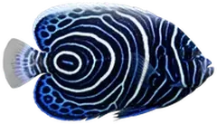 | Imperator-Kaiserfisch (Jungtier) <code>pomacanthus&#95;<wbr>imperator</code> | *Pomacanthus imperator* | Meerwasser | 6–12 cm | Freiwasserschwimmer · versteckt sich nachts | ✔ |
|  | Kaisersalmler <code>nematobrycon&#95;<wbr>palmeri</code> | *Nematobrycon palmeri* | Süßwasser | 4–6 cm | Schwarmfisch · versteckt sich nachts | ✔ |
|  | Kakadu-Zwergbuntbarsch <code>apistogramma&#95;<wbr>cacatuoides</code> | *Apistogramma cacatuoides* | Süßwasser | 5–9 cm | Bodenbewohner · versteckt sich nachts | ✔ |
|  | Kampffisch <code>betta&#95;<wbr>splendens</code> | *Betta splendens* | Süßwasser | 5–7 cm | Bleibt an Ort und Stelle · bleibt nahe seinem Unterschlupf · schwebt nachts im Wasser | ✔ |
|  | Kap-Lopez-Prachtkärpfling <code>aphyosemion&#95;<wbr>australe</code> | *Aphyosemion australe* | Süßwasser | 5–6 cm | Bleibt an Ort und Stelle · schwebt nachts im Wasser | ✔ |
|  | Kardinalfisch <code>tanichthys&#95;<wbr>albonubes</code> | *Tanichthys albonubes* | Süßwasser | 3–4 cm | Schwarmfisch · versteckt sich nachts | ✔ |
|  | Keilfleckbärbling <code>trigonostigma&#95;<wbr>heteromorpha</code> | *Trigonostigma heteromorpha* | Süßwasser | 3–4.5 cm | Schwarmfisch · versteckt sich nachts | ✔ |
| 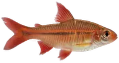 | Kirschbarbe <code>pethia&#95;<wbr>titteya</code> | *Pethia titteya* | Süßwasser | 4–5 cm | Schwarmfisch · versteckt sich nachts | ✔ |
|  | Kole-Doktorfisch <code>ctenochaetus&#95;<wbr>strigosus</code> | *Ctenochaetus strigosus* | Meerwasser | 12–18 cm | Freiwasserschwimmer · versteckt sich nachts | ✔ |
|  | Kuhli-Schmerle <code>pangio&#95;<wbr>kuhlii</code> | *Pangio kuhlii* | Süßwasser | 8–12 cm | Bodenbewohner · versteckt sich nachts | ✔ |
|  | Kupferstreifen-Pinzettfisch <code>chelmon&#95;<wbr>rostratus</code> | *Chelmon rostratus* | Meerwasser | 15–20 cm | Freiwasserschwimmer · versteckt sich nachts | ✔ |
|  | Königs-Gramma <code>gramma&#95;<wbr>loreto</code> | *Gramma loreto* | Meerwasser | 7–8 cm | Bleibt an Ort und Stelle · schwebt nachts im Wasser | ✔ |
|  | Mandarinfisch <code>synchiropus&#95;<wbr>splendidus</code> | *Synchiropus splendidus* | Meerwasser | 5–8 cm | Bodenbewohner · versteckt sich nachts | ✔ |
|  | Marmorierter Beilbauchfisch <code>carnegiella&#95;<wbr>strigata</code> | *Carnegiella strigata* | Süßwasser | 4–5 cm | Schwarmfisch · versteckt sich nachts | ✔ |
|  | Mosaikfadenfisch <code>trichopodus&#95;<wbr>leerii</code> | *Trichopodus leerii* | Süßwasser | 10–12 cm | Freiwasserschwimmer · versteckt sich nachts | ✔ |
|  | Neon-Grundel <code>elacatinus&#95;<wbr>oceanops</code> | *Elacatinus oceanops* | Meerwasser | 4–6 cm | Bodenbewohner · versteckt sich nachts | ✔ |
|  | Neonsalmler <code>paracheirodon&#95;<wbr>innesi</code> | *Paracheirodon innesi* | Süßwasser | 3–4 cm | Schwarmfisch · versteckt sich nachts | ✔ |
|  | Nördliches Seepferdchen <code>hippocampus&#95;<wbr>erectus</code> | *Hippocampus erectus* | Meerwasser | 10–15 cm | Bleibt an Ort und Stelle · schwebt nachts im Wasser | ✔ |
| 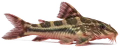 | Ohrgitterwels <code>otocinclus&#95;<wbr>affinis</code> | *Otocinclus affinis* | Süßwasser | 3–5 cm | Bodenbewohner · versteckt sich nachts | ✔ |
|  | Okinawa-Korallengrundel <code>gobiodon&#95;<wbr>okinawae</code> | *Gobiodon okinawae* | Meerwasser | 2.5–3.5 cm | Bodenbewohner · versteckt sich nachts | ✔ |
|  | Orchideen-Zwergbarsch <code>pseudochromis&#95;<wbr>fridmani</code> | *Pseudochromis fridmani* | Meerwasser | 6–7 cm | Bleibt an Ort und Stelle · bleibt nahe seinem Unterschlupf · schwebt nachts im Wasser | ✔ |
|  | Paletten-Doktorfisch <code>paracanthurus&#95;<wbr>hepatus</code> | *Paracanthurus hepatus* | Meerwasser | 20–30 cm | Freiwasserschwimmer · versteckt sich nachts | ✔ |
|  | Pandapanzerwels <code>corydoras&#95;<wbr>panda</code> | *Corydoras panda* | Süßwasser | 4–5 cm | Bodenbewohner · versteckt sich nachts | ✔ |
|  | Pazifischer Segelflossen-Doktorfisch <code>zebrasoma&#95;<wbr>veliferum</code> | *Zebrasoma veliferum* | Meerwasser | 25–40 cm | Freiwasserschwimmer · versteckt sich nachts | ✔ |
|  | Perlen-Bärbling <code>danio&#95;<wbr>albolineatus</code> | *Danio albolineatus* | Süßwasser | 4–6 cm | Schwarmfisch · versteckt sich nachts | ✔ |
|  | Pfauenaugen-Buntbarsch <code>astronotus&#95;<wbr>ocellatus</code> | *Astronotus ocellatus* | Süßwasser | 25–35 cm | Freiwasserschwimmer · versteckt sich nachts | ✔ |
|  | Picasso-Drückerfisch <code>rhinecanthus&#95;<wbr>aculeatus</code> | *Rhinecanthus aculeatus* | Meerwasser | 20–25 cm | Freiwasserschwimmer · versteckt sich nachts | ✔ |
|  | Pixie-Korallenwächter <code>cirrhitichthys&#95;<wbr>oxycephalus</code> | *Cirrhitichthys oxycephalus* | Meerwasser | 8–10 cm | Bodenbewohner · versteckt sich nachts | ✔ |
|  | Psychedelischer Mandarinfisch <code>synchiropus&#95;<wbr>picturatus</code> | *Synchiropus picturatus* | Meerwasser | 6–8 cm | Bodenbewohner · versteckt sich nachts | ✔ |
|  | Purpur-Schwertgrundel <code>nemateleotris&#95;<wbr>decora</code> | *Nemateleotris decora* | Meerwasser | 8–10 cm | Bleibt an Ort und Stelle · schwebt nachts im Wasser | ✔ |
|  | Purpurprachtbarsch <code>pelvicachromis&#95;<wbr>pulcher</code> | *Pelvicachromis pulcher* | Süßwasser | 8–10 cm | Bodenbewohner · versteckt sich nachts | ✔ |
|  | Pyjama-Kardinalbarsch <code>sphaeramia&#95;<wbr>nematoptera</code> | *Sphaeramia nematoptera* | Meerwasser | 8–10 cm | Bleibt an Ort und Stelle · schwebt nachts im Wasser | ✔ |
|  | Rasenmäher-Schleimfisch <code>salarias&#95;<wbr>fasciatus</code> | *Salarias fasciatus* | Meerwasser | 12–14 cm | Bodenbewohner · versteckt sich nachts | ✔ |
|  | Ritter-Grundel <code>stigmatogobius&#95;<wbr>sadanundio</code> | *Stigmatogobius sadanundio* | Brackwasser | 6–8 cm | Bodenbewohner · versteckt sich nachts | ✔ |
|  | Roter Feuerfisch <code>pterois&#95;<wbr>volitans</code> | *Pterois volitans* | Meerwasser | 25–35 cm | Freiwasserschwimmer · versteckt sich nachts | ✔ |
|  | Roter Neon <code>paracheirodon&#95;<wbr>axelrodi</code> | *Paracheirodon axelrodi* | Süßwasser | 3–5 cm | Schwarmfisch · versteckt sich nachts | ✔ |
|  | Rotkopfsalmler <code>hemigrammus&#95;<wbr>bleheri</code> | *Hemigrammus bleheri* | Süßwasser | 4–5 cm | Schwarmfisch · versteckt sich nachts | ✔ |
|  | Schläfergrundel <code>valenciennea</code> | *Valenciennea sp.* | Meerwasser | 10–16 cm | Lebt auf dem Sand · lebt in einer Höhle im Sand · ruht nachts am Boden | ✔ |
|  | Schmetterlingsbuntbarsch <code>mikrogeophagus&#95;<wbr>ramirezi</code> | *Mikrogeophagus ramirezi* | Süßwasser | 5–7 cm | Bleibt an Ort und Stelle · schwebt nachts im Wasser | ✔ |
|  | Schwertträger <code>xiphophorus&#95;<wbr>hellerii</code> | *Xiphophorus hellerii* | Süßwasser | 6–12 cm | Schwarmfisch · versteckt sich nachts | ✔ |
|  | Schützenfisch <code>toxotes&#95;<wbr>jaculatrix</code> | *Toxotes jaculatrix* | Brackwasser | 15–25 cm | Freiwasserschwimmer · versteckt sich nachts | ✔ |
|  | Sechsstreifen-Lippfisch <code>pseudocheilinus&#95;<wbr>hexataenia</code> | *Pseudocheilinus hexataenia* | Meerwasser | 7–10 cm | Freiwasserschwimmer · versteckt sich nachts | ✔ |
|  | Segelkärpfling <code>poecilia&#95;<wbr>velifera</code> | *Poecilia velifera* | Brackwasser, Süßwasser | 10–15 cm | Schwarmfisch · versteckt sich nachts | ✔ |
|  | Serpae-Salmler <code>hyphessobrycon&#95;<wbr>eques</code> | *Hyphessobrycon eques* | Süßwasser | 3–4.5 cm | Schwarmfisch · versteckt sich nachts | ✔ |
|  | Siamesische Rüsselbarbe <code>crossocheilus&#95;<wbr>oblongus</code> | *Crossocheilus oblongus* | Süßwasser | 10–15 cm | Freiwasserschwimmer · versteckt sich nachts | ✔ |
|  | Silberflossenblatt <code>monodactylus&#95;<wbr>argenteus</code> | *Monodactylus argenteus* | Brackwasser, Meerwasser | 15–25 cm | Schwarmfisch · versteckt sich nachts | ✔ |
|  | Skalar <code>pterophyllum&#95;<wbr>scalare</code> | *Pterophyllum scalare* | Süßwasser | 12–15 cm | Freiwasserschwimmer · versteckt sich nachts | ✔ |
|  | Solor-Feenlippfisch <code>cirrhilabrus&#95;<wbr>solorensis</code> | *Cirrhilabrus solorensis* | Meerwasser | 10–12 cm | Freiwasserschwimmer · versteckt sich nachts | ✔ |
|  | Spiegelkärpfling <code>xiphophorus&#95;<wbr>maculatus</code> | *Xiphophorus maculatus* | Süßwasser | 4–6 cm | Schwarmfisch · versteckt sich nachts | ✔ |
| 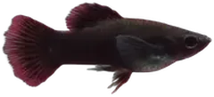 | Spitzmaulkärpfling <code>poecilia&#95;<wbr>sphenops</code> | *Poecilia sphenops* | Süßwasser, Brackwasser | 6–10 cm | Schwarmfisch · versteckt sich nachts | ✔ |
|  | Stachel-Anemonenfisch <code>premnas&#95;<wbr>biaculeatus</code> | *Premnas biaculeatus* | Meerwasser | 10–15 cm | Bleibt an Ort und Stelle · schwebt nachts im Wasser | ✔ |
|  | Sternenhimmel-Bärbling <code>danio&#95;<wbr>margaritatus</code> | *Danio margaritatus* | Süßwasser | 2–3 cm | Schwarmfisch · versteckt sich nachts | ✔ |
|  | Sumatrabarbe <code>puntigrus&#95;<wbr>tetrazona</code> | *Puntigrus tetrazona* | Süßwasser | 5–7 cm | Schwarmfisch · versteckt sich nachts | ✔ |
|  | Trauermantelsalmler <code>gymnocorymbus&#95;<wbr>ternetzi</code> | *Gymnocorymbus ternetzi* | Süßwasser | 5–6 cm | Schwarmfisch · versteckt sich nachts | ✔ |
|  | Türkis-Regenbogenfisch <code>melanotaenia&#95;<wbr>lacustris</code> | *Melanotaenia lacustris* | Süßwasser | 8–12 cm | Schwarmfisch · versteckt sich nachts | ✔ |
|  | Valentins Spitzkopf-Kugelfisch <code>canthigaster&#95;<wbr>valentini</code> | *Canthigaster valentini* | Meerwasser | 8–10 cm | Freiwasserschwimmer · versteckt sich nachts | ✔ |
|  | Violette Grundel <code>gobioides&#95;<wbr>broussonnetii</code> | *Gobioides broussonnetii* | Brackwasser | 30–50 cm | Lebt auf dem Sand · lebt in einer Höhle im Sand · ruht nachts am Boden | ✔ |
|  | Weißkehl-Doktorfisch <code>acanthurus&#95;<wbr>leucosternon</code> | *Acanthurus leucosternon* | Meerwasser | 20–23 cm | Freiwasserschwimmer · versteckt sich nachts | ✔ |
|  | Yasha-Symbiosegrundel <code>stonogobiops&#95;<wbr>yasha</code> | *Stonogobiops yasha* | Meerwasser | 6–8 cm | Lebt auf dem Sand · lebt in einer Höhle im Sand · ruht nachts am Boden | ✔ |
|  | Zebra-Harnischwels <code>hypancistrus&#95;<wbr>zebra</code> | *Hypancistrus zebra* | Süßwasser | 7–10 cm | Bodenbewohner · versteckt sich nachts | ✔ |
|  | Zebra-Zwergfeuerfisch <code>dendrochirus&#95;<wbr>zebra</code> | *Dendrochirus zebra* | Meerwasser | 12–18 cm | Freiwasserschwimmer · versteckt sich nachts | ✔ |
|  | Zebrabärbling <code>danio&#95;<wbr>rerio</code> | *Danio rerio* | Süßwasser | 4–5 cm | Schwarmfisch · versteckt sich nachts | ✔ |
|  | Zitronen-Korallengrundel <code>gobiodon&#95;<wbr>citrinus</code> | *Gobiodon citrinus* | Meerwasser | 3–5 cm | Bodenbewohner · versteckt sich nachts | ✔ |
|  | Zitronensalmler <code>hyphessobrycon&#95;<wbr>pulchripinnis</code> | *Hyphessobrycon pulchripinnis* | Süßwasser | 3–4.5 cm | Schwarmfisch · versteckt sich nachts | ✔ |
|  | Zweifarben-Schleimfisch <code>ecsenius&#95;<wbr>bicolor</code> | *Ecsenius bicolor* | Meerwasser | 8–10 cm | Bodenbewohner · versteckt sich nachts | ✔ |
|  | Zweifarben-Zwergkaiserfisch <code>centropyge&#95;<wbr>bicolor</code> | *Centropyge bicolor* | Meerwasser | 10–15 cm | Bleibt an Ort und Stelle · schwebt nachts im Wasser | ✔ |
|  | Zwergfadenfisch <code>trichogaster&#95;<wbr>lalius</code> | *Trichogaster lalius* | Süßwasser | 5–8 cm | Freiwasserschwimmer · versteckt sich nachts | ✔ |

## Korallen (1)

| &nbsp;&nbsp;&nbsp;&nbsp;&nbsp;&nbsp;&nbsp;&nbsp;&nbsp;&nbsp;&nbsp;&nbsp;&nbsp;&nbsp;&nbsp;&nbsp;&nbsp;&nbsp;&nbsp;&nbsp;&nbsp;&nbsp;&nbsp;&nbsp;&nbsp;&nbsp;&nbsp;&nbsp;&nbsp;&nbsp;&nbsp;&nbsp;&nbsp; | Name | Wissenschaftlicher Name | Wasser | Größe |
|---|---|---|---|---|
|  | Fackelkoralle <code>euphyllia&#95;<wbr>glabrescens</code> | *Euphyllia glabrescens* | Meerwasser | 10–30 cm |

## Pflanzen (29)

| &nbsp;&nbsp;&nbsp;&nbsp;&nbsp;&nbsp;&nbsp;&nbsp;&nbsp;&nbsp;&nbsp;&nbsp;&nbsp;&nbsp;&nbsp;&nbsp;&nbsp;&nbsp;&nbsp;&nbsp;&nbsp;&nbsp;&nbsp;&nbsp;&nbsp;&nbsp;&nbsp;&nbsp;&nbsp;&nbsp;&nbsp;&nbsp;&nbsp; | Name | Wissenschaftlicher Name | Wasser | Größe | Zone |
|---|---|---|---|---|---|
|  | Amazonas-Froschbiss <code>limnobium&#95;<wbr>laevigatum</code> | *Limnobium laevigatum* | Süßwasser | 5–10 cm | Schwimmpflanze |
|  | Amazonas-Schwertpflanze <code>echinodorus&#95;<wbr>bleheri</code> | *Echinodorus bleheri* | Süßwasser | 30–50 cm | Mittelgrund |
|  | Ambulia <code>limnophila&#95;<wbr>sessiliflora</code> | *Limnophila sessiliflora* | Süßwasser | 20–40 cm | Hintergrund |
|  | Anubias <code>anubias&#95;<wbr>barteri</code> | *Anubias barteri* | Süßwasser | 10–25 cm | Aufsitzerpflanze |
|  | Bewimperter Wasserkelch <code>cryptocoryne&#95;<wbr>ciliata</code> | *Cryptocoryne ciliata* | Brackwasser, Süßwasser | 20–40 cm | Mittelgrund |
|  | Bucephalandra <code>bucephalandra</code> | *Bucephalandra sp.* | Süßwasser | 5–15 cm | Aufsitzerpflanze |
| 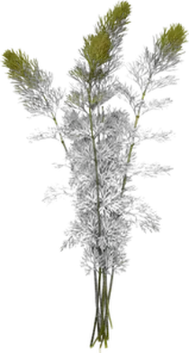 | Carolina-Haarnixe <code>cabomba&#95;<wbr>caroliniana</code> | *Cabomba caroliniana* | Süßwasser | 30–60 cm | Hintergrund |
|  | Caulerpa <code>caulerpa&#95;<wbr>prolifera</code> | *Caulerpa prolifera* | Meerwasser | 5–20 cm | Vordergrund |
|  | Chaetomorpha <code>chaetomorpha&#95;<wbr>linum</code> | *Chaetomorpha linum* | Meerwasser | 5–30 cm | Vordergrund |
|  | Dichte Wasserpest <code>egeria&#95;<wbr>densa</code> | *Egeria densa* | Süßwasser | 30–100 cm | Hintergrund |
|  | Glossostigma <code>glossostigma&#95;<wbr>elatinoides</code> | *Glossostigma elatinoides* | Süßwasser | 2–5 cm | Vordergrund |
|  | Halimeda <code>halimeda&#95;<wbr>opuntia</code> | *Halimeda opuntia* | Meerwasser | 5–15 cm | Vordergrund |
|  | Indischer Wasserfreund <code>hygrophila&#95;<wbr>polysperma</code> | *Hygrophila polysperma* | Süßwasser | 20–50 cm | Hintergrund |
|  | Javafarn <code>microsorum&#95;<wbr>pteropus</code> | *Microsorum pteropus* | Süßwasser | 20–30 cm | Aufsitzerpflanze |
|  | Javamoos <code>vesicularia&#95;<wbr>dubyana</code> | *Vesicularia dubyana* | Süßwasser | 3–5 cm | Aufsitzerpflanze |
|  | Kleine Wasserlinse <code>lemna&#95;<wbr>minor</code> | *Lemna minor* | Süßwasser | 0.5–1 cm | Schwimmpflanze |
|  | Kriechende Ludwigie <code>ludwigia&#95;<wbr>repens</code> | *Ludwigia repens* | Süßwasser | 20–40 cm | Mittelgrund |
|  | Kuba-Perlenkraut <code>hemianthus&#95;<wbr>callitrichoides</code> | *Hemianthus callitrichoides* | Süßwasser | 2–5 cm | Vordergrund |
|  | Marimo (Kugelalge) <code>aegagropila&#95;<wbr>linnaei</code> | *Aegagropila linnaei* | Süßwasser | 3–10 cm | Vordergrund |
|  | Muschelblume <code>pistia&#95;<wbr>stratiotes</code> | *Pistia stratiotes* | Süßwasser | 5–15 cm | Schwimmpflanze |
|  | Rote Mangrove <code>rhizophora&#95;<wbr>mangle</code> | *Rhizophora mangle* | Brackwasser, Meerwasser | 30–100 cm | Mittelgrund |
|  | Rundblättrige Rotala <code>rotala&#95;<wbr>rotundifolia</code> | *Rotala rotundifolia* | Süßwasser | 20–50 cm | Hintergrund |
|  | Schildkrötengras <code>thalassia&#95;<wbr>testudinum</code> | *Thalassia testudinum* | Meerwasser | 10–30 cm | Vordergrund |
|  | Staurogyne <code>staurogyne&#95;<wbr>repens</code> | *Staurogyne repens* | Süßwasser | 5–10 cm | Vordergrund |
|  | Wasserschraube <code>vallisneria&#95;<wbr>spiralis</code> | *Vallisneria spiralis* | Süßwasser, Brackwasser | 30–60 cm | Hintergrund |
|  | Wendts Wasserkelch <code>cryptocoryne&#95;<wbr>wendtii</code> | *Cryptocoryne wendtii* | Süßwasser | 10–20 cm | Mittelgrund |
| 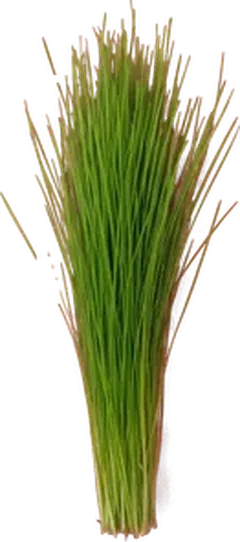 | Zwerg-Nadelsimse <code>eleocharis&#95;<wbr>parvula</code> | *Eleocharis parvula* | Süßwasser | 5–10 cm | Vordergrund |
|  | Zwerg-Pfeilkraut <code>sagittaria&#95;<wbr>subulata</code> | *Sagittaria subulata* | Süßwasser | 10–30 cm | Vordergrund |
|  | Zwerg-Wasserkelch <code>cryptocoryne&#95;<wbr>parva</code> | *Cryptocoryne parva* | Süßwasser | 5–8 cm | Vordergrund |

## Wirbellose (33)

| &nbsp;&nbsp;&nbsp;&nbsp;&nbsp;&nbsp;&nbsp;&nbsp;&nbsp;&nbsp;&nbsp;&nbsp;&nbsp;&nbsp;&nbsp;&nbsp;&nbsp;&nbsp;&nbsp;&nbsp;&nbsp;&nbsp;&nbsp;&nbsp;&nbsp;&nbsp;&nbsp;&nbsp;&nbsp;&nbsp;&nbsp;&nbsp;&nbsp; | Name | Wissenschaftlicher Name | Wasser | Größe | Rolle |
|---|---|---|---|---|---|
|  | Amano-Garnele <code>caridina&#95;<wbr>multidentata</code> | *Caridina multidentata* | Süßwasser | 3–5 cm | Algenfresser · läuft am Boden |
|  | Apfelschnecke <code>pomacea&#95;<wbr>bridgesii</code> | *Pomacea bridgesii* | Süßwasser | 4–5 cm | Aasfresser · läuft am Boden |
|  | Astraea-Schnecke <code>astraea&#95;<wbr>tecta</code> | *Astraea tecta* | Meerwasser | 2–4 cm | Algenfresser · lebt auf dem Dekor |
|  | Bambusgarnele <code>atyopsis&#95;<wbr>moluccensis</code> | *Atyopsis moluccensis* | Süßwasser | 6–8 cm | Filtrierer · lebt auf dem Dekor |
|  | Blaubein-Einsiedlerkrebs <code>clibanarius&#95;<wbr>tricolor</code> | *Clibanarius tricolor* | Meerwasser | 2–3 cm | Aasfresser · läuft am Boden |
|  | Bohrende Riesenmuschel <code>tridacna&#95;<wbr>crocea</code> | *Tridacna crocea* | Meerwasser | 5–15 cm | Filtrierer · festsitzend |
|  | Cerithium-Schnecke <code>cerithium</code> | *Cerithium sp.* | Meerwasser | 2–3 cm | Detritusfresser · läuft am Boden |
|  | Federwurm <code>sabellastarte</code> | *Sabellastarte sp.* | Meerwasser | 5–10 cm | Filtrierer · festsitzend |
| 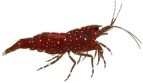 | Feuergarnele <code>lysmata&#95;<wbr>debelius</code> | *Lysmata debelius* | Meerwasser | 5–6 cm | Putzer · lebt auf dem Dekor |
|  | Griffelseeigel <code>prionocidaris&#95;<wbr>baculosa</code> | *Prionocidaris baculosa* | Meerwasser | 8–10 cm | Algenfresser · lebt auf dem Dekor |
|  | Harlekingarnele <code>hymenocera&#95;<wbr>picta</code> | *Hymenocera picta* | Meerwasser | 4–6 cm | Räuber · läuft am Boden |
|  | Kirschgarnele <code>neocaridina&#95;<wbr>davidi</code> | *Neocaridina davidi* | Süßwasser | 2–3.5 cm | Detritusfresser · läuft am Boden |
|  | Malayische Turmdeckelschnecke <code>melanoides&#95;<wbr>tuberculata</code> | *Melanoides tuberculata* | Süßwasser | 2–3 cm | Detritusfresser · läuft am Boden |
|  | Marmorgarnele <code>saron&#95;<wbr>marmoratus</code> | *Saron marmoratus* | Meerwasser | 5–7 cm | Aasfresser · lebt auf dem Dekor |
| 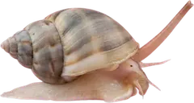 | Nassa-Schnecke <code>nassarius</code> | *Nassarius sp.* | Meerwasser | 2–4 cm | Aasfresser · läuft am Boden |
|  | Nerita-Schnecke <code>nerita</code> | *Nerita sp.* | Meerwasser | 2–3 cm | Algenfresser · klettert an der Scheibe |
|  | Peppermint-Garnele <code>lysmata&#95;<wbr>wurdemanni</code> | *Lysmata wurdemanni* | Meerwasser | 3–5 cm | Putzer · lebt auf dem Dekor |
|  | Posthornschnecke <code>planorbella&#95;<wbr>duryi</code> | *Planorbella duryi* | Süßwasser | 2–3 cm | Detritusfresser · klettert an der Scheibe |
|  | Raubschnecke <code>clea&#95;<wbr>helena</code> | *Clea helena* | Süßwasser | 2–3 cm | Räuber · läuft am Boden |
|  | Rote Kristallgarnele <code>caridina&#95;<wbr>cantonensis</code> | *Caridina cantonensis* | Süßwasser | 2–3 cm | Detritusfresser · läuft am Boden |
|  | Sammler-Seeigel <code>tripneustes&#95;<wbr>gratilla</code> | *Tripneustes gratilla* | Meerwasser | 10–15 cm | Algenfresser · lebt auf dem Dekor |
|  | Sand-Seestern <code>archaster&#95;<wbr>typicus</code> | *Archaster typicus* | Meerwasser | 6–10 cm | Detritusfresser · läuft am Boden |
|  | Scharlachroter Einsiedlerkrebs <code>paguristes&#95;<wbr>cadenati</code> | *Paguristes cadenati* | Meerwasser | 3–4 cm | Aasfresser · läuft am Boden |
|  | Scherengarnele <code>stenopus&#95;<wbr>hispidus</code> | *Stenopus hispidus* | Meerwasser | 6–8 cm | Putzer · lebt auf dem Dekor |
|  | Schlangenstern <code>ophiolepis&#95;<wbr>superba</code> | *Ophiolepis superba* | Meerwasser | 8–12 cm | Aasfresser · läuft am Boden |
| 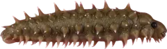 | Seegurke <code>holothuria</code> | *Holothuria sp.* | Meerwasser | 15–30 cm | Detritusfresser · läuft am Boden |
|  | Smaragdkrabbe <code>mithraculus&#95;<wbr>sculptus</code> | *Mithraculus sculptus* | Meerwasser | 3–4 cm | Algenfresser · lebt auf dem Dekor |
|  | Tiger-Pistolenkrebs <code>alpheus&#95;<wbr>bellulus</code> | *Alpheus bellulus* | Meerwasser | 4–5 cm | Detritusfresser · Aasfresser · läuft am Boden |
| 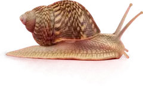 | Trochus-Schnecke <code>tectus&#95;<wbr>fenestratus</code> | *Tectus fenestratus* | Meerwasser | 4–6 cm | Algenfresser · lebt auf dem Dekor |
|  | Turbo-Schnecke <code>turbo&#95;<wbr>fluctuosus</code> | *Turbo fluctuosus* | Meerwasser | 4–8 cm | Algenfresser · klettert an der Scheibe |
| 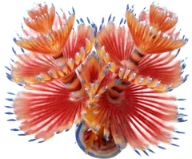 | Weihnachtsbaumwurm <code>spirobranchus&#95;<wbr>giganteus</code> | *Spirobranchus giganteus* | Meerwasser | 3–5 cm | Filtrierer · festsitzend |
| 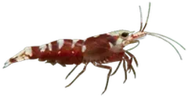 | Weißstreifen-Putzergarnele <code>lysmata&#95;<wbr>amboinensis</code> | *Lysmata amboinensis* | Meerwasser | 5–6 cm | Putzer · lebt auf dem Dekor |
|  | Zebra-Rennschnecke <code>neritina&#95;<wbr>natalensis</code> | *Neritina natalensis* | Süßwasser | 2–3 cm | Algenfresser · klettert an der Scheibe |

Zum Hinzufügen einer Art (Erzeugen der Clips, Build, Veröffentlichung) siehe die [englische Dokumentation](README.md).

Die Art-Ressourcen stehen unter **CC BY 4.0**, die Skripte unter MIT: siehe [LICENSE.md](LICENSE.md).

<!-- species:end -->

<!-- ecosystem:start -->

## Verwandte Projekte

Die ReefTech-Projekte greifen ineinander: die Integrationen bringen Ihre Geräte in Home Assistant, die Karte zeigt und steuert sie, und das Backup hält sie bei einem Stromausfall am Laufen. Jedes funktioniert auch für sich allein.

<table>
  <tr>
    <th width="100px"></th>
    <th>Projekt</th>
    <th>Funktion</th>
    <th>Arbeitet mit</th>
  </tr>
  <tr>
    <td></td>
    <td>🐠 <a href="https://github.com/Elwinmage/ha-reefbeat-component"><b>ha-reefbeat-component</b></a></td>
    <td>Red Sea ReefBeat-Geräte, lokal gesteuert ohne Cloud: ReefATO+, ReefControl, ReefControl-Power, ReefDose, ReefLed, ReefMat, ReefRun und ReefWave. Alarm-Blueprint für abweichende Modi, Kalibrierungen und niedrigen Akkustand. </td>
    <td>ha-reef-card</td>
  </tr>
  <tr>
    <td></td>
    <td>🌊 <a href="https://github.com/Elwinmage/ha-aquamedic-component"><b>ha-aquamedic-component</b></a></td>
    <td>Aqua Medic-Pumpen über die Gizwits-Cloud-API: EcoDrift- und SmartDrift-Strömungspumpen, DC Runner Rückförder- und Abschäumerpumpen.</td>
    <td>ha-reef-card</td>
  </tr>
  <tr>
    <td></td>
    <td>🐟 <a href="https://github.com/Elwinmage/ha-vson-component"><b>ha-vson-component</b></a></td>
    <td>VSON-Futterautomaten über die VSON-Cloud-API: der WP8621 (Füttern, Akku, Warnung bei wenig Futter) und generische Erkennung jedes anderen VSON-Geräts. Der WP8621 kann auch vollständig lokal mit ESPHome laufen.</td>
    <td>ha-reef-card</td>
  </tr>
  <tr>
    <td></td>
    <td>🐙 <a href="https://github.com/Elwinmage/ha-reef-maintenance-component"><b>ha-reef-maintenance-component</b></a></td>
    <td>Reinigungs- und Verschleißverfolgung für Geräte, die Home Assistant nicht erreicht: Strömungspumpen, Rückförderpumpen, Abschäumer, Reaktoren, alles was von Hand gewartet wird.</td>
    <td>ha-reef-card</td>
  </tr>
  <tr>
    <td></td>
    <td>🪸 <a href="https://github.com/Elwinmage/ha-reef-card"><b>ha-reef-card</b></a></td>
    <td>Interaktive grafische Ansicht jedes Geräts auf Ihrem Dashboard und der einzige Weg, erweiterte Zeitpläne zu bearbeiten. Liest die vier Integrationen über den gemeinsamen <code>reef_role</code>-Vertrag, ohne Konfiguration auf Kartenseite. Zeichnet außerdem die Energieflüsse von reefbeatEnergyBackup. Ihre Aquariumkarte erweckt Ihr Becken mit ha-reeftank-component zum Leben.</td>
    <td>alle vier Integrationen und ha-reeftank-component für das Aquarium</td>
  </tr>
  <tr>
    <td></td>
    <td>🐟 <a href="https://github.com/Elwinmage/ha-reeftank-component"><b>ha-reeftank-component</b></a></td>
    <td>Ein lebendiges Bild Ihres Beckens auf dem Dashboard: Ihr Foto, beleuchtet von Ihren echten Lampen, mit animierten Fischen und Korallen und Ihren Geräten und Entitäten darauf. Speichert die Aquarien und ihren Besatz, protokolliert die Fütterungen.</td>
    <td>ha-reef-card</td>
  </tr>
  <tr>
    <td></td>
    <td>🐡 <b>reeftank-catalog</b> <i>(dieses Repository)</i></td>
    <td>Fische, Korallen und Texturen der Aquariumkarte, von ha-reeftank-component heruntergeladen und aktuell gehalten.</td>
    <td>ha-reeftank-component</td>
  </tr>
  <tr>
    <td></td>
    <td>🐬 <a href="https://github.com/Elwinmage/ha-reef-blueprints"><b>ha-reef-blueprints</b></a></td>
    <td>Automatisierungs-Blueprints für das gesamte Ökosystem: überfällige Wartungen, über den <code>reef_role</code>-Vertrag gefunden, nicht mehr erreichbare Geräte, ein regelmäßiger Heizertest und eine Relaisüberwachung. Acht Sprachen.</td>
    <td>alle vier Integrationen</td>
  </tr>
  <tr>
    <td></td>
    <td>⚡ <a href="https://github.com/Elwinmage/reefbeatEnergyBackup"><b>reefbeatEnergyBackup</b></a></td>
    <td>Batterie-Backup bei Stromausfall. Ein 24V LiFePO₄-Pack, gesteuert von einem Raspberry Pi, mit schrittweiser Reduzierung der Pumpendrehzahl je nach Ladezustand.</td>
    <td>eigenständig oder zusammen mit ha-reefbeat-component und ha-reef-card</td>
  </tr>
</table>

Alle zusammen sind auf der [ReefTech-Projektseite](https://elwinmage.github.io/reeftank/) dokumentiert.

<!-- ecosystem:end -->
