# reeftank-catalog

<!-- species:begin (generated by scripts/make_readme.py, do not edit) -->

> Parte del [**ecosistema de proyectos ReefTech**](https://elwinmage.github.io/reeftank/)

       

Especies de peces, corales, plantas e invertebrados para la vista de acuario de [ha-reef-card](https://github.com/Elwinmage/ha-reef-card), servidas por la [integración ReefTank](https://github.com/Elwinmage/ha-reeftank-component).

La integración descarga las versiones publicadas de este repositorio y las mantiene al día (`update.reeftank_catalog`, automático por defecto): nada que hacer en Home Assistant.

## Cómo funciona

Cada pez es una hoja de imágenes (un atlas WebP) y un descriptor con sus clips: *nadar*, *quieto* y *giro*. La tarjeta los encadena y refleja el giro para que el pez vuelva por donde vino. Aquí están el nado, el giro y la vuelta de dos especies:

<table><tr><td align="center"> Pez ángel emperador</td><td align="center"> Pez payaso</td></tr></table>

## Peces (102)

**HD**: una animación real, hecha a partir de vídeos. Los demás tienen una animación simple hecha a partir de una foto, o el pez genérico.

| &nbsp;&nbsp;&nbsp;&nbsp;&nbsp;&nbsp;&nbsp;&nbsp;&nbsp;&nbsp;&nbsp;&nbsp;&nbsp;&nbsp;&nbsp;&nbsp;&nbsp;&nbsp;&nbsp;&nbsp;&nbsp;&nbsp;&nbsp;&nbsp;&nbsp;&nbsp;&nbsp;&nbsp;&nbsp;&nbsp;&nbsp;&nbsp;&nbsp;&nbsp;&nbsp;&nbsp;&nbsp;&nbsp;&nbsp; | <small>Nombre</small> | <small>Nombre científico</small> | <small>Agua</small> | <small>Tamaño</small> | <small>Comportamiento</small> | HD |
|---|---|---|---|---|---|---|
|  | <small>Ancistrus `ancistrus`</small> | <small>*Ancistrus sp.*</small> | <small>Agua dulce</small> | <small>10–14 cm</small> | <small>Vive cerca del fondo · se esconde de noche</small> |  |
|  | <small>Antias `pseudanthias`</small> | <small>*Pseudanthias sp.*</small> | <small>Marino</small> | <small>8–14 cm</small> | <small>En cardumen · se esconde de noche</small> | ✔ |
|  | <small>Apistogramma cacatúa `apistogramma_cacatuoides`</small> | <small>*Apistogramma cacatuoides*</small> | <small>Agua dulce</small> | <small>5–9 cm</small> | <small>Vive cerca del fondo · se esconde de noche</small> |  |
|  | <small>Barbo cereza `pethia_titteya`</small> | <small>*Pethia titteya*</small> | <small>Agua dulce</small> | <small>4–5 cm</small> | <small>En cardumen · se esconde de noche</small> |  |
|  | <small>Barbo de Sumatra `puntigrus_tetrazona`</small> | <small>*Puntigrus tetrazona*</small> | <small>Agua dulce</small> | <small>5–7 cm</small> | <small>En cardumen · se esconde de noche</small> |  |
|  | <small>Blenio bicolor `ecsenius_bicolor`</small> | <small>*Ecsenius bicolor*</small> | <small>Marino</small> | <small>8–10 cm</small> | <small>Vive cerca del fondo · se esconde de noche</small> |  |
|  | <small>Blenio cortacésped `salarias_fasciatus`</small> | <small>*Salarias fasciatus*</small> | <small>Marino</small> | <small>12–14 cm</small> | <small>Vive cerca del fondo · se esconde de noche</small> |  |
|  | <small>Caballito de mar rayado `hippocampus_erectus`</small> | <small>*Hippocampus erectus*</small> | <small>Marino</small> | <small>10–15 cm</small> | <small>Estacionario · flota en el agua de noche</small> |  |
|  | <small>Cirujano amarillo `zebrasoma_flavescens`</small> | <small>*Zebrasoma flavescens*</small> | <small>Marino</small> | <small>15–20 cm</small> | <small>Nadador de aguas abiertas · se esconde de noche</small> |  |
|  | <small>Cirujano azul `paracanthurus_hepatus`</small> | <small>*Paracanthurus hepatus*</small> | <small>Marino</small> | <small>20–30 cm</small> | <small>Nadador de aguas abiertas · se esconde de noche</small> |  |
|  | <small>Cirujano azul polvo `acanthurus_leucosternon`</small> | <small>*Acanthurus leucosternon*</small> | <small>Marino</small> | <small>20–23 cm</small> | <small>Nadador de aguas abiertas · se esconde de noche</small> |  |
|  | <small>Cirujano kole `ctenochaetus_strigosus`</small> | <small>*Ctenochaetus strigosus*</small> | <small>Marino</small> | <small>12–18 cm</small> | <small>Nadador de aguas abiertas · se esconde de noche</small> |  |
|  | <small>Cirujano marrón `zebrasoma_scopas`</small> | <small>*Zebrasoma scopas*</small> | <small>Marino</small> | <small>15–20 cm</small> | <small>Nadador de aguas abiertas · se esconde de noche</small> |  |
|  | <small>Cirujano velero `zebrasoma_veliferum`</small> | <small>*Zebrasoma veliferum*</small> | <small>Marino</small> | <small>25–40 cm</small> | <small>Nadador de aguas abiertas · se esconde de noche</small> |  |
|  | <small>Cola de espada `xiphophorus_hellerii`</small> | <small>*Xiphophorus hellerii*</small> | <small>Agua dulce</small> | <small>6–12 cm</small> | <small>En cardumen · se esconde de noche</small> |  |
|  | <small>Come algas siamés `crossocheilus_oblongus`</small> | <small>*Crossocheilus oblongus*</small> | <small>Agua dulce</small> | <small>10–15 cm</small> | <small>Nadador de aguas abiertas · se esconde de noche</small> |  |
|  | <small>Corydoras bronceado `corydoras_aeneus`</small> | <small>*Corydoras aeneus*</small> | <small>Agua dulce</small> | <small>6–7 cm</small> | <small>Vive cerca del fondo · se esconde de noche</small> |  |
|  | <small>Corydoras panda `corydoras_panda`</small> | <small>*Corydoras panda*</small> | <small>Agua dulce</small> | <small>4–5 cm</small> | <small>Vive cerca del fondo · se esconde de noche</small> |  |
|  | <small>Cromis verde `chromis_viridis`</small> | <small>*Chromis viridis*</small> | <small>Marino</small> | <small>5–8 cm</small> | <small>En cardumen · se esconde de noche</small> | ✔ |
|  | <small>Cíclido amarillo eléctrico `labidochromis_caeruleus`</small> | <small>*Labidochromis caeruleus*</small> | <small>Agua dulce</small> | <small>8–10 cm</small> | <small>Nadador de aguas abiertas · se esconde de noche</small> |  |
|  | <small>Cíclido Demasoni `pseudotropheus_demasoni`</small> | <small>*Pseudotropheus demasoni*</small> | <small>Agua dulce</small> | <small>7–8 cm</small> | <small>Nadador de aguas abiertas · se esconde de noche</small> |  |
| 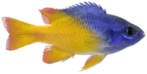 | <small>Damisela de cola amarilla `chrysiptera_parasema`</small> | <small>*Chrysiptera parasema*</small> | <small>Marino</small> | <small>5–6 cm</small> | <small>Estacionario · se queda cerca de su refugio · flota en el agua de noche</small> |  |
|  | <small>Damisela de Fiji `chrysiptera_taupou`</small> | <small>*Chrysiptera taupou*</small> | <small>Marino</small> | <small>6–8 cm</small> | <small>Estacionario · se queda cerca de su refugio · flota en el agua de noche</small> |  |
|  | <small>Danio galaxia `danio_margaritatus`</small> | <small>*Danio margaritatus*</small> | <small>Agua dulce</small> | <small>2–3 cm</small> | <small>En cardumen · se esconde de noche</small> |  |
|  | <small>Danio perla `danio_albolineatus`</small> | <small>*Danio albolineatus*</small> | <small>Agua dulce</small> | <small>4–6 cm</small> | <small>En cardumen · se esconde de noche</small> |  |
|  | <small>Dascilo de tres manchas `dascyllus_trimaculatus`</small> | <small>*Dascyllus trimaculatus*</small> | <small>Marino</small> | <small>10–14 cm</small> | <small>Estacionario · flota en el agua de noche</small> |  |
|  | <small>Discus `symphysodon_aequifasciatus`</small> | <small>*Symphysodon aequifasciatus*</small> | <small>Agua dulce</small> | <small>15–20 cm</small> | <small>Nadador de aguas abiertas · se esconde de noche</small> |  |
|  | <small>Escalar `pterophyllum_scalare`</small> | <small>*Pterophyllum scalare*</small> | <small>Agua dulce</small> | <small>12–15 cm</small> | <small>Nadador de aguas abiertas · se esconde de noche</small> |  |
|  | <small>Escáter moteado `scatophagus_argus`</small> | <small>*Scatophagus argus*</small> | <small>Salobre, Marino</small> | <small>15–30 cm</small> | <small>Nadador de aguas abiertas · se esconde de noche</small> |  |
|  | <small>Gobio abejorro `brachygobius_xanthozonus`</small> | <small>*Brachygobius xanthozonus*</small> | <small>Salobre</small> | <small>3–4 cm</small> | <small>Vive cerca del fondo · se esconde de noche</small> |  |
|  | <small>Gobio bandeado `amblygobius_phalaena`</small> | <small>*Amblygobius phalaena*</small> | <small>Marino</small> | <small>8–10 cm</small> | <small>Vive sobre la arena · descansa en el fondo de noche</small> |  |
|  | <small>Gobio caballero `stigmatogobius_sadanundio`</small> | <small>*Stigmatogobius sadanundio*</small> | <small>Salobre</small> | <small>6–8 cm</small> | <small>Vive cerca del fondo · se esconde de noche</small> |  |
|  | <small>Gobio centinela amarillo `cryptocentrus_cinctus`</small> | <small>*Cryptocentrus cinctus*</small> | <small>Marino</small> | <small>8–10 cm</small> | <small>Vive sobre la arena · vive en una madriguera · descansa en el fondo de noche</small> |  |
|  | <small>Gobio de coral limón `gobiodon_citrinus`</small> | <small>*Gobiodon citrinus*</small> | <small>Marino</small> | <small>3–5 cm</small> | <small>Vive cerca del fondo · se esconde de noche</small> |  |
|  | <small>Gobio de Okinawa `gobiodon_okinawae`</small> | <small>*Gobiodon okinawae*</small> | <small>Marino</small> | <small>2.5–3.5 cm</small> | <small>Vive cerca del fondo · se esconde de noche</small> |  |
|  | <small>Gobio durmiente `valenciennea`</small> | <small>*Valenciennea sp.*</small> | <small>Marino</small> | <small>10–16 cm</small> | <small>Vive sobre la arena · vive en una madriguera · descansa en el fondo de noche</small> | ✔ |
|  | <small>Gobio neón `elacatinus_oceanops`</small> | <small>*Elacatinus oceanops*</small> | <small>Marino</small> | <small>4–6 cm</small> | <small>Vive cerca del fondo · se esconde de noche</small> |  |
|  | <small>Gobio violeta `gobioides_broussonnetii`</small> | <small>*Gobioides broussonnetii*</small> | <small>Salobre</small> | <small>30–50 cm</small> | <small>Vive sobre la arena · vive en una madriguera · descansa en el fondo de noche</small> |  |
|  | <small>Gobio yasha `stonogobiops_yasha`</small> | <small>*Stonogobiops yasha*</small> | <small>Marino</small> | <small>6–8 cm</small> | <small>Vive sobre la arena · vive en una madriguera · descansa en el fondo de noche</small> |  |
|  | <small>Gramma real `gramma_loreto`</small> | <small>*Gramma loreto*</small> | <small>Marino</small> | <small>7–8 cm</small> | <small>Estacionario · flota en el agua de noche</small> |  |
|  | <small>Guppy `poecilia_reticulata`</small> | <small>*Poecilia reticulata*</small> | <small>Agua dulce</small> | <small>3–6 cm</small> | <small>En cardumen · se esconde de noche</small> |  |
|  | <small>Guppy de Endler `poecilia_wingei`</small> | <small>*Poecilia wingei*</small> | <small>Agua dulce</small> | <small>2–4 cm</small> | <small>En cardumen · se esconde de noche</small> |  |
|  | <small>Gurami azul `trichopodus_trichopterus`</small> | <small>*Trichopodus trichopterus*</small> | <small>Agua dulce</small> | <small>10–15 cm</small> | <small>Nadador de aguas abiertas · se esconde de noche</small> |  |
|  | <small>Gurami enano `trichogaster_lalius`</small> | <small>*Trichogaster lalius*</small> | <small>Agua dulce</small> | <small>5–8 cm</small> | <small>Nadador de aguas abiertas · se esconde de noche</small> |  |
|  | <small>Gurami perla `trichopodus_leerii`</small> | <small>*Trichopodus leerii*</small> | <small>Agua dulce</small> | <small>10–12 cm</small> | <small>Nadador de aguas abiertas · se esconde de noche</small> |  |
|  | <small>Killi del Cabo López `aphyosemion_australe`</small> | <small>*Aphyosemion australe*</small> | <small>Agua dulce</small> | <small>5–6 cm</small> | <small>Estacionario · flota en el agua de noche</small> |  |
|  | <small>Kribensis `pelvicachromis_pulcher`</small> | <small>*Pelvicachromis pulcher*</small> | <small>Agua dulce</small> | <small>8–10 cm</small> | <small>Vive cerca del fondo · se esconde de noche</small> |  |
|  | <small>Limpiador común `labroides_dimidiatus`</small> | <small>*Labroides dimidiatus*</small> | <small>Marino</small> | <small>10–12 cm</small> | <small>Nadador de aguas abiertas · se esconde de noche</small> |  |
|  | <small>Locha de Kuhl `pangio_kuhlii`</small> | <small>*Pangio kuhlii*</small> | <small>Agua dulce</small> | <small>8–12 cm</small> | <small>Vive cerca del fondo · se esconde de noche</small> |  |
|  | <small>Locha payaso `chromobotia_macracanthus`</small> | <small>*Chromobotia macracanthus*</small> | <small>Agua dulce</small> | <small>15–30 cm</small> | <small>Vive cerca del fondo · se esconde de noche</small> |  |
|  | <small>Lábrido amarillo `halichoeres_chrysus`</small> | <small>*Halichoeres chrysus*</small> | <small>Marino</small> | <small>10–12 cm</small> | <small>Nadador de aguas abiertas · descansa en el fondo de noche</small> |  |
|  | <small>Lábrido de seis líneas `pseudocheilinus_hexataenia`</small> | <small>*Pseudocheilinus hexataenia*</small> | <small>Marino</small> | <small>7–10 cm</small> | <small>Nadador de aguas abiertas · se esconde de noche</small> |  |
| 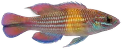 | <small>Lábrido hada de Solor `cirrhilabrus_solorensis`</small> | <small>*Cirrhilabrus solorensis*</small> | <small>Marino</small> | <small>10–12 cm</small> | <small>Nadador de aguas abiertas · se esconde de noche</small> |  |
|  | <small>Molly común `poecilia_sphenops`</small> | <small>*Poecilia sphenops*</small> | <small>Agua dulce, Salobre</small> | <small>6–10 cm</small> | <small>En cardumen · se esconde de noche</small> |  |
| 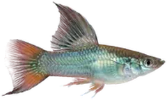 | <small>Molly vela `poecilia_velifera`</small> | <small>*Poecilia velifera*</small> | <small>Salobre, Agua dulce</small> | <small>10–15 cm</small> | <small>En cardumen · se esconde de noche</small> |  |
|  | <small>Monodáctilo plateado `monodactylus_argenteus`</small> | <small>*Monodactylus argenteus*</small> | <small>Salobre, Marino</small> | <small>15–25 cm</small> | <small>En cardumen · se esconde de noche</small> |  |
|  | <small>Oscar `astronotus_ocellatus`</small> | <small>*Astronotus ocellatus*</small> | <small>Agua dulce</small> | <small>25–35 cm</small> | <small>Nadador de aguas abiertas · se esconde de noche</small> |  |
|  | <small>Otocinclus `otocinclus_affinis`</small> | <small>*Otocinclus affinis*</small> | <small>Agua dulce</small> | <small>3–5 cm</small> | <small>Vive cerca del fondo · se esconde de noche</small> |  |
|  | <small>Pez arcoíris turquesa `melanotaenia_lacustris`</small> | <small>*Melanotaenia lacustris*</small> | <small>Agua dulce</small> | <small>8–12 cm</small> | <small>En cardumen · se esconde de noche</small> |  |
|  | <small>Pez arquero `toxotes_jaculatrix`</small> | <small>*Toxotes jaculatrix*</small> | <small>Salobre</small> | <small>15–25 cm</small> | <small>Nadador de aguas abiertas · se esconde de noche</small> |  |
|  | <small>Pez ballesta Picasso `rhinecanthus_aculeatus`</small> | <small>*Rhinecanthus aculeatus*</small> | <small>Marino</small> | <small>20–25 cm</small> | <small>Nadador de aguas abiertas · se esconde de noche</small> |  |
|  | <small>Pez cardenal de Banggai `pterapogon_kauderni`</small> | <small>*Pterapogon kauderni*</small> | <small>Marino</small> | <small>5–8 cm</small> | <small>Estacionario · flota en el agua de noche</small> | ✔ |
|  | <small>Pez cardenal de rayas amarillas `ostorhinchus_cyanosoma`</small> | <small>*Ostorhinchus cyanosoma*</small> | <small>Marino</small> | <small>7–8 cm</small> | <small>Estacionario · flota en el agua de noche</small> |  |
|  | <small>Pez cardenal pijama `sphaeramia_nematoptera`</small> | <small>*Sphaeramia nematoptera*</small> | <small>Marino</small> | <small>8–10 cm</small> | <small>Estacionario · flota en el agua de noche</small> |  |
|  | <small>Pez cebra `danio_rerio`</small> | <small>*Danio rerio*</small> | <small>Agua dulce</small> | <small>4–5 cm</small> | <small>En cardumen · se esconde de noche</small> |  |
|  | <small>Pez conejo cara de zorro `siganus_vulpinus`</small> | <small>*Siganus vulpinus*</small> | <small>Marino</small> | <small>15–22 cm</small> | <small>Nadador de aguas abiertas · descansa en el fondo de noche</small> | ✔ |
|  | <small>Pez de fuego `nemateleotris_magnifica`</small> | <small>*Nemateleotris magnifica*</small> | <small>Marino</small> | <small>8–10 cm</small> | <small>Estacionario · flota en el agua de noche</small> |  |
|  | <small>Pez de fuego púrpura `nemateleotris_decora`</small> | <small>*Nemateleotris decora*</small> | <small>Marino</small> | <small>8–10 cm</small> | <small>Estacionario · flota en el agua de noche</small> |  |
| 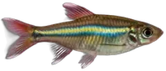 | <small>Pez de las nubes `tanichthys_albonubes`</small> | <small>*Tanichthys albonubes*</small> | <small>Agua dulce</small> | <small>3–4 cm</small> | <small>En cardumen · se esconde de noche</small> |  |
|  | <small>Pez dorado `carassius_auratus`</small> | <small>*Carassius auratus*</small> | <small>Agua dulce</small> | <small>10–25 cm</small> | <small>Nadador de aguas abiertas · se esconde de noche</small> |  |
|  | <small>Pez globo de ocho `dichotomyctere_biocellatus`</small> | <small>*Dichotomyctere biocellatus*</small> | <small>Salobre</small> | <small>5–6.5 cm</small> | <small>Nadador de aguas abiertas · se esconde de noche</small> |  |
|  | <small>Pez globo de Valentin `canthigaster_valentini`</small> | <small>*Canthigaster valentini*</small> | <small>Marino</small> | <small>8–10 cm</small> | <small>Nadador de aguas abiertas · se esconde de noche</small> |  |
|  | <small>Pez globo verde `dichotomyctere_nigroviridis`</small> | <small>*Dichotomyctere nigroviridis*</small> | <small>Salobre</small> | <small>10–17 cm</small> | <small>Nadador de aguas abiertas · se esconde de noche</small> |  |
|  | <small>Pez hacha marmoleado `carnegiella_strigata`</small> | <small>*Carnegiella strigata*</small> | <small>Agua dulce</small> | <small>4–5 cm</small> | <small>En cardumen · se esconde de noche</small> |  |
|  | <small>Pez halcón pixie `cirrhitichthys_oxycephalus`</small> | <small>*Cirrhitichthys oxycephalus*</small> | <small>Marino</small> | <small>8–10 cm</small> | <small>Vive cerca del fondo · se esconde de noche</small> |  |
|  | <small>Pez león cebra `dendrochirus_zebra`</small> | <small>*Dendrochirus zebra*</small> | <small>Marino</small> | <small>12–18 cm</small> | <small>Nadador de aguas abiertas · se esconde de noche</small> |  |
|  | <small>Pez león rojo `pterois_volitans`</small> | <small>*Pterois volitans*</small> | <small>Marino</small> | <small>25–35 cm</small> | <small>Nadador de aguas abiertas · se esconde de noche</small> |  |
|  | <small>Pez luchador de Siam `betta_splendens`</small> | <small>*Betta splendens*</small> | <small>Agua dulce</small> | <small>5–7 cm</small> | <small>Estacionario · se queda cerca de su refugio · flota en el agua de noche</small> |  |
|  | <small>Pez mandarín `synchiropus_splendidus`</small> | <small>*Synchiropus splendidus*</small> | <small>Marino</small> | <small>5–8 cm</small> | <small>Vive cerca del fondo · se esconde de noche</small> | ✔ |
|  | <small>Pez mandarín psicodélico `synchiropus_picturatus`</small> | <small>*Synchiropus picturatus*</small> | <small>Marino</small> | <small>6–8 cm</small> | <small>Vive cerca del fondo · se esconde de noche</small> |  |
|  | <small>Pez mandíbula de cabeza amarilla `opistognathus_aurifrons`</small> | <small>*Opistognathus aurifrons*</small> | <small>Marino</small> | <small>10–12 cm</small> | <small>Vive sobre la arena · vive en una madriguera · descansa en el fondo de noche</small> |  |
|  | <small>Pez mariposa de franjas cobrizas `chelmon_rostratus`</small> | <small>*Chelmon rostratus*</small> | <small>Marino</small> | <small>15–20 cm</small> | <small>Nadador de aguas abiertas · se esconde de noche</small> |  |
|  | <small>Pez payaso `amphiprion`</small> | <small>*Amphiprion sp.*</small> | <small>Marino</small> | <small>7–11 cm</small> | <small>Estacionario · flota en el agua de noche</small> | ✔ |
|  | <small>Pez payaso granate `premnas_biaculeatus`</small> | <small>*Premnas biaculeatus*</small> | <small>Marino</small> | <small>10–15 cm</small> | <small>Estacionario · flota en el agua de noche</small> |  |
|  | <small>Pez ángel bicolor `centropyge_bicolor`</small> | <small>*Centropyge bicolor*</small> | <small>Marino</small> | <small>10–15 cm</small> | <small>Estacionario · flota en el agua de noche</small> |  |
|  | <small>Pez ángel emperador (adulto) `pomacanthus_imperator_adult`</small> | <small>*Pomacanthus imperator*</small> | <small>Marino</small> | <small>25–38 cm</small> | <small>Nadador de aguas abiertas · se esconde de noche</small> | ✔ |
|  | <small>Pez ángel emperador (juvenil) `pomacanthus_imperator`</small> | <small>*Pomacanthus imperator*</small> | <small>Marino</small> | <small>6–12 cm</small> | <small>Nadador de aguas abiertas · se esconde de noche</small> | ✔ |
| 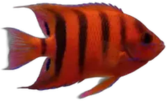 | <small>Pez ángel flama `centropyge_loricula`</small> | <small>*Centropyge loricula*</small> | <small>Marino</small> | <small>8–10 cm</small> | <small>Estacionario · flota en el agua de noche</small> |  |
|  | <small>Pez ángel real `pygoplites_diacanthus`</small> | <small>*Pygoplites diacanthus*</small> | <small>Marino</small> | <small>20–25 cm</small> | <small>Nadador de aguas abiertas · se esconde de noche</small> |  |
|  | <small>Platy `xiphophorus_maculatus`</small> | <small>*Xiphophorus maculatus*</small> | <small>Agua dulce</small> | <small>4–6 cm</small> | <small>En cardumen · se esconde de noche</small> |  |
|  | <small>Pleco cebra `hypancistrus_zebra`</small> | <small>*Hypancistrus zebra*</small> | <small>Agua dulce</small> | <small>7–10 cm</small> | <small>Vive cerca del fondo · se esconde de noche</small> |  |
|  | <small>Pseudocromis orquídea `pseudochromis_fridmani`</small> | <small>*Pseudochromis fridmani*</small> | <small>Marino</small> | <small>6–7 cm</small> | <small>Estacionario · se queda cerca de su refugio · flota en el agua de noche</small> |  |
|  | <small>Ramirezi `mikrogeophagus_ramirezi`</small> | <small>*Mikrogeophagus ramirezi*</small> | <small>Agua dulce</small> | <small>5–7 cm</small> | <small>Estacionario · flota en el agua de noche</small> |  |
|  | <small>Rasbora arlequín `trigonostigma_heteromorpha`</small> | <small>*Trigonostigma heteromorpha*</small> | <small>Agua dulce</small> | <small>3–4.5 cm</small> | <small>En cardumen · se esconde de noche</small> |  |
|  | <small>Saltarín del fango atlántico `periophthalmus_barbarus`</small> | <small>*Periophthalmus barbarus*</small> | <small>Salobre</small> | <small>10–15 cm</small> | <small>Vive cerca del fondo · se esconde de noche</small> |  |
| 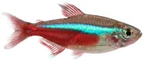 | <small>Tetra cardenal `paracheirodon_axelrodi`</small> | <small>*Paracheirodon axelrodi*</small> | <small>Agua dulce</small> | <small>3–5 cm</small> | <small>En cardumen · se esconde de noche</small> |  |
|  | <small>Tetra emperador `nematobrycon_palmeri`</small> | <small>*Nematobrycon palmeri*</small> | <small>Agua dulce</small> | <small>4–6 cm</small> | <small>En cardumen · se esconde de noche</small> |  |
| 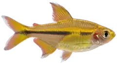 | <small>Tetra limón `hyphessobrycon_pulchripinnis`</small> | <small>*Hyphessobrycon pulchripinnis*</small> | <small>Agua dulce</small> | <small>3–4.5 cm</small> | <small>En cardumen · se esconde de noche</small> |  |
|  | <small>Tetra nariz roja `hemigrammus_bleheri`</small> | <small>*Hemigrammus bleheri*</small> | <small>Agua dulce</small> | <small>4–5 cm</small> | <small>En cardumen · se esconde de noche</small> |  |
|  | <small>Tetra negro `gymnocorymbus_ternetzi`</small> | <small>*Gymnocorymbus ternetzi*</small> | <small>Agua dulce</small> | <small>5–6 cm</small> | <small>En cardumen · se esconde de noche</small> |  |
|  | <small>Tetra neón `paracheirodon_innesi`</small> | <small>*Paracheirodon innesi*</small> | <small>Agua dulce</small> | <small>3–4 cm</small> | <small>En cardumen · se esconde de noche</small> |  |
|  | <small>Tetra serpae `hyphessobrycon_eques`</small> | <small>*Hyphessobrycon eques*</small> | <small>Agua dulce</small> | <small>3–4.5 cm</small> | <small>En cardumen · se esconde de noche</small> |  |

## Corales (1)

| &nbsp;&nbsp;&nbsp;&nbsp;&nbsp;&nbsp;&nbsp;&nbsp;&nbsp;&nbsp;&nbsp;&nbsp;&nbsp;&nbsp;&nbsp;&nbsp;&nbsp;&nbsp;&nbsp;&nbsp;&nbsp;&nbsp;&nbsp;&nbsp;&nbsp;&nbsp;&nbsp;&nbsp;&nbsp;&nbsp;&nbsp;&nbsp;&nbsp;&nbsp;&nbsp;&nbsp;&nbsp;&nbsp;&nbsp; | <small>Nombre</small> | <small>Nombre científico</small> | <small>Agua</small> | <small>Tamaño</small> |
|---|---|---|---|---|
|  | <small>Coral antorcha `euphyllia_glabrescens`</small> | <small>*Euphyllia glabrescens*</small> | <small>Marino</small> | <small>10–30 cm</small> |

## Plantas (29)

| &nbsp;&nbsp;&nbsp;&nbsp;&nbsp;&nbsp;&nbsp;&nbsp;&nbsp;&nbsp;&nbsp;&nbsp;&nbsp;&nbsp;&nbsp;&nbsp;&nbsp;&nbsp;&nbsp;&nbsp;&nbsp;&nbsp;&nbsp;&nbsp;&nbsp;&nbsp;&nbsp;&nbsp;&nbsp;&nbsp;&nbsp;&nbsp;&nbsp;&nbsp;&nbsp;&nbsp;&nbsp;&nbsp;&nbsp; | <small>Nombre</small> | <small>Nombre científico</small> | <small>Agua</small> | <small>Tamaño</small> | <small>Zona</small> |
|---|---|---|---|---|---|
|  | <small>Ambulia `limnophila_sessiliflora`</small> | <small>*Limnophila sessiliflora*</small> | <small>Agua dulce</small> | <small>20–40 cm</small> | <small>Fondo</small> |
|  | <small>Anubias `anubias_barteri`</small> | <small>*Anubias barteri*</small> | <small>Agua dulce</small> | <small>10–25 cm</small> | <small>Epífita</small> |
| 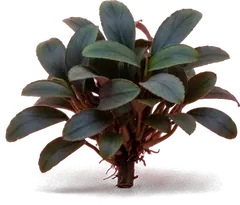 | <small>Bucephalandra `bucephalandra`</small> | <small>*Bucephalandra sp.*</small> | <small>Agua dulce</small> | <small>5–15 cm</small> | <small>Epífita</small> |
|  | <small>Cabomba `cabomba_caroliniana`</small> | <small>*Cabomba caroliniana*</small> | <small>Agua dulce</small> | <small>30–60 cm</small> | <small>Fondo</small> |
|  | <small>Caulerpa `caulerpa_prolifera`</small> | <small>*Caulerpa prolifera*</small> | <small>Marino</small> | <small>5–20 cm</small> | <small>Primer plano</small> |
|  | <small>Chaetomorpha `chaetomorpha_linum`</small> | <small>*Chaetomorpha linum*</small> | <small>Marino</small> | <small>5–30 cm</small> | <small>Primer plano</small> |
|  | <small>Cryptocoryne ciliata `cryptocoryne_ciliata`</small> | <small>*Cryptocoryne ciliata*</small> | <small>Salobre, Agua dulce</small> | <small>20–40 cm</small> | <small>Plano medio</small> |
|  | <small>Cryptocoryne parva `cryptocoryne_parva`</small> | <small>*Cryptocoryne parva*</small> | <small>Agua dulce</small> | <small>5–8 cm</small> | <small>Primer plano</small> |
|  | <small>Cryptocoryne wendtii `cryptocoryne_wendtii`</small> | <small>*Cryptocoryne wendtii*</small> | <small>Agua dulce</small> | <small>10–20 cm</small> | <small>Plano medio</small> |
|  | <small>Eleocharis enana `eleocharis_parvula`</small> | <small>*Eleocharis parvula*</small> | <small>Agua dulce</small> | <small>5–10 cm</small> | <small>Primer plano</small> |
| 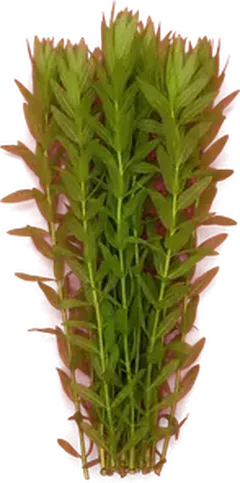 | <small>Elodea densa `egeria_densa`</small> | <small>*Egeria densa*</small> | <small>Agua dulce</small> | <small>30–100 cm</small> | <small>Fondo</small> |
|  | <small>Espada amazónica `echinodorus_bleheri`</small> | <small>*Echinodorus bleheri*</small> | <small>Agua dulce</small> | <small>30–50 cm</small> | <small>Plano medio</small> |
|  | <small>Glossostigma `glossostigma_elatinoides`</small> | <small>*Glossostigma elatinoides*</small> | <small>Agua dulce</small> | <small>2–5 cm</small> | <small>Primer plano</small> |
|  | <small>Halimeda `halimeda_opuntia`</small> | <small>*Halimeda opuntia*</small> | <small>Marino</small> | <small>5–15 cm</small> | <small>Primer plano</small> |
|  | <small>Helecho de Java `microsorum_pteropus`</small> | <small>*Microsorum pteropus*</small> | <small>Agua dulce</small> | <small>20–30 cm</small> | <small>Epífita</small> |
|  | <small>Hemianthus `hemianthus_callitrichoides`</small> | <small>*Hemianthus callitrichoides*</small> | <small>Agua dulce</small> | <small>2–5 cm</small> | <small>Primer plano</small> |
|  | <small>Hierba de tortuga `thalassia_testudinum`</small> | <small>*Thalassia testudinum*</small> | <small>Marino</small> | <small>10–30 cm</small> | <small>Primer plano</small> |
|  | <small>Hygrophila `hygrophila_polysperma`</small> | <small>*Hygrophila polysperma*</small> | <small>Agua dulce</small> | <small>20–50 cm</small> | <small>Fondo</small> |
|  | <small>Lechuga de agua `pistia_stratiotes`</small> | <small>*Pistia stratiotes*</small> | <small>Agua dulce</small> | <small>5–15 cm</small> | <small>Flotante</small> |
|  | <small>Lenteja de agua `lemna_minor`</small> | <small>*Lemna minor*</small> | <small>Agua dulce</small> | <small>0.5–1 cm</small> | <small>Flotante</small> |
|  | <small>Limnobium `limnobium_laevigatum`</small> | <small>*Limnobium laevigatum*</small> | <small>Agua dulce</small> | <small>5–10 cm</small> | <small>Flotante</small> |
|  | <small>Ludwigia `ludwigia_repens`</small> | <small>*Ludwigia repens*</small> | <small>Agua dulce</small> | <small>20–40 cm</small> | <small>Plano medio</small> |
|  | <small>Mangle rojo `rhizophora_mangle`</small> | <small>*Rhizophora mangle*</small> | <small>Salobre, Marino</small> | <small>30–100 cm</small> | <small>Plano medio</small> |
|  | <small>Marimo `aegagropila_linnaei`</small> | <small>*Aegagropila linnaei*</small> | <small>Agua dulce</small> | <small>3–10 cm</small> | <small>Primer plano</small> |
|  | <small>Musgo de Java `vesicularia_dubyana`</small> | <small>*Vesicularia dubyana*</small> | <small>Agua dulce</small> | <small>3–5 cm</small> | <small>Epífita</small> |
| 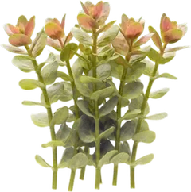 | <small>Rotala `rotala_rotundifolia`</small> | <small>*Rotala rotundifolia*</small> | <small>Agua dulce</small> | <small>20–50 cm</small> | <small>Fondo</small> |
| 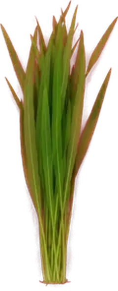 | <small>Sagitaria enana `sagittaria_subulata`</small> | <small>*Sagittaria subulata*</small> | <small>Agua dulce</small> | <small>10–30 cm</small> | <small>Primer plano</small> |
|  | <small>Staurogyne `staurogyne_repens`</small> | <small>*Staurogyne repens*</small> | <small>Agua dulce</small> | <small>5–10 cm</small> | <small>Primer plano</small> |
|  | <small>Vallisneria `vallisneria_spiralis`</small> | <small>*Vallisneria spiralis*</small> | <small>Agua dulce, Salobre</small> | <small>30–60 cm</small> | <small>Fondo</small> |

## Invertebrados (32)

| &nbsp;&nbsp;&nbsp;&nbsp;&nbsp;&nbsp;&nbsp;&nbsp;&nbsp;&nbsp;&nbsp;&nbsp;&nbsp;&nbsp;&nbsp;&nbsp;&nbsp;&nbsp;&nbsp;&nbsp;&nbsp;&nbsp;&nbsp;&nbsp;&nbsp;&nbsp;&nbsp;&nbsp;&nbsp;&nbsp;&nbsp;&nbsp;&nbsp;&nbsp;&nbsp;&nbsp;&nbsp;&nbsp;&nbsp; | <small>Nombre</small> | <small>Nombre científico</small> | <small>Agua</small> | <small>Tamaño</small> | <small>Función</small> |
|---|---|---|---|---|---|
|  | <small>Almeja gigante perforadora `tridacna_crocea`</small> | <small>*Tridacna crocea*</small> | <small>Marino</small> | <small>5–15 cm</small> | <small>Filtrador · sésil</small> |
|  | <small>Cangrejo ermitaño de patas azules `clibanarius_tricolor`</small> | <small>*Clibanarius tricolor*</small> | <small>Marino</small> | <small>2–3 cm</small> | <small>Carroñero · se desplaza por el fondo</small> |
|  | <small>Cangrejo ermitaño escarlata `paguristes_cadenati`</small> | <small>*Paguristes cadenati*</small> | <small>Marino</small> | <small>3–4 cm</small> | <small>Carroñero · se desplaza por el fondo</small> |
|  | <small>Cangrejo esmeralda `mithraculus_sculptus`</small> | <small>*Mithraculus sculptus*</small> | <small>Marino</small> | <small>3–4 cm</small> | <small>Comedor de algas · vive en la decoración</small> |
|  | <small>Caracol asesino `clea_helena`</small> | <small>*Clea helena*</small> | <small>Agua dulce</small> | <small>2–3 cm</small> | <small>Depredador · se desplaza por el fondo</small> |
|  | <small>Caracol Astraea `astraea_tecta`</small> | <small>*Astraea tecta*</small> | <small>Marino</small> | <small>2–4 cm</small> | <small>Comedor de algas · vive en la decoración</small> |
|  | <small>Caracol cerite `cerithium`</small> | <small>*Cerithium sp.*</small> | <small>Marino</small> | <small>2–3 cm</small> | <small>Detritívoro · se desplaza por el fondo</small> |
|  | <small>Caracol cuerno de carnero `planorbella_duryi`</small> | <small>*Planorbella duryi*</small> | <small>Agua dulce</small> | <small>2–3 cm</small> | <small>Detritívoro · trepa por el cristal</small> |
|  | <small>Caracol manzana `pomacea_bridgesii`</small> | <small>*Pomacea bridgesii*</small> | <small>Agua dulce</small> | <small>4–5 cm</small> | <small>Carroñero · se desplaza por el fondo</small> |
|  | <small>Caracol Nassarius `nassarius`</small> | <small>*Nassarius sp.*</small> | <small>Marino</small> | <small>2–4 cm</small> | <small>Carroñero · se desplaza por el fondo</small> |
|  | <small>Caracol nerita cebra `neritina_natalensis`</small> | <small>*Neritina natalensis*</small> | <small>Agua dulce</small> | <small>2–3 cm</small> | <small>Comedor de algas · trepa por el cristal</small> |
|  | <small>Caracol nerita marino `nerita`</small> | <small>*Nerita sp.*</small> | <small>Marino</small> | <small>2–3 cm</small> | <small>Comedor de algas · trepa por el cristal</small> |
|  | <small>Caracol trochus `tectus_fenestratus`</small> | <small>*Tectus fenestratus*</small> | <small>Marino</small> | <small>4–6 cm</small> | <small>Comedor de algas · vive en la decoración</small> |
|  | <small>Caracol trompeta malayo `melanoides_tuberculata`</small> | <small>*Melanoides tuberculata*</small> | <small>Agua dulce</small> | <small>2–3 cm</small> | <small>Detritívoro · se desplaza por el fondo</small> |
|  | <small>Caracol turbo `turbo_fluctuosus`</small> | <small>*Turbo fluctuosus*</small> | <small>Marino</small> | <small>4–8 cm</small> | <small>Comedor de algas · trepa por el cristal</small> |
|  | <small>Erizo colector `tripneustes_gratilla`</small> | <small>*Tripneustes gratilla*</small> | <small>Marino</small> | <small>10–15 cm</small> | <small>Comedor de algas · vive en la decoración</small> |
|  | <small>Erizo lápiz `prionocidaris_baculosa`</small> | <small>*Prionocidaris baculosa*</small> | <small>Marino</small> | <small>8–10 cm</small> | <small>Comedor de algas · vive en la decoración</small> |
|  | <small>Estrella de arena `archaster_typicus`</small> | <small>*Archaster typicus*</small> | <small>Marino</small> | <small>6–10 cm</small> | <small>Detritívoro · se desplaza por el fondo</small> |
|  | <small>Estrella serpiente `ophiolepis_superba`</small> | <small>*Ophiolepis superba*</small> | <small>Marino</small> | <small>8–12 cm</small> | <small>Carroñero · se desplaza por el fondo</small> |
|  | <small>Gamba Amano `caridina_multidentata`</small> | <small>*Caridina multidentata*</small> | <small>Agua dulce</small> | <small>3–5 cm</small> | <small>Comedor de algas · se desplaza por el fondo</small> |
|  | <small>Gamba arlequín `hymenocera_picta`</small> | <small>*Hymenocera picta*</small> | <small>Marino</small> | <small>4–6 cm</small> | <small>Depredador · se desplaza por el fondo</small> |
|  | <small>Gamba boxeadora `stenopus_hispidus`</small> | <small>*Stenopus hispidus*</small> | <small>Marino</small> | <small>6–8 cm</small> | <small>Limpiador · vive en la decoración</small> |
|  | <small>Gamba cereza `neocaridina_davidi`</small> | <small>*Neocaridina davidi*</small> | <small>Agua dulce</small> | <small>2–3.5 cm</small> | <small>Detritívoro · se desplaza por el fondo</small> |
|  | <small>Gamba cristal roja `caridina_cantonensis`</small> | <small>*Caridina cantonensis*</small> | <small>Agua dulce</small> | <small>2–3 cm</small> | <small>Detritívoro · se desplaza por el fondo</small> |
|  | <small>Gamba de bambú `atyopsis_moluccensis`</small> | <small>*Atyopsis moluccensis*</small> | <small>Agua dulce</small> | <small>6–8 cm</small> | <small>Filtrador · vive en la decoración</small> |
|  | <small>Gamba fuego `lysmata_debelius`</small> | <small>*Lysmata debelius*</small> | <small>Marino</small> | <small>5–6 cm</small> | <small>Limpiador · vive en la decoración</small> |
|  | <small>Gamba limpiadora escarlata `lysmata_amboinensis`</small> | <small>*Lysmata amboinensis*</small> | <small>Marino</small> | <small>5–6 cm</small> | <small>Limpiador · vive en la decoración</small> |
|  | <small>Gamba marmoleada `saron_marmoratus`</small> | <small>*Saron marmoratus*</small> | <small>Marino</small> | <small>5–7 cm</small> | <small>Carroñero · vive en la decoración</small> |
|  | <small>Gamba peppermint `lysmata_wurdemanni`</small> | <small>*Lysmata wurdemanni*</small> | <small>Marino</small> | <small>3–5 cm</small> | <small>Limpiador · vive en la decoración</small> |
|  | <small>Gusano plumero `sabellastarte`</small> | <small>*Sabellastarte sp.*</small> | <small>Marino</small> | <small>5–10 cm</small> | <small>Filtrador · sésil</small> |
|  | <small>Gusano árbol de Navidad `spirobranchus_giganteus`</small> | <small>*Spirobranchus giganteus*</small> | <small>Marino</small> | <small>3–5 cm</small> | <small>Filtrador · sésil</small> |
|  | <small>Pepino de mar `holothuria`</small> | <small>*Holothuria sp.*</small> | <small>Marino</small> | <small>15–30 cm</small> | <small>Detritívoro · se desplaza por el fondo</small> |

Para añadir una especie (generación de los clips, construcción, publicación), ver la [documentación en inglés](README.md).

Los recursos de las especies están bajo **CC BY 4.0**, los scripts bajo MIT: ver [LICENSE.md](LICENSE.md).

<!-- species:end -->

<!-- ecosystem:start -->

## Proyectos relacionados

Los proyectos ReefTech encajan entre sí: las integraciones traen tu equipo a Home Assistant, la tarjeta lo muestra y lo controla, y el respaldo lo mantiene en marcha durante un corte. Cada uno funciona también por su cuenta.

<table>
  <tr>
    <th width="100px"></th>
    <th>Proyecto</th>
    <th>Función</th>
    <th>Funciona con</th>
  </tr>
  <tr>
    <td></td>
    <td>🐠 <a href="https://github.com/Elwinmage/ha-reefbeat-component"><b>ha-reefbeat-component</b></a></td>
    <td>Dispositivos Red Sea ReefBeat, controlados localmente sin cloud: ReefATO+, ReefControl, ReefControl-Power, ReefDose, ReefLed, ReefMat, ReefRun y ReefWave. blueprint de alertas para modos anómalos, calibraciones y batería baja. </td>
    <td>ha-reef-card</td>
  </tr>
  <tr>
    <td></td>
    <td>🌊 <a href="https://github.com/Elwinmage/ha-aquamedic-component"><b>ha-aquamedic-component</b></a></td>
    <td>Bombas Aqua Medic a través de la API cloud Gizwits: bombas de movimiento EcoDrift y SmartDrift, bombas DC Runner de retorno y de skimmer.</td>
    <td>ha-reef-card</td>
  </tr>
  <tr>
    <td></td>
    <td>🐟 <a href="https://github.com/Elwinmage/ha-vson-component"><b>ha-vson-component</b></a></td>
    <td>Comederos automáticos VSON a través de la API cloud VSON: el comedero WP8621 (alimentar, batería, aviso de poca comida) y detección genérica de cualquier otro dispositivo VSON. El WP8621 también puede funcionar totalmente local con ESPHome.</td>
    <td>ha-reef-card</td>
  </tr>
  <tr>
    <td></td>
    <td>🐙 <a href="https://github.com/Elwinmage/ha-reef-maintenance-component"><b>ha-reef-maintenance-component</b></a></td>
    <td>Seguimiento de limpieza y desgaste del equipo que Home Assistant no puede consultar: bombas de movimiento, bombas de retorno, skimmers, reactores, todo lo que mantienes a mano.</td>
    <td>ha-reef-card</td>
  </tr>
  <tr>
    <td></td>
    <td>🪸 <a href="https://github.com/Elwinmage/ha-reef-card"><b>ha-reef-card</b></a></td>
    <td>Vista gráfica interactiva de cada dispositivo en tu panel, y la única forma de editar programaciones avanzadas. Lee las tres integraciones mediante el contrato <code>reef_role</code> común, sin configuración del lado de la tarjeta. También dibuja los flujos de energía de reefbeatEnergyBackup. Su tarjeta de acuario da vida a su acuario con ha-reeftank-component.</td>
    <td>las cuatro integraciones, y ha-reeftank-component para el acuario</td>
  </tr>
  <tr>
    <td></td>
    <td>🐟 <a href="https://github.com/Elwinmage/ha-reeftank-component"><b>ha-reeftank-component</b></a></td>
    <td>Una imagen viva de su acuario en el panel: su foto, iluminada por sus lámparas reales, con peces y corales animados, y sus dispositivos y entidades encima. Guarda los acuarios y su fauna, registra las alimentaciones.</td>
    <td>ha-reef-card</td>
  </tr>
  <tr>
    <td></td>
    <td>🐡 <b>reeftank-catalog</b> <i>(este repositorio)</i></td>
    <td>Peces, corales y texturas de la tarjeta de acuario, descargados y mantenidos al día por ha-reeftank-component.</td>
    <td>ha-reeftank-component</td>
  </tr>
  <tr>
    <td></td>
    <td>🐬 <a href="https://github.com/Elwinmage/ha-reef-blueprints"><b>ha-reef-blueprints</b></a></td>
    <td>Blueprints de automatización comunes a todo el ecosistema: mantenimientos vencidos encontrados por el contrato <code>reef_role</code>, dispositivos que dejaron de responder, una prueba periódica de calentadores y una vigilancia de relés. Ocho idiomas.</td>
    <td>las cuatro integraciones</td>
  </tr>
  <tr>
    <td></td>
    <td>⚡ <a href="https://github.com/Elwinmage/reefbeatEnergyBackup"><b>reefbeatEnergyBackup</b></a></td>
    <td>Respaldo por batería ante cortes de luz. Un pack 24V LiFePO₄ gobernado por una Raspberry Pi, con degradación progresiva de la velocidad de las bombas según el estado de carga.</td>
    <td>por su cuenta, o junto a ha-reefbeat-component y ha-reef-card</td>
  </tr>
</table>

Todos están documentados juntos en la [página del proyecto ReefTech](https://elwinmage.github.io/reeftank/).

<!-- ecosystem:end -->
