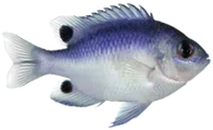
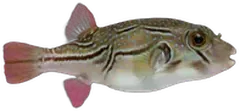
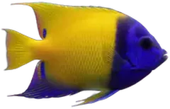
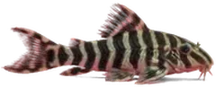
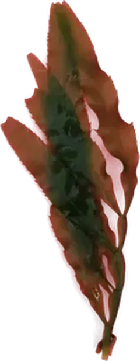
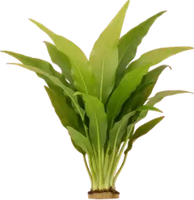
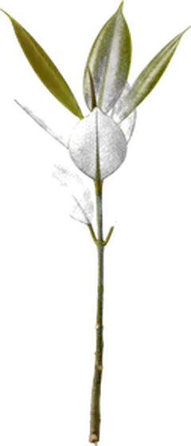

# reeftank-catalog

<!-- species:begin (generated by scripts/make_readme.py, do not edit) -->

> Parte del [**ecosistema de proyectos ReefTech**](https://elwinmage.github.io/reeftank/)

       

Especies de peces, corales, plantas e invertebrados para la vista de acuario de [ha-reef-card](https://github.com/Elwinmage/ha-reef-card), servidas por la [integración ReefTank](https://github.com/Elwinmage/ha-reeftank-component).

La integración descarga las versiones publicadas de este repositorio y las mantiene al día (`update.reeftank_catalog`, automático por defecto): nada que hacer en Home Assistant.

## Cómo funciona

Cada pez es una hoja de imágenes (un atlas WebP) y un descriptor con sus clips: *nadar*, *quieto* y *giro*. La tarjeta los encadena y refleja el giro para que el pez vuelva por donde vino. Aquí están el nado, el giro y la vuelta de dos especies:

Una especie sin vídeos tiene un atlas más sencillo hecho a partir de una sola foto (*LD*): todo el cuerpo ondula, las aletas no se mueven. Los hechos a partir de vídeos están marcados en la columna HD de las tablas de abajo.

<table><tr><th></th><th>Pez ángel emperador</th><th>Pez payaso</th></tr><tr><td>HD (vídeos)</td><td align="center"></td><td align="center"></td></tr><tr><td>LD (una foto)</td><td align="center"></td><td align="center"></td></tr></table>

## Peces (102)

**HD**: una animación real, hecha a partir de vídeos. Los demás tienen una animación simple hecha a partir de una foto, o el pez genérico.

| &nbsp;&nbsp;&nbsp;&nbsp;&nbsp;&nbsp;&nbsp;&nbsp;&nbsp;&nbsp;&nbsp;&nbsp;&nbsp;&nbsp;&nbsp;&nbsp;&nbsp;&nbsp;&nbsp;&nbsp;&nbsp;&nbsp;&nbsp;&nbsp;&nbsp;&nbsp;&nbsp;&nbsp;&nbsp;&nbsp;&nbsp;&nbsp;&nbsp; | Nombre | Nombre científico | Agua | Tamaño | Comportamiento | HD |
|---|---|---|---|---|---|---|
|  | Ancistrus <code>ancistrus</code> | *Ancistrus sp.* | Agua dulce | 10–14 cm | Vive cerca del fondo · se esconde de noche |  |
|  | Antias <code>pseudanthias</code> | *Pseudanthias sp.* | Marino | 8–14 cm | En cardumen · se esconde de noche | ✔ |
|  | Apistogramma cacatúa <code>apistogramma&#95;<wbr>cacatuoides</code> | *Apistogramma cacatuoides* | Agua dulce | 5–9 cm | Vive cerca del fondo · se esconde de noche |  |
|  | Barbo cereza <code>pethia&#95;<wbr>titteya</code> | *Pethia titteya* | Agua dulce | 4–5 cm | En cardumen · se esconde de noche |  |
|  | Barbo de Sumatra <code>puntigrus&#95;<wbr>tetrazona</code> | *Puntigrus tetrazona* | Agua dulce | 5–7 cm | En cardumen · se esconde de noche |  |
|  | Blenio bicolor <code>ecsenius&#95;<wbr>bicolor</code> | *Ecsenius bicolor* | Marino | 8–10 cm | Vive cerca del fondo · se esconde de noche |  |
|  | Blenio cortacésped <code>salarias&#95;<wbr>fasciatus</code> | *Salarias fasciatus* | Marino | 12–14 cm | Vive cerca del fondo · se esconde de noche |  |
|  | Caballito de mar rayado <code>hippocampus&#95;<wbr>erectus</code> | *Hippocampus erectus* | Marino | 10–15 cm | Estacionario · flota en el agua de noche |  |
|  | Cirujano amarillo <code>zebrasoma&#95;<wbr>flavescens</code> | *Zebrasoma flavescens* | Marino | 15–20 cm | Nadador de aguas abiertas · se esconde de noche |  |
|  | Cirujano azul <code>paracanthurus&#95;<wbr>hepatus</code> | *Paracanthurus hepatus* | Marino | 20–30 cm | Nadador de aguas abiertas · se esconde de noche |  |
|  | Cirujano azul polvo <code>acanthurus&#95;<wbr>leucosternon</code> | *Acanthurus leucosternon* | Marino | 20–23 cm | Nadador de aguas abiertas · se esconde de noche |  |
|  | Cirujano kole <code>ctenochaetus&#95;<wbr>strigosus</code> | *Ctenochaetus strigosus* | Marino | 12–18 cm | Nadador de aguas abiertas · se esconde de noche |  |
|  | Cirujano marrón <code>zebrasoma&#95;<wbr>scopas</code> | *Zebrasoma scopas* | Marino | 15–20 cm | Nadador de aguas abiertas · se esconde de noche |  |
|  | Cirujano velero <code>zebrasoma&#95;<wbr>veliferum</code> | *Zebrasoma veliferum* | Marino | 25–40 cm | Nadador de aguas abiertas · se esconde de noche |  |
|  | Cola de espada <code>xiphophorus&#95;<wbr>hellerii</code> | *Xiphophorus hellerii* | Agua dulce | 6–12 cm | En cardumen · se esconde de noche |  |
|  | Come algas siamés <code>crossocheilus&#95;<wbr>oblongus</code> | *Crossocheilus oblongus* | Agua dulce | 10–15 cm | Nadador de aguas abiertas · se esconde de noche |  |
|  | Corydoras bronceado <code>corydoras&#95;<wbr>aeneus</code> | *Corydoras aeneus* | Agua dulce | 6–7 cm | Vive cerca del fondo · se esconde de noche |  |
|  | Corydoras panda <code>corydoras&#95;<wbr>panda</code> | *Corydoras panda* | Agua dulce | 4–5 cm | Vive cerca del fondo · se esconde de noche |  |
|  | Cromis verde <code>chromis&#95;<wbr>viridis</code> | *Chromis viridis* | Marino | 5–8 cm | En cardumen · se esconde de noche | ✔ |
|  | Cíclido amarillo eléctrico <code>labidochromis&#95;<wbr>caeruleus</code> | *Labidochromis caeruleus* | Agua dulce | 8–10 cm | Nadador de aguas abiertas · se esconde de noche |  |
|  | Cíclido Demasoni <code>pseudotropheus&#95;<wbr>demasoni</code> | *Pseudotropheus demasoni* | Agua dulce | 7–8 cm | Nadador de aguas abiertas · se esconde de noche |  |
|  | Damisela de cola amarilla <code>chrysiptera&#95;<wbr>parasema</code> | *Chrysiptera parasema* | Marino | 5–6 cm | Estacionario · se queda cerca de su refugio · flota en el agua de noche |  |
|  | Damisela de Fiji <code>chrysiptera&#95;<wbr>taupou</code> | *Chrysiptera taupou* | Marino | 6–8 cm | Estacionario · se queda cerca de su refugio · flota en el agua de noche |  |
|  | Danio galaxia <code>danio&#95;<wbr>margaritatus</code> | *Danio margaritatus* | Agua dulce | 2–3 cm | En cardumen · se esconde de noche |  |
|  | Danio perla <code>danio&#95;<wbr>albolineatus</code> | *Danio albolineatus* | Agua dulce | 4–6 cm | En cardumen · se esconde de noche |  |
|  | Dascilo de tres manchas <code>dascyllus&#95;<wbr>trimaculatus</code> | *Dascyllus trimaculatus* | Marino | 10–14 cm | Estacionario · flota en el agua de noche |  |
|  | Discus <code>symphysodon&#95;<wbr>aequifasciatus</code> | *Symphysodon aequifasciatus* | Agua dulce | 15–20 cm | Nadador de aguas abiertas · se esconde de noche |  |
|  | Escalar <code>pterophyllum&#95;<wbr>scalare</code> | *Pterophyllum scalare* | Agua dulce | 12–15 cm | Nadador de aguas abiertas · se esconde de noche |  |
|  | Escáter moteado <code>scatophagus&#95;<wbr>argus</code> | *Scatophagus argus* | Salobre, Marino | 15–30 cm | Nadador de aguas abiertas · se esconde de noche |  |
|  | Gobio abejorro <code>brachygobius&#95;<wbr>xanthozonus</code> | *Brachygobius xanthozonus* | Salobre | 3–4 cm | Vive cerca del fondo · se esconde de noche |  |
|  | Gobio bandeado <code>amblygobius&#95;<wbr>phalaena</code> | *Amblygobius phalaena* | Marino | 8–10 cm | Vive sobre la arena · descansa en el fondo de noche |  |
|  | Gobio caballero <code>stigmatogobius&#95;<wbr>sadanundio</code> | *Stigmatogobius sadanundio* | Salobre | 6–8 cm | Vive cerca del fondo · se esconde de noche |  |
|  | Gobio centinela amarillo <code>cryptocentrus&#95;<wbr>cinctus</code> | *Cryptocentrus cinctus* | Marino | 8–10 cm | Vive sobre la arena · vive en una madriguera · descansa en el fondo de noche |  |
|  | Gobio de coral limón <code>gobiodon&#95;<wbr>citrinus</code> | *Gobiodon citrinus* | Marino | 3–5 cm | Vive cerca del fondo · se esconde de noche |  |
|  | Gobio de Okinawa <code>gobiodon&#95;<wbr>okinawae</code> | *Gobiodon okinawae* | Marino | 2.5–3.5 cm | Vive cerca del fondo · se esconde de noche |  |
|  | Gobio durmiente <code>valenciennea</code> | *Valenciennea sp.* | Marino | 10–16 cm | Vive sobre la arena · vive en una madriguera · descansa en el fondo de noche | ✔ |
|  | Gobio neón <code>elacatinus&#95;<wbr>oceanops</code> | *Elacatinus oceanops* | Marino | 4–6 cm | Vive cerca del fondo · se esconde de noche |  |
|  | Gobio violeta <code>gobioides&#95;<wbr>broussonnetii</code> | *Gobioides broussonnetii* | Salobre | 30–50 cm | Vive sobre la arena · vive en una madriguera · descansa en el fondo de noche |  |
|  | Gobio yasha <code>stonogobiops&#95;<wbr>yasha</code> | *Stonogobiops yasha* | Marino | 6–8 cm | Vive sobre la arena · vive en una madriguera · descansa en el fondo de noche |  |
|  | Gramma real <code>gramma&#95;<wbr>loreto</code> | *Gramma loreto* | Marino | 7–8 cm | Estacionario · flota en el agua de noche |  |
|  | Guppy <code>poecilia&#95;<wbr>reticulata</code> | *Poecilia reticulata* | Agua dulce | 3–6 cm | En cardumen · se esconde de noche |  |
|  | Guppy de Endler <code>poecilia&#95;<wbr>wingei</code> | *Poecilia wingei* | Agua dulce | 2–4 cm | En cardumen · se esconde de noche |  |
|  | Gurami azul <code>trichopodus&#95;<wbr>trichopterus</code> | *Trichopodus trichopterus* | Agua dulce | 10–15 cm | Nadador de aguas abiertas · se esconde de noche |  |
|  | Gurami enano <code>trichogaster&#95;<wbr>lalius</code> | *Trichogaster lalius* | Agua dulce | 5–8 cm | Nadador de aguas abiertas · se esconde de noche |  |
|  | Gurami perla <code>trichopodus&#95;<wbr>leerii</code> | *Trichopodus leerii* | Agua dulce | 10–12 cm | Nadador de aguas abiertas · se esconde de noche |  |
|  | Killi del Cabo López <code>aphyosemion&#95;<wbr>australe</code> | *Aphyosemion australe* | Agua dulce | 5–6 cm | Estacionario · flota en el agua de noche |  |
|  | Kribensis <code>pelvicachromis&#95;<wbr>pulcher</code> | *Pelvicachromis pulcher* | Agua dulce | 8–10 cm | Vive cerca del fondo · se esconde de noche |  |
|  | Limpiador común <code>labroides&#95;<wbr>dimidiatus</code> | *Labroides dimidiatus* | Marino | 10–12 cm | Nadador de aguas abiertas · se esconde de noche |  |
|  | Locha de Kuhl <code>pangio&#95;<wbr>kuhlii</code> | *Pangio kuhlii* | Agua dulce | 8–12 cm | Vive cerca del fondo · se esconde de noche |  |
|  | Locha payaso <code>chromobotia&#95;<wbr>macracanthus</code> | *Chromobotia macracanthus* | Agua dulce | 15–30 cm | Vive cerca del fondo · se esconde de noche |  |
|  | Lábrido amarillo <code>halichoeres&#95;<wbr>chrysus</code> | *Halichoeres chrysus* | Marino | 10–12 cm | Nadador de aguas abiertas · descansa en el fondo de noche |  |
|  | Lábrido de seis líneas <code>pseudocheilinus&#95;<wbr>hexataenia</code> | *Pseudocheilinus hexataenia* | Marino | 7–10 cm | Nadador de aguas abiertas · se esconde de noche |  |
|  | Lábrido hada de Solor <code>cirrhilabrus&#95;<wbr>solorensis</code> | *Cirrhilabrus solorensis* | Marino | 10–12 cm | Nadador de aguas abiertas · se esconde de noche |  |
|  | Molly común <code>poecilia&#95;<wbr>sphenops</code> | *Poecilia sphenops* | Agua dulce, Salobre | 6–10 cm | En cardumen · se esconde de noche |  |
|  | Molly vela <code>poecilia&#95;<wbr>velifera</code> | *Poecilia velifera* | Salobre, Agua dulce | 10–15 cm | En cardumen · se esconde de noche |  |
|  | Monodáctilo plateado <code>monodactylus&#95;<wbr>argenteus</code> | *Monodactylus argenteus* | Salobre, Marino | 15–25 cm | En cardumen · se esconde de noche |  |
|  | Oscar <code>astronotus&#95;<wbr>ocellatus</code> | *Astronotus ocellatus* | Agua dulce | 25–35 cm | Nadador de aguas abiertas · se esconde de noche |  |
|  | Otocinclus <code>otocinclus&#95;<wbr>affinis</code> | *Otocinclus affinis* | Agua dulce | 3–5 cm | Vive cerca del fondo · se esconde de noche |  |
|  | Pez arcoíris turquesa <code>melanotaenia&#95;<wbr>lacustris</code> | *Melanotaenia lacustris* | Agua dulce | 8–12 cm | En cardumen · se esconde de noche |  |
|  | Pez arquero <code>toxotes&#95;<wbr>jaculatrix</code> | *Toxotes jaculatrix* | Salobre | 15–25 cm | Nadador de aguas abiertas · se esconde de noche |  |
|  | Pez ballesta Picasso <code>rhinecanthus&#95;<wbr>aculeatus</code> | *Rhinecanthus aculeatus* | Marino | 20–25 cm | Nadador de aguas abiertas · se esconde de noche |  |
|  | Pez cardenal de Banggai <code>pterapogon&#95;<wbr>kauderni</code> | *Pterapogon kauderni* | Marino | 5–8 cm | Estacionario · flota en el agua de noche | ✔ |
|  | Pez cardenal de rayas amarillas <code>ostorhinchus&#95;<wbr>cyanosoma</code> | *Ostorhinchus cyanosoma* | Marino | 7–8 cm | Estacionario · flota en el agua de noche |  |
|  | Pez cardenal pijama <code>sphaeramia&#95;<wbr>nematoptera</code> | *Sphaeramia nematoptera* | Marino | 8–10 cm | Estacionario · flota en el agua de noche |  |
|  | Pez cebra <code>danio&#95;<wbr>rerio</code> | *Danio rerio* | Agua dulce | 4–5 cm | En cardumen · se esconde de noche |  |
|  | Pez conejo cara de zorro <code>siganus&#95;<wbr>vulpinus</code> | *Siganus vulpinus* | Marino | 15–22 cm | Nadador de aguas abiertas · descansa en el fondo de noche | ✔ |
|  | Pez de fuego <code>nemateleotris&#95;<wbr>magnifica</code> | *Nemateleotris magnifica* | Marino | 8–10 cm | Estacionario · flota en el agua de noche |  |
|  | Pez de fuego púrpura <code>nemateleotris&#95;<wbr>decora</code> | *Nemateleotris decora* | Marino | 8–10 cm | Estacionario · flota en el agua de noche |  |
|  | Pez de las nubes <code>tanichthys&#95;<wbr>albonubes</code> | *Tanichthys albonubes* | Agua dulce | 3–4 cm | En cardumen · se esconde de noche |  |
|  | Pez dorado <code>carassius&#95;<wbr>auratus</code> | *Carassius auratus* | Agua dulce | 10–25 cm | Nadador de aguas abiertas · se esconde de noche |  |
|  | Pez globo de ocho <code>dichotomyctere&#95;<wbr>biocellatus</code> | *Dichotomyctere biocellatus* | Salobre | 5–6.5 cm | Nadador de aguas abiertas · se esconde de noche |  |
|  | Pez globo de Valentin <code>canthigaster&#95;<wbr>valentini</code> | *Canthigaster valentini* | Marino | 8–10 cm | Nadador de aguas abiertas · se esconde de noche |  |
|  | Pez globo verde <code>dichotomyctere&#95;<wbr>nigroviridis</code> | *Dichotomyctere nigroviridis* | Salobre | 10–17 cm | Nadador de aguas abiertas · se esconde de noche |  |
|  | Pez hacha marmoleado <code>carnegiella&#95;<wbr>strigata</code> | *Carnegiella strigata* | Agua dulce | 4–5 cm | En cardumen · se esconde de noche |  |
|  | Pez halcón pixie <code>cirrhitichthys&#95;<wbr>oxycephalus</code> | *Cirrhitichthys oxycephalus* | Marino | 8–10 cm | Vive cerca del fondo · se esconde de noche |  |
|  | Pez león cebra <code>dendrochirus&#95;<wbr>zebra</code> | *Dendrochirus zebra* | Marino | 12–18 cm | Nadador de aguas abiertas · se esconde de noche |  |
|  | Pez león rojo <code>pterois&#95;<wbr>volitans</code> | *Pterois volitans* | Marino | 25–35 cm | Nadador de aguas abiertas · se esconde de noche |  |
|  | Pez luchador de Siam <code>betta&#95;<wbr>splendens</code> | *Betta splendens* | Agua dulce | 5–7 cm | Estacionario · se queda cerca de su refugio · flota en el agua de noche |  |
|  | Pez mandarín <code>synchiropus&#95;<wbr>splendidus</code> | *Synchiropus splendidus* | Marino | 5–8 cm | Vive cerca del fondo · se esconde de noche | ✔ |
|  | Pez mandarín psicodélico <code>synchiropus&#95;<wbr>picturatus</code> | *Synchiropus picturatus* | Marino | 6–8 cm | Vive cerca del fondo · se esconde de noche |  |
|  | Pez mandíbula de cabeza amarilla <code>opistognathus&#95;<wbr>aurifrons</code> | *Opistognathus aurifrons* | Marino | 10–12 cm | Vive sobre la arena · vive en una madriguera · descansa en el fondo de noche |  |
|  | Pez mariposa de franjas cobrizas <code>chelmon&#95;<wbr>rostratus</code> | *Chelmon rostratus* | Marino | 15–20 cm | Nadador de aguas abiertas · se esconde de noche |  |
|  | Pez payaso <code>amphiprion</code> | *Amphiprion sp.* | Marino | 7–11 cm | Estacionario · flota en el agua de noche | ✔ |
|  | Pez payaso granate <code>premnas&#95;<wbr>biaculeatus</code> | *Premnas biaculeatus* | Marino | 10–15 cm | Estacionario · flota en el agua de noche |  |
|  | Pez ángel bicolor <code>centropyge&#95;<wbr>bicolor</code> | *Centropyge bicolor* | Marino | 10–15 cm | Estacionario · flota en el agua de noche |  |
|  | Pez ángel emperador (adulto) <code>pomacanthus&#95;<wbr>imperator&#95;<wbr>adult</code> | *Pomacanthus imperator* | Marino | 25–38 cm | Nadador de aguas abiertas · se esconde de noche | ✔ |
|  | Pez ángel emperador (juvenil) <code>pomacanthus&#95;<wbr>imperator</code> | *Pomacanthus imperator* | Marino | 6–12 cm | Nadador de aguas abiertas · se esconde de noche | ✔ |
|  | Pez ángel flama <code>centropyge&#95;<wbr>loricula</code> | *Centropyge loricula* | Marino | 8–10 cm | Estacionario · flota en el agua de noche |  |
|  | Pez ángel real <code>pygoplites&#95;<wbr>diacanthus</code> | *Pygoplites diacanthus* | Marino | 20–25 cm | Nadador de aguas abiertas · se esconde de noche |  |
|  | Platy <code>xiphophorus&#95;<wbr>maculatus</code> | *Xiphophorus maculatus* | Agua dulce | 4–6 cm | En cardumen · se esconde de noche |  |
|  | Pleco cebra <code>hypancistrus&#95;<wbr>zebra</code> | *Hypancistrus zebra* | Agua dulce | 7–10 cm | Vive cerca del fondo · se esconde de noche |  |
|  | Pseudocromis orquídea <code>pseudochromis&#95;<wbr>fridmani</code> | *Pseudochromis fridmani* | Marino | 6–7 cm | Estacionario · se queda cerca de su refugio · flota en el agua de noche |  |
|  | Ramirezi <code>mikrogeophagus&#95;<wbr>ramirezi</code> | *Mikrogeophagus ramirezi* | Agua dulce | 5–7 cm | Estacionario · flota en el agua de noche |  |
|  | Rasbora arlequín <code>trigonostigma&#95;<wbr>heteromorpha</code> | *Trigonostigma heteromorpha* | Agua dulce | 3–4.5 cm | En cardumen · se esconde de noche |  |
|  | Saltarín del fango atlántico <code>periophthalmus&#95;<wbr>barbarus</code> | *Periophthalmus barbarus* | Salobre | 10–15 cm | Vive cerca del fondo · se esconde de noche |  |
|  | Tetra cardenal <code>paracheirodon&#95;<wbr>axelrodi</code> | *Paracheirodon axelrodi* | Agua dulce | 3–5 cm | En cardumen · se esconde de noche |  |
|  | Tetra emperador <code>nematobrycon&#95;<wbr>palmeri</code> | *Nematobrycon palmeri* | Agua dulce | 4–6 cm | En cardumen · se esconde de noche |  |
|  | Tetra limón <code>hyphessobrycon&#95;<wbr>pulchripinnis</code> | *Hyphessobrycon pulchripinnis* | Agua dulce | 3–4.5 cm | En cardumen · se esconde de noche |  |
|  | Tetra nariz roja <code>hemigrammus&#95;<wbr>bleheri</code> | *Hemigrammus bleheri* | Agua dulce | 4–5 cm | En cardumen · se esconde de noche |  |
|  | Tetra negro <code>gymnocorymbus&#95;<wbr>ternetzi</code> | *Gymnocorymbus ternetzi* | Agua dulce | 5–6 cm | En cardumen · se esconde de noche |  |
|  | Tetra neón <code>paracheirodon&#95;<wbr>innesi</code> | *Paracheirodon innesi* | Agua dulce | 3–4 cm | En cardumen · se esconde de noche |  |
|  | Tetra serpae <code>hyphessobrycon&#95;<wbr>eques</code> | *Hyphessobrycon eques* | Agua dulce | 3–4.5 cm | En cardumen · se esconde de noche |  |

## Corales (1)

| &nbsp;&nbsp;&nbsp;&nbsp;&nbsp;&nbsp;&nbsp;&nbsp;&nbsp;&nbsp;&nbsp;&nbsp;&nbsp;&nbsp;&nbsp;&nbsp;&nbsp;&nbsp;&nbsp;&nbsp;&nbsp;&nbsp;&nbsp;&nbsp;&nbsp;&nbsp;&nbsp;&nbsp;&nbsp;&nbsp;&nbsp;&nbsp;&nbsp; | Nombre | Nombre científico | Agua | Tamaño |
|---|---|---|---|---|
|  | Coral antorcha <code>euphyllia&#95;<wbr>glabrescens</code> | *Euphyllia glabrescens* | Marino | 10–30 cm |

## Plantas (29)

| &nbsp;&nbsp;&nbsp;&nbsp;&nbsp;&nbsp;&nbsp;&nbsp;&nbsp;&nbsp;&nbsp;&nbsp;&nbsp;&nbsp;&nbsp;&nbsp;&nbsp;&nbsp;&nbsp;&nbsp;&nbsp;&nbsp;&nbsp;&nbsp;&nbsp;&nbsp;&nbsp;&nbsp;&nbsp;&nbsp;&nbsp;&nbsp;&nbsp; | Nombre | Nombre científico | Agua | Tamaño | Zona |
|---|---|---|---|---|---|
|  | Ambulia <code>limnophila&#95;<wbr>sessiliflora</code> | *Limnophila sessiliflora* | Agua dulce | 20–40 cm | Fondo |
|  | Anubias <code>anubias&#95;<wbr>barteri</code> | *Anubias barteri* | Agua dulce | 10–25 cm | Epífita |
|  | Bucephalandra <code>bucephalandra</code> | *Bucephalandra sp.* | Agua dulce | 5–15 cm | Epífita |
|  | Cabomba <code>cabomba&#95;<wbr>caroliniana</code> | *Cabomba caroliniana* | Agua dulce | 30–60 cm | Fondo |
|  | Caulerpa <code>caulerpa&#95;<wbr>prolifera</code> | *Caulerpa prolifera* | Marino | 5–20 cm | Primer plano |
|  | Chaetomorpha <code>chaetomorpha&#95;<wbr>linum</code> | *Chaetomorpha linum* | Marino | 5–30 cm | Primer plano |
|  | Cryptocoryne ciliata <code>cryptocoryne&#95;<wbr>ciliata</code> | *Cryptocoryne ciliata* | Salobre, Agua dulce | 20–40 cm | Plano medio |
|  | Cryptocoryne parva <code>cryptocoryne&#95;<wbr>parva</code> | *Cryptocoryne parva* | Agua dulce | 5–8 cm | Primer plano |
|  | Cryptocoryne wendtii <code>cryptocoryne&#95;<wbr>wendtii</code> | *Cryptocoryne wendtii* | Agua dulce | 10–20 cm | Plano medio |
|  | Eleocharis enana <code>eleocharis&#95;<wbr>parvula</code> | *Eleocharis parvula* | Agua dulce | 5–10 cm | Primer plano |
|  | Elodea densa <code>egeria&#95;<wbr>densa</code> | *Egeria densa* | Agua dulce | 30–100 cm | Fondo |
|  | Espada amazónica <code>echinodorus&#95;<wbr>bleheri</code> | *Echinodorus bleheri* | Agua dulce | 30–50 cm | Plano medio |
|  | Glossostigma <code>glossostigma&#95;<wbr>elatinoides</code> | *Glossostigma elatinoides* | Agua dulce | 2–5 cm | Primer plano |
|  | Halimeda <code>halimeda&#95;<wbr>opuntia</code> | *Halimeda opuntia* | Marino | 5–15 cm | Primer plano |
|  | Helecho de Java <code>microsorum&#95;<wbr>pteropus</code> | *Microsorum pteropus* | Agua dulce | 20–30 cm | Epífita |
|  | Hemianthus <code>hemianthus&#95;<wbr>callitrichoides</code> | *Hemianthus callitrichoides* | Agua dulce | 2–5 cm | Primer plano |
|  | Hierba de tortuga <code>thalassia&#95;<wbr>testudinum</code> | *Thalassia testudinum* | Marino | 10–30 cm | Primer plano |
|  | Hygrophila <code>hygrophila&#95;<wbr>polysperma</code> | *Hygrophila polysperma* | Agua dulce | 20–50 cm | Fondo |
|  | Lechuga de agua <code>pistia&#95;<wbr>stratiotes</code> | *Pistia stratiotes* | Agua dulce | 5–15 cm | Flotante |
|  | Lenteja de agua <code>lemna&#95;<wbr>minor</code> | *Lemna minor* | Agua dulce | 0.5–1 cm | Flotante |
|  | Limnobium <code>limnobium&#95;<wbr>laevigatum</code> | *Limnobium laevigatum* | Agua dulce | 5–10 cm | Flotante |
|  | Ludwigia <code>ludwigia&#95;<wbr>repens</code> | *Ludwigia repens* | Agua dulce | 20–40 cm | Plano medio |
|  | Mangle rojo <code>rhizophora&#95;<wbr>mangle</code> | *Rhizophora mangle* | Salobre, Marino | 30–100 cm | Plano medio |
|  | Marimo <code>aegagropila&#95;<wbr>linnaei</code> | *Aegagropila linnaei* | Agua dulce | 3–10 cm | Primer plano |
|  | Musgo de Java <code>vesicularia&#95;<wbr>dubyana</code> | *Vesicularia dubyana* | Agua dulce | 3–5 cm | Epífita |
|  | Rotala <code>rotala&#95;<wbr>rotundifolia</code> | *Rotala rotundifolia* | Agua dulce | 20–50 cm | Fondo |
|  | Sagitaria enana <code>sagittaria&#95;<wbr>subulata</code> | *Sagittaria subulata* | Agua dulce | 10–30 cm | Primer plano |
|  | Staurogyne <code>staurogyne&#95;<wbr>repens</code> | *Staurogyne repens* | Agua dulce | 5–10 cm | Primer plano |
|  | Vallisneria <code>vallisneria&#95;<wbr>spiralis</code> | *Vallisneria spiralis* | Agua dulce, Salobre | 30–60 cm | Fondo |

## Invertebrados (32)

| &nbsp;&nbsp;&nbsp;&nbsp;&nbsp;&nbsp;&nbsp;&nbsp;&nbsp;&nbsp;&nbsp;&nbsp;&nbsp;&nbsp;&nbsp;&nbsp;&nbsp;&nbsp;&nbsp;&nbsp;&nbsp;&nbsp;&nbsp;&nbsp;&nbsp;&nbsp;&nbsp;&nbsp;&nbsp;&nbsp;&nbsp;&nbsp;&nbsp; | Nombre | Nombre científico | Agua | Tamaño | Función |
|---|---|---|---|---|---|
|  | Almeja gigante perforadora <code>tridacna&#95;<wbr>crocea</code> | *Tridacna crocea* | Marino | 5–15 cm | Filtrador · sésil |
|  | Cangrejo ermitaño de patas azules <code>clibanarius&#95;<wbr>tricolor</code> | *Clibanarius tricolor* | Marino | 2–3 cm | Carroñero · se desplaza por el fondo |
|  | Cangrejo ermitaño escarlata <code>paguristes&#95;<wbr>cadenati</code> | *Paguristes cadenati* | Marino | 3–4 cm | Carroñero · se desplaza por el fondo |
|  | Cangrejo esmeralda <code>mithraculus&#95;<wbr>sculptus</code> | *Mithraculus sculptus* | Marino | 3–4 cm | Comedor de algas · vive en la decoración |
|  | Caracol asesino <code>clea&#95;<wbr>helena</code> | *Clea helena* | Agua dulce | 2–3 cm | Depredador · se desplaza por el fondo |
|  | Caracol Astraea <code>astraea&#95;<wbr>tecta</code> | *Astraea tecta* | Marino | 2–4 cm | Comedor de algas · vive en la decoración |
|  | Caracol cerite <code>cerithium</code> | *Cerithium sp.* | Marino | 2–3 cm | Detritívoro · se desplaza por el fondo |
|  | Caracol cuerno de carnero <code>planorbella&#95;<wbr>duryi</code> | *Planorbella duryi* | Agua dulce | 2–3 cm | Detritívoro · trepa por el cristal |
|  | Caracol manzana <code>pomacea&#95;<wbr>bridgesii</code> | *Pomacea bridgesii* | Agua dulce | 4–5 cm | Carroñero · se desplaza por el fondo |
|  | Caracol Nassarius <code>nassarius</code> | *Nassarius sp.* | Marino | 2–4 cm | Carroñero · se desplaza por el fondo |
|  | Caracol nerita cebra <code>neritina&#95;<wbr>natalensis</code> | *Neritina natalensis* | Agua dulce | 2–3 cm | Comedor de algas · trepa por el cristal |
|  | Caracol nerita marino <code>nerita</code> | *Nerita sp.* | Marino | 2–3 cm | Comedor de algas · trepa por el cristal |
|  | Caracol trochus <code>tectus&#95;<wbr>fenestratus</code> | *Tectus fenestratus* | Marino | 4–6 cm | Comedor de algas · vive en la decoración |
|  | Caracol trompeta malayo <code>melanoides&#95;<wbr>tuberculata</code> | *Melanoides tuberculata* | Agua dulce | 2–3 cm | Detritívoro · se desplaza por el fondo |
|  | Caracol turbo <code>turbo&#95;<wbr>fluctuosus</code> | *Turbo fluctuosus* | Marino | 4–8 cm | Comedor de algas · trepa por el cristal |
|  | Erizo colector <code>tripneustes&#95;<wbr>gratilla</code> | *Tripneustes gratilla* | Marino | 10–15 cm | Comedor de algas · vive en la decoración |
|  | Erizo lápiz <code>prionocidaris&#95;<wbr>baculosa</code> | *Prionocidaris baculosa* | Marino | 8–10 cm | Comedor de algas · vive en la decoración |
|  | Estrella de arena <code>archaster&#95;<wbr>typicus</code> | *Archaster typicus* | Marino | 6–10 cm | Detritívoro · se desplaza por el fondo |
|  | Estrella serpiente <code>ophiolepis&#95;<wbr>superba</code> | *Ophiolepis superba* | Marino | 8–12 cm | Carroñero · se desplaza por el fondo |
|  | Gamba Amano <code>caridina&#95;<wbr>multidentata</code> | *Caridina multidentata* | Agua dulce | 3–5 cm | Comedor de algas · se desplaza por el fondo |
|  | Gamba arlequín <code>hymenocera&#95;<wbr>picta</code> | *Hymenocera picta* | Marino | 4–6 cm | Depredador · se desplaza por el fondo |
|  | Gamba boxeadora <code>stenopus&#95;<wbr>hispidus</code> | *Stenopus hispidus* | Marino | 6–8 cm | Limpiador · vive en la decoración |
|  | Gamba cereza <code>neocaridina&#95;<wbr>davidi</code> | *Neocaridina davidi* | Agua dulce | 2–3.5 cm | Detritívoro · se desplaza por el fondo |
|  | Gamba cristal roja <code>caridina&#95;<wbr>cantonensis</code> | *Caridina cantonensis* | Agua dulce | 2–3 cm | Detritívoro · se desplaza por el fondo |
|  | Gamba de bambú <code>atyopsis&#95;<wbr>moluccensis</code> | *Atyopsis moluccensis* | Agua dulce | 6–8 cm | Filtrador · vive en la decoración |
|  | Gamba fuego <code>lysmata&#95;<wbr>debelius</code> | *Lysmata debelius* | Marino | 5–6 cm | Limpiador · vive en la decoración |
|  | Gamba limpiadora escarlata <code>lysmata&#95;<wbr>amboinensis</code> | *Lysmata amboinensis* | Marino | 5–6 cm | Limpiador · vive en la decoración |
|  | Gamba marmoleada <code>saron&#95;<wbr>marmoratus</code> | *Saron marmoratus* | Marino | 5–7 cm | Carroñero · vive en la decoración |
|  | Gamba peppermint <code>lysmata&#95;<wbr>wurdemanni</code> | *Lysmata wurdemanni* | Marino | 3–5 cm | Limpiador · vive en la decoración |
|  | Gusano plumero <code>sabellastarte</code> | *Sabellastarte sp.* | Marino | 5–10 cm | Filtrador · sésil |
|  | Gusano árbol de Navidad <code>spirobranchus&#95;<wbr>giganteus</code> | *Spirobranchus giganteus* | Marino | 3–5 cm | Filtrador · sésil |
|  | Pepino de mar <code>holothuria</code> | *Holothuria sp.* | Marino | 15–30 cm | Detritívoro · se desplaza por el fondo |

Para añadir una especie (generación de los clips, construcción, publicación), ver la [documentación en inglés](README.md).

Los recursos de las especies están bajo **CC BY 4.0**, los scripts bajo MIT: ver [LICENSE.md](LICENSE.md).

<!-- species:end -->

<!-- ecosystem:start -->

## Proyectos relacionados

Los proyectos ReefTech encajan entre sí: las integraciones traen tu equipo a Home Assistant, la tarjeta lo muestra y lo controla, y el respaldo lo mantiene en marcha durante un corte. Cada uno funciona también por su cuenta.

<table>
  <tr>
    <th width="100px"></th>
    <th>Proyecto</th>
    <th>Función</th>
    <th>Funciona con</th>
  </tr>
  <tr>
    <td></td>
    <td>🐠 <a href="https://github.com/Elwinmage/ha-reefbeat-component"><b>ha-reefbeat-component</b></a></td>
    <td>Dispositivos Red Sea ReefBeat, controlados localmente sin cloud: ReefATO+, ReefControl, ReefControl-Power, ReefDose, ReefLed, ReefMat, ReefRun y ReefWave. blueprint de alertas para modos anómalos, calibraciones y batería baja. </td>
    <td>ha-reef-card</td>
  </tr>
  <tr>
    <td></td>
    <td>🌊 <a href="https://github.com/Elwinmage/ha-aquamedic-component"><b>ha-aquamedic-component</b></a></td>
    <td>Bombas Aqua Medic a través de la API cloud Gizwits: bombas de movimiento EcoDrift y SmartDrift, bombas DC Runner de retorno y de skimmer.</td>
    <td>ha-reef-card</td>
  </tr>
  <tr>
    <td></td>
    <td>🐟 <a href="https://github.com/Elwinmage/ha-vson-component"><b>ha-vson-component</b></a></td>
    <td>Comederos automáticos VSON a través de la API cloud VSON: el comedero WP8621 (alimentar, batería, aviso de poca comida) y detección genérica de cualquier otro dispositivo VSON. El WP8621 también puede funcionar totalmente local con ESPHome.</td>
    <td>ha-reef-card</td>
  </tr>
  <tr>
    <td></td>
    <td>🐙 <a href="https://github.com/Elwinmage/ha-reef-maintenance-component"><b>ha-reef-maintenance-component</b></a></td>
    <td>Seguimiento de limpieza y desgaste del equipo que Home Assistant no puede consultar: bombas de movimiento, bombas de retorno, skimmers, reactores, todo lo que mantienes a mano.</td>
    <td>ha-reef-card</td>
  </tr>
  <tr>
    <td></td>
    <td>🪸 <a href="https://github.com/Elwinmage/ha-reef-card"><b>ha-reef-card</b></a></td>
    <td>Vista gráfica interactiva de cada dispositivo en tu panel, y la única forma de editar programaciones avanzadas. Lee las tres integraciones mediante el contrato <code>reef_role</code> común, sin configuración del lado de la tarjeta. También dibuja los flujos de energía de reefbeatEnergyBackup. Su tarjeta de acuario da vida a su acuario con ha-reeftank-component.</td>
    <td>las cuatro integraciones, y ha-reeftank-component para el acuario</td>
  </tr>
  <tr>
    <td></td>
    <td>🐟 <a href="https://github.com/Elwinmage/ha-reeftank-component"><b>ha-reeftank-component</b></a></td>
    <td>Una imagen viva de su acuario en el panel: su foto, iluminada por sus lámparas reales, con peces y corales animados, y sus dispositivos y entidades encima. Guarda los acuarios y su fauna, registra las alimentaciones.</td>
    <td>ha-reef-card</td>
  </tr>
  <tr>
    <td></td>
    <td>🐡 <b>reeftank-catalog</b> <i>(este repositorio)</i></td>
    <td>Peces, corales y texturas de la tarjeta de acuario, descargados y mantenidos al día por ha-reeftank-component.</td>
    <td>ha-reeftank-component</td>
  </tr>
  <tr>
    <td></td>
    <td>🐬 <a href="https://github.com/Elwinmage/ha-reef-blueprints"><b>ha-reef-blueprints</b></a></td>
    <td>Blueprints de automatización comunes a todo el ecosistema: mantenimientos vencidos encontrados por el contrato <code>reef_role</code>, dispositivos que dejaron de responder, una prueba periódica de calentadores y una vigilancia de relés. Ocho idiomas.</td>
    <td>las cuatro integraciones</td>
  </tr>
  <tr>
    <td></td>
    <td>⚡ <a href="https://github.com/Elwinmage/reefbeatEnergyBackup"><b>reefbeatEnergyBackup</b></a></td>
    <td>Respaldo por batería ante cortes de luz. Un pack 24V LiFePO₄ gobernado por una Raspberry Pi, con degradación progresiva de la velocidad de las bombas según el estado de carga.</td>
    <td>por su cuenta, o junto a ha-reefbeat-component y ha-reef-card</td>
  </tr>
</table>

Todos están documentados juntos en la [página del proyecto ReefTech](https://elwinmage.github.io/reeftank/).

<!-- ecosystem:end -->
