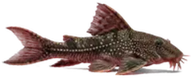
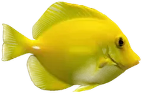
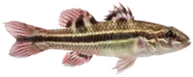
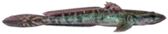
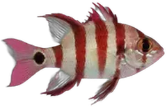
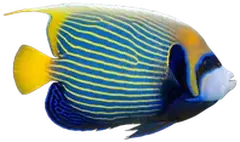
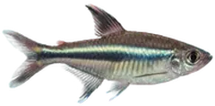
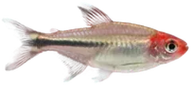

# reeftank-catalog

<!-- species:begin (generated by scripts/make_readme.py, do not edit) -->

> Parte del [**ecosistema de proyectos ReefTech**](https://elwinmage.github.io/reeftank/)

       

Especies de peces, corales, plantas e invertebrados para la vista de acuario de [ha-reef-card](https://github.com/Elwinmage/ha-reef-card), servidas por la [integración ReefTank](https://github.com/Elwinmage/ha-reeftank-component).

La integración descarga las versiones publicadas de este repositorio y las mantiene al día (`update.reeftank_catalog`, automático por defecto): nada que hacer en Home Assistant.

## Cómo funciona

Cada pez es una hoja de imágenes (un atlas WebP) y un descriptor con sus clips: *nadar*, *quieto* y *giro*. La tarjeta los encadena y refleja el giro para que el pez vuelva por donde vino. Aquí están el nado, el giro y la vuelta de dos especies:

<table><tr><td align="center"> Pez ángel emperador</td><td align="center"> Pez payaso</td></tr></table>

## Peces (102)

**HD**: una animación real, hecha a partir de vídeos. Los demás tienen una animación simple hecha a partir de una foto, o el pez genérico.

| &nbsp;&nbsp;&nbsp;&nbsp;&nbsp;&nbsp;&nbsp;&nbsp;&nbsp;&nbsp;&nbsp;&nbsp;&nbsp;&nbsp;&nbsp;&nbsp;&nbsp;&nbsp;&nbsp;&nbsp;&nbsp;&nbsp;&nbsp;&nbsp;&nbsp;&nbsp;&nbsp;&nbsp;&nbsp;&nbsp;&nbsp;&nbsp;&nbsp;&nbsp;&nbsp;&nbsp;&nbsp;&nbsp;&nbsp;&nbsp;&nbsp;&nbsp;&nbsp;&nbsp;&nbsp;&nbsp;&nbsp;&nbsp;&nbsp;&nbsp;&nbsp;&nbsp;&nbsp;&nbsp;&nbsp;&nbsp; | Nombre | Nombre científico | Agua | Tamaño | Comportamiento | HD |
|---|---|---|---|---|---|---|
|  | Ancistrus `ancistrus` | *Ancistrus sp.* | Agua dulce | 10–14 cm | Vive cerca del fondo · se esconde de noche |  |
|  | Antias `pseudanthias` | *Pseudanthias sp.* | Marino | 8–14 cm | En cardumen · se esconde de noche | ✔ |
|  | Apistogramma cacatúa `apistogramma_cacatuoides` | *Apistogramma cacatuoides* | Agua dulce | 5–9 cm | Vive cerca del fondo · se esconde de noche |  |
|  | Barbo cereza `pethia_titteya` | *Pethia titteya* | Agua dulce | 4–5 cm | En cardumen · se esconde de noche |  |
|  | Barbo de Sumatra `puntigrus_tetrazona` | *Puntigrus tetrazona* | Agua dulce | 5–7 cm | En cardumen · se esconde de noche |  |
|  | Blenio bicolor `ecsenius_bicolor` | *Ecsenius bicolor* | Marino | 8–10 cm | Vive cerca del fondo · se esconde de noche |  |
|  | Blenio cortacésped `salarias_fasciatus` | *Salarias fasciatus* | Marino | 12–14 cm | Vive cerca del fondo · se esconde de noche |  |
|  | Caballito de mar rayado `hippocampus_erectus` | *Hippocampus erectus* | Marino | 10–15 cm | Estacionario · flota en el agua de noche |  |
|  | Cirujano amarillo `zebrasoma_flavescens` | *Zebrasoma flavescens* | Marino | 15–20 cm | Nadador de aguas abiertas · se esconde de noche |  |
|  | Cirujano azul `paracanthurus_hepatus` | *Paracanthurus hepatus* | Marino | 20–30 cm | Nadador de aguas abiertas · se esconde de noche |  |
|  | Cirujano azul polvo `acanthurus_leucosternon` | *Acanthurus leucosternon* | Marino | 20–23 cm | Nadador de aguas abiertas · se esconde de noche |  |
|  | Cirujano kole `ctenochaetus_strigosus` | *Ctenochaetus strigosus* | Marino | 12–18 cm | Nadador de aguas abiertas · se esconde de noche |  |
|  | Cirujano marrón `zebrasoma_scopas` | *Zebrasoma scopas* | Marino | 15–20 cm | Nadador de aguas abiertas · se esconde de noche |  |
|  | Cirujano velero `zebrasoma_veliferum` | *Zebrasoma veliferum* | Marino | 25–40 cm | Nadador de aguas abiertas · se esconde de noche |  |
|  | Cola de espada `xiphophorus_hellerii` | *Xiphophorus hellerii* | Agua dulce | 6–12 cm | En cardumen · se esconde de noche |  |
|  | Come algas siamés `crossocheilus_oblongus` | *Crossocheilus oblongus* | Agua dulce | 10–15 cm | Nadador de aguas abiertas · se esconde de noche |  |
|  | Corydoras bronceado `corydoras_aeneus` | *Corydoras aeneus* | Agua dulce | 6–7 cm | Vive cerca del fondo · se esconde de noche |  |
|  | Corydoras panda `corydoras_panda` | *Corydoras panda* | Agua dulce | 4–5 cm | Vive cerca del fondo · se esconde de noche |  |
|  | Cromis verde `chromis_viridis` | *Chromis viridis* | Marino | 5–8 cm | En cardumen · se esconde de noche | ✔ |
|  | Cíclido amarillo eléctrico `labidochromis_caeruleus` | *Labidochromis caeruleus* | Agua dulce | 8–10 cm | Nadador de aguas abiertas · se esconde de noche |  |
|  | Cíclido Demasoni `pseudotropheus_demasoni` | *Pseudotropheus demasoni* | Agua dulce | 7–8 cm | Nadador de aguas abiertas · se esconde de noche |  |
|  | Damisela de cola amarilla `chrysiptera_parasema` | *Chrysiptera parasema* | Marino | 5–6 cm | Estacionario · se queda cerca de su refugio · flota en el agua de noche |  |
|  | Damisela de Fiji `chrysiptera_taupou` | *Chrysiptera taupou* | Marino | 6–8 cm | Estacionario · se queda cerca de su refugio · flota en el agua de noche |  |
|  | Danio galaxia `danio_margaritatus` | *Danio margaritatus* | Agua dulce | 2–3 cm | En cardumen · se esconde de noche |  |
|  | Danio perla `danio_albolineatus` | *Danio albolineatus* | Agua dulce | 4–6 cm | En cardumen · se esconde de noche |  |
|  | Dascilo de tres manchas `dascyllus_trimaculatus` | *Dascyllus trimaculatus* | Marino | 10–14 cm | Estacionario · flota en el agua de noche |  |
|  | Discus `symphysodon_aequifasciatus` | *Symphysodon aequifasciatus* | Agua dulce | 15–20 cm | Nadador de aguas abiertas · se esconde de noche |  |
|  | Escalar `pterophyllum_scalare` | *Pterophyllum scalare* | Agua dulce | 12–15 cm | Nadador de aguas abiertas · se esconde de noche |  |
|  | Escáter moteado `scatophagus_argus` | *Scatophagus argus* | Salobre, Marino | 15–30 cm | Nadador de aguas abiertas · se esconde de noche |  |
|  | Gobio abejorro `brachygobius_xanthozonus` | *Brachygobius xanthozonus* | Salobre | 3–4 cm | Vive cerca del fondo · se esconde de noche |  |
|  | Gobio bandeado `amblygobius_phalaena` | *Amblygobius phalaena* | Marino | 8–10 cm | Vive sobre la arena · descansa en el fondo de noche |  |
|  | Gobio caballero `stigmatogobius_sadanundio` | *Stigmatogobius sadanundio* | Salobre | 6–8 cm | Vive cerca del fondo · se esconde de noche |  |
|  | Gobio centinela amarillo `cryptocentrus_cinctus` | *Cryptocentrus cinctus* | Marino | 8–10 cm | Vive sobre la arena · vive en una madriguera · descansa en el fondo de noche |  |
|  | Gobio de coral limón `gobiodon_citrinus` | *Gobiodon citrinus* | Marino | 3–5 cm | Vive cerca del fondo · se esconde de noche |  |
|  | Gobio de Okinawa `gobiodon_okinawae` | *Gobiodon okinawae* | Marino | 2.5–3.5 cm | Vive cerca del fondo · se esconde de noche |  |
|  | Gobio durmiente `valenciennea` | *Valenciennea sp.* | Marino | 10–16 cm | Vive sobre la arena · vive en una madriguera · descansa en el fondo de noche | ✔ |
|  | Gobio neón `elacatinus_oceanops` | *Elacatinus oceanops* | Marino | 4–6 cm | Vive cerca del fondo · se esconde de noche |  |
|  | Gobio violeta `gobioides_broussonnetii` | *Gobioides broussonnetii* | Salobre | 30–50 cm | Vive sobre la arena · vive en una madriguera · descansa en el fondo de noche |  |
|  | Gobio yasha `stonogobiops_yasha` | *Stonogobiops yasha* | Marino | 6–8 cm | Vive sobre la arena · vive en una madriguera · descansa en el fondo de noche |  |
|  | Gramma real `gramma_loreto` | *Gramma loreto* | Marino | 7–8 cm | Estacionario · flota en el agua de noche |  |
|  | Guppy `poecilia_reticulata` | *Poecilia reticulata* | Agua dulce | 3–6 cm | En cardumen · se esconde de noche |  |
|  | Guppy de Endler `poecilia_wingei` | *Poecilia wingei* | Agua dulce | 2–4 cm | En cardumen · se esconde de noche |  |
|  | Gurami azul `trichopodus_trichopterus` | *Trichopodus trichopterus* | Agua dulce | 10–15 cm | Nadador de aguas abiertas · se esconde de noche |  |
|  | Gurami enano `trichogaster_lalius` | *Trichogaster lalius* | Agua dulce | 5–8 cm | Nadador de aguas abiertas · se esconde de noche |  |
|  | Gurami perla `trichopodus_leerii` | *Trichopodus leerii* | Agua dulce | 10–12 cm | Nadador de aguas abiertas · se esconde de noche |  |
|  | Killi del Cabo López `aphyosemion_australe` | *Aphyosemion australe* | Agua dulce | 5–6 cm | Estacionario · flota en el agua de noche |  |
|  | Kribensis `pelvicachromis_pulcher` | *Pelvicachromis pulcher* | Agua dulce | 8–10 cm | Vive cerca del fondo · se esconde de noche |  |
|  | Limpiador común `labroides_dimidiatus` | *Labroides dimidiatus* | Marino | 10–12 cm | Nadador de aguas abiertas · se esconde de noche |  |
|  | Locha de Kuhl `pangio_kuhlii` | *Pangio kuhlii* | Agua dulce | 8–12 cm | Vive cerca del fondo · se esconde de noche |  |
|  | Locha payaso `chromobotia_macracanthus` | *Chromobotia macracanthus* | Agua dulce | 15–30 cm | Vive cerca del fondo · se esconde de noche |  |
|  | Lábrido amarillo `halichoeres_chrysus` | *Halichoeres chrysus* | Marino | 10–12 cm | Nadador de aguas abiertas · descansa en el fondo de noche |  |
|  | Lábrido de seis líneas `pseudocheilinus_hexataenia` | *Pseudocheilinus hexataenia* | Marino | 7–10 cm | Nadador de aguas abiertas · se esconde de noche |  |
|  | Lábrido hada de Solor `cirrhilabrus_solorensis` | *Cirrhilabrus solorensis* | Marino | 10–12 cm | Nadador de aguas abiertas · se esconde de noche |  |
|  | Molly común `poecilia_sphenops` | *Poecilia sphenops* | Agua dulce, Salobre | 6–10 cm | En cardumen · se esconde de noche |  |
|  | Molly vela `poecilia_velifera` | *Poecilia velifera* | Salobre, Agua dulce | 10–15 cm | En cardumen · se esconde de noche |  |
|  | Monodáctilo plateado `monodactylus_argenteus` | *Monodactylus argenteus* | Salobre, Marino | 15–25 cm | En cardumen · se esconde de noche |  |
|  | Oscar `astronotus_ocellatus` | *Astronotus ocellatus* | Agua dulce | 25–35 cm | Nadador de aguas abiertas · se esconde de noche |  |
|  | Otocinclus `otocinclus_affinis` | *Otocinclus affinis* | Agua dulce | 3–5 cm | Vive cerca del fondo · se esconde de noche |  |
|  | Pez arcoíris turquesa `melanotaenia_lacustris` | *Melanotaenia lacustris* | Agua dulce | 8–12 cm | En cardumen · se esconde de noche |  |
|  | Pez arquero `toxotes_jaculatrix` | *Toxotes jaculatrix* | Salobre | 15–25 cm | Nadador de aguas abiertas · se esconde de noche |  |
|  | Pez ballesta Picasso `rhinecanthus_aculeatus` | *Rhinecanthus aculeatus* | Marino | 20–25 cm | Nadador de aguas abiertas · se esconde de noche |  |
|  | Pez cardenal de Banggai `pterapogon_kauderni` | *Pterapogon kauderni* | Marino | 5–8 cm | Estacionario · flota en el agua de noche | ✔ |
|  | Pez cardenal de rayas amarillas `ostorhinchus_cyanosoma` | *Ostorhinchus cyanosoma* | Marino | 7–8 cm | Estacionario · flota en el agua de noche |  |
|  | Pez cardenal pijama `sphaeramia_nematoptera` | *Sphaeramia nematoptera* | Marino | 8–10 cm | Estacionario · flota en el agua de noche |  |
|  | Pez cebra `danio_rerio` | *Danio rerio* | Agua dulce | 4–5 cm | En cardumen · se esconde de noche |  |
|  | Pez conejo cara de zorro `siganus_vulpinus` | *Siganus vulpinus* | Marino | 15–22 cm | Nadador de aguas abiertas · descansa en el fondo de noche | ✔ |
|  | Pez de fuego `nemateleotris_magnifica` | *Nemateleotris magnifica* | Marino | 8–10 cm | Estacionario · flota en el agua de noche |  |
|  | Pez de fuego púrpura `nemateleotris_decora` | *Nemateleotris decora* | Marino | 8–10 cm | Estacionario · flota en el agua de noche |  |
|  | Pez de las nubes `tanichthys_albonubes` | *Tanichthys albonubes* | Agua dulce | 3–4 cm | En cardumen · se esconde de noche |  |
|  | Pez dorado `carassius_auratus` | *Carassius auratus* | Agua dulce | 10–25 cm | Nadador de aguas abiertas · se esconde de noche |  |
|  | Pez globo de ocho `dichotomyctere_biocellatus` | *Dichotomyctere biocellatus* | Salobre | 5–6.5 cm | Nadador de aguas abiertas · se esconde de noche |  |
|  | Pez globo de Valentin `canthigaster_valentini` | *Canthigaster valentini* | Marino | 8–10 cm | Nadador de aguas abiertas · se esconde de noche |  |
|  | Pez globo verde `dichotomyctere_nigroviridis` | *Dichotomyctere nigroviridis* | Salobre | 10–17 cm | Nadador de aguas abiertas · se esconde de noche |  |
|  | Pez hacha marmoleado `carnegiella_strigata` | *Carnegiella strigata* | Agua dulce | 4–5 cm | En cardumen · se esconde de noche |  |
|  | Pez halcón pixie `cirrhitichthys_oxycephalus` | *Cirrhitichthys oxycephalus* | Marino | 8–10 cm | Vive cerca del fondo · se esconde de noche |  |
|  | Pez león cebra `dendrochirus_zebra` | *Dendrochirus zebra* | Marino | 12–18 cm | Nadador de aguas abiertas · se esconde de noche |  |
|  | Pez león rojo `pterois_volitans` | *Pterois volitans* | Marino | 25–35 cm | Nadador de aguas abiertas · se esconde de noche |  |
|  | Pez luchador de Siam `betta_splendens` | *Betta splendens* | Agua dulce | 5–7 cm | Estacionario · se queda cerca de su refugio · flota en el agua de noche |  |
|  | Pez mandarín `synchiropus_splendidus` | *Synchiropus splendidus* | Marino | 5–8 cm | Vive cerca del fondo · se esconde de noche | ✔ |
|  | Pez mandarín psicodélico `synchiropus_picturatus` | *Synchiropus picturatus* | Marino | 6–8 cm | Vive cerca del fondo · se esconde de noche |  |
|  | Pez mandíbula de cabeza amarilla `opistognathus_aurifrons` | *Opistognathus aurifrons* | Marino | 10–12 cm | Vive sobre la arena · vive en una madriguera · descansa en el fondo de noche |  |
|  | Pez mariposa de franjas cobrizas `chelmon_rostratus` | *Chelmon rostratus* | Marino | 15–20 cm | Nadador de aguas abiertas · se esconde de noche |  |
|  | Pez payaso `amphiprion` | *Amphiprion sp.* | Marino | 7–11 cm | Estacionario · flota en el agua de noche | ✔ |
|  | Pez payaso granate `premnas_biaculeatus` | *Premnas biaculeatus* | Marino | 10–15 cm | Estacionario · flota en el agua de noche |  |
|  | Pez ángel bicolor `centropyge_bicolor` | *Centropyge bicolor* | Marino | 10–15 cm | Estacionario · flota en el agua de noche |  |
|  | Pez ángel emperador (adulto) `pomacanthus_imperator_adult` | *Pomacanthus imperator* | Marino | 25–38 cm | Nadador de aguas abiertas · se esconde de noche | ✔ |
|  | Pez ángel emperador (juvenil) `pomacanthus_imperator` | *Pomacanthus imperator* | Marino | 6–12 cm | Nadador de aguas abiertas · se esconde de noche | ✔ |
|  | Pez ángel flama `centropyge_loricula` | *Centropyge loricula* | Marino | 8–10 cm | Estacionario · flota en el agua de noche |  |
|  | Pez ángel real `pygoplites_diacanthus` | *Pygoplites diacanthus* | Marino | 20–25 cm | Nadador de aguas abiertas · se esconde de noche |  |
|  | Platy `xiphophorus_maculatus` | *Xiphophorus maculatus* | Agua dulce | 4–6 cm | En cardumen · se esconde de noche |  |
|  | Pleco cebra `hypancistrus_zebra` | *Hypancistrus zebra* | Agua dulce | 7–10 cm | Vive cerca del fondo · se esconde de noche |  |
|  | Pseudocromis orquídea `pseudochromis_fridmani` | *Pseudochromis fridmani* | Marino | 6–7 cm | Estacionario · se queda cerca de su refugio · flota en el agua de noche |  |
|  | Ramirezi `mikrogeophagus_ramirezi` | *Mikrogeophagus ramirezi* | Agua dulce | 5–7 cm | Estacionario · flota en el agua de noche |  |
|  | Rasbora arlequín `trigonostigma_heteromorpha` | *Trigonostigma heteromorpha* | Agua dulce | 3–4.5 cm | En cardumen · se esconde de noche |  |
|  | Saltarín del fango atlántico `periophthalmus_barbarus` | *Periophthalmus barbarus* | Salobre | 10–15 cm | Vive cerca del fondo · se esconde de noche |  |
|  | Tetra cardenal `paracheirodon_axelrodi` | *Paracheirodon axelrodi* | Agua dulce | 3–5 cm | En cardumen · se esconde de noche |  |
|  | Tetra emperador `nematobrycon_palmeri` | *Nematobrycon palmeri* | Agua dulce | 4–6 cm | En cardumen · se esconde de noche |  |
|  | Tetra limón `hyphessobrycon_pulchripinnis` | *Hyphessobrycon pulchripinnis* | Agua dulce | 3–4.5 cm | En cardumen · se esconde de noche |  |
|  | Tetra nariz roja `hemigrammus_bleheri` | *Hemigrammus bleheri* | Agua dulce | 4–5 cm | En cardumen · se esconde de noche |  |
|  | Tetra negro `gymnocorymbus_ternetzi` | *Gymnocorymbus ternetzi* | Agua dulce | 5–6 cm | En cardumen · se esconde de noche |  |
|  | Tetra neón `paracheirodon_innesi` | *Paracheirodon innesi* | Agua dulce | 3–4 cm | En cardumen · se esconde de noche |  |
|  | Tetra serpae `hyphessobrycon_eques` | *Hyphessobrycon eques* | Agua dulce | 3–4.5 cm | En cardumen · se esconde de noche |  |

## Corales (1)

| &nbsp;&nbsp;&nbsp;&nbsp;&nbsp;&nbsp;&nbsp;&nbsp;&nbsp;&nbsp;&nbsp;&nbsp;&nbsp;&nbsp;&nbsp;&nbsp;&nbsp;&nbsp;&nbsp;&nbsp;&nbsp;&nbsp;&nbsp;&nbsp;&nbsp;&nbsp;&nbsp;&nbsp;&nbsp;&nbsp;&nbsp;&nbsp;&nbsp;&nbsp;&nbsp;&nbsp;&nbsp;&nbsp;&nbsp;&nbsp;&nbsp;&nbsp;&nbsp;&nbsp;&nbsp;&nbsp;&nbsp;&nbsp;&nbsp;&nbsp;&nbsp;&nbsp;&nbsp;&nbsp;&nbsp;&nbsp; | Nombre | Nombre científico | Agua | Tamaño |
|---|---|---|---|---|
|  | Coral antorcha `euphyllia_glabrescens` | *Euphyllia glabrescens* | Marino | 10–30 cm |

## Plantas (29)

| &nbsp;&nbsp;&nbsp;&nbsp;&nbsp;&nbsp;&nbsp;&nbsp;&nbsp;&nbsp;&nbsp;&nbsp;&nbsp;&nbsp;&nbsp;&nbsp;&nbsp;&nbsp;&nbsp;&nbsp;&nbsp;&nbsp;&nbsp;&nbsp;&nbsp;&nbsp;&nbsp;&nbsp;&nbsp;&nbsp;&nbsp;&nbsp;&nbsp;&nbsp;&nbsp;&nbsp;&nbsp;&nbsp;&nbsp;&nbsp;&nbsp;&nbsp;&nbsp;&nbsp;&nbsp;&nbsp;&nbsp;&nbsp;&nbsp;&nbsp;&nbsp;&nbsp;&nbsp;&nbsp;&nbsp;&nbsp; | Nombre | Nombre científico | Agua | Tamaño | Zona |
|---|---|---|---|---|---|
|  | Ambulia `limnophila_sessiliflora` | *Limnophila sessiliflora* | Agua dulce | 20–40 cm | Fondo |
|  | Anubias `anubias_barteri` | *Anubias barteri* | Agua dulce | 10–25 cm | Epífita |
|  | Bucephalandra `bucephalandra` | *Bucephalandra sp.* | Agua dulce | 5–15 cm | Epífita |
|  | Cabomba `cabomba_caroliniana` | *Cabomba caroliniana* | Agua dulce | 30–60 cm | Fondo |
|  | Caulerpa `caulerpa_prolifera` | *Caulerpa prolifera* | Marino | 5–20 cm | Primer plano |
|  | Chaetomorpha `chaetomorpha_linum` | *Chaetomorpha linum* | Marino | 5–30 cm | Primer plano |
|  | Cryptocoryne ciliata `cryptocoryne_ciliata` | *Cryptocoryne ciliata* | Salobre, Agua dulce | 20–40 cm | Plano medio |
|  | Cryptocoryne parva `cryptocoryne_parva` | *Cryptocoryne parva* | Agua dulce | 5–8 cm | Primer plano |
|  | Cryptocoryne wendtii `cryptocoryne_wendtii` | *Cryptocoryne wendtii* | Agua dulce | 10–20 cm | Plano medio |
|  | Eleocharis enana `eleocharis_parvula` | *Eleocharis parvula* | Agua dulce | 5–10 cm | Primer plano |
|  | Elodea densa `egeria_densa` | *Egeria densa* | Agua dulce | 30–100 cm | Fondo |
|  | Espada amazónica `echinodorus_bleheri` | *Echinodorus bleheri* | Agua dulce | 30–50 cm | Plano medio |
|  | Glossostigma `glossostigma_elatinoides` | *Glossostigma elatinoides* | Agua dulce | 2–5 cm | Primer plano |
|  | Halimeda `halimeda_opuntia` | *Halimeda opuntia* | Marino | 5–15 cm | Primer plano |
|  | Helecho de Java `microsorum_pteropus` | *Microsorum pteropus* | Agua dulce | 20–30 cm | Epífita |
|  | Hemianthus `hemianthus_callitrichoides` | *Hemianthus callitrichoides* | Agua dulce | 2–5 cm | Primer plano |
|  | Hierba de tortuga `thalassia_testudinum` | *Thalassia testudinum* | Marino | 10–30 cm | Primer plano |
|  | Hygrophila `hygrophila_polysperma` | *Hygrophila polysperma* | Agua dulce | 20–50 cm | Fondo |
|  | Lechuga de agua `pistia_stratiotes` | *Pistia stratiotes* | Agua dulce | 5–15 cm | Flotante |
|  | Lenteja de agua `lemna_minor` | *Lemna minor* | Agua dulce | 0.5–1 cm | Flotante |
|  | Limnobium `limnobium_laevigatum` | *Limnobium laevigatum* | Agua dulce | 5–10 cm | Flotante |
|  | Ludwigia `ludwigia_repens` | *Ludwigia repens* | Agua dulce | 20–40 cm | Plano medio |
|  | Mangle rojo `rhizophora_mangle` | *Rhizophora mangle* | Salobre, Marino | 30–100 cm | Plano medio |
|  | Marimo `aegagropila_linnaei` | *Aegagropila linnaei* | Agua dulce | 3–10 cm | Primer plano |
|  | Musgo de Java `vesicularia_dubyana` | *Vesicularia dubyana* | Agua dulce | 3–5 cm | Epífita |
|  | Rotala `rotala_rotundifolia` | *Rotala rotundifolia* | Agua dulce | 20–50 cm | Fondo |
|  | Sagitaria enana `sagittaria_subulata` | *Sagittaria subulata* | Agua dulce | 10–30 cm | Primer plano |
|  | Staurogyne `staurogyne_repens` | *Staurogyne repens* | Agua dulce | 5–10 cm | Primer plano |
|  | Vallisneria `vallisneria_spiralis` | *Vallisneria spiralis* | Agua dulce, Salobre | 30–60 cm | Fondo |

## Invertebrados (32)

| &nbsp;&nbsp;&nbsp;&nbsp;&nbsp;&nbsp;&nbsp;&nbsp;&nbsp;&nbsp;&nbsp;&nbsp;&nbsp;&nbsp;&nbsp;&nbsp;&nbsp;&nbsp;&nbsp;&nbsp;&nbsp;&nbsp;&nbsp;&nbsp;&nbsp;&nbsp;&nbsp;&nbsp;&nbsp;&nbsp;&nbsp;&nbsp;&nbsp;&nbsp;&nbsp;&nbsp;&nbsp;&nbsp;&nbsp;&nbsp;&nbsp;&nbsp;&nbsp;&nbsp;&nbsp;&nbsp;&nbsp;&nbsp;&nbsp;&nbsp;&nbsp;&nbsp;&nbsp;&nbsp;&nbsp;&nbsp; | Nombre | Nombre científico | Agua | Tamaño | Función |
|---|---|---|---|---|---|
|  | Almeja gigante perforadora `tridacna_crocea` | *Tridacna crocea* | Marino | 5–15 cm | Filtrador · sésil |
|  | Cangrejo ermitaño de patas azules `clibanarius_tricolor` | *Clibanarius tricolor* | Marino | 2–3 cm | Carroñero · se desplaza por el fondo |
|  | Cangrejo ermitaño escarlata `paguristes_cadenati` | *Paguristes cadenati* | Marino | 3–4 cm | Carroñero · se desplaza por el fondo |
|  | Cangrejo esmeralda `mithraculus_sculptus` | *Mithraculus sculptus* | Marino | 3–4 cm | Comedor de algas · vive en la decoración |
|  | Caracol asesino `clea_helena` | *Clea helena* | Agua dulce | 2–3 cm | Depredador · se desplaza por el fondo |
|  | Caracol Astraea `astraea_tecta` | *Astraea tecta* | Marino | 2–4 cm | Comedor de algas · vive en la decoración |
|  | Caracol cerite `cerithium` | *Cerithium sp.* | Marino | 2–3 cm | Detritívoro · se desplaza por el fondo |
|  | Caracol cuerno de carnero `planorbella_duryi` | *Planorbella duryi* | Agua dulce | 2–3 cm | Detritívoro · trepa por el cristal |
|  | Caracol manzana `pomacea_bridgesii` | *Pomacea bridgesii* | Agua dulce | 4–5 cm | Carroñero · se desplaza por el fondo |
|  | Caracol Nassarius `nassarius` | *Nassarius sp.* | Marino | 2–4 cm | Carroñero · se desplaza por el fondo |
|  | Caracol nerita cebra `neritina_natalensis` | *Neritina natalensis* | Agua dulce | 2–3 cm | Comedor de algas · trepa por el cristal |
|  | Caracol nerita marino `nerita` | *Nerita sp.* | Marino | 2–3 cm | Comedor de algas · trepa por el cristal |
|  | Caracol trochus `tectus_fenestratus` | *Tectus fenestratus* | Marino | 4–6 cm | Comedor de algas · vive en la decoración |
|  | Caracol trompeta malayo `melanoides_tuberculata` | *Melanoides tuberculata* | Agua dulce | 2–3 cm | Detritívoro · se desplaza por el fondo |
|  | Caracol turbo `turbo_fluctuosus` | *Turbo fluctuosus* | Marino | 4–8 cm | Comedor de algas · trepa por el cristal |
|  | Erizo colector `tripneustes_gratilla` | *Tripneustes gratilla* | Marino | 10–15 cm | Comedor de algas · vive en la decoración |
|  | Erizo lápiz `prionocidaris_baculosa` | *Prionocidaris baculosa* | Marino | 8–10 cm | Comedor de algas · vive en la decoración |
|  | Estrella de arena `archaster_typicus` | *Archaster typicus* | Marino | 6–10 cm | Detritívoro · se desplaza por el fondo |
|  | Estrella serpiente `ophiolepis_superba` | *Ophiolepis superba* | Marino | 8–12 cm | Carroñero · se desplaza por el fondo |
|  | Gamba Amano `caridina_multidentata` | *Caridina multidentata* | Agua dulce | 3–5 cm | Comedor de algas · se desplaza por el fondo |
|  | Gamba arlequín `hymenocera_picta` | *Hymenocera picta* | Marino | 4–6 cm | Depredador · se desplaza por el fondo |
|  | Gamba boxeadora `stenopus_hispidus` | *Stenopus hispidus* | Marino | 6–8 cm | Limpiador · vive en la decoración |
|  | Gamba cereza `neocaridina_davidi` | *Neocaridina davidi* | Agua dulce | 2–3.5 cm | Detritívoro · se desplaza por el fondo |
|  | Gamba cristal roja `caridina_cantonensis` | *Caridina cantonensis* | Agua dulce | 2–3 cm | Detritívoro · se desplaza por el fondo |
|  | Gamba de bambú `atyopsis_moluccensis` | *Atyopsis moluccensis* | Agua dulce | 6–8 cm | Filtrador · vive en la decoración |
|  | Gamba fuego `lysmata_debelius` | *Lysmata debelius* | Marino | 5–6 cm | Limpiador · vive en la decoración |
|  | Gamba limpiadora escarlata `lysmata_amboinensis` | *Lysmata amboinensis* | Marino | 5–6 cm | Limpiador · vive en la decoración |
|  | Gamba marmoleada `saron_marmoratus` | *Saron marmoratus* | Marino | 5–7 cm | Carroñero · vive en la decoración |
|  | Gamba peppermint `lysmata_wurdemanni` | *Lysmata wurdemanni* | Marino | 3–5 cm | Limpiador · vive en la decoración |
|  | Gusano plumero `sabellastarte` | *Sabellastarte sp.* | Marino | 5–10 cm | Filtrador · sésil |
|  | Gusano árbol de Navidad `spirobranchus_giganteus` | *Spirobranchus giganteus* | Marino | 3–5 cm | Filtrador · sésil |
|  | Pepino de mar `holothuria` | *Holothuria sp.* | Marino | 15–30 cm | Detritívoro · se desplaza por el fondo |

Para añadir una especie (generación de los clips, construcción, publicación), ver la [documentación en inglés](README.md).

Los recursos de las especies están bajo **CC BY 4.0**, los scripts bajo MIT: ver [LICENSE.md](LICENSE.md).

<!-- species:end -->

<!-- ecosystem:start -->

## Proyectos relacionados

Los proyectos ReefTech encajan entre sí: las integraciones traen tu equipo a Home Assistant, la tarjeta lo muestra y lo controla, y el respaldo lo mantiene en marcha durante un corte. Cada uno funciona también por su cuenta.

<table>
  <tr>
    <th width="100px"></th>
    <th>Proyecto</th>
    <th>Función</th>
    <th>Funciona con</th>
  </tr>
  <tr>
    <td></td>
    <td>🐠 <a href="https://github.com/Elwinmage/ha-reefbeat-component"><b>ha-reefbeat-component</b></a></td>
    <td>Dispositivos Red Sea ReefBeat, controlados localmente sin cloud: ReefATO+, ReefControl, ReefControl-Power, ReefDose, ReefLed, ReefMat, ReefRun y ReefWave. blueprint de alertas para modos anómalos, calibraciones y batería baja. </td>
    <td>ha-reef-card</td>
  </tr>
  <tr>
    <td></td>
    <td>🌊 <a href="https://github.com/Elwinmage/ha-aquamedic-component"><b>ha-aquamedic-component</b></a></td>
    <td>Bombas Aqua Medic a través de la API cloud Gizwits: bombas de movimiento EcoDrift y SmartDrift, bombas DC Runner de retorno y de skimmer.</td>
    <td>ha-reef-card</td>
  </tr>
  <tr>
    <td></td>
    <td>🐟 <a href="https://github.com/Elwinmage/ha-vson-component"><b>ha-vson-component</b></a></td>
    <td>Comederos automáticos VSON a través de la API cloud VSON: el comedero WP8621 (alimentar, batería, aviso de poca comida) y detección genérica de cualquier otro dispositivo VSON. El WP8621 también puede funcionar totalmente local con ESPHome.</td>
    <td>ha-reef-card</td>
  </tr>
  <tr>
    <td></td>
    <td>🐙 <a href="https://github.com/Elwinmage/ha-reef-maintenance-component"><b>ha-reef-maintenance-component</b></a></td>
    <td>Seguimiento de limpieza y desgaste del equipo que Home Assistant no puede consultar: bombas de movimiento, bombas de retorno, skimmers, reactores, todo lo que mantienes a mano.</td>
    <td>ha-reef-card</td>
  </tr>
  <tr>
    <td></td>
    <td>🪸 <a href="https://github.com/Elwinmage/ha-reef-card"><b>ha-reef-card</b></a></td>
    <td>Vista gráfica interactiva de cada dispositivo en tu panel, y la única forma de editar programaciones avanzadas. Lee las tres integraciones mediante el contrato <code>reef_role</code> común, sin configuración del lado de la tarjeta. También dibuja los flujos de energía de reefbeatEnergyBackup. Su tarjeta de acuario da vida a su acuario con ha-reeftank-component.</td>
    <td>las cuatro integraciones, y ha-reeftank-component para el acuario</td>
  </tr>
  <tr>
    <td></td>
    <td>🐟 <a href="https://github.com/Elwinmage/ha-reeftank-component"><b>ha-reeftank-component</b></a></td>
    <td>Una imagen viva de su acuario en el panel: su foto, iluminada por sus lámparas reales, con peces y corales animados, y sus dispositivos y entidades encima. Guarda los acuarios y su fauna, registra las alimentaciones.</td>
    <td>ha-reef-card</td>
  </tr>
  <tr>
    <td></td>
    <td>🐡 <b>reeftank-catalog</b> <i>(este repositorio)</i></td>
    <td>Peces, corales y texturas de la tarjeta de acuario, descargados y mantenidos al día por ha-reeftank-component.</td>
    <td>ha-reeftank-component</td>
  </tr>
  <tr>
    <td></td>
    <td>🐬 <a href="https://github.com/Elwinmage/ha-reef-blueprints"><b>ha-reef-blueprints</b></a></td>
    <td>Blueprints de automatización comunes a todo el ecosistema: mantenimientos vencidos encontrados por el contrato <code>reef_role</code>, dispositivos que dejaron de responder, una prueba periódica de calentadores y una vigilancia de relés. Ocho idiomas.</td>
    <td>las cuatro integraciones</td>
  </tr>
  <tr>
    <td></td>
    <td>⚡ <a href="https://github.com/Elwinmage/reefbeatEnergyBackup"><b>reefbeatEnergyBackup</b></a></td>
    <td>Respaldo por batería ante cortes de luz. Un pack 24V LiFePO₄ gobernado por una Raspberry Pi, con degradación progresiva de la velocidad de las bombas según el estado de carga.</td>
    <td>por su cuenta, o junto a ha-reefbeat-component y ha-reef-card</td>
  </tr>
</table>

Todos están documentados juntos en la [página del proyecto ReefTech](https://elwinmage.github.io/reeftank/).

<!-- ecosystem:end -->
