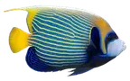
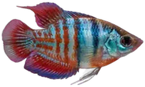
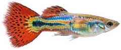
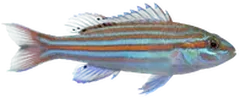
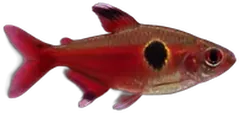
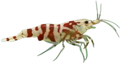
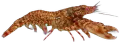
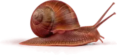

# reeftank-catalog

<!-- species:begin (generated by scripts/make_readme.py, do not edit) -->

> Fait partie de l'[**écosystème ReefTech**](https://elwinmage.github.io/reeftank/)

       

Espèces de poissons, coraux, plantes et invertébrés pour la vue aquarium de [ha-reef-card](https://github.com/Elwinmage/ha-reef-card), fournies par l'[intégration ReefTank](https://github.com/Elwinmage/ha-reeftank-component).

L'intégration télécharge les versions publiées de ce dépôt et les tient à jour (`update.reeftank_catalog`, automatique par défaut) : rien à faire côté Home Assistant.

## Comment ça marche

Chaque poisson est une planche d'images (un atlas WebP) et un descripteur avec ses clips : *nage*, *immobile* et *demi-tour*. La carte les enchaîne, et inverse le demi-tour en miroir pour que le poisson revienne comme il est venu. Voici la nage, le demi-tour et le retour de deux espèces :

Une espèce sans vidéos a un atlas plus simple, fait à partir d'une seule photo (*LD*) : tout le corps ondule, les nageoires ne bougent pas. Ceux faits à partir de vidéos sont cochés dans la colonne HD des tableaux ci-dessous.

<table><tr><th></th><th>Poisson-ange empereur</th><th>Poisson-clown</th></tr><tr><td>HD (vidéos)</td><td align="center"></td><td align="center"></td></tr><tr><td>LD (une photo)</td><td align="center"></td><td align="center"></td></tr></table>

## Poissons (102)

**HD** : une vraie animation, faite à partir de vidéos. Les autres ont une animation simple faite à partir d'une photo, ou le poisson générique.

| &nbsp;&nbsp;&nbsp;&nbsp;&nbsp;&nbsp;&nbsp;&nbsp;&nbsp;&nbsp;&nbsp;&nbsp;&nbsp;&nbsp;&nbsp;&nbsp;&nbsp;&nbsp;&nbsp;&nbsp;&nbsp;&nbsp;&nbsp;&nbsp;&nbsp;&nbsp;&nbsp;&nbsp;&nbsp;&nbsp;&nbsp;&nbsp;&nbsp; | Nom | Nom scientifique | Eau | Taille | Comportement | HD |
|---|---|---|---|---|---|---|
|  | Ancistrus <code>ancistrus</code> | *Ancistrus sp.* | Eau douce | 10–14 cm | Vit près du fond · se cache la nuit | ✔ |
|  | Anthias <code>pseudanthias</code> | *Pseudanthias sp.* | Marine | 8–14 cm | En banc · se cache la nuit | ✔ |
|  | Apistogramma <code>apistogramma&#95;<wbr>cacatuoides</code> | *Apistogramma cacatuoides* | Eau douce | 5–9 cm | Vit près du fond · se cache la nuit | ✔ |
|  | Arc-en-ciel turquoise <code>melanotaenia&#95;<wbr>lacustris</code> | *Melanotaenia lacustris* | Eau douce | 8–12 cm | En banc · se cache la nuit | ✔ |
|  | Archer <code>toxotes&#95;<wbr>jaculatrix</code> | *Toxotes jaculatrix* | Saumâtre | 15–25 cm | Nageur de pleine eau · se cache la nuit | ✔ |
|  | Baliste Picasso <code>rhinecanthus&#95;<wbr>aculeatus</code> | *Rhinecanthus aculeatus* | Marine | 20–25 cm | Nageur de pleine eau · se cache la nuit | ✔ |
|  | Barbus cerise <code>pethia&#95;<wbr>titteya</code> | *Pethia titteya* | Eau douce | 4–5 cm | En banc · se cache la nuit | ✔ |
|  | Barbus de Sumatra <code>puntigrus&#95;<wbr>tetrazona</code> | *Puntigrus tetrazona* | Eau douce | 5–7 cm | En banc · se cache la nuit | ✔ |
|  | Blennie bicolore <code>ecsenius&#95;<wbr>bicolor</code> | *Ecsenius bicolor* | Marine | 8–10 cm | Vit près du fond · se cache la nuit | ✔ |
|  | Blennie tondeuse <code>salarias&#95;<wbr>fasciatus</code> | *Salarias fasciatus* | Marine | 12–14 cm | Vit près du fond · se cache la nuit | ✔ |
|  | Botia clown <code>chromobotia&#95;<wbr>macracanthus</code> | *Chromobotia macracanthus* | Eau douce | 15–30 cm | Vit près du fond · se cache la nuit | ✔ |
|  | Canthigaster de Valentin <code>canthigaster&#95;<wbr>valentini</code> | *Canthigaster valentini* | Marine | 8–10 cm | Nageur de pleine eau · se cache la nuit | ✔ |
|  | Cardinal pyjama <code>sphaeramia&#95;<wbr>nematoptera</code> | *Sphaeramia nematoptera* | Marine | 8–10 cm | Stationnaire · reste en pleine eau la nuit | ✔ |
|  | Cardinal à bande jaune <code>ostorhinchus&#95;<wbr>cyanosoma</code> | *Ostorhinchus cyanosoma* | Marine | 7–8 cm | Stationnaire · reste en pleine eau la nuit | ✔ |
|  | Chirurgien bleu <code>paracanthurus&#95;<wbr>hepatus</code> | *Paracanthurus hepatus* | Marine | 20–30 cm | Nageur de pleine eau · se cache la nuit | ✔ |
|  | Chirurgien bleu poudré <code>acanthurus&#95;<wbr>leucosternon</code> | *Acanthurus leucosternon* | Marine | 20–23 cm | Nageur de pleine eau · se cache la nuit | ✔ |
|  | Chirurgien brun <code>zebrasoma&#95;<wbr>scopas</code> | *Zebrasoma scopas* | Marine | 15–20 cm | Nageur de pleine eau · se cache la nuit | ✔ |
|  | Chirurgien jaune <code>zebrasoma&#95;<wbr>flavescens</code> | *Zebrasoma flavescens* | Marine | 15–20 cm | Nageur de pleine eau · se cache la nuit | ✔ |
|  | Chirurgien kole <code>ctenochaetus&#95;<wbr>strigosus</code> | *Ctenochaetus strigosus* | Marine | 12–18 cm | Nageur de pleine eau · se cache la nuit | ✔ |
|  | Chirurgien à voile <code>zebrasoma&#95;<wbr>veliferum</code> | *Zebrasoma veliferum* | Marine | 25–40 cm | Nageur de pleine eau · se cache la nuit | ✔ |
|  | Chromis vert <code>chromis&#95;<wbr>viridis</code> | *Chromis viridis* | Marine | 5–8 cm | En banc · se cache la nuit | ✔ |
|  | Combattant <code>betta&#95;<wbr>splendens</code> | *Betta splendens* | Eau douce | 5–7 cm | Stationnaire · reste près de son abri · reste en pleine eau la nuit | ✔ |
|  | Corydoras bronzé <code>corydoras&#95;<wbr>aeneus</code> | *Corydoras aeneus* | Eau douce | 6–7 cm | Vit près du fond · se cache la nuit | ✔ |
|  | Corydoras panda <code>corydoras&#95;<wbr>panda</code> | *Corydoras panda* | Eau douce | 4–5 cm | Vit près du fond · se cache la nuit | ✔ |
|  | Danio galaxy <code>danio&#95;<wbr>margaritatus</code> | *Danio margaritatus* | Eau douce | 2–3 cm | En banc · se cache la nuit | ✔ |
|  | Danio perlé <code>danio&#95;<wbr>albolineatus</code> | *Danio albolineatus* | Eau douce | 4–6 cm | En banc · se cache la nuit | ✔ |
|  | Danio zébré <code>danio&#95;<wbr>rerio</code> | *Danio rerio* | Eau douce | 4–5 cm | En banc · se cache la nuit | ✔ |
|  | Dascyllus à trois taches <code>dascyllus&#95;<wbr>trimaculatus</code> | *Dascyllus trimaculatus* | Marine | 10–14 cm | Stationnaire · reste en pleine eau la nuit | ✔ |
|  | Demasoni <code>pseudotropheus&#95;<wbr>demasoni</code> | *Pseudotropheus demasoni* | Eau douce | 7–8 cm | Nageur de pleine eau · se cache la nuit | ✔ |
|  | Demoiselle des mers du sud <code>chrysiptera&#95;<wbr>taupou</code> | *Chrysiptera taupou* | Marine | 6–8 cm | Stationnaire · reste près de son abri · reste en pleine eau la nuit | ✔ |
|  | Demoiselle à queue jaune <code>chrysiptera&#95;<wbr>parasema</code> | *Chrysiptera parasema* | Marine | 5–6 cm | Stationnaire · reste près de son abri · reste en pleine eau la nuit | ✔ |
|  | Discus <code>symphysodon&#95;<wbr>aequifasciatus</code> | *Symphysodon aequifasciatus* | Eau douce | 15–20 cm | Nageur de pleine eau · se cache la nuit | ✔ |
|  | Dragonnet psychédélique <code>synchiropus&#95;<wbr>picturatus</code> | *Synchiropus picturatus* | Marine | 6–8 cm | Vit près du fond · se cache la nuit | ✔ |
|  | Endler <code>poecilia&#95;<wbr>wingei</code> | *Poecilia wingei* | Eau douce | 2–4 cm | En banc · se cache la nuit | ✔ |
|  | Gobie bourdon <code>brachygobius&#95;<wbr>xanthozonus</code> | *Brachygobius xanthozonus* | Saumâtre | 3–4 cm | Vit près du fond · se cache la nuit | ✔ |
|  | Gobie chevalier <code>stigmatogobius&#95;<wbr>sadanundio</code> | *Stigmatogobius sadanundio* | Saumâtre | 6–8 cm | Vit près du fond · se cache la nuit | ✔ |
|  | Gobie corail jaune <code>gobiodon&#95;<wbr>okinawae</code> | *Gobiodon okinawae* | Marine | 2.5–3.5 cm | Vit près du fond · se cache la nuit | ✔ |
|  | Gobie de corail citron <code>gobiodon&#95;<wbr>citrinus</code> | *Gobiodon citrinus* | Marine | 3–5 cm | Vit près du fond · se cache la nuit | ✔ |
|  | Gobie dormeur <code>valenciennea</code> | *Valenciennea sp.* | Marine | 10–16 cm | Vit sur le sable · vit dans un terrier · se pose au fond la nuit | ✔ |
|  | Gobie néon <code>elacatinus&#95;<wbr>oceanops</code> | *Elacatinus oceanops* | Marine | 4–6 cm | Vit près du fond · se cache la nuit | ✔ |
|  | Gobie rayé <code>amblygobius&#95;<wbr>phalaena</code> | *Amblygobius phalaena* | Marine | 8–10 cm | Vit sur le sable · se pose au fond la nuit | ✔ |
|  | Gobie violet <code>gobioides&#95;<wbr>broussonnetii</code> | *Gobioides broussonnetii* | Saumâtre | 30–50 cm | Vit sur le sable · vit dans un terrier · se pose au fond la nuit | ✔ |
|  | Gobie yasha <code>stonogobiops&#95;<wbr>yasha</code> | *Stonogobiops yasha* | Marine | 6–8 cm | Vit sur le sable · vit dans un terrier · se pose au fond la nuit | ✔ |
|  | Gobie à bandeau jaune <code>cryptocentrus&#95;<wbr>cinctus</code> | *Cryptocentrus cinctus* | Marine | 8–10 cm | Vit sur le sable · vit dans un terrier · se pose au fond la nuit | ✔ |
|  | Gourami bleu <code>trichopodus&#95;<wbr>trichopterus</code> | *Trichopodus trichopterus* | Eau douce | 10–15 cm | Nageur de pleine eau · se cache la nuit | ✔ |
|  | Gourami nain <code>trichogaster&#95;<wbr>lalius</code> | *Trichogaster lalius* | Eau douce | 5–8 cm | Nageur de pleine eau · se cache la nuit | ✔ |
|  | Gourami perlé <code>trichopodus&#95;<wbr>leerii</code> | *Trichopodus leerii* | Eau douce | 10–12 cm | Nageur de pleine eau · se cache la nuit | ✔ |
|  | Gramma royal <code>gramma&#95;<wbr>loreto</code> | *Gramma loreto* | Marine | 7–8 cm | Stationnaire · reste en pleine eau la nuit | ✔ |
|  | Guppy <code>poecilia&#95;<wbr>reticulata</code> | *Poecilia reticulata* | Eau douce | 3–6 cm | En banc · se cache la nuit | ✔ |
|  | Hippocampe <code>hippocampus&#95;<wbr>erectus</code> | *Hippocampus erectus* | Marine | 10–15 cm | Stationnaire · reste en pleine eau la nuit | ✔ |
|  | Killi du Cap Lopez <code>aphyosemion&#95;<wbr>australe</code> | *Aphyosemion australe* | Eau douce | 5–6 cm | Stationnaire · reste en pleine eau la nuit | ✔ |
|  | Kribensis <code>pelvicachromis&#95;<wbr>pulcher</code> | *Pelvicachromis pulcher* | Eau douce | 8–10 cm | Vit près du fond · se cache la nuit | ✔ |
|  | Labidochromis jaune <code>labidochromis&#95;<wbr>caeruleus</code> | *Labidochromis caeruleus* | Eau douce | 8–10 cm | Nageur de pleine eau · se cache la nuit | ✔ |
|  | Labre chrysus <code>halichoeres&#95;<wbr>chrysus</code> | *Halichoeres chrysus* | Marine | 10–12 cm | Nageur de pleine eau · se pose au fond la nuit | ✔ |
|  | Labre de Solor <code>cirrhilabrus&#95;<wbr>solorensis</code> | *Cirrhilabrus solorensis* | Marine | 10–12 cm | Nageur de pleine eau · se cache la nuit | ✔ |
|  | Labre nettoyeur <code>labroides&#95;<wbr>dimidiatus</code> | *Labroides dimidiatus* | Marine | 10–12 cm | Nageur de pleine eau · se cache la nuit | ✔ |
|  | Labre à six lignes <code>pseudocheilinus&#95;<wbr>hexataenia</code> | *Pseudocheilinus hexataenia* | Marine | 7–10 cm | Nageur de pleine eau · se cache la nuit | ✔ |
|  | Loche kuhli <code>pangio&#95;<wbr>kuhlii</code> | *Pangio kuhlii* | Eau douce | 8–12 cm | Vit près du fond · se cache la nuit | ✔ |
|  | Mangeur d'algues siamois <code>crossocheilus&#95;<wbr>oblongus</code> | *Crossocheilus oblongus* | Eau douce | 10–15 cm | Nageur de pleine eau · se cache la nuit | ✔ |
|  | Molly <code>poecilia&#95;<wbr>sphenops</code> | *Poecilia sphenops* | Eau douce, Saumâtre | 6–10 cm | En banc · se cache la nuit | ✔ |
|  | Molly voile <code>poecilia&#95;<wbr>velifera</code> | *Poecilia velifera* | Saumâtre, Eau douce | 10–15 cm | En banc · se cache la nuit | ✔ |
|  | Mono argenté <code>monodactylus&#95;<wbr>argenteus</code> | *Monodactylus argenteus* | Saumâtre, Marine | 15–25 cm | En banc · se cache la nuit | ✔ |
|  | Néon bleu <code>paracheirodon&#95;<wbr>innesi</code> | *Paracheirodon innesi* | Eau douce | 3–4 cm | En banc · se cache la nuit | ✔ |
|  | Néon cardinal <code>paracheirodon&#95;<wbr>axelrodi</code> | *Paracheirodon axelrodi* | Eau douce | 3–5 cm | En banc · se cache la nuit | ✔ |
|  | Opistognathe à tête jaune <code>opistognathus&#95;<wbr>aurifrons</code> | *Opistognathus aurifrons* | Marine | 10–12 cm | Vit sur le sable · vit dans un terrier · se pose au fond la nuit | ✔ |
|  | Oscar <code>astronotus&#95;<wbr>ocellatus</code> | *Astronotus ocellatus* | Eau douce | 25–35 cm | Nageur de pleine eau · se cache la nuit | ✔ |
|  | Otocinclus <code>otocinclus&#95;<wbr>affinis</code> | *Otocinclus affinis* | Eau douce | 3–5 cm | Vit près du fond · se cache la nuit | ✔ |
|  | Platy <code>xiphophorus&#95;<wbr>maculatus</code> | *Xiphophorus maculatus* | Eau douce | 4–6 cm | En banc · se cache la nuit | ✔ |
|  | Pléco zèbre <code>hypancistrus&#95;<wbr>zebra</code> | *Hypancistrus zebra* | Eau douce | 7–10 cm | Vit près du fond · se cache la nuit | ✔ |
|  | Poisson nuage blanc <code>tanichthys&#95;<wbr>albonubes</code> | *Tanichthys albonubes* | Eau douce | 3–4 cm | En banc · se cache la nuit | ✔ |
|  | Poisson rouge <code>carassius&#95;<wbr>auratus</code> | *Carassius auratus* | Eau douce | 10–25 cm | Nageur de pleine eau · se cache la nuit | ✔ |
|  | Poisson-ange bicolore <code>centropyge&#95;<wbr>bicolor</code> | *Centropyge bicolor* | Marine | 10–15 cm | Stationnaire · reste en pleine eau la nuit | ✔ |
|  | Poisson-ange empereur (adulte) <code>pomacanthus&#95;<wbr>imperator&#95;<wbr>adult</code> | *Pomacanthus imperator* | Marine | 25–38 cm | Nageur de pleine eau · se cache la nuit | ✔ |
|  | Poisson-ange empereur (juvénile) <code>pomacanthus&#95;<wbr>imperator</code> | *Pomacanthus imperator* | Marine | 6–12 cm | Nageur de pleine eau · se cache la nuit | ✔ |
|  | Poisson-ange flamme <code>centropyge&#95;<wbr>loricula</code> | *Centropyge loricula* | Marine | 8–10 cm | Stationnaire · reste en pleine eau la nuit | ✔ |
|  | Poisson-ange royal <code>pygoplites&#95;<wbr>diacanthus</code> | *Pygoplites diacanthus* | Marine | 20–25 cm | Nageur de pleine eau · se cache la nuit | ✔ |
|  | Poisson-cardinal de Banggai <code>pterapogon&#95;<wbr>kauderni</code> | *Pterapogon kauderni* | Marine | 5–8 cm | Stationnaire · reste en pleine eau la nuit | ✔ |
|  | Poisson-clown <code>amphiprion</code> | *Amphiprion sp.* | Marine | 7–11 cm | Stationnaire · reste en pleine eau la nuit | ✔ |
|  | Poisson-clown tomate <code>premnas&#95;<wbr>biaculeatus</code> | *Premnas biaculeatus* | Marine | 10–15 cm | Stationnaire · reste en pleine eau la nuit | ✔ |
|  | Poisson-faucon pixie <code>cirrhitichthys&#95;<wbr>oxycephalus</code> | *Cirrhitichthys oxycephalus* | Marine | 8–10 cm | Vit près du fond · se cache la nuit | ✔ |
|  | Poisson-flamme <code>nemateleotris&#95;<wbr>magnifica</code> | *Nemateleotris magnifica* | Marine | 8–10 cm | Stationnaire · reste en pleine eau la nuit | ✔ |
|  | Poisson-flamme pourpre <code>nemateleotris&#95;<wbr>decora</code> | *Nemateleotris decora* | Marine | 8–10 cm | Stationnaire · reste en pleine eau la nuit | ✔ |
|  | Poisson-hachette <code>carnegiella&#95;<wbr>strigata</code> | *Carnegiella strigata* | Eau douce | 4–5 cm | En banc · se cache la nuit | ✔ |
|  | Poisson-lapin à tête de renard <code>siganus&#95;<wbr>vulpinus</code> | *Siganus vulpinus* | Marine | 15–22 cm | Nageur de pleine eau · se pose au fond la nuit | ✔ |
|  | Poisson-lion volitans <code>pterois&#95;<wbr>volitans</code> | *Pterois volitans* | Marine | 25–35 cm | Nageur de pleine eau · se cache la nuit | ✔ |
|  | Poisson-lion zèbre <code>dendrochirus&#95;<wbr>zebra</code> | *Dendrochirus zebra* | Marine | 12–18 cm | Nageur de pleine eau · se cache la nuit | ✔ |
|  | Poisson-mandarin <code>synchiropus&#95;<wbr>splendidus</code> | *Synchiropus splendidus* | Marine | 5–8 cm | Vit près du fond · se cache la nuit | ✔ |
|  | Poisson-papillon cuivré <code>chelmon&#95;<wbr>rostratus</code> | *Chelmon rostratus* | Marine | 15–20 cm | Nageur de pleine eau · se cache la nuit | ✔ |
|  | Pseudochromis orchidée <code>pseudochromis&#95;<wbr>fridmani</code> | *Pseudochromis fridmani* | Marine | 6–7 cm | Stationnaire · reste près de son abri · reste en pleine eau la nuit | ✔ |
|  | Périophtalme <code>periophthalmus&#95;<wbr>barbarus</code> | *Periophthalmus barbarus* | Saumâtre | 10–15 cm | Vit près du fond · se cache la nuit | ✔ |
|  | Ramirezi <code>mikrogeophagus&#95;<wbr>ramirezi</code> | *Mikrogeophagus ramirezi* | Eau douce | 5–7 cm | Stationnaire · reste en pleine eau la nuit | ✔ |
|  | Rasbora arlequin <code>trigonostigma&#95;<wbr>heteromorpha</code> | *Trigonostigma heteromorpha* | Eau douce | 3–4.5 cm | En banc · se cache la nuit | ✔ |
|  | Scalaire <code>pterophyllum&#95;<wbr>scalare</code> | *Pterophyllum scalare* | Eau douce | 12–15 cm | Nageur de pleine eau · se cache la nuit | ✔ |
|  | Scat <code>scatophagus&#95;<wbr>argus</code> | *Scatophagus argus* | Saumâtre, Marine | 15–30 cm | Nageur de pleine eau · se cache la nuit | ✔ |
|  | Tétra citron <code>hyphessobrycon&#95;<wbr>pulchripinnis</code> | *Hyphessobrycon pulchripinnis* | Eau douce | 3–4.5 cm | En banc · se cache la nuit | ✔ |
|  | Tétra empereur <code>nematobrycon&#95;<wbr>palmeri</code> | *Nematobrycon palmeri* | Eau douce | 4–6 cm | En banc · se cache la nuit | ✔ |
|  | Tétra noir <code>gymnocorymbus&#95;<wbr>ternetzi</code> | *Gymnocorymbus ternetzi* | Eau douce | 5–6 cm | En banc · se cache la nuit | ✔ |
|  | Tétra serpae <code>hyphessobrycon&#95;<wbr>eques</code> | *Hyphessobrycon eques* | Eau douce | 3–4.5 cm | En banc · se cache la nuit | ✔ |
|  | Tétra à nez rouge <code>hemigrammus&#95;<wbr>bleheri</code> | *Hemigrammus bleheri* | Eau douce | 4–5 cm | En banc · se cache la nuit | ✔ |
|  | Tétraodon en 8 <code>dichotomyctere&#95;<wbr>biocellatus</code> | *Dichotomyctere biocellatus* | Saumâtre | 5–6.5 cm | Nageur de pleine eau · se cache la nuit | ✔ |
|  | Tétraodon vert <code>dichotomyctere&#95;<wbr>nigroviridis</code> | *Dichotomyctere nigroviridis* | Saumâtre | 10–17 cm | Nageur de pleine eau · se cache la nuit | ✔ |
|  | Xipho <code>xiphophorus&#95;<wbr>hellerii</code> | *Xiphophorus hellerii* | Eau douce | 6–12 cm | En banc · se cache la nuit | ✔ |

## Coraux (1)

| &nbsp;&nbsp;&nbsp;&nbsp;&nbsp;&nbsp;&nbsp;&nbsp;&nbsp;&nbsp;&nbsp;&nbsp;&nbsp;&nbsp;&nbsp;&nbsp;&nbsp;&nbsp;&nbsp;&nbsp;&nbsp;&nbsp;&nbsp;&nbsp;&nbsp;&nbsp;&nbsp;&nbsp;&nbsp;&nbsp;&nbsp;&nbsp;&nbsp; | Nom | Nom scientifique | Eau | Taille |
|---|---|---|---|---|
|  | Euphyllie torche <code>euphyllia&#95;<wbr>glabrescens</code> | *Euphyllia glabrescens* | Marine | 10–30 cm |

## Plantes (29)

| &nbsp;&nbsp;&nbsp;&nbsp;&nbsp;&nbsp;&nbsp;&nbsp;&nbsp;&nbsp;&nbsp;&nbsp;&nbsp;&nbsp;&nbsp;&nbsp;&nbsp;&nbsp;&nbsp;&nbsp;&nbsp;&nbsp;&nbsp;&nbsp;&nbsp;&nbsp;&nbsp;&nbsp;&nbsp;&nbsp;&nbsp;&nbsp;&nbsp; | Nom | Nom scientifique | Eau | Taille | Zone |
|---|---|---|---|---|---|
|  | Anubias <code>anubias&#95;<wbr>barteri</code> | *Anubias barteri* | Eau douce | 10–25 cm | Épiphyte |
|  | Bucéphalandra <code>bucephalandra</code> | *Bucephalandra sp.* | Eau douce | 5–15 cm | Épiphyte |
|  | Cabomba <code>cabomba&#95;<wbr>caroliniana</code> | *Cabomba caroliniana* | Eau douce | 30–60 cm | Arrière-plan |
|  | Caulerpa <code>caulerpa&#95;<wbr>prolifera</code> | *Caulerpa prolifera* | Marine | 5–20 cm | Premier plan |
|  | Chaetomorpha <code>chaetomorpha&#95;<wbr>linum</code> | *Chaetomorpha linum* | Marine | 5–30 cm | Premier plan |
|  | Cryptocoryne ciliata <code>cryptocoryne&#95;<wbr>ciliata</code> | *Cryptocoryne ciliata* | Saumâtre, Eau douce | 20–40 cm | Plan intermédiaire |
|  | Cryptocoryne parva <code>cryptocoryne&#95;<wbr>parva</code> | *Cryptocoryne parva* | Eau douce | 5–8 cm | Premier plan |
|  | Cryptocoryne wendtii <code>cryptocoryne&#95;<wbr>wendtii</code> | *Cryptocoryne wendtii* | Eau douce | 10–20 cm | Plan intermédiaire |
|  | Echinodorus <code>echinodorus&#95;<wbr>bleheri</code> | *Echinodorus bleheri* | Eau douce | 30–50 cm | Plan intermédiaire |
|  | Eleocharis <code>eleocharis&#95;<wbr>parvula</code> | *Eleocharis parvula* | Eau douce | 5–10 cm | Premier plan |
|  | Fougère de Java <code>microsorum&#95;<wbr>pteropus</code> | *Microsorum pteropus* | Eau douce | 20–30 cm | Épiphyte |
|  | Glossostigma <code>glossostigma&#95;<wbr>elatinoides</code> | *Glossostigma elatinoides* | Eau douce | 2–5 cm | Premier plan |
|  | Halimeda <code>halimeda&#95;<wbr>opuntia</code> | *Halimeda opuntia* | Marine | 5–15 cm | Premier plan |
|  | Hemianthus <code>hemianthus&#95;<wbr>callitrichoides</code> | *Hemianthus callitrichoides* | Eau douce | 2–5 cm | Premier plan |
|  | Herbier de tortue <code>thalassia&#95;<wbr>testudinum</code> | *Thalassia testudinum* | Marine | 10–30 cm | Premier plan |
|  | Hygrophila <code>hygrophila&#95;<wbr>polysperma</code> | *Hygrophila polysperma* | Eau douce | 20–50 cm | Arrière-plan |
|  | Laitue d'eau <code>pistia&#95;<wbr>stratiotes</code> | *Pistia stratiotes* | Eau douce | 5–15 cm | Flottante |
|  | Lentille d'eau <code>lemna&#95;<wbr>minor</code> | *Lemna minor* | Eau douce | 0.5–1 cm | Flottante |
|  | Limnobium <code>limnobium&#95;<wbr>laevigatum</code> | *Limnobium laevigatum* | Eau douce | 5–10 cm | Flottante |
|  | Limnophila <code>limnophila&#95;<wbr>sessiliflora</code> | *Limnophila sessiliflora* | Eau douce | 20–40 cm | Arrière-plan |
|  | Ludwigia <code>ludwigia&#95;<wbr>repens</code> | *Ludwigia repens* | Eau douce | 20–40 cm | Plan intermédiaire |
|  | Marimo <code>aegagropila&#95;<wbr>linnaei</code> | *Aegagropila linnaei* | Eau douce | 3–10 cm | Premier plan |
|  | Mousse de Java <code>vesicularia&#95;<wbr>dubyana</code> | *Vesicularia dubyana* | Eau douce | 3–5 cm | Épiphyte |
|  | Palétuvier rouge <code>rhizophora&#95;<wbr>mangle</code> | *Rhizophora mangle* | Saumâtre, Marine | 30–100 cm | Plan intermédiaire |
|  | Rotala <code>rotala&#95;<wbr>rotundifolia</code> | *Rotala rotundifolia* | Eau douce | 20–50 cm | Arrière-plan |
|  | Sagittaire naine <code>sagittaria&#95;<wbr>subulata</code> | *Sagittaria subulata* | Eau douce | 10–30 cm | Premier plan |
|  | Staurogyne <code>staurogyne&#95;<wbr>repens</code> | *Staurogyne repens* | Eau douce | 5–10 cm | Premier plan |
|  | Vallisnérie <code>vallisneria&#95;<wbr>spiralis</code> | *Vallisneria spiralis* | Eau douce, Saumâtre | 30–60 cm | Arrière-plan |
|  | Élodée dense <code>egeria&#95;<wbr>densa</code> | *Egeria densa* | Eau douce | 30–100 cm | Arrière-plan |

## Invertébrés (33)

| &nbsp;&nbsp;&nbsp;&nbsp;&nbsp;&nbsp;&nbsp;&nbsp;&nbsp;&nbsp;&nbsp;&nbsp;&nbsp;&nbsp;&nbsp;&nbsp;&nbsp;&nbsp;&nbsp;&nbsp;&nbsp;&nbsp;&nbsp;&nbsp;&nbsp;&nbsp;&nbsp;&nbsp;&nbsp;&nbsp;&nbsp;&nbsp;&nbsp; | Nom | Nom scientifique | Eau | Taille | Rôle |
|---|---|---|---|---|---|
|  | Ampullaire <code>pomacea&#95;<wbr>bridgesii</code> | *Pomacea bridgesii* | Eau douce | 4–5 cm | Charognard · se déplace sur le fond |
|  | Astrée <code>astraea&#95;<wbr>tecta</code> | *Astraea tecta* | Marine | 2–4 cm | Mangeur d'algues · vit sur le décor |
|  | Bernard-l'ermite à pattes bleues <code>clibanarius&#95;<wbr>tricolor</code> | *Clibanarius tricolor* | Marine | 2–3 cm | Charognard · se déplace sur le fond |
|  | Bernard-l'ermite à pattes rouges <code>paguristes&#95;<wbr>cadenati</code> | *Paguristes cadenati* | Marine | 3–4 cm | Charognard · se déplace sur le fond |
|  | Bénitier <code>tridacna&#95;<wbr>crocea</code> | *Tridacna crocea* | Marine | 5–15 cm | Filtreur · fixé |
|  | Concombre de mer <code>holothuria</code> | *Holothuria sp.* | Marine | 15–30 cm | Détritivore · se déplace sur le fond |
|  | Crabe émeraude <code>mithraculus&#95;<wbr>sculptus</code> | *Mithraculus sculptus* | Marine | 3–4 cm | Mangeur d'algues · vit sur le décor |
|  | Crevette Amano <code>caridina&#95;<wbr>multidentata</code> | *Caridina multidentata* | Eau douce | 3–5 cm | Mangeur d'algues · se déplace sur le fond |
|  | Crevette arlequin <code>hymenocera&#95;<wbr>picta</code> | *Hymenocera picta* | Marine | 4–6 cm | Prédateur · se déplace sur le fond |
|  | Crevette bambou <code>atyopsis&#95;<wbr>moluccensis</code> | *Atyopsis moluccensis* | Eau douce | 6–8 cm | Filtreur · vit sur le décor |
|  | Crevette boxer <code>stenopus&#95;<wbr>hispidus</code> | *Stenopus hispidus* | Marine | 6–8 cm | Nettoyeur · vit sur le décor |
|  | Crevette cerise <code>neocaridina&#95;<wbr>davidi</code> | *Neocaridina davidi* | Eau douce | 2–3.5 cm | Détritivore · se déplace sur le fond |
|  | Crevette cristal rouge <code>caridina&#95;<wbr>cantonensis</code> | *Caridina cantonensis* | Eau douce | 2–3 cm | Détritivore · se déplace sur le fond |
|  | Crevette nettoyeuse <code>lysmata&#95;<wbr>amboinensis</code> | *Lysmata amboinensis* | Marine | 5–6 cm | Nettoyeur · vit sur le décor |
|  | Crevette peppermint <code>lysmata&#95;<wbr>wurdemanni</code> | *Lysmata wurdemanni* | Marine | 3–5 cm | Nettoyeur · vit sur le décor |
|  | Crevette pistolet tigre <code>alpheus&#95;<wbr>bellulus</code> | *Alpheus bellulus* | Marine | 4–5 cm | Détritivore · Charognard · se déplace sur le fond |
|  | Crevette sang de feu <code>lysmata&#95;<wbr>debelius</code> | *Lysmata debelius* | Marine | 5–6 cm | Nettoyeur · vit sur le décor |
|  | Crevette Saron <code>saron&#95;<wbr>marmoratus</code> | *Saron marmoratus* | Marine | 5–7 cm | Charognard · vit sur le décor |
|  | Cérithe <code>cerithium</code> | *Cerithium sp.* | Marine | 2–3 cm | Détritivore · se déplace sur le fond |
|  | Escargot assassin <code>clea&#95;<wbr>helena</code> | *Clea helena* | Eau douce | 2–3 cm | Prédateur · se déplace sur le fond |
|  | Mélanie <code>melanoides&#95;<wbr>tuberculata</code> | *Melanoides tuberculata* | Eau douce | 2–3 cm | Détritivore · se déplace sur le fond |
|  | Nassarius <code>nassarius</code> | *Nassarius sp.* | Marine | 2–4 cm | Charognard · se déplace sur le fond |
|  | Néritine marine <code>nerita</code> | *Nerita sp.* | Marine | 2–3 cm | Mangeur d'algues · grimpe sur les vitres |
|  | Néritine zébrée <code>neritina&#95;<wbr>natalensis</code> | *Neritina natalensis* | Eau douce | 2–3 cm | Mangeur d'algues · grimpe sur les vitres |
|  | Ophiure <code>ophiolepis&#95;<wbr>superba</code> | *Ophiolepis superba* | Marine | 8–12 cm | Charognard · se déplace sur le fond |
|  | Oursin collecteur <code>tripneustes&#95;<wbr>gratilla</code> | *Tripneustes gratilla* | Marine | 10–15 cm | Mangeur d'algues · vit sur le décor |
|  | Oursin crayon <code>prionocidaris&#95;<wbr>baculosa</code> | *Prionocidaris baculosa* | Marine | 8–10 cm | Mangeur d'algues · vit sur le décor |
|  | Planorbe <code>planorbella&#95;<wbr>duryi</code> | *Planorbella duryi* | Eau douce | 2–3 cm | Détritivore · grimpe sur les vitres |
|  | Trochus <code>tectus&#95;<wbr>fenestratus</code> | *Tectus fenestratus* | Marine | 4–6 cm | Mangeur d'algues · vit sur le décor |
|  | Turbo <code>turbo&#95;<wbr>fluctuosus</code> | *Turbo fluctuosus* | Marine | 4–8 cm | Mangeur d'algues · grimpe sur les vitres |
|  | Ver plumeau <code>sabellastarte</code> | *Sabellastarte sp.* | Marine | 5–10 cm | Filtreur · fixé |
|  | Ver sapin de Noël <code>spirobranchus&#95;<wbr>giganteus</code> | *Spirobranchus giganteus* | Marine | 3–5 cm | Filtreur · fixé |
|  | Étoile de sable <code>archaster&#95;<wbr>typicus</code> | *Archaster typicus* | Marine | 6–10 cm | Détritivore · se déplace sur le fond |

Pour ajouter une espèce (génération des clips, construction, publication), voir la [documentation en anglais](README.md).

Les ressources des espèces sont sous **CC BY 4.0**, les scripts sous MIT : voir [LICENSE.md](LICENSE.md).

<!-- species:end -->

<!-- ecosystem:start -->

## Projets liés

Les projets ReefTech s'articulent entre eux : les intégrations font entrer votre matériel dans Home Assistant, la carte l'affiche et le pilote, et le secours le maintient en marche pendant une coupure. Chacun fonctionne aussi seul.

<table>
  <tr>
    <th width="100px"></th>
    <th>Projet</th>
    <th>Rôle</th>
    <th>Fonctionne avec</th>
  </tr>
  <tr>
    <td></td>
    <td>🐠 <a href="https://github.com/Elwinmage/ha-reefbeat-component"><b>ha-reefbeat-component</b></a></td>
    <td>Appareils Red Sea ReefBeat, pilotés en local sans cloud : ReefATO+, ReefControl, ReefControl-Power, ReefDose, ReefLed, ReefMat, ReefRun et ReefWave. blueprint d'alertes pour les modes anormaux, les calibrations et les batteries faibles. </td>
    <td>ha-reef-card</td>
  </tr>
  <tr>
    <td></td>
    <td>🌊 <a href="https://github.com/Elwinmage/ha-aquamedic-component"><b>ha-aquamedic-component</b></a></td>
    <td>Pompes Aqua Medic via l'API cloud Gizwits : brasseurs EcoDrift et SmartDrift, pompes DC Runner de remontée et d'écumeur.</td>
    <td>ha-reef-card</td>
  </tr>
  <tr>
    <td></td>
    <td>🐟 <a href="https://github.com/Elwinmage/ha-vson-component"><b>ha-vson-component</b></a></td>
    <td>Distributeurs de nourriture VSON via l'API cloud VSON : le distributeur WP8621 (nourrir, batterie, alerte réserve basse) et la détection générique de tout autre appareil VSON. Le WP8621 peut aussi fonctionner 100 % en local sous ESPHome.</td>
    <td>ha-reef-card</td>
  </tr>
  <tr>
    <td></td>
    <td>🐙 <a href="https://github.com/Elwinmage/ha-reef-maintenance-component"><b>ha-reef-maintenance-component</b></a></td>
    <td>Suivi du nettoyage et de l'usure du matériel que Home Assistant ne peut pas interroger : pompes de brassage, pompes de remontée, écumeurs, réacteurs, tout ce que vous entretenez à la main.</td>
    <td>ha-reef-card</td>
  </tr>
  <tr>
    <td></td>
    <td>🪸 <a href="https://github.com/Elwinmage/ha-reef-card"><b>ha-reef-card</b></a></td>
    <td>Vue graphique interactive de chaque appareil sur votre tableau de bord, et seul moyen d'éditer les programmes avancés. Lit les quatre intégrations ci-dessus via le contrat <code>reef_role</code> commun, sans configuration côté carte. Dessine aussi les flux d'énergie de reefbeatEnergyBackup. Sa carte aquarium donne vie à votre bac avec ha-reeftank-component.</td>
    <td>les quatre intégrations, et ha-reeftank-component pour l'aquarium</td>
  </tr>
  <tr>
    <td></td>
    <td>🐟 <a href="https://github.com/Elwinmage/ha-reeftank-component"><b>ha-reeftank-component</b></a></td>
    <td>Une image vivante de votre bac sur le tableau de bord : votre photo, éclairée par vos vraies lampes, avec des poissons et des coraux animés, et vos appareils et entités dessus. Stocke les aquariums et leur population, enregistre les nourrissages.</td>
    <td>ha-reef-card</td>
  </tr>
  <tr>
    <td></td>
    <td>🐡 <b>reeftank-catalog</b> <i>(ce dépôt)</i></td>
    <td>Poissons, coraux et textures de la carte aquarium, téléchargés et tenus à jour par ha-reeftank-component.</td>
    <td>ha-reeftank-component</td>
  </tr>
  <tr>
    <td></td>
    <td>🐬 <a href="https://github.com/Elwinmage/ha-reef-blueprints"><b>ha-reef-blueprints</b></a></td>
    <td>Blueprints d'automatisation communs à tout l'écosystème : entretiens en retard trouvés via le contrat <code>reef_role</code>, appareils devenus injoignables, test périodique des chauffages et surveillance des relais. Huit langues.</td>
    <td>les quatre intégrations</td>
  </tr>
  <tr>
    <td></td>
    <td>⚡ <a href="https://github.com/Elwinmage/reefbeatEnergyBackup"><b>reefbeatEnergyBackup</b></a></td>
    <td>Secours sur batterie en cas de coupure. Pack 24V LiFePO₄ piloté par un Raspberry Pi, avec dégradation progressive de la vitesse des pompes selon l'état de charge.</td>
    <td>seul, ou avec ha-reefbeat-component et ha-reef-card</td>
  </tr>
</table>

L'ensemble est documenté sur la [page du projet ReefTech](https://elwinmage.github.io/reeftank/).

<!-- ecosystem:end -->
