# reeftank-catalog

<!-- species:begin (generated by scripts/make_readme.py, do not edit) -->

> Fait partie de l'[**écosystème ReefTech**](https://elwinmage.github.io/reeftank/)

       

Espèces de poissons, coraux, plantes et invertébrés pour la vue aquarium de [ha-reef-card](https://github.com/Elwinmage/ha-reef-card), fournies par l'[intégration ReefTank](https://github.com/Elwinmage/ha-reeftank-component).

L'intégration télécharge les versions publiées de ce dépôt et les tient à jour (`update.reeftank_catalog`, automatique par défaut) : rien à faire côté Home Assistant.

## Comment ça marche

Chaque poisson est une planche d'images (un atlas WebP) et un descripteur avec ses clips : *nage*, *immobile* et *demi-tour*. La carte les enchaîne, et inverse le demi-tour en miroir pour que le poisson revienne comme il est venu. Voici la nage, le demi-tour et le retour de deux espèces :

<table><tr><td align="center"> Poisson-ange empereur</td><td align="center">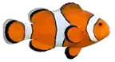 Poisson-clown</td></tr></table>

## Poissons (102)

**HD** : une vraie animation, faite à partir de vidéos. Les autres ont une animation simple faite à partir d'une photo, ou le poisson générique.

|  | Nom | Nom scientifique | Eau | Taille | Comportement | HD |
|---|---|---|---|---|---|---|
|  | Ancistrus `ancistrus` | *Ancistrus sp.* | Eau douce | 10–14 cm | Vit près du fond · se cache la nuit |  |
|  | Anthias `pseudanthias` | *Pseudanthias sp.* | Marine | 8–14 cm | En banc · se cache la nuit | ✔ |
|  | Apistogramma `apistogramma_cacatuoides` | *Apistogramma cacatuoides* | Eau douce | 5–9 cm | Vit près du fond · se cache la nuit |  |
| 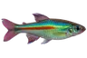 | Arc-en-ciel turquoise `melanotaenia_lacustris` | *Melanotaenia lacustris* | Eau douce | 8–12 cm | En banc · se cache la nuit |  |
|  | Archer `toxotes_jaculatrix` | *Toxotes jaculatrix* | Saumâtre | 15–25 cm | Nageur de pleine eau · se cache la nuit |  |
|  | Baliste Picasso `rhinecanthus_aculeatus` | *Rhinecanthus aculeatus* | Marine | 20–25 cm | Nageur de pleine eau · se cache la nuit |  |
|  | Barbus cerise `pethia_titteya` | *Pethia titteya* | Eau douce | 4–5 cm | En banc · se cache la nuit |  |
| 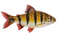 | Barbus de Sumatra `puntigrus_tetrazona` | *Puntigrus tetrazona* | Eau douce | 5–7 cm | En banc · se cache la nuit |  |
|  | Blennie bicolore `ecsenius_bicolor` | *Ecsenius bicolor* | Marine | 8–10 cm | Vit près du fond · se cache la nuit |  |
| 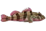 | Blennie tondeuse `salarias_fasciatus` | *Salarias fasciatus* | Marine | 12–14 cm | Vit près du fond · se cache la nuit |  |
|  | Botia clown `chromobotia_macracanthus` | *Chromobotia macracanthus* | Eau douce | 15–30 cm | Vit près du fond · se cache la nuit |  |
|  | Canthigaster de Valentin `canthigaster_valentini` | *Canthigaster valentini* | Marine | 8–10 cm | Nageur de pleine eau · se cache la nuit |  |
| 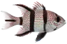 | Cardinal pyjama `sphaeramia_nematoptera` | *Sphaeramia nematoptera* | Marine | 8–10 cm | Stationnaire · reste en pleine eau la nuit |  |
| 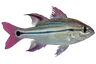 | Cardinal à bande jaune `ostorhinchus_cyanosoma` | *Ostorhinchus cyanosoma* | Marine | 7–8 cm | Stationnaire · reste en pleine eau la nuit |  |
|  | Chirurgien bleu `paracanthurus_hepatus` | *Paracanthurus hepatus* | Marine | 20–30 cm | Nageur de pleine eau · se cache la nuit |  |
|  | Chirurgien bleu poudré `acanthurus_leucosternon` | *Acanthurus leucosternon* | Marine | 20–23 cm | Nageur de pleine eau · se cache la nuit |  |
|  | Chirurgien brun `zebrasoma_scopas` | *Zebrasoma scopas* | Marine | 15–20 cm | Nageur de pleine eau · se cache la nuit |  |
|  | Chirurgien jaune `zebrasoma_flavescens` | *Zebrasoma flavescens* | Marine | 15–20 cm | Nageur de pleine eau · se cache la nuit |  |
| 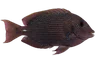 | Chirurgien kole `ctenochaetus_strigosus` | *Ctenochaetus strigosus* | Marine | 12–18 cm | Nageur de pleine eau · se cache la nuit |  |
| 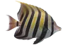 | Chirurgien à voile `zebrasoma_veliferum` | *Zebrasoma veliferum* | Marine | 25–40 cm | Nageur de pleine eau · se cache la nuit |  |
|  | Chromis vert `chromis_viridis` | *Chromis viridis* | Marine | 5–8 cm | En banc · se cache la nuit | ✔ |
|  | Combattant `betta_splendens` | *Betta splendens* | Eau douce | 5–7 cm | Stationnaire · reste près de son abri · reste en pleine eau la nuit |  |
| 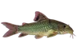 | Corydoras bronzé `corydoras_aeneus` | *Corydoras aeneus* | Eau douce | 6–7 cm | Vit près du fond · se cache la nuit |  |
|  | Corydoras panda `corydoras_panda` | *Corydoras panda* | Eau douce | 4–5 cm | Vit près du fond · se cache la nuit |  |
|  | Danio galaxy `danio_margaritatus` | *Danio margaritatus* | Eau douce | 2–3 cm | En banc · se cache la nuit |  |
| 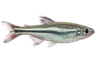 | Danio perlé `danio_albolineatus` | *Danio albolineatus* | Eau douce | 4–6 cm | En banc · se cache la nuit |  |
|  | Danio zébré `danio_rerio` | *Danio rerio* | Eau douce | 4–5 cm | En banc · se cache la nuit |  |
| 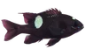 | Dascyllus à trois taches `dascyllus_trimaculatus` | *Dascyllus trimaculatus* | Marine | 10–14 cm | Stationnaire · reste en pleine eau la nuit |  |
|  | Demasoni `pseudotropheus_demasoni` | *Pseudotropheus demasoni* | Eau douce | 7–8 cm | Nageur de pleine eau · se cache la nuit |  |
| 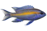 | Demoiselle des mers du sud `chrysiptera_taupou` | *Chrysiptera taupou* | Marine | 6–8 cm | Stationnaire · reste près de son abri · reste en pleine eau la nuit |  |
| 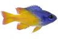 | Demoiselle à queue jaune `chrysiptera_parasema` | *Chrysiptera parasema* | Marine | 5–6 cm | Stationnaire · reste près de son abri · reste en pleine eau la nuit |  |
|  | Discus `symphysodon_aequifasciatus` | *Symphysodon aequifasciatus* | Eau douce | 15–20 cm | Nageur de pleine eau · se cache la nuit |  |
| 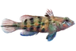 | Dragonnet psychédélique `synchiropus_picturatus` | *Synchiropus picturatus* | Marine | 6–8 cm | Vit près du fond · se cache la nuit |  |
|  | Endler `poecilia_wingei` | *Poecilia wingei* | Eau douce | 2–4 cm | En banc · se cache la nuit |  |
|  | Gobie bourdon `brachygobius_xanthozonus` | *Brachygobius xanthozonus* | Saumâtre | 3–4 cm | Vit près du fond · se cache la nuit |  |
|  | Gobie chevalier `stigmatogobius_sadanundio` | *Stigmatogobius sadanundio* | Saumâtre | 6–8 cm | Vit près du fond · se cache la nuit |  |
| 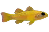 | Gobie corail jaune `gobiodon_okinawae` | *Gobiodon okinawae* | Marine | 2.5–3.5 cm | Vit près du fond · se cache la nuit |  |
|  | Gobie de corail citron `gobiodon_citrinus` | *Gobiodon citrinus* | Marine | 3–5 cm | Vit près du fond · se cache la nuit |  |
|  | Gobie dormeur `valenciennea` | *Valenciennea sp.* | Marine | 10–16 cm | Vit sur le sable · vit dans un terrier · se pose au fond la nuit | ✔ |
|  | Gobie néon `elacatinus_oceanops` | *Elacatinus oceanops* | Marine | 4–6 cm | Vit près du fond · se cache la nuit |  |
| 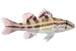 | Gobie rayé `amblygobius_phalaena` | *Amblygobius phalaena* | Marine | 8–10 cm | Vit sur le sable · se pose au fond la nuit |  |
| 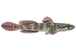 | Gobie violet `gobioides_broussonnetii` | *Gobioides broussonnetii* | Saumâtre | 30–50 cm | Vit sur le sable · vit dans un terrier · se pose au fond la nuit |  |
|  | Gobie à bandeau jaune `cryptocentrus_cinctus` | *Cryptocentrus cinctus* | Marine | 8–10 cm | Vit sur le sable · vit dans un terrier · se pose au fond la nuit |  |
|  | Gobie à crevette `stonogobiops_yasha` | *Stonogobiops yasha* | Marine | 6–8 cm | Vit sur le sable · vit dans un terrier · se pose au fond la nuit |  |
|  | Gourami bleu `trichopodus_trichopterus` | *Trichopodus trichopterus* | Eau douce | 10–15 cm | Nageur de pleine eau · se cache la nuit |  |
|  | Gourami nain `trichogaster_lalius` | *Trichogaster lalius* | Eau douce | 5–8 cm | Nageur de pleine eau · se cache la nuit |  |
| 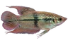 | Gourami perlé `trichopodus_leerii` | *Trichopodus leerii* | Eau douce | 10–12 cm | Nageur de pleine eau · se cache la nuit |  |
|  | Gramma royal `gramma_loreto` | *Gramma loreto* | Marine | 7–8 cm | Stationnaire · reste en pleine eau la nuit |  |
|  | Guppy `poecilia_reticulata` | *Poecilia reticulata* | Eau douce | 3–6 cm | En banc · se cache la nuit |  |
| 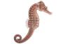 | Hippocampe `hippocampus_erectus` | *Hippocampus erectus* | Marine | 10–15 cm | Stationnaire · reste en pleine eau la nuit |  |
| 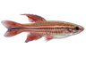 | Killi du Cap Lopez `aphyosemion_australe` | *Aphyosemion australe* | Eau douce | 5–6 cm | Stationnaire · reste en pleine eau la nuit |  |
| 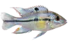 | Kribensis `pelvicachromis_pulcher` | *Pelvicachromis pulcher* | Eau douce | 8–10 cm | Vit près du fond · se cache la nuit |  |
|  | Labidochromis jaune `labidochromis_caeruleus` | *Labidochromis caeruleus* | Eau douce | 8–10 cm | Nageur de pleine eau · se cache la nuit |  |
| 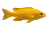 | Labre chrysus `halichoeres_chrysus` | *Halichoeres chrysus* | Marine | 10–12 cm | Nageur de pleine eau · se pose au fond la nuit |  |
|  | Labre de Solor `cirrhilabrus_solorensis` | *Cirrhilabrus solorensis* | Marine | 10–12 cm | Nageur de pleine eau · se cache la nuit |  |
| 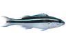 | Labre nettoyeur `labroides_dimidiatus` | *Labroides dimidiatus* | Marine | 10–12 cm | Nageur de pleine eau · se cache la nuit |  |
|  | Labre à six lignes `pseudocheilinus_hexataenia` | *Pseudocheilinus hexataenia* | Marine | 7–10 cm | Nageur de pleine eau · se cache la nuit |  |
|  | Loche kuhli `pangio_kuhlii` | *Pangio kuhlii* | Eau douce | 8–12 cm | Vit près du fond · se cache la nuit |  |
|  | Mangeur d'algues siamois `crossocheilus_oblongus` | *Crossocheilus oblongus* | Eau douce | 10–15 cm | Nageur de pleine eau · se cache la nuit |  |
|  | Molly `poecilia_sphenops` | *Poecilia sphenops* | Eau douce, Saumâtre | 6–10 cm | En banc · se cache la nuit |  |
|  | Molly voile `poecilia_velifera` | *Poecilia velifera* | Saumâtre, Eau douce | 10–15 cm | En banc · se cache la nuit |  |
| 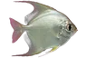 | Mono argenté `monodactylus_argenteus` | *Monodactylus argenteus* | Saumâtre, Marine | 15–25 cm | En banc · se cache la nuit |  |
|  | Néon bleu `paracheirodon_innesi` | *Paracheirodon innesi* | Eau douce | 3–4 cm | En banc · se cache la nuit |  |
|  | Néon cardinal `paracheirodon_axelrodi` | *Paracheirodon axelrodi* | Eau douce | 3–5 cm | En banc · se cache la nuit |  |
|  | Opistognathe à tête jaune `opistognathus_aurifrons` | *Opistognathus aurifrons* | Marine | 10–12 cm | Vit sur le sable · vit dans un terrier · se pose au fond la nuit |  |
|  | Oscar `astronotus_ocellatus` | *Astronotus ocellatus* | Eau douce | 25–35 cm | Nageur de pleine eau · se cache la nuit |  |
| 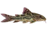 | Otocinclus `otocinclus_affinis` | *Otocinclus affinis* | Eau douce | 3–5 cm | Vit près du fond · se cache la nuit |  |
| 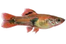 | Platy `xiphophorus_maculatus` | *Xiphophorus maculatus* | Eau douce | 4–6 cm | En banc · se cache la nuit |  |
| 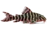 | Pléco zèbre `hypancistrus_zebra` | *Hypancistrus zebra* | Eau douce | 7–10 cm | Vit près du fond · se cache la nuit |  |
|  | Poisson mandarin `synchiropus_splendidus` | *Synchiropus splendidus* | Marine | 5–8 cm | Vit près du fond · se cache la nuit | ✔ |
| 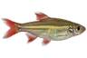 | Poisson nuage blanc `tanichthys_albonubes` | *Tanichthys albonubes* | Eau douce | 3–4 cm | En banc · se cache la nuit |  |
|  | Poisson rouge `carassius_auratus` | *Carassius auratus* | Eau douce | 10–25 cm | Nageur de pleine eau · se cache la nuit |  |
| 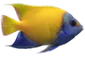 | Poisson-ange bicolore `centropyge_bicolor` | *Centropyge bicolor* | Marine | 10–15 cm | Stationnaire · reste en pleine eau la nuit |  |
|  | Poisson-ange empereur (adulte) `pomacanthus_imperator_adult` | *Pomacanthus imperator* | Marine | 25–38 cm | Nageur de pleine eau · se cache la nuit | ✔ |
|  | Poisson-ange empereur (juvénile) `pomacanthus_imperator` | *Pomacanthus imperator* | Marine | 6–12 cm | Nageur de pleine eau · se cache la nuit | ✔ |
| 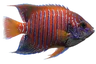 | Poisson-ange flamme `centropyge_loricula` | *Centropyge loricula* | Marine | 8–10 cm | Stationnaire · reste en pleine eau la nuit |  |
| 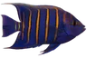 | Poisson-ange royal `pygoplites_diacanthus` | *Pygoplites diacanthus* | Marine | 20–25 cm | Nageur de pleine eau · se cache la nuit |  |
|  | Poisson-cardinal de Banggai `pterapogon_kauderni` | *Pterapogon kauderni* | Marine | 5–8 cm | Stationnaire · reste en pleine eau la nuit | ✔ |
|  | Poisson-clown `amphiprion` | *Amphiprion sp.* | Marine | 7–11 cm | Stationnaire · reste en pleine eau la nuit | ✔ |
|  | Poisson-clown tomate `premnas_biaculeatus` | *Premnas biaculeatus* | Marine | 10–15 cm | Stationnaire · reste en pleine eau la nuit |  |
|  | Poisson-faucon pixie `cirrhitichthys_oxycephalus` | *Cirrhitichthys oxycephalus* | Marine | 8–10 cm | Vit près du fond · se cache la nuit |  |
|  | Poisson-flamme `nemateleotris_magnifica` | *Nemateleotris magnifica* | Marine | 8–10 cm | Stationnaire · reste en pleine eau la nuit |  |
| 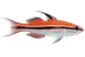 | Poisson-flamme pourpre `nemateleotris_decora` | *Nemateleotris decora* | Marine | 8–10 cm | Stationnaire · reste en pleine eau la nuit |  |
|  | Poisson-hachette `carnegiella_strigata` | *Carnegiella strigata* | Eau douce | 4–5 cm | En banc · se cache la nuit |  |
|  | Poisson-lapin à tête de renard `siganus_vulpinus` | *Siganus vulpinus* | Marine | 15–22 cm | Nageur de pleine eau · se pose au fond la nuit | ✔ |
|  | Poisson-lion volitans `pterois_volitans` | *Pterois volitans* | Marine | 25–35 cm | Nageur de pleine eau · se cache la nuit |  |
| 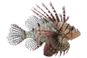 | Poisson-lion zèbre `dendrochirus_zebra` | *Dendrochirus zebra* | Marine | 12–18 cm | Nageur de pleine eau · se cache la nuit |  |
|  | Poisson-papillon cuivré `chelmon_rostratus` | *Chelmon rostratus* | Marine | 15–20 cm | Nageur de pleine eau · se cache la nuit |  |
|  | Pseudochromis orchidée `pseudochromis_fridmani` | *Pseudochromis fridmani* | Marine | 6–7 cm | Stationnaire · reste près de son abri · reste en pleine eau la nuit |  |
|  | Périophtalme `periophthalmus_barbarus` | *Periophthalmus barbarus* | Saumâtre | 10–15 cm | Vit près du fond · se cache la nuit |  |
|  | Ramirezi `mikrogeophagus_ramirezi` | *Mikrogeophagus ramirezi* | Eau douce | 5–7 cm | Stationnaire · reste en pleine eau la nuit |  |
| 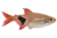 | Rasbora arlequin `trigonostigma_heteromorpha` | *Trigonostigma heteromorpha* | Eau douce | 3–4.5 cm | En banc · se cache la nuit |  |
| 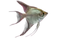 | Scalaire `pterophyllum_scalare` | *Pterophyllum scalare* | Eau douce | 12–15 cm | Nageur de pleine eau · se cache la nuit |  |
|  | Scat `scatophagus_argus` | *Scatophagus argus* | Saumâtre, Marine | 15–30 cm | Nageur de pleine eau · se cache la nuit |  |
|  | Tétra citron `hyphessobrycon_pulchripinnis` | *Hyphessobrycon pulchripinnis* | Eau douce | 3–4.5 cm | En banc · se cache la nuit |  |
|  | Tétra empereur `nematobrycon_palmeri` | *Nematobrycon palmeri* | Eau douce | 4–6 cm | En banc · se cache la nuit |  |
|  | Tétra noir `gymnocorymbus_ternetzi` | *Gymnocorymbus ternetzi* | Eau douce | 5–6 cm | En banc · se cache la nuit |  |
|  | Tétra serpae `hyphessobrycon_eques` | *Hyphessobrycon eques* | Eau douce | 3–4.5 cm | En banc · se cache la nuit |  |
|  | Tétra à nez rouge `hemigrammus_bleheri` | *Hemigrammus bleheri* | Eau douce | 4–5 cm | En banc · se cache la nuit |  |
| 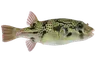 | Tétraodon vert `dichotomyctere_nigroviridis` | *Dichotomyctere nigroviridis* | Saumâtre | 10–17 cm | Nageur de pleine eau · se cache la nuit |  |
|  | Tétraodon à huit `dichotomyctere_biocellatus` | *Dichotomyctere biocellatus* | Saumâtre | 5–6.5 cm | Nageur de pleine eau · se cache la nuit |  |
| 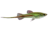 | Xipho `xiphophorus_hellerii` | *Xiphophorus hellerii* | Eau douce | 6–12 cm | En banc · se cache la nuit |  |

## Coraux (1)

|  | Nom | Nom scientifique | Eau | Taille |
|---|---|---|---|---|
| 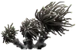 | Euphyllie torche `euphyllia_glabrescens` | *Euphyllia glabrescens* | Marine | 10–30 cm |

## Plantes (29)

|  | Nom | Nom scientifique | Eau | Taille | Zone |
|---|---|---|---|---|---|
|  | Anubias `anubias_barteri` | *Anubias barteri* | Eau douce | 10–25 cm | Épiphyte |
|  | Bucéphalandra `bucephalandra` | *Bucephalandra sp.* | Eau douce | 5–15 cm | Épiphyte |
|  | Cabomba `cabomba_caroliniana` | *Cabomba caroliniana* | Eau douce | 30–60 cm | Arrière-plan |
|  | Caulerpa `caulerpa_prolifera` | *Caulerpa prolifera* | Marine | 5–20 cm | Premier plan |
|  | Chaetomorpha `chaetomorpha_linum` | *Chaetomorpha linum* | Marine | 5–30 cm | Premier plan |
|  | Cryptocoryne ciliata `cryptocoryne_ciliata` | *Cryptocoryne ciliata* | Saumâtre, Eau douce | 20–40 cm | Plan intermédiaire |
|  | Cryptocoryne parva `cryptocoryne_parva` | *Cryptocoryne parva* | Eau douce | 5–8 cm | Premier plan |
|  | Cryptocoryne wendtii `cryptocoryne_wendtii` | *Cryptocoryne wendtii* | Eau douce | 10–20 cm | Plan intermédiaire |
|  | Echinodorus `echinodorus_bleheri` | *Echinodorus bleheri* | Eau douce | 30–50 cm | Plan intermédiaire |
|  | Eleocharis `eleocharis_parvula` | *Eleocharis parvula* | Eau douce | 5–10 cm | Premier plan |
|  | Fougère de Java `microsorum_pteropus` | *Microsorum pteropus* | Eau douce | 20–30 cm | Épiphyte |
|  | Glossostigma `glossostigma_elatinoides` | *Glossostigma elatinoides* | Eau douce | 2–5 cm | Premier plan |
|  | Halimeda `halimeda_opuntia` | *Halimeda opuntia* | Marine | 5–15 cm | Premier plan |
|  | Hemianthus `hemianthus_callitrichoides` | *Hemianthus callitrichoides* | Eau douce | 2–5 cm | Premier plan |
|  | Herbier de tortue `thalassia_testudinum` | *Thalassia testudinum* | Marine | 10–30 cm | Premier plan |
|  | Hygrophila `hygrophila_polysperma` | *Hygrophila polysperma* | Eau douce | 20–50 cm | Arrière-plan |
|  | Laitue d'eau `pistia_stratiotes` | *Pistia stratiotes* | Eau douce | 5–15 cm | Flottante |
|  | Lentille d'eau `lemna_minor` | *Lemna minor* | Eau douce | 0.5–1 cm | Flottante |
|  | Limnobium `limnobium_laevigatum` | *Limnobium laevigatum* | Eau douce | 5–10 cm | Flottante |
|  | Limnophila `limnophila_sessiliflora` | *Limnophila sessiliflora* | Eau douce | 20–40 cm | Arrière-plan |
|  | Ludwigia `ludwigia_repens` | *Ludwigia repens* | Eau douce | 20–40 cm | Plan intermédiaire |
|  | Marimo `aegagropila_linnaei` | *Aegagropila linnaei* | Eau douce | 3–10 cm | Premier plan |
|  | Mousse de Java `vesicularia_dubyana` | *Vesicularia dubyana* | Eau douce | 3–5 cm | Épiphyte |
|  | Palétuvier rouge `rhizophora_mangle` | *Rhizophora mangle* | Saumâtre, Marine | 30–100 cm | Plan intermédiaire |
|  | Rotala `rotala_rotundifolia` | *Rotala rotundifolia* | Eau douce | 20–50 cm | Arrière-plan |
|  | Sagittaire naine `sagittaria_subulata` | *Sagittaria subulata* | Eau douce | 10–30 cm | Premier plan |
|  | Staurogyne `staurogyne_repens` | *Staurogyne repens* | Eau douce | 5–10 cm | Premier plan |
|  | Vallisnérie `vallisneria_spiralis` | *Vallisneria spiralis* | Eau douce, Saumâtre | 30–60 cm | Arrière-plan |
|  | Élodée dense `egeria_densa` | *Egeria densa* | Eau douce | 30–100 cm | Arrière-plan |

## Invertébrés (32)

|  | Nom | Nom scientifique | Eau | Taille | Rôle |
|---|---|---|---|---|---|
|  | Ampullaire `pomacea_bridgesii` | *Pomacea bridgesii* | Eau douce | 4–5 cm | Charognard · se déplace sur le fond |
|  | Astrée `astraea_tecta` | *Astraea tecta* | Marine | 2–4 cm | Mangeur d'algues · vit sur le décor |
|  | Bernard-l'ermite à pattes bleues `clibanarius_tricolor` | *Clibanarius tricolor* | Marine | 2–3 cm | Charognard · se déplace sur le fond |
|  | Bernard-l'ermite à pattes rouges `paguristes_cadenati` | *Paguristes cadenati* | Marine | 3–4 cm | Charognard · se déplace sur le fond |
|  | Bénitier `tridacna_crocea` | *Tridacna crocea* | Marine | 5–15 cm | Filtreur · fixé |
|  | Concombre de mer `holothuria` | *Holothuria sp.* | Marine | 15–30 cm | Détritivore · se déplace sur le fond |
|  | Crabe émeraude `mithraculus_sculptus` | *Mithraculus sculptus* | Marine | 3–4 cm | Mangeur d'algues · vit sur le décor |
|  | Crevette Amano `caridina_multidentata` | *Caridina multidentata* | Eau douce | 3–5 cm | Mangeur d'algues · se déplace sur le fond |
|  | Crevette arlequin `hymenocera_picta` | *Hymenocera picta* | Marine | 4–6 cm | Prédateur · se déplace sur le fond |
|  | Crevette bambou `atyopsis_moluccensis` | *Atyopsis moluccensis* | Eau douce | 6–8 cm | Filtreur · vit sur le décor |
|  | Crevette boxer `stenopus_hispidus` | *Stenopus hispidus* | Marine | 6–8 cm | Nettoyeur · vit sur le décor |
|  | Crevette cerise `neocaridina_davidi` | *Neocaridina davidi* | Eau douce | 2–3.5 cm | Détritivore · se déplace sur le fond |
|  | Crevette cristal rouge `caridina_cantonensis` | *Caridina cantonensis* | Eau douce | 2–3 cm | Détritivore · se déplace sur le fond |
|  | Crevette nettoyeuse `lysmata_amboinensis` | *Lysmata amboinensis* | Marine | 5–6 cm | Nettoyeur · vit sur le décor |
|  | Crevette peppermint `lysmata_wurdemanni` | *Lysmata wurdemanni* | Marine | 3–5 cm | Nettoyeur · vit sur le décor |
|  | Crevette sang de feu `lysmata_debelius` | *Lysmata debelius* | Marine | 5–6 cm | Nettoyeur · vit sur le décor |
|  | Crevette Saron `saron_marmoratus` | *Saron marmoratus* | Marine | 5–7 cm | Charognard · vit sur le décor |
|  | Cérithe `cerithium` | *Cerithium sp.* | Marine | 2–3 cm | Détritivore · se déplace sur le fond |
|  | Escargot assassin `clea_helena` | *Clea helena* | Eau douce | 2–3 cm | Prédateur · se déplace sur le fond |
|  | Mélanie `melanoides_tuberculata` | *Melanoides tuberculata* | Eau douce | 2–3 cm | Détritivore · se déplace sur le fond |
|  | Nassarius `nassarius` | *Nassarius sp.* | Marine | 2–4 cm | Charognard · se déplace sur le fond |
|  | Néritine marine `nerita` | *Nerita sp.* | Marine | 2–3 cm | Mangeur d'algues · grimpe sur les vitres |
|  | Néritine zébrée `neritina_natalensis` | *Neritina natalensis* | Eau douce | 2–3 cm | Mangeur d'algues · grimpe sur les vitres |
|  | Ophiure `ophiolepis_superba` | *Ophiolepis superba* | Marine | 8–12 cm | Charognard · se déplace sur le fond |
|  | Oursin collecteur `tripneustes_gratilla` | *Tripneustes gratilla* | Marine | 10–15 cm | Mangeur d'algues · vit sur le décor |
|  | Oursin crayon `prionocidaris_baculosa` | *Prionocidaris baculosa* | Marine | 8–10 cm | Mangeur d'algues · vit sur le décor |
|  | Planorbe `planorbella_duryi` | *Planorbella duryi* | Eau douce | 2–3 cm | Détritivore · grimpe sur les vitres |
|  | Trochus `tectus_fenestratus` | *Tectus fenestratus* | Marine | 4–6 cm | Mangeur d'algues · vit sur le décor |
|  | Turbo `turbo_fluctuosus` | *Turbo fluctuosus* | Marine | 4–8 cm | Mangeur d'algues · grimpe sur les vitres |
|  | Ver plumeau `sabellastarte` | *Sabellastarte sp.* | Marine | 5–10 cm | Filtreur · fixé |
|  | Ver sapin de Noël `spirobranchus_giganteus` | *Spirobranchus giganteus* | Marine | 3–5 cm | Filtreur · fixé |
|  | Étoile de sable `archaster_typicus` | *Archaster typicus* | Marine | 6–10 cm | Détritivore · se déplace sur le fond |

Pour ajouter une espèce (génération des clips, construction, publication), voir la [documentation en anglais](README.md).

Les ressources des espèces sont sous **CC BY 4.0**, les scripts sous MIT : voir [LICENSE.md](LICENSE.md).

<!-- species:end -->

<!-- ecosystem:start -->

## Projets liés

Les projets ReefTech s'articulent entre eux : les intégrations font entrer votre matériel dans Home Assistant, la carte l'affiche et le pilote, et le secours le maintient en marche pendant une coupure. Chacun fonctionne aussi seul.

<table>
  <tr>
    <th width="100px"></th>
    <th>Projet</th>
    <th>Rôle</th>
    <th>Fonctionne avec</th>
  </tr>
  <tr>
    <td></td>
    <td>🐠 <a href="https://github.com/Elwinmage/ha-reefbeat-component"><b>ha-reefbeat-component</b></a></td>
    <td>Appareils Red Sea ReefBeat, pilotés en local sans cloud : ReefATO+, ReefControl, ReefControl-Power, ReefDose, ReefLed, ReefMat, ReefRun et ReefWave. blueprint d'alertes pour les modes anormaux, les calibrations et les batteries faibles. </td>
    <td>ha-reef-card</td>
  </tr>
  <tr>
    <td></td>
    <td>🌊 <a href="https://github.com/Elwinmage/ha-aquamedic-component"><b>ha-aquamedic-component</b></a></td>
    <td>Pompes Aqua Medic via l'API cloud Gizwits : brasseurs EcoDrift et SmartDrift, pompes DC Runner de remontée et d'écumeur.</td>
    <td>ha-reef-card</td>
  </tr>
  <tr>
    <td></td>
    <td>🐟 <a href="https://github.com/Elwinmage/ha-vson-component"><b>ha-vson-component</b></a></td>
    <td>Distributeurs de nourriture VSON via l'API cloud VSON : le distributeur WP8621 (nourrir, batterie, alerte réserve basse) et la détection générique de tout autre appareil VSON. Le WP8621 peut aussi fonctionner 100 % en local sous ESPHome.</td>
    <td>ha-reef-card</td>
  </tr>
  <tr>
    <td></td>
    <td>🐙 <a href="https://github.com/Elwinmage/ha-reef-maintenance-component"><b>ha-reef-maintenance-component</b></a></td>
    <td>Suivi du nettoyage et de l'usure du matériel que Home Assistant ne peut pas interroger : pompes de brassage, pompes de remontée, écumeurs, réacteurs, tout ce que vous entretenez à la main.</td>
    <td>ha-reef-card</td>
  </tr>
  <tr>
    <td></td>
    <td>🪸 <a href="https://github.com/Elwinmage/ha-reef-card"><b>ha-reef-card</b></a></td>
    <td>Vue graphique interactive de chaque appareil sur votre tableau de bord, et seul moyen d'éditer les programmes avancés. Lit les quatre intégrations ci-dessus via le contrat <code>reef_role</code> commun, sans configuration côté carte. Dessine aussi les flux d'énergie de reefbeatEnergyBackup. Sa carte aquarium donne vie à votre bac avec ha-reeftank-component.</td>
    <td>les quatre intégrations, et ha-reeftank-component pour l'aquarium</td>
  </tr>
  <tr>
    <td></td>
    <td>🐟 <a href="https://github.com/Elwinmage/ha-reeftank-component"><b>ha-reeftank-component</b></a></td>
    <td>Une image vivante de votre bac sur le tableau de bord : votre photo, éclairée par vos vraies lampes, avec des poissons et des coraux animés, et vos appareils et entités dessus. Stocke les aquariums et leur population, enregistre les nourrissages.</td>
    <td>ha-reef-card</td>
  </tr>
  <tr>
    <td></td>
    <td>🐡 <b>reeftank-catalog</b> <i>(ce dépôt)</i></td>
    <td>Poissons, coraux et textures de la carte aquarium, téléchargés et tenus à jour par ha-reeftank-component.</td>
    <td>ha-reeftank-component</td>
  </tr>
  <tr>
    <td></td>
    <td>🐬 <a href="https://github.com/Elwinmage/ha-reef-blueprints"><b>ha-reef-blueprints</b></a></td>
    <td>Blueprints d'automatisation communs à tout l'écosystème : entretiens en retard trouvés via le contrat <code>reef_role</code>, appareils devenus injoignables, test périodique des chauffages et surveillance des relais. Huit langues.</td>
    <td>les quatre intégrations</td>
  </tr>
  <tr>
    <td></td>
    <td>⚡ <a href="https://github.com/Elwinmage/reefbeatEnergyBackup"><b>reefbeatEnergyBackup</b></a></td>
    <td>Secours sur batterie en cas de coupure. Pack 24V LiFePO₄ piloté par un Raspberry Pi, avec dégradation progressive de la vitesse des pompes selon l'état de charge.</td>
    <td>seul, ou avec ha-reefbeat-component et ha-reef-card</td>
  </tr>
</table>

L'ensemble est documenté sur la [page du projet ReefTech](https://elwinmage.github.io/reeftank/).

<!-- ecosystem:end -->
