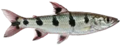
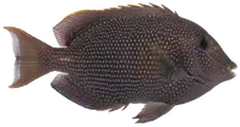
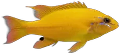
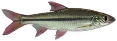
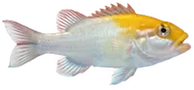
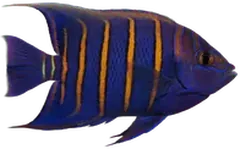
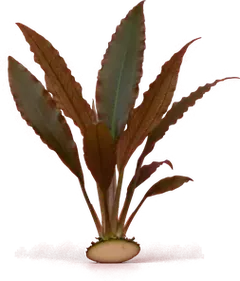
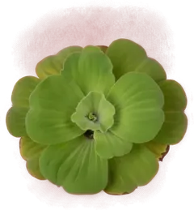

# reeftank-catalog

<!-- species:begin (generated by scripts/make_readme.py, do not edit) -->

> Fait partie de l'[**écosystème ReefTech**](https://elwinmage.github.io/reeftank/)

       

Espèces de poissons, coraux, plantes et invertébrés pour la vue aquarium de [ha-reef-card](https://github.com/Elwinmage/ha-reef-card), fournies par l'[intégration ReefTank](https://github.com/Elwinmage/ha-reeftank-component).

L'intégration télécharge les versions publiées de ce dépôt et les tient à jour (`update.reeftank_catalog`, automatique par défaut) : rien à faire côté Home Assistant.

## Comment ça marche

Chaque poisson est une planche d'images (un atlas WebP) et un descripteur avec ses clips : *nage*, *immobile* et *demi-tour*. La carte les enchaîne, et inverse le demi-tour en miroir pour que le poisson revienne comme il est venu. Voici la nage, le demi-tour et le retour de deux espèces :

<table><tr><td align="center"> Poisson-ange empereur</td><td align="center"> Poisson-clown</td></tr></table>

## Poissons (102)

**HD** : une vraie animation, faite à partir de vidéos. Les autres ont une animation simple faite à partir d'une photo, ou le poisson générique.

| &nbsp;&nbsp;&nbsp;&nbsp;&nbsp;&nbsp;&nbsp;&nbsp;&nbsp;&nbsp;&nbsp;&nbsp;&nbsp;&nbsp;&nbsp;&nbsp;&nbsp;&nbsp;&nbsp;&nbsp;&nbsp;&nbsp;&nbsp;&nbsp;&nbsp;&nbsp;&nbsp;&nbsp;&nbsp;&nbsp;&nbsp;&nbsp;&nbsp;&nbsp;&nbsp;&nbsp;&nbsp;&nbsp;&nbsp; | <small>Nom</small> | <small>Nom scientifique</small> | <small>Eau</small> | <small>Taille</small> | <small>Comportement</small> | HD |
|---|---|---|---|---|---|---|
|  | <small>Ancistrus `ancistrus`</small> | <small>*Ancistrus sp.*</small> | <small>Eau douce</small> | <small>10–14 cm</small> | <small>Vit près du fond · se cache la nuit</small> |  |
|  | <small>Anthias `pseudanthias`</small> | <small>*Pseudanthias sp.*</small> | <small>Marine</small> | <small>8–14 cm</small> | <small>En banc · se cache la nuit</small> | ✔ |
|  | <small>Apistogramma `apistogramma_cacatuoides`</small> | <small>*Apistogramma cacatuoides*</small> | <small>Eau douce</small> | <small>5–9 cm</small> | <small>Vit près du fond · se cache la nuit</small> |  |
|  | <small>Arc-en-ciel turquoise `melanotaenia_lacustris`</small> | <small>*Melanotaenia lacustris*</small> | <small>Eau douce</small> | <small>8–12 cm</small> | <small>En banc · se cache la nuit</small> |  |
|  | <small>Archer `toxotes_jaculatrix`</small> | <small>*Toxotes jaculatrix*</small> | <small>Saumâtre</small> | <small>15–25 cm</small> | <small>Nageur de pleine eau · se cache la nuit</small> |  |
|  | <small>Baliste Picasso `rhinecanthus_aculeatus`</small> | <small>*Rhinecanthus aculeatus*</small> | <small>Marine</small> | <small>20–25 cm</small> | <small>Nageur de pleine eau · se cache la nuit</small> |  |
|  | <small>Barbus cerise `pethia_titteya`</small> | <small>*Pethia titteya*</small> | <small>Eau douce</small> | <small>4–5 cm</small> | <small>En banc · se cache la nuit</small> |  |
|  | <small>Barbus de Sumatra `puntigrus_tetrazona`</small> | <small>*Puntigrus tetrazona*</small> | <small>Eau douce</small> | <small>5–7 cm</small> | <small>En banc · se cache la nuit</small> |  |
|  | <small>Blennie bicolore `ecsenius_bicolor`</small> | <small>*Ecsenius bicolor*</small> | <small>Marine</small> | <small>8–10 cm</small> | <small>Vit près du fond · se cache la nuit</small> |  |
|  | <small>Blennie tondeuse `salarias_fasciatus`</small> | <small>*Salarias fasciatus*</small> | <small>Marine</small> | <small>12–14 cm</small> | <small>Vit près du fond · se cache la nuit</small> |  |
|  | <small>Botia clown `chromobotia_macracanthus`</small> | <small>*Chromobotia macracanthus*</small> | <small>Eau douce</small> | <small>15–30 cm</small> | <small>Vit près du fond · se cache la nuit</small> |  |
|  | <small>Canthigaster de Valentin `canthigaster_valentini`</small> | <small>*Canthigaster valentini*</small> | <small>Marine</small> | <small>8–10 cm</small> | <small>Nageur de pleine eau · se cache la nuit</small> |  |
|  | <small>Cardinal pyjama `sphaeramia_nematoptera`</small> | <small>*Sphaeramia nematoptera*</small> | <small>Marine</small> | <small>8–10 cm</small> | <small>Stationnaire · reste en pleine eau la nuit</small> |  |
|  | <small>Cardinal à bande jaune `ostorhinchus_cyanosoma`</small> | <small>*Ostorhinchus cyanosoma*</small> | <small>Marine</small> | <small>7–8 cm</small> | <small>Stationnaire · reste en pleine eau la nuit</small> |  |
|  | <small>Chirurgien bleu `paracanthurus_hepatus`</small> | <small>*Paracanthurus hepatus*</small> | <small>Marine</small> | <small>20–30 cm</small> | <small>Nageur de pleine eau · se cache la nuit</small> |  |
|  | <small>Chirurgien bleu poudré `acanthurus_leucosternon`</small> | <small>*Acanthurus leucosternon*</small> | <small>Marine</small> | <small>20–23 cm</small> | <small>Nageur de pleine eau · se cache la nuit</small> |  |
|  | <small>Chirurgien brun `zebrasoma_scopas`</small> | <small>*Zebrasoma scopas*</small> | <small>Marine</small> | <small>15–20 cm</small> | <small>Nageur de pleine eau · se cache la nuit</small> |  |
|  | <small>Chirurgien jaune `zebrasoma_flavescens`</small> | <small>*Zebrasoma flavescens*</small> | <small>Marine</small> | <small>15–20 cm</small> | <small>Nageur de pleine eau · se cache la nuit</small> |  |
|  | <small>Chirurgien kole `ctenochaetus_strigosus`</small> | <small>*Ctenochaetus strigosus*</small> | <small>Marine</small> | <small>12–18 cm</small> | <small>Nageur de pleine eau · se cache la nuit</small> |  |
|  | <small>Chirurgien à voile `zebrasoma_veliferum`</small> | <small>*Zebrasoma veliferum*</small> | <small>Marine</small> | <small>25–40 cm</small> | <small>Nageur de pleine eau · se cache la nuit</small> |  |
|  | <small>Chromis vert `chromis_viridis`</small> | <small>*Chromis viridis*</small> | <small>Marine</small> | <small>5–8 cm</small> | <small>En banc · se cache la nuit</small> | ✔ |
|  | <small>Combattant `betta_splendens`</small> | <small>*Betta splendens*</small> | <small>Eau douce</small> | <small>5–7 cm</small> | <small>Stationnaire · reste près de son abri · reste en pleine eau la nuit</small> |  |
|  | <small>Corydoras bronzé `corydoras_aeneus`</small> | <small>*Corydoras aeneus*</small> | <small>Eau douce</small> | <small>6–7 cm</small> | <small>Vit près du fond · se cache la nuit</small> |  |
|  | <small>Corydoras panda `corydoras_panda`</small> | <small>*Corydoras panda*</small> | <small>Eau douce</small> | <small>4–5 cm</small> | <small>Vit près du fond · se cache la nuit</small> |  |
|  | <small>Danio galaxy `danio_margaritatus`</small> | <small>*Danio margaritatus*</small> | <small>Eau douce</small> | <small>2–3 cm</small> | <small>En banc · se cache la nuit</small> |  |
|  | <small>Danio perlé `danio_albolineatus`</small> | <small>*Danio albolineatus*</small> | <small>Eau douce</small> | <small>4–6 cm</small> | <small>En banc · se cache la nuit</small> |  |
|  | <small>Danio zébré `danio_rerio`</small> | <small>*Danio rerio*</small> | <small>Eau douce</small> | <small>4–5 cm</small> | <small>En banc · se cache la nuit</small> |  |
|  | <small>Dascyllus à trois taches `dascyllus_trimaculatus`</small> | <small>*Dascyllus trimaculatus*</small> | <small>Marine</small> | <small>10–14 cm</small> | <small>Stationnaire · reste en pleine eau la nuit</small> |  |
|  | <small>Demasoni `pseudotropheus_demasoni`</small> | <small>*Pseudotropheus demasoni*</small> | <small>Eau douce</small> | <small>7–8 cm</small> | <small>Nageur de pleine eau · se cache la nuit</small> |  |
|  | <small>Demoiselle des mers du sud `chrysiptera_taupou`</small> | <small>*Chrysiptera taupou*</small> | <small>Marine</small> | <small>6–8 cm</small> | <small>Stationnaire · reste près de son abri · reste en pleine eau la nuit</small> |  |
|  | <small>Demoiselle à queue jaune `chrysiptera_parasema`</small> | <small>*Chrysiptera parasema*</small> | <small>Marine</small> | <small>5–6 cm</small> | <small>Stationnaire · reste près de son abri · reste en pleine eau la nuit</small> |  |
|  | <small>Discus `symphysodon_aequifasciatus`</small> | <small>*Symphysodon aequifasciatus*</small> | <small>Eau douce</small> | <small>15–20 cm</small> | <small>Nageur de pleine eau · se cache la nuit</small> |  |
|  | <small>Dragonnet psychédélique `synchiropus_picturatus`</small> | <small>*Synchiropus picturatus*</small> | <small>Marine</small> | <small>6–8 cm</small> | <small>Vit près du fond · se cache la nuit</small> |  |
|  | <small>Endler `poecilia_wingei`</small> | <small>*Poecilia wingei*</small> | <small>Eau douce</small> | <small>2–4 cm</small> | <small>En banc · se cache la nuit</small> |  |
|  | <small>Gobie bourdon `brachygobius_xanthozonus`</small> | <small>*Brachygobius xanthozonus*</small> | <small>Saumâtre</small> | <small>3–4 cm</small> | <small>Vit près du fond · se cache la nuit</small> |  |
|  | <small>Gobie chevalier `stigmatogobius_sadanundio`</small> | <small>*Stigmatogobius sadanundio*</small> | <small>Saumâtre</small> | <small>6–8 cm</small> | <small>Vit près du fond · se cache la nuit</small> |  |
|  | <small>Gobie corail jaune `gobiodon_okinawae`</small> | <small>*Gobiodon okinawae*</small> | <small>Marine</small> | <small>2.5–3.5 cm</small> | <small>Vit près du fond · se cache la nuit</small> |  |
|  | <small>Gobie de corail citron `gobiodon_citrinus`</small> | <small>*Gobiodon citrinus*</small> | <small>Marine</small> | <small>3–5 cm</small> | <small>Vit près du fond · se cache la nuit</small> |  |
|  | <small>Gobie dormeur `valenciennea`</small> | <small>*Valenciennea sp.*</small> | <small>Marine</small> | <small>10–16 cm</small> | <small>Vit sur le sable · vit dans un terrier · se pose au fond la nuit</small> | ✔ |
|  | <small>Gobie néon `elacatinus_oceanops`</small> | <small>*Elacatinus oceanops*</small> | <small>Marine</small> | <small>4–6 cm</small> | <small>Vit près du fond · se cache la nuit</small> |  |
|  | <small>Gobie rayé `amblygobius_phalaena`</small> | <small>*Amblygobius phalaena*</small> | <small>Marine</small> | <small>8–10 cm</small> | <small>Vit sur le sable · se pose au fond la nuit</small> |  |
|  | <small>Gobie violet `gobioides_broussonnetii`</small> | <small>*Gobioides broussonnetii*</small> | <small>Saumâtre</small> | <small>30–50 cm</small> | <small>Vit sur le sable · vit dans un terrier · se pose au fond la nuit</small> |  |
|  | <small>Gobie yasha `stonogobiops_yasha`</small> | <small>*Stonogobiops yasha*</small> | <small>Marine</small> | <small>6–8 cm</small> | <small>Vit sur le sable · vit dans un terrier · se pose au fond la nuit</small> |  |
|  | <small>Gobie à bandeau jaune `cryptocentrus_cinctus`</small> | <small>*Cryptocentrus cinctus*</small> | <small>Marine</small> | <small>8–10 cm</small> | <small>Vit sur le sable · vit dans un terrier · se pose au fond la nuit</small> |  |
|  | <small>Gourami bleu `trichopodus_trichopterus`</small> | <small>*Trichopodus trichopterus*</small> | <small>Eau douce</small> | <small>10–15 cm</small> | <small>Nageur de pleine eau · se cache la nuit</small> |  |
|  | <small>Gourami nain `trichogaster_lalius`</small> | <small>*Trichogaster lalius*</small> | <small>Eau douce</small> | <small>5–8 cm</small> | <small>Nageur de pleine eau · se cache la nuit</small> |  |
|  | <small>Gourami perlé `trichopodus_leerii`</small> | <small>*Trichopodus leerii*</small> | <small>Eau douce</small> | <small>10–12 cm</small> | <small>Nageur de pleine eau · se cache la nuit</small> |  |
|  | <small>Gramma royal `gramma_loreto`</small> | <small>*Gramma loreto*</small> | <small>Marine</small> | <small>7–8 cm</small> | <small>Stationnaire · reste en pleine eau la nuit</small> |  |
|  | <small>Guppy `poecilia_reticulata`</small> | <small>*Poecilia reticulata*</small> | <small>Eau douce</small> | <small>3–6 cm</small> | <small>En banc · se cache la nuit</small> |  |
|  | <small>Hippocampe `hippocampus_erectus`</small> | <small>*Hippocampus erectus*</small> | <small>Marine</small> | <small>10–15 cm</small> | <small>Stationnaire · reste en pleine eau la nuit</small> |  |
|  | <small>Killi du Cap Lopez `aphyosemion_australe`</small> | <small>*Aphyosemion australe*</small> | <small>Eau douce</small> | <small>5–6 cm</small> | <small>Stationnaire · reste en pleine eau la nuit</small> |  |
|  | <small>Kribensis `pelvicachromis_pulcher`</small> | <small>*Pelvicachromis pulcher*</small> | <small>Eau douce</small> | <small>8–10 cm</small> | <small>Vit près du fond · se cache la nuit</small> |  |
|  | <small>Labidochromis jaune `labidochromis_caeruleus`</small> | <small>*Labidochromis caeruleus*</small> | <small>Eau douce</small> | <small>8–10 cm</small> | <small>Nageur de pleine eau · se cache la nuit</small> |  |
|  | <small>Labre chrysus `halichoeres_chrysus`</small> | <small>*Halichoeres chrysus*</small> | <small>Marine</small> | <small>10–12 cm</small> | <small>Nageur de pleine eau · se pose au fond la nuit</small> |  |
|  | <small>Labre de Solor `cirrhilabrus_solorensis`</small> | <small>*Cirrhilabrus solorensis*</small> | <small>Marine</small> | <small>10–12 cm</small> | <small>Nageur de pleine eau · se cache la nuit</small> |  |
|  | <small>Labre nettoyeur `labroides_dimidiatus`</small> | <small>*Labroides dimidiatus*</small> | <small>Marine</small> | <small>10–12 cm</small> | <small>Nageur de pleine eau · se cache la nuit</small> |  |
|  | <small>Labre à six lignes `pseudocheilinus_hexataenia`</small> | <small>*Pseudocheilinus hexataenia*</small> | <small>Marine</small> | <small>7–10 cm</small> | <small>Nageur de pleine eau · se cache la nuit</small> |  |
|  | <small>Loche kuhli `pangio_kuhlii`</small> | <small>*Pangio kuhlii*</small> | <small>Eau douce</small> | <small>8–12 cm</small> | <small>Vit près du fond · se cache la nuit</small> |  |
|  | <small>Mangeur d'algues siamois `crossocheilus_oblongus`</small> | <small>*Crossocheilus oblongus*</small> | <small>Eau douce</small> | <small>10–15 cm</small> | <small>Nageur de pleine eau · se cache la nuit</small> |  |
|  | <small>Molly `poecilia_sphenops`</small> | <small>*Poecilia sphenops*</small> | <small>Eau douce, Saumâtre</small> | <small>6–10 cm</small> | <small>En banc · se cache la nuit</small> |  |
|  | <small>Molly voile `poecilia_velifera`</small> | <small>*Poecilia velifera*</small> | <small>Saumâtre, Eau douce</small> | <small>10–15 cm</small> | <small>En banc · se cache la nuit</small> |  |
|  | <small>Mono argenté `monodactylus_argenteus`</small> | <small>*Monodactylus argenteus*</small> | <small>Saumâtre, Marine</small> | <small>15–25 cm</small> | <small>En banc · se cache la nuit</small> |  |
|  | <small>Néon bleu `paracheirodon_innesi`</small> | <small>*Paracheirodon innesi*</small> | <small>Eau douce</small> | <small>3–4 cm</small> | <small>En banc · se cache la nuit</small> |  |
|  | <small>Néon cardinal `paracheirodon_axelrodi`</small> | <small>*Paracheirodon axelrodi*</small> | <small>Eau douce</small> | <small>3–5 cm</small> | <small>En banc · se cache la nuit</small> |  |
|  | <small>Opistognathe à tête jaune `opistognathus_aurifrons`</small> | <small>*Opistognathus aurifrons*</small> | <small>Marine</small> | <small>10–12 cm</small> | <small>Vit sur le sable · vit dans un terrier · se pose au fond la nuit</small> |  |
|  | <small>Oscar `astronotus_ocellatus`</small> | <small>*Astronotus ocellatus*</small> | <small>Eau douce</small> | <small>25–35 cm</small> | <small>Nageur de pleine eau · se cache la nuit</small> |  |
|  | <small>Otocinclus `otocinclus_affinis`</small> | <small>*Otocinclus affinis*</small> | <small>Eau douce</small> | <small>3–5 cm</small> | <small>Vit près du fond · se cache la nuit</small> |  |
|  | <small>Platy `xiphophorus_maculatus`</small> | <small>*Xiphophorus maculatus*</small> | <small>Eau douce</small> | <small>4–6 cm</small> | <small>En banc · se cache la nuit</small> |  |
|  | <small>Pléco zèbre `hypancistrus_zebra`</small> | <small>*Hypancistrus zebra*</small> | <small>Eau douce</small> | <small>7–10 cm</small> | <small>Vit près du fond · se cache la nuit</small> |  |
|  | <small>Poisson nuage blanc `tanichthys_albonubes`</small> | <small>*Tanichthys albonubes*</small> | <small>Eau douce</small> | <small>3–4 cm</small> | <small>En banc · se cache la nuit</small> |  |
|  | <small>Poisson rouge `carassius_auratus`</small> | <small>*Carassius auratus*</small> | <small>Eau douce</small> | <small>10–25 cm</small> | <small>Nageur de pleine eau · se cache la nuit</small> |  |
|  | <small>Poisson-ange bicolore `centropyge_bicolor`</small> | <small>*Centropyge bicolor*</small> | <small>Marine</small> | <small>10–15 cm</small> | <small>Stationnaire · reste en pleine eau la nuit</small> |  |
|  | <small>Poisson-ange empereur (adulte) `pomacanthus_imperator_adult`</small> | <small>*Pomacanthus imperator*</small> | <small>Marine</small> | <small>25–38 cm</small> | <small>Nageur de pleine eau · se cache la nuit</small> | ✔ |
|  | <small>Poisson-ange empereur (juvénile) `pomacanthus_imperator`</small> | <small>*Pomacanthus imperator*</small> | <small>Marine</small> | <small>6–12 cm</small> | <small>Nageur de pleine eau · se cache la nuit</small> | ✔ |
|  | <small>Poisson-ange flamme `centropyge_loricula`</small> | <small>*Centropyge loricula*</small> | <small>Marine</small> | <small>8–10 cm</small> | <small>Stationnaire · reste en pleine eau la nuit</small> |  |
|  | <small>Poisson-ange royal `pygoplites_diacanthus`</small> | <small>*Pygoplites diacanthus*</small> | <small>Marine</small> | <small>20–25 cm</small> | <small>Nageur de pleine eau · se cache la nuit</small> |  |
|  | <small>Poisson-cardinal de Banggai `pterapogon_kauderni`</small> | <small>*Pterapogon kauderni*</small> | <small>Marine</small> | <small>5–8 cm</small> | <small>Stationnaire · reste en pleine eau la nuit</small> | ✔ |
|  | <small>Poisson-clown `amphiprion`</small> | <small>*Amphiprion sp.*</small> | <small>Marine</small> | <small>7–11 cm</small> | <small>Stationnaire · reste en pleine eau la nuit</small> | ✔ |
|  | <small>Poisson-clown tomate `premnas_biaculeatus`</small> | <small>*Premnas biaculeatus*</small> | <small>Marine</small> | <small>10–15 cm</small> | <small>Stationnaire · reste en pleine eau la nuit</small> |  |
|  | <small>Poisson-faucon pixie `cirrhitichthys_oxycephalus`</small> | <small>*Cirrhitichthys oxycephalus*</small> | <small>Marine</small> | <small>8–10 cm</small> | <small>Vit près du fond · se cache la nuit</small> |  |
|  | <small>Poisson-flamme `nemateleotris_magnifica`</small> | <small>*Nemateleotris magnifica*</small> | <small>Marine</small> | <small>8–10 cm</small> | <small>Stationnaire · reste en pleine eau la nuit</small> |  |
|  | <small>Poisson-flamme pourpre `nemateleotris_decora`</small> | <small>*Nemateleotris decora*</small> | <small>Marine</small> | <small>8–10 cm</small> | <small>Stationnaire · reste en pleine eau la nuit</small> |  |
|  | <small>Poisson-hachette `carnegiella_strigata`</small> | <small>*Carnegiella strigata*</small> | <small>Eau douce</small> | <small>4–5 cm</small> | <small>En banc · se cache la nuit</small> |  |
|  | <small>Poisson-lapin à tête de renard `siganus_vulpinus`</small> | <small>*Siganus vulpinus*</small> | <small>Marine</small> | <small>15–22 cm</small> | <small>Nageur de pleine eau · se pose au fond la nuit</small> | ✔ |
|  | <small>Poisson-lion volitans `pterois_volitans`</small> | <small>*Pterois volitans*</small> | <small>Marine</small> | <small>25–35 cm</small> | <small>Nageur de pleine eau · se cache la nuit</small> |  |
|  | <small>Poisson-lion zèbre `dendrochirus_zebra`</small> | <small>*Dendrochirus zebra*</small> | <small>Marine</small> | <small>12–18 cm</small> | <small>Nageur de pleine eau · se cache la nuit</small> |  |
|  | <small>Poisson-mandarin `synchiropus_splendidus`</small> | <small>*Synchiropus splendidus*</small> | <small>Marine</small> | <small>5–8 cm</small> | <small>Vit près du fond · se cache la nuit</small> | ✔ |
|  | <small>Poisson-papillon cuivré `chelmon_rostratus`</small> | <small>*Chelmon rostratus*</small> | <small>Marine</small> | <small>15–20 cm</small> | <small>Nageur de pleine eau · se cache la nuit</small> |  |
|  | <small>Pseudochromis orchidée `pseudochromis_fridmani`</small> | <small>*Pseudochromis fridmani*</small> | <small>Marine</small> | <small>6–7 cm</small> | <small>Stationnaire · reste près de son abri · reste en pleine eau la nuit</small> |  |
|  | <small>Périophtalme `periophthalmus_barbarus`</small> | <small>*Periophthalmus barbarus*</small> | <small>Saumâtre</small> | <small>10–15 cm</small> | <small>Vit près du fond · se cache la nuit</small> |  |
|  | <small>Ramirezi `mikrogeophagus_ramirezi`</small> | <small>*Mikrogeophagus ramirezi*</small> | <small>Eau douce</small> | <small>5–7 cm</small> | <small>Stationnaire · reste en pleine eau la nuit</small> |  |
|  | <small>Rasbora arlequin `trigonostigma_heteromorpha`</small> | <small>*Trigonostigma heteromorpha*</small> | <small>Eau douce</small> | <small>3–4.5 cm</small> | <small>En banc · se cache la nuit</small> |  |
|  | <small>Scalaire `pterophyllum_scalare`</small> | <small>*Pterophyllum scalare*</small> | <small>Eau douce</small> | <small>12–15 cm</small> | <small>Nageur de pleine eau · se cache la nuit</small> |  |
|  | <small>Scat `scatophagus_argus`</small> | <small>*Scatophagus argus*</small> | <small>Saumâtre, Marine</small> | <small>15–30 cm</small> | <small>Nageur de pleine eau · se cache la nuit</small> |  |
|  | <small>Tétra citron `hyphessobrycon_pulchripinnis`</small> | <small>*Hyphessobrycon pulchripinnis*</small> | <small>Eau douce</small> | <small>3–4.5 cm</small> | <small>En banc · se cache la nuit</small> |  |
|  | <small>Tétra empereur `nematobrycon_palmeri`</small> | <small>*Nematobrycon palmeri*</small> | <small>Eau douce</small> | <small>4–6 cm</small> | <small>En banc · se cache la nuit</small> |  |
|  | <small>Tétra noir `gymnocorymbus_ternetzi`</small> | <small>*Gymnocorymbus ternetzi*</small> | <small>Eau douce</small> | <small>5–6 cm</small> | <small>En banc · se cache la nuit</small> |  |
|  | <small>Tétra serpae `hyphessobrycon_eques`</small> | <small>*Hyphessobrycon eques*</small> | <small>Eau douce</small> | <small>3–4.5 cm</small> | <small>En banc · se cache la nuit</small> |  |
|  | <small>Tétra à nez rouge `hemigrammus_bleheri`</small> | <small>*Hemigrammus bleheri*</small> | <small>Eau douce</small> | <small>4–5 cm</small> | <small>En banc · se cache la nuit</small> |  |
|  | <small>Tétraodon en 8 `dichotomyctere_biocellatus`</small> | <small>*Dichotomyctere biocellatus*</small> | <small>Saumâtre</small> | <small>5–6.5 cm</small> | <small>Nageur de pleine eau · se cache la nuit</small> |  |
|  | <small>Tétraodon vert `dichotomyctere_nigroviridis`</small> | <small>*Dichotomyctere nigroviridis*</small> | <small>Saumâtre</small> | <small>10–17 cm</small> | <small>Nageur de pleine eau · se cache la nuit</small> |  |
|  | <small>Xipho `xiphophorus_hellerii`</small> | <small>*Xiphophorus hellerii*</small> | <small>Eau douce</small> | <small>6–12 cm</small> | <small>En banc · se cache la nuit</small> |  |

## Coraux (1)

| &nbsp;&nbsp;&nbsp;&nbsp;&nbsp;&nbsp;&nbsp;&nbsp;&nbsp;&nbsp;&nbsp;&nbsp;&nbsp;&nbsp;&nbsp;&nbsp;&nbsp;&nbsp;&nbsp;&nbsp;&nbsp;&nbsp;&nbsp;&nbsp;&nbsp;&nbsp;&nbsp;&nbsp;&nbsp;&nbsp;&nbsp;&nbsp;&nbsp;&nbsp;&nbsp;&nbsp;&nbsp;&nbsp;&nbsp; | <small>Nom</small> | <small>Nom scientifique</small> | <small>Eau</small> | <small>Taille</small> |
|---|---|---|---|---|
|  | <small>Euphyllie torche `euphyllia_glabrescens`</small> | <small>*Euphyllia glabrescens*</small> | <small>Marine</small> | <small>10–30 cm</small> |

## Plantes (29)

| &nbsp;&nbsp;&nbsp;&nbsp;&nbsp;&nbsp;&nbsp;&nbsp;&nbsp;&nbsp;&nbsp;&nbsp;&nbsp;&nbsp;&nbsp;&nbsp;&nbsp;&nbsp;&nbsp;&nbsp;&nbsp;&nbsp;&nbsp;&nbsp;&nbsp;&nbsp;&nbsp;&nbsp;&nbsp;&nbsp;&nbsp;&nbsp;&nbsp;&nbsp;&nbsp;&nbsp;&nbsp;&nbsp;&nbsp; | <small>Nom</small> | <small>Nom scientifique</small> | <small>Eau</small> | <small>Taille</small> | <small>Zone</small> |
|---|---|---|---|---|---|
|  | <small>Anubias `anubias_barteri`</small> | <small>*Anubias barteri*</small> | <small>Eau douce</small> | <small>10–25 cm</small> | <small>Épiphyte</small> |
|  | <small>Bucéphalandra `bucephalandra`</small> | <small>*Bucephalandra sp.*</small> | <small>Eau douce</small> | <small>5–15 cm</small> | <small>Épiphyte</small> |
|  | <small>Cabomba `cabomba_caroliniana`</small> | <small>*Cabomba caroliniana*</small> | <small>Eau douce</small> | <small>30–60 cm</small> | <small>Arrière-plan</small> |
|  | <small>Caulerpa `caulerpa_prolifera`</small> | <small>*Caulerpa prolifera*</small> | <small>Marine</small> | <small>5–20 cm</small> | <small>Premier plan</small> |
|  | <small>Chaetomorpha `chaetomorpha_linum`</small> | <small>*Chaetomorpha linum*</small> | <small>Marine</small> | <small>5–30 cm</small> | <small>Premier plan</small> |
|  | <small>Cryptocoryne ciliata `cryptocoryne_ciliata`</small> | <small>*Cryptocoryne ciliata*</small> | <small>Saumâtre, Eau douce</small> | <small>20–40 cm</small> | <small>Plan intermédiaire</small> |
|  | <small>Cryptocoryne parva `cryptocoryne_parva`</small> | <small>*Cryptocoryne parva*</small> | <small>Eau douce</small> | <small>5–8 cm</small> | <small>Premier plan</small> |
|  | <small>Cryptocoryne wendtii `cryptocoryne_wendtii`</small> | <small>*Cryptocoryne wendtii*</small> | <small>Eau douce</small> | <small>10–20 cm</small> | <small>Plan intermédiaire</small> |
|  | <small>Echinodorus `echinodorus_bleheri`</small> | <small>*Echinodorus bleheri*</small> | <small>Eau douce</small> | <small>30–50 cm</small> | <small>Plan intermédiaire</small> |
|  | <small>Eleocharis `eleocharis_parvula`</small> | <small>*Eleocharis parvula*</small> | <small>Eau douce</small> | <small>5–10 cm</small> | <small>Premier plan</small> |
|  | <small>Fougère de Java `microsorum_pteropus`</small> | <small>*Microsorum pteropus*</small> | <small>Eau douce</small> | <small>20–30 cm</small> | <small>Épiphyte</small> |
|  | <small>Glossostigma `glossostigma_elatinoides`</small> | <small>*Glossostigma elatinoides*</small> | <small>Eau douce</small> | <small>2–5 cm</small> | <small>Premier plan</small> |
|  | <small>Halimeda `halimeda_opuntia`</small> | <small>*Halimeda opuntia*</small> | <small>Marine</small> | <small>5–15 cm</small> | <small>Premier plan</small> |
|  | <small>Hemianthus `hemianthus_callitrichoides`</small> | <small>*Hemianthus callitrichoides*</small> | <small>Eau douce</small> | <small>2–5 cm</small> | <small>Premier plan</small> |
|  | <small>Herbier de tortue `thalassia_testudinum`</small> | <small>*Thalassia testudinum*</small> | <small>Marine</small> | <small>10–30 cm</small> | <small>Premier plan</small> |
|  | <small>Hygrophila `hygrophila_polysperma`</small> | <small>*Hygrophila polysperma*</small> | <small>Eau douce</small> | <small>20–50 cm</small> | <small>Arrière-plan</small> |
|  | <small>Laitue d'eau `pistia_stratiotes`</small> | <small>*Pistia stratiotes*</small> | <small>Eau douce</small> | <small>5–15 cm</small> | <small>Flottante</small> |
|  | <small>Lentille d'eau `lemna_minor`</small> | <small>*Lemna minor*</small> | <small>Eau douce</small> | <small>0.5–1 cm</small> | <small>Flottante</small> |
|  | <small>Limnobium `limnobium_laevigatum`</small> | <small>*Limnobium laevigatum*</small> | <small>Eau douce</small> | <small>5–10 cm</small> | <small>Flottante</small> |
|  | <small>Limnophila `limnophila_sessiliflora`</small> | <small>*Limnophila sessiliflora*</small> | <small>Eau douce</small> | <small>20–40 cm</small> | <small>Arrière-plan</small> |
|  | <small>Ludwigia `ludwigia_repens`</small> | <small>*Ludwigia repens*</small> | <small>Eau douce</small> | <small>20–40 cm</small> | <small>Plan intermédiaire</small> |
|  | <small>Marimo `aegagropila_linnaei`</small> | <small>*Aegagropila linnaei*</small> | <small>Eau douce</small> | <small>3–10 cm</small> | <small>Premier plan</small> |
|  | <small>Mousse de Java `vesicularia_dubyana`</small> | <small>*Vesicularia dubyana*</small> | <small>Eau douce</small> | <small>3–5 cm</small> | <small>Épiphyte</small> |
|  | <small>Palétuvier rouge `rhizophora_mangle`</small> | <small>*Rhizophora mangle*</small> | <small>Saumâtre, Marine</small> | <small>30–100 cm</small> | <small>Plan intermédiaire</small> |
|  | <small>Rotala `rotala_rotundifolia`</small> | <small>*Rotala rotundifolia*</small> | <small>Eau douce</small> | <small>20–50 cm</small> | <small>Arrière-plan</small> |
|  | <small>Sagittaire naine `sagittaria_subulata`</small> | <small>*Sagittaria subulata*</small> | <small>Eau douce</small> | <small>10–30 cm</small> | <small>Premier plan</small> |
|  | <small>Staurogyne `staurogyne_repens`</small> | <small>*Staurogyne repens*</small> | <small>Eau douce</small> | <small>5–10 cm</small> | <small>Premier plan</small> |
|  | <small>Vallisnérie `vallisneria_spiralis`</small> | <small>*Vallisneria spiralis*</small> | <small>Eau douce, Saumâtre</small> | <small>30–60 cm</small> | <small>Arrière-plan</small> |
|  | <small>Élodée dense `egeria_densa`</small> | <small>*Egeria densa*</small> | <small>Eau douce</small> | <small>30–100 cm</small> | <small>Arrière-plan</small> |

## Invertébrés (32)

| &nbsp;&nbsp;&nbsp;&nbsp;&nbsp;&nbsp;&nbsp;&nbsp;&nbsp;&nbsp;&nbsp;&nbsp;&nbsp;&nbsp;&nbsp;&nbsp;&nbsp;&nbsp;&nbsp;&nbsp;&nbsp;&nbsp;&nbsp;&nbsp;&nbsp;&nbsp;&nbsp;&nbsp;&nbsp;&nbsp;&nbsp;&nbsp;&nbsp;&nbsp;&nbsp;&nbsp;&nbsp;&nbsp;&nbsp; | <small>Nom</small> | <small>Nom scientifique</small> | <small>Eau</small> | <small>Taille</small> | <small>Rôle</small> |
|---|---|---|---|---|---|
|  | <small>Ampullaire `pomacea_bridgesii`</small> | <small>*Pomacea bridgesii*</small> | <small>Eau douce</small> | <small>4–5 cm</small> | <small>Charognard · se déplace sur le fond</small> |
|  | <small>Astrée `astraea_tecta`</small> | <small>*Astraea tecta*</small> | <small>Marine</small> | <small>2–4 cm</small> | <small>Mangeur d'algues · vit sur le décor</small> |
|  | <small>Bernard-l'ermite à pattes bleues `clibanarius_tricolor`</small> | <small>*Clibanarius tricolor*</small> | <small>Marine</small> | <small>2–3 cm</small> | <small>Charognard · se déplace sur le fond</small> |
|  | <small>Bernard-l'ermite à pattes rouges `paguristes_cadenati`</small> | <small>*Paguristes cadenati*</small> | <small>Marine</small> | <small>3–4 cm</small> | <small>Charognard · se déplace sur le fond</small> |
|  | <small>Bénitier `tridacna_crocea`</small> | <small>*Tridacna crocea*</small> | <small>Marine</small> | <small>5–15 cm</small> | <small>Filtreur · fixé</small> |
|  | <small>Concombre de mer `holothuria`</small> | <small>*Holothuria sp.*</small> | <small>Marine</small> | <small>15–30 cm</small> | <small>Détritivore · se déplace sur le fond</small> |
|  | <small>Crabe émeraude `mithraculus_sculptus`</small> | <small>*Mithraculus sculptus*</small> | <small>Marine</small> | <small>3–4 cm</small> | <small>Mangeur d'algues · vit sur le décor</small> |
|  | <small>Crevette Amano `caridina_multidentata`</small> | <small>*Caridina multidentata*</small> | <small>Eau douce</small> | <small>3–5 cm</small> | <small>Mangeur d'algues · se déplace sur le fond</small> |
|  | <small>Crevette arlequin `hymenocera_picta`</small> | <small>*Hymenocera picta*</small> | <small>Marine</small> | <small>4–6 cm</small> | <small>Prédateur · se déplace sur le fond</small> |
|  | <small>Crevette bambou `atyopsis_moluccensis`</small> | <small>*Atyopsis moluccensis*</small> | <small>Eau douce</small> | <small>6–8 cm</small> | <small>Filtreur · vit sur le décor</small> |
|  | <small>Crevette boxer `stenopus_hispidus`</small> | <small>*Stenopus hispidus*</small> | <small>Marine</small> | <small>6–8 cm</small> | <small>Nettoyeur · vit sur le décor</small> |
|  | <small>Crevette cerise `neocaridina_davidi`</small> | <small>*Neocaridina davidi*</small> | <small>Eau douce</small> | <small>2–3.5 cm</small> | <small>Détritivore · se déplace sur le fond</small> |
|  | <small>Crevette cristal rouge `caridina_cantonensis`</small> | <small>*Caridina cantonensis*</small> | <small>Eau douce</small> | <small>2–3 cm</small> | <small>Détritivore · se déplace sur le fond</small> |
|  | <small>Crevette nettoyeuse `lysmata_amboinensis`</small> | <small>*Lysmata amboinensis*</small> | <small>Marine</small> | <small>5–6 cm</small> | <small>Nettoyeur · vit sur le décor</small> |
|  | <small>Crevette peppermint `lysmata_wurdemanni`</small> | <small>*Lysmata wurdemanni*</small> | <small>Marine</small> | <small>3–5 cm</small> | <small>Nettoyeur · vit sur le décor</small> |
|  | <small>Crevette sang de feu `lysmata_debelius`</small> | <small>*Lysmata debelius*</small> | <small>Marine</small> | <small>5–6 cm</small> | <small>Nettoyeur · vit sur le décor</small> |
|  | <small>Crevette Saron `saron_marmoratus`</small> | <small>*Saron marmoratus*</small> | <small>Marine</small> | <small>5–7 cm</small> | <small>Charognard · vit sur le décor</small> |
|  | <small>Cérithe `cerithium`</small> | <small>*Cerithium sp.*</small> | <small>Marine</small> | <small>2–3 cm</small> | <small>Détritivore · se déplace sur le fond</small> |
|  | <small>Escargot assassin `clea_helena`</small> | <small>*Clea helena*</small> | <small>Eau douce</small> | <small>2–3 cm</small> | <small>Prédateur · se déplace sur le fond</small> |
|  | <small>Mélanie `melanoides_tuberculata`</small> | <small>*Melanoides tuberculata*</small> | <small>Eau douce</small> | <small>2–3 cm</small> | <small>Détritivore · se déplace sur le fond</small> |
|  | <small>Nassarius `nassarius`</small> | <small>*Nassarius sp.*</small> | <small>Marine</small> | <small>2–4 cm</small> | <small>Charognard · se déplace sur le fond</small> |
|  | <small>Néritine marine `nerita`</small> | <small>*Nerita sp.*</small> | <small>Marine</small> | <small>2–3 cm</small> | <small>Mangeur d'algues · grimpe sur les vitres</small> |
|  | <small>Néritine zébrée `neritina_natalensis`</small> | <small>*Neritina natalensis*</small> | <small>Eau douce</small> | <small>2–3 cm</small> | <small>Mangeur d'algues · grimpe sur les vitres</small> |
|  | <small>Ophiure `ophiolepis_superba`</small> | <small>*Ophiolepis superba*</small> | <small>Marine</small> | <small>8–12 cm</small> | <small>Charognard · se déplace sur le fond</small> |
|  | <small>Oursin collecteur `tripneustes_gratilla`</small> | <small>*Tripneustes gratilla*</small> | <small>Marine</small> | <small>10–15 cm</small> | <small>Mangeur d'algues · vit sur le décor</small> |
|  | <small>Oursin crayon `prionocidaris_baculosa`</small> | <small>*Prionocidaris baculosa*</small> | <small>Marine</small> | <small>8–10 cm</small> | <small>Mangeur d'algues · vit sur le décor</small> |
|  | <small>Planorbe `planorbella_duryi`</small> | <small>*Planorbella duryi*</small> | <small>Eau douce</small> | <small>2–3 cm</small> | <small>Détritivore · grimpe sur les vitres</small> |
|  | <small>Trochus `tectus_fenestratus`</small> | <small>*Tectus fenestratus*</small> | <small>Marine</small> | <small>4–6 cm</small> | <small>Mangeur d'algues · vit sur le décor</small> |
|  | <small>Turbo `turbo_fluctuosus`</small> | <small>*Turbo fluctuosus*</small> | <small>Marine</small> | <small>4–8 cm</small> | <small>Mangeur d'algues · grimpe sur les vitres</small> |
|  | <small>Ver plumeau `sabellastarte`</small> | <small>*Sabellastarte sp.*</small> | <small>Marine</small> | <small>5–10 cm</small> | <small>Filtreur · fixé</small> |
|  | <small>Ver sapin de Noël `spirobranchus_giganteus`</small> | <small>*Spirobranchus giganteus*</small> | <small>Marine</small> | <small>3–5 cm</small> | <small>Filtreur · fixé</small> |
|  | <small>Étoile de sable `archaster_typicus`</small> | <small>*Archaster typicus*</small> | <small>Marine</small> | <small>6–10 cm</small> | <small>Détritivore · se déplace sur le fond</small> |

Pour ajouter une espèce (génération des clips, construction, publication), voir la [documentation en anglais](README.md).

Les ressources des espèces sont sous **CC BY 4.0**, les scripts sous MIT : voir [LICENSE.md](LICENSE.md).

<!-- species:end -->

<!-- ecosystem:start -->

## Projets liés

Les projets ReefTech s'articulent entre eux : les intégrations font entrer votre matériel dans Home Assistant, la carte l'affiche et le pilote, et le secours le maintient en marche pendant une coupure. Chacun fonctionne aussi seul.

<table>
  <tr>
    <th width="100px"></th>
    <th>Projet</th>
    <th>Rôle</th>
    <th>Fonctionne avec</th>
  </tr>
  <tr>
    <td></td>
    <td>🐠 <a href="https://github.com/Elwinmage/ha-reefbeat-component"><b>ha-reefbeat-component</b></a></td>
    <td>Appareils Red Sea ReefBeat, pilotés en local sans cloud : ReefATO+, ReefControl, ReefControl-Power, ReefDose, ReefLed, ReefMat, ReefRun et ReefWave. blueprint d'alertes pour les modes anormaux, les calibrations et les batteries faibles. </td>
    <td>ha-reef-card</td>
  </tr>
  <tr>
    <td></td>
    <td>🌊 <a href="https://github.com/Elwinmage/ha-aquamedic-component"><b>ha-aquamedic-component</b></a></td>
    <td>Pompes Aqua Medic via l'API cloud Gizwits : brasseurs EcoDrift et SmartDrift, pompes DC Runner de remontée et d'écumeur.</td>
    <td>ha-reef-card</td>
  </tr>
  <tr>
    <td></td>
    <td>🐟 <a href="https://github.com/Elwinmage/ha-vson-component"><b>ha-vson-component</b></a></td>
    <td>Distributeurs de nourriture VSON via l'API cloud VSON : le distributeur WP8621 (nourrir, batterie, alerte réserve basse) et la détection générique de tout autre appareil VSON. Le WP8621 peut aussi fonctionner 100 % en local sous ESPHome.</td>
    <td>ha-reef-card</td>
  </tr>
  <tr>
    <td></td>
    <td>🐙 <a href="https://github.com/Elwinmage/ha-reef-maintenance-component"><b>ha-reef-maintenance-component</b></a></td>
    <td>Suivi du nettoyage et de l'usure du matériel que Home Assistant ne peut pas interroger : pompes de brassage, pompes de remontée, écumeurs, réacteurs, tout ce que vous entretenez à la main.</td>
    <td>ha-reef-card</td>
  </tr>
  <tr>
    <td></td>
    <td>🪸 <a href="https://github.com/Elwinmage/ha-reef-card"><b>ha-reef-card</b></a></td>
    <td>Vue graphique interactive de chaque appareil sur votre tableau de bord, et seul moyen d'éditer les programmes avancés. Lit les quatre intégrations ci-dessus via le contrat <code>reef_role</code> commun, sans configuration côté carte. Dessine aussi les flux d'énergie de reefbeatEnergyBackup. Sa carte aquarium donne vie à votre bac avec ha-reeftank-component.</td>
    <td>les quatre intégrations, et ha-reeftank-component pour l'aquarium</td>
  </tr>
  <tr>
    <td></td>
    <td>🐟 <a href="https://github.com/Elwinmage/ha-reeftank-component"><b>ha-reeftank-component</b></a></td>
    <td>Une image vivante de votre bac sur le tableau de bord : votre photo, éclairée par vos vraies lampes, avec des poissons et des coraux animés, et vos appareils et entités dessus. Stocke les aquariums et leur population, enregistre les nourrissages.</td>
    <td>ha-reef-card</td>
  </tr>
  <tr>
    <td></td>
    <td>🐡 <b>reeftank-catalog</b> <i>(ce dépôt)</i></td>
    <td>Poissons, coraux et textures de la carte aquarium, téléchargés et tenus à jour par ha-reeftank-component.</td>
    <td>ha-reeftank-component</td>
  </tr>
  <tr>
    <td></td>
    <td>🐬 <a href="https://github.com/Elwinmage/ha-reef-blueprints"><b>ha-reef-blueprints</b></a></td>
    <td>Blueprints d'automatisation communs à tout l'écosystème : entretiens en retard trouvés via le contrat <code>reef_role</code>, appareils devenus injoignables, test périodique des chauffages et surveillance des relais. Huit langues.</td>
    <td>les quatre intégrations</td>
  </tr>
  <tr>
    <td></td>
    <td>⚡ <a href="https://github.com/Elwinmage/reefbeatEnergyBackup"><b>reefbeatEnergyBackup</b></a></td>
    <td>Secours sur batterie en cas de coupure. Pack 24V LiFePO₄ piloté par un Raspberry Pi, avec dégradation progressive de la vitesse des pompes selon l'état de charge.</td>
    <td>seul, ou avec ha-reefbeat-component et ha-reef-card</td>
  </tr>
</table>

L'ensemble est documenté sur la [page du projet ReefTech](https://elwinmage.github.io/reeftank/).

<!-- ecosystem:end -->
