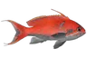
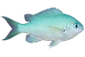
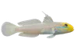
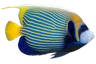
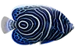
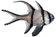
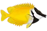
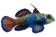
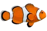

# reeftank-catalog

<!-- species:begin (generated by scripts/make_readme.py, do not edit) -->

       

Specie di pesci e coralli per la vista acquario di [ha-reef-card](https://github.com/Elwinmage/ha-reef-card), fornite dall'[integrazione ReefTank](https://github.com/Elwinmage/ha-reeftank-component).

L'integrazione scarica le release di questo repository e le mantiene aggiornate (`update.reeftank_catalog`, automatico per impostazione predefinita): nulla da fare in Home Assistant.

## Pesci (9)

|  | Nome | Nome scientifico | Taglia | Comportamento |
|---|---|---|---|---|
|  | Anthias `pseudanthias` | *Pseudanthias sp.* | 8–14 cm | In banco · si nasconde di notte |
|  | Castagnola verde `chromis_viridis` | *Chromis viridis* | 5–8 cm | In banco · si nasconde di notte |
|  | Ghiozzo dormiente `valenciennea` | *Valenciennea sp.* | 10–16 cm | Vive vicino al fondo · riposa sul fondo di notte |
|  | Pesce angelo imperatore (adulto) `pomacanthus_imperator_adult` | *Pomacanthus imperator* | 25–38 cm | Nuotatore di acque libere · si nasconde di notte |
|  | Pesce angelo imperatore (giovane) `pomacanthus_imperator` | *Pomacanthus imperator* | 6–12 cm | Nuotatore di acque libere · si nasconde di notte |
|  | Pesce cardinale di Banggai `pterapogon_kauderni` | *Pterapogon kauderni* | 5–8 cm | Stazionario · resta sospeso di notte |
|  | Pesce coniglio volpe `siganus_vulpinus` | *Siganus vulpinus* | 15–22 cm | Nuotatore di acque libere · riposa sul fondo di notte |
|  | Pesce mandarino `synchiropus_splendidus` | *Synchiropus splendidus* | 5–8 cm | Vive vicino al fondo · si nasconde di notte |
|  | Pesce pagliaccio `amphiprion` | *Amphiprion sp.* | 7–11 cm | Stazionario · resta sospeso di notte |

## Coralli (0)

Ancora nessuna specie.

Per aggiungere una specie (generazione delle clip, build, pubblicazione), vedere la [documentazione in inglese](README.md).

Le risorse delle specie sono sotto **CC BY 4.0**, gli script sotto MIT: vedere [LICENSE.md](LICENSE.md).

<!-- species:end -->
