# reeftank-catalog

<!-- species:begin (generated by scripts/make_readme.py, do not edit) -->

> Parte dell'[**ecosistema di progetti ReefTech**](https://elwinmage.github.io/reeftank/)

       

Specie di pesci, coralli, piante e invertebrati per la vista acquario di [ha-reef-card](https://github.com/Elwinmage/ha-reef-card), fornite dall'[integrazione ReefTank](https://github.com/Elwinmage/ha-reeftank-component).

L'integrazione scarica le release di questo repository e le mantiene aggiornate (`update.reeftank_catalog`, automatico per impostazione predefinita): nulla da fare in Home Assistant.

## Come funziona

Ogni pesce è un foglio di immagini (un atlante WebP) e un descrittore con le sue clip: *nuoto*, *fermo* e *virata*. La scheda le concatena e specchia la virata perché il pesce torni da dove è venuto. Ecco il nuoto, la virata e il ritorno di due specie:

Una specie senza video ha un atlante più semplice ricavato da una sola foto (*LD*): tutto il corpo ondeggia, le pinne non si muovono. Quelli ricavati da video sono spuntati nella colonna HD delle tabelle qui sotto.

<table><tr><th></th><th>Pesce angelo imperatore</th><th>Pesce pagliaccio</th></tr><tr><td>HD (video)</td><td align="center"></td><td align="center"></td></tr><tr><td>LD (una foto)</td><td align="center"></td><td align="center">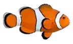</td></tr></table>

## Pesci (102)

**HD**: un'animazione reale, fatta da video. Gli altri hanno un'animazione semplice fatta da una foto, o il pesce generico.

| &nbsp;&nbsp;&nbsp;&nbsp;&nbsp;&nbsp;&nbsp;&nbsp;&nbsp;&nbsp;&nbsp;&nbsp;&nbsp;&nbsp;&nbsp;&nbsp;&nbsp;&nbsp;&nbsp;&nbsp;&nbsp;&nbsp;&nbsp;&nbsp;&nbsp;&nbsp;&nbsp;&nbsp;&nbsp;&nbsp;&nbsp;&nbsp;&nbsp; | Nome | Nome scientifico | Acqua | Taglia | Comportamento | HD |
|---|---|---|---|---|---|---|
|  | Ancistrus <code>ancistrus</code> | *Ancistrus sp.* | Acqua dolce | 10–14 cm | Vive vicino al fondo · si nasconde di notte | ✔ |
|  | Anthias <code>pseudanthias</code> | *Pseudanthias sp.* | Marino | 8–14 cm | In banco · si nasconde di notte | ✔ |
|  | Apistogramma cacatua <code>apistogramma&#95;<wbr>cacatuoides</code> | *Apistogramma cacatuoides* | Acqua dolce | 5–9 cm | Vive vicino al fondo · si nasconde di notte | ✔ |
|  | Barbo ciliegia <code>pethia&#95;<wbr>titteya</code> | *Pethia titteya* | Acqua dolce | 4–5 cm | In banco · si nasconde di notte | ✔ |
|  | Barbo di Sumatra <code>puntigrus&#95;<wbr>tetrazona</code> | *Puntigrus tetrazona* | Acqua dolce | 5–7 cm | In banco · si nasconde di notte | ✔ |
|  | Bavosa bicolore <code>ecsenius&#95;<wbr>bicolor</code> | *Ecsenius bicolor* | Marino | 8–10 cm | Vive vicino al fondo · si nasconde di notte | ✔ |
|  | Bavosa tosaerba <code>salarias&#95;<wbr>fasciatus</code> | *Salarias fasciatus* | Marino | 12–14 cm | Vive vicino al fondo · si nasconde di notte | ✔ |
|  | Botia anguilla <code>pangio&#95;<wbr>kuhlii</code> | *Pangio kuhlii* | Acqua dolce | 8–12 cm | Vive vicino al fondo · si nasconde di notte | ✔ |
|  | Botia pagliaccio <code>chromobotia&#95;<wbr>macracanthus</code> | *Chromobotia macracanthus* | Acqua dolce | 15–30 cm | Vive vicino al fondo · si nasconde di notte | ✔ |
|  | Castagnola verde <code>chromis&#95;<wbr>viridis</code> | *Chromis viridis* | Marino | 5–8 cm | In banco · si nasconde di notte | ✔ |
|  | Cavalluccio marino striato <code>hippocampus&#95;<wbr>erectus</code> | *Hippocampus erectus* | Marino | 10–15 cm | Stazionario · resta sospeso di notte | ✔ |
|  | Ciclide Demasoni <code>pseudotropheus&#95;<wbr>demasoni</code> | *Pseudotropheus demasoni* | Acqua dolce | 7–8 cm | Nuotatore di acque libere · si nasconde di notte | ✔ |
|  | Ciclide giallo elettrico <code>labidochromis&#95;<wbr>caeruleus</code> | *Labidochromis caeruleus* | Acqua dolce | 8–10 cm | Nuotatore di acque libere · si nasconde di notte | ✔ |
|  | Corydoras bronzeo <code>corydoras&#95;<wbr>aeneus</code> | *Corydoras aeneus* | Acqua dolce | 6–7 cm | Vive vicino al fondo · si nasconde di notte | ✔ |
|  | Corydoras panda <code>corydoras&#95;<wbr>panda</code> | *Corydoras panda* | Acqua dolce | 4–5 cm | Vive vicino al fondo · si nasconde di notte | ✔ |
|  | Damigella a coda gialla <code>chrysiptera&#95;<wbr>parasema</code> | *Chrysiptera parasema* | Marino | 5–6 cm | Stazionario · resta vicino al suo rifugio · resta sospeso di notte | ✔ |
| 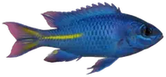 | Damigella delle Figi <code>chrysiptera&#95;<wbr>taupou</code> | *Chrysiptera taupou* | Marino | 6–8 cm | Stazionario · resta vicino al suo rifugio · resta sospeso di notte | ✔ |
|  | Danio galassia <code>danio&#95;<wbr>margaritatus</code> | *Danio margaritatus* | Acqua dolce | 2–3 cm | In banco · si nasconde di notte | ✔ |
|  | Danio perla <code>danio&#95;<wbr>albolineatus</code> | *Danio albolineatus* | Acqua dolce | 4–6 cm | In banco · si nasconde di notte | ✔ |
|  | Dascillo a tre macchie <code>dascyllus&#95;<wbr>trimaculatus</code> | *Dascyllus trimaculatus* | Marino | 10–14 cm | Stazionario · resta sospeso di notte | ✔ |
|  | Discus <code>symphysodon&#95;<wbr>aequifasciatus</code> | *Symphysodon aequifasciatus* | Acqua dolce | 15–20 cm | Nuotatore di acque libere · si nasconde di notte | ✔ |
|  | Ghiozzo a bande <code>amblygobius&#95;<wbr>phalaena</code> | *Amblygobius phalaena* | Marino | 8–10 cm | Vive sulla sabbia · riposa sul fondo di notte | ✔ |
|  | Ghiozzo calabrone <code>brachygobius&#95;<wbr>xanthozonus</code> | *Brachygobius xanthozonus* | Salmastro | 3–4 cm | Vive vicino al fondo · si nasconde di notte | ✔ |
|  | Ghiozzo cavaliere <code>stigmatogobius&#95;<wbr>sadanundio</code> | *Stigmatogobius sadanundio* | Salmastro | 6–8 cm | Vive vicino al fondo · si nasconde di notte | ✔ |
|  | Ghiozzo corallino limone <code>gobiodon&#95;<wbr>citrinus</code> | *Gobiodon citrinus* | Marino | 3–5 cm | Vive vicino al fondo · si nasconde di notte | ✔ |
|  | Ghiozzo dai cerchi gialli <code>cryptocentrus&#95;<wbr>cinctus</code> | *Cryptocentrus cinctus* | Marino | 8–10 cm | Vive sulla sabbia · vive in una tana · riposa sul fondo di notte | ✔ |
|  | Ghiozzo di Okinawa <code>gobiodon&#95;<wbr>okinawae</code> | *Gobiodon okinawae* | Marino | 2.5–3.5 cm | Vive vicino al fondo · si nasconde di notte | ✔ |
|  | Ghiozzo dormiente <code>valenciennea</code> | *Valenciennea sp.* | Marino | 10–16 cm | Vive sulla sabbia · vive in una tana · riposa sul fondo di notte | ✔ |
|  | Ghiozzo neon <code>elacatinus&#95;<wbr>oceanops</code> | *Elacatinus oceanops* | Marino | 4–6 cm | Vive vicino al fondo · si nasconde di notte | ✔ |
|  | Ghiozzo viola <code>gobioides&#95;<wbr>broussonnetii</code> | *Gobioides broussonnetii* | Salmastro | 30–50 cm | Vive sulla sabbia · vive in una tana · riposa sul fondo di notte | ✔ |
|  | Ghiozzo yasha <code>stonogobiops&#95;<wbr>yasha</code> | *Stonogobiops yasha* | Marino | 6–8 cm | Vive sulla sabbia · vive in una tana · riposa sul fondo di notte | ✔ |
|  | Gourami azzurro <code>trichopodus&#95;<wbr>trichopterus</code> | *Trichopodus trichopterus* | Acqua dolce | 10–15 cm | Nuotatore di acque libere · si nasconde di notte | ✔ |
|  | Gourami nano <code>trichogaster&#95;<wbr>lalius</code> | *Trichogaster lalius* | Acqua dolce | 5–8 cm | Nuotatore di acque libere · si nasconde di notte | ✔ |
|  | Gourami perla <code>trichopodus&#95;<wbr>leerii</code> | *Trichopodus leerii* | Acqua dolce | 10–12 cm | Nuotatore di acque libere · si nasconde di notte | ✔ |
|  | Gramma reale <code>gramma&#95;<wbr>loreto</code> | *Gramma loreto* | Marino | 7–8 cm | Stazionario · resta sospeso di notte | ✔ |
|  | Guppy <code>poecilia&#95;<wbr>reticulata</code> | *Poecilia reticulata* | Acqua dolce | 3–6 cm | In banco · si nasconde di notte | ✔ |
|  | Guppy di Endler <code>poecilia&#95;<wbr>wingei</code> | *Poecilia wingei* | Acqua dolce | 2–4 cm | In banco · si nasconde di notte | ✔ |
|  | Killi del Capo Lopez <code>aphyosemion&#95;<wbr>australe</code> | *Aphyosemion australe* | Acqua dolce | 5–6 cm | Stazionario · resta sospeso di notte | ✔ |
|  | Kribensis <code>pelvicachromis&#95;<wbr>pulcher</code> | *Pelvicachromis pulcher* | Acqua dolce | 8–10 cm | Vive vicino al fondo · si nasconde di notte | ✔ |
|  | Labride a sei linee <code>pseudocheilinus&#95;<wbr>hexataenia</code> | *Pseudocheilinus hexataenia* | Marino | 7–10 cm | Nuotatore di acque libere · si nasconde di notte | ✔ |
|  | Labride fata di Solor <code>cirrhilabrus&#95;<wbr>solorensis</code> | *Cirrhilabrus solorensis* | Marino | 10–12 cm | Nuotatore di acque libere · si nasconde di notte | ✔ |
|  | Labride giallo <code>halichoeres&#95;<wbr>chrysus</code> | *Halichoeres chrysus* | Marino | 10–12 cm | Nuotatore di acque libere · riposa sul fondo di notte | ✔ |
|  | Mangiaalghe siamese <code>crossocheilus&#95;<wbr>oblongus</code> | *Crossocheilus oblongus* | Acqua dolce | 10–15 cm | Nuotatore di acque libere · si nasconde di notte | ✔ |
|  | Molly comune <code>poecilia&#95;<wbr>sphenops</code> | *Poecilia sphenops* | Acqua dolce, Salmastro | 6–10 cm | In banco · si nasconde di notte | ✔ |
|  | Molly vela <code>poecilia&#95;<wbr>velifera</code> | *Poecilia velifera* | Salmastro, Acqua dolce | 10–15 cm | In banco · si nasconde di notte | ✔ |
|  | Monodattilo argentato <code>monodactylus&#95;<wbr>argenteus</code> | *Monodactylus argenteus* | Salmastro, Marino | 15–25 cm | In banco · si nasconde di notte | ✔ |
|  | Oscar <code>astronotus&#95;<wbr>ocellatus</code> | *Astronotus ocellatus* | Acqua dolce | 25–35 cm | Nuotatore di acque libere · si nasconde di notte | ✔ |
|  | Otocinclus <code>otocinclus&#95;<wbr>affinis</code> | *Otocinclus affinis* | Acqua dolce | 3–5 cm | Vive vicino al fondo · si nasconde di notte | ✔ |
|  | Periofalmo atlantico <code>periophthalmus&#95;<wbr>barbarus</code> | *Periophthalmus barbarus* | Salmastro | 10–15 cm | Vive vicino al fondo · si nasconde di notte | ✔ |
|  | Pesce angelo <code>pterophyllum&#95;<wbr>scalare</code> | *Pterophyllum scalare* | Acqua dolce | 12–15 cm | Nuotatore di acque libere · si nasconde di notte | ✔ |
|  | Pesce angelo bicolore <code>centropyge&#95;<wbr>bicolor</code> | *Centropyge bicolor* | Marino | 10–15 cm | Stazionario · resta sospeso di notte | ✔ |
|  | Pesce angelo fiamma <code>centropyge&#95;<wbr>loricula</code> | *Centropyge loricula* | Marino | 8–10 cm | Stazionario · resta sospeso di notte | ✔ |
|  | Pesce angelo imperatore (adulto) <code>pomacanthus&#95;<wbr>imperator&#95;<wbr>adult</code> | *Pomacanthus imperator* | Marino | 25–38 cm | Nuotatore di acque libere · si nasconde di notte | ✔ |
|  | Pesce angelo imperatore (giovane) <code>pomacanthus&#95;<wbr>imperator</code> | *Pomacanthus imperator* | Marino | 6–12 cm | Nuotatore di acque libere · si nasconde di notte | ✔ |
|  | Pesce angelo reale <code>pygoplites&#95;<wbr>diacanthus</code> | *Pygoplites diacanthus* | Marino | 20–25 cm | Nuotatore di acque libere · si nasconde di notte | ✔ |
|  | Pesce arciere <code>toxotes&#95;<wbr>jaculatrix</code> | *Toxotes jaculatrix* | Salmastro | 15–25 cm | Nuotatore di acque libere · si nasconde di notte | ✔ |
|  | Pesce arcobaleno turchese <code>melanotaenia&#95;<wbr>lacustris</code> | *Melanotaenia lacustris* | Acqua dolce | 8–12 cm | In banco · si nasconde di notte | ✔ |
|  | Pesce ascia marmorizzato <code>carnegiella&#95;<wbr>strigata</code> | *Carnegiella strigata* | Acqua dolce | 4–5 cm | In banco · si nasconde di notte | ✔ |
|  | Pesce balestra Picasso <code>rhinecanthus&#95;<wbr>aculeatus</code> | *Rhinecanthus aculeatus* | Marino | 20–25 cm | Nuotatore di acque libere · si nasconde di notte | ✔ |
|  | Pesce cardinale a strisce gialle <code>ostorhinchus&#95;<wbr>cyanosoma</code> | *Ostorhinchus cyanosoma* | Marino | 7–8 cm | Stazionario · resta sospeso di notte | ✔ |
|  | Pesce cardinale di Banggai <code>pterapogon&#95;<wbr>kauderni</code> | *Pterapogon kauderni* | Marino | 5–8 cm | Stazionario · resta sospeso di notte | ✔ |
|  | Pesce cardinale pigiama <code>sphaeramia&#95;<wbr>nematoptera</code> | *Sphaeramia nematoptera* | Marino | 8–10 cm | Stazionario · resta sospeso di notte | ✔ |
|  | Pesce chirurgo azzurro <code>acanthurus&#95;<wbr>leucosternon</code> | *Acanthurus leucosternon* | Marino | 20–23 cm | Nuotatore di acque libere · si nasconde di notte | ✔ |
|  | Pesce chirurgo blu <code>paracanthurus&#95;<wbr>hepatus</code> | *Paracanthurus hepatus* | Marino | 20–30 cm | Nuotatore di acque libere · si nasconde di notte | ✔ |
|  | Pesce chirurgo giallo <code>zebrasoma&#95;<wbr>flavescens</code> | *Zebrasoma flavescens* | Marino | 15–20 cm | Nuotatore di acque libere · si nasconde di notte | ✔ |
|  | Pesce chirurgo kole <code>ctenochaetus&#95;<wbr>strigosus</code> | *Ctenochaetus strigosus* | Marino | 12–18 cm | Nuotatore di acque libere · si nasconde di notte | ✔ |
| 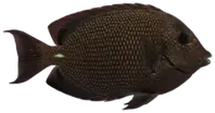 | Pesce chirurgo marrone <code>zebrasoma&#95;<wbr>scopas</code> | *Zebrasoma scopas* | Marino | 15–20 cm | Nuotatore di acque libere · si nasconde di notte | ✔ |
|  | Pesce chirurgo vela <code>zebrasoma&#95;<wbr>veliferum</code> | *Zebrasoma veliferum* | Marino | 25–40 cm | Nuotatore di acque libere · si nasconde di notte | ✔ |
|  | Pesce combattente <code>betta&#95;<wbr>splendens</code> | *Betta splendens* | Acqua dolce | 5–7 cm | Stazionario · resta vicino al suo rifugio · resta sospeso di notte | ✔ |
|  | Pesce coniglio volpe <code>siganus&#95;<wbr>vulpinus</code> | *Siganus vulpinus* | Marino | 15–22 cm | Nuotatore di acque libere · riposa sul fondo di notte | ✔ |
|  | Pesce delle nuvole <code>tanichthys&#95;<wbr>albonubes</code> | *Tanichthys albonubes* | Acqua dolce | 3–4 cm | In banco · si nasconde di notte | ✔ |
|  | Pesce falco pixie <code>cirrhitichthys&#95;<wbr>oxycephalus</code> | *Cirrhitichthys oxycephalus* | Marino | 8–10 cm | Vive vicino al fondo · si nasconde di notte | ✔ |
|  | Pesce farfalla a bande ramate <code>chelmon&#95;<wbr>rostratus</code> | *Chelmon rostratus* | Marino | 15–20 cm | Nuotatore di acque libere · si nasconde di notte | ✔ |
|  | Pesce fuoco <code>nemateleotris&#95;<wbr>magnifica</code> | *Nemateleotris magnifica* | Marino | 8–10 cm | Stazionario · resta sospeso di notte | ✔ |
|  | Pesce fuoco viola <code>nemateleotris&#95;<wbr>decora</code> | *Nemateleotris decora* | Marino | 8–10 cm | Stazionario · resta sospeso di notte | ✔ |
|  | Pesce leone rosso <code>pterois&#95;<wbr>volitans</code> | *Pterois volitans* | Marino | 25–35 cm | Nuotatore di acque libere · si nasconde di notte | ✔ |
|  | Pesce leone zebra <code>dendrochirus&#95;<wbr>zebra</code> | *Dendrochirus zebra* | Marino | 12–18 cm | Nuotatore di acque libere · si nasconde di notte | ✔ |
|  | Pesce mandarino <code>synchiropus&#95;<wbr>splendidus</code> | *Synchiropus splendidus* | Marino | 5–8 cm | Vive vicino al fondo · si nasconde di notte | ✔ |
| 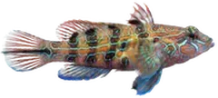 | Pesce mandarino psichedelico <code>synchiropus&#95;<wbr>picturatus</code> | *Synchiropus picturatus* | Marino | 6–8 cm | Vive vicino al fondo · si nasconde di notte | ✔ |
|  | Pesce mascella testa gialla <code>opistognathus&#95;<wbr>aurifrons</code> | *Opistognathus aurifrons* | Marino | 10–12 cm | Vive sulla sabbia · vive in una tana · riposa sul fondo di notte | ✔ |
|  | Pesce pagliaccio <code>amphiprion</code> | *Amphiprion sp.* | Marino | 7–11 cm | Stazionario · resta sospeso di notte | ✔ |
|  | Pesce pagliaccio marrone <code>premnas&#95;<wbr>biaculeatus</code> | *Premnas biaculeatus* | Marino | 10–15 cm | Stazionario · resta sospeso di notte | ✔ |
| 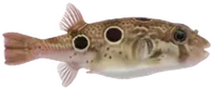 | Pesce palla a otto <code>dichotomyctere&#95;<wbr>biocellatus</code> | *Dichotomyctere biocellatus* | Salmastro | 5–6.5 cm | Nuotatore di acque libere · si nasconde di notte | ✔ |
|  | Pesce palla di Valentin <code>canthigaster&#95;<wbr>valentini</code> | *Canthigaster valentini* | Marino | 8–10 cm | Nuotatore di acque libere · si nasconde di notte | ✔ |
|  | Pesce palla verde <code>dichotomyctere&#95;<wbr>nigroviridis</code> | *Dichotomyctere nigroviridis* | Salmastro | 10–17 cm | Nuotatore di acque libere · si nasconde di notte | ✔ |
|  | Pesce pulitore <code>labroides&#95;<wbr>dimidiatus</code> | *Labroides dimidiatus* | Marino | 10–12 cm | Nuotatore di acque libere · si nasconde di notte | ✔ |
|  | Pesce rosso <code>carassius&#95;<wbr>auratus</code> | *Carassius auratus* | Acqua dolce | 10–25 cm | Nuotatore di acque libere · si nasconde di notte | ✔ |
|  | Pesce zebra <code>danio&#95;<wbr>rerio</code> | *Danio rerio* | Acqua dolce | 4–5 cm | In banco · si nasconde di notte | ✔ |
| 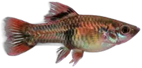 | Platy <code>xiphophorus&#95;<wbr>maculatus</code> | *Xiphophorus maculatus* | Acqua dolce | 4–6 cm | In banco · si nasconde di notte | ✔ |
|  | Pleco zebra <code>hypancistrus&#95;<wbr>zebra</code> | *Hypancistrus zebra* | Acqua dolce | 7–10 cm | Vive vicino al fondo · si nasconde di notte | ✔ |
|  | Portaspada <code>xiphophorus&#95;<wbr>hellerii</code> | *Xiphophorus hellerii* | Acqua dolce | 6–12 cm | In banco · si nasconde di notte | ✔ |
|  | Pseudochromis orchidea <code>pseudochromis&#95;<wbr>fridmani</code> | *Pseudochromis fridmani* | Marino | 6–7 cm | Stazionario · resta vicino al suo rifugio · resta sospeso di notte | ✔ |
|  | Ramirezi <code>mikrogeophagus&#95;<wbr>ramirezi</code> | *Mikrogeophagus ramirezi* | Acqua dolce | 5–7 cm | Stazionario · resta sospeso di notte | ✔ |
|  | Rasbora arlecchino <code>trigonostigma&#95;<wbr>heteromorpha</code> | *Trigonostigma heteromorpha* | Acqua dolce | 3–4.5 cm | In banco · si nasconde di notte | ✔ |
|  | Scato argo <code>scatophagus&#95;<wbr>argus</code> | *Scatophagus argus* | Salmastro, Marino | 15–30 cm | Nuotatore di acque libere · si nasconde di notte | ✔ |
|  | Tetra cardinale <code>paracheirodon&#95;<wbr>axelrodi</code> | *Paracheirodon axelrodi* | Acqua dolce | 3–5 cm | In banco · si nasconde di notte | ✔ |
|  | Tetra imperatore <code>nematobrycon&#95;<wbr>palmeri</code> | *Nematobrycon palmeri* | Acqua dolce | 4–6 cm | In banco · si nasconde di notte | ✔ |
|  | Tetra limone <code>hyphessobrycon&#95;<wbr>pulchripinnis</code> | *Hyphessobrycon pulchripinnis* | Acqua dolce | 3–4.5 cm | In banco · si nasconde di notte | ✔ |
|  | Tetra neon <code>paracheirodon&#95;<wbr>innesi</code> | *Paracheirodon innesi* | Acqua dolce | 3–4 cm | In banco · si nasconde di notte | ✔ |
|  | Tetra nero <code>gymnocorymbus&#95;<wbr>ternetzi</code> | *Gymnocorymbus ternetzi* | Acqua dolce | 5–6 cm | In banco · si nasconde di notte | ✔ |
|  | Tetra serpae <code>hyphessobrycon&#95;<wbr>eques</code> | *Hyphessobrycon eques* | Acqua dolce | 3–4.5 cm | In banco · si nasconde di notte | ✔ |
|  | Tetra testa rossa <code>hemigrammus&#95;<wbr>bleheri</code> | *Hemigrammus bleheri* | Acqua dolce | 4–5 cm | In banco · si nasconde di notte | ✔ |

## Coralli (1)

| &nbsp;&nbsp;&nbsp;&nbsp;&nbsp;&nbsp;&nbsp;&nbsp;&nbsp;&nbsp;&nbsp;&nbsp;&nbsp;&nbsp;&nbsp;&nbsp;&nbsp;&nbsp;&nbsp;&nbsp;&nbsp;&nbsp;&nbsp;&nbsp;&nbsp;&nbsp;&nbsp;&nbsp;&nbsp;&nbsp;&nbsp;&nbsp;&nbsp; | Nome | Nome scientifico | Acqua | Taglia |
|---|---|---|---|---|
|  | Corallo torcia <code>euphyllia&#95;<wbr>glabrescens</code> | *Euphyllia glabrescens* | Marino | 10–30 cm |

## Piante (29)

| &nbsp;&nbsp;&nbsp;&nbsp;&nbsp;&nbsp;&nbsp;&nbsp;&nbsp;&nbsp;&nbsp;&nbsp;&nbsp;&nbsp;&nbsp;&nbsp;&nbsp;&nbsp;&nbsp;&nbsp;&nbsp;&nbsp;&nbsp;&nbsp;&nbsp;&nbsp;&nbsp;&nbsp;&nbsp;&nbsp;&nbsp;&nbsp;&nbsp; | Nome | Nome scientifico | Acqua | Taglia | Zona |
|---|---|---|---|---|---|
|  | Ambulia <code>limnophila&#95;<wbr>sessiliflora</code> | *Limnophila sessiliflora* | Acqua dolce | 20–40 cm | Sfondo |
|  | Anubias <code>anubias&#95;<wbr>barteri</code> | *Anubias barteri* | Acqua dolce | 10–25 cm | Epifita |
|  | Bucephalandra <code>bucephalandra</code> | *Bucephalandra sp.* | Acqua dolce | 5–15 cm | Epifita |
|  | Cabomba <code>cabomba&#95;<wbr>caroliniana</code> | *Cabomba caroliniana* | Acqua dolce | 30–60 cm | Sfondo |
|  | Caulerpa <code>caulerpa&#95;<wbr>prolifera</code> | *Caulerpa prolifera* | Marino | 5–20 cm | Primo piano |
|  | Chaetomorpha <code>chaetomorpha&#95;<wbr>linum</code> | *Chaetomorpha linum* | Marino | 5–30 cm | Primo piano |
|  | Cryptocoryne ciliata <code>cryptocoryne&#95;<wbr>ciliata</code> | *Cryptocoryne ciliata* | Salmastro, Acqua dolce | 20–40 cm | Piano intermedio |
|  | Cryptocoryne parva <code>cryptocoryne&#95;<wbr>parva</code> | *Cryptocoryne parva* | Acqua dolce | 5–8 cm | Primo piano |
|  | Cryptocoryne wendtii <code>cryptocoryne&#95;<wbr>wendtii</code> | *Cryptocoryne wendtii* | Acqua dolce | 10–20 cm | Piano intermedio |
|  | Egeria densa <code>egeria&#95;<wbr>densa</code> | *Egeria densa* | Acqua dolce | 30–100 cm | Sfondo |
|  | Eleocharis nana <code>eleocharis&#95;<wbr>parvula</code> | *Eleocharis parvula* | Acqua dolce | 5–10 cm | Primo piano |
|  | Erba delle tartarughe <code>thalassia&#95;<wbr>testudinum</code> | *Thalassia testudinum* | Marino | 10–30 cm | Primo piano |
|  | Felce di Giava <code>microsorum&#95;<wbr>pteropus</code> | *Microsorum pteropus* | Acqua dolce | 20–30 cm | Epifita |
|  | Glossostigma <code>glossostigma&#95;<wbr>elatinoides</code> | *Glossostigma elatinoides* | Acqua dolce | 2–5 cm | Primo piano |
|  | Halimeda <code>halimeda&#95;<wbr>opuntia</code> | *Halimeda opuntia* | Marino | 5–15 cm | Primo piano |
|  | Hemianthus <code>hemianthus&#95;<wbr>callitrichoides</code> | *Hemianthus callitrichoides* | Acqua dolce | 2–5 cm | Primo piano |
|  | Hygrophila <code>hygrophila&#95;<wbr>polysperma</code> | *Hygrophila polysperma* | Acqua dolce | 20–50 cm | Sfondo |
|  | Lattuga d'acqua <code>pistia&#95;<wbr>stratiotes</code> | *Pistia stratiotes* | Acqua dolce | 5–15 cm | Galleggiante |
|  | Lenticchia d'acqua <code>lemna&#95;<wbr>minor</code> | *Lemna minor* | Acqua dolce | 0.5–1 cm | Galleggiante |
|  | Limnobium <code>limnobium&#95;<wbr>laevigatum</code> | *Limnobium laevigatum* | Acqua dolce | 5–10 cm | Galleggiante |
|  | Ludwigia <code>ludwigia&#95;<wbr>repens</code> | *Ludwigia repens* | Acqua dolce | 20–40 cm | Piano intermedio |
|  | Mangrovia rossa <code>rhizophora&#95;<wbr>mangle</code> | *Rhizophora mangle* | Salmastro, Marino | 30–100 cm | Piano intermedio |
| 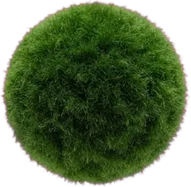 | Marimo <code>aegagropila&#95;<wbr>linnaei</code> | *Aegagropila linnaei* | Acqua dolce | 3–10 cm | Primo piano |
|  | Muschio di Giava <code>vesicularia&#95;<wbr>dubyana</code> | *Vesicularia dubyana* | Acqua dolce | 3–5 cm | Epifita |
|  | Rotala <code>rotala&#95;<wbr>rotundifolia</code> | *Rotala rotundifolia* | Acqua dolce | 20–50 cm | Sfondo |
|  | Sagittaria nana <code>sagittaria&#95;<wbr>subulata</code> | *Sagittaria subulata* | Acqua dolce | 10–30 cm | Primo piano |
|  | Spada amazzonica <code>echinodorus&#95;<wbr>bleheri</code> | *Echinodorus bleheri* | Acqua dolce | 30–50 cm | Piano intermedio |
|  | Staurogyne <code>staurogyne&#95;<wbr>repens</code> | *Staurogyne repens* | Acqua dolce | 5–10 cm | Primo piano |
|  | Vallisneria <code>vallisneria&#95;<wbr>spiralis</code> | *Vallisneria spiralis* | Acqua dolce, Salmastro | 30–60 cm | Sfondo |

## Invertebrati (32)

| &nbsp;&nbsp;&nbsp;&nbsp;&nbsp;&nbsp;&nbsp;&nbsp;&nbsp;&nbsp;&nbsp;&nbsp;&nbsp;&nbsp;&nbsp;&nbsp;&nbsp;&nbsp;&nbsp;&nbsp;&nbsp;&nbsp;&nbsp;&nbsp;&nbsp;&nbsp;&nbsp;&nbsp;&nbsp;&nbsp;&nbsp;&nbsp;&nbsp; | Nome | Nome scientifico | Acqua | Taglia | Ruolo |
|---|---|---|---|---|---|
|  | Cetriolo di mare <code>holothuria</code> | *Holothuria sp.* | Marino | 15–30 cm | Detritivoro · si muove sul fondo |
| 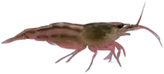 | Gambero Amano <code>caridina&#95;<wbr>multidentata</code> | *Caridina multidentata* | Acqua dolce | 3–5 cm | Mangiatore di alghe · si muove sul fondo |
| 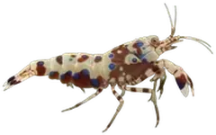 | Gambero arlecchino <code>hymenocera&#95;<wbr>picta</code> | *Hymenocera picta* | Marino | 4–6 cm | Predatore · si muove sul fondo |
| 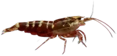 | Gambero bambù <code>atyopsis&#95;<wbr>moluccensis</code> | *Atyopsis moluccensis* | Acqua dolce | 6–8 cm | Filtratore · vive sull'arredo |
|  | Gambero boxer <code>stenopus&#95;<wbr>hispidus</code> | *Stenopus hispidus* | Marino | 6–8 cm | Pulitore · vive sull'arredo |
|  | Gambero ciliegia <code>neocaridina&#95;<wbr>davidi</code> | *Neocaridina davidi* | Acqua dolce | 2–3.5 cm | Detritivoro · si muove sul fondo |
|  | Gambero cristal rosso <code>caridina&#95;<wbr>cantonensis</code> | *Caridina cantonensis* | Acqua dolce | 2–3 cm | Detritivoro · si muove sul fondo |
|  | Gambero fuoco <code>lysmata&#95;<wbr>debelius</code> | *Lysmata debelius* | Marino | 5–6 cm | Pulitore · vive sull'arredo |
| 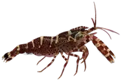 | Gambero marmorizzato <code>saron&#95;<wbr>marmoratus</code> | *Saron marmoratus* | Marino | 5–7 cm | Spazzino · vive sull'arredo |
|  | Gambero peppermint <code>lysmata&#95;<wbr>wurdemanni</code> | *Lysmata wurdemanni* | Marino | 3–5 cm | Pulitore · vive sull'arredo |
|  | Gambero pulitore scarlatto <code>lysmata&#95;<wbr>amboinensis</code> | *Lysmata amboinensis* | Marino | 5–6 cm | Pulitore · vive sull'arredo |
| 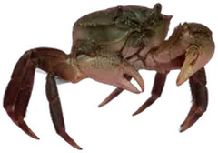 | Granchio smeraldo <code>mithraculus&#95;<wbr>sculptus</code> | *Mithraculus sculptus* | Marino | 3–4 cm | Mangiatore di alghe · vive sull'arredo |
| 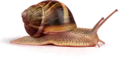 | Lumaca assassina <code>clea&#95;<wbr>helena</code> | *Clea helena* | Acqua dolce | 2–3 cm | Predatore · si muove sul fondo |
|  | Lumaca Astraea <code>astraea&#95;<wbr>tecta</code> | *Astraea tecta* | Marino | 2–4 cm | Mangiatore di alghe · vive sull'arredo |
| 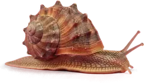 | Lumaca cerito <code>cerithium</code> | *Cerithium sp.* | Marino | 2–3 cm | Detritivoro · si muove sul fondo |
|  | Lumaca corno d'ariete <code>planorbella&#95;<wbr>duryi</code> | *Planorbella duryi* | Acqua dolce | 2–3 cm | Detritivoro · si arrampica sul vetro |
|  | Lumaca mela <code>pomacea&#95;<wbr>bridgesii</code> | *Pomacea bridgesii* | Acqua dolce | 4–5 cm | Spazzino · si muove sul fondo |
|  | Lumaca Nassarius <code>nassarius</code> | *Nassarius sp.* | Marino | 2–4 cm | Spazzino · si muove sul fondo |
|  | Lumaca trochus <code>tectus&#95;<wbr>fenestratus</code> | *Tectus fenestratus* | Marino | 4–6 cm | Mangiatore di alghe · vive sull'arredo |
| 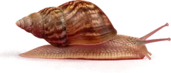 | Lumaca trombetta malese <code>melanoides&#95;<wbr>tuberculata</code> | *Melanoides tuberculata* | Acqua dolce | 2–3 cm | Detritivoro · si muove sul fondo |
| 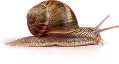 | Lumaca turbo <code>turbo&#95;<wbr>fluctuosus</code> | *Turbo fluctuosus* | Marino | 4–8 cm | Mangiatore di alghe · si arrampica sul vetro |
|  | Nerita marina <code>nerita</code> | *Nerita sp.* | Marino | 2–3 cm | Mangiatore di alghe · si arrampica sul vetro |
|  | Neritina zebrata <code>neritina&#95;<wbr>natalensis</code> | *Neritina natalensis* | Acqua dolce | 2–3 cm | Mangiatore di alghe · si arrampica sul vetro |
| 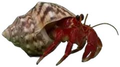 | Paguro rosso scarlatto <code>paguristes&#95;<wbr>cadenati</code> | *Paguristes cadenati* | Marino | 3–4 cm | Spazzino · si muove sul fondo |
|  | Paguro zampe blu <code>clibanarius&#95;<wbr>tricolor</code> | *Clibanarius tricolor* | Marino | 2–3 cm | Spazzino · si muove sul fondo |
|  | Riccio collezionista <code>tripneustes&#95;<wbr>gratilla</code> | *Tripneustes gratilla* | Marino | 10–15 cm | Mangiatore di alghe · vive sull'arredo |
|  | Riccio matita <code>prionocidaris&#95;<wbr>baculosa</code> | *Prionocidaris baculosa* | Marino | 8–10 cm | Mangiatore di alghe · vive sull'arredo |
| 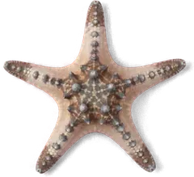 | Stella di sabbia <code>archaster&#95;<wbr>typicus</code> | *Archaster typicus* | Marino | 6–10 cm | Detritivoro · si muove sul fondo |
|  | Stella serpente <code>ophiolepis&#95;<wbr>superba</code> | *Ophiolepis superba* | Marino | 8–12 cm | Spazzino · si muove sul fondo |
|  | Tridacna perforante <code>tridacna&#95;<wbr>crocea</code> | *Tridacna crocea* | Marino | 5–15 cm | Filtratore · sessile |
|  | Verme albero di Natale <code>spirobranchus&#95;<wbr>giganteus</code> | *Spirobranchus giganteus* | Marino | 3–5 cm | Filtratore · sessile |
| 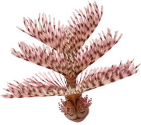 | Verme piumino <code>sabellastarte</code> | *Sabellastarte sp.* | Marino | 5–10 cm | Filtratore · sessile |

Per aggiungere una specie (generazione delle clip, build, pubblicazione), vedere la [documentazione in inglese](README.md).

Le risorse delle specie sono sotto **CC BY 4.0**, gli script sotto MIT: vedere [LICENSE.md](LICENSE.md).

<!-- species:end -->

<!-- ecosystem:start -->

## Progetti correlati

I progetti ReefTech si incastrano tra loro: le integrazioni portano la tua attrezzatura in Home Assistant, la scheda la mostra e la pilota, e il backup la mantiene in funzione durante un blackout. Ognuno funziona anche da solo.

<table>
  <tr>
    <th width="100px"></th>
    <th>Progetto</th>
    <th>Ruolo</th>
    <th>Funziona con</th>
  </tr>
  <tr>
    <td></td>
    <td>🐠 <a href="https://github.com/Elwinmage/ha-reefbeat-component"><b>ha-reefbeat-component</b></a></td>
    <td>Dispositivi Red Sea ReefBeat, pilotati in locale senza cloud: ReefATO+, ReefControl, ReefControl-Power, ReefDose, ReefLed, ReefMat, ReefRun e ReefWave. blueprint di allerta per modalità anomale, calibrazioni e batteria scarica. </td>
    <td>ha-reef-card</td>
  </tr>
  <tr>
    <td></td>
    <td>🌊 <a href="https://github.com/Elwinmage/ha-aquamedic-component"><b>ha-aquamedic-component</b></a></td>
    <td>Pompe Aqua Medic tramite l'API cloud Gizwits: pompe di movimento EcoDrift e SmartDrift, pompe DC Runner di risalita e dello schiumatoio.</td>
    <td>ha-reef-card</td>
  </tr>
  <tr>
    <td></td>
    <td>🐟 <a href="https://github.com/Elwinmage/ha-vson-component"><b>ha-vson-component</b></a></td>
    <td>Alimentatori automatici VSON tramite l'API cloud VSON: l'alimentatore WP8621 (alimenta, batteria, avviso cibo scarso) e rilevamento generico di qualsiasi altro dispositivo VSON. Il WP8621 può anche funzionare totalmente in locale con ESPHome.</td>
    <td>ha-reef-card</td>
  </tr>
  <tr>
    <td></td>
    <td>🐙 <a href="https://github.com/Elwinmage/ha-reef-maintenance-component"><b>ha-reef-maintenance-component</b></a></td>
    <td>Tracciamento di pulizia e usura per l'attrezzatura che Home Assistant non può interrogare: pompe di movimento, pompe di risalita, schiumatoi, reattori, tutto ciò che curi a mano.</td>
    <td>ha-reef-card</td>
  </tr>
  <tr>
    <td></td>
    <td>🪸 <a href="https://github.com/Elwinmage/ha-reef-card"><b>ha-reef-card</b></a></td>
    <td>Vista grafica interattiva di ogni dispositivo sulla tua dashboard, e unico modo per modificare le programmazioni avanzate. Legge le quattro integrazioni tramite il contratto <code>reef_role</code> comune, senza configurazione lato scheda. Disegna anche i flussi di energia di reefbeatEnergyBackup. La sua scheda acquario dà vita alla vostra vasca con ha-reeftank-component.</td>
    <td>tutte e quattro le integrazioni, e ha-reeftank-component per l'acquario</td>
  </tr>
  <tr>
    <td></td>
    <td>🐟 <a href="https://github.com/Elwinmage/ha-reeftank-component"><b>ha-reeftank-component</b></a></td>
    <td>Un'immagine viva della vostra vasca sulla plancia: la vostra foto, illuminata dalle vostre vere lampade, con pesci e coralli animati, e sopra i vostri dispositivi ed entità. Conserva gli acquari e la loro fauna, registra le alimentazioni.</td>
    <td>ha-reef-card</td>
  </tr>
  <tr>
    <td></td>
    <td>🐡 <b>reeftank-catalog</b> <i>(questo repository)</i></td>
    <td>Pesci, coralli e texture della scheda acquario, scaricati e tenuti aggiornati da ha-reeftank-component.</td>
    <td>ha-reeftank-component</td>
  </tr>
  <tr>
    <td></td>
    <td>🐬 <a href="https://github.com/Elwinmage/ha-reef-blueprints"><b>ha-reef-blueprints</b></a></td>
    <td>Blueprint di automazione comuni a tutto l'ecosistema: manutenzioni scadute trovate tramite il contratto <code>reef_role</code>, dispositivi diventati irraggiungibili, un test periodico dei riscaldatori e una sorveglianza dei relè. Otto lingue.</td>
    <td>tutte e quattro le integrazioni</td>
  </tr>
  <tr>
    <td></td>
    <td>⚡ <a href="https://github.com/Elwinmage/reefbeatEnergyBackup"><b>reefbeatEnergyBackup</b></a></td>
    <td>Backup a batteria in caso di blackout. Un pacco 24V LiFePO₄ gestito da un Raspberry Pi, con degrado progressivo della velocità delle pompe in base allo stato di carica.</td>
    <td>da solo, o insieme a ha-reefbeat-component e ha-reef-card</td>
  </tr>
</table>

Sono tutti documentati insieme sulla [pagina del progetto ReefTech](https://elwinmage.github.io/reeftank/).

<!-- ecosystem:end -->
