# reeftank-catalog

<!-- species:begin (generated by scripts/make_readme.py, do not edit) -->

> Parte dell'[**ecosistema di progetti ReefTech**](https://elwinmage.github.io/reeftank/)

       

Specie di pesci, coralli, piante e invertebrati per la vista acquario di [ha-reef-card](https://github.com/Elwinmage/ha-reef-card), fornite dall'[integrazione ReefTank](https://github.com/Elwinmage/ha-reeftank-component).

L'integrazione scarica le release di questo repository e le mantiene aggiornate (`update.reeftank_catalog`, automatico per impostazione predefinita): nulla da fare in Home Assistant.

## Come funziona

Ogni pesce è un foglio di immagini (un atlante WebP) e un descrittore con le sue clip: *nuoto*, *fermo* e *virata*. La scheda le concatena e specchia la virata perché il pesce torni da dove è venuto. Ecco il nuoto, la virata e il ritorno di due specie:

<table><tr><td align="center"> Pesce angelo imperatore</td><td align="center"> Pesce pagliaccio</td></tr></table>

## Pesci (102)

**HD**: un'animazione reale, fatta da video. Gli altri hanno un'animazione semplice fatta da una foto, o il pesce generico.

| &nbsp;&nbsp;&nbsp;&nbsp;&nbsp;&nbsp;&nbsp;&nbsp;&nbsp;&nbsp;&nbsp;&nbsp;&nbsp;&nbsp;&nbsp;&nbsp;&nbsp;&nbsp;&nbsp;&nbsp;&nbsp;&nbsp;&nbsp;&nbsp;&nbsp;&nbsp;&nbsp;&nbsp;&nbsp;&nbsp;&nbsp;&nbsp;&nbsp;&nbsp;&nbsp;&nbsp;&nbsp;&nbsp;&nbsp;&nbsp;&nbsp;&nbsp;&nbsp;&nbsp;&nbsp;&nbsp;&nbsp;&nbsp;&nbsp;&nbsp;&nbsp;&nbsp;&nbsp;&nbsp;&nbsp;&nbsp; | Nome | Nome scientifico | Acqua | Taglia | Comportamento | HD |
|---|---|---|---|---|---|---|
|  | Angelfish `pterophyllum_scalare` | *Pterophyllum scalare* | Acqua dolce | 12–15 cm | Nuotatore di acque libere · si nasconde di notte |  |
|  | Anthias `pseudanthias` | *Pseudanthias sp.* | Marino | 8–14 cm | In banco · si nasconde di notte | ✔ |
|  | Atlantic mudskipper `periophthalmus_barbarus` | *Periophthalmus barbarus* | Salmastro | 10–15 cm | Vive vicino al fondo · si nasconde di notte |  |
|  | Banded archerfish `toxotes_jaculatrix` | *Toxotes jaculatrix* | Salmastro | 15–25 cm | Nuotatore di acque libere · si nasconde di notte |  |
| 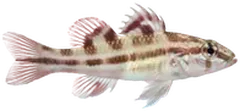 | Banded goby `amblygobius_phalaena` | *Amblygobius phalaena* | Marino | 8–10 cm | Vive sulla sabbia · riposa sul fondo di notte |  |
|  | Bicolor angelfish `centropyge_bicolor` | *Centropyge bicolor* | Marino | 10–15 cm | Stazionario · resta sospeso di notte |  |
|  | Bicolor blenny `ecsenius_bicolor` | *Ecsenius bicolor* | Marino | 8–10 cm | Vive vicino al fondo · si nasconde di notte |  |
|  | Black skirt tetra `gymnocorymbus_ternetzi` | *Gymnocorymbus ternetzi* | Acqua dolce | 5–6 cm | In banco · si nasconde di notte |  |
|  | Bluestreak cleaner wrasse `labroides_dimidiatus` | *Labroides dimidiatus* | Marino | 10–12 cm | Nuotatore di acque libere · si nasconde di notte |  |
|  | Bristlenose pleco `ancistrus` | *Ancistrus sp.* | Acqua dolce | 10–14 cm | Vive vicino al fondo · si nasconde di notte |  |
|  | Bronze corydoras `corydoras_aeneus` | *Corydoras aeneus* | Acqua dolce | 6–7 cm | Vive vicino al fondo · si nasconde di notte |  |
|  | Bumblebee goby `brachygobius_xanthozonus` | *Brachygobius xanthozonus* | Salmastro | 3–4 cm | Vive vicino al fondo · si nasconde di notte |  |
|  | Cardinal tetra `paracheirodon_axelrodi` | *Paracheirodon axelrodi* | Acqua dolce | 3–5 cm | In banco · si nasconde di notte |  |
| 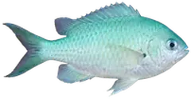 | Castagnola verde `chromis_viridis` | *Chromis viridis* | Marino | 5–8 cm | In banco · si nasconde di notte | ✔ |
|  | Celestial pearl danio `danio_margaritatus` | *Danio margaritatus* | Acqua dolce | 2–3 cm | In banco · si nasconde di notte |  |
|  | Cherry barb `pethia_titteya` | *Pethia titteya* | Acqua dolce | 4–5 cm | In banco · si nasconde di notte |  |
|  | Citron coral goby `gobiodon_citrinus` | *Gobiodon citrinus* | Marino | 3–5 cm | Vive vicino al fondo · si nasconde di notte |  |
| 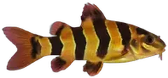 | Clown loach `chromobotia_macracanthus` | *Chromobotia macracanthus* | Acqua dolce | 15–30 cm | Vive vicino al fondo · si nasconde di notte |  |
|  | Cockatoo dwarf cichlid `apistogramma_cacatuoides` | *Apistogramma cacatuoides* | Acqua dolce | 5–9 cm | Vive vicino al fondo · si nasconde di notte |  |
|  | Common molly `poecilia_sphenops` | *Poecilia sphenops* | Acqua dolce, Salmastro | 6–10 cm | In banco · si nasconde di notte |  |
|  | Copperband butterflyfish `chelmon_rostratus` | *Chelmon rostratus* | Marino | 15–20 cm | Nuotatore di acque libere · si nasconde di notte |  |
|  | Damigella delle Figi `chrysiptera_taupou` | *Chrysiptera taupou* | Marino | 6–8 cm | Stazionario · resta vicino al suo rifugio · resta sospeso di notte |  |
| 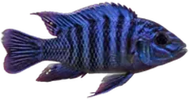 | Demasoni cichlid `pseudotropheus_demasoni` | *Pseudotropheus demasoni* | Acqua dolce | 7–8 cm | Nuotatore di acque libere · si nasconde di notte |  |
|  | Discus `symphysodon_aequifasciatus` | *Symphysodon aequifasciatus* | Acqua dolce | 15–20 cm | Nuotatore di acque libere · si nasconde di notte |  |
|  | Dwarf gourami `trichogaster_lalius` | *Trichogaster lalius* | Acqua dolce | 5–8 cm | Nuotatore di acque libere · si nasconde di notte |  |
|  | Electric yellow cichlid `labidochromis_caeruleus` | *Labidochromis caeruleus* | Acqua dolce | 8–10 cm | Nuotatore di acque libere · si nasconde di notte |  |
|  | Emperor tetra `nematobrycon_palmeri` | *Nematobrycon palmeri* | Acqua dolce | 4–6 cm | In banco · si nasconde di notte |  |
| 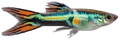 | Endler's livebearer `poecilia_wingei` | *Poecilia wingei* | Acqua dolce | 2–4 cm | In banco · si nasconde di notte |  |
|  | Figure-eight puffer `dichotomyctere_biocellatus` | *Dichotomyctere biocellatus* | Salmastro | 5–6.5 cm | Nuotatore di acque libere · si nasconde di notte |  |
|  | Firefish goby `nemateleotris_magnifica` | *Nemateleotris magnifica* | Marino | 8–10 cm | Stazionario · resta sospeso di notte |  |
|  | Flame angelfish `centropyge_loricula` | *Centropyge loricula* | Marino | 8–10 cm | Stazionario · resta sospeso di notte |  |
|  | Ghiozzo dai cerchi gialli `cryptocentrus_cinctus` | *Cryptocentrus cinctus* | Marino | 8–10 cm | Vive sulla sabbia · vive in una tana · riposa sul fondo di notte |  |
|  | Ghiozzo di Okinawa `gobiodon_okinawae` | *Gobiodon okinawae* | Marino | 2.5–3.5 cm | Vive vicino al fondo · si nasconde di notte |  |
|  | Ghiozzo dormiente `valenciennea` | *Valenciennea sp.* | Marino | 10–16 cm | Vive sulla sabbia · vive in una tana · riposa sul fondo di notte | ✔ |
|  | Goldfish `carassius_auratus` | *Carassius auratus* | Acqua dolce | 10–25 cm | Nuotatore di acque libere · si nasconde di notte |  |
|  | Green spotted puffer `dichotomyctere_nigroviridis` | *Dichotomyctere nigroviridis* | Salmastro | 10–17 cm | Nuotatore di acque libere · si nasconde di notte |  |
|  | Green swordtail `xiphophorus_hellerii` | *Xiphophorus hellerii* | Acqua dolce | 6–12 cm | In banco · si nasconde di notte |  |
|  | Guppy `poecilia_reticulata` | *Poecilia reticulata* | Acqua dolce | 3–6 cm | In banco · si nasconde di notte |  |
|  | Harlequin rasbora `trigonostigma_heteromorpha` | *Trigonostigma heteromorpha* | Acqua dolce | 3–4.5 cm | In banco · si nasconde di notte |  |
|  | Knight goby `stigmatogobius_sadanundio` | *Stigmatogobius sadanundio* | Salmastro | 6–8 cm | Vive vicino al fondo · si nasconde di notte |  |
|  | Kole tang `ctenochaetus_strigosus` | *Ctenochaetus strigosus* | Marino | 12–18 cm | Nuotatore di acque libere · si nasconde di notte |  |
|  | Kribensis `pelvicachromis_pulcher` | *Pelvicachromis pulcher* | Acqua dolce | 8–10 cm | Vive vicino al fondo · si nasconde di notte |  |
|  | Kuhli loach `pangio_kuhlii` | *Pangio kuhlii* | Acqua dolce | 8–12 cm | Vive vicino al fondo · si nasconde di notte |  |
| 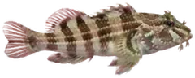 | Lawnmower blenny `salarias_fasciatus` | *Salarias fasciatus* | Marino | 12–14 cm | Vive vicino al fondo · si nasconde di notte |  |
|  | Lemon tetra `hyphessobrycon_pulchripinnis` | *Hyphessobrycon pulchripinnis* | Acqua dolce | 3–4.5 cm | In banco · si nasconde di notte |  |
|  | Lined seahorse `hippocampus_erectus` | *Hippocampus erectus* | Marino | 10–15 cm | Stazionario · resta sospeso di notte |  |
|  | Lyretail killifish `aphyosemion_australe` | *Aphyosemion australe* | Acqua dolce | 5–6 cm | Stazionario · resta sospeso di notte |  |
|  | Marbled hatchetfish `carnegiella_strigata` | *Carnegiella strigata* | Acqua dolce | 4–5 cm | In banco · si nasconde di notte |  |
|  | Maroon clownfish `premnas_biaculeatus` | *Premnas biaculeatus* | Marino | 10–15 cm | Stazionario · resta sospeso di notte |  |
|  | Neon goby `elacatinus_oceanops` | *Elacatinus oceanops* | Marino | 4–6 cm | Vive vicino al fondo · si nasconde di notte |  |
|  | Neon tetra `paracheirodon_innesi` | *Paracheirodon innesi* | Acqua dolce | 3–4 cm | In banco · si nasconde di notte |  |
|  | Orchid dottyback `pseudochromis_fridmani` | *Pseudochromis fridmani* | Marino | 6–7 cm | Stazionario · resta vicino al suo rifugio · resta sospeso di notte |  |
|  | Oscar `astronotus_ocellatus` | *Astronotus ocellatus* | Acqua dolce | 25–35 cm | Nuotatore di acque libere · si nasconde di notte |  |
|  | Otocinclus `otocinclus_affinis` | *Otocinclus affinis* | Acqua dolce | 3–5 cm | Vive vicino al fondo · si nasconde di notte |  |
|  | Pajama cardinalfish `sphaeramia_nematoptera` | *Sphaeramia nematoptera* | Marino | 8–10 cm | Stazionario · resta sospeso di notte |  |
|  | Panda corydoras `corydoras_panda` | *Corydoras panda* | Acqua dolce | 4–5 cm | Vive vicino al fondo · si nasconde di notte |  |
|  | Pearl danio `danio_albolineatus` | *Danio albolineatus* | Acqua dolce | 4–6 cm | In banco · si nasconde di notte |  |
| 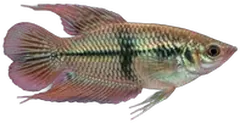 | Pearl gourami `trichopodus_leerii` | *Trichopodus leerii* | Acqua dolce | 10–12 cm | Nuotatore di acque libere · si nasconde di notte |  |
|  | Pesce angelo imperatore (adulto) `pomacanthus_imperator_adult` | *Pomacanthus imperator* | Marino | 25–38 cm | Nuotatore di acque libere · si nasconde di notte | ✔ |
|  | Pesce angelo imperatore (giovane) `pomacanthus_imperator` | *Pomacanthus imperator* | Marino | 6–12 cm | Nuotatore di acque libere · si nasconde di notte | ✔ |
|  | Pesce cardinale di Banggai `pterapogon_kauderni` | *Pterapogon kauderni* | Marino | 5–8 cm | Stazionario · resta sospeso di notte | ✔ |
| 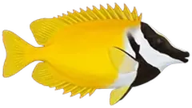 | Pesce coniglio volpe `siganus_vulpinus` | *Siganus vulpinus* | Marino | 15–22 cm | Nuotatore di acque libere · riposa sul fondo di notte | ✔ |
| 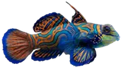 | Pesce mandarino `synchiropus_splendidus` | *Synchiropus splendidus* | Marino | 5–8 cm | Vive vicino al fondo · si nasconde di notte | ✔ |
|  | Pesce pagliaccio `amphiprion` | *Amphiprion sp.* | Marino | 7–11 cm | Stazionario · resta sospeso di notte | ✔ |
|  | Picasso triggerfish `rhinecanthus_aculeatus` | *Rhinecanthus aculeatus* | Marino | 20–25 cm | Nuotatore di acque libere · si nasconde di notte |  |
|  | Pixy hawkfish `cirrhitichthys_oxycephalus` | *Cirrhitichthys oxycephalus* | Marino | 8–10 cm | Vive vicino al fondo · si nasconde di notte |  |
|  | Powder blue tang `acanthurus_leucosternon` | *Acanthurus leucosternon* | Marino | 20–23 cm | Nuotatore di acque libere · si nasconde di notte |  |
|  | Purple firefish `nemateleotris_decora` | *Nemateleotris decora* | Marino | 8–10 cm | Stazionario · resta sospeso di notte |  |
|  | Ram cichlid `mikrogeophagus_ramirezi` | *Mikrogeophagus ramirezi* | Acqua dolce | 5–7 cm | Stazionario · resta sospeso di notte |  |
|  | Red lionfish `pterois_volitans` | *Pterois volitans* | Marino | 25–35 cm | Nuotatore di acque libere · si nasconde di notte |  |
|  | Regal angelfish `pygoplites_diacanthus` | *Pygoplites diacanthus* | Marino | 20–25 cm | Nuotatore di acque libere · si nasconde di notte |  |
|  | Regal blue tang `paracanthurus_hepatus` | *Paracanthurus hepatus* | Marino | 20–30 cm | Nuotatore di acque libere · si nasconde di notte |  |
|  | Royal gramma `gramma_loreto` | *Gramma loreto* | Marino | 7–8 cm | Stazionario · resta sospeso di notte |  |
|  | Rummy-nose tetra `hemigrammus_bleheri` | *Hemigrammus bleheri* | Acqua dolce | 4–5 cm | In banco · si nasconde di notte |  |
|  | Sailfin molly `poecilia_velifera` | *Poecilia velifera* | Salmastro, Acqua dolce | 10–15 cm | In banco · si nasconde di notte |  |
|  | Sailfin tang `zebrasoma_veliferum` | *Zebrasoma veliferum* | Marino | 25–40 cm | Nuotatore di acque libere · si nasconde di notte |  |
|  | Scopas tang `zebrasoma_scopas` | *Zebrasoma scopas* | Marino | 15–20 cm | Nuotatore di acque libere · si nasconde di notte |  |
|  | Serpae tetra `hyphessobrycon_eques` | *Hyphessobrycon eques* | Acqua dolce | 3–4.5 cm | In banco · si nasconde di notte |  |
|  | Siamese algae eater `crossocheilus_oblongus` | *Crossocheilus oblongus* | Acqua dolce | 10–15 cm | Nuotatore di acque libere · si nasconde di notte |  |
|  | Siamese fighting fish `betta_splendens` | *Betta splendens* | Acqua dolce | 5–7 cm | Stazionario · resta vicino al suo rifugio · resta sospeso di notte |  |
|  | Silver moony `monodactylus_argenteus` | *Monodactylus argenteus* | Salmastro, Marino | 15–25 cm | In banco · si nasconde di notte |  |
|  | Six line wrasse `pseudocheilinus_hexataenia` | *Pseudocheilinus hexataenia* | Marino | 7–10 cm | Nuotatore di acque libere · si nasconde di notte |  |
|  | Solor fairy wrasse `cirrhilabrus_solorensis` | *Cirrhilabrus solorensis* | Marino | 10–12 cm | Nuotatore di acque libere · si nasconde di notte |  |
|  | Southern platyfish `xiphophorus_maculatus` | *Xiphophorus maculatus* | Acqua dolce | 4–6 cm | In banco · si nasconde di notte |  |
|  | Spotted mandarin `synchiropus_picturatus` | *Synchiropus picturatus* | Marino | 6–8 cm | Vive vicino al fondo · si nasconde di notte |  |
|  | Spotted scat `scatophagus_argus` | *Scatophagus argus* | Salmastro, Marino | 15–30 cm | Nuotatore di acque libere · si nasconde di notte |  |
|  | Three-spot gourami `trichopodus_trichopterus` | *Trichopodus trichopterus* | Acqua dolce | 10–15 cm | Nuotatore di acque libere · si nasconde di notte |  |
|  | Threespot dascyllus `dascyllus_trimaculatus` | *Dascyllus trimaculatus* | Marino | 10–14 cm | Stazionario · resta sospeso di notte |  |
|  | Tiger barb `puntigrus_tetrazona` | *Puntigrus tetrazona* | Acqua dolce | 5–7 cm | In banco · si nasconde di notte |  |
|  | Turquoise rainbowfish `melanotaenia_lacustris` | *Melanotaenia lacustris* | Acqua dolce | 8–12 cm | In banco · si nasconde di notte |  |
|  | Valentini puffer `canthigaster_valentini` | *Canthigaster valentini* | Marino | 8–10 cm | Nuotatore di acque libere · si nasconde di notte |  |
|  | Violet goby `gobioides_broussonnetii` | *Gobioides broussonnetii* | Salmastro | 30–50 cm | Vive sulla sabbia · vive in una tana · riposa sul fondo di notte |  |
|  | White cloud mountain minnow `tanichthys_albonubes` | *Tanichthys albonubes* | Acqua dolce | 3–4 cm | In banco · si nasconde di notte |  |
|  | Yasha goby `stonogobiops_yasha` | *Stonogobiops yasha* | Marino | 6–8 cm | Vive sulla sabbia · vive in una tana · riposa sul fondo di notte |  |
|  | Yellow coris wrasse `halichoeres_chrysus` | *Halichoeres chrysus* | Marino | 10–12 cm | Nuotatore di acque libere · riposa sul fondo di notte |  |
|  | Yellow tang `zebrasoma_flavescens` | *Zebrasoma flavescens* | Marino | 15–20 cm | Nuotatore di acque libere · si nasconde di notte |  |
|  | Yellow-striped cardinalfish `ostorhinchus_cyanosoma` | *Ostorhinchus cyanosoma* | Marino | 7–8 cm | Stazionario · resta sospeso di notte |  |
|  | Yellowhead jawfish `opistognathus_aurifrons` | *Opistognathus aurifrons* | Marino | 10–12 cm | Vive sulla sabbia · vive in una tana · riposa sul fondo di notte |  |
|  | Yellowtail blue damselfish `chrysiptera_parasema` | *Chrysiptera parasema* | Marino | 5–6 cm | Stazionario · resta vicino al suo rifugio · resta sospeso di notte |  |
| 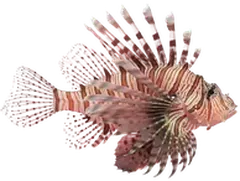 | Zebra lionfish `dendrochirus_zebra` | *Dendrochirus zebra* | Marino | 12–18 cm | Nuotatore di acque libere · si nasconde di notte |  |
|  | Zebra pleco `hypancistrus_zebra` | *Hypancistrus zebra* | Acqua dolce | 7–10 cm | Vive vicino al fondo · si nasconde di notte |  |
|  | Zebrafish `danio_rerio` | *Danio rerio* | Acqua dolce | 4–5 cm | In banco · si nasconde di notte |  |

## Coralli (1)

| &nbsp;&nbsp;&nbsp;&nbsp;&nbsp;&nbsp;&nbsp;&nbsp;&nbsp;&nbsp;&nbsp;&nbsp;&nbsp;&nbsp;&nbsp;&nbsp;&nbsp;&nbsp;&nbsp;&nbsp;&nbsp;&nbsp;&nbsp;&nbsp;&nbsp;&nbsp;&nbsp;&nbsp;&nbsp;&nbsp;&nbsp;&nbsp;&nbsp;&nbsp;&nbsp;&nbsp;&nbsp;&nbsp;&nbsp;&nbsp;&nbsp;&nbsp;&nbsp;&nbsp;&nbsp;&nbsp;&nbsp;&nbsp;&nbsp;&nbsp;&nbsp;&nbsp;&nbsp;&nbsp;&nbsp;&nbsp; | Nome | Nome scientifico | Acqua | Taglia |
|---|---|---|---|---|
|  | Corallo torcia `euphyllia_glabrescens` | *Euphyllia glabrescens* | Marino | 10–30 cm |

## Piante (29)

| &nbsp;&nbsp;&nbsp;&nbsp;&nbsp;&nbsp;&nbsp;&nbsp;&nbsp;&nbsp;&nbsp;&nbsp;&nbsp;&nbsp;&nbsp;&nbsp;&nbsp;&nbsp;&nbsp;&nbsp;&nbsp;&nbsp;&nbsp;&nbsp;&nbsp;&nbsp;&nbsp;&nbsp;&nbsp;&nbsp;&nbsp;&nbsp;&nbsp;&nbsp;&nbsp;&nbsp;&nbsp;&nbsp;&nbsp;&nbsp;&nbsp;&nbsp;&nbsp;&nbsp;&nbsp;&nbsp;&nbsp;&nbsp;&nbsp;&nbsp;&nbsp;&nbsp;&nbsp;&nbsp;&nbsp;&nbsp; | Nome | Nome scientifico | Acqua | Taglia | Zona |
|---|---|---|---|---|---|
|  | Amazon frogbit `limnobium_laevigatum` | *Limnobium laevigatum* | Acqua dolce | 5–10 cm | Galleggiante |
|  | Amazon sword `echinodorus_bleheri` | *Echinodorus bleheri* | Acqua dolce | 30–50 cm | Piano intermedio |
|  | Ambulia `limnophila_sessiliflora` | *Limnophila sessiliflora* | Acqua dolce | 20–40 cm | Sfondo |
| 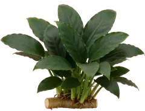 | Anubias `anubias_barteri` | *Anubias barteri* | Acqua dolce | 10–25 cm | Epifita |
|  | Brazilian waterweed `egeria_densa` | *Egeria densa* | Acqua dolce | 30–100 cm | Sfondo |
|  | Bucephalandra `bucephalandra` | *Bucephalandra sp.* | Acqua dolce | 5–15 cm | Epifita |
|  | Carolina fanwort `cabomba_caroliniana` | *Cabomba caroliniana* | Acqua dolce | 30–60 cm | Sfondo |
|  | Caulerpa `caulerpa_prolifera` | *Caulerpa prolifera* | Marino | 5–20 cm | Primo piano |
|  | Chaeto `chaetomorpha_linum` | *Chaetomorpha linum* | Marino | 5–30 cm | Primo piano |
|  | Ciliated cryptocoryne `cryptocoryne_ciliata` | *Cryptocoryne ciliata* | Salmastro, Acqua dolce | 20–40 cm | Piano intermedio |
|  | Creeping primrose willow `ludwigia_repens` | *Ludwigia repens* | Acqua dolce | 20–40 cm | Piano intermedio |
| 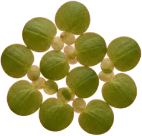 | Duckweed `lemna_minor` | *Lemna minor* | Acqua dolce | 0.5–1 cm | Galleggiante |
|  | Dwarf baby tears `hemianthus_callitrichoides` | *Hemianthus callitrichoides* | Acqua dolce | 2–5 cm | Primo piano |
|  | Dwarf cryptocoryne `cryptocoryne_parva` | *Cryptocoryne parva* | Acqua dolce | 5–8 cm | Primo piano |
|  | Dwarf hairgrass `eleocharis_parvula` | *Eleocharis parvula* | Acqua dolce | 5–10 cm | Primo piano |
|  | Dwarf sagittaria `sagittaria_subulata` | *Sagittaria subulata* | Acqua dolce | 10–30 cm | Primo piano |
|  | Eelgrass `vallisneria_spiralis` | *Vallisneria spiralis* | Acqua dolce, Salmastro | 30–60 cm | Sfondo |
|  | Halimeda `halimeda_opuntia` | *Halimeda opuntia* | Marino | 5–15 cm | Primo piano |
|  | Indian swampweed `hygrophila_polysperma` | *Hygrophila polysperma* | Acqua dolce | 20–50 cm | Sfondo |
|  | Java fern `microsorum_pteropus` | *Microsorum pteropus* | Acqua dolce | 20–30 cm | Epifita |
|  | Java moss `vesicularia_dubyana` | *Vesicularia dubyana* | Acqua dolce | 3–5 cm | Epifita |
|  | Marimo moss ball `aegagropila_linnaei` | *Aegagropila linnaei* | Acqua dolce | 3–10 cm | Primo piano |
|  | Mud mudwort `glossostigma_elatinoides` | *Glossostigma elatinoides* | Acqua dolce | 2–5 cm | Primo piano |
|  | Red mangrove `rhizophora_mangle` | *Rhizophora mangle* | Salmastro, Marino | 30–100 cm | Piano intermedio |
|  | Roundleaf toothcup `rotala_rotundifolia` | *Rotala rotundifolia* | Acqua dolce | 20–50 cm | Sfondo |
|  | Staurogyne `staurogyne_repens` | *Staurogyne repens* | Acqua dolce | 5–10 cm | Primo piano |
|  | Turtle grass `thalassia_testudinum` | *Thalassia testudinum* | Marino | 10–30 cm | Primo piano |
|  | Water lettuce `pistia_stratiotes` | *Pistia stratiotes* | Acqua dolce | 5–15 cm | Galleggiante |
|  | Wendt's cryptocoryne `cryptocoryne_wendtii` | *Cryptocoryne wendtii* | Acqua dolce | 10–20 cm | Piano intermedio |

## Invertebrati (32)

| &nbsp;&nbsp;&nbsp;&nbsp;&nbsp;&nbsp;&nbsp;&nbsp;&nbsp;&nbsp;&nbsp;&nbsp;&nbsp;&nbsp;&nbsp;&nbsp;&nbsp;&nbsp;&nbsp;&nbsp;&nbsp;&nbsp;&nbsp;&nbsp;&nbsp;&nbsp;&nbsp;&nbsp;&nbsp;&nbsp;&nbsp;&nbsp;&nbsp;&nbsp;&nbsp;&nbsp;&nbsp;&nbsp;&nbsp;&nbsp;&nbsp;&nbsp;&nbsp;&nbsp;&nbsp;&nbsp;&nbsp;&nbsp;&nbsp;&nbsp;&nbsp;&nbsp;&nbsp;&nbsp;&nbsp;&nbsp; | Nome | Nome scientifico | Acqua | Taglia | Ruolo |
|---|---|---|---|---|---|
|  | Amano shrimp `caridina_multidentata` | *Caridina multidentata* | Acqua dolce | 3–5 cm | Mangiatore di alghe · si muove sul fondo |
|  | Assassin snail `clea_helena` | *Clea helena* | Acqua dolce | 2–3 cm | Predatore · si muove sul fondo |
|  | Astraea snail `astraea_tecta` | *Astraea tecta* | Marino | 2–4 cm | Mangiatore di alghe · vive sull'arredo |
|  | Bamboo shrimp `atyopsis_moluccensis` | *Atyopsis moluccensis* | Acqua dolce | 6–8 cm | Filtratore · vive sull'arredo |
|  | Banded coral shrimp `stenopus_hispidus` | *Stenopus hispidus* | Marino | 6–8 cm | Pulitore · vive sull'arredo |
|  | Blue-legged hermit crab `clibanarius_tricolor` | *Clibanarius tricolor* | Marino | 2–3 cm | Spazzino · si muove sul fondo |
|  | Boring giant clam `tridacna_crocea` | *Tridacna crocea* | Marino | 5–15 cm | Filtratore · sessile |
|  | Cerith snail `cerithium` | *Cerithium sp.* | Marino | 2–3 cm | Detritivoro · si muove sul fondo |
|  | Cherry shrimp `neocaridina_davidi` | *Neocaridina davidi* | Acqua dolce | 2–3.5 cm | Detritivoro · si muove sul fondo |
|  | Christmas tree worm `spirobranchus_giganteus` | *Spirobranchus giganteus* | Marino | 3–5 cm | Filtratore · sessile |
|  | Collector urchin `tripneustes_gratilla` | *Tripneustes gratilla* | Marino | 10–15 cm | Mangiatore di alghe · vive sull'arredo |
|  | Crystal red shrimp `caridina_cantonensis` | *Caridina cantonensis* | Acqua dolce | 2–3 cm | Detritivoro · si muove sul fondo |
|  | Emerald crab `mithraculus_sculptus` | *Mithraculus sculptus* | Marino | 3–4 cm | Mangiatore di alghe · vive sull'arredo |
|  | Feather duster worm `sabellastarte` | *Sabellastarte sp.* | Marino | 5–10 cm | Filtratore · sessile |
|  | Fire shrimp `lysmata_debelius` | *Lysmata debelius* | Marino | 5–6 cm | Pulitore · vive sull'arredo |
|  | Harlequin shrimp `hymenocera_picta` | *Hymenocera picta* | Marino | 4–6 cm | Predatore · si muove sul fondo |
|  | Malaysian trumpet snail `melanoides_tuberculata` | *Melanoides tuberculata* | Acqua dolce | 2–3 cm | Detritivoro · si muove sul fondo |
|  | Marbled shrimp `saron_marmoratus` | *Saron marmoratus* | Marino | 5–7 cm | Spazzino · vive sull'arredo |
|  | Marine nerite `nerita` | *Nerita sp.* | Marino | 2–3 cm | Mangiatore di alghe · si arrampica sul vetro |
|  | Mystery snail `pomacea_bridgesii` | *Pomacea bridgesii* | Acqua dolce | 4–5 cm | Spazzino · si muove sul fondo |
|  | Nassarius snail `nassarius` | *Nassarius sp.* | Marino | 2–4 cm | Spazzino · si muove sul fondo |
|  | Pencil urchin `prionocidaris_baculosa` | *Prionocidaris baculosa* | Marino | 8–10 cm | Mangiatore di alghe · vive sull'arredo |
|  | Peppermint shrimp `lysmata_wurdemanni` | *Lysmata wurdemanni* | Marino | 3–5 cm | Pulitore · vive sull'arredo |
|  | Ramshorn snail `planorbella_duryi` | *Planorbella duryi* | Acqua dolce | 2–3 cm | Detritivoro · si arrampica sul vetro |
|  | Sand-sifting starfish `archaster_typicus` | *Archaster typicus* | Marino | 6–10 cm | Detritivoro · si muove sul fondo |
|  | Scarlet cleaner shrimp `lysmata_amboinensis` | *Lysmata amboinensis* | Marino | 5–6 cm | Pulitore · vive sull'arredo |
|  | Scarlet reef hermit `paguristes_cadenati` | *Paguristes cadenati* | Marino | 3–4 cm | Spazzino · si muove sul fondo |
|  | Sea cucumber `holothuria` | *Holothuria sp.* | Marino | 15–30 cm | Detritivoro · si muove sul fondo |
|  | Serpent star `ophiolepis_superba` | *Ophiolepis superba* | Marino | 8–12 cm | Spazzino · si muove sul fondo |
|  | Trochus snail `tectus_fenestratus` | *Tectus fenestratus* | Marino | 4–6 cm | Mangiatore di alghe · vive sull'arredo |
|  | Turbo snail `turbo_fluctuosus` | *Turbo fluctuosus* | Marino | 4–8 cm | Mangiatore di alghe · si arrampica sul vetro |
|  | Zebra nerite `neritina_natalensis` | *Neritina natalensis* | Acqua dolce | 2–3 cm | Mangiatore di alghe · si arrampica sul vetro |

Per aggiungere una specie (generazione delle clip, build, pubblicazione), vedere la [documentazione in inglese](README.md).

Le risorse delle specie sono sotto **CC BY 4.0**, gli script sotto MIT: vedere [LICENSE.md](LICENSE.md).

<!-- species:end -->

<!-- ecosystem:start -->

## Progetti correlati

I progetti ReefTech si incastrano tra loro: le integrazioni portano la tua attrezzatura in Home Assistant, la scheda la mostra e la pilota, e il backup la mantiene in funzione durante un blackout. Ognuno funziona anche da solo.

<table>
  <tr>
    <th width="100px"></th>
    <th>Progetto</th>
    <th>Ruolo</th>
    <th>Funziona con</th>
  </tr>
  <tr>
    <td></td>
    <td>🐠 <a href="https://github.com/Elwinmage/ha-reefbeat-component"><b>ha-reefbeat-component</b></a></td>
    <td>Dispositivi Red Sea ReefBeat, pilotati in locale senza cloud: ReefATO+, ReefControl, ReefControl-Power, ReefDose, ReefLed, ReefMat, ReefRun e ReefWave. blueprint di allerta per modalità anomale, calibrazioni e batteria scarica. </td>
    <td>ha-reef-card</td>
  </tr>
  <tr>
    <td></td>
    <td>🌊 <a href="https://github.com/Elwinmage/ha-aquamedic-component"><b>ha-aquamedic-component</b></a></td>
    <td>Pompe Aqua Medic tramite l'API cloud Gizwits: pompe di movimento EcoDrift e SmartDrift, pompe DC Runner di risalita e dello schiumatoio.</td>
    <td>ha-reef-card</td>
  </tr>
  <tr>
    <td></td>
    <td>🐟 <a href="https://github.com/Elwinmage/ha-vson-component"><b>ha-vson-component</b></a></td>
    <td>Alimentatori automatici VSON tramite l'API cloud VSON: l'alimentatore WP8621 (alimenta, batteria, avviso cibo scarso) e rilevamento generico di qualsiasi altro dispositivo VSON. Il WP8621 può anche funzionare totalmente in locale con ESPHome.</td>
    <td>ha-reef-card</td>
  </tr>
  <tr>
    <td></td>
    <td>🐙 <a href="https://github.com/Elwinmage/ha-reef-maintenance-component"><b>ha-reef-maintenance-component</b></a></td>
    <td>Tracciamento di pulizia e usura per l'attrezzatura che Home Assistant non può interrogare: pompe di movimento, pompe di risalita, schiumatoi, reattori, tutto ciò che curi a mano.</td>
    <td>ha-reef-card</td>
  </tr>
  <tr>
    <td></td>
    <td>🪸 <a href="https://github.com/Elwinmage/ha-reef-card"><b>ha-reef-card</b></a></td>
    <td>Vista grafica interattiva di ogni dispositivo sulla tua dashboard, e unico modo per modificare le programmazioni avanzate. Legge le quattro integrazioni tramite il contratto <code>reef_role</code> comune, senza configurazione lato scheda. Disegna anche i flussi di energia di reefbeatEnergyBackup. La sua scheda acquario dà vita alla vostra vasca con ha-reeftank-component.</td>
    <td>tutte e quattro le integrazioni, e ha-reeftank-component per l'acquario</td>
  </tr>
  <tr>
    <td></td>
    <td>🐟 <a href="https://github.com/Elwinmage/ha-reeftank-component"><b>ha-reeftank-component</b></a></td>
    <td>Un'immagine viva della vostra vasca sulla plancia: la vostra foto, illuminata dalle vostre vere lampade, con pesci e coralli animati, e sopra i vostri dispositivi ed entità. Conserva gli acquari e la loro fauna, registra le alimentazioni.</td>
    <td>ha-reef-card</td>
  </tr>
  <tr>
    <td></td>
    <td>🐡 <b>reeftank-catalog</b> <i>(questo repository)</i></td>
    <td>Pesci, coralli e texture della scheda acquario, scaricati e tenuti aggiornati da ha-reeftank-component.</td>
    <td>ha-reeftank-component</td>
  </tr>
  <tr>
    <td></td>
    <td>🐬 <a href="https://github.com/Elwinmage/ha-reef-blueprints"><b>ha-reef-blueprints</b></a></td>
    <td>Blueprint di automazione comuni a tutto l'ecosistema: manutenzioni scadute trovate tramite il contratto <code>reef_role</code>, dispositivi diventati irraggiungibili, un test periodico dei riscaldatori e una sorveglianza dei relè. Otto lingue.</td>
    <td>tutte e quattro le integrazioni</td>
  </tr>
  <tr>
    <td></td>
    <td>⚡ <a href="https://github.com/Elwinmage/reefbeatEnergyBackup"><b>reefbeatEnergyBackup</b></a></td>
    <td>Backup a batteria in caso di blackout. Un pacco 24V LiFePO₄ gestito da un Raspberry Pi, con degrado progressivo della velocità delle pompe in base allo stato di carica.</td>
    <td>da solo, o insieme a ha-reefbeat-component e ha-reef-card</td>
  </tr>
</table>

Sono tutti documentati insieme sulla [pagina del progetto ReefTech](https://elwinmage.github.io/reeftank/).

<!-- ecosystem:end -->
