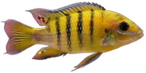
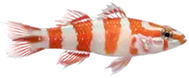
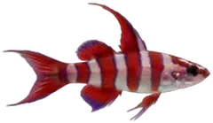
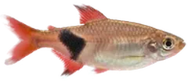
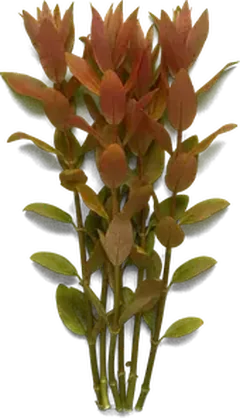

# reeftank-catalog

<!-- species:begin (generated by scripts/make_readme.py, do not edit) -->

> Parte dell'[**ecosistema di progetti ReefTech**](https://elwinmage.github.io/reeftank/)

       

Specie di pesci, coralli, piante e invertebrati per la vista acquario di [ha-reef-card](https://github.com/Elwinmage/ha-reef-card), fornite dall'[integrazione ReefTank](https://github.com/Elwinmage/ha-reeftank-component).

L'integrazione scarica le release di questo repository e le mantiene aggiornate (`update.reeftank_catalog`, automatico per impostazione predefinita): nulla da fare in Home Assistant.

## Come funziona

Ogni pesce è un foglio di immagini (un atlante WebP) e un descrittore con le sue clip: *nuoto*, *fermo* e *virata*. La scheda le concatena e specchia la virata perché il pesce torni da dove è venuto. Ecco il nuoto, la virata e il ritorno di due specie:

<table><tr><td align="center"> Pesce angelo imperatore</td><td align="center"> Pesce pagliaccio</td></tr></table>

## Pesci (102)

**HD**: un'animazione reale, fatta da video. Gli altri hanno un'animazione semplice fatta da una foto, o il pesce generico.

| &nbsp;&nbsp;&nbsp;&nbsp;&nbsp;&nbsp;&nbsp;&nbsp;&nbsp;&nbsp;&nbsp;&nbsp;&nbsp;&nbsp;&nbsp;&nbsp;&nbsp;&nbsp;&nbsp;&nbsp;&nbsp;&nbsp;&nbsp;&nbsp;&nbsp;&nbsp;&nbsp;&nbsp;&nbsp;&nbsp;&nbsp;&nbsp;&nbsp;&nbsp;&nbsp;&nbsp;&nbsp;&nbsp;&nbsp; | <small>Nome</small> | <small>Nome scientifico</small> | <small>Acqua</small> | <small>Taglia</small> | <small>Comportamento</small> | HD |
|---|---|---|---|---|---|---|
|  | <small>Ancistrus `ancistrus`</small> | <small>*Ancistrus sp.*</small> | <small>Acqua dolce</small> | <small>10–14 cm</small> | <small>Vive vicino al fondo · si nasconde di notte</small> |  |
|  | <small>Anthias `pseudanthias`</small> | <small>*Pseudanthias sp.*</small> | <small>Marino</small> | <small>8–14 cm</small> | <small>In banco · si nasconde di notte</small> | ✔ |
|  | <small>Apistogramma cacatua `apistogramma_cacatuoides`</small> | <small>*Apistogramma cacatuoides*</small> | <small>Acqua dolce</small> | <small>5–9 cm</small> | <small>Vive vicino al fondo · si nasconde di notte</small> |  |
|  | <small>Barbo ciliegia `pethia_titteya`</small> | <small>*Pethia titteya*</small> | <small>Acqua dolce</small> | <small>4–5 cm</small> | <small>In banco · si nasconde di notte</small> |  |
|  | <small>Barbo di Sumatra `puntigrus_tetrazona`</small> | <small>*Puntigrus tetrazona*</small> | <small>Acqua dolce</small> | <small>5–7 cm</small> | <small>In banco · si nasconde di notte</small> |  |
|  | <small>Bavosa bicolore `ecsenius_bicolor`</small> | <small>*Ecsenius bicolor*</small> | <small>Marino</small> | <small>8–10 cm</small> | <small>Vive vicino al fondo · si nasconde di notte</small> |  |
|  | <small>Bavosa tosaerba `salarias_fasciatus`</small> | <small>*Salarias fasciatus*</small> | <small>Marino</small> | <small>12–14 cm</small> | <small>Vive vicino al fondo · si nasconde di notte</small> |  |
|  | <small>Botia anguilla `pangio_kuhlii`</small> | <small>*Pangio kuhlii*</small> | <small>Acqua dolce</small> | <small>8–12 cm</small> | <small>Vive vicino al fondo · si nasconde di notte</small> |  |
|  | <small>Botia pagliaccio `chromobotia_macracanthus`</small> | <small>*Chromobotia macracanthus*</small> | <small>Acqua dolce</small> | <small>15–30 cm</small> | <small>Vive vicino al fondo · si nasconde di notte</small> |  |
|  | <small>Castagnola verde `chromis_viridis`</small> | <small>*Chromis viridis*</small> | <small>Marino</small> | <small>5–8 cm</small> | <small>In banco · si nasconde di notte</small> | ✔ |
|  | <small>Cavalluccio marino striato `hippocampus_erectus`</small> | <small>*Hippocampus erectus*</small> | <small>Marino</small> | <small>10–15 cm</small> | <small>Stazionario · resta sospeso di notte</small> |  |
|  | <small>Ciclide Demasoni `pseudotropheus_demasoni`</small> | <small>*Pseudotropheus demasoni*</small> | <small>Acqua dolce</small> | <small>7–8 cm</small> | <small>Nuotatore di acque libere · si nasconde di notte</small> |  |
|  | <small>Ciclide giallo elettrico `labidochromis_caeruleus`</small> | <small>*Labidochromis caeruleus*</small> | <small>Acqua dolce</small> | <small>8–10 cm</small> | <small>Nuotatore di acque libere · si nasconde di notte</small> |  |
|  | <small>Corydoras bronzeo `corydoras_aeneus`</small> | <small>*Corydoras aeneus*</small> | <small>Acqua dolce</small> | <small>6–7 cm</small> | <small>Vive vicino al fondo · si nasconde di notte</small> |  |
|  | <small>Corydoras panda `corydoras_panda`</small> | <small>*Corydoras panda*</small> | <small>Acqua dolce</small> | <small>4–5 cm</small> | <small>Vive vicino al fondo · si nasconde di notte</small> |  |
|  | <small>Damigella a coda gialla `chrysiptera_parasema`</small> | <small>*Chrysiptera parasema*</small> | <small>Marino</small> | <small>5–6 cm</small> | <small>Stazionario · resta vicino al suo rifugio · resta sospeso di notte</small> |  |
|  | <small>Damigella delle Figi `chrysiptera_taupou`</small> | <small>*Chrysiptera taupou*</small> | <small>Marino</small> | <small>6–8 cm</small> | <small>Stazionario · resta vicino al suo rifugio · resta sospeso di notte</small> |  |
|  | <small>Danio galassia `danio_margaritatus`</small> | <small>*Danio margaritatus*</small> | <small>Acqua dolce</small> | <small>2–3 cm</small> | <small>In banco · si nasconde di notte</small> |  |
|  | <small>Danio perla `danio_albolineatus`</small> | <small>*Danio albolineatus*</small> | <small>Acqua dolce</small> | <small>4–6 cm</small> | <small>In banco · si nasconde di notte</small> |  |
|  | <small>Dascillo a tre macchie `dascyllus_trimaculatus`</small> | <small>*Dascyllus trimaculatus*</small> | <small>Marino</small> | <small>10–14 cm</small> | <small>Stazionario · resta sospeso di notte</small> |  |
|  | <small>Discus `symphysodon_aequifasciatus`</small> | <small>*Symphysodon aequifasciatus*</small> | <small>Acqua dolce</small> | <small>15–20 cm</small> | <small>Nuotatore di acque libere · si nasconde di notte</small> |  |
|  | <small>Ghiozzo a bande `amblygobius_phalaena`</small> | <small>*Amblygobius phalaena*</small> | <small>Marino</small> | <small>8–10 cm</small> | <small>Vive sulla sabbia · riposa sul fondo di notte</small> |  |
|  | <small>Ghiozzo calabrone `brachygobius_xanthozonus`</small> | <small>*Brachygobius xanthozonus*</small> | <small>Salmastro</small> | <small>3–4 cm</small> | <small>Vive vicino al fondo · si nasconde di notte</small> |  |
|  | <small>Ghiozzo cavaliere `stigmatogobius_sadanundio`</small> | <small>*Stigmatogobius sadanundio*</small> | <small>Salmastro</small> | <small>6–8 cm</small> | <small>Vive vicino al fondo · si nasconde di notte</small> |  |
|  | <small>Ghiozzo corallino limone `gobiodon_citrinus`</small> | <small>*Gobiodon citrinus*</small> | <small>Marino</small> | <small>3–5 cm</small> | <small>Vive vicino al fondo · si nasconde di notte</small> |  |
|  | <small>Ghiozzo dai cerchi gialli `cryptocentrus_cinctus`</small> | <small>*Cryptocentrus cinctus*</small> | <small>Marino</small> | <small>8–10 cm</small> | <small>Vive sulla sabbia · vive in una tana · riposa sul fondo di notte</small> |  |
|  | <small>Ghiozzo di Okinawa `gobiodon_okinawae`</small> | <small>*Gobiodon okinawae*</small> | <small>Marino</small> | <small>2.5–3.5 cm</small> | <small>Vive vicino al fondo · si nasconde di notte</small> |  |
|  | <small>Ghiozzo dormiente `valenciennea`</small> | <small>*Valenciennea sp.*</small> | <small>Marino</small> | <small>10–16 cm</small> | <small>Vive sulla sabbia · vive in una tana · riposa sul fondo di notte</small> | ✔ |
|  | <small>Ghiozzo neon `elacatinus_oceanops`</small> | <small>*Elacatinus oceanops*</small> | <small>Marino</small> | <small>4–6 cm</small> | <small>Vive vicino al fondo · si nasconde di notte</small> |  |
|  | <small>Ghiozzo viola `gobioides_broussonnetii`</small> | <small>*Gobioides broussonnetii*</small> | <small>Salmastro</small> | <small>30–50 cm</small> | <small>Vive sulla sabbia · vive in una tana · riposa sul fondo di notte</small> |  |
|  | <small>Ghiozzo yasha `stonogobiops_yasha`</small> | <small>*Stonogobiops yasha*</small> | <small>Marino</small> | <small>6–8 cm</small> | <small>Vive sulla sabbia · vive in una tana · riposa sul fondo di notte</small> |  |
|  | <small>Gourami azzurro `trichopodus_trichopterus`</small> | <small>*Trichopodus trichopterus*</small> | <small>Acqua dolce</small> | <small>10–15 cm</small> | <small>Nuotatore di acque libere · si nasconde di notte</small> |  |
|  | <small>Gourami nano `trichogaster_lalius`</small> | <small>*Trichogaster lalius*</small> | <small>Acqua dolce</small> | <small>5–8 cm</small> | <small>Nuotatore di acque libere · si nasconde di notte</small> |  |
|  | <small>Gourami perla `trichopodus_leerii`</small> | <small>*Trichopodus leerii*</small> | <small>Acqua dolce</small> | <small>10–12 cm</small> | <small>Nuotatore di acque libere · si nasconde di notte</small> |  |
|  | <small>Gramma reale `gramma_loreto`</small> | <small>*Gramma loreto*</small> | <small>Marino</small> | <small>7–8 cm</small> | <small>Stazionario · resta sospeso di notte</small> |  |
|  | <small>Guppy `poecilia_reticulata`</small> | <small>*Poecilia reticulata*</small> | <small>Acqua dolce</small> | <small>3–6 cm</small> | <small>In banco · si nasconde di notte</small> |  |
|  | <small>Guppy di Endler `poecilia_wingei`</small> | <small>*Poecilia wingei*</small> | <small>Acqua dolce</small> | <small>2–4 cm</small> | <small>In banco · si nasconde di notte</small> |  |
|  | <small>Killi del Capo Lopez `aphyosemion_australe`</small> | <small>*Aphyosemion australe*</small> | <small>Acqua dolce</small> | <small>5–6 cm</small> | <small>Stazionario · resta sospeso di notte</small> |  |
|  | <small>Kribensis `pelvicachromis_pulcher`</small> | <small>*Pelvicachromis pulcher*</small> | <small>Acqua dolce</small> | <small>8–10 cm</small> | <small>Vive vicino al fondo · si nasconde di notte</small> |  |
|  | <small>Labride a sei linee `pseudocheilinus_hexataenia`</small> | <small>*Pseudocheilinus hexataenia*</small> | <small>Marino</small> | <small>7–10 cm</small> | <small>Nuotatore di acque libere · si nasconde di notte</small> |  |
|  | <small>Labride fata di Solor `cirrhilabrus_solorensis`</small> | <small>*Cirrhilabrus solorensis*</small> | <small>Marino</small> | <small>10–12 cm</small> | <small>Nuotatore di acque libere · si nasconde di notte</small> |  |
|  | <small>Labride giallo `halichoeres_chrysus`</small> | <small>*Halichoeres chrysus*</small> | <small>Marino</small> | <small>10–12 cm</small> | <small>Nuotatore di acque libere · riposa sul fondo di notte</small> |  |
|  | <small>Mangiaalghe siamese `crossocheilus_oblongus`</small> | <small>*Crossocheilus oblongus*</small> | <small>Acqua dolce</small> | <small>10–15 cm</small> | <small>Nuotatore di acque libere · si nasconde di notte</small> |  |
|  | <small>Molly comune `poecilia_sphenops`</small> | <small>*Poecilia sphenops*</small> | <small>Acqua dolce, Salmastro</small> | <small>6–10 cm</small> | <small>In banco · si nasconde di notte</small> |  |
|  | <small>Molly vela `poecilia_velifera`</small> | <small>*Poecilia velifera*</small> | <small>Salmastro, Acqua dolce</small> | <small>10–15 cm</small> | <small>In banco · si nasconde di notte</small> |  |
|  | <small>Monodattilo argentato `monodactylus_argenteus`</small> | <small>*Monodactylus argenteus*</small> | <small>Salmastro, Marino</small> | <small>15–25 cm</small> | <small>In banco · si nasconde di notte</small> |  |
|  | <small>Oscar `astronotus_ocellatus`</small> | <small>*Astronotus ocellatus*</small> | <small>Acqua dolce</small> | <small>25–35 cm</small> | <small>Nuotatore di acque libere · si nasconde di notte</small> |  |
|  | <small>Otocinclus `otocinclus_affinis`</small> | <small>*Otocinclus affinis*</small> | <small>Acqua dolce</small> | <small>3–5 cm</small> | <small>Vive vicino al fondo · si nasconde di notte</small> |  |
|  | <small>Periofalmo atlantico `periophthalmus_barbarus`</small> | <small>*Periophthalmus barbarus*</small> | <small>Salmastro</small> | <small>10–15 cm</small> | <small>Vive vicino al fondo · si nasconde di notte</small> |  |
|  | <small>Pesce angelo `pterophyllum_scalare`</small> | <small>*Pterophyllum scalare*</small> | <small>Acqua dolce</small> | <small>12–15 cm</small> | <small>Nuotatore di acque libere · si nasconde di notte</small> |  |
|  | <small>Pesce angelo bicolore `centropyge_bicolor`</small> | <small>*Centropyge bicolor*</small> | <small>Marino</small> | <small>10–15 cm</small> | <small>Stazionario · resta sospeso di notte</small> |  |
|  | <small>Pesce angelo fiamma `centropyge_loricula`</small> | <small>*Centropyge loricula*</small> | <small>Marino</small> | <small>8–10 cm</small> | <small>Stazionario · resta sospeso di notte</small> |  |
|  | <small>Pesce angelo imperatore (adulto) `pomacanthus_imperator_adult`</small> | <small>*Pomacanthus imperator*</small> | <small>Marino</small> | <small>25–38 cm</small> | <small>Nuotatore di acque libere · si nasconde di notte</small> | ✔ |
|  | <small>Pesce angelo imperatore (giovane) `pomacanthus_imperator`</small> | <small>*Pomacanthus imperator*</small> | <small>Marino</small> | <small>6–12 cm</small> | <small>Nuotatore di acque libere · si nasconde di notte</small> | ✔ |
|  | <small>Pesce angelo reale `pygoplites_diacanthus`</small> | <small>*Pygoplites diacanthus*</small> | <small>Marino</small> | <small>20–25 cm</small> | <small>Nuotatore di acque libere · si nasconde di notte</small> |  |
|  | <small>Pesce arciere `toxotes_jaculatrix`</small> | <small>*Toxotes jaculatrix*</small> | <small>Salmastro</small> | <small>15–25 cm</small> | <small>Nuotatore di acque libere · si nasconde di notte</small> |  |
|  | <small>Pesce arcobaleno turchese `melanotaenia_lacustris`</small> | <small>*Melanotaenia lacustris*</small> | <small>Acqua dolce</small> | <small>8–12 cm</small> | <small>In banco · si nasconde di notte</small> |  |
|  | <small>Pesce ascia marmorizzato `carnegiella_strigata`</small> | <small>*Carnegiella strigata*</small> | <small>Acqua dolce</small> | <small>4–5 cm</small> | <small>In banco · si nasconde di notte</small> |  |
|  | <small>Pesce balestra Picasso `rhinecanthus_aculeatus`</small> | <small>*Rhinecanthus aculeatus*</small> | <small>Marino</small> | <small>20–25 cm</small> | <small>Nuotatore di acque libere · si nasconde di notte</small> |  |
|  | <small>Pesce cardinale a strisce gialle `ostorhinchus_cyanosoma`</small> | <small>*Ostorhinchus cyanosoma*</small> | <small>Marino</small> | <small>7–8 cm</small> | <small>Stazionario · resta sospeso di notte</small> |  |
|  | <small>Pesce cardinale di Banggai `pterapogon_kauderni`</small> | <small>*Pterapogon kauderni*</small> | <small>Marino</small> | <small>5–8 cm</small> | <small>Stazionario · resta sospeso di notte</small> | ✔ |
|  | <small>Pesce cardinale pigiama `sphaeramia_nematoptera`</small> | <small>*Sphaeramia nematoptera*</small> | <small>Marino</small> | <small>8–10 cm</small> | <small>Stazionario · resta sospeso di notte</small> |  |
|  | <small>Pesce chirurgo azzurro `acanthurus_leucosternon`</small> | <small>*Acanthurus leucosternon*</small> | <small>Marino</small> | <small>20–23 cm</small> | <small>Nuotatore di acque libere · si nasconde di notte</small> |  |
|  | <small>Pesce chirurgo blu `paracanthurus_hepatus`</small> | <small>*Paracanthurus hepatus*</small> | <small>Marino</small> | <small>20–30 cm</small> | <small>Nuotatore di acque libere · si nasconde di notte</small> |  |
|  | <small>Pesce chirurgo giallo `zebrasoma_flavescens`</small> | <small>*Zebrasoma flavescens*</small> | <small>Marino</small> | <small>15–20 cm</small> | <small>Nuotatore di acque libere · si nasconde di notte</small> |  |
|  | <small>Pesce chirurgo kole `ctenochaetus_strigosus`</small> | <small>*Ctenochaetus strigosus*</small> | <small>Marino</small> | <small>12–18 cm</small> | <small>Nuotatore di acque libere · si nasconde di notte</small> |  |
|  | <small>Pesce chirurgo marrone `zebrasoma_scopas`</small> | <small>*Zebrasoma scopas*</small> | <small>Marino</small> | <small>15–20 cm</small> | <small>Nuotatore di acque libere · si nasconde di notte</small> |  |
|  | <small>Pesce chirurgo vela `zebrasoma_veliferum`</small> | <small>*Zebrasoma veliferum*</small> | <small>Marino</small> | <small>25–40 cm</small> | <small>Nuotatore di acque libere · si nasconde di notte</small> |  |
|  | <small>Pesce combattente `betta_splendens`</small> | <small>*Betta splendens*</small> | <small>Acqua dolce</small> | <small>5–7 cm</small> | <small>Stazionario · resta vicino al suo rifugio · resta sospeso di notte</small> |  |
|  | <small>Pesce coniglio volpe `siganus_vulpinus`</small> | <small>*Siganus vulpinus*</small> | <small>Marino</small> | <small>15–22 cm</small> | <small>Nuotatore di acque libere · riposa sul fondo di notte</small> | ✔ |
|  | <small>Pesce delle nuvole `tanichthys_albonubes`</small> | <small>*Tanichthys albonubes*</small> | <small>Acqua dolce</small> | <small>3–4 cm</small> | <small>In banco · si nasconde di notte</small> |  |
|  | <small>Pesce falco pixie `cirrhitichthys_oxycephalus`</small> | <small>*Cirrhitichthys oxycephalus*</small> | <small>Marino</small> | <small>8–10 cm</small> | <small>Vive vicino al fondo · si nasconde di notte</small> |  |
|  | <small>Pesce farfalla a bande ramate `chelmon_rostratus`</small> | <small>*Chelmon rostratus*</small> | <small>Marino</small> | <small>15–20 cm</small> | <small>Nuotatore di acque libere · si nasconde di notte</small> |  |
|  | <small>Pesce fuoco `nemateleotris_magnifica`</small> | <small>*Nemateleotris magnifica*</small> | <small>Marino</small> | <small>8–10 cm</small> | <small>Stazionario · resta sospeso di notte</small> |  |
|  | <small>Pesce fuoco viola `nemateleotris_decora`</small> | <small>*Nemateleotris decora*</small> | <small>Marino</small> | <small>8–10 cm</small> | <small>Stazionario · resta sospeso di notte</small> |  |
|  | <small>Pesce leone rosso `pterois_volitans`</small> | <small>*Pterois volitans*</small> | <small>Marino</small> | <small>25–35 cm</small> | <small>Nuotatore di acque libere · si nasconde di notte</small> |  |
|  | <small>Pesce leone zebra `dendrochirus_zebra`</small> | <small>*Dendrochirus zebra*</small> | <small>Marino</small> | <small>12–18 cm</small> | <small>Nuotatore di acque libere · si nasconde di notte</small> |  |
|  | <small>Pesce mandarino `synchiropus_splendidus`</small> | <small>*Synchiropus splendidus*</small> | <small>Marino</small> | <small>5–8 cm</small> | <small>Vive vicino al fondo · si nasconde di notte</small> | ✔ |
|  | <small>Pesce mandarino psichedelico `synchiropus_picturatus`</small> | <small>*Synchiropus picturatus*</small> | <small>Marino</small> | <small>6–8 cm</small> | <small>Vive vicino al fondo · si nasconde di notte</small> |  |
|  | <small>Pesce mascella testa gialla `opistognathus_aurifrons`</small> | <small>*Opistognathus aurifrons*</small> | <small>Marino</small> | <small>10–12 cm</small> | <small>Vive sulla sabbia · vive in una tana · riposa sul fondo di notte</small> |  |
|  | <small>Pesce pagliaccio `amphiprion`</small> | <small>*Amphiprion sp.*</small> | <small>Marino</small> | <small>7–11 cm</small> | <small>Stazionario · resta sospeso di notte</small> | ✔ |
|  | <small>Pesce pagliaccio marrone `premnas_biaculeatus`</small> | <small>*Premnas biaculeatus*</small> | <small>Marino</small> | <small>10–15 cm</small> | <small>Stazionario · resta sospeso di notte</small> |  |
|  | <small>Pesce palla a otto `dichotomyctere_biocellatus`</small> | <small>*Dichotomyctere biocellatus*</small> | <small>Salmastro</small> | <small>5–6.5 cm</small> | <small>Nuotatore di acque libere · si nasconde di notte</small> |  |
|  | <small>Pesce palla di Valentin `canthigaster_valentini`</small> | <small>*Canthigaster valentini*</small> | <small>Marino</small> | <small>8–10 cm</small> | <small>Nuotatore di acque libere · si nasconde di notte</small> |  |
|  | <small>Pesce palla verde `dichotomyctere_nigroviridis`</small> | <small>*Dichotomyctere nigroviridis*</small> | <small>Salmastro</small> | <small>10–17 cm</small> | <small>Nuotatore di acque libere · si nasconde di notte</small> |  |
|  | <small>Pesce pulitore `labroides_dimidiatus`</small> | <small>*Labroides dimidiatus*</small> | <small>Marino</small> | <small>10–12 cm</small> | <small>Nuotatore di acque libere · si nasconde di notte</small> |  |
|  | <small>Pesce rosso `carassius_auratus`</small> | <small>*Carassius auratus*</small> | <small>Acqua dolce</small> | <small>10–25 cm</small> | <small>Nuotatore di acque libere · si nasconde di notte</small> |  |
|  | <small>Pesce zebra `danio_rerio`</small> | <small>*Danio rerio*</small> | <small>Acqua dolce</small> | <small>4–5 cm</small> | <small>In banco · si nasconde di notte</small> |  |
|  | <small>Platy `xiphophorus_maculatus`</small> | <small>*Xiphophorus maculatus*</small> | <small>Acqua dolce</small> | <small>4–6 cm</small> | <small>In banco · si nasconde di notte</small> |  |
|  | <small>Pleco zebra `hypancistrus_zebra`</small> | <small>*Hypancistrus zebra*</small> | <small>Acqua dolce</small> | <small>7–10 cm</small> | <small>Vive vicino al fondo · si nasconde di notte</small> |  |
|  | <small>Portaspada `xiphophorus_hellerii`</small> | <small>*Xiphophorus hellerii*</small> | <small>Acqua dolce</small> | <small>6–12 cm</small> | <small>In banco · si nasconde di notte</small> |  |
|  | <small>Pseudochromis orchidea `pseudochromis_fridmani`</small> | <small>*Pseudochromis fridmani*</small> | <small>Marino</small> | <small>6–7 cm</small> | <small>Stazionario · resta vicino al suo rifugio · resta sospeso di notte</small> |  |
|  | <small>Ramirezi `mikrogeophagus_ramirezi`</small> | <small>*Mikrogeophagus ramirezi*</small> | <small>Acqua dolce</small> | <small>5–7 cm</small> | <small>Stazionario · resta sospeso di notte</small> |  |
|  | <small>Rasbora arlecchino `trigonostigma_heteromorpha`</small> | <small>*Trigonostigma heteromorpha*</small> | <small>Acqua dolce</small> | <small>3–4.5 cm</small> | <small>In banco · si nasconde di notte</small> |  |
|  | <small>Scato argo `scatophagus_argus`</small> | <small>*Scatophagus argus*</small> | <small>Salmastro, Marino</small> | <small>15–30 cm</small> | <small>Nuotatore di acque libere · si nasconde di notte</small> |  |
|  | <small>Tetra cardinale `paracheirodon_axelrodi`</small> | <small>*Paracheirodon axelrodi*</small> | <small>Acqua dolce</small> | <small>3–5 cm</small> | <small>In banco · si nasconde di notte</small> |  |
|  | <small>Tetra imperatore `nematobrycon_palmeri`</small> | <small>*Nematobrycon palmeri*</small> | <small>Acqua dolce</small> | <small>4–6 cm</small> | <small>In banco · si nasconde di notte</small> |  |
|  | <small>Tetra limone `hyphessobrycon_pulchripinnis`</small> | <small>*Hyphessobrycon pulchripinnis*</small> | <small>Acqua dolce</small> | <small>3–4.5 cm</small> | <small>In banco · si nasconde di notte</small> |  |
|  | <small>Tetra neon `paracheirodon_innesi`</small> | <small>*Paracheirodon innesi*</small> | <small>Acqua dolce</small> | <small>3–4 cm</small> | <small>In banco · si nasconde di notte</small> |  |
|  | <small>Tetra nero `gymnocorymbus_ternetzi`</small> | <small>*Gymnocorymbus ternetzi*</small> | <small>Acqua dolce</small> | <small>5–6 cm</small> | <small>In banco · si nasconde di notte</small> |  |
|  | <small>Tetra serpae `hyphessobrycon_eques`</small> | <small>*Hyphessobrycon eques*</small> | <small>Acqua dolce</small> | <small>3–4.5 cm</small> | <small>In banco · si nasconde di notte</small> |  |
|  | <small>Tetra testa rossa `hemigrammus_bleheri`</small> | <small>*Hemigrammus bleheri*</small> | <small>Acqua dolce</small> | <small>4–5 cm</small> | <small>In banco · si nasconde di notte</small> |  |

## Coralli (1)

| &nbsp;&nbsp;&nbsp;&nbsp;&nbsp;&nbsp;&nbsp;&nbsp;&nbsp;&nbsp;&nbsp;&nbsp;&nbsp;&nbsp;&nbsp;&nbsp;&nbsp;&nbsp;&nbsp;&nbsp;&nbsp;&nbsp;&nbsp;&nbsp;&nbsp;&nbsp;&nbsp;&nbsp;&nbsp;&nbsp;&nbsp;&nbsp;&nbsp;&nbsp;&nbsp;&nbsp;&nbsp;&nbsp;&nbsp; | <small>Nome</small> | <small>Nome scientifico</small> | <small>Acqua</small> | <small>Taglia</small> |
|---|---|---|---|---|
|  | <small>Corallo torcia `euphyllia_glabrescens`</small> | <small>*Euphyllia glabrescens*</small> | <small>Marino</small> | <small>10–30 cm</small> |

## Piante (29)

| &nbsp;&nbsp;&nbsp;&nbsp;&nbsp;&nbsp;&nbsp;&nbsp;&nbsp;&nbsp;&nbsp;&nbsp;&nbsp;&nbsp;&nbsp;&nbsp;&nbsp;&nbsp;&nbsp;&nbsp;&nbsp;&nbsp;&nbsp;&nbsp;&nbsp;&nbsp;&nbsp;&nbsp;&nbsp;&nbsp;&nbsp;&nbsp;&nbsp;&nbsp;&nbsp;&nbsp;&nbsp;&nbsp;&nbsp; | <small>Nome</small> | <small>Nome scientifico</small> | <small>Acqua</small> | <small>Taglia</small> | <small>Zona</small> |
|---|---|---|---|---|---|
|  | <small>Ambulia `limnophila_sessiliflora`</small> | <small>*Limnophila sessiliflora*</small> | <small>Acqua dolce</small> | <small>20–40 cm</small> | <small>Sfondo</small> |
|  | <small>Anubias `anubias_barteri`</small> | <small>*Anubias barteri*</small> | <small>Acqua dolce</small> | <small>10–25 cm</small> | <small>Epifita</small> |
|  | <small>Bucephalandra `bucephalandra`</small> | <small>*Bucephalandra sp.*</small> | <small>Acqua dolce</small> | <small>5–15 cm</small> | <small>Epifita</small> |
|  | <small>Cabomba `cabomba_caroliniana`</small> | <small>*Cabomba caroliniana*</small> | <small>Acqua dolce</small> | <small>30–60 cm</small> | <small>Sfondo</small> |
|  | <small>Caulerpa `caulerpa_prolifera`</small> | <small>*Caulerpa prolifera*</small> | <small>Marino</small> | <small>5–20 cm</small> | <small>Primo piano</small> |
|  | <small>Chaetomorpha `chaetomorpha_linum`</small> | <small>*Chaetomorpha linum*</small> | <small>Marino</small> | <small>5–30 cm</small> | <small>Primo piano</small> |
|  | <small>Cryptocoryne ciliata `cryptocoryne_ciliata`</small> | <small>*Cryptocoryne ciliata*</small> | <small>Salmastro, Acqua dolce</small> | <small>20–40 cm</small> | <small>Piano intermedio</small> |
|  | <small>Cryptocoryne parva `cryptocoryne_parva`</small> | <small>*Cryptocoryne parva*</small> | <small>Acqua dolce</small> | <small>5–8 cm</small> | <small>Primo piano</small> |
|  | <small>Cryptocoryne wendtii `cryptocoryne_wendtii`</small> | <small>*Cryptocoryne wendtii*</small> | <small>Acqua dolce</small> | <small>10–20 cm</small> | <small>Piano intermedio</small> |
|  | <small>Egeria densa `egeria_densa`</small> | <small>*Egeria densa*</small> | <small>Acqua dolce</small> | <small>30–100 cm</small> | <small>Sfondo</small> |
|  | <small>Eleocharis nana `eleocharis_parvula`</small> | <small>*Eleocharis parvula*</small> | <small>Acqua dolce</small> | <small>5–10 cm</small> | <small>Primo piano</small> |
|  | <small>Erba delle tartarughe `thalassia_testudinum`</small> | <small>*Thalassia testudinum*</small> | <small>Marino</small> | <small>10–30 cm</small> | <small>Primo piano</small> |
|  | <small>Felce di Giava `microsorum_pteropus`</small> | <small>*Microsorum pteropus*</small> | <small>Acqua dolce</small> | <small>20–30 cm</small> | <small>Epifita</small> |
|  | <small>Glossostigma `glossostigma_elatinoides`</small> | <small>*Glossostigma elatinoides*</small> | <small>Acqua dolce</small> | <small>2–5 cm</small> | <small>Primo piano</small> |
|  | <small>Halimeda `halimeda_opuntia`</small> | <small>*Halimeda opuntia*</small> | <small>Marino</small> | <small>5–15 cm</small> | <small>Primo piano</small> |
|  | <small>Hemianthus `hemianthus_callitrichoides`</small> | <small>*Hemianthus callitrichoides*</small> | <small>Acqua dolce</small> | <small>2–5 cm</small> | <small>Primo piano</small> |
|  | <small>Hygrophila `hygrophila_polysperma`</small> | <small>*Hygrophila polysperma*</small> | <small>Acqua dolce</small> | <small>20–50 cm</small> | <small>Sfondo</small> |
|  | <small>Lattuga d'acqua `pistia_stratiotes`</small> | <small>*Pistia stratiotes*</small> | <small>Acqua dolce</small> | <small>5–15 cm</small> | <small>Galleggiante</small> |
|  | <small>Lenticchia d'acqua `lemna_minor`</small> | <small>*Lemna minor*</small> | <small>Acqua dolce</small> | <small>0.5–1 cm</small> | <small>Galleggiante</small> |
|  | <small>Limnobium `limnobium_laevigatum`</small> | <small>*Limnobium laevigatum*</small> | <small>Acqua dolce</small> | <small>5–10 cm</small> | <small>Galleggiante</small> |
|  | <small>Ludwigia `ludwigia_repens`</small> | <small>*Ludwigia repens*</small> | <small>Acqua dolce</small> | <small>20–40 cm</small> | <small>Piano intermedio</small> |
|  | <small>Mangrovia rossa `rhizophora_mangle`</small> | <small>*Rhizophora mangle*</small> | <small>Salmastro, Marino</small> | <small>30–100 cm</small> | <small>Piano intermedio</small> |
|  | <small>Marimo `aegagropila_linnaei`</small> | <small>*Aegagropila linnaei*</small> | <small>Acqua dolce</small> | <small>3–10 cm</small> | <small>Primo piano</small> |
|  | <small>Muschio di Giava `vesicularia_dubyana`</small> | <small>*Vesicularia dubyana*</small> | <small>Acqua dolce</small> | <small>3–5 cm</small> | <small>Epifita</small> |
|  | <small>Rotala `rotala_rotundifolia`</small> | <small>*Rotala rotundifolia*</small> | <small>Acqua dolce</small> | <small>20–50 cm</small> | <small>Sfondo</small> |
|  | <small>Sagittaria nana `sagittaria_subulata`</small> | <small>*Sagittaria subulata*</small> | <small>Acqua dolce</small> | <small>10–30 cm</small> | <small>Primo piano</small> |
|  | <small>Spada amazzonica `echinodorus_bleheri`</small> | <small>*Echinodorus bleheri*</small> | <small>Acqua dolce</small> | <small>30–50 cm</small> | <small>Piano intermedio</small> |
|  | <small>Staurogyne `staurogyne_repens`</small> | <small>*Staurogyne repens*</small> | <small>Acqua dolce</small> | <small>5–10 cm</small> | <small>Primo piano</small> |
|  | <small>Vallisneria `vallisneria_spiralis`</small> | <small>*Vallisneria spiralis*</small> | <small>Acqua dolce, Salmastro</small> | <small>30–60 cm</small> | <small>Sfondo</small> |

## Invertebrati (32)

| &nbsp;&nbsp;&nbsp;&nbsp;&nbsp;&nbsp;&nbsp;&nbsp;&nbsp;&nbsp;&nbsp;&nbsp;&nbsp;&nbsp;&nbsp;&nbsp;&nbsp;&nbsp;&nbsp;&nbsp;&nbsp;&nbsp;&nbsp;&nbsp;&nbsp;&nbsp;&nbsp;&nbsp;&nbsp;&nbsp;&nbsp;&nbsp;&nbsp;&nbsp;&nbsp;&nbsp;&nbsp;&nbsp;&nbsp; | <small>Nome</small> | <small>Nome scientifico</small> | <small>Acqua</small> | <small>Taglia</small> | <small>Ruolo</small> |
|---|---|---|---|---|---|
|  | <small>Cetriolo di mare `holothuria`</small> | <small>*Holothuria sp.*</small> | <small>Marino</small> | <small>15–30 cm</small> | <small>Detritivoro · si muove sul fondo</small> |
|  | <small>Gambero Amano `caridina_multidentata`</small> | <small>*Caridina multidentata*</small> | <small>Acqua dolce</small> | <small>3–5 cm</small> | <small>Mangiatore di alghe · si muove sul fondo</small> |
|  | <small>Gambero arlecchino `hymenocera_picta`</small> | <small>*Hymenocera picta*</small> | <small>Marino</small> | <small>4–6 cm</small> | <small>Predatore · si muove sul fondo</small> |
|  | <small>Gambero bambù `atyopsis_moluccensis`</small> | <small>*Atyopsis moluccensis*</small> | <small>Acqua dolce</small> | <small>6–8 cm</small> | <small>Filtratore · vive sull'arredo</small> |
|  | <small>Gambero boxer `stenopus_hispidus`</small> | <small>*Stenopus hispidus*</small> | <small>Marino</small> | <small>6–8 cm</small> | <small>Pulitore · vive sull'arredo</small> |
|  | <small>Gambero ciliegia `neocaridina_davidi`</small> | <small>*Neocaridina davidi*</small> | <small>Acqua dolce</small> | <small>2–3.5 cm</small> | <small>Detritivoro · si muove sul fondo</small> |
|  | <small>Gambero cristal rosso `caridina_cantonensis`</small> | <small>*Caridina cantonensis*</small> | <small>Acqua dolce</small> | <small>2–3 cm</small> | <small>Detritivoro · si muove sul fondo</small> |
|  | <small>Gambero fuoco `lysmata_debelius`</small> | <small>*Lysmata debelius*</small> | <small>Marino</small> | <small>5–6 cm</small> | <small>Pulitore · vive sull'arredo</small> |
|  | <small>Gambero marmorizzato `saron_marmoratus`</small> | <small>*Saron marmoratus*</small> | <small>Marino</small> | <small>5–7 cm</small> | <small>Spazzino · vive sull'arredo</small> |
|  | <small>Gambero peppermint `lysmata_wurdemanni`</small> | <small>*Lysmata wurdemanni*</small> | <small>Marino</small> | <small>3–5 cm</small> | <small>Pulitore · vive sull'arredo</small> |
|  | <small>Gambero pulitore scarlatto `lysmata_amboinensis`</small> | <small>*Lysmata amboinensis*</small> | <small>Marino</small> | <small>5–6 cm</small> | <small>Pulitore · vive sull'arredo</small> |
|  | <small>Granchio smeraldo `mithraculus_sculptus`</small> | <small>*Mithraculus sculptus*</small> | <small>Marino</small> | <small>3–4 cm</small> | <small>Mangiatore di alghe · vive sull'arredo</small> |
|  | <small>Lumaca assassina `clea_helena`</small> | <small>*Clea helena*</small> | <small>Acqua dolce</small> | <small>2–3 cm</small> | <small>Predatore · si muove sul fondo</small> |
|  | <small>Lumaca Astraea `astraea_tecta`</small> | <small>*Astraea tecta*</small> | <small>Marino</small> | <small>2–4 cm</small> | <small>Mangiatore di alghe · vive sull'arredo</small> |
|  | <small>Lumaca cerito `cerithium`</small> | <small>*Cerithium sp.*</small> | <small>Marino</small> | <small>2–3 cm</small> | <small>Detritivoro · si muove sul fondo</small> |
|  | <small>Lumaca corno d'ariete `planorbella_duryi`</small> | <small>*Planorbella duryi*</small> | <small>Acqua dolce</small> | <small>2–3 cm</small> | <small>Detritivoro · si arrampica sul vetro</small> |
|  | <small>Lumaca mela `pomacea_bridgesii`</small> | <small>*Pomacea bridgesii*</small> | <small>Acqua dolce</small> | <small>4–5 cm</small> | <small>Spazzino · si muove sul fondo</small> |
|  | <small>Lumaca Nassarius `nassarius`</small> | <small>*Nassarius sp.*</small> | <small>Marino</small> | <small>2–4 cm</small> | <small>Spazzino · si muove sul fondo</small> |
|  | <small>Lumaca trochus `tectus_fenestratus`</small> | <small>*Tectus fenestratus*</small> | <small>Marino</small> | <small>4–6 cm</small> | <small>Mangiatore di alghe · vive sull'arredo</small> |
|  | <small>Lumaca trombetta malese `melanoides_tuberculata`</small> | <small>*Melanoides tuberculata*</small> | <small>Acqua dolce</small> | <small>2–3 cm</small> | <small>Detritivoro · si muove sul fondo</small> |
|  | <small>Lumaca turbo `turbo_fluctuosus`</small> | <small>*Turbo fluctuosus*</small> | <small>Marino</small> | <small>4–8 cm</small> | <small>Mangiatore di alghe · si arrampica sul vetro</small> |
|  | <small>Nerita marina `nerita`</small> | <small>*Nerita sp.*</small> | <small>Marino</small> | <small>2–3 cm</small> | <small>Mangiatore di alghe · si arrampica sul vetro</small> |
|  | <small>Neritina zebrata `neritina_natalensis`</small> | <small>*Neritina natalensis*</small> | <small>Acqua dolce</small> | <small>2–3 cm</small> | <small>Mangiatore di alghe · si arrampica sul vetro</small> |
|  | <small>Paguro rosso scarlatto `paguristes_cadenati`</small> | <small>*Paguristes cadenati*</small> | <small>Marino</small> | <small>3–4 cm</small> | <small>Spazzino · si muove sul fondo</small> |
|  | <small>Paguro zampe blu `clibanarius_tricolor`</small> | <small>*Clibanarius tricolor*</small> | <small>Marino</small> | <small>2–3 cm</small> | <small>Spazzino · si muove sul fondo</small> |
|  | <small>Riccio collezionista `tripneustes_gratilla`</small> | <small>*Tripneustes gratilla*</small> | <small>Marino</small> | <small>10–15 cm</small> | <small>Mangiatore di alghe · vive sull'arredo</small> |
|  | <small>Riccio matita `prionocidaris_baculosa`</small> | <small>*Prionocidaris baculosa*</small> | <small>Marino</small> | <small>8–10 cm</small> | <small>Mangiatore di alghe · vive sull'arredo</small> |
|  | <small>Stella di sabbia `archaster_typicus`</small> | <small>*Archaster typicus*</small> | <small>Marino</small> | <small>6–10 cm</small> | <small>Detritivoro · si muove sul fondo</small> |
|  | <small>Stella serpente `ophiolepis_superba`</small> | <small>*Ophiolepis superba*</small> | <small>Marino</small> | <small>8–12 cm</small> | <small>Spazzino · si muove sul fondo</small> |
|  | <small>Tridacna perforante `tridacna_crocea`</small> | <small>*Tridacna crocea*</small> | <small>Marino</small> | <small>5–15 cm</small> | <small>Filtratore · sessile</small> |
|  | <small>Verme albero di Natale `spirobranchus_giganteus`</small> | <small>*Spirobranchus giganteus*</small> | <small>Marino</small> | <small>3–5 cm</small> | <small>Filtratore · sessile</small> |
|  | <small>Verme piumino `sabellastarte`</small> | <small>*Sabellastarte sp.*</small> | <small>Marino</small> | <small>5–10 cm</small> | <small>Filtratore · sessile</small> |

Per aggiungere una specie (generazione delle clip, build, pubblicazione), vedere la [documentazione in inglese](README.md).

Le risorse delle specie sono sotto **CC BY 4.0**, gli script sotto MIT: vedere [LICENSE.md](LICENSE.md).

<!-- species:end -->

<!-- ecosystem:start -->

## Progetti correlati

I progetti ReefTech si incastrano tra loro: le integrazioni portano la tua attrezzatura in Home Assistant, la scheda la mostra e la pilota, e il backup la mantiene in funzione durante un blackout. Ognuno funziona anche da solo.

<table>
  <tr>
    <th width="100px"></th>
    <th>Progetto</th>
    <th>Ruolo</th>
    <th>Funziona con</th>
  </tr>
  <tr>
    <td></td>
    <td>🐠 <a href="https://github.com/Elwinmage/ha-reefbeat-component"><b>ha-reefbeat-component</b></a></td>
    <td>Dispositivi Red Sea ReefBeat, pilotati in locale senza cloud: ReefATO+, ReefControl, ReefControl-Power, ReefDose, ReefLed, ReefMat, ReefRun e ReefWave. blueprint di allerta per modalità anomale, calibrazioni e batteria scarica. </td>
    <td>ha-reef-card</td>
  </tr>
  <tr>
    <td></td>
    <td>🌊 <a href="https://github.com/Elwinmage/ha-aquamedic-component"><b>ha-aquamedic-component</b></a></td>
    <td>Pompe Aqua Medic tramite l'API cloud Gizwits: pompe di movimento EcoDrift e SmartDrift, pompe DC Runner di risalita e dello schiumatoio.</td>
    <td>ha-reef-card</td>
  </tr>
  <tr>
    <td></td>
    <td>🐟 <a href="https://github.com/Elwinmage/ha-vson-component"><b>ha-vson-component</b></a></td>
    <td>Alimentatori automatici VSON tramite l'API cloud VSON: l'alimentatore WP8621 (alimenta, batteria, avviso cibo scarso) e rilevamento generico di qualsiasi altro dispositivo VSON. Il WP8621 può anche funzionare totalmente in locale con ESPHome.</td>
    <td>ha-reef-card</td>
  </tr>
  <tr>
    <td></td>
    <td>🐙 <a href="https://github.com/Elwinmage/ha-reef-maintenance-component"><b>ha-reef-maintenance-component</b></a></td>
    <td>Tracciamento di pulizia e usura per l'attrezzatura che Home Assistant non può interrogare: pompe di movimento, pompe di risalita, schiumatoi, reattori, tutto ciò che curi a mano.</td>
    <td>ha-reef-card</td>
  </tr>
  <tr>
    <td></td>
    <td>🪸 <a href="https://github.com/Elwinmage/ha-reef-card"><b>ha-reef-card</b></a></td>
    <td>Vista grafica interattiva di ogni dispositivo sulla tua dashboard, e unico modo per modificare le programmazioni avanzate. Legge le quattro integrazioni tramite il contratto <code>reef_role</code> comune, senza configurazione lato scheda. Disegna anche i flussi di energia di reefbeatEnergyBackup. La sua scheda acquario dà vita alla vostra vasca con ha-reeftank-component.</td>
    <td>tutte e quattro le integrazioni, e ha-reeftank-component per l'acquario</td>
  </tr>
  <tr>
    <td></td>
    <td>🐟 <a href="https://github.com/Elwinmage/ha-reeftank-component"><b>ha-reeftank-component</b></a></td>
    <td>Un'immagine viva della vostra vasca sulla plancia: la vostra foto, illuminata dalle vostre vere lampade, con pesci e coralli animati, e sopra i vostri dispositivi ed entità. Conserva gli acquari e la loro fauna, registra le alimentazioni.</td>
    <td>ha-reef-card</td>
  </tr>
  <tr>
    <td></td>
    <td>🐡 <b>reeftank-catalog</b> <i>(questo repository)</i></td>
    <td>Pesci, coralli e texture della scheda acquario, scaricati e tenuti aggiornati da ha-reeftank-component.</td>
    <td>ha-reeftank-component</td>
  </tr>
  <tr>
    <td></td>
    <td>🐬 <a href="https://github.com/Elwinmage/ha-reef-blueprints"><b>ha-reef-blueprints</b></a></td>
    <td>Blueprint di automazione comuni a tutto l'ecosistema: manutenzioni scadute trovate tramite il contratto <code>reef_role</code>, dispositivi diventati irraggiungibili, un test periodico dei riscaldatori e una sorveglianza dei relè. Otto lingue.</td>
    <td>tutte e quattro le integrazioni</td>
  </tr>
  <tr>
    <td></td>
    <td>⚡ <a href="https://github.com/Elwinmage/reefbeatEnergyBackup"><b>reefbeatEnergyBackup</b></a></td>
    <td>Backup a batteria in caso di blackout. Un pacco 24V LiFePO₄ gestito da un Raspberry Pi, con degrado progressivo della velocità delle pompe in base allo stato di carica.</td>
    <td>da solo, o insieme a ha-reefbeat-component e ha-reef-card</td>
  </tr>
</table>

Sono tutti documentati insieme sulla [pagina del progetto ReefTech](https://elwinmage.github.io/reeftank/).

<!-- ecosystem:end -->
