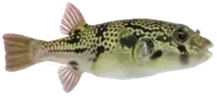
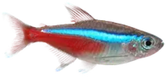

# reeftank-catalog

<!-- species:begin (generated by scripts/make_readme.py, do not edit) -->

> Part of the [**ReefTech Project Ecosystem**](https://elwinmage.github.io/reeftank/)

[](README.md) [](README.fr.md) [](README.de.md) [](README.es.md) [](README.it.md) [](README.nl.md) [](README.pl.md) [](README.pt.md)

Fish, coral, plant and invertebrate species for the aquarium view of [ha-reef-card](https://github.com/Elwinmage/ha-reef-card), served by the [ReefTank integration](https://github.com/Elwinmage/ha-reeftank-component).

The integration downloads the releases of this repository and keeps them up to date (`update.reeftank_catalog`, automatic by default): nothing to do on the Home Assistant side.

## How it works

Each fish is a sheet of frames (a WebP atlas) and a descriptor with its clips: *swim*, *idle* and *turn*. The card plays them one after the other, and mirrors the turn so that the fish comes back the way it came. Here is the swim, the turn and the turn back of two species:

<table><tr><td align="center"><br/><sub>Emperor angelfish</sub></td><td align="center"><br/><sub>Clownfish</sub></td></tr></table>

## Fish (102)

**HD**: a real animation, made from videos. The others have a simple animation made from a photo, or the generic fish.

| &nbsp;&nbsp;&nbsp;&nbsp;&nbsp;&nbsp;&nbsp;&nbsp;&nbsp;&nbsp;&nbsp;&nbsp;&nbsp;&nbsp;&nbsp;&nbsp;&nbsp;&nbsp;&nbsp;&nbsp;&nbsp;&nbsp;&nbsp;&nbsp;&nbsp;&nbsp;&nbsp;&nbsp;&nbsp;&nbsp;&nbsp;&nbsp;&nbsp;&nbsp;&nbsp;&nbsp;&nbsp;&nbsp;&nbsp; | <small>Name</small> | <small>Scientific name</small> | <small>Water</small> | <small>Size</small> | <small>Behaviour</small> | HD |
|---|---|---|---|---|---|---|
|  | <small>Angelfish<br>`pterophyllum_scalare`</small> | <small>*Pterophyllum scalare*</small> | <small>Freshwater</small> | <small>12–15 cm</small> | <small>Open-water cruiser · hides at night</small> |  |
|  | <small>Anthias<br>`pseudanthias`</small> | <small>*Pseudanthias sp.*</small> | <small>Marine</small> | <small>8–14 cm</small> | <small>Shoaling · hides at night</small> | ✔ |
|  | <small>Atlantic mudskipper<br>`periophthalmus_barbarus`</small> | <small>*Periophthalmus barbarus*</small> | <small>Brackish</small> | <small>10–15 cm</small> | <small>Bottom dweller · hides at night</small> |  |
|  | <small>Banded archerfish<br>`toxotes_jaculatrix`</small> | <small>*Toxotes jaculatrix*</small> | <small>Brackish</small> | <small>15–25 cm</small> | <small>Open-water cruiser · hides at night</small> |  |
|  | <small>Banded goby<br>`amblygobius_phalaena`</small> | <small>*Amblygobius phalaena*</small> | <small>Marine</small> | <small>8–10 cm</small> | <small>Lives on the sand · rests on the bottom at night</small> |  |
|  | <small>Banggai cardinalfish<br>`pterapogon_kauderni`</small> | <small>*Pterapogon kauderni*</small> | <small>Marine</small> | <small>5–8 cm</small> | <small>Hovers in place · hovers at night</small> | ✔ |
|  | <small>Bicolor angelfish<br>`centropyge_bicolor`</small> | <small>*Centropyge bicolor*</small> | <small>Marine</small> | <small>10–15 cm</small> | <small>Hovers in place · hovers at night</small> |  |
|  | <small>Bicolor blenny<br>`ecsenius_bicolor`</small> | <small>*Ecsenius bicolor*</small> | <small>Marine</small> | <small>8–10 cm</small> | <small>Bottom dweller · hides at night</small> |  |
|  | <small>Black skirt tetra<br>`gymnocorymbus_ternetzi`</small> | <small>*Gymnocorymbus ternetzi*</small> | <small>Freshwater</small> | <small>5–6 cm</small> | <small>Shoaling · hides at night</small> |  |
|  | <small>Blue-green chromis<br>`chromis_viridis`</small> | <small>*Chromis viridis*</small> | <small>Marine</small> | <small>5–8 cm</small> | <small>Shoaling · hides at night</small> | ✔ |
|  | <small>Bluestreak cleaner wrasse<br>`labroides_dimidiatus`</small> | <small>*Labroides dimidiatus*</small> | <small>Marine</small> | <small>10–12 cm</small> | <small>Open-water cruiser · hides at night</small> |  |
|  | <small>Bristlenose pleco<br>`ancistrus`</small> | <small>*Ancistrus sp.*</small> | <small>Freshwater</small> | <small>10–14 cm</small> | <small>Bottom dweller · hides at night</small> |  |
|  | <small>Bronze corydoras<br>`corydoras_aeneus`</small> | <small>*Corydoras aeneus*</small> | <small>Freshwater</small> | <small>6–7 cm</small> | <small>Bottom dweller · hides at night</small> |  |
|  | <small>Bumblebee goby<br>`brachygobius_xanthozonus`</small> | <small>*Brachygobius xanthozonus*</small> | <small>Brackish</small> | <small>3–4 cm</small> | <small>Bottom dweller · hides at night</small> |  |
|  | <small>Cardinal tetra<br>`paracheirodon_axelrodi`</small> | <small>*Paracheirodon axelrodi*</small> | <small>Freshwater</small> | <small>3–5 cm</small> | <small>Shoaling · hides at night</small> |  |
|  | <small>Celestial pearl danio<br>`danio_margaritatus`</small> | <small>*Danio margaritatus*</small> | <small>Freshwater</small> | <small>2–3 cm</small> | <small>Shoaling · hides at night</small> |  |
|  | <small>Cherry barb<br>`pethia_titteya`</small> | <small>*Pethia titteya*</small> | <small>Freshwater</small> | <small>4–5 cm</small> | <small>Shoaling · hides at night</small> |  |
|  | <small>Citron coral goby<br>`gobiodon_citrinus`</small> | <small>*Gobiodon citrinus*</small> | <small>Marine</small> | <small>3–5 cm</small> | <small>Bottom dweller · hides at night</small> |  |
|  | <small>Clown loach<br>`chromobotia_macracanthus`</small> | <small>*Chromobotia macracanthus*</small> | <small>Freshwater</small> | <small>15–30 cm</small> | <small>Bottom dweller · hides at night</small> |  |
|  | <small>Clownfish<br>`amphiprion`</small> | <small>*Amphiprion sp.*</small> | <small>Marine</small> | <small>7–11 cm</small> | <small>Hovers in place · hovers at night</small> | ✔ |
|  | <small>Cockatoo dwarf cichlid<br>`apistogramma_cacatuoides`</small> | <small>*Apistogramma cacatuoides*</small> | <small>Freshwater</small> | <small>5–9 cm</small> | <small>Bottom dweller · hides at night</small> |  |
|  | <small>Common molly<br>`poecilia_sphenops`</small> | <small>*Poecilia sphenops*</small> | <small>Freshwater, Brackish</small> | <small>6–10 cm</small> | <small>Shoaling · hides at night</small> |  |
|  | <small>Copperband butterflyfish<br>`chelmon_rostratus`</small> | <small>*Chelmon rostratus*</small> | <small>Marine</small> | <small>15–20 cm</small> | <small>Open-water cruiser · hides at night</small> |  |
|  | <small>Demasoni cichlid<br>`pseudotropheus_demasoni`</small> | <small>*Pseudotropheus demasoni*</small> | <small>Freshwater</small> | <small>7–8 cm</small> | <small>Open-water cruiser · hides at night</small> |  |
|  | <small>Discus<br>`symphysodon_aequifasciatus`</small> | <small>*Symphysodon aequifasciatus*</small> | <small>Freshwater</small> | <small>15–20 cm</small> | <small>Open-water cruiser · hides at night</small> |  |
|  | <small>Dwarf gourami<br>`trichogaster_lalius`</small> | <small>*Trichogaster lalius*</small> | <small>Freshwater</small> | <small>5–8 cm</small> | <small>Open-water cruiser · hides at night</small> |  |
|  | <small>Electric yellow cichlid<br>`labidochromis_caeruleus`</small> | <small>*Labidochromis caeruleus*</small> | <small>Freshwater</small> | <small>8–10 cm</small> | <small>Open-water cruiser · hides at night</small> |  |
|  | <small>Emperor angelfish (adult)<br>`pomacanthus_imperator_adult`</small> | <small>*Pomacanthus imperator*</small> | <small>Marine</small> | <small>25–38 cm</small> | <small>Open-water cruiser · hides at night</small> | ✔ |
|  | <small>Emperor angelfish (juvenile)<br>`pomacanthus_imperator`</small> | <small>*Pomacanthus imperator*</small> | <small>Marine</small> | <small>6–12 cm</small> | <small>Open-water cruiser · hides at night</small> | ✔ |
|  | <small>Emperor tetra<br>`nematobrycon_palmeri`</small> | <small>*Nematobrycon palmeri*</small> | <small>Freshwater</small> | <small>4–6 cm</small> | <small>Shoaling · hides at night</small> |  |
|  | <small>Endler's livebearer<br>`poecilia_wingei`</small> | <small>*Poecilia wingei*</small> | <small>Freshwater</small> | <small>2–4 cm</small> | <small>Shoaling · hides at night</small> |  |
|  | <small>Figure-eight puffer<br>`dichotomyctere_biocellatus`</small> | <small>*Dichotomyctere biocellatus*</small> | <small>Brackish</small> | <small>5–6.5 cm</small> | <small>Open-water cruiser · hides at night</small> |  |
|  | <small>Fiji devil damselfish<br>`chrysiptera_taupou`</small> | <small>*Chrysiptera taupou*</small> | <small>Marine</small> | <small>6–8 cm</small> | <small>Hovers in place · stays near its home · hovers at night</small> |  |
|  | <small>Firefish goby<br>`nemateleotris_magnifica`</small> | <small>*Nemateleotris magnifica*</small> | <small>Marine</small> | <small>8–10 cm</small> | <small>Hovers in place · hovers at night</small> |  |
|  | <small>Flame angelfish<br>`centropyge_loricula`</small> | <small>*Centropyge loricula*</small> | <small>Marine</small> | <small>8–10 cm</small> | <small>Hovers in place · hovers at night</small> |  |
|  | <small>Foxface rabbitfish<br>`siganus_vulpinus`</small> | <small>*Siganus vulpinus*</small> | <small>Marine</small> | <small>15–22 cm</small> | <small>Open-water cruiser · rests on the bottom at night</small> | ✔ |
|  | <small>Goldfish<br>`carassius_auratus`</small> | <small>*Carassius auratus*</small> | <small>Freshwater</small> | <small>10–25 cm</small> | <small>Open-water cruiser · hides at night</small> |  |
|  | <small>Green spotted puffer<br>`dichotomyctere_nigroviridis`</small> | <small>*Dichotomyctere nigroviridis*</small> | <small>Brackish</small> | <small>10–17 cm</small> | <small>Open-water cruiser · hides at night</small> |  |
|  | <small>Green swordtail<br>`xiphophorus_hellerii`</small> | <small>*Xiphophorus hellerii*</small> | <small>Freshwater</small> | <small>6–12 cm</small> | <small>Shoaling · hides at night</small> |  |
|  | <small>Guppy<br>`poecilia_reticulata`</small> | <small>*Poecilia reticulata*</small> | <small>Freshwater</small> | <small>3–6 cm</small> | <small>Shoaling · hides at night</small> |  |
|  | <small>Harlequin rasbora<br>`trigonostigma_heteromorpha`</small> | <small>*Trigonostigma heteromorpha*</small> | <small>Freshwater</small> | <small>3–4.5 cm</small> | <small>Shoaling · hides at night</small> |  |
|  | <small>Knight goby<br>`stigmatogobius_sadanundio`</small> | <small>*Stigmatogobius sadanundio*</small> | <small>Brackish</small> | <small>6–8 cm</small> | <small>Bottom dweller · hides at night</small> |  |
|  | <small>Kole tang<br>`ctenochaetus_strigosus`</small> | <small>*Ctenochaetus strigosus*</small> | <small>Marine</small> | <small>12–18 cm</small> | <small>Open-water cruiser · hides at night</small> |  |
|  | <small>Kribensis<br>`pelvicachromis_pulcher`</small> | <small>*Pelvicachromis pulcher*</small> | <small>Freshwater</small> | <small>8–10 cm</small> | <small>Bottom dweller · hides at night</small> |  |
|  | <small>Kuhli loach<br>`pangio_kuhlii`</small> | <small>*Pangio kuhlii*</small> | <small>Freshwater</small> | <small>8–12 cm</small> | <small>Bottom dweller · hides at night</small> |  |
|  | <small>Lawnmower blenny<br>`salarias_fasciatus`</small> | <small>*Salarias fasciatus*</small> | <small>Marine</small> | <small>12–14 cm</small> | <small>Bottom dweller · hides at night</small> |  |
|  | <small>Lemon tetra<br>`hyphessobrycon_pulchripinnis`</small> | <small>*Hyphessobrycon pulchripinnis*</small> | <small>Freshwater</small> | <small>3–4.5 cm</small> | <small>Shoaling · hides at night</small> |  |
|  | <small>Lined seahorse<br>`hippocampus_erectus`</small> | <small>*Hippocampus erectus*</small> | <small>Marine</small> | <small>10–15 cm</small> | <small>Hovers in place · hovers at night</small> |  |
|  | <small>Lyretail killifish<br>`aphyosemion_australe`</small> | <small>*Aphyosemion australe*</small> | <small>Freshwater</small> | <small>5–6 cm</small> | <small>Hovers in place · hovers at night</small> |  |
|  | <small>Mandarin dragonet<br>`synchiropus_splendidus`</small> | <small>*Synchiropus splendidus*</small> | <small>Marine</small> | <small>5–8 cm</small> | <small>Bottom dweller · hides at night</small> | ✔ |
|  | <small>Marbled hatchetfish<br>`carnegiella_strigata`</small> | <small>*Carnegiella strigata*</small> | <small>Freshwater</small> | <small>4–5 cm</small> | <small>Shoaling · hides at night</small> |  |
|  | <small>Maroon clownfish<br>`premnas_biaculeatus`</small> | <small>*Premnas biaculeatus*</small> | <small>Marine</small> | <small>10–15 cm</small> | <small>Hovers in place · hovers at night</small> |  |
|  | <small>Neon goby<br>`elacatinus_oceanops`</small> | <small>*Elacatinus oceanops*</small> | <small>Marine</small> | <small>4–6 cm</small> | <small>Bottom dweller · hides at night</small> |  |
|  | <small>Neon tetra<br>`paracheirodon_innesi`</small> | <small>*Paracheirodon innesi*</small> | <small>Freshwater</small> | <small>3–4 cm</small> | <small>Shoaling · hides at night</small> |  |
|  | <small>Okinawa goby<br>`gobiodon_okinawae`</small> | <small>*Gobiodon okinawae*</small> | <small>Marine</small> | <small>2.5–3.5 cm</small> | <small>Bottom dweller · hides at night</small> |  |
|  | <small>Orchid dottyback<br>`pseudochromis_fridmani`</small> | <small>*Pseudochromis fridmani*</small> | <small>Marine</small> | <small>6–7 cm</small> | <small>Hovers in place · stays near its home · hovers at night</small> |  |
|  | <small>Oscar<br>`astronotus_ocellatus`</small> | <small>*Astronotus ocellatus*</small> | <small>Freshwater</small> | <small>25–35 cm</small> | <small>Open-water cruiser · hides at night</small> |  |
|  | <small>Otocinclus<br>`otocinclus_affinis`</small> | <small>*Otocinclus affinis*</small> | <small>Freshwater</small> | <small>3–5 cm</small> | <small>Bottom dweller · hides at night</small> |  |
|  | <small>Pajama cardinalfish<br>`sphaeramia_nematoptera`</small> | <small>*Sphaeramia nematoptera*</small> | <small>Marine</small> | <small>8–10 cm</small> | <small>Hovers in place · hovers at night</small> |  |
|  | <small>Panda corydoras<br>`corydoras_panda`</small> | <small>*Corydoras panda*</small> | <small>Freshwater</small> | <small>4–5 cm</small> | <small>Bottom dweller · hides at night</small> |  |
|  | <small>Pearl danio<br>`danio_albolineatus`</small> | <small>*Danio albolineatus*</small> | <small>Freshwater</small> | <small>4–6 cm</small> | <small>Shoaling · hides at night</small> |  |
|  | <small>Pearl gourami<br>`trichopodus_leerii`</small> | <small>*Trichopodus leerii*</small> | <small>Freshwater</small> | <small>10–12 cm</small> | <small>Open-water cruiser · hides at night</small> |  |
|  | <small>Picasso triggerfish<br>`rhinecanthus_aculeatus`</small> | <small>*Rhinecanthus aculeatus*</small> | <small>Marine</small> | <small>20–25 cm</small> | <small>Open-water cruiser · hides at night</small> |  |
|  | <small>Pixy hawkfish<br>`cirrhitichthys_oxycephalus`</small> | <small>*Cirrhitichthys oxycephalus*</small> | <small>Marine</small> | <small>8–10 cm</small> | <small>Bottom dweller · hides at night</small> |  |
|  | <small>Powder blue tang<br>`acanthurus_leucosternon`</small> | <small>*Acanthurus leucosternon*</small> | <small>Marine</small> | <small>20–23 cm</small> | <small>Open-water cruiser · hides at night</small> |  |
|  | <small>Purple firefish<br>`nemateleotris_decora`</small> | <small>*Nemateleotris decora*</small> | <small>Marine</small> | <small>8–10 cm</small> | <small>Hovers in place · hovers at night</small> |  |
|  | <small>Ram cichlid<br>`mikrogeophagus_ramirezi`</small> | <small>*Mikrogeophagus ramirezi*</small> | <small>Freshwater</small> | <small>5–7 cm</small> | <small>Hovers in place · hovers at night</small> |  |
|  | <small>Red lionfish<br>`pterois_volitans`</small> | <small>*Pterois volitans*</small> | <small>Marine</small> | <small>25–35 cm</small> | <small>Open-water cruiser · hides at night</small> |  |
|  | <small>Regal angelfish<br>`pygoplites_diacanthus`</small> | <small>*Pygoplites diacanthus*</small> | <small>Marine</small> | <small>20–25 cm</small> | <small>Open-water cruiser · hides at night</small> |  |
|  | <small>Regal blue tang<br>`paracanthurus_hepatus`</small> | <small>*Paracanthurus hepatus*</small> | <small>Marine</small> | <small>20–30 cm</small> | <small>Open-water cruiser · hides at night</small> |  |
|  | <small>Royal gramma<br>`gramma_loreto`</small> | <small>*Gramma loreto*</small> | <small>Marine</small> | <small>7–8 cm</small> | <small>Hovers in place · hovers at night</small> |  |
|  | <small>Rummy-nose tetra<br>`hemigrammus_bleheri`</small> | <small>*Hemigrammus bleheri*</small> | <small>Freshwater</small> | <small>4–5 cm</small> | <small>Shoaling · hides at night</small> |  |
|  | <small>Sailfin molly<br>`poecilia_velifera`</small> | <small>*Poecilia velifera*</small> | <small>Brackish, Freshwater</small> | <small>10–15 cm</small> | <small>Shoaling · hides at night</small> |  |
|  | <small>Sailfin tang<br>`zebrasoma_veliferum`</small> | <small>*Zebrasoma veliferum*</small> | <small>Marine</small> | <small>25–40 cm</small> | <small>Open-water cruiser · hides at night</small> |  |
|  | <small>Scopas tang<br>`zebrasoma_scopas`</small> | <small>*Zebrasoma scopas*</small> | <small>Marine</small> | <small>15–20 cm</small> | <small>Open-water cruiser · hides at night</small> |  |
|  | <small>Serpae tetra<br>`hyphessobrycon_eques`</small> | <small>*Hyphessobrycon eques*</small> | <small>Freshwater</small> | <small>3–4.5 cm</small> | <small>Shoaling · hides at night</small> |  |
|  | <small>Siamese algae eater<br>`crossocheilus_oblongus`</small> | <small>*Crossocheilus oblongus*</small> | <small>Freshwater</small> | <small>10–15 cm</small> | <small>Open-water cruiser · hides at night</small> |  |
|  | <small>Siamese fighting fish<br>`betta_splendens`</small> | <small>*Betta splendens*</small> | <small>Freshwater</small> | <small>5–7 cm</small> | <small>Hovers in place · stays near its home · hovers at night</small> |  |
|  | <small>Silver moony<br>`monodactylus_argenteus`</small> | <small>*Monodactylus argenteus*</small> | <small>Brackish, Marine</small> | <small>15–25 cm</small> | <small>Shoaling · hides at night</small> |  |
|  | <small>Six line wrasse<br>`pseudocheilinus_hexataenia`</small> | <small>*Pseudocheilinus hexataenia*</small> | <small>Marine</small> | <small>7–10 cm</small> | <small>Open-water cruiser · hides at night</small> |  |
|  | <small>Sleeper goby<br>`valenciennea`</small> | <small>*Valenciennea sp.*</small> | <small>Marine</small> | <small>10–16 cm</small> | <small>Lives on the sand · lives in a burrow · rests on the bottom at night</small> | ✔ |
|  | <small>Solor fairy wrasse<br>`cirrhilabrus_solorensis`</small> | <small>*Cirrhilabrus solorensis*</small> | <small>Marine</small> | <small>10–12 cm</small> | <small>Open-water cruiser · hides at night</small> |  |
|  | <small>Southern platyfish<br>`xiphophorus_maculatus`</small> | <small>*Xiphophorus maculatus*</small> | <small>Freshwater</small> | <small>4–6 cm</small> | <small>Shoaling · hides at night</small> |  |
|  | <small>Spotted mandarin<br>`synchiropus_picturatus`</small> | <small>*Synchiropus picturatus*</small> | <small>Marine</small> | <small>6–8 cm</small> | <small>Bottom dweller · hides at night</small> |  |
|  | <small>Spotted scat<br>`scatophagus_argus`</small> | <small>*Scatophagus argus*</small> | <small>Brackish, Marine</small> | <small>15–30 cm</small> | <small>Open-water cruiser · hides at night</small> |  |
|  | <small>Three-spot gourami<br>`trichopodus_trichopterus`</small> | <small>*Trichopodus trichopterus*</small> | <small>Freshwater</small> | <small>10–15 cm</small> | <small>Open-water cruiser · hides at night</small> |  |
|  | <small>Threespot dascyllus<br>`dascyllus_trimaculatus`</small> | <small>*Dascyllus trimaculatus*</small> | <small>Marine</small> | <small>10–14 cm</small> | <small>Hovers in place · hovers at night</small> |  |
|  | <small>Tiger barb<br>`puntigrus_tetrazona`</small> | <small>*Puntigrus tetrazona*</small> | <small>Freshwater</small> | <small>5–7 cm</small> | <small>Shoaling · hides at night</small> |  |
|  | <small>Turquoise rainbowfish<br>`melanotaenia_lacustris`</small> | <small>*Melanotaenia lacustris*</small> | <small>Freshwater</small> | <small>8–12 cm</small> | <small>Shoaling · hides at night</small> |  |
|  | <small>Valentini puffer<br>`canthigaster_valentini`</small> | <small>*Canthigaster valentini*</small> | <small>Marine</small> | <small>8–10 cm</small> | <small>Open-water cruiser · hides at night</small> |  |
|  | <small>Violet goby<br>`gobioides_broussonnetii`</small> | <small>*Gobioides broussonnetii*</small> | <small>Brackish</small> | <small>30–50 cm</small> | <small>Lives on the sand · lives in a burrow · rests on the bottom at night</small> |  |
|  | <small>White cloud mountain minnow<br>`tanichthys_albonubes`</small> | <small>*Tanichthys albonubes*</small> | <small>Freshwater</small> | <small>3–4 cm</small> | <small>Shoaling · hides at night</small> |  |
|  | <small>Yasha goby<br>`stonogobiops_yasha`</small> | <small>*Stonogobiops yasha*</small> | <small>Marine</small> | <small>6–8 cm</small> | <small>Lives on the sand · lives in a burrow · rests on the bottom at night</small> |  |
|  | <small>Yellow coris wrasse<br>`halichoeres_chrysus`</small> | <small>*Halichoeres chrysus*</small> | <small>Marine</small> | <small>10–12 cm</small> | <small>Open-water cruiser · rests on the bottom at night</small> |  |
|  | <small>Yellow prawn-goby<br>`cryptocentrus_cinctus`</small> | <small>*Cryptocentrus cinctus*</small> | <small>Marine</small> | <small>8–10 cm</small> | <small>Lives on the sand · lives in a burrow · rests on the bottom at night</small> |  |
|  | <small>Yellow tang<br>`zebrasoma_flavescens`</small> | <small>*Zebrasoma flavescens*</small> | <small>Marine</small> | <small>15–20 cm</small> | <small>Open-water cruiser · hides at night</small> |  |
|  | <small>Yellow-striped cardinalfish<br>`ostorhinchus_cyanosoma`</small> | <small>*Ostorhinchus cyanosoma*</small> | <small>Marine</small> | <small>7–8 cm</small> | <small>Hovers in place · hovers at night</small> |  |
|  | <small>Yellowhead jawfish<br>`opistognathus_aurifrons`</small> | <small>*Opistognathus aurifrons*</small> | <small>Marine</small> | <small>10–12 cm</small> | <small>Lives on the sand · lives in a burrow · rests on the bottom at night</small> |  |
|  | <small>Yellowtail blue damselfish<br>`chrysiptera_parasema`</small> | <small>*Chrysiptera parasema*</small> | <small>Marine</small> | <small>5–6 cm</small> | <small>Hovers in place · stays near its home · hovers at night</small> |  |
|  | <small>Zebra lionfish<br>`dendrochirus_zebra`</small> | <small>*Dendrochirus zebra*</small> | <small>Marine</small> | <small>12–18 cm</small> | <small>Open-water cruiser · hides at night</small> |  |
|  | <small>Zebra pleco<br>`hypancistrus_zebra`</small> | <small>*Hypancistrus zebra*</small> | <small>Freshwater</small> | <small>7–10 cm</small> | <small>Bottom dweller · hides at night</small> |  |
|  | <small>Zebrafish<br>`danio_rerio`</small> | <small>*Danio rerio*</small> | <small>Freshwater</small> | <small>4–5 cm</small> | <small>Shoaling · hides at night</small> |  |

## Corals (1)

| &nbsp;&nbsp;&nbsp;&nbsp;&nbsp;&nbsp;&nbsp;&nbsp;&nbsp;&nbsp;&nbsp;&nbsp;&nbsp;&nbsp;&nbsp;&nbsp;&nbsp;&nbsp;&nbsp;&nbsp;&nbsp;&nbsp;&nbsp;&nbsp;&nbsp;&nbsp;&nbsp;&nbsp;&nbsp;&nbsp;&nbsp;&nbsp;&nbsp;&nbsp;&nbsp;&nbsp;&nbsp;&nbsp;&nbsp; | <small>Name</small> | <small>Scientific name</small> | <small>Water</small> | <small>Size</small> |
|---|---|---|---|---|
|  | <small>Torch coral<br>`euphyllia_glabrescens`</small> | <small>*Euphyllia glabrescens*</small> | <small>Marine</small> | <small>10–30 cm</small> |

## Plants (29)

| &nbsp;&nbsp;&nbsp;&nbsp;&nbsp;&nbsp;&nbsp;&nbsp;&nbsp;&nbsp;&nbsp;&nbsp;&nbsp;&nbsp;&nbsp;&nbsp;&nbsp;&nbsp;&nbsp;&nbsp;&nbsp;&nbsp;&nbsp;&nbsp;&nbsp;&nbsp;&nbsp;&nbsp;&nbsp;&nbsp;&nbsp;&nbsp;&nbsp;&nbsp;&nbsp;&nbsp;&nbsp;&nbsp;&nbsp; | <small>Name</small> | <small>Scientific name</small> | <small>Water</small> | <small>Size</small> | <small>Zone</small> |
|---|---|---|---|---|---|
|  | <small>Amazon frogbit<br>`limnobium_laevigatum`</small> | <small>*Limnobium laevigatum*</small> | <small>Freshwater</small> | <small>5–10 cm</small> | <small>Floating</small> |
|  | <small>Amazon sword<br>`echinodorus_bleheri`</small> | <small>*Echinodorus bleheri*</small> | <small>Freshwater</small> | <small>30–50 cm</small> | <small>Midground</small> |
|  | <small>Ambulia<br>`limnophila_sessiliflora`</small> | <small>*Limnophila sessiliflora*</small> | <small>Freshwater</small> | <small>20–40 cm</small> | <small>Background</small> |
|  | <small>Anubias<br>`anubias_barteri`</small> | <small>*Anubias barteri*</small> | <small>Freshwater</small> | <small>10–25 cm</small> | <small>Epiphyte</small> |
|  | <small>Brazilian waterweed<br>`egeria_densa`</small> | <small>*Egeria densa*</small> | <small>Freshwater</small> | <small>30–100 cm</small> | <small>Background</small> |
|  | <small>Bucephalandra<br>`bucephalandra`</small> | <small>*Bucephalandra sp.*</small> | <small>Freshwater</small> | <small>5–15 cm</small> | <small>Epiphyte</small> |
|  | <small>Carolina fanwort<br>`cabomba_caroliniana`</small> | <small>*Cabomba caroliniana*</small> | <small>Freshwater</small> | <small>30–60 cm</small> | <small>Background</small> |
|  | <small>Caulerpa<br>`caulerpa_prolifera`</small> | <small>*Caulerpa prolifera*</small> | <small>Marine</small> | <small>5–20 cm</small> | <small>Foreground</small> |
|  | <small>Chaeto<br>`chaetomorpha_linum`</small> | <small>*Chaetomorpha linum*</small> | <small>Marine</small> | <small>5–30 cm</small> | <small>Foreground</small> |
|  | <small>Ciliated cryptocoryne<br>`cryptocoryne_ciliata`</small> | <small>*Cryptocoryne ciliata*</small> | <small>Brackish, Freshwater</small> | <small>20–40 cm</small> | <small>Midground</small> |
|  | <small>Creeping primrose willow<br>`ludwigia_repens`</small> | <small>*Ludwigia repens*</small> | <small>Freshwater</small> | <small>20–40 cm</small> | <small>Midground</small> |
|  | <small>Duckweed<br>`lemna_minor`</small> | <small>*Lemna minor*</small> | <small>Freshwater</small> | <small>0.5–1 cm</small> | <small>Floating</small> |
|  | <small>Dwarf baby tears<br>`hemianthus_callitrichoides`</small> | <small>*Hemianthus callitrichoides*</small> | <small>Freshwater</small> | <small>2–5 cm</small> | <small>Foreground</small> |
|  | <small>Dwarf cryptocoryne<br>`cryptocoryne_parva`</small> | <small>*Cryptocoryne parva*</small> | <small>Freshwater</small> | <small>5–8 cm</small> | <small>Foreground</small> |
|  | <small>Dwarf hairgrass<br>`eleocharis_parvula`</small> | <small>*Eleocharis parvula*</small> | <small>Freshwater</small> | <small>5–10 cm</small> | <small>Foreground</small> |
|  | <small>Dwarf sagittaria<br>`sagittaria_subulata`</small> | <small>*Sagittaria subulata*</small> | <small>Freshwater</small> | <small>10–30 cm</small> | <small>Foreground</small> |
|  | <small>Eelgrass<br>`vallisneria_spiralis`</small> | <small>*Vallisneria spiralis*</small> | <small>Freshwater, Brackish</small> | <small>30–60 cm</small> | <small>Background</small> |
|  | <small>Halimeda<br>`halimeda_opuntia`</small> | <small>*Halimeda opuntia*</small> | <small>Marine</small> | <small>5–15 cm</small> | <small>Foreground</small> |
|  | <small>Indian swampweed<br>`hygrophila_polysperma`</small> | <small>*Hygrophila polysperma*</small> | <small>Freshwater</small> | <small>20–50 cm</small> | <small>Background</small> |
|  | <small>Java fern<br>`microsorum_pteropus`</small> | <small>*Microsorum pteropus*</small> | <small>Freshwater</small> | <small>20–30 cm</small> | <small>Epiphyte</small> |
|  | <small>Java moss<br>`vesicularia_dubyana`</small> | <small>*Vesicularia dubyana*</small> | <small>Freshwater</small> | <small>3–5 cm</small> | <small>Epiphyte</small> |
|  | <small>Marimo moss ball<br>`aegagropila_linnaei`</small> | <small>*Aegagropila linnaei*</small> | <small>Freshwater</small> | <small>3–10 cm</small> | <small>Foreground</small> |
|  | <small>Mud mudwort<br>`glossostigma_elatinoides`</small> | <small>*Glossostigma elatinoides*</small> | <small>Freshwater</small> | <small>2–5 cm</small> | <small>Foreground</small> |
|  | <small>Red mangrove<br>`rhizophora_mangle`</small> | <small>*Rhizophora mangle*</small> | <small>Brackish, Marine</small> | <small>30–100 cm</small> | <small>Midground</small> |
|  | <small>Roundleaf toothcup<br>`rotala_rotundifolia`</small> | <small>*Rotala rotundifolia*</small> | <small>Freshwater</small> | <small>20–50 cm</small> | <small>Background</small> |
|  | <small>Staurogyne<br>`staurogyne_repens`</small> | <small>*Staurogyne repens*</small> | <small>Freshwater</small> | <small>5–10 cm</small> | <small>Foreground</small> |
|  | <small>Turtle grass<br>`thalassia_testudinum`</small> | <small>*Thalassia testudinum*</small> | <small>Marine</small> | <small>10–30 cm</small> | <small>Foreground</small> |
|  | <small>Water lettuce<br>`pistia_stratiotes`</small> | <small>*Pistia stratiotes*</small> | <small>Freshwater</small> | <small>5–15 cm</small> | <small>Floating</small> |
|  | <small>Wendt's cryptocoryne<br>`cryptocoryne_wendtii`</small> | <small>*Cryptocoryne wendtii*</small> | <small>Freshwater</small> | <small>10–20 cm</small> | <small>Midground</small> |

## Invertebrates (32)

| &nbsp;&nbsp;&nbsp;&nbsp;&nbsp;&nbsp;&nbsp;&nbsp;&nbsp;&nbsp;&nbsp;&nbsp;&nbsp;&nbsp;&nbsp;&nbsp;&nbsp;&nbsp;&nbsp;&nbsp;&nbsp;&nbsp;&nbsp;&nbsp;&nbsp;&nbsp;&nbsp;&nbsp;&nbsp;&nbsp;&nbsp;&nbsp;&nbsp;&nbsp;&nbsp;&nbsp;&nbsp;&nbsp;&nbsp; | <small>Name</small> | <small>Scientific name</small> | <small>Water</small> | <small>Size</small> | <small>Role</small> |
|---|---|---|---|---|---|
|  | <small>Amano shrimp<br>`caridina_multidentata`</small> | <small>*Caridina multidentata*</small> | <small>Freshwater</small> | <small>3–5 cm</small> | <small>Algae eater · crawls on the bottom</small> |
|  | <small>Assassin snail<br>`clea_helena`</small> | <small>*Clea helena*</small> | <small>Freshwater</small> | <small>2–3 cm</small> | <small>Predator · crawls on the bottom</small> |
|  | <small>Astraea snail<br>`astraea_tecta`</small> | <small>*Astraea tecta*</small> | <small>Marine</small> | <small>2–4 cm</small> | <small>Algae eater · lives on the decor</small> |
|  | <small>Bamboo shrimp<br>`atyopsis_moluccensis`</small> | <small>*Atyopsis moluccensis*</small> | <small>Freshwater</small> | <small>6–8 cm</small> | <small>Filter feeder · lives on the decor</small> |
|  | <small>Banded coral shrimp<br>`stenopus_hispidus`</small> | <small>*Stenopus hispidus*</small> | <small>Marine</small> | <small>6–8 cm</small> | <small>Cleaner · lives on the decor</small> |
|  | <small>Blue-legged hermit crab<br>`clibanarius_tricolor`</small> | <small>*Clibanarius tricolor*</small> | <small>Marine</small> | <small>2–3 cm</small> | <small>Scavenger · crawls on the bottom</small> |
|  | <small>Boring giant clam<br>`tridacna_crocea`</small> | <small>*Tridacna crocea*</small> | <small>Marine</small> | <small>5–15 cm</small> | <small>Filter feeder · sessile</small> |
|  | <small>Cerith snail<br>`cerithium`</small> | <small>*Cerithium sp.*</small> | <small>Marine</small> | <small>2–3 cm</small> | <small>Detritivore · crawls on the bottom</small> |
|  | <small>Cherry shrimp<br>`neocaridina_davidi`</small> | <small>*Neocaridina davidi*</small> | <small>Freshwater</small> | <small>2–3.5 cm</small> | <small>Detritivore · crawls on the bottom</small> |
|  | <small>Christmas tree worm<br>`spirobranchus_giganteus`</small> | <small>*Spirobranchus giganteus*</small> | <small>Marine</small> | <small>3–5 cm</small> | <small>Filter feeder · sessile</small> |
|  | <small>Collector urchin<br>`tripneustes_gratilla`</small> | <small>*Tripneustes gratilla*</small> | <small>Marine</small> | <small>10–15 cm</small> | <small>Algae eater · lives on the decor</small> |
|  | <small>Crystal red shrimp<br>`caridina_cantonensis`</small> | <small>*Caridina cantonensis*</small> | <small>Freshwater</small> | <small>2–3 cm</small> | <small>Detritivore · crawls on the bottom</small> |
|  | <small>Emerald crab<br>`mithraculus_sculptus`</small> | <small>*Mithraculus sculptus*</small> | <small>Marine</small> | <small>3–4 cm</small> | <small>Algae eater · lives on the decor</small> |
|  | <small>Feather duster worm<br>`sabellastarte`</small> | <small>*Sabellastarte sp.*</small> | <small>Marine</small> | <small>5–10 cm</small> | <small>Filter feeder · sessile</small> |
|  | <small>Fire shrimp<br>`lysmata_debelius`</small> | <small>*Lysmata debelius*</small> | <small>Marine</small> | <small>5–6 cm</small> | <small>Cleaner · lives on the decor</small> |
|  | <small>Harlequin shrimp<br>`hymenocera_picta`</small> | <small>*Hymenocera picta*</small> | <small>Marine</small> | <small>4–6 cm</small> | <small>Predator · crawls on the bottom</small> |
|  | <small>Malaysian trumpet snail<br>`melanoides_tuberculata`</small> | <small>*Melanoides tuberculata*</small> | <small>Freshwater</small> | <small>2–3 cm</small> | <small>Detritivore · crawls on the bottom</small> |
|  | <small>Marbled shrimp<br>`saron_marmoratus`</small> | <small>*Saron marmoratus*</small> | <small>Marine</small> | <small>5–7 cm</small> | <small>Scavenger · lives on the decor</small> |
|  | <small>Marine nerite<br>`nerita`</small> | <small>*Nerita sp.*</small> | <small>Marine</small> | <small>2–3 cm</small> | <small>Algae eater · climbs the glass</small> |
|  | <small>Mystery snail<br>`pomacea_bridgesii`</small> | <small>*Pomacea bridgesii*</small> | <small>Freshwater</small> | <small>4–5 cm</small> | <small>Scavenger · crawls on the bottom</small> |
|  | <small>Nassarius snail<br>`nassarius`</small> | <small>*Nassarius sp.*</small> | <small>Marine</small> | <small>2–4 cm</small> | <small>Scavenger · crawls on the bottom</small> |
|  | <small>Pencil urchin<br>`prionocidaris_baculosa`</small> | <small>*Prionocidaris baculosa*</small> | <small>Marine</small> | <small>8–10 cm</small> | <small>Algae eater · lives on the decor</small> |
|  | <small>Peppermint shrimp<br>`lysmata_wurdemanni`</small> | <small>*Lysmata wurdemanni*</small> | <small>Marine</small> | <small>3–5 cm</small> | <small>Cleaner · lives on the decor</small> |
|  | <small>Ramshorn snail<br>`planorbella_duryi`</small> | <small>*Planorbella duryi*</small> | <small>Freshwater</small> | <small>2–3 cm</small> | <small>Detritivore · climbs the glass</small> |
|  | <small>Sand-sifting starfish<br>`archaster_typicus`</small> | <small>*Archaster typicus*</small> | <small>Marine</small> | <small>6–10 cm</small> | <small>Detritivore · crawls on the bottom</small> |
|  | <small>Scarlet cleaner shrimp<br>`lysmata_amboinensis`</small> | <small>*Lysmata amboinensis*</small> | <small>Marine</small> | <small>5–6 cm</small> | <small>Cleaner · lives on the decor</small> |
|  | <small>Scarlet reef hermit<br>`paguristes_cadenati`</small> | <small>*Paguristes cadenati*</small> | <small>Marine</small> | <small>3–4 cm</small> | <small>Scavenger · crawls on the bottom</small> |
|  | <small>Sea cucumber<br>`holothuria`</small> | <small>*Holothuria sp.*</small> | <small>Marine</small> | <small>15–30 cm</small> | <small>Detritivore · crawls on the bottom</small> |
|  | <small>Serpent star<br>`ophiolepis_superba`</small> | <small>*Ophiolepis superba*</small> | <small>Marine</small> | <small>8–12 cm</small> | <small>Scavenger · crawls on the bottom</small> |
|  | <small>Trochus snail<br>`tectus_fenestratus`</small> | <small>*Tectus fenestratus*</small> | <small>Marine</small> | <small>4–6 cm</small> | <small>Algae eater · lives on the decor</small> |
|  | <small>Turbo snail<br>`turbo_fluctuosus`</small> | <small>*Turbo fluctuosus*</small> | <small>Marine</small> | <small>4–8 cm</small> | <small>Algae eater · climbs the glass</small> |
|  | <small>Zebra nerite<br>`neritina_natalensis`</small> | <small>*Neritina natalensis*</small> | <small>Freshwater</small> | <small>2–3 cm</small> | <small>Algae eater · climbs the glass</small> |

Species assets are under **CC BY 4.0**, scripts under MIT: see [LICENSE.md](LICENSE.md).

<!-- species:end -->

---

<!-- ecosystem:start -->

## Related projects

The ReefTech projects fit together: the integrations bring your equipment into Home Assistant, the card displays and drives it, and the backup keeps it running through an outage. Each one also works on its own.

<p align="center"><a href="https://elwinmage.github.io/reeftank/"></a></p>

<table>
  <tr>
    <th width="100px"></th>
    <th>Project</th>
    <th>What it does</th>
    <th>Works with</th>
  </tr>
  <tr>
    <td></td>
    <td>🐠<br /><a href="https://github.com/Elwinmage/ha-reefbeat-component"><b>ha-reefbeat-component</b></a></td>
    <td>Red Sea ReefBeat devices, controlled locally with no cloud: ReefATO+, ReefControl, ReefControl-Power, ReefDose, ReefLed, ReefMat, ReefRun and ReefWave.<br />alert blueprint for abnormal modes, calibrations and low battery. <a href="https://my.home-assistant.io/redirect/blueprint_import/?blueprint_url=https://raw.githubusercontent.com/Elwinmage/ha-reefbeat-component/refs/heads/main/blueprints/automation/redsea_alerts.en.yaml"></a></td>
    <td>ha-reef-card</td>
  </tr>
  <tr>
    <td></td>
    <td>🌊<br /><a href="https://github.com/Elwinmage/ha-aquamedic-component"><b>ha-aquamedic-component</b></a></td>
    <td>Aqua Medic pumps through the Gizwits cloud API: EcoDrift and SmartDrift wavemakers, DC Runner return and skimmer pumps.</td>
    <td>ha-reef-card</td>
  </tr>
  <tr>
    <td></td>
    <td>🐟<br /><a href="https://github.com/Elwinmage/ha-vson-component"><b>ha-vson-component</b></a></td>
    <td>VSON automatic fish feeders through the VSON cloud API: the WP8621 feeder (feed now, battery, low-food alert), plus generic detection of any other VSON device. The WP8621 can also run fully local on ESPHome.</td>
    <td>ha-reef-card</td>
  </tr>
  <tr>
    <td></td>
    <td>🐙<br /><a href="https://github.com/Elwinmage/ha-reef-maintenance-component"><b>ha-reef-maintenance-component</b></a></td>
    <td>Cleaning and wear tracking for the equipment Home Assistant cannot talk to: flow pumps, return pumps, skimmers, media reactors, anything you service by hand.</td>
    <td>ha-reef-card</td>
  </tr>
  <tr>
    <td></td>
    <td>🪸<br /><a href="https://github.com/Elwinmage/ha-reef-card"><b>ha-reef-card</b></a></td>
    <td>Interactive graphical view of each device on your dashboard, and the only way to edit advanced schedules. Reads the three integrations above through the shared <code>reef_role</code> contract, with no card-side configuration. Also draws the power flows of reefbeatEnergyBackup. Its aquarium card brings your tank to life with ha-reeftank-component.</td>
    <td>all four integrations, and ha-reeftank-component for the aquarium</td>
  </tr>
  <tr>
    <td></td>
    <td>🐟<br /><a href="https://github.com/Elwinmage/ha-reeftank-component"><b>ha-reeftank-component</b></a></td>
    <td>A living picture of your tank on the dashboard: your photo, lit by your real lamps, with animated fish and corals, and your devices and entities on it. Stores the aquariums and their livestock, records the feedings.</td>
    <td>ha-reef-card</td>
  </tr>
  <tr>
    <td></td>
    <td>🐡<br /><b>reeftank-catalog</b><br /><i>(this repository)</i></td>
    <td>Fish, corals and textures of the aquarium card, downloaded and kept up to date by ha-reeftank-component.</td>
    <td>ha-reeftank-component</td>
  </tr>
  <tr>
    <td></td>
    <td>🐬<br /><a href="https://github.com/Elwinmage/ha-reef-blueprints"><b>ha-reef-blueprints</b></a></td>
    <td>Automation blueprints shared by the whole ecosystem: overdue maintenance found through the <code>reef_role</code> contract, devices that went unreachable, a periodic heater test and a relay watch. Eight languages.</td>
    <td>all four integrations</td>
  </tr>
  <tr>
    <td></td>
    <td>⚡<br /><a href="https://github.com/Elwinmage/reefbeatEnergyBackup"><b>reefbeatEnergyBackup</b></a></td>
    <td>Battery backup for power outages. A 24V LiFePO₄ pack driven by a Raspberry Pi, with pump speed degraded progressively according to the state of charge.</td>
    <td>standalone, or alongside ha-reefbeat-component and ha-reef-card</td>
  </tr>
</table>

All of them are documented together on the [ReefTech project page](https://elwinmage.github.io/reeftank/).

<!-- ecosystem:end -->

## Contents

```
fish/<id>/
  species.json        # descriptor: clips, size, behaviour, names
  <id>.webp           # atlas: every frame of every clip
  thumb.webp          # 96x64 picture for the editor's lists
corals/<id>/
  species.json
  <id>.shade.webp     # brightness
  <id>.mask.png       # palette weights
  thumb.webp          # in the default colours
scripts/
  build_atlas.py      # clips -> atlas + descriptor + thumbnail
  validate.py         # checks every entry
  make_release.py     # archives + manifest of a release
```

Only `species.json`, `.webp` and `.png` files are shipped: a recipe or notes
kept in a species folder stay in the repository.

## Adding a species

### 1. Generate the clips

With an image-to-video model (Kling, Wan, Veo…), from **one reference
picture** of the fish: strict profile, head to the right, flat magenta
background (`#FF00FF`; chroma green `#00FF00` for pink or purple fish),
neutral white light. For each clip, impose the first and last frames:

| Clip | First frame | Last frame | Duration |
|---|---|---|---|
| `swim` | reference | reference | ~4 s |
| `idle` (optional) | reference | reference | 3–4 s |
| `turn` (optional) | reference | reference mirrored left-right | 4–5 s |

Turn off any "loop" option of the tool: it often makes forward-then-backward
clips. Mirror the reference yourself (any picture editor), do not ask the model
for a left-facing fish.

<details>
<summary>Prompt: swim</summary>

```
Side view of a single [SPECIES] swimming in place, as if on a treadmill,
for a looping game sprite.

Subject
- Exactly one fish, adult, natural colors and patterns, anatomically accurate
  fins and tail.
- Strict lateral (profile) view, head pointing to the RIGHT, body parallel to
  the image plane. No rotation, no turning toward the camera.
- Active cruising swim: clear side-to-side sweeps of the caudal fin
  (about 2 full beats per second), the rear half of the body flexing slightly
  with each beat, pectoral fins sculling. The fish keeps the same position
  and size in the frame, as if swimming against a current.
- The whole fish (including the tail at full swing and every fin) stays inside
  the frame, with a margin of at least 15% on every side.

Background and lighting
- Perfectly flat, uniform magenta (#FF00FF) background, filling the whole
  frame. No gradient, no texture, no vignette.
- No water, no bubbles, no particles, no plants, no rocks, no sand.
- Neutral white studio lighting, soft and even, as for a product photo.
  True colors: no blue or green color cast, no underwater haze,
  no caustics, no light rays.
- No shadow and no reflection on the background. The fish casts nothing.
- No magenta (#FF00FF) tint on the fish edges.

Camera
- Fixed camera: no zoom, no pan, no shake, no depth of field change.
- Orthographic-like framing, the fish in sharp focus from head to tail.
- No motion blur.

Animation
- The clip must loop seamlessly: the last frame matches the first one.
- Duration: 4 seconds.

Output
- Highest available resolution, landscape framing with the fish filling about
  70% of the width.
- No text, no watermark, no logo, no frame border.
```
</details>

<details>
<summary>Prompt: idle</summary>

Same as `swim`, with:

```
Side view of a single [SPECIES] hovering in place, almost motionless,
for a looping game sprite (idle animation).

- Idle hovering: the fish stays still in the water, holding its position.
  The pectoral fins scull gently and continuously, the dorsal and anal fins
  ripple slightly, the tail barely moves (small, slow corrections only).
  Subtle breathing: gill covers and mouth open and close slowly.
- No forward swimming motion, no strong tail beat, no drifting.
  The body stays in the same place, same size, same height, centered.

Animation
- Calm, slow, continuous motion, always moving forward in time: never played
  in reverse, no back-and-forth playback.
- The clip must loop seamlessly: the last frame matches the first one.
- Duration: 3 to 4 seconds, two or three slow fin-sculling cycles.
```
</details>

<details>
<summary>Prompt: turn</summary>

Same as `swim`, with:

```
Animation
- Starts exactly on the first frame: the fish in strict profile, head to the
  RIGHT, swimming in place.
- After about one second, the fish makes one smooth 180° turn in place:
  it bends its body and swings its head toward the camera, passes through a
  front three-quarter view, and ends in strict profile with the head to the
  LEFT.
- The turn itself lasts about one second. The fish stays at the same
  position, same size and same height in the frame during the whole turn.
- After the turn, the fish keeps swimming in place, head to the LEFT, and the
  clip ends exactly on the last frame.
- Play once. No loop, no reverse playback.
```
</details>

Negative prompt, when the tool takes one:

```
multiple fish, turning, head toward camera, camera movement, zoom,
underwater scene, blue tint, haze, caustics, bubbles, particles, shadow,
reflection, gradient background, motion blur, depth of field, cropped fins,
cropped tail, text, watermark
```

(remove `turning, head toward camera` for the turn clip).

### 2. Describe the species

Next to the clips, a `meta.json` merged into the descriptor:

```json
{
  "scientific": "Siganus vulpinus",
  "size_cm": [15, 22],
  "behavior": {
    "profile": "cruiser",
    "band": [0.15, 0.75],
    "depth": [0.2, 0.8],
    "speed_cm_s": [4, 10],
    "turn_rate": 2.0
  },
  "night": "rest_bottom",
  "feeding_response": 1.0,
  "names": {"en": "Foxface rabbitfish", "fr": "Poisson-lapin à tête de renard"}
}
```

| Field | Meaning |
|---|---|
| `scientific` | Latin name, `Genus species`; `Genus sp.` when the entry stands for a whole genus (`Amphiprion sp.`) |
| `size_cm` | adult length range, cm (an inventory line may give its own) |
| `behavior.profile` | `shoal` (school), `cruiser` (open water, long paths), `benthic` (bottom and decor, stops), `hover` (around a spot), `sand` (on the sand line: gobies at their burrow, starfish) |
| `behavior.band` | height in the tank, 0 surface … 1 bottom |
| `behavior.depth` | 0 front glass … 1 back |
| `behavior.speed_cm_s` | cruising speed range |
| `behavior.turn_rate` | how fast it turns, radians per second |
| `behavior.territory_cm` | optional: the species stays within this distance of its home (a burrow, a host anemone), placed per inventory line in the editor, else picked at random |
| `behavior.burrow` | optional, `true`: lives in a burrow in the sand at its home (watchman gobies, sleeper gobies): in it at night, mostly only its head out during the day, sometimes out around it, sometimes back in; out for the food |
| `behavior.shoal` | `cohesion` (1), `alignment` (0.8), `separation` (1.2) for a school |
| `night` | `hide` (behind the decor), `hover`, `rest_bottom` |
| `feeding_response` | 0 ignores the food … 1 rushes to it |
| `names` | display names by language |

### Editing the descriptions of the catalog

Once a species is in the catalog, its `species.json` is the reference: a
rebuild keeps its names, size, behaviour and palette (the `meta.json` of the
clips only seeds a new species). To edit them all at once, or to hand them
over (translations, behaviour):

```bash
python scripts/species_meta.py export                 # -> species-meta.tgz
# edit fish/<id>/meta.json, corals/<id>/meta.json (null = to fill)
python scripts/species_meta.py import species-meta.tgz --dry-run   # what would change
python scripts/species_meta.py import species-meta.tgz
python scripts/validate.py
```

The export holds only the hand written fields (no picture, no clip), with
every field shown, `null` when unknown, and the 8 languages of the names.
On import, the fields given replace the current ones (names and behaviour
key by key); `null` or missing fields leave the current value, and the built
fields (clips, atlas, frame…) are never touched.

`validate.py` (so pre-commit, and the release) refuses a species not fully
described: names in the 8 languages, scientific name, size, and for a fish the behaviour
(profile, band, depth, speed, turn rate), night mode and feeding response,
for a coral its palette. It checks the values too (profile, night mode,
ranges, palette colours).

### 3. Build

Tools, once, in a virtual environment (so that numpy and scipy match):

```bash
python3 -m venv ~/.venvs/atlas
~/.venvs/atlas/bin/pip install -r requirements.txt
# and ffmpeg (with ffprobe) from your system
```

Clips stay on your computer, one folder per species named after its id:

```
~/clips/
  siganus_vulpinus/  swim.mp4  idle.mp4  turn.mp4  meta.json
  pseudanthias_squamipinnis/  swim.mp4  turn.mp4  meta.json
```

```bash
~/.venvs/atlas/bin/python scripts/build_atlas.py batch ~/clips --out fish
```

For each folder the clips are analysed:

- **swim**: the best seamless loop of 1–3 s, leaving out the pauses of the
  tail;
- **idle**: a forward-then-backward clip is cut in half and played as a
  ping-pong, otherwise a 2–4 s loop; kept at 12 fps, at most 72 frames;
- **turn**: the frames where the fish actually turns (from the reference to
  its mirror), sped up to about 1.2 s;
- clips that do not start or end on the reference picture are reported.

The choices are written to `<id>.json` next to the clips (a recipe), then the
atlas is built: the fish is cut out of the key colour (soft edges, the key
seen through translucent fins turned into transparency, specks dropped), every
clip is brought to one scale (192 px for the fish length), and a thumbnail is
written. A recipe is reused on the next run, so hand edits stay
(`--reanalyse` rewrites them). One species alone:

```bash
python scripts/build_atlas.py fish siganus_vulpinus --auto ~/clips/siganus_vulpinus --out fish
```

Then **look at the atlas** (`fish/<id>/<id>.webp`): a clip gone wrong (a fin
melting, a second fish) is not detected.

<details>
<summary>By hand</summary>

`loops` lists the seamless loops of a clip and detects ping-pong clips:

```bash
python scripts/build_atlas.py loops ~/clips/siganus_vulpinus/swim.mp4
```

A recipe:

```json
{
  "length": 192,
  "clips": {
    "swim": {"source": "swim.mp4", "fps": 24, "mode": "loop", "range": [118, 153]},
    "idle": {"source": "idle.mp4", "fps": 12, "mode": "pingpong", "range": [0, 146], "step": 2},
    "turn": {"source": "turn.mp4", "fps": 24, "mode": "once", "range": [85, 202], "step": 4}
  },
  "meta": {"size_cm": [15, 22]}
}
```

```bash
python scripts/build_atlas.py fish siganus_vulpinus --recipe ~/clips/siganus_vulpinus/siganus_vulpinus.json --out fish
```

or `--clip name=source[:fps[:mode[:from-to[:step]]]]` on the command line
(mode `loop`, `once` or `pingpong`). Options: `--key '#00ff00'` (key colour;
found on the frame borders by default), `--length 160` (lighter atlas),
`--hd` (double resolution atlas too).
</details>

Corals: a coral clip is painted with its zones in **pure red, green and
blue** (any shading), grey parts taking the fourth colour; the script splits
it into the shade and mask atlases, and the card recolours them with the
palette of each coral (`palette` in `meta.json`):

```bash
python scripts/build_atlas.py coral euphyllia_glabrescens \
    --clip day=~/clips/euphyllia/day.mp4 --clip close=~/clips/euphyllia/close.mp4 \
    --meta ~/clips/euphyllia/meta.json --out corals
```

### 4. Check and publish

```bash
python scripts/validate.py
python scripts/make_readme.py      # species tables of the READMEs
git add fish/<id> README*.md && git commit -m "Add <id>" && git push
```

`make_readme.py` writes the species tables (thumbnail, name, scientific
name, size, behaviour) into `README.md`, between its two `species` markers,
and writes `README.<lang>.md` for the other languages, entirely generated.
Names and behaviour come from the `species.json` files: never edit the
generated parts by hand. pre-commit runs it too, and stops the commit when it
changed a README, so that you add the updated files.

A pull request that only adds a species folder (the editor makes those) does not
need the READMEs: they are not checked on pull requests, and the `README lists`
workflow refreshes them on `main` after each merge (its push needs the branch rules
of `main` to let `github-actions[bot]` push, or to be bypassed by it).

Then run the **Release** workflow (*Actions → Release → Run workflow*) with
the new version (`2026.10.0`, `2026.10.1`…). It checks the catalog, builds
one archive per species and the manifest, and publishes the release: every
Home Assistant with automatic updates installs it within 12 hours.

## Textures

Views can hide their photo and draw their decor instead: water, sand below
the sand line, and the decor outlines filled with a rock texture. Textures
live in `textures/<id>/`:

```
textures/live_rock/
  texture.json     # {"kind": "texture", "role": "rock", "image": "live_rock.webp",
                   #  "scale_cm": 30, "names": {"en": "Live rock"}}
  live_rock.webp   # tileable, 1024x1024 (2048 at most)
```

`role` is `rock` or `sand`; `scale_cm` is the tank length the picture
covers, so the grains keep their size whatever the tank. Without any
texture, the card draws built-in ones.

Prompts (neutral light: the card tints them with the LEDs):

```
Seamless tileable texture of aquarium live rock, macro photograph, flat orthographic
view straight at the surface. Porous aragonite rock with small holes and cavities,
patches of pink and purple coralline algae, a few tiny green algae spots, natural
beige-grey base color. Soft, even, neutral white lighting, no directional light,
no cast shadows, no specular highlights, no vignetting. No fish, no coral, no water,
no sand, no text. Uniform detail density across the whole image so it tiles without
visible seams. Square, 1024x1024.
```

```
Seamless tileable texture of reef aquarium aragonite sand, top-down macro photograph.
Fine to medium white-cream grains with a few small shell fragments and occasional
darker grains, slightly uneven surface. Soft, even, neutral white lighting, no
shadows, no highlights, no vignetting. No rocks, no animals, no text. Uniform
detail density across the whole image so it tiles without visible seams.
Square, 1024x1024.
```

Convert to WebP (`cwebp -q 85 rock.png -o live_rock.webp`), write the
`texture.json`, check with `scripts/validate.py`.

## Release format

Read by the integration (`custom_components/reeftank/pack.py`):

```json
{
  "format": 1,
  "version": "2026.10.0",
  "min_integration": "0.1.0",
  "notes": "## 2026.10.0\n\n**Added**: Foxface rabbitfish (`siganus_vulpinus`)",
  "entries": {
    "fish/siganus_vulpinus": {
      "version": "2026.10.0",
      "sha256": "…",
      "size": 830000,
      "file": "fish-siganus_vulpinus.zip"
    }
  }
}
```

- One zip per entry, flat (species.json and its pictures). Archives are
  reproducible: an unchanged species keeps its sha256 and its version, and
  is not downloaded again.
- `min_integration`: older integrations do not install the release (raise it
  when the descriptors use something new).
- The integration reads `…/releases/latest/download/manifest.json`: publish
  releases as *latest*, not as pre-releases.

## Development

```bash
pip install -r requirements.test.txt
pre-commit install          # checks before every commit
pre-commit run --all-files  # the same, on demand
```

### Photos of a whole lot of species

`scripts/generate_stills.py` makes the degraded atlas of every fish (or plant, with `--section plants`) that has no
atlas yet: it asks the photo from Google Gemini (the prompt of
`prompts/still_photo.json`), checks it, builds the atlas and writes it, with its
`source`, next to the `species.json`. A species that already has an atlas is left
alone, so the script can be stopped and started again.

```bash
export GEMINI_API_KEY=...
python scripts/generate_stills.py --dry-run               # the species it would do
python scripts/generate_stills.py --limit 5 --photos photos/
python scripts/generate_stills.py                         # the whole lot
python scripts/generate_stills.py --from-photos photos/   # the atlases of the photos kept, no request
```

The plants have their own prompt, `prompts/still_plant.json`, worded after the
growth form of the plant (stem plant, rosette, ribbon leaves, carpet, floating,
epiphyte, moss, alga…): one clean specimen on a flat magenta (green for the red
plants) background, no roots, no pot. `scripts/plant_prompt.py <id>` prints the
prompt of a plant. The picture becomes a one-frame atlas (clip `still`) standing on
the bottom of a square frame, with its thumbnail, shown in the README tables:

```bash
python scripts/generate_stills.py --section plants --dry-run
python scripts/generate_stills.py --section plants --photos photos-plants/
python scripts/generate_stills.py --section plants --only egeria_densa --redo
python scripts/plant_atlas.py photo.png plants/egeria_densa --source ai-generated --model gemini-2.5-flash-image
```

`--photos` keeps the photos received (the refused ones too) to look at them; they
are not committed. A refused photo is asked again, on the other background colour.
`--from-photos` builds the atlases from the photos kept by an earlier run (the refused ones are checked again), without key nor request. The run stops when the key is refused or the quota is reached: start it again later.

Before each commit, pre-commit:

- refuses video files (source clips stay on your computer) and files over
  4 MB;
- checks JSON and YAML, line endings and trailing spaces;
- lints and formats the scripts (ruff);
- checks every species (`scripts/validate.py`);
- updates the species tables of the READMEs (`scripts/make_readme.py`; on GitHub, the
  `README lists` workflow does it after a merge, not the checks of a pull request);
- runs the tests, with 100 % coverage of the scripts.

Its hooks install their own environment (Pillow, numpy, scipy): no conflict
with the Python packages of the system. The same checks run on GitHub for
every push.
