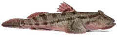
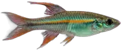
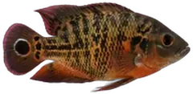
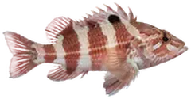
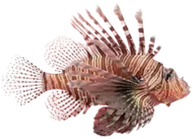
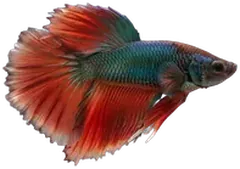

# reeftank-catalog

<!-- species:begin (generated by scripts/make_readme.py, do not edit) -->

> Onderdeel van het [**ReefTech-projectecosysteem**](https://elwinmage.github.io/reeftank/)

       

Vissen-, koraal-, planten- en ongewervelde soorten voor de aquariumweergave van [ha-reef-card](https://github.com/Elwinmage/ha-reef-card), geleverd door de [ReefTank-integratie](https://github.com/Elwinmage/ha-reeftank-component).

De integratie downloadt de releases van deze repository en houdt ze up-to-date (`update.reeftank_catalog`, standaard automatisch): niets te doen in Home Assistant.

## Hoe het werkt

Elke vis is een blad met beelden (een WebP-atlas) en een descriptor met zijn clips: *zwemmen*, *stilstaan* en *keren*. De kaart speelt ze achter elkaar af en spiegelt de keer, zodat de vis terugkeert langs dezelfde weg. Hier het zwemmen, de keer en de terugkeer van twee soorten:

Een soort zonder video's krijgt een eenvoudiger atlas, gemaakt van één foto (*LD*): het hele lichaam golft, de vinnen bewegen niet. Die gemaakt van video's zijn aangevinkt in de kolom HD van de tabellen hieronder.

<table><tr><th></th><th>Keizersvlinderbaars</th><th>Clownvis</th></tr><tr><td>HD (video's)</td><td align="center"></td><td align="center"></td></tr><tr><td>LD (één foto)</td><td align="center"></td><td align="center"></td></tr></table>

## Vissen (102)

**HD**: een echte animatie, gemaakt van video's. De andere hebben een eenvoudige animatie van een foto, of de generieke vis.

| &nbsp;&nbsp;&nbsp;&nbsp;&nbsp;&nbsp;&nbsp;&nbsp;&nbsp;&nbsp;&nbsp;&nbsp;&nbsp;&nbsp;&nbsp;&nbsp;&nbsp;&nbsp;&nbsp;&nbsp;&nbsp;&nbsp;&nbsp;&nbsp;&nbsp;&nbsp;&nbsp;&nbsp;&nbsp;&nbsp;&nbsp;&nbsp;&nbsp; | Naam | Wetenschappelijke naam | Water | Grootte | Gedrag | HD |
|---|---|---|---|---|---|---|
|  | Achtvormige kogelvis <code>dichotomyctere&#95;<wbr>biocellatus</code> | *Dichotomyctere biocellatus* | Brakwater | 5–6.5 cm | Openwaterzwemmer · verstopt zich 's nachts | ✔ |
|  | Ancistrus <code>ancistrus</code> | *Ancistrus sp.* | Zoetwater | 10–14 cm | Bodembewoner · verstopt zich 's nachts | ✔ |
|  | Anemoonvis <code>amphiprion</code> | *Amphiprion sp.* | Zeewater | 7–11 cm | Blijft op zijn plek · zweeft 's nachts | ✔ |
|  | Anthias <code>pseudanthias</code> | *Pseudanthias sp.* | Zeewater | 8–14 cm | Scholenvis · verstopt zich 's nachts | ✔ |
|  | Atlantische slikspringer <code>periophthalmus&#95;<wbr>barbarus</code> | *Periophthalmus barbarus* | Brakwater | 10–15 cm | Bodembewoner · verstopt zich 's nachts | ✔ |
|  | Banggai-kardinaalbaars <code>pterapogon&#95;<wbr>kauderni</code> | *Pterapogon kauderni* | Zeewater | 5–8 cm | Blijft op zijn plek · zweeft 's nachts | ✔ |
|  | Blauwe doktersvis <code>paracanthurus&#95;<wbr>hepatus</code> | *Paracanthurus hepatus* | Zeewater | 20–30 cm | Openwaterzwemmer · verstopt zich 's nachts | ✔ |
|  | Blauwe goerami <code>trichopodus&#95;<wbr>trichopterus</code> | *Trichopodus trichopterus* | Zoetwater | 10–15 cm | Openwaterzwemmer · verstopt zich 's nachts | ✔ |
|  | Blauwstreep-poetsvis <code>labroides&#95;<wbr>dimidiatus</code> | *Labroides dimidiatus* | Zeewater | 10–12 cm | Openwaterzwemmer · verstopt zich 's nachts | ✔ |
|  | Bronzen pantserwels <code>corydoras&#95;<wbr>aeneus</code> | *Corydoras aeneus* | Zoetwater | 6–7 cm | Bodembewoner · verstopt zich 's nachts | ✔ |
|  | Bruine doktersvis <code>zebrasoma&#95;<wbr>scopas</code> | *Zebrasoma scopas* | Zeewater | 15–20 cm | Openwaterzwemmer · verstopt zich 's nachts | ✔ |
|  | Citroen-koraalgrondel <code>gobiodon&#95;<wbr>citrinus</code> | *Gobiodon citrinus* | Zeewater | 3–5 cm | Bodembewoner · verstopt zich 's nachts | ✔ |
|  | Citroentetra <code>hyphessobrycon&#95;<wbr>pulchripinnis</code> | *Hyphessobrycon pulchripinnis* | Zoetwater | 3–4.5 cm | Scholenvis · verstopt zich 's nachts | ✔ |
|  | Clownbotia <code>chromobotia&#95;<wbr>macracanthus</code> | *Chromobotia macracanthus* | Zoetwater | 15–30 cm | Bodembewoner · verstopt zich 's nachts | ✔ |
|  | Demasoni-cichlide <code>pseudotropheus&#95;<wbr>demasoni</code> | *Pseudotropheus demasoni* | Zoetwater | 7–8 cm | Openwaterzwemmer · verstopt zich 's nachts | ✔ |
|  | Discus <code>symphysodon&#95;<wbr>aequifasciatus</code> | *Symphysodon aequifasciatus* | Zoetwater | 15–20 cm | Openwaterzwemmer · verstopt zich 's nachts | ✔ |
|  | Driestippel-dascyllus <code>dascyllus&#95;<wbr>trimaculatus</code> | *Dascyllus trimaculatus* | Zeewater | 10–14 cm | Blijft op zijn plek · zweeft 's nachts | ✔ |
|  | Dwerggoerami <code>trichogaster&#95;<wbr>lalius</code> | *Trichogaster lalius* | Zoetwater | 5–8 cm | Openwaterzwemmer · verstopt zich 's nachts | ✔ |
|  | Elektrisch gele cichlide <code>labidochromis&#95;<wbr>caeruleus</code> | *Labidochromis caeruleus* | Zoetwater | 8–10 cm | Openwaterzwemmer · verstopt zich 's nachts | ✔ |
|  | Endlers guppy <code>poecilia&#95;<wbr>wingei</code> | *Poecilia wingei* | Zoetwater | 2–4 cm | Scholenvis · verstopt zich 's nachts | ✔ |
|  | Fiji-juffertje <code>chrysiptera&#95;<wbr>taupou</code> | *Chrysiptera taupou* | Zeewater | 6–8 cm | Blijft op zijn plek · blijft bij zijn schuilplaats · zweeft 's nachts | ✔ |
|  | Galaxy-danio <code>danio&#95;<wbr>margaritatus</code> | *Danio margaritatus* | Zoetwater | 2–3 cm | Scholenvis · verstopt zich 's nachts | ✔ |
|  | Gebandeerde grondel <code>amblygobius&#95;<wbr>phalaena</code> | *Amblygobius phalaena* | Zeewater | 8–10 cm | Leeft op het zand · rust 's nachts op de bodem | ✔ |
|  | Gebandeerde schietvis <code>toxotes&#95;<wbr>jaculatrix</code> | *Toxotes jaculatrix* | Brakwater | 15–25 cm | Openwaterzwemmer · verstopt zich 's nachts | ✔ |
|  | Geelgestreepte kardinaalbaars <code>ostorhinchus&#95;<wbr>cyanosoma</code> | *Ostorhinchus cyanosoma* | Zeewater | 7–8 cm | Blijft op zijn plek · zweeft 's nachts | ✔ |
|  | Geelkop-kaakvis <code>opistognathus&#95;<wbr>aurifrons</code> | *Opistognathus aurifrons* | Zeewater | 10–12 cm | Leeft op het zand · leeft in een hol · rust 's nachts op de bodem | ✔ |
|  | Geelstaartjuffertje <code>chrysiptera&#95;<wbr>parasema</code> | *Chrysiptera parasema* | Zeewater | 5–6 cm | Blijft op zijn plek · blijft bij zijn schuilplaats · zweeft 's nachts | ✔ |
|  | Gele doktersvis <code>zebrasoma&#95;<wbr>flavescens</code> | *Zebrasoma flavescens* | Zeewater | 15–20 cm | Openwaterzwemmer · verstopt zich 's nachts | ✔ |
|  | Gele lipvis <code>halichoeres&#95;<wbr>chrysus</code> | *Halichoeres chrysus* | Zeewater | 10–12 cm | Openwaterzwemmer · rust 's nachts op de bodem | ✔ |
|  | Gele symbiosegrondel <code>cryptocentrus&#95;<wbr>cinctus</code> | *Cryptocentrus cinctus* | Zeewater | 8–10 cm | Leeft op het zand · leeft in een hol · rust 's nachts op de bodem | ✔ |
|  | Gemarmerde bijlvis <code>carnegiella&#95;<wbr>strigata</code> | *Carnegiella strigata* | Zoetwater | 4–5 cm | Scholenvis · verstopt zich 's nachts | ✔ |
|  | Gestreept zeepaardje <code>hippocampus&#95;<wbr>erectus</code> | *Hippocampus erectus* | Zeewater | 10–15 cm | Blijft op zijn plek · zweeft 's nachts | ✔ |
|  | Gewone molly <code>poecilia&#95;<wbr>sphenops</code> | *Poecilia sphenops* | Zoetwater, Brakwater | 6–10 cm | Scholenvis · verstopt zich 's nachts | ✔ |
|  | Goudvis <code>carassius&#95;<wbr>auratus</code> | *Carassius auratus* | Zoetwater | 10–25 cm | Openwaterzwemmer · verstopt zich 's nachts | ✔ |
|  | Grasmaaier-slijmvis <code>salarias&#95;<wbr>fasciatus</code> | *Salarias fasciatus* | Zeewater | 12–14 cm | Bodembewoner · verstopt zich 's nachts | ✔ |
|  | Groene chromis <code>chromis&#95;<wbr>viridis</code> | *Chromis viridis* | Zeewater | 5–8 cm | Scholenvis · verstopt zich 's nachts | ✔ |
|  | Groene kogelvis <code>dichotomyctere&#95;<wbr>nigroviridis</code> | *Dichotomyctere nigroviridis* | Brakwater | 10–17 cm | Openwaterzwemmer · verstopt zich 's nachts | ✔ |
|  | Guppy <code>poecilia&#95;<wbr>reticulata</code> | *Poecilia reticulata* | Zoetwater | 3–6 cm | Scholenvis · verstopt zich 's nachts | ✔ |
|  | Harlekijnbarbeel <code>trigonostigma&#95;<wbr>heteromorpha</code> | *Trigonostigma heteromorpha* | Zoetwater | 3–4.5 cm | Scholenvis · verstopt zich 's nachts | ✔ |
|  | Hommelgrondel <code>brachygobius&#95;<wbr>xanthozonus</code> | *Brachygobius xanthozonus* | Brakwater | 3–4 cm | Bodembewoner · verstopt zich 's nachts | ✔ |
|  | Kaketoe-dwergcichlide <code>apistogramma&#95;<wbr>cacatuoides</code> | *Apistogramma cacatuoides* | Zoetwater | 5–9 cm | Bodembewoner · verstopt zich 's nachts | ✔ |
|  | Kardinaaltetra <code>paracheirodon&#95;<wbr>axelrodi</code> | *Paracheirodon axelrodi* | Zoetwater | 3–5 cm | Scholenvis · verstopt zich 's nachts | ✔ |
|  | Kastanjebruine anemoonvis <code>premnas&#95;<wbr>biaculeatus</code> | *Premnas biaculeatus* | Zeewater | 10–15 cm | Blijft op zijn plek · zweeft 's nachts | ✔ |
|  | Keizer-engelvis (juveniel) <code>pomacanthus&#95;<wbr>imperator</code> | *Pomacanthus imperator* | Zeewater | 6–12 cm | Openwaterzwemmer · verstopt zich 's nachts | ✔ |
|  | Keizer-engelvis (volwassen) <code>pomacanthus&#95;<wbr>imperator&#95;<wbr>adult</code> | *Pomacanthus imperator* | Zeewater | 25–38 cm | Openwaterzwemmer · verstopt zich 's nachts | ✔ |
|  | Keizertetra <code>nematobrycon&#95;<wbr>palmeri</code> | *Nematobrycon palmeri* | Zoetwater | 4–6 cm | Scholenvis · verstopt zich 's nachts | ✔ |
|  | Kersenbarbeel <code>pethia&#95;<wbr>titteya</code> | *Pethia titteya* | Zoetwater | 4–5 cm | Scholenvis · verstopt zich 's nachts | ✔ |
|  | Kole-doktersvis <code>ctenochaetus&#95;<wbr>strigosus</code> | *Ctenochaetus strigosus* | Zeewater | 12–18 cm | Openwaterzwemmer · verstopt zich 's nachts | ✔ |
|  | Koningsgramma <code>gramma&#95;<wbr>loreto</code> | *Gramma loreto* | Zeewater | 7–8 cm | Blijft op zijn plek · zweeft 's nachts | ✔ |
|  | Koninklijke keizersvis <code>pygoplites&#95;<wbr>diacanthus</code> | *Pygoplites diacanthus* | Zeewater | 20–25 cm | Openwaterzwemmer · verstopt zich 's nachts | ✔ |
|  | Koperband-vlindervis <code>chelmon&#95;<wbr>rostratus</code> | *Chelmon rostratus* | Zeewater | 15–20 cm | Openwaterzwemmer · verstopt zich 's nachts | ✔ |
|  | Kribensis <code>pelvicachromis&#95;<wbr>pulcher</code> | *Pelvicachromis pulcher* | Zoetwater | 8–10 cm | Bodembewoner · verstopt zich 's nachts | ✔ |
|  | Kuhli-modderkruiper <code>pangio&#95;<wbr>kuhlii</code> | *Pangio kuhlii* | Zoetwater | 8–12 cm | Bodembewoner · verstopt zich 's nachts | ✔ |
|  | Lierstaartkilli <code>aphyosemion&#95;<wbr>australe</code> | *Aphyosemion australe* | Zoetwater | 5–6 cm | Blijft op zijn plek · zweeft 's nachts | ✔ |
|  | Mandarijnvis <code>synchiropus&#95;<wbr>splendidus</code> | *Synchiropus splendidus* | Zeewater | 5–8 cm | Bodembewoner · verstopt zich 's nachts | ✔ |
|  | Neongrondel <code>elacatinus&#95;<wbr>oceanops</code> | *Elacatinus oceanops* | Zeewater | 4–6 cm | Bodembewoner · verstopt zich 's nachts | ✔ |
|  | Neontetra <code>paracheirodon&#95;<wbr>innesi</code> | *Paracheirodon innesi* | Zoetwater | 3–4 cm | Scholenvis · verstopt zich 's nachts | ✔ |
|  | Okinawa-koraalgrondel <code>gobiodon&#95;<wbr>okinawae</code> | *Gobiodon okinawae* | Zeewater | 2.5–3.5 cm | Bodembewoner · verstopt zich 's nachts | ✔ |
|  | Orchideedwergbaars <code>pseudochromis&#95;<wbr>fridmani</code> | *Pseudochromis fridmani* | Zeewater | 6–7 cm | Blijft op zijn plek · blijft bij zijn schuilplaats · zweeft 's nachts | ✔ |
|  | Oscar <code>astronotus&#95;<wbr>ocellatus</code> | *Astronotus ocellatus* | Zoetwater | 25–35 cm | Openwaterzwemmer · verstopt zich 's nachts | ✔ |
|  | Otocinclus <code>otocinclus&#95;<wbr>affinis</code> | *Otocinclus affinis* | Zoetwater | 3–5 cm | Bodembewoner · verstopt zich 's nachts | ✔ |
|  | Panda-pantserwels <code>corydoras&#95;<wbr>panda</code> | *Corydoras panda* | Zoetwater | 4–5 cm | Bodembewoner · verstopt zich 's nachts | ✔ |
|  | Parel-danio <code>danio&#95;<wbr>albolineatus</code> | *Danio albolineatus* | Zoetwater | 4–6 cm | Scholenvis · verstopt zich 's nachts | ✔ |
|  | Parelgoerami <code>trichopodus&#95;<wbr>leerii</code> | *Trichopodus leerii* | Zoetwater | 10–12 cm | Openwaterzwemmer · verstopt zich 's nachts | ✔ |
|  | Picasso-trekkervis <code>rhinecanthus&#95;<wbr>aculeatus</code> | *Rhinecanthus aculeatus* | Zeewater | 20–25 cm | Openwaterzwemmer · verstopt zich 's nachts | ✔ |
|  | Pixie-valkvis <code>cirrhitichthys&#95;<wbr>oxycephalus</code> | *Cirrhitichthys oxycephalus* | Zeewater | 8–10 cm | Bodembewoner · verstopt zich 's nachts | ✔ |
|  | Platy <code>xiphophorus&#95;<wbr>maculatus</code> | *Xiphophorus maculatus* | Zoetwater | 4–6 cm | Scholenvis · verstopt zich 's nachts | ✔ |
|  | Poederblauwe doktersvis <code>acanthurus&#95;<wbr>leucosternon</code> | *Acanthurus leucosternon* | Zeewater | 20–23 cm | Openwaterzwemmer · verstopt zich 's nachts | ✔ |
|  | Psychedelische mandarijnvis <code>synchiropus&#95;<wbr>picturatus</code> | *Synchiropus picturatus* | Zeewater | 6–8 cm | Bodembewoner · verstopt zich 's nachts | ✔ |
|  | Purperen vuurvis <code>nemateleotris&#95;<wbr>decora</code> | *Nemateleotris decora* | Zeewater | 8–10 cm | Blijft op zijn plek · zweeft 's nachts | ✔ |
|  | Pyjama-kardinaalbaars <code>sphaeramia&#95;<wbr>nematoptera</code> | *Sphaeramia nematoptera* | Zeewater | 8–10 cm | Blijft op zijn plek · zweeft 's nachts | ✔ |
|  | Ramirezi <code>mikrogeophagus&#95;<wbr>ramirezi</code> | *Mikrogeophagus ramirezi* | Zoetwater | 5–7 cm | Blijft op zijn plek · zweeft 's nachts | ✔ |
|  | Ridder-grondel <code>stigmatogobius&#95;<wbr>sadanundio</code> | *Stigmatogobius sadanundio* | Brakwater | 6–8 cm | Bodembewoner · verstopt zich 's nachts | ✔ |
|  | Rode leeuwenvis <code>pterois&#95;<wbr>volitans</code> | *Pterois volitans* | Zeewater | 25–35 cm | Openwaterzwemmer · verstopt zich 's nachts | ✔ |
|  | Roodneus-tetra <code>hemigrammus&#95;<wbr>bleheri</code> | *Hemigrammus bleheri* | Zoetwater | 4–5 cm | Scholenvis · verstopt zich 's nachts | ✔ |
|  | Rouwtetra <code>gymnocorymbus&#95;<wbr>ternetzi</code> | *Gymnocorymbus ternetzi* | Zoetwater | 5–6 cm | Scholenvis · verstopt zich 's nachts | ✔ |
|  | Scat <code>scatophagus&#95;<wbr>argus</code> | *Scatophagus argus* | Brakwater, Zeewater | 15–30 cm | Openwaterzwemmer · verstopt zich 's nachts | ✔ |
|  | Serpae-tetra <code>hyphessobrycon&#95;<wbr>eques</code> | *Hyphessobrycon eques* | Zoetwater | 3–4.5 cm | Scholenvis · verstopt zich 's nachts | ✔ |
|  | Siamese algeneter <code>crossocheilus&#95;<wbr>oblongus</code> | *Crossocheilus oblongus* | Zoetwater | 10–15 cm | Openwaterzwemmer · verstopt zich 's nachts | ✔ |
|  | Siamese kempvis <code>betta&#95;<wbr>splendens</code> | *Betta splendens* | Zoetwater | 5–7 cm | Blijft op zijn plek · blijft bij zijn schuilplaats · zweeft 's nachts | ✔ |
|  | Skalaar <code>pterophyllum&#95;<wbr>scalare</code> | *Pterophyllum scalare* | Zoetwater | 12–15 cm | Openwaterzwemmer · verstopt zich 's nachts | ✔ |
|  | Slaapgrondel <code>valenciennea</code> | *Valenciennea sp.* | Zeewater | 10–16 cm | Leeft op het zand · leeft in een hol · rust 's nachts op de bodem | ✔ |
|  | Solor-feeënlipvis <code>cirrhilabrus&#95;<wbr>solorensis</code> | *Cirrhilabrus solorensis* | Zeewater | 10–12 cm | Openwaterzwemmer · verstopt zich 's nachts | ✔ |
|  | Sumatraanse barbeel <code>puntigrus&#95;<wbr>tetrazona</code> | *Puntigrus tetrazona* | Zoetwater | 5–7 cm | Scholenvis · verstopt zich 's nachts | ✔ |
|  | Turquoise regenboogvis <code>melanotaenia&#95;<wbr>lacustris</code> | *Melanotaenia lacustris* | Zoetwater | 8–12 cm | Scholenvis · verstopt zich 's nachts | ✔ |
|  | Tweekleurige dwergkeizersvis <code>centropyge&#95;<wbr>bicolor</code> | *Centropyge bicolor* | Zeewater | 10–15 cm | Blijft op zijn plek · zweeft 's nachts | ✔ |
|  | Tweekleurige slijmvis <code>ecsenius&#95;<wbr>bicolor</code> | *Ecsenius bicolor* | Zeewater | 8–10 cm | Bodembewoner · verstopt zich 's nachts | ✔ |
|  | Valentins kogelvis <code>canthigaster&#95;<wbr>valentini</code> | *Canthigaster valentini* | Zeewater | 8–10 cm | Openwaterzwemmer · verstopt zich 's nachts | ✔ |
|  | Violette grondel <code>gobioides&#95;<wbr>broussonnetii</code> | *Gobioides broussonnetii* | Brakwater | 30–50 cm | Leeft op het zand · leeft in een hol · rust 's nachts op de bodem | ✔ |
|  | Vlammen-dwergkeizersvis <code>centropyge&#95;<wbr>loricula</code> | *Centropyge loricula* | Zeewater | 8–10 cm | Blijft op zijn plek · zweeft 's nachts | ✔ |
|  | Vossengezicht konijnvis <code>siganus&#95;<wbr>vulpinus</code> | *Siganus vulpinus* | Zeewater | 15–22 cm | Openwaterzwemmer · rust 's nachts op de bodem | ✔ |
|  | Vuurvis <code>nemateleotris&#95;<wbr>magnifica</code> | *Nemateleotris magnifica* | Zeewater | 8–10 cm | Blijft op zijn plek · zweeft 's nachts | ✔ |
|  | Witte wolkenvis <code>tanichthys&#95;<wbr>albonubes</code> | *Tanichthys albonubes* | Zoetwater | 3–4 cm | Scholenvis · verstopt zich 's nachts | ✔ |
|  | Yasha-symbiosegrondel <code>stonogobiops&#95;<wbr>yasha</code> | *Stonogobiops yasha* | Zeewater | 6–8 cm | Leeft op het zand · leeft in een hol · rust 's nachts op de bodem | ✔ |
|  | Zebra-harnasmeerval <code>hypancistrus&#95;<wbr>zebra</code> | *Hypancistrus zebra* | Zoetwater | 7–10 cm | Bodembewoner · verstopt zich 's nachts | ✔ |
|  | Zebra-leeuwenvis <code>dendrochirus&#95;<wbr>zebra</code> | *Dendrochirus zebra* | Zeewater | 12–18 cm | Openwaterzwemmer · verstopt zich 's nachts | ✔ |
|  | Zebravisje <code>danio&#95;<wbr>rerio</code> | *Danio rerio* | Zoetwater | 4–5 cm | Scholenvis · verstopt zich 's nachts | ✔ |
|  | Zeil-doktersvis <code>zebrasoma&#95;<wbr>veliferum</code> | *Zebrasoma veliferum* | Zeewater | 25–40 cm | Openwaterzwemmer · verstopt zich 's nachts | ✔ |
|  | Zeilvin-molly <code>poecilia&#95;<wbr>velifera</code> | *Poecilia velifera* | Brakwater, Zoetwater | 10–15 cm | Scholenvis · verstopt zich 's nachts | ✔ |
|  | Zesstrepen-lipvis <code>pseudocheilinus&#95;<wbr>hexataenia</code> | *Pseudocheilinus hexataenia* | Zeewater | 7–10 cm | Openwaterzwemmer · verstopt zich 's nachts | ✔ |
|  | Zilveren maanvis <code>monodactylus&#95;<wbr>argenteus</code> | *Monodactylus argenteus* | Brakwater, Zeewater | 15–25 cm | Scholenvis · verstopt zich 's nachts | ✔ |
|  | Zwaarddrager <code>xiphophorus&#95;<wbr>hellerii</code> | *Xiphophorus hellerii* | Zoetwater | 6–12 cm | Scholenvis · verstopt zich 's nachts | ✔ |

## Koralen (1)

| &nbsp;&nbsp;&nbsp;&nbsp;&nbsp;&nbsp;&nbsp;&nbsp;&nbsp;&nbsp;&nbsp;&nbsp;&nbsp;&nbsp;&nbsp;&nbsp;&nbsp;&nbsp;&nbsp;&nbsp;&nbsp;&nbsp;&nbsp;&nbsp;&nbsp;&nbsp;&nbsp;&nbsp;&nbsp;&nbsp;&nbsp;&nbsp;&nbsp; | Naam | Wetenschappelijke naam | Water | Grootte |
|---|---|---|---|---|
|  | Fakkelkoraal <code>euphyllia&#95;<wbr>glabrescens</code> | *Euphyllia glabrescens* | Zeewater | 10–30 cm |

## Planten (29)

| &nbsp;&nbsp;&nbsp;&nbsp;&nbsp;&nbsp;&nbsp;&nbsp;&nbsp;&nbsp;&nbsp;&nbsp;&nbsp;&nbsp;&nbsp;&nbsp;&nbsp;&nbsp;&nbsp;&nbsp;&nbsp;&nbsp;&nbsp;&nbsp;&nbsp;&nbsp;&nbsp;&nbsp;&nbsp;&nbsp;&nbsp;&nbsp;&nbsp; | Naam | Wetenschappelijke naam | Water | Grootte | Zone |
|---|---|---|---|---|---|
|  | Amazone-kikkerbeet <code>limnobium&#95;<wbr>laevigatum</code> | *Limnobium laevigatum* | Zoetwater | 5–10 cm | Drijvend |
|  | Amazone-zwaardplant <code>echinodorus&#95;<wbr>bleheri</code> | *Echinodorus bleheri* | Zoetwater | 30–50 cm | Middengrond |
|  | Ambulia <code>limnophila&#95;<wbr>sessiliflora</code> | *Limnophila sessiliflora* | Zoetwater | 20–40 cm | Achtergrond |
|  | Anubias <code>anubias&#95;<wbr>barteri</code> | *Anubias barteri* | Zoetwater | 10–25 cm | Epifyt |
|  | Brazilaanse waterpest <code>egeria&#95;<wbr>densa</code> | *Egeria densa* | Zoetwater | 30–100 cm | Achtergrond |
|  | Bucephalandra <code>bucephalandra</code> | *Bucephalandra sp.* | Zoetwater | 5–15 cm | Epifyt |
|  | Cabomba <code>cabomba&#95;<wbr>caroliniana</code> | *Cabomba caroliniana* | Zoetwater | 30–60 cm | Achtergrond |
|  | Caulerpa <code>caulerpa&#95;<wbr>prolifera</code> | *Caulerpa prolifera* | Zeewater | 5–20 cm | Voorgrond |
|  | Chaetomorpha <code>chaetomorpha&#95;<wbr>linum</code> | *Chaetomorpha linum* | Zeewater | 5–30 cm | Voorgrond |
|  | Cryptocoryne ciliata <code>cryptocoryne&#95;<wbr>ciliata</code> | *Cryptocoryne ciliata* | Brakwater, Zoetwater | 20–40 cm | Middengrond |
|  | Cryptocoryne parva <code>cryptocoryne&#95;<wbr>parva</code> | *Cryptocoryne parva* | Zoetwater | 5–8 cm | Voorgrond |
|  | Cryptocoryne wendtii <code>cryptocoryne&#95;<wbr>wendtii</code> | *Cryptocoryne wendtii* | Zoetwater | 10–20 cm | Middengrond |
|  | Dwergnaaldbies <code>eleocharis&#95;<wbr>parvula</code> | *Eleocharis parvula* | Zoetwater | 5–10 cm | Voorgrond |
|  | Dwergpijlkruid <code>sagittaria&#95;<wbr>subulata</code> | *Sagittaria subulata* | Zoetwater | 10–30 cm | Voorgrond |
|  | Glossostigma <code>glossostigma&#95;<wbr>elatinoides</code> | *Glossostigma elatinoides* | Zoetwater | 2–5 cm | Voorgrond |
|  | Halimeda <code>halimeda&#95;<wbr>opuntia</code> | *Halimeda opuntia* | Zeewater | 5–15 cm | Voorgrond |
|  | Hemianthus <code>hemianthus&#95;<wbr>callitrichoides</code> | *Hemianthus callitrichoides* | Zoetwater | 2–5 cm | Voorgrond |
|  | Hygrophila <code>hygrophila&#95;<wbr>polysperma</code> | *Hygrophila polysperma* | Zoetwater | 20–50 cm | Achtergrond |
|  | Javamos <code>vesicularia&#95;<wbr>dubyana</code> | *Vesicularia dubyana* | Zoetwater | 3–5 cm | Epifyt |
|  | Javavaren <code>microsorum&#95;<wbr>pteropus</code> | *Microsorum pteropus* | Zoetwater | 20–30 cm | Epifyt |
|  | Klein kroos <code>lemna&#95;<wbr>minor</code> | *Lemna minor* | Zoetwater | 0.5–1 cm | Drijvend |
|  | Ludwigia <code>ludwigia&#95;<wbr>repens</code> | *Ludwigia repens* | Zoetwater | 20–40 cm | Middengrond |
|  | Marimo <code>aegagropila&#95;<wbr>linnaei</code> | *Aegagropila linnaei* | Zoetwater | 3–10 cm | Voorgrond |
|  | Rode mangrove <code>rhizophora&#95;<wbr>mangle</code> | *Rhizophora mangle* | Brakwater, Zeewater | 30–100 cm | Middengrond |
|  | Rotala <code>rotala&#95;<wbr>rotundifolia</code> | *Rotala rotundifolia* | Zoetwater | 20–50 cm | Achtergrond |
|  | Schildpadgras <code>thalassia&#95;<wbr>testudinum</code> | *Thalassia testudinum* | Zeewater | 10–30 cm | Voorgrond |
|  | Staurogyne <code>staurogyne&#95;<wbr>repens</code> | *Staurogyne repens* | Zoetwater | 5–10 cm | Voorgrond |
|  | Vallisneria <code>vallisneria&#95;<wbr>spiralis</code> | *Vallisneria spiralis* | Zoetwater, Brakwater | 30–60 cm | Achtergrond |
|  | Watersla <code>pistia&#95;<wbr>stratiotes</code> | *Pistia stratiotes* | Zoetwater | 5–15 cm | Drijvend |

## Ongewervelden (32)

| &nbsp;&nbsp;&nbsp;&nbsp;&nbsp;&nbsp;&nbsp;&nbsp;&nbsp;&nbsp;&nbsp;&nbsp;&nbsp;&nbsp;&nbsp;&nbsp;&nbsp;&nbsp;&nbsp;&nbsp;&nbsp;&nbsp;&nbsp;&nbsp;&nbsp;&nbsp;&nbsp;&nbsp;&nbsp;&nbsp;&nbsp;&nbsp;&nbsp; | Naam | Wetenschappelijke naam | Water | Grootte | Rol |
|---|---|---|---|---|---|
|  | Amano-garnaal <code>caridina&#95;<wbr>multidentata</code> | *Caridina multidentata* | Zoetwater | 3–5 cm | Algeneter · kruipt over de bodem |
|  | Appelslak <code>pomacea&#95;<wbr>bridgesii</code> | *Pomacea bridgesii* | Zoetwater | 4–5 cm | Aaseter · kruipt over de bodem |
|  | Astraea-slak <code>astraea&#95;<wbr>tecta</code> | *Astraea tecta* | Zeewater | 2–4 cm | Algeneter · leeft op het decor |
|  | Bamboegarnaal <code>atyopsis&#95;<wbr>moluccensis</code> | *Atyopsis moluccensis* | Zoetwater | 6–8 cm | Filtreerder · leeft op het decor |
|  | Blauwpoot-kluizenaar <code>clibanarius&#95;<wbr>tricolor</code> | *Clibanarius tricolor* | Zeewater | 2–3 cm | Aaseter · kruipt over de bodem |
|  | Boorende reuzenmossel <code>tridacna&#95;<wbr>crocea</code> | *Tridacna crocea* | Zeewater | 5–15 cm | Filtreerder · vastzittend |
|  | Boxergarnaal <code>stenopus&#95;<wbr>hispidus</code> | *Stenopus hispidus* | Zeewater | 6–8 cm | Opruimer · leeft op het decor |
|  | Cerithium-slak <code>cerithium</code> | *Cerithium sp.* | Zeewater | 2–3 cm | Detrituseter · kruipt over de bodem |
|  | Crystal red-garnaal <code>caridina&#95;<wbr>cantonensis</code> | *Caridina cantonensis* | Zoetwater | 2–3 cm | Detrituseter · kruipt over de bodem |
|  | Gemarmerde garnaal <code>saron&#95;<wbr>marmoratus</code> | *Saron marmoratus* | Zeewater | 5–7 cm | Aaseter · leeft op het decor |
|  | Harlekijngarnaal <code>hymenocera&#95;<wbr>picta</code> | *Hymenocera picta* | Zeewater | 4–6 cm | Roofdier · kruipt over de bodem |
|  | Kersengarnaal <code>neocaridina&#95;<wbr>davidi</code> | *Neocaridina davidi* | Zoetwater | 2–3.5 cm | Detrituseter · kruipt over de bodem |
|  | Kerstboomworm <code>spirobranchus&#95;<wbr>giganteus</code> | *Spirobranchus giganteus* | Zeewater | 3–5 cm | Filtreerder · vastzittend |
|  | Maleise trompetslak <code>melanoides&#95;<wbr>tuberculata</code> | *Melanoides tuberculata* | Zoetwater | 2–3 cm | Detrituseter · kruipt over de bodem |
|  | Mariene nerietslak <code>nerita</code> | *Nerita sp.* | Zeewater | 2–3 cm | Algeneter · klimt tegen het glas |
|  | Moordenaarslak <code>clea&#95;<wbr>helena</code> | *Clea helena* | Zoetwater | 2–3 cm | Roofdier · kruipt over de bodem |
|  | Nassarius-slak <code>nassarius</code> | *Nassarius sp.* | Zeewater | 2–4 cm | Aaseter · kruipt over de bodem |
|  | Pepermuntgarnaal <code>lysmata&#95;<wbr>wurdemanni</code> | *Lysmata wurdemanni* | Zeewater | 3–5 cm | Opruimer · leeft op het decor |
|  | Posthoornslak <code>planorbella&#95;<wbr>duryi</code> | *Planorbella duryi* | Zoetwater | 2–3 cm | Detrituseter · klimt tegen het glas |
|  | Potloodzee-egel <code>prionocidaris&#95;<wbr>baculosa</code> | *Prionocidaris baculosa* | Zeewater | 8–10 cm | Algeneter · leeft op het decor |
|  | Rode poetsgarnaal <code>lysmata&#95;<wbr>amboinensis</code> | *Lysmata amboinensis* | Zeewater | 5–6 cm | Opruimer · leeft op het decor |
|  | Scharlaken kluizenaar <code>paguristes&#95;<wbr>cadenati</code> | *Paguristes cadenati* | Zeewater | 3–4 cm | Aaseter · kruipt over de bodem |
|  | Slangster <code>ophiolepis&#95;<wbr>superba</code> | *Ophiolepis superba* | Zeewater | 8–12 cm | Aaseter · kruipt over de bodem |
|  | Smaragdkrab <code>mithraculus&#95;<wbr>sculptus</code> | *Mithraculus sculptus* | Zeewater | 3–4 cm | Algeneter · leeft op het decor |
|  | Trochus-slak <code>tectus&#95;<wbr>fenestratus</code> | *Tectus fenestratus* | Zeewater | 4–6 cm | Algeneter · leeft op het decor |
|  | Turbo-slak <code>turbo&#95;<wbr>fluctuosus</code> | *Turbo fluctuosus* | Zeewater | 4–8 cm | Algeneter · klimt tegen het glas |
|  | Verzamelaarszee-egel <code>tripneustes&#95;<wbr>gratilla</code> | *Tripneustes gratilla* | Zeewater | 10–15 cm | Algeneter · leeft op het decor |
|  | Vuurgarnaal <code>lysmata&#95;<wbr>debelius</code> | *Lysmata debelius* | Zeewater | 5–6 cm | Opruimer · leeft op het decor |
|  | Waaierworm <code>sabellastarte</code> | *Sabellastarte sp.* | Zeewater | 5–10 cm | Filtreerder · vastzittend |
|  | Zandzeester <code>archaster&#95;<wbr>typicus</code> | *Archaster typicus* | Zeewater | 6–10 cm | Detrituseter · kruipt over de bodem |
|  | Zebra-nerietslak <code>neritina&#95;<wbr>natalensis</code> | *Neritina natalensis* | Zoetwater | 2–3 cm | Algeneter · klimt tegen het glas |
|  | Zeekomkommer <code>holothuria</code> | *Holothuria sp.* | Zeewater | 15–30 cm | Detrituseter · kruipt over de bodem |

Om een soort toe te voegen (clips genereren, bouwen, publiceren), zie de [Engelse documentatie](README.md).

De soortbestanden vallen onder **CC BY 4.0**, de scripts onder MIT: zie [LICENSE.md](LICENSE.md).

<!-- species:end -->

<!-- ecosystem:start -->

## Verwante projecten

De ReefTech-projecten grijpen in elkaar: de integraties brengen uw apparatuur in Home Assistant, de kaart toont en bedient ze, en de back-up houdt alles draaiend tijdens een stroomuitval. Elk werkt ook op zichzelf.

<table>
  <tr>
    <th width="100px"></th>
    <th>Project</th>
    <th>Rol</th>
    <th>Werkt samen met</th>
  </tr>
  <tr>
    <td></td>
    <td>🐠 <a href="https://github.com/Elwinmage/ha-reefbeat-component"><b>ha-reefbeat-component</b></a></td>
    <td>Red Sea ReefBeat-apparaten, lokaal aangestuurd zonder cloud: ReefATO+, ReefControl, ReefControl-Power, ReefDose, ReefLed, ReefMat, ReefRun en ReefWave. blueprint met meldingen voor afwijkende modi, kalibraties en lage accu. </td>
    <td>ha-reef-card</td>
  </tr>
  <tr>
    <td></td>
    <td>🌊 <a href="https://github.com/Elwinmage/ha-aquamedic-component"><b>ha-aquamedic-component</b></a></td>
    <td>Aqua Medic-pompen via de Gizwits-cloud-API: EcoDrift- en SmartDrift-stromingspompen, DC Runner opvoer- en afschuimerpompen.</td>
    <td>ha-reef-card</td>
  </tr>
  <tr>
    <td></td>
    <td>🐟 <a href="https://github.com/Elwinmage/ha-vson-component"><b>ha-vson-component</b></a></td>
    <td>VSON automatische voederautomaten via de VSON-cloud-API: de WP8621-voederautomaat (voeren, accu, waarschuwing bij weinig voer) en generieke detectie van elk ander VSON-apparaat. De WP8621 kan ook volledig lokaal draaien op ESPHome.</td>
    <td>ha-reef-card</td>
  </tr>
  <tr>
    <td></td>
    <td>🐙 <a href="https://github.com/Elwinmage/ha-reef-maintenance-component"><b>ha-reef-maintenance-component</b></a></td>
    <td>Schoonmaak- en slijtageopvolging voor apparatuur die Home Assistant niet kan uitlezen: stromingspompen, opvoerpompen, eiwitafschuimers, reactoren, alles wat u met de hand onderhoudt.</td>
    <td>ha-reef-card</td>
  </tr>
  <tr>
    <td></td>
    <td>🪸 <a href="https://github.com/Elwinmage/ha-reef-card"><b>ha-reef-card</b></a></td>
    <td>Interactieve grafische weergave van elk apparaat op uw dashboard, en de enige manier om geavanceerde schema's te bewerken. Leest de drie integraties via het gedeelde <code>reef_role</code>-contract, zonder configuratie aan de kaartzijde. Tekent ook de energiestromen van reefbeatEnergyBackup. De aquariumkaart brengt uw bak tot leven met ha-reeftank-component.</td>
    <td>alle vier de integraties, en ha-reeftank-component voor het aquarium</td>
  </tr>
  <tr>
    <td></td>
    <td>🐟 <a href="https://github.com/Elwinmage/ha-reeftank-component"><b>ha-reeftank-component</b></a></td>
    <td>Een levend beeld van uw bak op het dashboard: uw foto, verlicht door uw echte lampen, met geanimeerde vissen en koralen, en uw apparaten en entiteiten erop. Bewaart de aquaria en hun bezetting, legt de voederingen vast.</td>
    <td>ha-reef-card</td>
  </tr>
  <tr>
    <td></td>
    <td>🐡 <b>reeftank-catalog</b> <i>(deze repository)</i></td>
    <td>Vissen, koralen en texturen van de aquariumkaart, gedownload en bijgehouden door ha-reeftank-component.</td>
    <td>ha-reeftank-component</td>
  </tr>
  <tr>
    <td></td>
    <td>🐬 <a href="https://github.com/Elwinmage/ha-reef-blueprints"><b>ha-reef-blueprints</b></a></td>
    <td>Automatiserings-blueprints voor het hele ecosysteem: achterstallig onderhoud gevonden via het <code>reef_role</code>-contract, apparaten die onbereikbaar zijn geworden, een periodieke verwarmertest en relaisbewaking. Acht talen.</td>
    <td>alle vier de integraties</td>
  </tr>
  <tr>
    <td></td>
    <td>⚡ <a href="https://github.com/Elwinmage/reefbeatEnergyBackup"><b>reefbeatEnergyBackup</b></a></td>
    <td>Accuback-up bij stroomuitval. Een 24V LiFePO₄-pakket aangestuurd door een Raspberry Pi, met de pompsnelheid die geleidelijk zakt met de laadtoestand.</td>
    <td>zelfstandig, of samen met ha-reefbeat-component en ha-reef-card</td>
  </tr>
</table>

Alles staat samen gedocumenteerd op de [ReefTech-projectpagina](https://elwinmage.github.io/reeftank/).

<!-- ecosystem:end -->
