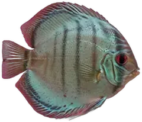
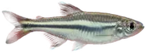
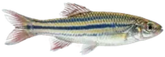

# reeftank-catalog

<!-- species:begin (generated by scripts/make_readme.py, do not edit) -->

> Onderdeel van het [**ReefTech-projectecosysteem**](https://elwinmage.github.io/reeftank/)

       

Vissen-, koraal-, planten- en ongewervelde soorten voor de aquariumweergave van [ha-reef-card](https://github.com/Elwinmage/ha-reef-card), geleverd door de [ReefTank-integratie](https://github.com/Elwinmage/ha-reeftank-component).

De integratie downloadt de releases van deze repository en houdt ze up-to-date (`update.reeftank_catalog`, standaard automatisch): niets te doen in Home Assistant.

## Hoe het werkt

Elke vis is een blad met beelden (een WebP-atlas) en een descriptor met zijn clips: *zwemmen*, *stilstaan* en *keren*. De kaart speelt ze achter elkaar af en spiegelt de keer, zodat de vis terugkeert langs dezelfde weg. Hier het zwemmen, de keer en de terugkeer van twee soorten:

<table><tr><td align="center"> Keizersvlinderbaars</td><td align="center"> Clownvis</td></tr></table>

## Vissen (102)

**HD**: een echte animatie, gemaakt van video's. De andere hebben een eenvoudige animatie van een foto, of de generieke vis.

| &nbsp;&nbsp;&nbsp;&nbsp;&nbsp;&nbsp;&nbsp;&nbsp;&nbsp;&nbsp;&nbsp;&nbsp;&nbsp;&nbsp;&nbsp;&nbsp;&nbsp;&nbsp;&nbsp;&nbsp;&nbsp;&nbsp;&nbsp;&nbsp;&nbsp;&nbsp;&nbsp;&nbsp;&nbsp;&nbsp;&nbsp;&nbsp;&nbsp;&nbsp;&nbsp;&nbsp;&nbsp;&nbsp;&nbsp; | <small>Naam</small> | <small>Wetenschappelijke naam</small> | <small>Water</small> | <small>Grootte</small> | <small>Gedrag</small> | HD |
|---|---|---|---|---|---|---|
|  | <small>Achtvormige kogelvis `dichotomyctere_biocellatus`</small> | <small>*Dichotomyctere biocellatus*</small> | <small>Brakwater</small> | <small>5–6.5 cm</small> | <small>Openwaterzwemmer · verstopt zich 's nachts</small> |  |
|  | <small>Ancistrus `ancistrus`</small> | <small>*Ancistrus sp.*</small> | <small>Zoetwater</small> | <small>10–14 cm</small> | <small>Bodembewoner · verstopt zich 's nachts</small> |  |
|  | <small>Anemoonvis `amphiprion`</small> | <small>*Amphiprion sp.*</small> | <small>Zeewater</small> | <small>7–11 cm</small> | <small>Blijft op zijn plek · zweeft 's nachts</small> | ✔ |
|  | <small>Anthias `pseudanthias`</small> | <small>*Pseudanthias sp.*</small> | <small>Zeewater</small> | <small>8–14 cm</small> | <small>Scholenvis · verstopt zich 's nachts</small> | ✔ |
|  | <small>Atlantische slikspringer `periophthalmus_barbarus`</small> | <small>*Periophthalmus barbarus*</small> | <small>Brakwater</small> | <small>10–15 cm</small> | <small>Bodembewoner · verstopt zich 's nachts</small> |  |
|  | <small>Banggai-kardinaalbaars `pterapogon_kauderni`</small> | <small>*Pterapogon kauderni*</small> | <small>Zeewater</small> | <small>5–8 cm</small> | <small>Blijft op zijn plek · zweeft 's nachts</small> | ✔ |
|  | <small>Blauwe doktersvis `paracanthurus_hepatus`</small> | <small>*Paracanthurus hepatus*</small> | <small>Zeewater</small> | <small>20–30 cm</small> | <small>Openwaterzwemmer · verstopt zich 's nachts</small> |  |
|  | <small>Blauwe goerami `trichopodus_trichopterus`</small> | <small>*Trichopodus trichopterus*</small> | <small>Zoetwater</small> | <small>10–15 cm</small> | <small>Openwaterzwemmer · verstopt zich 's nachts</small> |  |
|  | <small>Blauwstreep-poetsvis `labroides_dimidiatus`</small> | <small>*Labroides dimidiatus*</small> | <small>Zeewater</small> | <small>10–12 cm</small> | <small>Openwaterzwemmer · verstopt zich 's nachts</small> |  |
|  | <small>Bronzen pantserwels `corydoras_aeneus`</small> | <small>*Corydoras aeneus*</small> | <small>Zoetwater</small> | <small>6–7 cm</small> | <small>Bodembewoner · verstopt zich 's nachts</small> |  |
|  | <small>Bruine doktersvis `zebrasoma_scopas`</small> | <small>*Zebrasoma scopas*</small> | <small>Zeewater</small> | <small>15–20 cm</small> | <small>Openwaterzwemmer · verstopt zich 's nachts</small> |  |
|  | <small>Citroen-koraalgrondel `gobiodon_citrinus`</small> | <small>*Gobiodon citrinus*</small> | <small>Zeewater</small> | <small>3–5 cm</small> | <small>Bodembewoner · verstopt zich 's nachts</small> |  |
|  | <small>Citroentetra `hyphessobrycon_pulchripinnis`</small> | <small>*Hyphessobrycon pulchripinnis*</small> | <small>Zoetwater</small> | <small>3–4.5 cm</small> | <small>Scholenvis · verstopt zich 's nachts</small> |  |
|  | <small>Clownbotia `chromobotia_macracanthus`</small> | <small>*Chromobotia macracanthus*</small> | <small>Zoetwater</small> | <small>15–30 cm</small> | <small>Bodembewoner · verstopt zich 's nachts</small> |  |
|  | <small>Demasoni-cichlide `pseudotropheus_demasoni`</small> | <small>*Pseudotropheus demasoni*</small> | <small>Zoetwater</small> | <small>7–8 cm</small> | <small>Openwaterzwemmer · verstopt zich 's nachts</small> |  |
|  | <small>Discus `symphysodon_aequifasciatus`</small> | <small>*Symphysodon aequifasciatus*</small> | <small>Zoetwater</small> | <small>15–20 cm</small> | <small>Openwaterzwemmer · verstopt zich 's nachts</small> |  |
|  | <small>Driestippel-dascyllus `dascyllus_trimaculatus`</small> | <small>*Dascyllus trimaculatus*</small> | <small>Zeewater</small> | <small>10–14 cm</small> | <small>Blijft op zijn plek · zweeft 's nachts</small> |  |
|  | <small>Dwerggoerami `trichogaster_lalius`</small> | <small>*Trichogaster lalius*</small> | <small>Zoetwater</small> | <small>5–8 cm</small> | <small>Openwaterzwemmer · verstopt zich 's nachts</small> |  |
|  | <small>Elektrisch gele cichlide `labidochromis_caeruleus`</small> | <small>*Labidochromis caeruleus*</small> | <small>Zoetwater</small> | <small>8–10 cm</small> | <small>Openwaterzwemmer · verstopt zich 's nachts</small> |  |
|  | <small>Endlers guppy `poecilia_wingei`</small> | <small>*Poecilia wingei*</small> | <small>Zoetwater</small> | <small>2–4 cm</small> | <small>Scholenvis · verstopt zich 's nachts</small> |  |
|  | <small>Fiji-juffertje `chrysiptera_taupou`</small> | <small>*Chrysiptera taupou*</small> | <small>Zeewater</small> | <small>6–8 cm</small> | <small>Blijft op zijn plek · blijft bij zijn schuilplaats · zweeft 's nachts</small> |  |
|  | <small>Galaxy-danio `danio_margaritatus`</small> | <small>*Danio margaritatus*</small> | <small>Zoetwater</small> | <small>2–3 cm</small> | <small>Scholenvis · verstopt zich 's nachts</small> |  |
|  | <small>Gebandeerde grondel `amblygobius_phalaena`</small> | <small>*Amblygobius phalaena*</small> | <small>Zeewater</small> | <small>8–10 cm</small> | <small>Leeft op het zand · rust 's nachts op de bodem</small> |  |
|  | <small>Gebandeerde schietvis `toxotes_jaculatrix`</small> | <small>*Toxotes jaculatrix*</small> | <small>Brakwater</small> | <small>15–25 cm</small> | <small>Openwaterzwemmer · verstopt zich 's nachts</small> |  |
|  | <small>Geelgestreepte kardinaalbaars `ostorhinchus_cyanosoma`</small> | <small>*Ostorhinchus cyanosoma*</small> | <small>Zeewater</small> | <small>7–8 cm</small> | <small>Blijft op zijn plek · zweeft 's nachts</small> |  |
|  | <small>Geelkop-kaakvis `opistognathus_aurifrons`</small> | <small>*Opistognathus aurifrons*</small> | <small>Zeewater</small> | <small>10–12 cm</small> | <small>Leeft op het zand · leeft in een hol · rust 's nachts op de bodem</small> |  |
|  | <small>Geelstaartjuffertje `chrysiptera_parasema`</small> | <small>*Chrysiptera parasema*</small> | <small>Zeewater</small> | <small>5–6 cm</small> | <small>Blijft op zijn plek · blijft bij zijn schuilplaats · zweeft 's nachts</small> |  |
|  | <small>Gele doktersvis `zebrasoma_flavescens`</small> | <small>*Zebrasoma flavescens*</small> | <small>Zeewater</small> | <small>15–20 cm</small> | <small>Openwaterzwemmer · verstopt zich 's nachts</small> |  |
|  | <small>Gele lipvis `halichoeres_chrysus`</small> | <small>*Halichoeres chrysus*</small> | <small>Zeewater</small> | <small>10–12 cm</small> | <small>Openwaterzwemmer · rust 's nachts op de bodem</small> |  |
|  | <small>Gele symbiosegrondel `cryptocentrus_cinctus`</small> | <small>*Cryptocentrus cinctus*</small> | <small>Zeewater</small> | <small>8–10 cm</small> | <small>Leeft op het zand · leeft in een hol · rust 's nachts op de bodem</small> |  |
|  | <small>Gemarmerde bijlvis `carnegiella_strigata`</small> | <small>*Carnegiella strigata*</small> | <small>Zoetwater</small> | <small>4–5 cm</small> | <small>Scholenvis · verstopt zich 's nachts</small> |  |
|  | <small>Gestreept zeepaardje `hippocampus_erectus`</small> | <small>*Hippocampus erectus*</small> | <small>Zeewater</small> | <small>10–15 cm</small> | <small>Blijft op zijn plek · zweeft 's nachts</small> |  |
|  | <small>Gewone molly `poecilia_sphenops`</small> | <small>*Poecilia sphenops*</small> | <small>Zoetwater, Brakwater</small> | <small>6–10 cm</small> | <small>Scholenvis · verstopt zich 's nachts</small> |  |
|  | <small>Goudvis `carassius_auratus`</small> | <small>*Carassius auratus*</small> | <small>Zoetwater</small> | <small>10–25 cm</small> | <small>Openwaterzwemmer · verstopt zich 's nachts</small> |  |
|  | <small>Grasmaaier-slijmvis `salarias_fasciatus`</small> | <small>*Salarias fasciatus*</small> | <small>Zeewater</small> | <small>12–14 cm</small> | <small>Bodembewoner · verstopt zich 's nachts</small> |  |
|  | <small>Groene chromis `chromis_viridis`</small> | <small>*Chromis viridis*</small> | <small>Zeewater</small> | <small>5–8 cm</small> | <small>Scholenvis · verstopt zich 's nachts</small> | ✔ |
|  | <small>Groene kogelvis `dichotomyctere_nigroviridis`</small> | <small>*Dichotomyctere nigroviridis*</small> | <small>Brakwater</small> | <small>10–17 cm</small> | <small>Openwaterzwemmer · verstopt zich 's nachts</small> |  |
|  | <small>Guppy `poecilia_reticulata`</small> | <small>*Poecilia reticulata*</small> | <small>Zoetwater</small> | <small>3–6 cm</small> | <small>Scholenvis · verstopt zich 's nachts</small> |  |
|  | <small>Harlekijnbarbeel `trigonostigma_heteromorpha`</small> | <small>*Trigonostigma heteromorpha*</small> | <small>Zoetwater</small> | <small>3–4.5 cm</small> | <small>Scholenvis · verstopt zich 's nachts</small> |  |
|  | <small>Hommelgrondel `brachygobius_xanthozonus`</small> | <small>*Brachygobius xanthozonus*</small> | <small>Brakwater</small> | <small>3–4 cm</small> | <small>Bodembewoner · verstopt zich 's nachts</small> |  |
|  | <small>Kaketoe-dwergcichlide `apistogramma_cacatuoides`</small> | <small>*Apistogramma cacatuoides*</small> | <small>Zoetwater</small> | <small>5–9 cm</small> | <small>Bodembewoner · verstopt zich 's nachts</small> |  |
|  | <small>Kardinaaltetra `paracheirodon_axelrodi`</small> | <small>*Paracheirodon axelrodi*</small> | <small>Zoetwater</small> | <small>3–5 cm</small> | <small>Scholenvis · verstopt zich 's nachts</small> |  |
|  | <small>Kastanjebruine anemoonvis `premnas_biaculeatus`</small> | <small>*Premnas biaculeatus*</small> | <small>Zeewater</small> | <small>10–15 cm</small> | <small>Blijft op zijn plek · zweeft 's nachts</small> |  |
|  | <small>Keizer-engelvis (juveniel) `pomacanthus_imperator`</small> | <small>*Pomacanthus imperator*</small> | <small>Zeewater</small> | <small>6–12 cm</small> | <small>Openwaterzwemmer · verstopt zich 's nachts</small> | ✔ |
|  | <small>Keizer-engelvis (volwassen) `pomacanthus_imperator_adult`</small> | <small>*Pomacanthus imperator*</small> | <small>Zeewater</small> | <small>25–38 cm</small> | <small>Openwaterzwemmer · verstopt zich 's nachts</small> | ✔ |
|  | <small>Keizertetra `nematobrycon_palmeri`</small> | <small>*Nematobrycon palmeri*</small> | <small>Zoetwater</small> | <small>4–6 cm</small> | <small>Scholenvis · verstopt zich 's nachts</small> |  |
|  | <small>Kersenbarbeel `pethia_titteya`</small> | <small>*Pethia titteya*</small> | <small>Zoetwater</small> | <small>4–5 cm</small> | <small>Scholenvis · verstopt zich 's nachts</small> |  |
|  | <small>Kole-doktersvis `ctenochaetus_strigosus`</small> | <small>*Ctenochaetus strigosus*</small> | <small>Zeewater</small> | <small>12–18 cm</small> | <small>Openwaterzwemmer · verstopt zich 's nachts</small> |  |
|  | <small>Koningsgramma `gramma_loreto`</small> | <small>*Gramma loreto*</small> | <small>Zeewater</small> | <small>7–8 cm</small> | <small>Blijft op zijn plek · zweeft 's nachts</small> |  |
|  | <small>Koninklijke keizersvis `pygoplites_diacanthus`</small> | <small>*Pygoplites diacanthus*</small> | <small>Zeewater</small> | <small>20–25 cm</small> | <small>Openwaterzwemmer · verstopt zich 's nachts</small> |  |
|  | <small>Koperband-vlindervis `chelmon_rostratus`</small> | <small>*Chelmon rostratus*</small> | <small>Zeewater</small> | <small>15–20 cm</small> | <small>Openwaterzwemmer · verstopt zich 's nachts</small> |  |
|  | <small>Kribensis `pelvicachromis_pulcher`</small> | <small>*Pelvicachromis pulcher*</small> | <small>Zoetwater</small> | <small>8–10 cm</small> | <small>Bodembewoner · verstopt zich 's nachts</small> |  |
|  | <small>Kuhli-modderkruiper `pangio_kuhlii`</small> | <small>*Pangio kuhlii*</small> | <small>Zoetwater</small> | <small>8–12 cm</small> | <small>Bodembewoner · verstopt zich 's nachts</small> |  |
|  | <small>Lierstaartkilli `aphyosemion_australe`</small> | <small>*Aphyosemion australe*</small> | <small>Zoetwater</small> | <small>5–6 cm</small> | <small>Blijft op zijn plek · zweeft 's nachts</small> |  |
|  | <small>Mandarijnvis `synchiropus_splendidus`</small> | <small>*Synchiropus splendidus*</small> | <small>Zeewater</small> | <small>5–8 cm</small> | <small>Bodembewoner · verstopt zich 's nachts</small> | ✔ |
|  | <small>Neongrondel `elacatinus_oceanops`</small> | <small>*Elacatinus oceanops*</small> | <small>Zeewater</small> | <small>4–6 cm</small> | <small>Bodembewoner · verstopt zich 's nachts</small> |  |
|  | <small>Neontetra `paracheirodon_innesi`</small> | <small>*Paracheirodon innesi*</small> | <small>Zoetwater</small> | <small>3–4 cm</small> | <small>Scholenvis · verstopt zich 's nachts</small> |  |
|  | <small>Okinawa-koraalgrondel `gobiodon_okinawae`</small> | <small>*Gobiodon okinawae*</small> | <small>Zeewater</small> | <small>2.5–3.5 cm</small> | <small>Bodembewoner · verstopt zich 's nachts</small> |  |
|  | <small>Orchideedwergbaars `pseudochromis_fridmani`</small> | <small>*Pseudochromis fridmani*</small> | <small>Zeewater</small> | <small>6–7 cm</small> | <small>Blijft op zijn plek · blijft bij zijn schuilplaats · zweeft 's nachts</small> |  |
|  | <small>Oscar `astronotus_ocellatus`</small> | <small>*Astronotus ocellatus*</small> | <small>Zoetwater</small> | <small>25–35 cm</small> | <small>Openwaterzwemmer · verstopt zich 's nachts</small> |  |
|  | <small>Otocinclus `otocinclus_affinis`</small> | <small>*Otocinclus affinis*</small> | <small>Zoetwater</small> | <small>3–5 cm</small> | <small>Bodembewoner · verstopt zich 's nachts</small> |  |
|  | <small>Panda-pantserwels `corydoras_panda`</small> | <small>*Corydoras panda*</small> | <small>Zoetwater</small> | <small>4–5 cm</small> | <small>Bodembewoner · verstopt zich 's nachts</small> |  |
|  | <small>Parel-danio `danio_albolineatus`</small> | <small>*Danio albolineatus*</small> | <small>Zoetwater</small> | <small>4–6 cm</small> | <small>Scholenvis · verstopt zich 's nachts</small> |  |
|  | <small>Parelgoerami `trichopodus_leerii`</small> | <small>*Trichopodus leerii*</small> | <small>Zoetwater</small> | <small>10–12 cm</small> | <small>Openwaterzwemmer · verstopt zich 's nachts</small> |  |
|  | <small>Picasso-trekkervis `rhinecanthus_aculeatus`</small> | <small>*Rhinecanthus aculeatus*</small> | <small>Zeewater</small> | <small>20–25 cm</small> | <small>Openwaterzwemmer · verstopt zich 's nachts</small> |  |
|  | <small>Pixie-valkvis `cirrhitichthys_oxycephalus`</small> | <small>*Cirrhitichthys oxycephalus*</small> | <small>Zeewater</small> | <small>8–10 cm</small> | <small>Bodembewoner · verstopt zich 's nachts</small> |  |
|  | <small>Platy `xiphophorus_maculatus`</small> | <small>*Xiphophorus maculatus*</small> | <small>Zoetwater</small> | <small>4–6 cm</small> | <small>Scholenvis · verstopt zich 's nachts</small> |  |
|  | <small>Poederblauwe doktersvis `acanthurus_leucosternon`</small> | <small>*Acanthurus leucosternon*</small> | <small>Zeewater</small> | <small>20–23 cm</small> | <small>Openwaterzwemmer · verstopt zich 's nachts</small> |  |
|  | <small>Psychedelische mandarijnvis `synchiropus_picturatus`</small> | <small>*Synchiropus picturatus*</small> | <small>Zeewater</small> | <small>6–8 cm</small> | <small>Bodembewoner · verstopt zich 's nachts</small> |  |
|  | <small>Purperen vuurvis `nemateleotris_decora`</small> | <small>*Nemateleotris decora*</small> | <small>Zeewater</small> | <small>8–10 cm</small> | <small>Blijft op zijn plek · zweeft 's nachts</small> |  |
|  | <small>Pyjama-kardinaalbaars `sphaeramia_nematoptera`</small> | <small>*Sphaeramia nematoptera*</small> | <small>Zeewater</small> | <small>8–10 cm</small> | <small>Blijft op zijn plek · zweeft 's nachts</small> |  |
|  | <small>Ramirezi `mikrogeophagus_ramirezi`</small> | <small>*Mikrogeophagus ramirezi*</small> | <small>Zoetwater</small> | <small>5–7 cm</small> | <small>Blijft op zijn plek · zweeft 's nachts</small> |  |
|  | <small>Ridder-grondel `stigmatogobius_sadanundio`</small> | <small>*Stigmatogobius sadanundio*</small> | <small>Brakwater</small> | <small>6–8 cm</small> | <small>Bodembewoner · verstopt zich 's nachts</small> |  |
|  | <small>Rode leeuwenvis `pterois_volitans`</small> | <small>*Pterois volitans*</small> | <small>Zeewater</small> | <small>25–35 cm</small> | <small>Openwaterzwemmer · verstopt zich 's nachts</small> |  |
|  | <small>Roodneus-tetra `hemigrammus_bleheri`</small> | <small>*Hemigrammus bleheri*</small> | <small>Zoetwater</small> | <small>4–5 cm</small> | <small>Scholenvis · verstopt zich 's nachts</small> |  |
|  | <small>Rouwtetra `gymnocorymbus_ternetzi`</small> | <small>*Gymnocorymbus ternetzi*</small> | <small>Zoetwater</small> | <small>5–6 cm</small> | <small>Scholenvis · verstopt zich 's nachts</small> |  |
|  | <small>Scat `scatophagus_argus`</small> | <small>*Scatophagus argus*</small> | <small>Brakwater, Zeewater</small> | <small>15–30 cm</small> | <small>Openwaterzwemmer · verstopt zich 's nachts</small> |  |
|  | <small>Serpae-tetra `hyphessobrycon_eques`</small> | <small>*Hyphessobrycon eques*</small> | <small>Zoetwater</small> | <small>3–4.5 cm</small> | <small>Scholenvis · verstopt zich 's nachts</small> |  |
|  | <small>Siamese algeneter `crossocheilus_oblongus`</small> | <small>*Crossocheilus oblongus*</small> | <small>Zoetwater</small> | <small>10–15 cm</small> | <small>Openwaterzwemmer · verstopt zich 's nachts</small> |  |
|  | <small>Siamese kempvis `betta_splendens`</small> | <small>*Betta splendens*</small> | <small>Zoetwater</small> | <small>5–7 cm</small> | <small>Blijft op zijn plek · blijft bij zijn schuilplaats · zweeft 's nachts</small> |  |
|  | <small>Skalaar `pterophyllum_scalare`</small> | <small>*Pterophyllum scalare*</small> | <small>Zoetwater</small> | <small>12–15 cm</small> | <small>Openwaterzwemmer · verstopt zich 's nachts</small> |  |
|  | <small>Slaapgrondel `valenciennea`</small> | <small>*Valenciennea sp.*</small> | <small>Zeewater</small> | <small>10–16 cm</small> | <small>Leeft op het zand · leeft in een hol · rust 's nachts op de bodem</small> | ✔ |
|  | <small>Solor-feeënlipvis `cirrhilabrus_solorensis`</small> | <small>*Cirrhilabrus solorensis*</small> | <small>Zeewater</small> | <small>10–12 cm</small> | <small>Openwaterzwemmer · verstopt zich 's nachts</small> |  |
|  | <small>Sumatraanse barbeel `puntigrus_tetrazona`</small> | <small>*Puntigrus tetrazona*</small> | <small>Zoetwater</small> | <small>5–7 cm</small> | <small>Scholenvis · verstopt zich 's nachts</small> |  |
|  | <small>Turquoise regenboogvis `melanotaenia_lacustris`</small> | <small>*Melanotaenia lacustris*</small> | <small>Zoetwater</small> | <small>8–12 cm</small> | <small>Scholenvis · verstopt zich 's nachts</small> |  |
|  | <small>Tweekleurige dwergkeizersvis `centropyge_bicolor`</small> | <small>*Centropyge bicolor*</small> | <small>Zeewater</small> | <small>10–15 cm</small> | <small>Blijft op zijn plek · zweeft 's nachts</small> |  |
|  | <small>Tweekleurige slijmvis `ecsenius_bicolor`</small> | <small>*Ecsenius bicolor*</small> | <small>Zeewater</small> | <small>8–10 cm</small> | <small>Bodembewoner · verstopt zich 's nachts</small> |  |
|  | <small>Valentins kogelvis `canthigaster_valentini`</small> | <small>*Canthigaster valentini*</small> | <small>Zeewater</small> | <small>8–10 cm</small> | <small>Openwaterzwemmer · verstopt zich 's nachts</small> |  |
|  | <small>Violette grondel `gobioides_broussonnetii`</small> | <small>*Gobioides broussonnetii*</small> | <small>Brakwater</small> | <small>30–50 cm</small> | <small>Leeft op het zand · leeft in een hol · rust 's nachts op de bodem</small> |  |
|  | <small>Vlammen-dwergkeizersvis `centropyge_loricula`</small> | <small>*Centropyge loricula*</small> | <small>Zeewater</small> | <small>8–10 cm</small> | <small>Blijft op zijn plek · zweeft 's nachts</small> |  |
|  | <small>Vossengezicht konijnvis `siganus_vulpinus`</small> | <small>*Siganus vulpinus*</small> | <small>Zeewater</small> | <small>15–22 cm</small> | <small>Openwaterzwemmer · rust 's nachts op de bodem</small> | ✔ |
|  | <small>Vuurvis `nemateleotris_magnifica`</small> | <small>*Nemateleotris magnifica*</small> | <small>Zeewater</small> | <small>8–10 cm</small> | <small>Blijft op zijn plek · zweeft 's nachts</small> |  |
|  | <small>Witte wolkenvis `tanichthys_albonubes`</small> | <small>*Tanichthys albonubes*</small> | <small>Zoetwater</small> | <small>3–4 cm</small> | <small>Scholenvis · verstopt zich 's nachts</small> |  |
|  | <small>Yasha-symbiosegrondel `stonogobiops_yasha`</small> | <small>*Stonogobiops yasha*</small> | <small>Zeewater</small> | <small>6–8 cm</small> | <small>Leeft op het zand · leeft in een hol · rust 's nachts op de bodem</small> |  |
|  | <small>Zebra-harnasmeerval `hypancistrus_zebra`</small> | <small>*Hypancistrus zebra*</small> | <small>Zoetwater</small> | <small>7–10 cm</small> | <small>Bodembewoner · verstopt zich 's nachts</small> |  |
|  | <small>Zebra-leeuwenvis `dendrochirus_zebra`</small> | <small>*Dendrochirus zebra*</small> | <small>Zeewater</small> | <small>12–18 cm</small> | <small>Openwaterzwemmer · verstopt zich 's nachts</small> |  |
|  | <small>Zebravisje `danio_rerio`</small> | <small>*Danio rerio*</small> | <small>Zoetwater</small> | <small>4–5 cm</small> | <small>Scholenvis · verstopt zich 's nachts</small> |  |
|  | <small>Zeil-doktersvis `zebrasoma_veliferum`</small> | <small>*Zebrasoma veliferum*</small> | <small>Zeewater</small> | <small>25–40 cm</small> | <small>Openwaterzwemmer · verstopt zich 's nachts</small> |  |
|  | <small>Zeilvin-molly `poecilia_velifera`</small> | <small>*Poecilia velifera*</small> | <small>Brakwater, Zoetwater</small> | <small>10–15 cm</small> | <small>Scholenvis · verstopt zich 's nachts</small> |  |
|  | <small>Zesstrepen-lipvis `pseudocheilinus_hexataenia`</small> | <small>*Pseudocheilinus hexataenia*</small> | <small>Zeewater</small> | <small>7–10 cm</small> | <small>Openwaterzwemmer · verstopt zich 's nachts</small> |  |
|  | <small>Zilveren maanvis `monodactylus_argenteus`</small> | <small>*Monodactylus argenteus*</small> | <small>Brakwater, Zeewater</small> | <small>15–25 cm</small> | <small>Scholenvis · verstopt zich 's nachts</small> |  |
|  | <small>Zwaarddrager `xiphophorus_hellerii`</small> | <small>*Xiphophorus hellerii*</small> | <small>Zoetwater</small> | <small>6–12 cm</small> | <small>Scholenvis · verstopt zich 's nachts</small> |  |

## Koralen (1)

| &nbsp;&nbsp;&nbsp;&nbsp;&nbsp;&nbsp;&nbsp;&nbsp;&nbsp;&nbsp;&nbsp;&nbsp;&nbsp;&nbsp;&nbsp;&nbsp;&nbsp;&nbsp;&nbsp;&nbsp;&nbsp;&nbsp;&nbsp;&nbsp;&nbsp;&nbsp;&nbsp;&nbsp;&nbsp;&nbsp;&nbsp;&nbsp;&nbsp;&nbsp;&nbsp;&nbsp;&nbsp;&nbsp;&nbsp; | <small>Naam</small> | <small>Wetenschappelijke naam</small> | <small>Water</small> | <small>Grootte</small> |
|---|---|---|---|---|
|  | <small>Fakkelkoraal `euphyllia_glabrescens`</small> | <small>*Euphyllia glabrescens*</small> | <small>Zeewater</small> | <small>10–30 cm</small> |

## Planten (29)

| &nbsp;&nbsp;&nbsp;&nbsp;&nbsp;&nbsp;&nbsp;&nbsp;&nbsp;&nbsp;&nbsp;&nbsp;&nbsp;&nbsp;&nbsp;&nbsp;&nbsp;&nbsp;&nbsp;&nbsp;&nbsp;&nbsp;&nbsp;&nbsp;&nbsp;&nbsp;&nbsp;&nbsp;&nbsp;&nbsp;&nbsp;&nbsp;&nbsp;&nbsp;&nbsp;&nbsp;&nbsp;&nbsp;&nbsp; | <small>Naam</small> | <small>Wetenschappelijke naam</small> | <small>Water</small> | <small>Grootte</small> | <small>Zone</small> |
|---|---|---|---|---|---|
|  | <small>Amazone-kikkerbeet `limnobium_laevigatum`</small> | <small>*Limnobium laevigatum*</small> | <small>Zoetwater</small> | <small>5–10 cm</small> | <small>Drijvend</small> |
|  | <small>Amazone-zwaardplant `echinodorus_bleheri`</small> | <small>*Echinodorus bleheri*</small> | <small>Zoetwater</small> | <small>30–50 cm</small> | <small>Middengrond</small> |
|  | <small>Ambulia `limnophila_sessiliflora`</small> | <small>*Limnophila sessiliflora*</small> | <small>Zoetwater</small> | <small>20–40 cm</small> | <small>Achtergrond</small> |
|  | <small>Anubias `anubias_barteri`</small> | <small>*Anubias barteri*</small> | <small>Zoetwater</small> | <small>10–25 cm</small> | <small>Epifyt</small> |
|  | <small>Brazilaanse waterpest `egeria_densa`</small> | <small>*Egeria densa*</small> | <small>Zoetwater</small> | <small>30–100 cm</small> | <small>Achtergrond</small> |
|  | <small>Bucephalandra `bucephalandra`</small> | <small>*Bucephalandra sp.*</small> | <small>Zoetwater</small> | <small>5–15 cm</small> | <small>Epifyt</small> |
|  | <small>Cabomba `cabomba_caroliniana`</small> | <small>*Cabomba caroliniana*</small> | <small>Zoetwater</small> | <small>30–60 cm</small> | <small>Achtergrond</small> |
|  | <small>Caulerpa `caulerpa_prolifera`</small> | <small>*Caulerpa prolifera*</small> | <small>Zeewater</small> | <small>5–20 cm</small> | <small>Voorgrond</small> |
|  | <small>Chaetomorpha `chaetomorpha_linum`</small> | <small>*Chaetomorpha linum*</small> | <small>Zeewater</small> | <small>5–30 cm</small> | <small>Voorgrond</small> |
|  | <small>Cryptocoryne ciliata `cryptocoryne_ciliata`</small> | <small>*Cryptocoryne ciliata*</small> | <small>Brakwater, Zoetwater</small> | <small>20–40 cm</small> | <small>Middengrond</small> |
|  | <small>Cryptocoryne parva `cryptocoryne_parva`</small> | <small>*Cryptocoryne parva*</small> | <small>Zoetwater</small> | <small>5–8 cm</small> | <small>Voorgrond</small> |
|  | <small>Cryptocoryne wendtii `cryptocoryne_wendtii`</small> | <small>*Cryptocoryne wendtii*</small> | <small>Zoetwater</small> | <small>10–20 cm</small> | <small>Middengrond</small> |
|  | <small>Dwergnaaldbies `eleocharis_parvula`</small> | <small>*Eleocharis parvula*</small> | <small>Zoetwater</small> | <small>5–10 cm</small> | <small>Voorgrond</small> |
|  | <small>Dwergpijlkruid `sagittaria_subulata`</small> | <small>*Sagittaria subulata*</small> | <small>Zoetwater</small> | <small>10–30 cm</small> | <small>Voorgrond</small> |
|  | <small>Glossostigma `glossostigma_elatinoides`</small> | <small>*Glossostigma elatinoides*</small> | <small>Zoetwater</small> | <small>2–5 cm</small> | <small>Voorgrond</small> |
|  | <small>Halimeda `halimeda_opuntia`</small> | <small>*Halimeda opuntia*</small> | <small>Zeewater</small> | <small>5–15 cm</small> | <small>Voorgrond</small> |
|  | <small>Hemianthus `hemianthus_callitrichoides`</small> | <small>*Hemianthus callitrichoides*</small> | <small>Zoetwater</small> | <small>2–5 cm</small> | <small>Voorgrond</small> |
|  | <small>Hygrophila `hygrophila_polysperma`</small> | <small>*Hygrophila polysperma*</small> | <small>Zoetwater</small> | <small>20–50 cm</small> | <small>Achtergrond</small> |
|  | <small>Javamos `vesicularia_dubyana`</small> | <small>*Vesicularia dubyana*</small> | <small>Zoetwater</small> | <small>3–5 cm</small> | <small>Epifyt</small> |
|  | <small>Javavaren `microsorum_pteropus`</small> | <small>*Microsorum pteropus*</small> | <small>Zoetwater</small> | <small>20–30 cm</small> | <small>Epifyt</small> |
|  | <small>Klein kroos `lemna_minor`</small> | <small>*Lemna minor*</small> | <small>Zoetwater</small> | <small>0.5–1 cm</small> | <small>Drijvend</small> |
|  | <small>Ludwigia `ludwigia_repens`</small> | <small>*Ludwigia repens*</small> | <small>Zoetwater</small> | <small>20–40 cm</small> | <small>Middengrond</small> |
|  | <small>Marimo `aegagropila_linnaei`</small> | <small>*Aegagropila linnaei*</small> | <small>Zoetwater</small> | <small>3–10 cm</small> | <small>Voorgrond</small> |
|  | <small>Rode mangrove `rhizophora_mangle`</small> | <small>*Rhizophora mangle*</small> | <small>Brakwater, Zeewater</small> | <small>30–100 cm</small> | <small>Middengrond</small> |
|  | <small>Rotala `rotala_rotundifolia`</small> | <small>*Rotala rotundifolia*</small> | <small>Zoetwater</small> | <small>20–50 cm</small> | <small>Achtergrond</small> |
|  | <small>Schildpadgras `thalassia_testudinum`</small> | <small>*Thalassia testudinum*</small> | <small>Zeewater</small> | <small>10–30 cm</small> | <small>Voorgrond</small> |
|  | <small>Staurogyne `staurogyne_repens`</small> | <small>*Staurogyne repens*</small> | <small>Zoetwater</small> | <small>5–10 cm</small> | <small>Voorgrond</small> |
|  | <small>Vallisneria `vallisneria_spiralis`</small> | <small>*Vallisneria spiralis*</small> | <small>Zoetwater, Brakwater</small> | <small>30–60 cm</small> | <small>Achtergrond</small> |
|  | <small>Watersla `pistia_stratiotes`</small> | <small>*Pistia stratiotes*</small> | <small>Zoetwater</small> | <small>5–15 cm</small> | <small>Drijvend</small> |

## Ongewervelden (32)

| &nbsp;&nbsp;&nbsp;&nbsp;&nbsp;&nbsp;&nbsp;&nbsp;&nbsp;&nbsp;&nbsp;&nbsp;&nbsp;&nbsp;&nbsp;&nbsp;&nbsp;&nbsp;&nbsp;&nbsp;&nbsp;&nbsp;&nbsp;&nbsp;&nbsp;&nbsp;&nbsp;&nbsp;&nbsp;&nbsp;&nbsp;&nbsp;&nbsp;&nbsp;&nbsp;&nbsp;&nbsp;&nbsp;&nbsp; | <small>Naam</small> | <small>Wetenschappelijke naam</small> | <small>Water</small> | <small>Grootte</small> | <small>Rol</small> |
|---|---|---|---|---|---|
|  | <small>Amano-garnaal `caridina_multidentata`</small> | <small>*Caridina multidentata*</small> | <small>Zoetwater</small> | <small>3–5 cm</small> | <small>Algeneter · kruipt over de bodem</small> |
|  | <small>Appelslak `pomacea_bridgesii`</small> | <small>*Pomacea bridgesii*</small> | <small>Zoetwater</small> | <small>4–5 cm</small> | <small>Aaseter · kruipt over de bodem</small> |
|  | <small>Astraea-slak `astraea_tecta`</small> | <small>*Astraea tecta*</small> | <small>Zeewater</small> | <small>2–4 cm</small> | <small>Algeneter · leeft op het decor</small> |
|  | <small>Bamboegarnaal `atyopsis_moluccensis`</small> | <small>*Atyopsis moluccensis*</small> | <small>Zoetwater</small> | <small>6–8 cm</small> | <small>Filtreerder · leeft op het decor</small> |
|  | <small>Blauwpoot-kluizenaar `clibanarius_tricolor`</small> | <small>*Clibanarius tricolor*</small> | <small>Zeewater</small> | <small>2–3 cm</small> | <small>Aaseter · kruipt over de bodem</small> |
|  | <small>Boorende reuzenmossel `tridacna_crocea`</small> | <small>*Tridacna crocea*</small> | <small>Zeewater</small> | <small>5–15 cm</small> | <small>Filtreerder · vastzittend</small> |
|  | <small>Boxergarnaal `stenopus_hispidus`</small> | <small>*Stenopus hispidus*</small> | <small>Zeewater</small> | <small>6–8 cm</small> | <small>Opruimer · leeft op het decor</small> |
|  | <small>Cerithium-slak `cerithium`</small> | <small>*Cerithium sp.*</small> | <small>Zeewater</small> | <small>2–3 cm</small> | <small>Detrituseter · kruipt over de bodem</small> |
|  | <small>Crystal red-garnaal `caridina_cantonensis`</small> | <small>*Caridina cantonensis*</small> | <small>Zoetwater</small> | <small>2–3 cm</small> | <small>Detrituseter · kruipt over de bodem</small> |
|  | <small>Gemarmerde garnaal `saron_marmoratus`</small> | <small>*Saron marmoratus*</small> | <small>Zeewater</small> | <small>5–7 cm</small> | <small>Aaseter · leeft op het decor</small> |
|  | <small>Harlekijngarnaal `hymenocera_picta`</small> | <small>*Hymenocera picta*</small> | <small>Zeewater</small> | <small>4–6 cm</small> | <small>Roofdier · kruipt over de bodem</small> |
|  | <small>Kersengarnaal `neocaridina_davidi`</small> | <small>*Neocaridina davidi*</small> | <small>Zoetwater</small> | <small>2–3.5 cm</small> | <small>Detrituseter · kruipt over de bodem</small> |
|  | <small>Kerstboomworm `spirobranchus_giganteus`</small> | <small>*Spirobranchus giganteus*</small> | <small>Zeewater</small> | <small>3–5 cm</small> | <small>Filtreerder · vastzittend</small> |
|  | <small>Maleise trompetslak `melanoides_tuberculata`</small> | <small>*Melanoides tuberculata*</small> | <small>Zoetwater</small> | <small>2–3 cm</small> | <small>Detrituseter · kruipt over de bodem</small> |
|  | <small>Mariene nerietslak `nerita`</small> | <small>*Nerita sp.*</small> | <small>Zeewater</small> | <small>2–3 cm</small> | <small>Algeneter · klimt tegen het glas</small> |
|  | <small>Moordenaarslak `clea_helena`</small> | <small>*Clea helena*</small> | <small>Zoetwater</small> | <small>2–3 cm</small> | <small>Roofdier · kruipt over de bodem</small> |
|  | <small>Nassarius-slak `nassarius`</small> | <small>*Nassarius sp.*</small> | <small>Zeewater</small> | <small>2–4 cm</small> | <small>Aaseter · kruipt over de bodem</small> |
|  | <small>Pepermuntgarnaal `lysmata_wurdemanni`</small> | <small>*Lysmata wurdemanni*</small> | <small>Zeewater</small> | <small>3–5 cm</small> | <small>Opruimer · leeft op het decor</small> |
|  | <small>Posthoornslak `planorbella_duryi`</small> | <small>*Planorbella duryi*</small> | <small>Zoetwater</small> | <small>2–3 cm</small> | <small>Detrituseter · klimt tegen het glas</small> |
|  | <small>Potloodzee-egel `prionocidaris_baculosa`</small> | <small>*Prionocidaris baculosa*</small> | <small>Zeewater</small> | <small>8–10 cm</small> | <small>Algeneter · leeft op het decor</small> |
|  | <small>Rode poetsgarnaal `lysmata_amboinensis`</small> | <small>*Lysmata amboinensis*</small> | <small>Zeewater</small> | <small>5–6 cm</small> | <small>Opruimer · leeft op het decor</small> |
|  | <small>Scharlaken kluizenaar `paguristes_cadenati`</small> | <small>*Paguristes cadenati*</small> | <small>Zeewater</small> | <small>3–4 cm</small> | <small>Aaseter · kruipt over de bodem</small> |
|  | <small>Slangster `ophiolepis_superba`</small> | <small>*Ophiolepis superba*</small> | <small>Zeewater</small> | <small>8–12 cm</small> | <small>Aaseter · kruipt over de bodem</small> |
|  | <small>Smaragdkrab `mithraculus_sculptus`</small> | <small>*Mithraculus sculptus*</small> | <small>Zeewater</small> | <small>3–4 cm</small> | <small>Algeneter · leeft op het decor</small> |
|  | <small>Trochus-slak `tectus_fenestratus`</small> | <small>*Tectus fenestratus*</small> | <small>Zeewater</small> | <small>4–6 cm</small> | <small>Algeneter · leeft op het decor</small> |
|  | <small>Turbo-slak `turbo_fluctuosus`</small> | <small>*Turbo fluctuosus*</small> | <small>Zeewater</small> | <small>4–8 cm</small> | <small>Algeneter · klimt tegen het glas</small> |
|  | <small>Verzamelaarszee-egel `tripneustes_gratilla`</small> | <small>*Tripneustes gratilla*</small> | <small>Zeewater</small> | <small>10–15 cm</small> | <small>Algeneter · leeft op het decor</small> |
|  | <small>Vuurgarnaal `lysmata_debelius`</small> | <small>*Lysmata debelius*</small> | <small>Zeewater</small> | <small>5–6 cm</small> | <small>Opruimer · leeft op het decor</small> |
|  | <small>Waaierworm `sabellastarte`</small> | <small>*Sabellastarte sp.*</small> | <small>Zeewater</small> | <small>5–10 cm</small> | <small>Filtreerder · vastzittend</small> |
|  | <small>Zandzeester `archaster_typicus`</small> | <small>*Archaster typicus*</small> | <small>Zeewater</small> | <small>6–10 cm</small> | <small>Detrituseter · kruipt over de bodem</small> |
|  | <small>Zebra-nerietslak `neritina_natalensis`</small> | <small>*Neritina natalensis*</small> | <small>Zoetwater</small> | <small>2–3 cm</small> | <small>Algeneter · klimt tegen het glas</small> |
|  | <small>Zeekomkommer `holothuria`</small> | <small>*Holothuria sp.*</small> | <small>Zeewater</small> | <small>15–30 cm</small> | <small>Detrituseter · kruipt over de bodem</small> |

Om een soort toe te voegen (clips genereren, bouwen, publiceren), zie de [Engelse documentatie](README.md).

De soortbestanden vallen onder **CC BY 4.0**, de scripts onder MIT: zie [LICENSE.md](LICENSE.md).

<!-- species:end -->

<!-- ecosystem:start -->

## Verwante projecten

De ReefTech-projecten grijpen in elkaar: de integraties brengen uw apparatuur in Home Assistant, de kaart toont en bedient ze, en de back-up houdt alles draaiend tijdens een stroomuitval. Elk werkt ook op zichzelf.

<table>
  <tr>
    <th width="100px"></th>
    <th>Project</th>
    <th>Rol</th>
    <th>Werkt samen met</th>
  </tr>
  <tr>
    <td></td>
    <td>🐠 <a href="https://github.com/Elwinmage/ha-reefbeat-component"><b>ha-reefbeat-component</b></a></td>
    <td>Red Sea ReefBeat-apparaten, lokaal aangestuurd zonder cloud: ReefATO+, ReefControl, ReefControl-Power, ReefDose, ReefLed, ReefMat, ReefRun en ReefWave. blueprint met meldingen voor afwijkende modi, kalibraties en lage accu. </td>
    <td>ha-reef-card</td>
  </tr>
  <tr>
    <td></td>
    <td>🌊 <a href="https://github.com/Elwinmage/ha-aquamedic-component"><b>ha-aquamedic-component</b></a></td>
    <td>Aqua Medic-pompen via de Gizwits-cloud-API: EcoDrift- en SmartDrift-stromingspompen, DC Runner opvoer- en afschuimerpompen.</td>
    <td>ha-reef-card</td>
  </tr>
  <tr>
    <td></td>
    <td>🐟 <a href="https://github.com/Elwinmage/ha-vson-component"><b>ha-vson-component</b></a></td>
    <td>VSON automatische voederautomaten via de VSON-cloud-API: de WP8621-voederautomaat (voeren, accu, waarschuwing bij weinig voer) en generieke detectie van elk ander VSON-apparaat. De WP8621 kan ook volledig lokaal draaien op ESPHome.</td>
    <td>ha-reef-card</td>
  </tr>
  <tr>
    <td></td>
    <td>🐙 <a href="https://github.com/Elwinmage/ha-reef-maintenance-component"><b>ha-reef-maintenance-component</b></a></td>
    <td>Schoonmaak- en slijtageopvolging voor apparatuur die Home Assistant niet kan uitlezen: stromingspompen, opvoerpompen, eiwitafschuimers, reactoren, alles wat u met de hand onderhoudt.</td>
    <td>ha-reef-card</td>
  </tr>
  <tr>
    <td></td>
    <td>🪸 <a href="https://github.com/Elwinmage/ha-reef-card"><b>ha-reef-card</b></a></td>
    <td>Interactieve grafische weergave van elk apparaat op uw dashboard, en de enige manier om geavanceerde schema's te bewerken. Leest de drie integraties via het gedeelde <code>reef_role</code>-contract, zonder configuratie aan de kaartzijde. Tekent ook de energiestromen van reefbeatEnergyBackup. De aquariumkaart brengt uw bak tot leven met ha-reeftank-component.</td>
    <td>alle vier de integraties, en ha-reeftank-component voor het aquarium</td>
  </tr>
  <tr>
    <td></td>
    <td>🐟 <a href="https://github.com/Elwinmage/ha-reeftank-component"><b>ha-reeftank-component</b></a></td>
    <td>Een levend beeld van uw bak op het dashboard: uw foto, verlicht door uw echte lampen, met geanimeerde vissen en koralen, en uw apparaten en entiteiten erop. Bewaart de aquaria en hun bezetting, legt de voederingen vast.</td>
    <td>ha-reef-card</td>
  </tr>
  <tr>
    <td></td>
    <td>🐡 <b>reeftank-catalog</b> <i>(deze repository)</i></td>
    <td>Vissen, koralen en texturen van de aquariumkaart, gedownload en bijgehouden door ha-reeftank-component.</td>
    <td>ha-reeftank-component</td>
  </tr>
  <tr>
    <td></td>
    <td>🐬 <a href="https://github.com/Elwinmage/ha-reef-blueprints"><b>ha-reef-blueprints</b></a></td>
    <td>Automatiserings-blueprints voor het hele ecosysteem: achterstallig onderhoud gevonden via het <code>reef_role</code>-contract, apparaten die onbereikbaar zijn geworden, een periodieke verwarmertest en relaisbewaking. Acht talen.</td>
    <td>alle vier de integraties</td>
  </tr>
  <tr>
    <td></td>
    <td>⚡ <a href="https://github.com/Elwinmage/reefbeatEnergyBackup"><b>reefbeatEnergyBackup</b></a></td>
    <td>Accuback-up bij stroomuitval. Een 24V LiFePO₄-pakket aangestuurd door een Raspberry Pi, met de pompsnelheid die geleidelijk zakt met de laadtoestand.</td>
    <td>zelfstandig, of samen met ha-reefbeat-component en ha-reef-card</td>
  </tr>
</table>

Alles staat samen gedocumenteerd op de [ReefTech-projectpagina](https://elwinmage.github.io/reeftank/).

<!-- ecosystem:end -->
