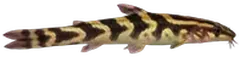
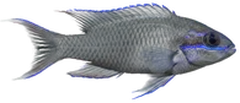
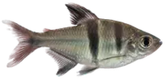
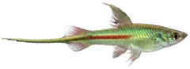
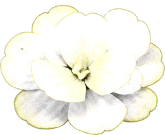
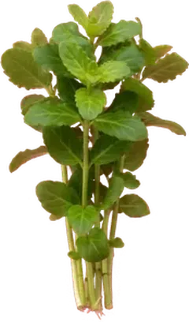

# reeftank-catalog

<!-- species:begin (generated by scripts/make_readme.py, do not edit) -->

> Onderdeel van het [**ReefTech-projectecosysteem**](https://elwinmage.github.io/reeftank/)

       

Vissen-, koraal-, planten- en ongewervelde soorten voor de aquariumweergave van [ha-reef-card](https://github.com/Elwinmage/ha-reef-card), geleverd door de [ReefTank-integratie](https://github.com/Elwinmage/ha-reeftank-component).

De integratie downloadt de releases van deze repository en houdt ze up-to-date (`update.reeftank_catalog`, standaard automatisch): niets te doen in Home Assistant.

## Hoe het werkt

Elke vis is een blad met beelden (een WebP-atlas) en een descriptor met zijn clips: *zwemmen*, *stilstaan* en *keren*. De kaart speelt ze achter elkaar af en spiegelt de keer, zodat de vis terugkeert langs dezelfde weg. Hier het zwemmen, de keer en de terugkeer van twee soorten:

<table><tr><td align="center"> Keizersvlinderbaars</td><td align="center"> Clownvis</td></tr></table>

## Vissen (102)

**HD**: een echte animatie, gemaakt van video's. De andere hebben een eenvoudige animatie van een foto, of de generieke vis.

| &nbsp;&nbsp;&nbsp;&nbsp;&nbsp;&nbsp;&nbsp;&nbsp;&nbsp;&nbsp;&nbsp;&nbsp;&nbsp;&nbsp;&nbsp;&nbsp;&nbsp;&nbsp;&nbsp;&nbsp;&nbsp;&nbsp;&nbsp;&nbsp;&nbsp;&nbsp;&nbsp;&nbsp;&nbsp;&nbsp;&nbsp;&nbsp;&nbsp;&nbsp;&nbsp;&nbsp;&nbsp;&nbsp;&nbsp;&nbsp;&nbsp;&nbsp;&nbsp;&nbsp;&nbsp;&nbsp;&nbsp;&nbsp;&nbsp;&nbsp;&nbsp;&nbsp;&nbsp;&nbsp;&nbsp;&nbsp; | Naam | Wetenschappelijke naam | Water | Grootte | Gedrag | HD |
|---|---|---|---|---|---|---|
|  | Achtvormige kogelvis `dichotomyctere_biocellatus` | *Dichotomyctere biocellatus* | Brakwater | 5–6.5 cm | Openwaterzwemmer · verstopt zich 's nachts |  |
|  | Ancistrus `ancistrus` | *Ancistrus sp.* | Zoetwater | 10–14 cm | Bodembewoner · verstopt zich 's nachts |  |
|  | Anemoonvis `amphiprion` | *Amphiprion sp.* | Zeewater | 7–11 cm | Blijft op zijn plek · zweeft 's nachts | ✔ |
|  | Anthias `pseudanthias` | *Pseudanthias sp.* | Zeewater | 8–14 cm | Scholenvis · verstopt zich 's nachts | ✔ |
|  | Atlantische slikspringer `periophthalmus_barbarus` | *Periophthalmus barbarus* | Brakwater | 10–15 cm | Bodembewoner · verstopt zich 's nachts |  |
|  | Banggai-kardinaalbaars `pterapogon_kauderni` | *Pterapogon kauderni* | Zeewater | 5–8 cm | Blijft op zijn plek · zweeft 's nachts | ✔ |
|  | Blauwe doktersvis `paracanthurus_hepatus` | *Paracanthurus hepatus* | Zeewater | 20–30 cm | Openwaterzwemmer · verstopt zich 's nachts |  |
|  | Blauwe goerami `trichopodus_trichopterus` | *Trichopodus trichopterus* | Zoetwater | 10–15 cm | Openwaterzwemmer · verstopt zich 's nachts |  |
|  | Blauwstreep-poetsvis `labroides_dimidiatus` | *Labroides dimidiatus* | Zeewater | 10–12 cm | Openwaterzwemmer · verstopt zich 's nachts |  |
|  | Bronzen pantserwels `corydoras_aeneus` | *Corydoras aeneus* | Zoetwater | 6–7 cm | Bodembewoner · verstopt zich 's nachts |  |
|  | Bruine doktersvis `zebrasoma_scopas` | *Zebrasoma scopas* | Zeewater | 15–20 cm | Openwaterzwemmer · verstopt zich 's nachts |  |
|  | Citroen-koraalgrondel `gobiodon_citrinus` | *Gobiodon citrinus* | Zeewater | 3–5 cm | Bodembewoner · verstopt zich 's nachts |  |
|  | Citroentetra `hyphessobrycon_pulchripinnis` | *Hyphessobrycon pulchripinnis* | Zoetwater | 3–4.5 cm | Scholenvis · verstopt zich 's nachts |  |
|  | Clownbotia `chromobotia_macracanthus` | *Chromobotia macracanthus* | Zoetwater | 15–30 cm | Bodembewoner · verstopt zich 's nachts |  |
|  | Demasoni-cichlide `pseudotropheus_demasoni` | *Pseudotropheus demasoni* | Zoetwater | 7–8 cm | Openwaterzwemmer · verstopt zich 's nachts |  |
|  | Discus `symphysodon_aequifasciatus` | *Symphysodon aequifasciatus* | Zoetwater | 15–20 cm | Openwaterzwemmer · verstopt zich 's nachts |  |
|  | Driestippel-dascyllus `dascyllus_trimaculatus` | *Dascyllus trimaculatus* | Zeewater | 10–14 cm | Blijft op zijn plek · zweeft 's nachts |  |
|  | Dwerggoerami `trichogaster_lalius` | *Trichogaster lalius* | Zoetwater | 5–8 cm | Openwaterzwemmer · verstopt zich 's nachts |  |
|  | Elektrisch gele cichlide `labidochromis_caeruleus` | *Labidochromis caeruleus* | Zoetwater | 8–10 cm | Openwaterzwemmer · verstopt zich 's nachts |  |
|  | Endlers guppy `poecilia_wingei` | *Poecilia wingei* | Zoetwater | 2–4 cm | Scholenvis · verstopt zich 's nachts |  |
|  | Fiji-juffertje `chrysiptera_taupou` | *Chrysiptera taupou* | Zeewater | 6–8 cm | Blijft op zijn plek · blijft bij zijn schuilplaats · zweeft 's nachts |  |
|  | Galaxy-danio `danio_margaritatus` | *Danio margaritatus* | Zoetwater | 2–3 cm | Scholenvis · verstopt zich 's nachts |  |
|  | Gebandeerde grondel `amblygobius_phalaena` | *Amblygobius phalaena* | Zeewater | 8–10 cm | Leeft op het zand · rust 's nachts op de bodem |  |
|  | Gebandeerde schietvis `toxotes_jaculatrix` | *Toxotes jaculatrix* | Brakwater | 15–25 cm | Openwaterzwemmer · verstopt zich 's nachts |  |
|  | Geelgestreepte kardinaalbaars `ostorhinchus_cyanosoma` | *Ostorhinchus cyanosoma* | Zeewater | 7–8 cm | Blijft op zijn plek · zweeft 's nachts |  |
|  | Geelkop-kaakvis `opistognathus_aurifrons` | *Opistognathus aurifrons* | Zeewater | 10–12 cm | Leeft op het zand · leeft in een hol · rust 's nachts op de bodem |  |
|  | Geelstaartjuffertje `chrysiptera_parasema` | *Chrysiptera parasema* | Zeewater | 5–6 cm | Blijft op zijn plek · blijft bij zijn schuilplaats · zweeft 's nachts |  |
|  | Gele doktersvis `zebrasoma_flavescens` | *Zebrasoma flavescens* | Zeewater | 15–20 cm | Openwaterzwemmer · verstopt zich 's nachts |  |
|  | Gele lipvis `halichoeres_chrysus` | *Halichoeres chrysus* | Zeewater | 10–12 cm | Openwaterzwemmer · rust 's nachts op de bodem |  |
|  | Gele symbiosegrondel `cryptocentrus_cinctus` | *Cryptocentrus cinctus* | Zeewater | 8–10 cm | Leeft op het zand · leeft in een hol · rust 's nachts op de bodem |  |
|  | Gemarmerde bijlvis `carnegiella_strigata` | *Carnegiella strigata* | Zoetwater | 4–5 cm | Scholenvis · verstopt zich 's nachts |  |
|  | Gestreept zeepaardje `hippocampus_erectus` | *Hippocampus erectus* | Zeewater | 10–15 cm | Blijft op zijn plek · zweeft 's nachts |  |
|  | Gewone molly `poecilia_sphenops` | *Poecilia sphenops* | Zoetwater, Brakwater | 6–10 cm | Scholenvis · verstopt zich 's nachts |  |
|  | Goudvis `carassius_auratus` | *Carassius auratus* | Zoetwater | 10–25 cm | Openwaterzwemmer · verstopt zich 's nachts |  |
|  | Grasmaaier-slijmvis `salarias_fasciatus` | *Salarias fasciatus* | Zeewater | 12–14 cm | Bodembewoner · verstopt zich 's nachts |  |
|  | Groene chromis `chromis_viridis` | *Chromis viridis* | Zeewater | 5–8 cm | Scholenvis · verstopt zich 's nachts | ✔ |
|  | Groene kogelvis `dichotomyctere_nigroviridis` | *Dichotomyctere nigroviridis* | Brakwater | 10–17 cm | Openwaterzwemmer · verstopt zich 's nachts |  |
|  | Guppy `poecilia_reticulata` | *Poecilia reticulata* | Zoetwater | 3–6 cm | Scholenvis · verstopt zich 's nachts |  |
|  | Harlekijnbarbeel `trigonostigma_heteromorpha` | *Trigonostigma heteromorpha* | Zoetwater | 3–4.5 cm | Scholenvis · verstopt zich 's nachts |  |
|  | Hommelgrondel `brachygobius_xanthozonus` | *Brachygobius xanthozonus* | Brakwater | 3–4 cm | Bodembewoner · verstopt zich 's nachts |  |
|  | Kaketoe-dwergcichlide `apistogramma_cacatuoides` | *Apistogramma cacatuoides* | Zoetwater | 5–9 cm | Bodembewoner · verstopt zich 's nachts |  |
|  | Kardinaaltetra `paracheirodon_axelrodi` | *Paracheirodon axelrodi* | Zoetwater | 3–5 cm | Scholenvis · verstopt zich 's nachts |  |
|  | Kastanjebruine anemoonvis `premnas_biaculeatus` | *Premnas biaculeatus* | Zeewater | 10–15 cm | Blijft op zijn plek · zweeft 's nachts |  |
|  | Keizer-engelvis (juveniel) `pomacanthus_imperator` | *Pomacanthus imperator* | Zeewater | 6–12 cm | Openwaterzwemmer · verstopt zich 's nachts | ✔ |
|  | Keizer-engelvis (volwassen) `pomacanthus_imperator_adult` | *Pomacanthus imperator* | Zeewater | 25–38 cm | Openwaterzwemmer · verstopt zich 's nachts | ✔ |
|  | Keizertetra `nematobrycon_palmeri` | *Nematobrycon palmeri* | Zoetwater | 4–6 cm | Scholenvis · verstopt zich 's nachts |  |
|  | Kersenbarbeel `pethia_titteya` | *Pethia titteya* | Zoetwater | 4–5 cm | Scholenvis · verstopt zich 's nachts |  |
|  | Kole-doktersvis `ctenochaetus_strigosus` | *Ctenochaetus strigosus* | Zeewater | 12–18 cm | Openwaterzwemmer · verstopt zich 's nachts |  |
|  | Koningsgramma `gramma_loreto` | *Gramma loreto* | Zeewater | 7–8 cm | Blijft op zijn plek · zweeft 's nachts |  |
|  | Koninklijke keizersvis `pygoplites_diacanthus` | *Pygoplites diacanthus* | Zeewater | 20–25 cm | Openwaterzwemmer · verstopt zich 's nachts |  |
|  | Koperband-vlindervis `chelmon_rostratus` | *Chelmon rostratus* | Zeewater | 15–20 cm | Openwaterzwemmer · verstopt zich 's nachts |  |
|  | Kribensis `pelvicachromis_pulcher` | *Pelvicachromis pulcher* | Zoetwater | 8–10 cm | Bodembewoner · verstopt zich 's nachts |  |
|  | Kuhli-modderkruiper `pangio_kuhlii` | *Pangio kuhlii* | Zoetwater | 8–12 cm | Bodembewoner · verstopt zich 's nachts |  |
|  | Lierstaartkilli `aphyosemion_australe` | *Aphyosemion australe* | Zoetwater | 5–6 cm | Blijft op zijn plek · zweeft 's nachts |  |
|  | Mandarijnvis `synchiropus_splendidus` | *Synchiropus splendidus* | Zeewater | 5–8 cm | Bodembewoner · verstopt zich 's nachts | ✔ |
|  | Neongrondel `elacatinus_oceanops` | *Elacatinus oceanops* | Zeewater | 4–6 cm | Bodembewoner · verstopt zich 's nachts |  |
|  | Neontetra `paracheirodon_innesi` | *Paracheirodon innesi* | Zoetwater | 3–4 cm | Scholenvis · verstopt zich 's nachts |  |
|  | Okinawa-koraalgrondel `gobiodon_okinawae` | *Gobiodon okinawae* | Zeewater | 2.5–3.5 cm | Bodembewoner · verstopt zich 's nachts |  |
|  | Orchideedwergbaars `pseudochromis_fridmani` | *Pseudochromis fridmani* | Zeewater | 6–7 cm | Blijft op zijn plek · blijft bij zijn schuilplaats · zweeft 's nachts |  |
|  | Oscar `astronotus_ocellatus` | *Astronotus ocellatus* | Zoetwater | 25–35 cm | Openwaterzwemmer · verstopt zich 's nachts |  |
|  | Otocinclus `otocinclus_affinis` | *Otocinclus affinis* | Zoetwater | 3–5 cm | Bodembewoner · verstopt zich 's nachts |  |
|  | Panda-pantserwels `corydoras_panda` | *Corydoras panda* | Zoetwater | 4–5 cm | Bodembewoner · verstopt zich 's nachts |  |
|  | Parel-danio `danio_albolineatus` | *Danio albolineatus* | Zoetwater | 4–6 cm | Scholenvis · verstopt zich 's nachts |  |
|  | Parelgoerami `trichopodus_leerii` | *Trichopodus leerii* | Zoetwater | 10–12 cm | Openwaterzwemmer · verstopt zich 's nachts |  |
|  | Picasso-trekkervis `rhinecanthus_aculeatus` | *Rhinecanthus aculeatus* | Zeewater | 20–25 cm | Openwaterzwemmer · verstopt zich 's nachts |  |
|  | Pixie-valkvis `cirrhitichthys_oxycephalus` | *Cirrhitichthys oxycephalus* | Zeewater | 8–10 cm | Bodembewoner · verstopt zich 's nachts |  |
|  | Platy `xiphophorus_maculatus` | *Xiphophorus maculatus* | Zoetwater | 4–6 cm | Scholenvis · verstopt zich 's nachts |  |
|  | Poederblauwe doktersvis `acanthurus_leucosternon` | *Acanthurus leucosternon* | Zeewater | 20–23 cm | Openwaterzwemmer · verstopt zich 's nachts |  |
|  | Psychedelische mandarijnvis `synchiropus_picturatus` | *Synchiropus picturatus* | Zeewater | 6–8 cm | Bodembewoner · verstopt zich 's nachts |  |
|  | Purperen vuurvis `nemateleotris_decora` | *Nemateleotris decora* | Zeewater | 8–10 cm | Blijft op zijn plek · zweeft 's nachts |  |
|  | Pyjama-kardinaalbaars `sphaeramia_nematoptera` | *Sphaeramia nematoptera* | Zeewater | 8–10 cm | Blijft op zijn plek · zweeft 's nachts |  |
|  | Ramirezi `mikrogeophagus_ramirezi` | *Mikrogeophagus ramirezi* | Zoetwater | 5–7 cm | Blijft op zijn plek · zweeft 's nachts |  |
|  | Ridder-grondel `stigmatogobius_sadanundio` | *Stigmatogobius sadanundio* | Brakwater | 6–8 cm | Bodembewoner · verstopt zich 's nachts |  |
|  | Rode leeuwenvis `pterois_volitans` | *Pterois volitans* | Zeewater | 25–35 cm | Openwaterzwemmer · verstopt zich 's nachts |  |
|  | Roodneus-tetra `hemigrammus_bleheri` | *Hemigrammus bleheri* | Zoetwater | 4–5 cm | Scholenvis · verstopt zich 's nachts |  |
|  | Rouwtetra `gymnocorymbus_ternetzi` | *Gymnocorymbus ternetzi* | Zoetwater | 5–6 cm | Scholenvis · verstopt zich 's nachts |  |
|  | Scat `scatophagus_argus` | *Scatophagus argus* | Brakwater, Zeewater | 15–30 cm | Openwaterzwemmer · verstopt zich 's nachts |  |
|  | Serpae-tetra `hyphessobrycon_eques` | *Hyphessobrycon eques* | Zoetwater | 3–4.5 cm | Scholenvis · verstopt zich 's nachts |  |
|  | Siamese algeneter `crossocheilus_oblongus` | *Crossocheilus oblongus* | Zoetwater | 10–15 cm | Openwaterzwemmer · verstopt zich 's nachts |  |
|  | Siamese kempvis `betta_splendens` | *Betta splendens* | Zoetwater | 5–7 cm | Blijft op zijn plek · blijft bij zijn schuilplaats · zweeft 's nachts |  |
|  | Skalaar `pterophyllum_scalare` | *Pterophyllum scalare* | Zoetwater | 12–15 cm | Openwaterzwemmer · verstopt zich 's nachts |  |
|  | Slaapgrondel `valenciennea` | *Valenciennea sp.* | Zeewater | 10–16 cm | Leeft op het zand · leeft in een hol · rust 's nachts op de bodem | ✔ |
|  | Solor-feeënlipvis `cirrhilabrus_solorensis` | *Cirrhilabrus solorensis* | Zeewater | 10–12 cm | Openwaterzwemmer · verstopt zich 's nachts |  |
|  | Sumatraanse barbeel `puntigrus_tetrazona` | *Puntigrus tetrazona* | Zoetwater | 5–7 cm | Scholenvis · verstopt zich 's nachts |  |
|  | Turquoise regenboogvis `melanotaenia_lacustris` | *Melanotaenia lacustris* | Zoetwater | 8–12 cm | Scholenvis · verstopt zich 's nachts |  |
|  | Tweekleurige dwergkeizersvis `centropyge_bicolor` | *Centropyge bicolor* | Zeewater | 10–15 cm | Blijft op zijn plek · zweeft 's nachts |  |
|  | Tweekleurige slijmvis `ecsenius_bicolor` | *Ecsenius bicolor* | Zeewater | 8–10 cm | Bodembewoner · verstopt zich 's nachts |  |
|  | Valentins kogelvis `canthigaster_valentini` | *Canthigaster valentini* | Zeewater | 8–10 cm | Openwaterzwemmer · verstopt zich 's nachts |  |
|  | Violette grondel `gobioides_broussonnetii` | *Gobioides broussonnetii* | Brakwater | 30–50 cm | Leeft op het zand · leeft in een hol · rust 's nachts op de bodem |  |
|  | Vlammen-dwergkeizersvis `centropyge_loricula` | *Centropyge loricula* | Zeewater | 8–10 cm | Blijft op zijn plek · zweeft 's nachts |  |
|  | Vossengezicht konijnvis `siganus_vulpinus` | *Siganus vulpinus* | Zeewater | 15–22 cm | Openwaterzwemmer · rust 's nachts op de bodem | ✔ |
|  | Vuurvis `nemateleotris_magnifica` | *Nemateleotris magnifica* | Zeewater | 8–10 cm | Blijft op zijn plek · zweeft 's nachts |  |
|  | Witte wolkenvis `tanichthys_albonubes` | *Tanichthys albonubes* | Zoetwater | 3–4 cm | Scholenvis · verstopt zich 's nachts |  |
|  | Yasha-symbiosegrondel `stonogobiops_yasha` | *Stonogobiops yasha* | Zeewater | 6–8 cm | Leeft op het zand · leeft in een hol · rust 's nachts op de bodem |  |
|  | Zebra-harnasmeerval `hypancistrus_zebra` | *Hypancistrus zebra* | Zoetwater | 7–10 cm | Bodembewoner · verstopt zich 's nachts |  |
|  | Zebra-leeuwenvis `dendrochirus_zebra` | *Dendrochirus zebra* | Zeewater | 12–18 cm | Openwaterzwemmer · verstopt zich 's nachts |  |
|  | Zebravisje `danio_rerio` | *Danio rerio* | Zoetwater | 4–5 cm | Scholenvis · verstopt zich 's nachts |  |
|  | Zeil-doktersvis `zebrasoma_veliferum` | *Zebrasoma veliferum* | Zeewater | 25–40 cm | Openwaterzwemmer · verstopt zich 's nachts |  |
|  | Zeilvin-molly `poecilia_velifera` | *Poecilia velifera* | Brakwater, Zoetwater | 10–15 cm | Scholenvis · verstopt zich 's nachts |  |
|  | Zesstrepen-lipvis `pseudocheilinus_hexataenia` | *Pseudocheilinus hexataenia* | Zeewater | 7–10 cm | Openwaterzwemmer · verstopt zich 's nachts |  |
|  | Zilveren maanvis `monodactylus_argenteus` | *Monodactylus argenteus* | Brakwater, Zeewater | 15–25 cm | Scholenvis · verstopt zich 's nachts |  |
|  | Zwaarddrager `xiphophorus_hellerii` | *Xiphophorus hellerii* | Zoetwater | 6–12 cm | Scholenvis · verstopt zich 's nachts |  |

## Koralen (1)

| &nbsp;&nbsp;&nbsp;&nbsp;&nbsp;&nbsp;&nbsp;&nbsp;&nbsp;&nbsp;&nbsp;&nbsp;&nbsp;&nbsp;&nbsp;&nbsp;&nbsp;&nbsp;&nbsp;&nbsp;&nbsp;&nbsp;&nbsp;&nbsp;&nbsp;&nbsp;&nbsp;&nbsp;&nbsp;&nbsp;&nbsp;&nbsp;&nbsp;&nbsp;&nbsp;&nbsp;&nbsp;&nbsp;&nbsp;&nbsp;&nbsp;&nbsp;&nbsp;&nbsp;&nbsp;&nbsp;&nbsp;&nbsp;&nbsp;&nbsp;&nbsp;&nbsp;&nbsp;&nbsp;&nbsp;&nbsp; | Naam | Wetenschappelijke naam | Water | Grootte |
|---|---|---|---|---|
|  | Fakkelkoraal `euphyllia_glabrescens` | *Euphyllia glabrescens* | Zeewater | 10–30 cm |

## Planten (29)

| &nbsp;&nbsp;&nbsp;&nbsp;&nbsp;&nbsp;&nbsp;&nbsp;&nbsp;&nbsp;&nbsp;&nbsp;&nbsp;&nbsp;&nbsp;&nbsp;&nbsp;&nbsp;&nbsp;&nbsp;&nbsp;&nbsp;&nbsp;&nbsp;&nbsp;&nbsp;&nbsp;&nbsp;&nbsp;&nbsp;&nbsp;&nbsp;&nbsp;&nbsp;&nbsp;&nbsp;&nbsp;&nbsp;&nbsp;&nbsp;&nbsp;&nbsp;&nbsp;&nbsp;&nbsp;&nbsp;&nbsp;&nbsp;&nbsp;&nbsp;&nbsp;&nbsp;&nbsp;&nbsp;&nbsp;&nbsp; | Naam | Wetenschappelijke naam | Water | Grootte | Zone |
|---|---|---|---|---|---|
|  | Amazone-kikkerbeet `limnobium_laevigatum` | *Limnobium laevigatum* | Zoetwater | 5–10 cm | Drijvend |
|  | Amazone-zwaardplant `echinodorus_bleheri` | *Echinodorus bleheri* | Zoetwater | 30–50 cm | Middengrond |
|  | Ambulia `limnophila_sessiliflora` | *Limnophila sessiliflora* | Zoetwater | 20–40 cm | Achtergrond |
|  | Anubias `anubias_barteri` | *Anubias barteri* | Zoetwater | 10–25 cm | Epifyt |
|  | Brazilaanse waterpest `egeria_densa` | *Egeria densa* | Zoetwater | 30–100 cm | Achtergrond |
|  | Bucephalandra `bucephalandra` | *Bucephalandra sp.* | Zoetwater | 5–15 cm | Epifyt |
|  | Cabomba `cabomba_caroliniana` | *Cabomba caroliniana* | Zoetwater | 30–60 cm | Achtergrond |
|  | Caulerpa `caulerpa_prolifera` | *Caulerpa prolifera* | Zeewater | 5–20 cm | Voorgrond |
|  | Chaetomorpha `chaetomorpha_linum` | *Chaetomorpha linum* | Zeewater | 5–30 cm | Voorgrond |
|  | Cryptocoryne ciliata `cryptocoryne_ciliata` | *Cryptocoryne ciliata* | Brakwater, Zoetwater | 20–40 cm | Middengrond |
|  | Cryptocoryne parva `cryptocoryne_parva` | *Cryptocoryne parva* | Zoetwater | 5–8 cm | Voorgrond |
|  | Cryptocoryne wendtii `cryptocoryne_wendtii` | *Cryptocoryne wendtii* | Zoetwater | 10–20 cm | Middengrond |
|  | Dwergnaaldbies `eleocharis_parvula` | *Eleocharis parvula* | Zoetwater | 5–10 cm | Voorgrond |
|  | Dwergpijlkruid `sagittaria_subulata` | *Sagittaria subulata* | Zoetwater | 10–30 cm | Voorgrond |
|  | Glossostigma `glossostigma_elatinoides` | *Glossostigma elatinoides* | Zoetwater | 2–5 cm | Voorgrond |
|  | Halimeda `halimeda_opuntia` | *Halimeda opuntia* | Zeewater | 5–15 cm | Voorgrond |
|  | Hemianthus `hemianthus_callitrichoides` | *Hemianthus callitrichoides* | Zoetwater | 2–5 cm | Voorgrond |
|  | Hygrophila `hygrophila_polysperma` | *Hygrophila polysperma* | Zoetwater | 20–50 cm | Achtergrond |
|  | Javamos `vesicularia_dubyana` | *Vesicularia dubyana* | Zoetwater | 3–5 cm | Epifyt |
|  | Javavaren `microsorum_pteropus` | *Microsorum pteropus* | Zoetwater | 20–30 cm | Epifyt |
|  | Klein kroos `lemna_minor` | *Lemna minor* | Zoetwater | 0.5–1 cm | Drijvend |
|  | Ludwigia `ludwigia_repens` | *Ludwigia repens* | Zoetwater | 20–40 cm | Middengrond |
|  | Marimo `aegagropila_linnaei` | *Aegagropila linnaei* | Zoetwater | 3–10 cm | Voorgrond |
|  | Rode mangrove `rhizophora_mangle` | *Rhizophora mangle* | Brakwater, Zeewater | 30–100 cm | Middengrond |
|  | Rotala `rotala_rotundifolia` | *Rotala rotundifolia* | Zoetwater | 20–50 cm | Achtergrond |
|  | Schildpadgras `thalassia_testudinum` | *Thalassia testudinum* | Zeewater | 10–30 cm | Voorgrond |
|  | Staurogyne `staurogyne_repens` | *Staurogyne repens* | Zoetwater | 5–10 cm | Voorgrond |
|  | Vallisneria `vallisneria_spiralis` | *Vallisneria spiralis* | Zoetwater, Brakwater | 30–60 cm | Achtergrond |
|  | Watersla `pistia_stratiotes` | *Pistia stratiotes* | Zoetwater | 5–15 cm | Drijvend |

## Ongewervelden (32)

| &nbsp;&nbsp;&nbsp;&nbsp;&nbsp;&nbsp;&nbsp;&nbsp;&nbsp;&nbsp;&nbsp;&nbsp;&nbsp;&nbsp;&nbsp;&nbsp;&nbsp;&nbsp;&nbsp;&nbsp;&nbsp;&nbsp;&nbsp;&nbsp;&nbsp;&nbsp;&nbsp;&nbsp;&nbsp;&nbsp;&nbsp;&nbsp;&nbsp;&nbsp;&nbsp;&nbsp;&nbsp;&nbsp;&nbsp;&nbsp;&nbsp;&nbsp;&nbsp;&nbsp;&nbsp;&nbsp;&nbsp;&nbsp;&nbsp;&nbsp;&nbsp;&nbsp;&nbsp;&nbsp;&nbsp;&nbsp; | Naam | Wetenschappelijke naam | Water | Grootte | Rol |
|---|---|---|---|---|---|
|  | Amano-garnaal `caridina_multidentata` | *Caridina multidentata* | Zoetwater | 3–5 cm | Algeneter · kruipt over de bodem |
|  | Appelslak `pomacea_bridgesii` | *Pomacea bridgesii* | Zoetwater | 4–5 cm | Aaseter · kruipt over de bodem |
|  | Astraea-slak `astraea_tecta` | *Astraea tecta* | Zeewater | 2–4 cm | Algeneter · leeft op het decor |
|  | Bamboegarnaal `atyopsis_moluccensis` | *Atyopsis moluccensis* | Zoetwater | 6–8 cm | Filtreerder · leeft op het decor |
|  | Blauwpoot-kluizenaar `clibanarius_tricolor` | *Clibanarius tricolor* | Zeewater | 2–3 cm | Aaseter · kruipt over de bodem |
|  | Boorende reuzenmossel `tridacna_crocea` | *Tridacna crocea* | Zeewater | 5–15 cm | Filtreerder · vastzittend |
|  | Boxergarnaal `stenopus_hispidus` | *Stenopus hispidus* | Zeewater | 6–8 cm | Opruimer · leeft op het decor |
|  | Cerithium-slak `cerithium` | *Cerithium sp.* | Zeewater | 2–3 cm | Detrituseter · kruipt over de bodem |
|  | Crystal red-garnaal `caridina_cantonensis` | *Caridina cantonensis* | Zoetwater | 2–3 cm | Detrituseter · kruipt over de bodem |
|  | Gemarmerde garnaal `saron_marmoratus` | *Saron marmoratus* | Zeewater | 5–7 cm | Aaseter · leeft op het decor |
|  | Harlekijngarnaal `hymenocera_picta` | *Hymenocera picta* | Zeewater | 4–6 cm | Roofdier · kruipt over de bodem |
|  | Kersengarnaal `neocaridina_davidi` | *Neocaridina davidi* | Zoetwater | 2–3.5 cm | Detrituseter · kruipt over de bodem |
|  | Kerstboomworm `spirobranchus_giganteus` | *Spirobranchus giganteus* | Zeewater | 3–5 cm | Filtreerder · vastzittend |
|  | Maleise trompetslak `melanoides_tuberculata` | *Melanoides tuberculata* | Zoetwater | 2–3 cm | Detrituseter · kruipt over de bodem |
|  | Mariene nerietslak `nerita` | *Nerita sp.* | Zeewater | 2–3 cm | Algeneter · klimt tegen het glas |
|  | Moordenaarslak `clea_helena` | *Clea helena* | Zoetwater | 2–3 cm | Roofdier · kruipt over de bodem |
|  | Nassarius-slak `nassarius` | *Nassarius sp.* | Zeewater | 2–4 cm | Aaseter · kruipt over de bodem |
|  | Pepermuntgarnaal `lysmata_wurdemanni` | *Lysmata wurdemanni* | Zeewater | 3–5 cm | Opruimer · leeft op het decor |
|  | Posthoornslak `planorbella_duryi` | *Planorbella duryi* | Zoetwater | 2–3 cm | Detrituseter · klimt tegen het glas |
|  | Potloodzee-egel `prionocidaris_baculosa` | *Prionocidaris baculosa* | Zeewater | 8–10 cm | Algeneter · leeft op het decor |
|  | Rode poetsgarnaal `lysmata_amboinensis` | *Lysmata amboinensis* | Zeewater | 5–6 cm | Opruimer · leeft op het decor |
|  | Scharlaken kluizenaar `paguristes_cadenati` | *Paguristes cadenati* | Zeewater | 3–4 cm | Aaseter · kruipt over de bodem |
|  | Slangster `ophiolepis_superba` | *Ophiolepis superba* | Zeewater | 8–12 cm | Aaseter · kruipt over de bodem |
|  | Smaragdkrab `mithraculus_sculptus` | *Mithraculus sculptus* | Zeewater | 3–4 cm | Algeneter · leeft op het decor |
|  | Trochus-slak `tectus_fenestratus` | *Tectus fenestratus* | Zeewater | 4–6 cm | Algeneter · leeft op het decor |
|  | Turbo-slak `turbo_fluctuosus` | *Turbo fluctuosus* | Zeewater | 4–8 cm | Algeneter · klimt tegen het glas |
|  | Verzamelaarszee-egel `tripneustes_gratilla` | *Tripneustes gratilla* | Zeewater | 10–15 cm | Algeneter · leeft op het decor |
|  | Vuurgarnaal `lysmata_debelius` | *Lysmata debelius* | Zeewater | 5–6 cm | Opruimer · leeft op het decor |
|  | Waaierworm `sabellastarte` | *Sabellastarte sp.* | Zeewater | 5–10 cm | Filtreerder · vastzittend |
|  | Zandzeester `archaster_typicus` | *Archaster typicus* | Zeewater | 6–10 cm | Detrituseter · kruipt over de bodem |
|  | Zebra-nerietslak `neritina_natalensis` | *Neritina natalensis* | Zoetwater | 2–3 cm | Algeneter · klimt tegen het glas |
|  | Zeekomkommer `holothuria` | *Holothuria sp.* | Zeewater | 15–30 cm | Detrituseter · kruipt over de bodem |

Om een soort toe te voegen (clips genereren, bouwen, publiceren), zie de [Engelse documentatie](README.md).

De soortbestanden vallen onder **CC BY 4.0**, de scripts onder MIT: zie [LICENSE.md](LICENSE.md).

<!-- species:end -->

<!-- ecosystem:start -->

## Verwante projecten

De ReefTech-projecten grijpen in elkaar: de integraties brengen uw apparatuur in Home Assistant, de kaart toont en bedient ze, en de back-up houdt alles draaiend tijdens een stroomuitval. Elk werkt ook op zichzelf.

<table>
  <tr>
    <th width="100px"></th>
    <th>Project</th>
    <th>Rol</th>
    <th>Werkt samen met</th>
  </tr>
  <tr>
    <td></td>
    <td>🐠 <a href="https://github.com/Elwinmage/ha-reefbeat-component"><b>ha-reefbeat-component</b></a></td>
    <td>Red Sea ReefBeat-apparaten, lokaal aangestuurd zonder cloud: ReefATO+, ReefControl, ReefControl-Power, ReefDose, ReefLed, ReefMat, ReefRun en ReefWave. blueprint met meldingen voor afwijkende modi, kalibraties en lage accu. </td>
    <td>ha-reef-card</td>
  </tr>
  <tr>
    <td></td>
    <td>🌊 <a href="https://github.com/Elwinmage/ha-aquamedic-component"><b>ha-aquamedic-component</b></a></td>
    <td>Aqua Medic-pompen via de Gizwits-cloud-API: EcoDrift- en SmartDrift-stromingspompen, DC Runner opvoer- en afschuimerpompen.</td>
    <td>ha-reef-card</td>
  </tr>
  <tr>
    <td></td>
    <td>🐟 <a href="https://github.com/Elwinmage/ha-vson-component"><b>ha-vson-component</b></a></td>
    <td>VSON automatische voederautomaten via de VSON-cloud-API: de WP8621-voederautomaat (voeren, accu, waarschuwing bij weinig voer) en generieke detectie van elk ander VSON-apparaat. De WP8621 kan ook volledig lokaal draaien op ESPHome.</td>
    <td>ha-reef-card</td>
  </tr>
  <tr>
    <td></td>
    <td>🐙 <a href="https://github.com/Elwinmage/ha-reef-maintenance-component"><b>ha-reef-maintenance-component</b></a></td>
    <td>Schoonmaak- en slijtageopvolging voor apparatuur die Home Assistant niet kan uitlezen: stromingspompen, opvoerpompen, eiwitafschuimers, reactoren, alles wat u met de hand onderhoudt.</td>
    <td>ha-reef-card</td>
  </tr>
  <tr>
    <td></td>
    <td>🪸 <a href="https://github.com/Elwinmage/ha-reef-card"><b>ha-reef-card</b></a></td>
    <td>Interactieve grafische weergave van elk apparaat op uw dashboard, en de enige manier om geavanceerde schema's te bewerken. Leest de drie integraties via het gedeelde <code>reef_role</code>-contract, zonder configuratie aan de kaartzijde. Tekent ook de energiestromen van reefbeatEnergyBackup. De aquariumkaart brengt uw bak tot leven met ha-reeftank-component.</td>
    <td>alle vier de integraties, en ha-reeftank-component voor het aquarium</td>
  </tr>
  <tr>
    <td></td>
    <td>🐟 <a href="https://github.com/Elwinmage/ha-reeftank-component"><b>ha-reeftank-component</b></a></td>
    <td>Een levend beeld van uw bak op het dashboard: uw foto, verlicht door uw echte lampen, met geanimeerde vissen en koralen, en uw apparaten en entiteiten erop. Bewaart de aquaria en hun bezetting, legt de voederingen vast.</td>
    <td>ha-reef-card</td>
  </tr>
  <tr>
    <td></td>
    <td>🐡 <b>reeftank-catalog</b> <i>(deze repository)</i></td>
    <td>Vissen, koralen en texturen van de aquariumkaart, gedownload en bijgehouden door ha-reeftank-component.</td>
    <td>ha-reeftank-component</td>
  </tr>
  <tr>
    <td></td>
    <td>🐬 <a href="https://github.com/Elwinmage/ha-reef-blueprints"><b>ha-reef-blueprints</b></a></td>
    <td>Automatiserings-blueprints voor het hele ecosysteem: achterstallig onderhoud gevonden via het <code>reef_role</code>-contract, apparaten die onbereikbaar zijn geworden, een periodieke verwarmertest en relaisbewaking. Acht talen.</td>
    <td>alle vier de integraties</td>
  </tr>
  <tr>
    <td></td>
    <td>⚡ <a href="https://github.com/Elwinmage/reefbeatEnergyBackup"><b>reefbeatEnergyBackup</b></a></td>
    <td>Accuback-up bij stroomuitval. Een 24V LiFePO₄-pakket aangestuurd door een Raspberry Pi, met de pompsnelheid die geleidelijk zakt met de laadtoestand.</td>
    <td>zelfstandig, of samen met ha-reefbeat-component en ha-reef-card</td>
  </tr>
</table>

Alles staat samen gedocumenteerd op de [ReefTech-projectpagina](https://elwinmage.github.io/reeftank/).

<!-- ecosystem:end -->
