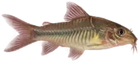
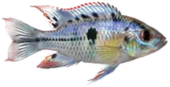
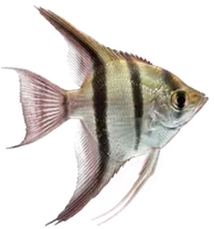
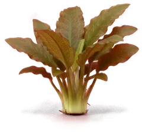
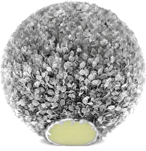
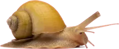
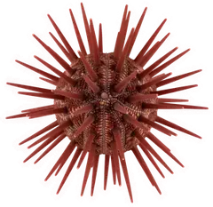
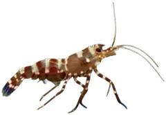
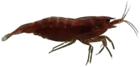
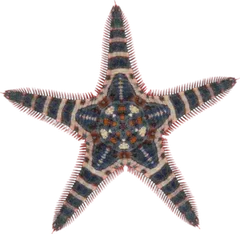

# reeftank-catalog

<!-- species:begin (generated by scripts/make_readme.py, do not edit) -->

> Część [**ekosystemu projektów ReefTech**](https://elwinmage.github.io/reeftank/)

       

Gatunki ryb, koralowców, roślin i bezkręgowców do widoku akwarium [ha-reef-card](https://github.com/Elwinmage/ha-reef-card), dostarczane przez [integrację ReefTank](https://github.com/Elwinmage/ha-reeftank-component).

Integracja pobiera wydania tego repozytorium i aktualizuje je (`update.reeftank_catalog`, domyślnie automatycznie): w Home Assistant nie trzeba nic robić.

## Jak to działa

Każda ryba to arkusz klatek (atlas WebP) i deskryptor z jej klipami: *pływanie*, *postój* i *zawrót*. Karta odtwarza je jeden po drugim, a zawrót odbija lustrzanie, by ryba wróciła tą samą drogą. Oto pływanie, zawrót i powrót dwóch gatunków:

Gatunek bez nagrań ma prostszy atlas zrobiony z jednego zdjęcia (*LD*): całe ciało się wygina, płetwy się nie ruszają. Atlasy zrobione z nagrań są zaznaczone w kolumnie HD tabel poniżej.

<table><tr><th></th><th>Pokolec cesarski</th><th>Błazenek</th></tr><tr><td>HD (nagrania)</td><td align="center"></td><td align="center"></td></tr><tr><td>LD (jedno zdjęcie)</td><td align="center"></td><td align="center"></td></tr></table>

## Ryby (102)

**HD**: prawdziwa animacja zrobiona z filmów. Pozostałe mają prostą animację ze zdjęcia albo rybę ogólną.

| &nbsp;&nbsp;&nbsp;&nbsp;&nbsp;&nbsp;&nbsp;&nbsp;&nbsp;&nbsp;&nbsp;&nbsp;&nbsp;&nbsp;&nbsp;&nbsp;&nbsp;&nbsp;&nbsp;&nbsp;&nbsp;&nbsp;&nbsp;&nbsp;&nbsp;&nbsp;&nbsp;&nbsp;&nbsp;&nbsp;&nbsp;&nbsp;&nbsp; | Nazwa | Nazwa naukowa | Woda | Rozmiar | Zachowanie | HD |
|---|---|---|---|---|---|---|
|  | Ancistrus <code>ancistrus</code> | *Ancistrus sp.* | Słodkowodna | 10–14 cm | Przydenny · chowa się w nocy | ✔ |
|  | Apistogramma kakadu <code>apistogramma&#95;<wbr>cacatuoides</code> | *Apistogramma cacatuoides* | Słodkowodna | 5–9 cm | Przydenny · chowa się w nocy | ✔ |
|  | Babka fioletowa <code>gobioides&#95;<wbr>broussonnetii</code> | *Gobioides broussonnetii* | Słonawa | 30–50 cm | Żyje na piasku · żyje w norze · odpoczywa w nocy na dnie | ✔ |
|  | Babka koralowa cytrynowa <code>gobiodon&#95;<wbr>citrinus</code> | *Gobiodon citrinus* | Morska | 3–5 cm | Przydenny · chowa się w nocy | ✔ |
|  | Babka neonowa <code>elacatinus&#95;<wbr>oceanops</code> | *Elacatinus oceanops* | Morska | 4–6 cm | Przydenny · chowa się w nocy | ✔ |
|  | Babka ognista <code>nemateleotris&#95;<wbr>magnifica</code> | *Nemateleotris magnifica* | Morska | 8–10 cm | Stoi w miejscu · unosi się w toni w nocy | ✔ |
|  | Babka ognista purpurowa <code>nemateleotris&#95;<wbr>decora</code> | *Nemateleotris decora* | Morska | 8–10 cm | Stoi w miejscu · unosi się w toni w nocy | ✔ |
|  | Babka okinawska <code>gobiodon&#95;<wbr>okinawae</code> | *Gobiodon okinawae* | Morska | 2.5–3.5 cm | Przydenny · chowa się w nocy | ✔ |
|  | Babka pasiasta <code>amblygobius&#95;<wbr>phalaena</code> | *Amblygobius phalaena* | Morska | 8–10 cm | Żyje na piasku · odpoczywa w nocy na dnie | ✔ |
|  | Babka piaskowa <code>valenciennea</code> | *Valenciennea sp.* | Morska | 10–16 cm | Żyje na piasku · żyje w norze · odpoczywa w nocy na dnie | ✔ |
|  | Babka rycerska <code>stigmatogobius&#95;<wbr>sadanundio</code> | *Stigmatogobius sadanundio* | Słonawa | 6–8 cm | Przydenny · chowa się w nocy | ✔ |
|  | Babka trzmielowa <code>brachygobius&#95;<wbr>xanthozonus</code> | *Brachygobius xanthozonus* | Słonawa | 3–4 cm | Przydenny · chowa się w nocy | ✔ |
|  | Babka yasha <code>stonogobiops&#95;<wbr>yasha</code> | *Stonogobiops yasha* | Morska | 6–8 cm | Żyje na piasku · żyje w norze · odpoczywa w nocy na dnie | ✔ |
|  | Babka żółta <code>cryptocentrus&#95;<wbr>cinctus</code> | *Cryptocentrus cinctus* | Morska | 8–10 cm | Żyje na piasku · żyje w norze · odpoczywa w nocy na dnie | ✔ |
|  | Bocja clown <code>chromobotia&#95;<wbr>macracanthus</code> | *Chromobotia macracanthus* | Słodkowodna | 15–30 cm | Przydenny · chowa się w nocy | ✔ |
|  | Bojownik wspaniały <code>betta&#95;<wbr>splendens</code> | *Betta splendens* | Słodkowodna | 5–7 cm | Stoi w miejscu · trzyma się swojej kryjówki · unosi się w toni w nocy | ✔ |
|  | Brzanka sumatrzańska <code>puntigrus&#95;<wbr>tetrazona</code> | *Puntigrus tetrazona* | Słodkowodna | 5–7 cm | Ławica · chowa się w nocy | ✔ |
|  | Brzanka wiśniowa <code>pethia&#95;<wbr>titteya</code> | *Pethia titteya* | Słodkowodna | 4–5 cm | Ławica · chowa się w nocy | ✔ |
|  | Błazenek <code>amphiprion</code> | *Amphiprion sp.* | Morska | 7–11 cm | Stoi w miejscu · unosi się w toni w nocy | ✔ |
|  | Błazenek kasztanowy <code>premnas&#95;<wbr>biaculeatus</code> | *Premnas biaculeatus* | Morska | 10–15 cm | Stoi w miejscu · unosi się w toni w nocy | ✔ |
|  | Chromis zielony <code>chromis&#95;<wbr>viridis</code> | *Chromis viridis* | Morska | 5–8 cm | Ławica · chowa się w nocy | ✔ |
|  | Danio galaxy <code>danio&#95;<wbr>margaritatus</code> | *Danio margaritatus* | Słodkowodna | 2–3 cm | Ławica · chowa się w nocy | ✔ |
|  | Danio perłowy <code>danio&#95;<wbr>albolineatus</code> | *Danio albolineatus* | Słodkowodna | 4–6 cm | Ławica · chowa się w nocy | ✔ |
|  | Danio pręgowany <code>danio&#95;<wbr>rerio</code> | *Danio rerio* | Słodkowodna | 4–5 cm | Ławica · chowa się w nocy | ✔ |
|  | Dascyllus trójplamisty <code>dascyllus&#95;<wbr>trimaculatus</code> | *Dascyllus trimaculatus* | Morska | 10–14 cm | Stoi w miejscu · unosi się w toni w nocy | ✔ |
|  | Dyskowiec <code>symphysodon&#95;<wbr>aequifasciatus</code> | *Symphysodon aequifasciatus* | Słodkowodna | 15–20 cm | Pływa w toni wodnej · chowa się w nocy | ✔ |
|  | Garbik fidżyjski <code>chrysiptera&#95;<wbr>taupou</code> | *Chrysiptera taupou* | Morska | 6–8 cm | Stoi w miejscu · trzyma się swojej kryjówki · unosi się w toni w nocy | ✔ |
|  | Garbik żółtoogonowy <code>chrysiptera&#95;<wbr>parasema</code> | *Chrysiptera parasema* | Morska | 5–6 cm | Stoi w miejscu · trzyma się swojej kryjówki · unosi się w toni w nocy | ✔ |
|  | Glonojad siamski <code>crossocheilus&#95;<wbr>oblongus</code> | *Crossocheilus oblongus* | Słodkowodna | 10–15 cm | Pływa w toni wodnej · chowa się w nocy | ✔ |
|  | Gramma królewska <code>gramma&#95;<wbr>loreto</code> | *Gramma loreto* | Morska | 7–8 cm | Stoi w miejscu · unosi się w toni w nocy | ✔ |
|  | Gupik <code>poecilia&#95;<wbr>reticulata</code> | *Poecilia reticulata* | Słodkowodna | 3–6 cm | Ławica · chowa się w nocy | ✔ |
|  | Gupik Endlera <code>poecilia&#95;<wbr>wingei</code> | *Poecilia wingei* | Słodkowodna | 2–4 cm | Ławica · chowa się w nocy | ✔ |
|  | Gurami błękitny <code>trichopodus&#95;<wbr>trichopterus</code> | *Trichopodus trichopterus* | Słodkowodna | 10–15 cm | Pływa w toni wodnej · chowa się w nocy | ✔ |
|  | Gurami karłowaty <code>trichogaster&#95;<wbr>lalius</code> | *Trichogaster lalius* | Słodkowodna | 5–8 cm | Pływa w toni wodnej · chowa się w nocy | ✔ |
|  | Gurami perłowy <code>trichopodus&#95;<wbr>leerii</code> | *Trichopodus leerii* | Słodkowodna | 10–12 cm | Pływa w toni wodnej · chowa się w nocy | ✔ |
|  | Jastrzębik pixie <code>cirrhitichthys&#95;<wbr>oxycephalus</code> | *Cirrhitichthys oxycephalus* | Morska | 8–10 cm | Przydenny · chowa się w nocy | ✔ |
|  | Kardynał piżamowy <code>sphaeramia&#95;<wbr>nematoptera</code> | *Sphaeramia nematoptera* | Morska | 8–10 cm | Stoi w miejscu · unosi się w toni w nocy | ✔ |
|  | Kardynał z Banggai <code>pterapogon&#95;<wbr>kauderni</code> | *Pterapogon kauderni* | Morska | 5–8 cm | Stoi w miejscu · unosi się w toni w nocy | ✔ |
|  | Kardynał żółtopręgi <code>ostorhinchus&#95;<wbr>cyanosoma</code> | *Ostorhinchus cyanosoma* | Morska | 7–8 cm | Stoi w miejscu · unosi się w toni w nocy | ✔ |
|  | Kiliasz lirogonowy <code>aphyosemion&#95;<wbr>australe</code> | *Aphyosemion australe* | Słodkowodna | 5–6 cm | Stoi w miejscu · unosi się w toni w nocy | ✔ |
|  | Kirysek brązowy <code>corydoras&#95;<wbr>aeneus</code> | *Corydoras aeneus* | Słodkowodna | 6–7 cm | Przydenny · chowa się w nocy | ✔ |
|  | Kirysek panda <code>corydoras&#95;<wbr>panda</code> | *Corydoras panda* | Słodkowodna | 4–5 cm | Przydenny · chowa się w nocy | ✔ |
|  | Konik morski prążkowany <code>hippocampus&#95;<wbr>erectus</code> | *Hippocampus erectus* | Morska | 10–15 cm | Stoi w miejscu · unosi się w toni w nocy | ✔ |
|  | Kribensis <code>pelvicachromis&#95;<wbr>pulcher</code> | *Pelvicachromis pulcher* | Słodkowodna | 8–10 cm | Przydenny · chowa się w nocy | ✔ |
|  | Mandaryn psychodeliczny <code>synchiropus&#95;<wbr>picturatus</code> | *Synchiropus picturatus* | Morska | 6–8 cm | Przydenny · chowa się w nocy | ✔ |
|  | Mandaryn wspaniały <code>synchiropus&#95;<wbr>splendidus</code> | *Synchiropus splendidus* | Morska | 5–8 cm | Przydenny · chowa się w nocy | ✔ |
|  | Mieczyk Hellera <code>xiphophorus&#95;<wbr>hellerii</code> | *Xiphophorus hellerii* | Słodkowodna | 6–12 cm | Ławica · chowa się w nocy | ✔ |
|  | Molinezja zwyczajna <code>poecilia&#95;<wbr>sphenops</code> | *Poecilia sphenops* | Słodkowodna, Słonawa | 6–10 cm | Ławica · chowa się w nocy | ✔ |
|  | Molinezja żaglowa <code>poecilia&#95;<wbr>velifera</code> | *Poecilia velifera* | Słonawa, Słodkowodna | 10–15 cm | Ławica · chowa się w nocy | ✔ |
|  | Monodaktyl srebrzysty <code>monodactylus&#95;<wbr>argenteus</code> | *Monodactylus argenteus* | Słonawa, Morska | 15–25 cm | Ławica · chowa się w nocy | ✔ |
|  | Motylek miedzianopręgi <code>chelmon&#95;<wbr>rostratus</code> | *Chelmon rostratus* | Morska | 15–20 cm | Pływa w toni wodnej · chowa się w nocy | ✔ |
|  | Neonka czerwona <code>paracheirodon&#95;<wbr>axelrodi</code> | *Paracheirodon axelrodi* | Słodkowodna | 3–5 cm | Ławica · chowa się w nocy | ✔ |
|  | Neonka Innesa <code>paracheirodon&#95;<wbr>innesi</code> | *Paracheirodon innesi* | Słodkowodna | 3–4 cm | Ławica · chowa się w nocy | ✔ |
|  | Oscar <code>astronotus&#95;<wbr>ocellatus</code> | *Astronotus ocellatus* | Słodkowodna | 25–35 cm | Pływa w toni wodnej · chowa się w nocy | ✔ |
|  | Otocinclus <code>otocinclus&#95;<wbr>affinis</code> | *Otocinclus affinis* | Słodkowodna | 3–5 cm | Przydenny · chowa się w nocy | ✔ |
|  | Pielęgniczka Ramireza <code>mikrogeophagus&#95;<wbr>ramirezi</code> | *Mikrogeophagus ramirezi* | Słodkowodna | 5–7 cm | Stoi w miejscu · unosi się w toni w nocy | ✔ |
|  | Piskorz Kuhla <code>pangio&#95;<wbr>kuhlii</code> | *Pangio kuhlii* | Słodkowodna | 8–12 cm | Przydenny · chowa się w nocy | ✔ |
|  | Platy <code>xiphophorus&#95;<wbr>maculatus</code> | *Xiphophorus maculatus* | Słodkowodna | 4–6 cm | Ławica · chowa się w nocy | ✔ |
|  | Pokolec białogardły <code>acanthurus&#95;<wbr>leucosternon</code> | *Acanthurus leucosternon* | Morska | 20–23 cm | Pływa w toni wodnej · chowa się w nocy | ✔ |
|  | Pokolec brązowy <code>zebrasoma&#95;<wbr>scopas</code> | *Zebrasoma scopas* | Morska | 15–20 cm | Pływa w toni wodnej · chowa się w nocy | ✔ |
|  | Pokolec kole <code>ctenochaetus&#95;<wbr>strigosus</code> | *Ctenochaetus strigosus* | Morska | 12–18 cm | Pływa w toni wodnej · chowa się w nocy | ✔ |
|  | Pokolec królewski <code>paracanthurus&#95;<wbr>hepatus</code> | *Paracanthurus hepatus* | Morska | 20–30 cm | Pływa w toni wodnej · chowa się w nocy | ✔ |
|  | Pokolec żaglowy <code>zebrasoma&#95;<wbr>veliferum</code> | *Zebrasoma veliferum* | Morska | 25–40 cm | Pływa w toni wodnej · chowa się w nocy | ✔ |
|  | Pokolec żółty <code>zebrasoma&#95;<wbr>flavescens</code> | *Zebrasoma flavescens* | Morska | 15–20 cm | Pływa w toni wodnej · chowa się w nocy | ✔ |
|  | Pseudanthias <code>pseudanthias</code> | *Pseudanthias sp.* | Morska | 8–14 cm | Ławica · chowa się w nocy | ✔ |
|  | Pseudochromis orchidea <code>pseudochromis&#95;<wbr>fridmani</code> | *Pseudochromis fridmani* | Morska | 6–7 cm | Stoi w miejscu · trzyma się swojej kryjówki · unosi się w toni w nocy | ✔ |
|  | Pyszczak Demasoni <code>pseudotropheus&#95;<wbr>demasoni</code> | *Pseudotropheus demasoni* | Słodkowodna | 7–8 cm | Pływa w toni wodnej · chowa się w nocy | ✔ |
|  | Pyszczak żółty <code>labidochromis&#95;<wbr>caeruleus</code> | *Labidochromis caeruleus* | Słodkowodna | 8–10 cm | Pływa w toni wodnej · chowa się w nocy | ✔ |
|  | Razbora klinowa <code>trigonostigma&#95;<wbr>heteromorpha</code> | *Trigonostigma heteromorpha* | Słodkowodna | 3–4.5 cm | Ławica · chowa się w nocy | ✔ |
|  | Rogatnica Picasso <code>rhinecanthus&#95;<wbr>aculeatus</code> | *Rhinecanthus aculeatus* | Morska | 20–25 cm | Pływa w toni wodnej · chowa się w nocy | ✔ |
|  | Rozdymka Valentina <code>canthigaster&#95;<wbr>valentini</code> | *Canthigaster valentini* | Morska | 8–10 cm | Pływa w toni wodnej · chowa się w nocy | ✔ |
|  | Rozdymka zielona <code>dichotomyctere&#95;<wbr>nigroviridis</code> | *Dichotomyctere nigroviridis* | Słonawa | 10–17 cm | Pływa w toni wodnej · chowa się w nocy | ✔ |
|  | Rozdymka ósemkowa <code>dichotomyctere&#95;<wbr>biocellatus</code> | *Dichotomyctere biocellatus* | Słonawa | 5–6.5 cm | Pływa w toni wodnej · chowa się w nocy | ✔ |
|  | Scat cętkowany <code>scatophagus&#95;<wbr>argus</code> | *Scatophagus argus* | Słonawa, Morska | 15–30 cm | Pływa w toni wodnej · chowa się w nocy | ✔ |
|  | Sigan lisi <code>siganus&#95;<wbr>vulpinus</code> | *Siganus vulpinus* | Morska | 15–22 cm | Pływa w toni wodnej · odpoczywa w nocy na dnie | ✔ |
|  | Skalar <code>pterophyllum&#95;<wbr>scalare</code> | *Pterophyllum scalare* | Słodkowodna | 12–15 cm | Pływa w toni wodnej · chowa się w nocy | ✔ |
|  | Skoczek mułowy atlantycki <code>periophthalmus&#95;<wbr>barbarus</code> | *Periophthalmus barbarus* | Słonawa | 10–15 cm | Przydenny · chowa się w nocy | ✔ |
|  | Skrzydlica czerwona <code>pterois&#95;<wbr>volitans</code> | *Pterois volitans* | Morska | 25–35 cm | Pływa w toni wodnej · chowa się w nocy | ✔ |
|  | Skrzydlica zebra <code>dendrochirus&#95;<wbr>zebra</code> | *Dendrochirus zebra* | Morska | 12–18 cm | Pływa w toni wodnej · chowa się w nocy | ✔ |
|  | Strzelec prążkowany <code>toxotes&#95;<wbr>jaculatrix</code> | *Toxotes jaculatrix* | Słonawa | 15–25 cm | Pływa w toni wodnej · chowa się w nocy | ✔ |
|  | Szczękowiec żółtogłowy <code>opistognathus&#95;<wbr>aurifrons</code> | *Opistognathus aurifrons* | Morska | 10–12 cm | Żyje na piasku · żyje w norze · odpoczywa w nocy na dnie | ✔ |
|  | Tanichthys <code>tanichthys&#95;<wbr>albonubes</code> | *Tanichthys albonubes* | Słodkowodna | 3–4 cm | Ławica · chowa się w nocy | ✔ |
|  | Tetra cesarska <code>nematobrycon&#95;<wbr>palmeri</code> | *Nematobrycon palmeri* | Słodkowodna | 4–6 cm | Ławica · chowa się w nocy | ✔ |
|  | Tetra cytrynowa <code>hyphessobrycon&#95;<wbr>pulchripinnis</code> | *Hyphessobrycon pulchripinnis* | Słodkowodna | 3–4.5 cm | Ławica · chowa się w nocy | ✔ |
|  | Tetra czarna <code>gymnocorymbus&#95;<wbr>ternetzi</code> | *Gymnocorymbus ternetzi* | Słodkowodna | 5–6 cm | Ławica · chowa się w nocy | ✔ |
|  | Tetra czerwononosa <code>hemigrammus&#95;<wbr>bleheri</code> | *Hemigrammus bleheri* | Słodkowodna | 4–5 cm | Ławica · chowa się w nocy | ✔ |
|  | Tetra serpae <code>hyphessobrycon&#95;<wbr>eques</code> | *Hyphessobrycon eques* | Słodkowodna | 3–4.5 cm | Ławica · chowa się w nocy | ✔ |
|  | Toporzyk marmurkowy <code>carnegiella&#95;<wbr>strigata</code> | *Carnegiella strigata* | Słodkowodna | 4–5 cm | Ławica · chowa się w nocy | ✔ |
|  | Tęczanka turkusowa <code>melanotaenia&#95;<wbr>lacustris</code> | *Melanotaenia lacustris* | Słodkowodna | 8–12 cm | Ławica · chowa się w nocy | ✔ |
|  | Ustniczek cesarski (dorosły) <code>pomacanthus&#95;<wbr>imperator&#95;<wbr>adult</code> | *Pomacanthus imperator* | Morska | 25–38 cm | Pływa w toni wodnej · chowa się w nocy | ✔ |
|  | Ustniczek cesarski (młody) <code>pomacanthus&#95;<wbr>imperator</code> | *Pomacanthus imperator* | Morska | 6–12 cm | Pływa w toni wodnej · chowa się w nocy | ✔ |
|  | Ustniczek dwubarwny <code>centropyge&#95;<wbr>bicolor</code> | *Centropyge bicolor* | Morska | 10–15 cm | Stoi w miejscu · unosi się w toni w nocy | ✔ |
|  | Ustniczek królewski <code>pygoplites&#95;<wbr>diacanthus</code> | *Pygoplites diacanthus* | Morska | 20–25 cm | Pływa w toni wodnej · chowa się w nocy | ✔ |
|  | Ustniczek płomienisty <code>centropyge&#95;<wbr>loricula</code> | *Centropyge loricula* | Morska | 8–10 cm | Stoi w miejscu · unosi się w toni w nocy | ✔ |
|  | Wargacz sześciopręgi <code>pseudocheilinus&#95;<wbr>hexataenia</code> | *Pseudocheilinus hexataenia* | Morska | 7–10 cm | Pływa w toni wodnej · chowa się w nocy | ✔ |
|  | Wargacz z Solor <code>cirrhilabrus&#95;<wbr>solorensis</code> | *Cirrhilabrus solorensis* | Morska | 10–12 cm | Pływa w toni wodnej · chowa się w nocy | ✔ |
|  | Wargacz żółty <code>halichoeres&#95;<wbr>chrysus</code> | *Halichoeres chrysus* | Morska | 10–12 cm | Pływa w toni wodnej · odpoczywa w nocy na dnie | ✔ |
|  | Wargatek czyściciel <code>labroides&#95;<wbr>dimidiatus</code> | *Labroides dimidiatus* | Morska | 10–12 cm | Pływa w toni wodnej · chowa się w nocy | ✔ |
|  | Zbrojnik zebra <code>hypancistrus&#95;<wbr>zebra</code> | *Hypancistrus zebra* | Słodkowodna | 7–10 cm | Przydenny · chowa się w nocy | ✔ |
|  | Złota rybka <code>carassius&#95;<wbr>auratus</code> | *Carassius auratus* | Słodkowodna | 10–25 cm | Pływa w toni wodnej · chowa się w nocy | ✔ |
|  | Ślizg dwubarwny <code>ecsenius&#95;<wbr>bicolor</code> | *Ecsenius bicolor* | Morska | 8–10 cm | Przydenny · chowa się w nocy | ✔ |
|  | Ślizg kosiarka <code>salarias&#95;<wbr>fasciatus</code> | *Salarias fasciatus* | Morska | 12–14 cm | Przydenny · chowa się w nocy | ✔ |

## Koralowce (1)

| &nbsp;&nbsp;&nbsp;&nbsp;&nbsp;&nbsp;&nbsp;&nbsp;&nbsp;&nbsp;&nbsp;&nbsp;&nbsp;&nbsp;&nbsp;&nbsp;&nbsp;&nbsp;&nbsp;&nbsp;&nbsp;&nbsp;&nbsp;&nbsp;&nbsp;&nbsp;&nbsp;&nbsp;&nbsp;&nbsp;&nbsp;&nbsp;&nbsp; | Nazwa | Nazwa naukowa | Woda | Rozmiar |
|---|---|---|---|---|
|  | Koral pochodnia <code>euphyllia&#95;<wbr>glabrescens</code> | *Euphyllia glabrescens* | Morska | 10–30 cm |

## Rośliny (29)

| &nbsp;&nbsp;&nbsp;&nbsp;&nbsp;&nbsp;&nbsp;&nbsp;&nbsp;&nbsp;&nbsp;&nbsp;&nbsp;&nbsp;&nbsp;&nbsp;&nbsp;&nbsp;&nbsp;&nbsp;&nbsp;&nbsp;&nbsp;&nbsp;&nbsp;&nbsp;&nbsp;&nbsp;&nbsp;&nbsp;&nbsp;&nbsp;&nbsp; | Nazwa | Nazwa naukowa | Woda | Rozmiar | Strefa |
|---|---|---|---|---|---|
|  | Ambulia <code>limnophila&#95;<wbr>sessiliflora</code> | *Limnophila sessiliflora* | Słodkowodna | 20–40 cm | Tło |
|  | Anubias <code>anubias&#95;<wbr>barteri</code> | *Anubias barteri* | Słodkowodna | 10–25 cm | Epifit |
|  | Bucephalandra <code>bucephalandra</code> | *Bucephalandra sp.* | Słodkowodna | 5–15 cm | Epifit |
|  | Caulerpa <code>caulerpa&#95;<wbr>prolifera</code> | *Caulerpa prolifera* | Morska | 5–20 cm | Pierwszy plan |
|  | Chaetomorpha <code>chaetomorpha&#95;<wbr>linum</code> | *Chaetomorpha linum* | Morska | 5–30 cm | Pierwszy plan |
|  | Glossostigma <code>glossostigma&#95;<wbr>elatinoides</code> | *Glossostigma elatinoides* | Słodkowodna | 2–5 cm | Pierwszy plan |
|  | Halimeda <code>halimeda&#95;<wbr>opuntia</code> | *Halimeda opuntia* | Morska | 5–15 cm | Pierwszy plan |
|  | Hemianthus <code>hemianthus&#95;<wbr>callitrichoides</code> | *Hemianthus callitrichoides* | Słodkowodna | 2–5 cm | Pierwszy plan |
|  | Hygrofila <code>hygrophila&#95;<wbr>polysperma</code> | *Hygrophila polysperma* | Słodkowodna | 20–50 cm | Tło |
|  | Kabomba karolińska <code>cabomba&#95;<wbr>caroliniana</code> | *Cabomba caroliniana* | Słodkowodna | 30–60 cm | Tło |
|  | Kryptokoryna drobna <code>cryptocoryne&#95;<wbr>parva</code> | *Cryptocoryne parva* | Słodkowodna | 5–8 cm | Pierwszy plan |
|  | Kryptokoryna orzęsiona <code>cryptocoryne&#95;<wbr>ciliata</code> | *Cryptocoryne ciliata* | Słonawa, Słodkowodna | 20–40 cm | Plan środkowy |
|  | Kryptokoryna Wendta <code>cryptocoryne&#95;<wbr>wendtii</code> | *Cryptocoryne wendtii* | Słodkowodna | 10–20 cm | Plan środkowy |
|  | Limnobium <code>limnobium&#95;<wbr>laevigatum</code> | *Limnobium laevigatum* | Słodkowodna | 5–10 cm | Pływająca |
|  | Ludwigia <code>ludwigia&#95;<wbr>repens</code> | *Ludwigia repens* | Słodkowodna | 20–40 cm | Plan środkowy |
|  | Marimo <code>aegagropila&#95;<wbr>linnaei</code> | *Aegagropila linnaei* | Słodkowodna | 3–10 cm | Pierwszy plan |
|  | Mech jawajski <code>vesicularia&#95;<wbr>dubyana</code> | *Vesicularia dubyana* | Słodkowodna | 3–5 cm | Epifit |
|  | Moczarka argentyńska <code>egeria&#95;<wbr>densa</code> | *Egeria densa* | Słodkowodna | 30–100 cm | Tło |
|  | Namorzyn czerwony <code>rhizophora&#95;<wbr>mangle</code> | *Rhizophora mangle* | Słonawa, Morska | 30–100 cm | Plan środkowy |
|  | Nurzaniec śrubowy <code>vallisneria&#95;<wbr>spiralis</code> | *Vallisneria spiralis* | Słodkowodna, Słonawa | 30–60 cm | Tło |
|  | Paproć jawajska <code>microsorum&#95;<wbr>pteropus</code> | *Microsorum pteropus* | Słodkowodna | 20–30 cm | Epifit |
|  | Ponikło drobne <code>eleocharis&#95;<wbr>parvula</code> | *Eleocharis parvula* | Słodkowodna | 5–10 cm | Pierwszy plan |
|  | Rotala <code>rotala&#95;<wbr>rotundifolia</code> | *Rotala rotundifolia* | Słodkowodna | 20–50 cm | Tło |
|  | Rzęsa drobna <code>lemna&#95;<wbr>minor</code> | *Lemna minor* | Słodkowodna | 0.5–1 cm | Pływająca |
|  | Salata wodna <code>pistia&#95;<wbr>stratiotes</code> | *Pistia stratiotes* | Słodkowodna | 5–15 cm | Pływająca |
|  | Staurogyne <code>staurogyne&#95;<wbr>repens</code> | *Staurogyne repens* | Słodkowodna | 5–10 cm | Pierwszy plan |
|  | Strzałka karłowata <code>sagittaria&#95;<wbr>subulata</code> | *Sagittaria subulata* | Słodkowodna | 10–30 cm | Pierwszy plan |
|  | Trawa żółwia <code>thalassia&#95;<wbr>testudinum</code> | *Thalassia testudinum* | Morska | 10–30 cm | Pierwszy plan |
|  | Żabienica amazońska <code>echinodorus&#95;<wbr>bleheri</code> | *Echinodorus bleheri* | Słodkowodna | 30–50 cm | Plan środkowy |

## Bezkręgowce (33)

| &nbsp;&nbsp;&nbsp;&nbsp;&nbsp;&nbsp;&nbsp;&nbsp;&nbsp;&nbsp;&nbsp;&nbsp;&nbsp;&nbsp;&nbsp;&nbsp;&nbsp;&nbsp;&nbsp;&nbsp;&nbsp;&nbsp;&nbsp;&nbsp;&nbsp;&nbsp;&nbsp;&nbsp;&nbsp;&nbsp;&nbsp;&nbsp;&nbsp; | Nazwa | Nazwa naukowa | Woda | Rozmiar | Rola |
|---|---|---|---|---|---|
|  | Ampularia <code>pomacea&#95;<wbr>bridgesii</code> | *Pomacea bridgesii* | Słodkowodna | 4–5 cm | Padlinożerca · porusza się po dnie |
|  | Jeżowiec kolekcjoner <code>tripneustes&#95;<wbr>gratilla</code> | *Tripneustes gratilla* | Morska | 10–15 cm | Glonojad · żyje na dekoracjach |
|  | Jeżowiec ołówkowy <code>prionocidaris&#95;<wbr>baculosa</code> | *Prionocidaris baculosa* | Morska | 8–10 cm | Glonojad · żyje na dekoracjach |
|  | Krab szmaragdowy <code>mithraculus&#95;<wbr>sculptus</code> | *Mithraculus sculptus* | Morska | 3–4 cm | Glonojad · żyje na dekoracjach |
|  | Krewetka Amano <code>caridina&#95;<wbr>multidentata</code> | *Caridina multidentata* | Słodkowodna | 3–5 cm | Glonojad · porusza się po dnie |
|  | Krewetka arlekin <code>hymenocera&#95;<wbr>picta</code> | *Hymenocera picta* | Morska | 4–6 cm | Drapieżnik · porusza się po dnie |
|  | Krewetka bambusowa <code>atyopsis&#95;<wbr>moluccensis</code> | *Atyopsis moluccensis* | Słodkowodna | 6–8 cm | Filtrator · żyje na dekoracjach |
|  | Krewetka bokser <code>stenopus&#95;<wbr>hispidus</code> | *Stenopus hispidus* | Morska | 6–8 cm | Sprzątacz · żyje na dekoracjach |
|  | Krewetka czyścicielka szkarłatna <code>lysmata&#95;<wbr>amboinensis</code> | *Lysmata amboinensis* | Morska | 5–6 cm | Sprzątacz · żyje na dekoracjach |
|  | Krewetka kryształowa czerwona <code>caridina&#95;<wbr>cantonensis</code> | *Caridina cantonensis* | Słodkowodna | 2–3 cm | Detrytusożerca · porusza się po dnie |
|  | Krewetka marmurkowa <code>saron&#95;<wbr>marmoratus</code> | *Saron marmoratus* | Morska | 5–7 cm | Padlinożerca · żyje na dekoracjach |
|  | Krewetka ognista <code>lysmata&#95;<wbr>debelius</code> | *Lysmata debelius* | Morska | 5–6 cm | Sprzątacz · żyje na dekoracjach |
|  | Krewetka peppermint <code>lysmata&#95;<wbr>wurdemanni</code> | *Lysmata wurdemanni* | Morska | 3–5 cm | Sprzątacz · żyje na dekoracjach |
|  | Krewetka pistoletowa tygrysia <code>alpheus&#95;<wbr>bellulus</code> | *Alpheus bellulus* | Morska | 4–5 cm | Detrytusożerca · Padlinożerca · porusza się po dnie |
|  | Krewetka wiśniowa <code>neocaridina&#95;<wbr>davidi</code> | *Neocaridina davidi* | Słodkowodna | 2–3.5 cm | Detrytusożerca · porusza się po dnie |
|  | Nerytka morska <code>nerita</code> | *Nerita sp.* | Morska | 2–3 cm | Glonojad · wspina się po szybie |
|  | Nerytka zebra <code>neritina&#95;<wbr>natalensis</code> | *Neritina natalensis* | Słodkowodna | 2–3 cm | Glonojad · wspina się po szybie |
|  | Pióropusznik <code>sabellastarte</code> | *Sabellastarte sp.* | Morska | 5–10 cm | Filtrator · osiadły |
|  | Rak pustelnik niebieskonogi <code>clibanarius&#95;<wbr>tricolor</code> | *Clibanarius tricolor* | Morska | 2–3 cm | Padlinożerca · porusza się po dnie |
|  | Rak pustelnik szkarłatny <code>paguristes&#95;<wbr>cadenati</code> | *Paguristes cadenati* | Morska | 3–4 cm | Padlinożerca · porusza się po dnie |
|  | Robak choinkowy <code>spirobranchus&#95;<wbr>giganteus</code> | *Spirobranchus giganteus* | Morska | 3–5 cm | Filtrator · osiadły |
|  | Rozgwiazda piaskowa <code>archaster&#95;<wbr>typicus</code> | *Archaster typicus* | Morska | 6–10 cm | Detrytusożerca · porusza się po dnie |
|  | Strzykwa <code>holothuria</code> | *Holothuria sp.* | Morska | 15–30 cm | Detrytusożerca · porusza się po dnie |
|  | Tridakna wiercąca <code>tridacna&#95;<wbr>crocea</code> | *Tridacna crocea* | Morska | 5–15 cm | Filtrator · osiadły |
|  | Wieżyczka <code>melanoides&#95;<wbr>tuberculata</code> | *Melanoides tuberculata* | Słodkowodna | 2–3 cm | Detrytusożerca · porusza się po dnie |
|  | Wężowidło <code>ophiolepis&#95;<wbr>superba</code> | *Ophiolepis superba* | Morska | 8–12 cm | Padlinożerca · porusza się po dnie |
|  | Zatoczek <code>planorbella&#95;<wbr>duryi</code> | *Planorbella duryi* | Słodkowodna | 2–3 cm | Detrytusożerca · wspina się po szybie |
|  | Ślimak Astraea <code>astraea&#95;<wbr>tecta</code> | *Astraea tecta* | Morska | 2–4 cm | Glonojad · żyje na dekoracjach |
|  | Ślimak cerit <code>cerithium</code> | *Cerithium sp.* | Morska | 2–3 cm | Detrytusożerca · porusza się po dnie |
|  | Ślimak Nassarius <code>nassarius</code> | *Nassarius sp.* | Morska | 2–4 cm | Padlinożerca · porusza się po dnie |
|  | Ślimak trochus <code>tectus&#95;<wbr>fenestratus</code> | *Tectus fenestratus* | Morska | 4–6 cm | Glonojad · żyje na dekoracjach |
|  | Ślimak turbo <code>turbo&#95;<wbr>fluctuosus</code> | *Turbo fluctuosus* | Morska | 4–8 cm | Glonojad · wspina się po szybie |
|  | Ślimak zabójca <code>clea&#95;<wbr>helena</code> | *Clea helena* | Słodkowodna | 2–3 cm | Drapieżnik · porusza się po dnie |

Aby dodać gatunek (generowanie klipów, budowanie, publikacja), zobacz [dokumentację w języku angielskim](README.md).

Zasoby gatunków są na licencji **CC BY 4.0**, skrypty na licencji MIT: zobacz [LICENSE.md](LICENSE.md).

<!-- species:end -->

<!-- ecosystem:start -->

## Powiązane projekty

Projekty ReefTech uzupełniają się: integracje wprowadzają sprzęt do Home Assistant, karta go wyświetla i steruje nim, a zasilanie awaryjne utrzymuje go w ruchu podczas przerwy w zasilaniu. Każdy działa również samodzielnie.

<table>
  <tr>
    <th width="100px"></th>
    <th>Projekt</th>
    <th>Rola</th>
    <th>Współpracuje z</th>
  </tr>
  <tr>
    <td></td>
    <td>🐠 <a href="https://github.com/Elwinmage/ha-reefbeat-component"><b>ha-reefbeat-component</b></a></td>
    <td>Urządzenia Red Sea ReefBeat, sterowane lokalnie bez chmury: ReefATO+, ReefControl, ReefControl-Power, ReefDose, ReefLed, ReefMat, ReefRun i ReefWave. blueprint alertów dla nietypowych trybów, kalibracji i niskiego poziomu baterii. </td>
    <td>ha-reef-card</td>
  </tr>
  <tr>
    <td></td>
    <td>🌊 <a href="https://github.com/Elwinmage/ha-aquamedic-component"><b>ha-aquamedic-component</b></a></td>
    <td>Pompy Aqua Medic przez chmurowe API Gizwits: pompy cyrkulacyjne EcoDrift i SmartDrift, pompy DC Runner obiegowe i do odpieniacza.</td>
    <td>ha-reef-card</td>
  </tr>
  <tr>
    <td></td>
    <td>🐟 <a href="https://github.com/Elwinmage/ha-vson-component"><b>ha-vson-component</b></a></td>
    <td>Automatyczne karmniki VSON przez chmurowe API VSON: karmnik WP8621 (karmienie, bateria, alert niskiego poziomu karmy) i generyczne wykrywanie dowolnego innego urządzenia VSON. WP8621 może też działać w pełni lokalnie na ESPHome.</td>
    <td>ha-reef-card</td>
  </tr>
  <tr>
    <td></td>
    <td>🐙 <a href="https://github.com/Elwinmage/ha-reef-maintenance-component"><b>ha-reef-maintenance-component</b></a></td>
    <td>Śledzenie czyszczenia i zużycia sprzętu, do którego Home Assistant nie ma dostępu: pompy cyrkulacyjne, pompy obiegowe, odpieniacze, reaktory, wszystko co obsługujesz ręcznie.</td>
    <td>ha-reef-card</td>
  </tr>
  <tr>
    <td></td>
    <td>🪸 <a href="https://github.com/Elwinmage/ha-reef-card"><b>ha-reef-card</b></a></td>
    <td>Interaktywny widok graficzny każdego urządzenia na pulpicie i jedyny sposób edycji zaawansowanych harmonogramów. Odczytuje trzy integracje przez wspólny kontrakt <code>reef_role</code>, bez konfiguracji po stronie karty. Rysuje też przepływy energii z reefbeatEnergyBackup. Jej karta akwarium ożywia Twój zbiornik dzięki ha-reeftank-component.</td>
    <td>wszystkie cztery integracje oraz ha-reeftank-component dla akwarium</td>
  </tr>
  <tr>
    <td></td>
    <td>🐟 <a href="https://github.com/Elwinmage/ha-reeftank-component"><b>ha-reeftank-component</b></a></td>
    <td>Żywy obraz Twojego zbiornika na pulpicie: Twoje zdjęcie, oświetlone prawdziwymi lampami, z animowanymi rybami i koralowcami oraz Twoimi urządzeniami i encjami. Przechowuje akwaria i ich obsadę, rejestruje karmienia.</td>
    <td>ha-reef-card</td>
  </tr>
  <tr>
    <td></td>
    <td>🐡 <b>reeftank-catalog</b> <i>(to repozytorium)</i></td>
    <td>Ryby, koralowce i tekstury karty akwarium, pobierane i aktualizowane przez ha-reeftank-component.</td>
    <td>ha-reeftank-component</td>
  </tr>
  <tr>
    <td></td>
    <td>🐬 <a href="https://github.com/Elwinmage/ha-reef-blueprints"><b>ha-reef-blueprints</b></a></td>
    <td>Blueprinty automatyzacji wspólne dla całego ekosystemu: zaległe konserwacje znajdowane przez kontrakt <code>reef_role</code>, urządzenia, które przestały odpowiadać, okresowy test grzałek i nadzór przekaźników. Osiem języków.</td>
    <td>wszystkie cztery integracje</td>
  </tr>
  <tr>
    <td></td>
    <td>⚡ <a href="https://github.com/Elwinmage/reefbeatEnergyBackup"><b>reefbeatEnergyBackup</b></a></td>
    <td>Zasilanie awaryjne na wypadek przerw w zasilaniu. Pakiet 24V LiFePO₄ sterowany przez Raspberry Pi, ze stopniowym obniżaniem prędkości pomp zależnie od stanu naładowania.</td>
    <td>samodzielnie lub razem z ha-reefbeat-component i ha-reef-card</td>
  </tr>
</table>

Wszystkie są udokumentowane razem na [stronie projektu ReefTech](https://elwinmage.github.io/reeftank/).

<!-- ecosystem:end -->
