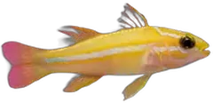
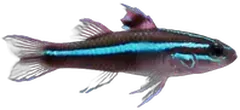
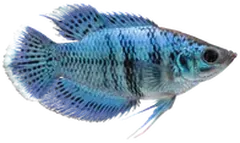
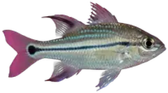
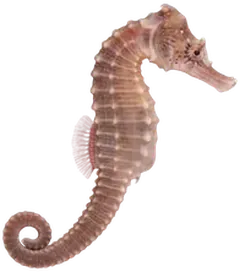
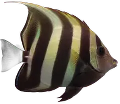
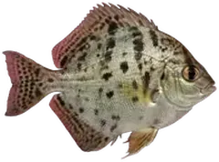
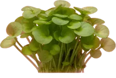
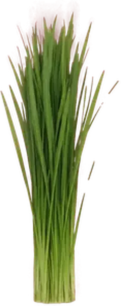

# reeftank-catalog

<!-- species:begin (generated by scripts/make_readme.py, do not edit) -->

> Część [**ekosystemu projektów ReefTech**](https://elwinmage.github.io/reeftank/)

       

Gatunki ryb, koralowców, roślin i bezkręgowców do widoku akwarium [ha-reef-card](https://github.com/Elwinmage/ha-reef-card), dostarczane przez [integrację ReefTank](https://github.com/Elwinmage/ha-reeftank-component).

Integracja pobiera wydania tego repozytorium i aktualizuje je (`update.reeftank_catalog`, domyślnie automatycznie): w Home Assistant nie trzeba nic robić.

## Jak to działa

Każda ryba to arkusz klatek (atlas WebP) i deskryptor z jej klipami: *pływanie*, *postój* i *zawrót*. Karta odtwarza je jeden po drugim, a zawrót odbija lustrzanie, by ryba wróciła tą samą drogą. Oto pływanie, zawrót i powrót dwóch gatunków:

<table><tr><td align="center"> Pokolec cesarski</td><td align="center"> Błazenek</td></tr></table>

## Ryby (102)

**HD**: prawdziwa animacja zrobiona z filmów. Pozostałe mają prostą animację ze zdjęcia albo rybę ogólną.

| &nbsp;&nbsp;&nbsp;&nbsp;&nbsp;&nbsp;&nbsp;&nbsp;&nbsp;&nbsp;&nbsp;&nbsp;&nbsp;&nbsp;&nbsp;&nbsp;&nbsp;&nbsp;&nbsp;&nbsp;&nbsp;&nbsp;&nbsp;&nbsp;&nbsp;&nbsp;&nbsp;&nbsp;&nbsp;&nbsp;&nbsp;&nbsp;&nbsp;&nbsp;&nbsp;&nbsp;&nbsp;&nbsp;&nbsp; | <small>Nazwa</small> | <small>Nazwa naukowa</small> | <small>Woda</small> | <small>Rozmiar</small> | <small>Zachowanie</small> | HD |
|---|---|---|---|---|---|---|
|  | <small>Ancistrus `ancistrus`</small> | <small>*Ancistrus sp.*</small> | <small>Słodkowodna</small> | <small>10–14 cm</small> | <small>Przydenny · chowa się w nocy</small> |  |
|  | <small>Apistogramma kakadu `apistogramma_cacatuoides`</small> | <small>*Apistogramma cacatuoides*</small> | <small>Słodkowodna</small> | <small>5–9 cm</small> | <small>Przydenny · chowa się w nocy</small> |  |
|  | <small>Babka fioletowa `gobioides_broussonnetii`</small> | <small>*Gobioides broussonnetii*</small> | <small>Słonawa</small> | <small>30–50 cm</small> | <small>Żyje na piasku · żyje w norze · odpoczywa w nocy na dnie</small> |  |
|  | <small>Babka koralowa cytrynowa `gobiodon_citrinus`</small> | <small>*Gobiodon citrinus*</small> | <small>Morska</small> | <small>3–5 cm</small> | <small>Przydenny · chowa się w nocy</small> |  |
|  | <small>Babka neonowa `elacatinus_oceanops`</small> | <small>*Elacatinus oceanops*</small> | <small>Morska</small> | <small>4–6 cm</small> | <small>Przydenny · chowa się w nocy</small> |  |
|  | <small>Babka ognista `nemateleotris_magnifica`</small> | <small>*Nemateleotris magnifica*</small> | <small>Morska</small> | <small>8–10 cm</small> | <small>Stoi w miejscu · unosi się w toni w nocy</small> |  |
|  | <small>Babka ognista purpurowa `nemateleotris_decora`</small> | <small>*Nemateleotris decora*</small> | <small>Morska</small> | <small>8–10 cm</small> | <small>Stoi w miejscu · unosi się w toni w nocy</small> |  |
|  | <small>Babka okinawska `gobiodon_okinawae`</small> | <small>*Gobiodon okinawae*</small> | <small>Morska</small> | <small>2.5–3.5 cm</small> | <small>Przydenny · chowa się w nocy</small> |  |
|  | <small>Babka pasiasta `amblygobius_phalaena`</small> | <small>*Amblygobius phalaena*</small> | <small>Morska</small> | <small>8–10 cm</small> | <small>Żyje na piasku · odpoczywa w nocy na dnie</small> |  |
|  | <small>Babka piaskowa `valenciennea`</small> | <small>*Valenciennea sp.*</small> | <small>Morska</small> | <small>10–16 cm</small> | <small>Żyje na piasku · żyje w norze · odpoczywa w nocy na dnie</small> | ✔ |
|  | <small>Babka rycerska `stigmatogobius_sadanundio`</small> | <small>*Stigmatogobius sadanundio*</small> | <small>Słonawa</small> | <small>6–8 cm</small> | <small>Przydenny · chowa się w nocy</small> |  |
|  | <small>Babka trzmielowa `brachygobius_xanthozonus`</small> | <small>*Brachygobius xanthozonus*</small> | <small>Słonawa</small> | <small>3–4 cm</small> | <small>Przydenny · chowa się w nocy</small> |  |
|  | <small>Babka yasha `stonogobiops_yasha`</small> | <small>*Stonogobiops yasha*</small> | <small>Morska</small> | <small>6–8 cm</small> | <small>Żyje na piasku · żyje w norze · odpoczywa w nocy na dnie</small> |  |
|  | <small>Babka żółta `cryptocentrus_cinctus`</small> | <small>*Cryptocentrus cinctus*</small> | <small>Morska</small> | <small>8–10 cm</small> | <small>Żyje na piasku · żyje w norze · odpoczywa w nocy na dnie</small> |  |
|  | <small>Bocja clown `chromobotia_macracanthus`</small> | <small>*Chromobotia macracanthus*</small> | <small>Słodkowodna</small> | <small>15–30 cm</small> | <small>Przydenny · chowa się w nocy</small> |  |
|  | <small>Bojownik wspaniały `betta_splendens`</small> | <small>*Betta splendens*</small> | <small>Słodkowodna</small> | <small>5–7 cm</small> | <small>Stoi w miejscu · trzyma się swojej kryjówki · unosi się w toni w nocy</small> |  |
|  | <small>Brzanka sumatrzańska `puntigrus_tetrazona`</small> | <small>*Puntigrus tetrazona*</small> | <small>Słodkowodna</small> | <small>5–7 cm</small> | <small>Ławica · chowa się w nocy</small> |  |
|  | <small>Brzanka wiśniowa `pethia_titteya`</small> | <small>*Pethia titteya*</small> | <small>Słodkowodna</small> | <small>4–5 cm</small> | <small>Ławica · chowa się w nocy</small> |  |
|  | <small>Błazenek `amphiprion`</small> | <small>*Amphiprion sp.*</small> | <small>Morska</small> | <small>7–11 cm</small> | <small>Stoi w miejscu · unosi się w toni w nocy</small> | ✔ |
|  | <small>Błazenek kasztanowy `premnas_biaculeatus`</small> | <small>*Premnas biaculeatus*</small> | <small>Morska</small> | <small>10–15 cm</small> | <small>Stoi w miejscu · unosi się w toni w nocy</small> |  |
|  | <small>Chromis zielony `chromis_viridis`</small> | <small>*Chromis viridis*</small> | <small>Morska</small> | <small>5–8 cm</small> | <small>Ławica · chowa się w nocy</small> | ✔ |
|  | <small>Danio galaxy `danio_margaritatus`</small> | <small>*Danio margaritatus*</small> | <small>Słodkowodna</small> | <small>2–3 cm</small> | <small>Ławica · chowa się w nocy</small> |  |
|  | <small>Danio perłowy `danio_albolineatus`</small> | <small>*Danio albolineatus*</small> | <small>Słodkowodna</small> | <small>4–6 cm</small> | <small>Ławica · chowa się w nocy</small> |  |
|  | <small>Danio pręgowany `danio_rerio`</small> | <small>*Danio rerio*</small> | <small>Słodkowodna</small> | <small>4–5 cm</small> | <small>Ławica · chowa się w nocy</small> |  |
|  | <small>Dascyllus trójplamisty `dascyllus_trimaculatus`</small> | <small>*Dascyllus trimaculatus*</small> | <small>Morska</small> | <small>10–14 cm</small> | <small>Stoi w miejscu · unosi się w toni w nocy</small> |  |
|  | <small>Dyskowiec `symphysodon_aequifasciatus`</small> | <small>*Symphysodon aequifasciatus*</small> | <small>Słodkowodna</small> | <small>15–20 cm</small> | <small>Pływa w toni wodnej · chowa się w nocy</small> |  |
|  | <small>Garbik fidżyjski `chrysiptera_taupou`</small> | <small>*Chrysiptera taupou*</small> | <small>Morska</small> | <small>6–8 cm</small> | <small>Stoi w miejscu · trzyma się swojej kryjówki · unosi się w toni w nocy</small> |  |
|  | <small>Garbik żółtoogonowy `chrysiptera_parasema`</small> | <small>*Chrysiptera parasema*</small> | <small>Morska</small> | <small>5–6 cm</small> | <small>Stoi w miejscu · trzyma się swojej kryjówki · unosi się w toni w nocy</small> |  |
|  | <small>Glonojad siamski `crossocheilus_oblongus`</small> | <small>*Crossocheilus oblongus*</small> | <small>Słodkowodna</small> | <small>10–15 cm</small> | <small>Pływa w toni wodnej · chowa się w nocy</small> |  |
|  | <small>Gramma królewska `gramma_loreto`</small> | <small>*Gramma loreto*</small> | <small>Morska</small> | <small>7–8 cm</small> | <small>Stoi w miejscu · unosi się w toni w nocy</small> |  |
|  | <small>Gupik `poecilia_reticulata`</small> | <small>*Poecilia reticulata*</small> | <small>Słodkowodna</small> | <small>3–6 cm</small> | <small>Ławica · chowa się w nocy</small> |  |
|  | <small>Gupik Endlera `poecilia_wingei`</small> | <small>*Poecilia wingei*</small> | <small>Słodkowodna</small> | <small>2–4 cm</small> | <small>Ławica · chowa się w nocy</small> |  |
|  | <small>Gurami błękitny `trichopodus_trichopterus`</small> | <small>*Trichopodus trichopterus*</small> | <small>Słodkowodna</small> | <small>10–15 cm</small> | <small>Pływa w toni wodnej · chowa się w nocy</small> |  |
|  | <small>Gurami karłowaty `trichogaster_lalius`</small> | <small>*Trichogaster lalius*</small> | <small>Słodkowodna</small> | <small>5–8 cm</small> | <small>Pływa w toni wodnej · chowa się w nocy</small> |  |
|  | <small>Gurami perłowy `trichopodus_leerii`</small> | <small>*Trichopodus leerii*</small> | <small>Słodkowodna</small> | <small>10–12 cm</small> | <small>Pływa w toni wodnej · chowa się w nocy</small> |  |
|  | <small>Jastrzębik pixie `cirrhitichthys_oxycephalus`</small> | <small>*Cirrhitichthys oxycephalus*</small> | <small>Morska</small> | <small>8–10 cm</small> | <small>Przydenny · chowa się w nocy</small> |  |
|  | <small>Kardynał piżamowy `sphaeramia_nematoptera`</small> | <small>*Sphaeramia nematoptera*</small> | <small>Morska</small> | <small>8–10 cm</small> | <small>Stoi w miejscu · unosi się w toni w nocy</small> |  |
|  | <small>Kardynał z Banggai `pterapogon_kauderni`</small> | <small>*Pterapogon kauderni*</small> | <small>Morska</small> | <small>5–8 cm</small> | <small>Stoi w miejscu · unosi się w toni w nocy</small> | ✔ |
|  | <small>Kardynał żółtopręgi `ostorhinchus_cyanosoma`</small> | <small>*Ostorhinchus cyanosoma*</small> | <small>Morska</small> | <small>7–8 cm</small> | <small>Stoi w miejscu · unosi się w toni w nocy</small> |  |
|  | <small>Kiliasz lirogonowy `aphyosemion_australe`</small> | <small>*Aphyosemion australe*</small> | <small>Słodkowodna</small> | <small>5–6 cm</small> | <small>Stoi w miejscu · unosi się w toni w nocy</small> |  |
|  | <small>Kirysek brązowy `corydoras_aeneus`</small> | <small>*Corydoras aeneus*</small> | <small>Słodkowodna</small> | <small>6–7 cm</small> | <small>Przydenny · chowa się w nocy</small> |  |
|  | <small>Kirysek panda `corydoras_panda`</small> | <small>*Corydoras panda*</small> | <small>Słodkowodna</small> | <small>4–5 cm</small> | <small>Przydenny · chowa się w nocy</small> |  |
|  | <small>Konik morski prążkowany `hippocampus_erectus`</small> | <small>*Hippocampus erectus*</small> | <small>Morska</small> | <small>10–15 cm</small> | <small>Stoi w miejscu · unosi się w toni w nocy</small> |  |
|  | <small>Kribensis `pelvicachromis_pulcher`</small> | <small>*Pelvicachromis pulcher*</small> | <small>Słodkowodna</small> | <small>8–10 cm</small> | <small>Przydenny · chowa się w nocy</small> |  |
|  | <small>Mandaryn psychodeliczny `synchiropus_picturatus`</small> | <small>*Synchiropus picturatus*</small> | <small>Morska</small> | <small>6–8 cm</small> | <small>Przydenny · chowa się w nocy</small> |  |
|  | <small>Mandaryn wspaniały `synchiropus_splendidus`</small> | <small>*Synchiropus splendidus*</small> | <small>Morska</small> | <small>5–8 cm</small> | <small>Przydenny · chowa się w nocy</small> | ✔ |
|  | <small>Mieczyk Hellera `xiphophorus_hellerii`</small> | <small>*Xiphophorus hellerii*</small> | <small>Słodkowodna</small> | <small>6–12 cm</small> | <small>Ławica · chowa się w nocy</small> |  |
|  | <small>Molinezja zwyczajna `poecilia_sphenops`</small> | <small>*Poecilia sphenops*</small> | <small>Słodkowodna, Słonawa</small> | <small>6–10 cm</small> | <small>Ławica · chowa się w nocy</small> |  |
|  | <small>Molinezja żaglowa `poecilia_velifera`</small> | <small>*Poecilia velifera*</small> | <small>Słonawa, Słodkowodna</small> | <small>10–15 cm</small> | <small>Ławica · chowa się w nocy</small> |  |
|  | <small>Monodaktyl srebrzysty `monodactylus_argenteus`</small> | <small>*Monodactylus argenteus*</small> | <small>Słonawa, Morska</small> | <small>15–25 cm</small> | <small>Ławica · chowa się w nocy</small> |  |
|  | <small>Motylek miedzianopręgi `chelmon_rostratus`</small> | <small>*Chelmon rostratus*</small> | <small>Morska</small> | <small>15–20 cm</small> | <small>Pływa w toni wodnej · chowa się w nocy</small> |  |
|  | <small>Neonka czerwona `paracheirodon_axelrodi`</small> | <small>*Paracheirodon axelrodi*</small> | <small>Słodkowodna</small> | <small>3–5 cm</small> | <small>Ławica · chowa się w nocy</small> |  |
|  | <small>Neonka Innesa `paracheirodon_innesi`</small> | <small>*Paracheirodon innesi*</small> | <small>Słodkowodna</small> | <small>3–4 cm</small> | <small>Ławica · chowa się w nocy</small> |  |
|  | <small>Oscar `astronotus_ocellatus`</small> | <small>*Astronotus ocellatus*</small> | <small>Słodkowodna</small> | <small>25–35 cm</small> | <small>Pływa w toni wodnej · chowa się w nocy</small> |  |
|  | <small>Otocinclus `otocinclus_affinis`</small> | <small>*Otocinclus affinis*</small> | <small>Słodkowodna</small> | <small>3–5 cm</small> | <small>Przydenny · chowa się w nocy</small> |  |
|  | <small>Pielęgniczka Ramireza `mikrogeophagus_ramirezi`</small> | <small>*Mikrogeophagus ramirezi*</small> | <small>Słodkowodna</small> | <small>5–7 cm</small> | <small>Stoi w miejscu · unosi się w toni w nocy</small> |  |
|  | <small>Piskorz Kuhla `pangio_kuhlii`</small> | <small>*Pangio kuhlii*</small> | <small>Słodkowodna</small> | <small>8–12 cm</small> | <small>Przydenny · chowa się w nocy</small> |  |
|  | <small>Platy `xiphophorus_maculatus`</small> | <small>*Xiphophorus maculatus*</small> | <small>Słodkowodna</small> | <small>4–6 cm</small> | <small>Ławica · chowa się w nocy</small> |  |
|  | <small>Pokolec białogardły `acanthurus_leucosternon`</small> | <small>*Acanthurus leucosternon*</small> | <small>Morska</small> | <small>20–23 cm</small> | <small>Pływa w toni wodnej · chowa się w nocy</small> |  |
|  | <small>Pokolec brązowy `zebrasoma_scopas`</small> | <small>*Zebrasoma scopas*</small> | <small>Morska</small> | <small>15–20 cm</small> | <small>Pływa w toni wodnej · chowa się w nocy</small> |  |
|  | <small>Pokolec kole `ctenochaetus_strigosus`</small> | <small>*Ctenochaetus strigosus*</small> | <small>Morska</small> | <small>12–18 cm</small> | <small>Pływa w toni wodnej · chowa się w nocy</small> |  |
|  | <small>Pokolec królewski `paracanthurus_hepatus`</small> | <small>*Paracanthurus hepatus*</small> | <small>Morska</small> | <small>20–30 cm</small> | <small>Pływa w toni wodnej · chowa się w nocy</small> |  |
|  | <small>Pokolec żaglowy `zebrasoma_veliferum`</small> | <small>*Zebrasoma veliferum*</small> | <small>Morska</small> | <small>25–40 cm</small> | <small>Pływa w toni wodnej · chowa się w nocy</small> |  |
|  | <small>Pokolec żółty `zebrasoma_flavescens`</small> | <small>*Zebrasoma flavescens*</small> | <small>Morska</small> | <small>15–20 cm</small> | <small>Pływa w toni wodnej · chowa się w nocy</small> |  |
|  | <small>Pseudanthias `pseudanthias`</small> | <small>*Pseudanthias sp.*</small> | <small>Morska</small> | <small>8–14 cm</small> | <small>Ławica · chowa się w nocy</small> | ✔ |
|  | <small>Pseudochromis orchidea `pseudochromis_fridmani`</small> | <small>*Pseudochromis fridmani*</small> | <small>Morska</small> | <small>6–7 cm</small> | <small>Stoi w miejscu · trzyma się swojej kryjówki · unosi się w toni w nocy</small> |  |
|  | <small>Pyszczak Demasoni `pseudotropheus_demasoni`</small> | <small>*Pseudotropheus demasoni*</small> | <small>Słodkowodna</small> | <small>7–8 cm</small> | <small>Pływa w toni wodnej · chowa się w nocy</small> |  |
|  | <small>Pyszczak żółty `labidochromis_caeruleus`</small> | <small>*Labidochromis caeruleus*</small> | <small>Słodkowodna</small> | <small>8–10 cm</small> | <small>Pływa w toni wodnej · chowa się w nocy</small> |  |
|  | <small>Razbora klinowa `trigonostigma_heteromorpha`</small> | <small>*Trigonostigma heteromorpha*</small> | <small>Słodkowodna</small> | <small>3–4.5 cm</small> | <small>Ławica · chowa się w nocy</small> |  |
|  | <small>Rogatnica Picasso `rhinecanthus_aculeatus`</small> | <small>*Rhinecanthus aculeatus*</small> | <small>Morska</small> | <small>20–25 cm</small> | <small>Pływa w toni wodnej · chowa się w nocy</small> |  |
|  | <small>Rozdymka Valentina `canthigaster_valentini`</small> | <small>*Canthigaster valentini*</small> | <small>Morska</small> | <small>8–10 cm</small> | <small>Pływa w toni wodnej · chowa się w nocy</small> |  |
|  | <small>Rozdymka zielona `dichotomyctere_nigroviridis`</small> | <small>*Dichotomyctere nigroviridis*</small> | <small>Słonawa</small> | <small>10–17 cm</small> | <small>Pływa w toni wodnej · chowa się w nocy</small> |  |
|  | <small>Rozdymka ósemkowa `dichotomyctere_biocellatus`</small> | <small>*Dichotomyctere biocellatus*</small> | <small>Słonawa</small> | <small>5–6.5 cm</small> | <small>Pływa w toni wodnej · chowa się w nocy</small> |  |
|  | <small>Scat cętkowany `scatophagus_argus`</small> | <small>*Scatophagus argus*</small> | <small>Słonawa, Morska</small> | <small>15–30 cm</small> | <small>Pływa w toni wodnej · chowa się w nocy</small> |  |
|  | <small>Sigan lisi `siganus_vulpinus`</small> | <small>*Siganus vulpinus*</small> | <small>Morska</small> | <small>15–22 cm</small> | <small>Pływa w toni wodnej · odpoczywa w nocy na dnie</small> | ✔ |
|  | <small>Skalar `pterophyllum_scalare`</small> | <small>*Pterophyllum scalare*</small> | <small>Słodkowodna</small> | <small>12–15 cm</small> | <small>Pływa w toni wodnej · chowa się w nocy</small> |  |
|  | <small>Skoczek mułowy atlantycki `periophthalmus_barbarus`</small> | <small>*Periophthalmus barbarus*</small> | <small>Słonawa</small> | <small>10–15 cm</small> | <small>Przydenny · chowa się w nocy</small> |  |
|  | <small>Skrzydlica czerwona `pterois_volitans`</small> | <small>*Pterois volitans*</small> | <small>Morska</small> | <small>25–35 cm</small> | <small>Pływa w toni wodnej · chowa się w nocy</small> |  |
|  | <small>Skrzydlica zebra `dendrochirus_zebra`</small> | <small>*Dendrochirus zebra*</small> | <small>Morska</small> | <small>12–18 cm</small> | <small>Pływa w toni wodnej · chowa się w nocy</small> |  |
|  | <small>Strzelec prążkowany `toxotes_jaculatrix`</small> | <small>*Toxotes jaculatrix*</small> | <small>Słonawa</small> | <small>15–25 cm</small> | <small>Pływa w toni wodnej · chowa się w nocy</small> |  |
|  | <small>Szczękowiec żółtogłowy `opistognathus_aurifrons`</small> | <small>*Opistognathus aurifrons*</small> | <small>Morska</small> | <small>10–12 cm</small> | <small>Żyje na piasku · żyje w norze · odpoczywa w nocy na dnie</small> |  |
|  | <small>Tanichthys `tanichthys_albonubes`</small> | <small>*Tanichthys albonubes*</small> | <small>Słodkowodna</small> | <small>3–4 cm</small> | <small>Ławica · chowa się w nocy</small> |  |
|  | <small>Tetra cesarska `nematobrycon_palmeri`</small> | <small>*Nematobrycon palmeri*</small> | <small>Słodkowodna</small> | <small>4–6 cm</small> | <small>Ławica · chowa się w nocy</small> |  |
|  | <small>Tetra cytrynowa `hyphessobrycon_pulchripinnis`</small> | <small>*Hyphessobrycon pulchripinnis*</small> | <small>Słodkowodna</small> | <small>3–4.5 cm</small> | <small>Ławica · chowa się w nocy</small> |  |
|  | <small>Tetra czarna `gymnocorymbus_ternetzi`</small> | <small>*Gymnocorymbus ternetzi*</small> | <small>Słodkowodna</small> | <small>5–6 cm</small> | <small>Ławica · chowa się w nocy</small> |  |
|  | <small>Tetra czerwononosa `hemigrammus_bleheri`</small> | <small>*Hemigrammus bleheri*</small> | <small>Słodkowodna</small> | <small>4–5 cm</small> | <small>Ławica · chowa się w nocy</small> |  |
|  | <small>Tetra serpae `hyphessobrycon_eques`</small> | <small>*Hyphessobrycon eques*</small> | <small>Słodkowodna</small> | <small>3–4.5 cm</small> | <small>Ławica · chowa się w nocy</small> |  |
|  | <small>Toporzyk marmurkowy `carnegiella_strigata`</small> | <small>*Carnegiella strigata*</small> | <small>Słodkowodna</small> | <small>4–5 cm</small> | <small>Ławica · chowa się w nocy</small> |  |
|  | <small>Tęczanka turkusowa `melanotaenia_lacustris`</small> | <small>*Melanotaenia lacustris*</small> | <small>Słodkowodna</small> | <small>8–12 cm</small> | <small>Ławica · chowa się w nocy</small> |  |
|  | <small>Ustniczek cesarski (dorosły) `pomacanthus_imperator_adult`</small> | <small>*Pomacanthus imperator*</small> | <small>Morska</small> | <small>25–38 cm</small> | <small>Pływa w toni wodnej · chowa się w nocy</small> | ✔ |
|  | <small>Ustniczek cesarski (młody) `pomacanthus_imperator`</small> | <small>*Pomacanthus imperator*</small> | <small>Morska</small> | <small>6–12 cm</small> | <small>Pływa w toni wodnej · chowa się w nocy</small> | ✔ |
|  | <small>Ustniczek dwubarwny `centropyge_bicolor`</small> | <small>*Centropyge bicolor*</small> | <small>Morska</small> | <small>10–15 cm</small> | <small>Stoi w miejscu · unosi się w toni w nocy</small> |  |
|  | <small>Ustniczek królewski `pygoplites_diacanthus`</small> | <small>*Pygoplites diacanthus*</small> | <small>Morska</small> | <small>20–25 cm</small> | <small>Pływa w toni wodnej · chowa się w nocy</small> |  |
|  | <small>Ustniczek płomienisty `centropyge_loricula`</small> | <small>*Centropyge loricula*</small> | <small>Morska</small> | <small>8–10 cm</small> | <small>Stoi w miejscu · unosi się w toni w nocy</small> |  |
|  | <small>Wargacz sześciopręgi `pseudocheilinus_hexataenia`</small> | <small>*Pseudocheilinus hexataenia*</small> | <small>Morska</small> | <small>7–10 cm</small> | <small>Pływa w toni wodnej · chowa się w nocy</small> |  |
|  | <small>Wargacz z Solor `cirrhilabrus_solorensis`</small> | <small>*Cirrhilabrus solorensis*</small> | <small>Morska</small> | <small>10–12 cm</small> | <small>Pływa w toni wodnej · chowa się w nocy</small> |  |
|  | <small>Wargacz żółty `halichoeres_chrysus`</small> | <small>*Halichoeres chrysus*</small> | <small>Morska</small> | <small>10–12 cm</small> | <small>Pływa w toni wodnej · odpoczywa w nocy na dnie</small> |  |
|  | <small>Wargatek czyściciel `labroides_dimidiatus`</small> | <small>*Labroides dimidiatus*</small> | <small>Morska</small> | <small>10–12 cm</small> | <small>Pływa w toni wodnej · chowa się w nocy</small> |  |
|  | <small>Zbrojnik zebra `hypancistrus_zebra`</small> | <small>*Hypancistrus zebra*</small> | <small>Słodkowodna</small> | <small>7–10 cm</small> | <small>Przydenny · chowa się w nocy</small> |  |
|  | <small>Złota rybka `carassius_auratus`</small> | <small>*Carassius auratus*</small> | <small>Słodkowodna</small> | <small>10–25 cm</small> | <small>Pływa w toni wodnej · chowa się w nocy</small> |  |
|  | <small>Ślizg dwubarwny `ecsenius_bicolor`</small> | <small>*Ecsenius bicolor*</small> | <small>Morska</small> | <small>8–10 cm</small> | <small>Przydenny · chowa się w nocy</small> |  |
|  | <small>Ślizg kosiarka `salarias_fasciatus`</small> | <small>*Salarias fasciatus*</small> | <small>Morska</small> | <small>12–14 cm</small> | <small>Przydenny · chowa się w nocy</small> |  |

## Koralowce (1)

| &nbsp;&nbsp;&nbsp;&nbsp;&nbsp;&nbsp;&nbsp;&nbsp;&nbsp;&nbsp;&nbsp;&nbsp;&nbsp;&nbsp;&nbsp;&nbsp;&nbsp;&nbsp;&nbsp;&nbsp;&nbsp;&nbsp;&nbsp;&nbsp;&nbsp;&nbsp;&nbsp;&nbsp;&nbsp;&nbsp;&nbsp;&nbsp;&nbsp;&nbsp;&nbsp;&nbsp;&nbsp;&nbsp;&nbsp; | <small>Nazwa</small> | <small>Nazwa naukowa</small> | <small>Woda</small> | <small>Rozmiar</small> |
|---|---|---|---|---|
|  | <small>Koral pochodnia `euphyllia_glabrescens`</small> | <small>*Euphyllia glabrescens*</small> | <small>Morska</small> | <small>10–30 cm</small> |

## Rośliny (29)

| &nbsp;&nbsp;&nbsp;&nbsp;&nbsp;&nbsp;&nbsp;&nbsp;&nbsp;&nbsp;&nbsp;&nbsp;&nbsp;&nbsp;&nbsp;&nbsp;&nbsp;&nbsp;&nbsp;&nbsp;&nbsp;&nbsp;&nbsp;&nbsp;&nbsp;&nbsp;&nbsp;&nbsp;&nbsp;&nbsp;&nbsp;&nbsp;&nbsp;&nbsp;&nbsp;&nbsp;&nbsp;&nbsp;&nbsp; | <small>Nazwa</small> | <small>Nazwa naukowa</small> | <small>Woda</small> | <small>Rozmiar</small> | <small>Strefa</small> |
|---|---|---|---|---|---|
|  | <small>Ambulia `limnophila_sessiliflora`</small> | <small>*Limnophila sessiliflora*</small> | <small>Słodkowodna</small> | <small>20–40 cm</small> | <small>Tło</small> |
|  | <small>Anubias `anubias_barteri`</small> | <small>*Anubias barteri*</small> | <small>Słodkowodna</small> | <small>10–25 cm</small> | <small>Epifit</small> |
|  | <small>Bucephalandra `bucephalandra`</small> | <small>*Bucephalandra sp.*</small> | <small>Słodkowodna</small> | <small>5–15 cm</small> | <small>Epifit</small> |
|  | <small>Caulerpa `caulerpa_prolifera`</small> | <small>*Caulerpa prolifera*</small> | <small>Morska</small> | <small>5–20 cm</small> | <small>Pierwszy plan</small> |
|  | <small>Chaetomorpha `chaetomorpha_linum`</small> | <small>*Chaetomorpha linum*</small> | <small>Morska</small> | <small>5–30 cm</small> | <small>Pierwszy plan</small> |
|  | <small>Glossostigma `glossostigma_elatinoides`</small> | <small>*Glossostigma elatinoides*</small> | <small>Słodkowodna</small> | <small>2–5 cm</small> | <small>Pierwszy plan</small> |
|  | <small>Halimeda `halimeda_opuntia`</small> | <small>*Halimeda opuntia*</small> | <small>Morska</small> | <small>5–15 cm</small> | <small>Pierwszy plan</small> |
|  | <small>Hemianthus `hemianthus_callitrichoides`</small> | <small>*Hemianthus callitrichoides*</small> | <small>Słodkowodna</small> | <small>2–5 cm</small> | <small>Pierwszy plan</small> |
|  | <small>Hygrofila `hygrophila_polysperma`</small> | <small>*Hygrophila polysperma*</small> | <small>Słodkowodna</small> | <small>20–50 cm</small> | <small>Tło</small> |
|  | <small>Kabomba karolińska `cabomba_caroliniana`</small> | <small>*Cabomba caroliniana*</small> | <small>Słodkowodna</small> | <small>30–60 cm</small> | <small>Tło</small> |
|  | <small>Kryptokoryna drobna `cryptocoryne_parva`</small> | <small>*Cryptocoryne parva*</small> | <small>Słodkowodna</small> | <small>5–8 cm</small> | <small>Pierwszy plan</small> |
|  | <small>Kryptokoryna orzęsiona `cryptocoryne_ciliata`</small> | <small>*Cryptocoryne ciliata*</small> | <small>Słonawa, Słodkowodna</small> | <small>20–40 cm</small> | <small>Plan środkowy</small> |
|  | <small>Kryptokoryna Wendta `cryptocoryne_wendtii`</small> | <small>*Cryptocoryne wendtii*</small> | <small>Słodkowodna</small> | <small>10–20 cm</small> | <small>Plan środkowy</small> |
|  | <small>Limnobium `limnobium_laevigatum`</small> | <small>*Limnobium laevigatum*</small> | <small>Słodkowodna</small> | <small>5–10 cm</small> | <small>Pływająca</small> |
|  | <small>Ludwigia `ludwigia_repens`</small> | <small>*Ludwigia repens*</small> | <small>Słodkowodna</small> | <small>20–40 cm</small> | <small>Plan środkowy</small> |
|  | <small>Marimo `aegagropila_linnaei`</small> | <small>*Aegagropila linnaei*</small> | <small>Słodkowodna</small> | <small>3–10 cm</small> | <small>Pierwszy plan</small> |
|  | <small>Mech jawajski `vesicularia_dubyana`</small> | <small>*Vesicularia dubyana*</small> | <small>Słodkowodna</small> | <small>3–5 cm</small> | <small>Epifit</small> |
|  | <small>Moczarka argentyńska `egeria_densa`</small> | <small>*Egeria densa*</small> | <small>Słodkowodna</small> | <small>30–100 cm</small> | <small>Tło</small> |
|  | <small>Namorzyn czerwony `rhizophora_mangle`</small> | <small>*Rhizophora mangle*</small> | <small>Słonawa, Morska</small> | <small>30–100 cm</small> | <small>Plan środkowy</small> |
|  | <small>Nurzaniec śrubowy `vallisneria_spiralis`</small> | <small>*Vallisneria spiralis*</small> | <small>Słodkowodna, Słonawa</small> | <small>30–60 cm</small> | <small>Tło</small> |
|  | <small>Paproć jawajska `microsorum_pteropus`</small> | <small>*Microsorum pteropus*</small> | <small>Słodkowodna</small> | <small>20–30 cm</small> | <small>Epifit</small> |
|  | <small>Ponikło drobne `eleocharis_parvula`</small> | <small>*Eleocharis parvula*</small> | <small>Słodkowodna</small> | <small>5–10 cm</small> | <small>Pierwszy plan</small> |
|  | <small>Rotala `rotala_rotundifolia`</small> | <small>*Rotala rotundifolia*</small> | <small>Słodkowodna</small> | <small>20–50 cm</small> | <small>Tło</small> |
|  | <small>Rzęsa drobna `lemna_minor`</small> | <small>*Lemna minor*</small> | <small>Słodkowodna</small> | <small>0.5–1 cm</small> | <small>Pływająca</small> |
|  | <small>Salata wodna `pistia_stratiotes`</small> | <small>*Pistia stratiotes*</small> | <small>Słodkowodna</small> | <small>5–15 cm</small> | <small>Pływająca</small> |
|  | <small>Staurogyne `staurogyne_repens`</small> | <small>*Staurogyne repens*</small> | <small>Słodkowodna</small> | <small>5–10 cm</small> | <small>Pierwszy plan</small> |
|  | <small>Strzałka karłowata `sagittaria_subulata`</small> | <small>*Sagittaria subulata*</small> | <small>Słodkowodna</small> | <small>10–30 cm</small> | <small>Pierwszy plan</small> |
|  | <small>Trawa żółwia `thalassia_testudinum`</small> | <small>*Thalassia testudinum*</small> | <small>Morska</small> | <small>10–30 cm</small> | <small>Pierwszy plan</small> |
|  | <small>Żabienica amazońska `echinodorus_bleheri`</small> | <small>*Echinodorus bleheri*</small> | <small>Słodkowodna</small> | <small>30–50 cm</small> | <small>Plan środkowy</small> |

## Bezkręgowce (32)

| &nbsp;&nbsp;&nbsp;&nbsp;&nbsp;&nbsp;&nbsp;&nbsp;&nbsp;&nbsp;&nbsp;&nbsp;&nbsp;&nbsp;&nbsp;&nbsp;&nbsp;&nbsp;&nbsp;&nbsp;&nbsp;&nbsp;&nbsp;&nbsp;&nbsp;&nbsp;&nbsp;&nbsp;&nbsp;&nbsp;&nbsp;&nbsp;&nbsp;&nbsp;&nbsp;&nbsp;&nbsp;&nbsp;&nbsp; | <small>Nazwa</small> | <small>Nazwa naukowa</small> | <small>Woda</small> | <small>Rozmiar</small> | <small>Rola</small> |
|---|---|---|---|---|---|
|  | <small>Ampularia `pomacea_bridgesii`</small> | <small>*Pomacea bridgesii*</small> | <small>Słodkowodna</small> | <small>4–5 cm</small> | <small>Padlinożerca · porusza się po dnie</small> |
|  | <small>Jeżowiec kolekcjoner `tripneustes_gratilla`</small> | <small>*Tripneustes gratilla*</small> | <small>Morska</small> | <small>10–15 cm</small> | <small>Glonojad · żyje na dekoracjach</small> |
|  | <small>Jeżowiec ołówkowy `prionocidaris_baculosa`</small> | <small>*Prionocidaris baculosa*</small> | <small>Morska</small> | <small>8–10 cm</small> | <small>Glonojad · żyje na dekoracjach</small> |
|  | <small>Krab szmaragdowy `mithraculus_sculptus`</small> | <small>*Mithraculus sculptus*</small> | <small>Morska</small> | <small>3–4 cm</small> | <small>Glonojad · żyje na dekoracjach</small> |
|  | <small>Krewetka Amano `caridina_multidentata`</small> | <small>*Caridina multidentata*</small> | <small>Słodkowodna</small> | <small>3–5 cm</small> | <small>Glonojad · porusza się po dnie</small> |
|  | <small>Krewetka arlekin `hymenocera_picta`</small> | <small>*Hymenocera picta*</small> | <small>Morska</small> | <small>4–6 cm</small> | <small>Drapieżnik · porusza się po dnie</small> |
|  | <small>Krewetka bambusowa `atyopsis_moluccensis`</small> | <small>*Atyopsis moluccensis*</small> | <small>Słodkowodna</small> | <small>6–8 cm</small> | <small>Filtrator · żyje na dekoracjach</small> |
|  | <small>Krewetka bokser `stenopus_hispidus`</small> | <small>*Stenopus hispidus*</small> | <small>Morska</small> | <small>6–8 cm</small> | <small>Sprzątacz · żyje na dekoracjach</small> |
|  | <small>Krewetka czyścicielka szkarłatna `lysmata_amboinensis`</small> | <small>*Lysmata amboinensis*</small> | <small>Morska</small> | <small>5–6 cm</small> | <small>Sprzątacz · żyje na dekoracjach</small> |
|  | <small>Krewetka kryształowa czerwona `caridina_cantonensis`</small> | <small>*Caridina cantonensis*</small> | <small>Słodkowodna</small> | <small>2–3 cm</small> | <small>Detrytusożerca · porusza się po dnie</small> |
|  | <small>Krewetka marmurkowa `saron_marmoratus`</small> | <small>*Saron marmoratus*</small> | <small>Morska</small> | <small>5–7 cm</small> | <small>Padlinożerca · żyje na dekoracjach</small> |
|  | <small>Krewetka ognista `lysmata_debelius`</small> | <small>*Lysmata debelius*</small> | <small>Morska</small> | <small>5–6 cm</small> | <small>Sprzątacz · żyje na dekoracjach</small> |
|  | <small>Krewetka peppermint `lysmata_wurdemanni`</small> | <small>*Lysmata wurdemanni*</small> | <small>Morska</small> | <small>3–5 cm</small> | <small>Sprzątacz · żyje na dekoracjach</small> |
|  | <small>Krewetka wiśniowa `neocaridina_davidi`</small> | <small>*Neocaridina davidi*</small> | <small>Słodkowodna</small> | <small>2–3.5 cm</small> | <small>Detrytusożerca · porusza się po dnie</small> |
|  | <small>Nerytka morska `nerita`</small> | <small>*Nerita sp.*</small> | <small>Morska</small> | <small>2–3 cm</small> | <small>Glonojad · wspina się po szybie</small> |
|  | <small>Nerytka zebra `neritina_natalensis`</small> | <small>*Neritina natalensis*</small> | <small>Słodkowodna</small> | <small>2–3 cm</small> | <small>Glonojad · wspina się po szybie</small> |
|  | <small>Pióropusznik `sabellastarte`</small> | <small>*Sabellastarte sp.*</small> | <small>Morska</small> | <small>5–10 cm</small> | <small>Filtrator · osiadły</small> |
|  | <small>Rak pustelnik niebieskonogi `clibanarius_tricolor`</small> | <small>*Clibanarius tricolor*</small> | <small>Morska</small> | <small>2–3 cm</small> | <small>Padlinożerca · porusza się po dnie</small> |
|  | <small>Rak pustelnik szkarłatny `paguristes_cadenati`</small> | <small>*Paguristes cadenati*</small> | <small>Morska</small> | <small>3–4 cm</small> | <small>Padlinożerca · porusza się po dnie</small> |
|  | <small>Robak choinkowy `spirobranchus_giganteus`</small> | <small>*Spirobranchus giganteus*</small> | <small>Morska</small> | <small>3–5 cm</small> | <small>Filtrator · osiadły</small> |
|  | <small>Rozgwiazda piaskowa `archaster_typicus`</small> | <small>*Archaster typicus*</small> | <small>Morska</small> | <small>6–10 cm</small> | <small>Detrytusożerca · porusza się po dnie</small> |
|  | <small>Strzykwa `holothuria`</small> | <small>*Holothuria sp.*</small> | <small>Morska</small> | <small>15–30 cm</small> | <small>Detrytusożerca · porusza się po dnie</small> |
|  | <small>Tridakna wiercąca `tridacna_crocea`</small> | <small>*Tridacna crocea*</small> | <small>Morska</small> | <small>5–15 cm</small> | <small>Filtrator · osiadły</small> |
|  | <small>Wieżyczka `melanoides_tuberculata`</small> | <small>*Melanoides tuberculata*</small> | <small>Słodkowodna</small> | <small>2–3 cm</small> | <small>Detrytusożerca · porusza się po dnie</small> |
|  | <small>Wężowidło `ophiolepis_superba`</small> | <small>*Ophiolepis superba*</small> | <small>Morska</small> | <small>8–12 cm</small> | <small>Padlinożerca · porusza się po dnie</small> |
|  | <small>Zatoczek `planorbella_duryi`</small> | <small>*Planorbella duryi*</small> | <small>Słodkowodna</small> | <small>2–3 cm</small> | <small>Detrytusożerca · wspina się po szybie</small> |
|  | <small>Ślimak Astraea `astraea_tecta`</small> | <small>*Astraea tecta*</small> | <small>Morska</small> | <small>2–4 cm</small> | <small>Glonojad · żyje na dekoracjach</small> |
|  | <small>Ślimak cerit `cerithium`</small> | <small>*Cerithium sp.*</small> | <small>Morska</small> | <small>2–3 cm</small> | <small>Detrytusożerca · porusza się po dnie</small> |
|  | <small>Ślimak Nassarius `nassarius`</small> | <small>*Nassarius sp.*</small> | <small>Morska</small> | <small>2–4 cm</small> | <small>Padlinożerca · porusza się po dnie</small> |
|  | <small>Ślimak trochus `tectus_fenestratus`</small> | <small>*Tectus fenestratus*</small> | <small>Morska</small> | <small>4–6 cm</small> | <small>Glonojad · żyje na dekoracjach</small> |
|  | <small>Ślimak turbo `turbo_fluctuosus`</small> | <small>*Turbo fluctuosus*</small> | <small>Morska</small> | <small>4–8 cm</small> | <small>Glonojad · wspina się po szybie</small> |
|  | <small>Ślimak zabójca `clea_helena`</small> | <small>*Clea helena*</small> | <small>Słodkowodna</small> | <small>2–3 cm</small> | <small>Drapieżnik · porusza się po dnie</small> |

Aby dodać gatunek (generowanie klipów, budowanie, publikacja), zobacz [dokumentację w języku angielskim](README.md).

Zasoby gatunków są na licencji **CC BY 4.0**, skrypty na licencji MIT: zobacz [LICENSE.md](LICENSE.md).

<!-- species:end -->

<!-- ecosystem:start -->

## Powiązane projekty

Projekty ReefTech uzupełniają się: integracje wprowadzają sprzęt do Home Assistant, karta go wyświetla i steruje nim, a zasilanie awaryjne utrzymuje go w ruchu podczas przerwy w zasilaniu. Każdy działa również samodzielnie.

<table>
  <tr>
    <th width="100px"></th>
    <th>Projekt</th>
    <th>Rola</th>
    <th>Współpracuje z</th>
  </tr>
  <tr>
    <td></td>
    <td>🐠 <a href="https://github.com/Elwinmage/ha-reefbeat-component"><b>ha-reefbeat-component</b></a></td>
    <td>Urządzenia Red Sea ReefBeat, sterowane lokalnie bez chmury: ReefATO+, ReefControl, ReefControl-Power, ReefDose, ReefLed, ReefMat, ReefRun i ReefWave. blueprint alertów dla nietypowych trybów, kalibracji i niskiego poziomu baterii. </td>
    <td>ha-reef-card</td>
  </tr>
  <tr>
    <td></td>
    <td>🌊 <a href="https://github.com/Elwinmage/ha-aquamedic-component"><b>ha-aquamedic-component</b></a></td>
    <td>Pompy Aqua Medic przez chmurowe API Gizwits: pompy cyrkulacyjne EcoDrift i SmartDrift, pompy DC Runner obiegowe i do odpieniacza.</td>
    <td>ha-reef-card</td>
  </tr>
  <tr>
    <td></td>
    <td>🐟 <a href="https://github.com/Elwinmage/ha-vson-component"><b>ha-vson-component</b></a></td>
    <td>Automatyczne karmniki VSON przez chmurowe API VSON: karmnik WP8621 (karmienie, bateria, alert niskiego poziomu karmy) i generyczne wykrywanie dowolnego innego urządzenia VSON. WP8621 może też działać w pełni lokalnie na ESPHome.</td>
    <td>ha-reef-card</td>
  </tr>
  <tr>
    <td></td>
    <td>🐙 <a href="https://github.com/Elwinmage/ha-reef-maintenance-component"><b>ha-reef-maintenance-component</b></a></td>
    <td>Śledzenie czyszczenia i zużycia sprzętu, do którego Home Assistant nie ma dostępu: pompy cyrkulacyjne, pompy obiegowe, odpieniacze, reaktory, wszystko co obsługujesz ręcznie.</td>
    <td>ha-reef-card</td>
  </tr>
  <tr>
    <td></td>
    <td>🪸 <a href="https://github.com/Elwinmage/ha-reef-card"><b>ha-reef-card</b></a></td>
    <td>Interaktywny widok graficzny każdego urządzenia na pulpicie i jedyny sposób edycji zaawansowanych harmonogramów. Odczytuje trzy integracje przez wspólny kontrakt <code>reef_role</code>, bez konfiguracji po stronie karty. Rysuje też przepływy energii z reefbeatEnergyBackup. Jej karta akwarium ożywia Twój zbiornik dzięki ha-reeftank-component.</td>
    <td>wszystkie cztery integracje oraz ha-reeftank-component dla akwarium</td>
  </tr>
  <tr>
    <td></td>
    <td>🐟 <a href="https://github.com/Elwinmage/ha-reeftank-component"><b>ha-reeftank-component</b></a></td>
    <td>Żywy obraz Twojego zbiornika na pulpicie: Twoje zdjęcie, oświetlone prawdziwymi lampami, z animowanymi rybami i koralowcami oraz Twoimi urządzeniami i encjami. Przechowuje akwaria i ich obsadę, rejestruje karmienia.</td>
    <td>ha-reef-card</td>
  </tr>
  <tr>
    <td></td>
    <td>🐡 <b>reeftank-catalog</b> <i>(to repozytorium)</i></td>
    <td>Ryby, koralowce i tekstury karty akwarium, pobierane i aktualizowane przez ha-reeftank-component.</td>
    <td>ha-reeftank-component</td>
  </tr>
  <tr>
    <td></td>
    <td>🐬 <a href="https://github.com/Elwinmage/ha-reef-blueprints"><b>ha-reef-blueprints</b></a></td>
    <td>Blueprinty automatyzacji wspólne dla całego ekosystemu: zaległe konserwacje znajdowane przez kontrakt <code>reef_role</code>, urządzenia, które przestały odpowiadać, okresowy test grzałek i nadzór przekaźników. Osiem języków.</td>
    <td>wszystkie cztery integracje</td>
  </tr>
  <tr>
    <td></td>
    <td>⚡ <a href="https://github.com/Elwinmage/reefbeatEnergyBackup"><b>reefbeatEnergyBackup</b></a></td>
    <td>Zasilanie awaryjne na wypadek przerw w zasilaniu. Pakiet 24V LiFePO₄ sterowany przez Raspberry Pi, ze stopniowym obniżaniem prędkości pomp zależnie od stanu naładowania.</td>
    <td>samodzielnie lub razem z ha-reefbeat-component i ha-reef-card</td>
  </tr>
</table>

Wszystkie są udokumentowane razem na [stronie projektu ReefTech](https://elwinmage.github.io/reeftank/).

<!-- ecosystem:end -->
