# reeftank-catalog

<!-- species:begin (generated by scripts/make_readme.py, do not edit) -->

> Część [**ekosystemu projektów ReefTech**](https://elwinmage.github.io/reeftank/)

       

Gatunki ryb, koralowców, roślin i bezkręgowców do widoku akwarium [ha-reef-card](https://github.com/Elwinmage/ha-reef-card), dostarczane przez [integrację ReefTank](https://github.com/Elwinmage/ha-reeftank-component).

Integracja pobiera wydania tego repozytorium i aktualizuje je (`update.reeftank_catalog`, domyślnie automatycznie): w Home Assistant nie trzeba nic robić.

## Ryby (102)

|  | Nazwa | Nazwa naukowa | Woda | Rozmiar | Zachowanie |
|---|---|---|---|---|---|
|  | Angelfish `pterophyllum_scalare` | *Pterophyllum scalare* | Słodkowodna | 12–15 cm | Pływa w toni wodnej · chowa się w nocy |
|  | Atlantic mudskipper `periophthalmus_barbarus` | *Periophthalmus barbarus* | Słonawa | 10–15 cm | Przydenny · chowa się w nocy |
|  | Babka Okinawska `gobiodon_okinawae` | *Gobiodon okinawae* | Morska | 2.5–3.5 cm | Przydenny · chowa się w nocy |
|  | Babka piaskowa `valenciennea` | *Valenciennea sp.* | Morska | 10–16 cm | Żyje na piasku · żyje w norze · odpoczywa w nocy na dnie |
|  | Babka żółta `cryptocentrus_cinctus` | *Cryptocentrus cinctus* | Morska | 8–10 cm | Żyje na piasku · żyje w norze · odpoczywa w nocy na dnie |
| 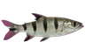 | Banded archerfish `toxotes_jaculatrix` | *Toxotes jaculatrix* | Słonawa | 15–25 cm | Pływa w toni wodnej · chowa się w nocy |
|  | Banded goby `amblygobius_phalaena` | *Amblygobius phalaena* | Morska | 8–10 cm | Żyje na piasku · odpoczywa w nocy na dnie |
|  | Bicolor angelfish `centropyge_bicolor` | *Centropyge bicolor* | Morska | 10–15 cm | Stoi w miejscu · unosi się w toni w nocy |
|  | Bicolor blenny `ecsenius_bicolor` | *Ecsenius bicolor* | Morska | 8–10 cm | Przydenny · chowa się w nocy |
|  | Black skirt tetra `gymnocorymbus_ternetzi` | *Gymnocorymbus ternetzi* | Słodkowodna | 5–6 cm | Ławica · chowa się w nocy |
|  | Bluestreak cleaner wrasse `labroides_dimidiatus` | *Labroides dimidiatus* | Morska | 10–12 cm | Pływa w toni wodnej · chowa się w nocy |
|  | Bristlenose pleco `ancistrus` | *Ancistrus sp.* | Słodkowodna | 10–14 cm | Przydenny · chowa się w nocy |
|  | Bronze corydoras `corydoras_aeneus` | *Corydoras aeneus* | Słodkowodna | 6–7 cm | Przydenny · chowa się w nocy |
| 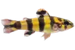 | Bumblebee goby `brachygobius_xanthozonus` | *Brachygobius xanthozonus* | Słonawa | 3–4 cm | Przydenny · chowa się w nocy |
|  | Błazenek `amphiprion` | *Amphiprion sp.* | Morska | 7–11 cm | Stoi w miejscu · unosi się w toni w nocy |
|  | Cardinal tetra `paracheirodon_axelrodi` | *Paracheirodon axelrodi* | Słodkowodna | 3–5 cm | Ławica · chowa się w nocy |
| 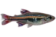 | Celestial pearl danio `danio_margaritatus` | *Danio margaritatus* | Słodkowodna | 2–3 cm | Ławica · chowa się w nocy |
| 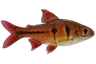 | Cherry barb `pethia_titteya` | *Pethia titteya* | Słodkowodna | 4–5 cm | Ławica · chowa się w nocy |
| 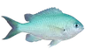 | Chromis zielony `chromis_viridis` | *Chromis viridis* | Morska | 5–8 cm | Ławica · chowa się w nocy |
|  | Citron coral goby `gobiodon_citrinus` | *Gobiodon citrinus* | Morska | 3–5 cm | Przydenny · chowa się w nocy |
| 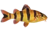 | Clown loach `chromobotia_macracanthus` | *Chromobotia macracanthus* | Słodkowodna | 15–30 cm | Przydenny · chowa się w nocy |
|  | Cockatoo dwarf cichlid `apistogramma_cacatuoides` | *Apistogramma cacatuoides* | Słodkowodna | 5–9 cm | Przydenny · chowa się w nocy |
| 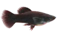 | Common molly `poecilia_sphenops` | *Poecilia sphenops* | Słodkowodna, Słonawa | 6–10 cm | Ławica · chowa się w nocy |
|  | Copperband butterflyfish `chelmon_rostratus` | *Chelmon rostratus* | Morska | 15–20 cm | Pływa w toni wodnej · chowa się w nocy |
| 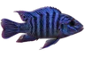 | Demasoni cichlid `pseudotropheus_demasoni` | *Pseudotropheus demasoni* | Słodkowodna | 7–8 cm | Pływa w toni wodnej · chowa się w nocy |
|  | Discus `symphysodon_aequifasciatus` | *Symphysodon aequifasciatus* | Słodkowodna | 15–20 cm | Pływa w toni wodnej · chowa się w nocy |
|  | Dwarf gourami `trichogaster_lalius` | *Trichogaster lalius* | Słodkowodna | 5–8 cm | Pływa w toni wodnej · chowa się w nocy |
| 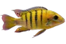 | Electric yellow cichlid `labidochromis_caeruleus` | *Labidochromis caeruleus* | Słodkowodna | 8–10 cm | Pływa w toni wodnej · chowa się w nocy |
| 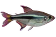 | Emperor tetra `nematobrycon_palmeri` | *Nematobrycon palmeri* | Słodkowodna | 4–6 cm | Ławica · chowa się w nocy |
| 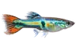 | Endler's livebearer `poecilia_wingei` | *Poecilia wingei* | Słodkowodna | 2–4 cm | Ławica · chowa się w nocy |
|  | Figure-eight puffer `dichotomyctere_biocellatus` | *Dichotomyctere biocellatus* | Słonawa | 5–6.5 cm | Pływa w toni wodnej · chowa się w nocy |
|  | Firefish goby `nemateleotris_magnifica` | *Nemateleotris magnifica* | Morska | 8–10 cm | Stoi w miejscu · unosi się w toni w nocy |
|  | Flame angelfish `centropyge_loricula` | *Centropyge loricula* | Morska | 8–10 cm | Stoi w miejscu · unosi się w toni w nocy |
| 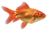 | Goldfish `carassius_auratus` | *Carassius auratus* | Słodkowodna | 10–25 cm | Pływa w toni wodnej · chowa się w nocy |
|  | Green spotted puffer `dichotomyctere_nigroviridis` | *Dichotomyctere nigroviridis* | Słonawa | 10–17 cm | Pływa w toni wodnej · chowa się w nocy |
|  | Green swordtail `xiphophorus_hellerii` | *Xiphophorus hellerii* | Słodkowodna | 6–12 cm | Ławica · chowa się w nocy |
| 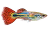 | Guppy `poecilia_reticulata` | *Poecilia reticulata* | Słodkowodna | 3–6 cm | Ławica · chowa się w nocy |
|  | Harlequin rasbora `trigonostigma_heteromorpha` | *Trigonostigma heteromorpha* | Słodkowodna | 3–4.5 cm | Ławica · chowa się w nocy |
|  | Kardynał z Banggai `pterapogon_kauderni` | *Pterapogon kauderni* | Morska | 5–8 cm | Stoi w miejscu · unosi się w toni w nocy |
| 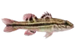 | Knight goby `stigmatogobius_sadanundio` | *Stigmatogobius sadanundio* | Słonawa | 6–8 cm | Przydenny · chowa się w nocy |
|  | Kole tang `ctenochaetus_strigosus` | *Ctenochaetus strigosus* | Morska | 12–18 cm | Pływa w toni wodnej · chowa się w nocy |
|  | Kribensis `pelvicachromis_pulcher` | *Pelvicachromis pulcher* | Słodkowodna | 8–10 cm | Przydenny · chowa się w nocy |
|  | Kuhli loach `pangio_kuhlii` | *Pangio kuhlii* | Słodkowodna | 8–12 cm | Przydenny · chowa się w nocy |
|  | Lawnmower blenny `salarias_fasciatus` | *Salarias fasciatus* | Morska | 12–14 cm | Przydenny · chowa się w nocy |
|  | Lemon tetra `hyphessobrycon_pulchripinnis` | *Hyphessobrycon pulchripinnis* | Słodkowodna | 3–4.5 cm | Ławica · chowa się w nocy |
|  | Lined seahorse `hippocampus_erectus` | *Hippocampus erectus* | Morska | 10–15 cm | Stoi w miejscu · unosi się w toni w nocy |
|  | Lyretail killifish `aphyosemion_australe` | *Aphyosemion australe* | Słodkowodna | 5–6 cm | Stoi w miejscu · unosi się w toni w nocy |
|  | Mandaryn wspaniały `synchiropus_splendidus` | *Synchiropus splendidus* | Morska | 5–8 cm | Przydenny · chowa się w nocy |
| 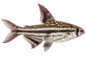 | Marbled hatchetfish `carnegiella_strigata` | *Carnegiella strigata* | Słodkowodna | 4–5 cm | Ławica · chowa się w nocy |
| 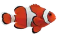 | Maroon clownfish `premnas_biaculeatus` | *Premnas biaculeatus* | Morska | 10–15 cm | Stoi w miejscu · unosi się w toni w nocy |
|  | Neon goby `elacatinus_oceanops` | *Elacatinus oceanops* | Morska | 4–6 cm | Przydenny · chowa się w nocy |
| 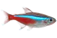 | Neon tetra `paracheirodon_innesi` | *Paracheirodon innesi* | Słodkowodna | 3–4 cm | Ławica · chowa się w nocy |
| 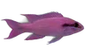 | Orchid dottyback `pseudochromis_fridmani` | *Pseudochromis fridmani* | Morska | 6–7 cm | Stoi w miejscu · trzyma się swojej kryjówki · unosi się w toni w nocy |
| 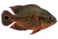 | Oscar `astronotus_ocellatus` | *Astronotus ocellatus* | Słodkowodna | 25–35 cm | Pływa w toni wodnej · chowa się w nocy |
|  | Otocinclus `otocinclus_affinis` | *Otocinclus affinis* | Słodkowodna | 3–5 cm | Przydenny · chowa się w nocy |
|  | Pajama cardinalfish `sphaeramia_nematoptera` | *Sphaeramia nematoptera* | Morska | 8–10 cm | Stoi w miejscu · unosi się w toni w nocy |
|  | Panda corydoras `corydoras_panda` | *Corydoras panda* | Słodkowodna | 4–5 cm | Przydenny · chowa się w nocy |
|  | Pearl danio `danio_albolineatus` | *Danio albolineatus* | Słodkowodna | 4–6 cm | Ławica · chowa się w nocy |
|  | Pearl gourami `trichopodus_leerii` | *Trichopodus leerii* | Słodkowodna | 10–12 cm | Pływa w toni wodnej · chowa się w nocy |
| 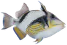 | Picasso triggerfish `rhinecanthus_aculeatus` | *Rhinecanthus aculeatus* | Morska | 20–25 cm | Pływa w toni wodnej · chowa się w nocy |
| 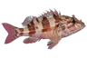 | Pixy hawkfish `cirrhitichthys_oxycephalus` | *Cirrhitichthys oxycephalus* | Morska | 8–10 cm | Przydenny · chowa się w nocy |
|  | Pomacentrus Fidji `chrysiptera_taupou` | *Chrysiptera taupou* | Morska | 6–8 cm | Stoi w miejscu · trzyma się swojej kryjówki · unosi się w toni w nocy |
|  | Powder blue tang `acanthurus_leucosternon` | *Acanthurus leucosternon* | Morska | 20–23 cm | Pływa w toni wodnej · chowa się w nocy |
|  | Pseudanthias `pseudanthias` | *Pseudanthias sp.* | Morska | 8–14 cm | Ławica · chowa się w nocy |
|  | Purple firefish `nemateleotris_decora` | *Nemateleotris decora* | Morska | 8–10 cm | Stoi w miejscu · unosi się w toni w nocy |
| 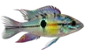 | Ram cichlid `mikrogeophagus_ramirezi` | *Mikrogeophagus ramirezi* | Słodkowodna | 5–7 cm | Stoi w miejscu · unosi się w toni w nocy |
|  | Red lionfish `pterois_volitans` | *Pterois volitans* | Morska | 25–35 cm | Pływa w toni wodnej · chowa się w nocy |
|  | Regal angelfish `pygoplites_diacanthus` | *Pygoplites diacanthus* | Morska | 20–25 cm | Pływa w toni wodnej · chowa się w nocy |
| 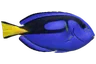 | Regal blue tang `paracanthurus_hepatus` | *Paracanthurus hepatus* | Morska | 20–30 cm | Pływa w toni wodnej · chowa się w nocy |
| 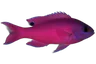 | Royal gramma `gramma_loreto` | *Gramma loreto* | Morska | 7–8 cm | Stoi w miejscu · unosi się w toni w nocy |
|  | Rummy-nose tetra `hemigrammus_bleheri` | *Hemigrammus bleheri* | Słodkowodna | 4–5 cm | Ławica · chowa się w nocy |
| 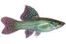 | Sailfin molly `poecilia_velifera` | *Poecilia velifera* | Słonawa, Słodkowodna | 10–15 cm | Ławica · chowa się w nocy |
|  | Sailfin tang `zebrasoma_veliferum` | *Zebrasoma veliferum* | Morska | 25–40 cm | Pływa w toni wodnej · chowa się w nocy |
| 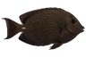 | Scopas tang `zebrasoma_scopas` | *Zebrasoma scopas* | Morska | 15–20 cm | Pływa w toni wodnej · chowa się w nocy |
|  | Serpae tetra `hyphessobrycon_eques` | *Hyphessobrycon eques* | Słodkowodna | 3–4.5 cm | Ławica · chowa się w nocy |
| 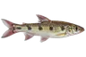 | Siamese algae eater `crossocheilus_oblongus` | *Crossocheilus oblongus* | Słodkowodna | 10–15 cm | Pływa w toni wodnej · chowa się w nocy |
|  | Siamese fighting fish `betta_splendens` | *Betta splendens* | Słodkowodna | 5–7 cm | Stoi w miejscu · trzyma się swojej kryjówki · unosi się w toni w nocy |
|  | Sigan lisi `siganus_vulpinus` | *Siganus vulpinus* | Morska | 15–22 cm | Pływa w toni wodnej · odpoczywa w nocy na dnie |
|  | Silver moony `monodactylus_argenteus` | *Monodactylus argenteus* | Słonawa, Morska | 15–25 cm | Ławica · chowa się w nocy |
| 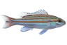 | Six line wrasse `pseudocheilinus_hexataenia` | *Pseudocheilinus hexataenia* | Morska | 7–10 cm | Pływa w toni wodnej · chowa się w nocy |
|  | Solor fairy wrasse `cirrhilabrus_solorensis` | *Cirrhilabrus solorensis* | Morska | 10–12 cm | Pływa w toni wodnej · chowa się w nocy |
|  | Southern platyfish `xiphophorus_maculatus` | *Xiphophorus maculatus* | Słodkowodna | 4–6 cm | Ławica · chowa się w nocy |
|  | Spotted mandarin `synchiropus_picturatus` | *Synchiropus picturatus* | Morska | 6–8 cm | Przydenny · chowa się w nocy |
|  | Spotted scat `scatophagus_argus` | *Scatophagus argus* | Słonawa, Morska | 15–30 cm | Pływa w toni wodnej · chowa się w nocy |
| 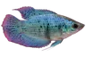 | Three-spot gourami `trichopodus_trichopterus` | *Trichopodus trichopterus* | Słodkowodna | 10–15 cm | Pływa w toni wodnej · chowa się w nocy |
|  | Threespot dascyllus `dascyllus_trimaculatus` | *Dascyllus trimaculatus* | Morska | 10–14 cm | Stoi w miejscu · unosi się w toni w nocy |
|  | Tiger barb `puntigrus_tetrazona` | *Puntigrus tetrazona* | Słodkowodna | 5–7 cm | Ławica · chowa się w nocy |
|  | Turquoise rainbowfish `melanotaenia_lacustris` | *Melanotaenia lacustris* | Słodkowodna | 8–12 cm | Ławica · chowa się w nocy |
| 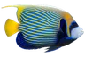 | Ustniczek cesarski (dorosły) `pomacanthus_imperator_adult` | *Pomacanthus imperator* | Morska | 25–38 cm | Pływa w toni wodnej · chowa się w nocy |
|  | Ustniczek cesarski (młody) `pomacanthus_imperator` | *Pomacanthus imperator* | Morska | 6–12 cm | Pływa w toni wodnej · chowa się w nocy |
| 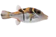 | Valentini puffer `canthigaster_valentini` | *Canthigaster valentini* | Morska | 8–10 cm | Pływa w toni wodnej · chowa się w nocy |
|  | Violet goby `gobioides_broussonnetii` | *Gobioides broussonnetii* | Słonawa | 30–50 cm | Żyje na piasku · żyje w norze · odpoczywa w nocy na dnie |
|  | White cloud mountain minnow `tanichthys_albonubes` | *Tanichthys albonubes* | Słodkowodna | 3–4 cm | Ławica · chowa się w nocy |
|  | Yasha goby `stonogobiops_yasha` | *Stonogobiops yasha* | Morska | 6–8 cm | Żyje na piasku · żyje w norze · odpoczywa w nocy na dnie |
|  | Yellow coris wrasse `halichoeres_chrysus` | *Halichoeres chrysus* | Morska | 10–12 cm | Pływa w toni wodnej · odpoczywa w nocy na dnie |
|  | Yellow tang `zebrasoma_flavescens` | *Zebrasoma flavescens* | Morska | 15–20 cm | Pływa w toni wodnej · chowa się w nocy |
|  | Yellow-striped cardinalfish `ostorhinchus_cyanosoma` | *Ostorhinchus cyanosoma* | Morska | 7–8 cm | Stoi w miejscu · unosi się w toni w nocy |
|  | Yellowhead jawfish `opistognathus_aurifrons` | *Opistognathus aurifrons* | Morska | 10–12 cm | Żyje na piasku · żyje w norze · odpoczywa w nocy na dnie |
|  | Yellowtail blue damselfish `chrysiptera_parasema` | *Chrysiptera parasema* | Morska | 5–6 cm | Stoi w miejscu · trzyma się swojej kryjówki · unosi się w toni w nocy |
|  | Zebra lionfish `dendrochirus_zebra` | *Dendrochirus zebra* | Morska | 12–18 cm | Pływa w toni wodnej · chowa się w nocy |
|  | Zebra pleco `hypancistrus_zebra` | *Hypancistrus zebra* | Słodkowodna | 7–10 cm | Przydenny · chowa się w nocy |
|  | Zebrafish `danio_rerio` | *Danio rerio* | Słodkowodna | 4–5 cm | Ławica · chowa się w nocy |

## Koralowce (1)

|  | Nazwa | Nazwa naukowa | Woda | Rozmiar |
|---|---|---|---|---|
|  | Koral pochodnia `euphyllia_glabrescens` | *Euphyllia glabrescens* | Morska | 10–30 cm |

## Rośliny (29)

|  | Nazwa | Nazwa naukowa | Woda | Rozmiar | Strefa |
|---|---|---|---|---|---|
|  | Amazon frogbit `limnobium_laevigatum` | *Limnobium laevigatum* | Słodkowodna | 5–10 cm | Pływająca |
|  | Amazon sword `echinodorus_bleheri` | *Echinodorus bleheri* | Słodkowodna | 30–50 cm | Plan środkowy |
|  | Ambulia `limnophila_sessiliflora` | *Limnophila sessiliflora* | Słodkowodna | 20–40 cm | Tło |
|  | Anubias `anubias_barteri` | *Anubias barteri* | Słodkowodna | 10–25 cm | Epifit |
|  | Brazilian waterweed `egeria_densa` | *Egeria densa* | Słodkowodna | 30–100 cm | Tło |
|  | Bucephalandra `bucephalandra` | *Bucephalandra sp.* | Słodkowodna | 5–15 cm | Epifit |
|  | Carolina fanwort `cabomba_caroliniana` | *Cabomba caroliniana* | Słodkowodna | 30–60 cm | Tło |
|  | Caulerpa `caulerpa_prolifera` | *Caulerpa prolifera* | Morska | 5–20 cm | Pierwszy plan |
|  | Chaeto `chaetomorpha_linum` | *Chaetomorpha linum* | Morska | 5–30 cm | Pierwszy plan |
|  | Ciliated cryptocoryne `cryptocoryne_ciliata` | *Cryptocoryne ciliata* | Słonawa, Słodkowodna | 20–40 cm | Plan środkowy |
|  | Creeping primrose willow `ludwigia_repens` | *Ludwigia repens* | Słodkowodna | 20–40 cm | Plan środkowy |
|  | Duckweed `lemna_minor` | *Lemna minor* | Słodkowodna | 0.5–1 cm | Pływająca |
|  | Dwarf baby tears `hemianthus_callitrichoides` | *Hemianthus callitrichoides* | Słodkowodna | 2–5 cm | Pierwszy plan |
|  | Dwarf cryptocoryne `cryptocoryne_parva` | *Cryptocoryne parva* | Słodkowodna | 5–8 cm | Pierwszy plan |
|  | Dwarf hairgrass `eleocharis_parvula` | *Eleocharis parvula* | Słodkowodna | 5–10 cm | Pierwszy plan |
|  | Dwarf sagittaria `sagittaria_subulata` | *Sagittaria subulata* | Słodkowodna | 10–30 cm | Pierwszy plan |
|  | Eelgrass `vallisneria_spiralis` | *Vallisneria spiralis* | Słodkowodna, Słonawa | 30–60 cm | Tło |
|  | Halimeda `halimeda_opuntia` | *Halimeda opuntia* | Morska | 5–15 cm | Pierwszy plan |
|  | Indian swampweed `hygrophila_polysperma` | *Hygrophila polysperma* | Słodkowodna | 20–50 cm | Tło |
|  | Java fern `microsorum_pteropus` | *Microsorum pteropus* | Słodkowodna | 20–30 cm | Epifit |
|  | Java moss `vesicularia_dubyana` | *Vesicularia dubyana* | Słodkowodna | 3–5 cm | Epifit |
|  | Marimo moss ball `aegagropila_linnaei` | *Aegagropila linnaei* | Słodkowodna | 3–10 cm | Pierwszy plan |
|  | Mud mudwort `glossostigma_elatinoides` | *Glossostigma elatinoides* | Słodkowodna | 2–5 cm | Pierwszy plan |
|  | Red mangrove `rhizophora_mangle` | *Rhizophora mangle* | Słonawa, Morska | 30–100 cm | Plan środkowy |
|  | Roundleaf toothcup `rotala_rotundifolia` | *Rotala rotundifolia* | Słodkowodna | 20–50 cm | Tło |
|  | Staurogyne `staurogyne_repens` | *Staurogyne repens* | Słodkowodna | 5–10 cm | Pierwszy plan |
|  | Turtle grass `thalassia_testudinum` | *Thalassia testudinum* | Morska | 10–30 cm | Pierwszy plan |
|  | Water lettuce `pistia_stratiotes` | *Pistia stratiotes* | Słodkowodna | 5–15 cm | Pływająca |
|  | Wendt's cryptocoryne `cryptocoryne_wendtii` | *Cryptocoryne wendtii* | Słodkowodna | 10–20 cm | Plan środkowy |

## Bezkręgowce (32)

|  | Nazwa | Nazwa naukowa | Woda | Rozmiar | Rola |
|---|---|---|---|---|---|
|  | Amano shrimp `caridina_multidentata` | *Caridina multidentata* | Słodkowodna | 3–5 cm | Glonojad · porusza się po dnie |
|  | Assassin snail `clea_helena` | *Clea helena* | Słodkowodna | 2–3 cm | Drapieżnik · porusza się po dnie |
|  | Astraea snail `astraea_tecta` | *Astraea tecta* | Morska | 2–4 cm | Glonojad · żyje na dekoracjach |
|  | Bamboo shrimp `atyopsis_moluccensis` | *Atyopsis moluccensis* | Słodkowodna | 6–8 cm | Filtrator · żyje na dekoracjach |
|  | Banded coral shrimp `stenopus_hispidus` | *Stenopus hispidus* | Morska | 6–8 cm | Sprzątacz · żyje na dekoracjach |
|  | Blue-legged hermit crab `clibanarius_tricolor` | *Clibanarius tricolor* | Morska | 2–3 cm | Padlinożerca · porusza się po dnie |
|  | Boring giant clam `tridacna_crocea` | *Tridacna crocea* | Morska | 5–15 cm | Filtrator · osiadły |
|  | Cerith snail `cerithium` | *Cerithium sp.* | Morska | 2–3 cm | Detrytusożerca · porusza się po dnie |
|  | Cherry shrimp `neocaridina_davidi` | *Neocaridina davidi* | Słodkowodna | 2–3.5 cm | Detrytusożerca · porusza się po dnie |
|  | Christmas tree worm `spirobranchus_giganteus` | *Spirobranchus giganteus* | Morska | 3–5 cm | Filtrator · osiadły |
|  | Collector urchin `tripneustes_gratilla` | *Tripneustes gratilla* | Morska | 10–15 cm | Glonojad · żyje na dekoracjach |
|  | Crystal red shrimp `caridina_cantonensis` | *Caridina cantonensis* | Słodkowodna | 2–3 cm | Detrytusożerca · porusza się po dnie |
|  | Emerald crab `mithraculus_sculptus` | *Mithraculus sculptus* | Morska | 3–4 cm | Glonojad · żyje na dekoracjach |
|  | Feather duster worm `sabellastarte` | *Sabellastarte sp.* | Morska | 5–10 cm | Filtrator · osiadły |
|  | Fire shrimp `lysmata_debelius` | *Lysmata debelius* | Morska | 5–6 cm | Sprzątacz · żyje na dekoracjach |
|  | Harlequin shrimp `hymenocera_picta` | *Hymenocera picta* | Morska | 4–6 cm | Drapieżnik · porusza się po dnie |
|  | Malaysian trumpet snail `melanoides_tuberculata` | *Melanoides tuberculata* | Słodkowodna | 2–3 cm | Detrytusożerca · porusza się po dnie |
|  | Marbled shrimp `saron_marmoratus` | *Saron marmoratus* | Morska | 5–7 cm | Padlinożerca · żyje na dekoracjach |
|  | Marine nerite `nerita` | *Nerita sp.* | Morska | 2–3 cm | Glonojad · wspina się po szybie |
|  | Mystery snail `pomacea_bridgesii` | *Pomacea bridgesii* | Słodkowodna | 4–5 cm | Padlinożerca · porusza się po dnie |
|  | Nassarius snail `nassarius` | *Nassarius sp.* | Morska | 2–4 cm | Padlinożerca · porusza się po dnie |
|  | Pencil urchin `prionocidaris_baculosa` | *Prionocidaris baculosa* | Morska | 8–10 cm | Glonojad · żyje na dekoracjach |
|  | Peppermint shrimp `lysmata_wurdemanni` | *Lysmata wurdemanni* | Morska | 3–5 cm | Sprzątacz · żyje na dekoracjach |
|  | Ramshorn snail `planorbella_duryi` | *Planorbella duryi* | Słodkowodna | 2–3 cm | Detrytusożerca · wspina się po szybie |
|  | Sand-sifting starfish `archaster_typicus` | *Archaster typicus* | Morska | 6–10 cm | Detrytusożerca · porusza się po dnie |
|  | Scarlet cleaner shrimp `lysmata_amboinensis` | *Lysmata amboinensis* | Morska | 5–6 cm | Sprzątacz · żyje na dekoracjach |
|  | Scarlet reef hermit `paguristes_cadenati` | *Paguristes cadenati* | Morska | 3–4 cm | Padlinożerca · porusza się po dnie |
|  | Sea cucumber `holothuria` | *Holothuria sp.* | Morska | 15–30 cm | Detrytusożerca · porusza się po dnie |
|  | Serpent star `ophiolepis_superba` | *Ophiolepis superba* | Morska | 8–12 cm | Padlinożerca · porusza się po dnie |
|  | Trochus snail `tectus_fenestratus` | *Tectus fenestratus* | Morska | 4–6 cm | Glonojad · żyje na dekoracjach |
|  | Turbo snail `turbo_fluctuosus` | *Turbo fluctuosus* | Morska | 4–8 cm | Glonojad · wspina się po szybie |
|  | Zebra nerite `neritina_natalensis` | *Neritina natalensis* | Słodkowodna | 2–3 cm | Glonojad · wspina się po szybie |

Aby dodać gatunek (generowanie klipów, budowanie, publikacja), zobacz [dokumentację w języku angielskim](README.md).

Zasoby gatunków są na licencji **CC BY 4.0**, skrypty na licencji MIT: zobacz [LICENSE.md](LICENSE.md).

<!-- species:end -->

<!-- ecosystem:start -->

## Powiązane projekty

Projekty ReefTech uzupełniają się: integracje wprowadzają sprzęt do Home Assistant, karta go wyświetla i steruje nim, a zasilanie awaryjne utrzymuje go w ruchu podczas przerwy w zasilaniu. Każdy działa również samodzielnie.

<table>
  <tr>
    <th width="100px"></th>
    <th>Projekt</th>
    <th>Rola</th>
    <th>Współpracuje z</th>
  </tr>
  <tr>
    <td></td>
    <td>🐠 <a href="https://github.com/Elwinmage/ha-reefbeat-component"><b>ha-reefbeat-component</b></a></td>
    <td>Urządzenia Red Sea ReefBeat, sterowane lokalnie bez chmury: ReefATO+, ReefControl, ReefControl-Power, ReefDose, ReefLed, ReefMat, ReefRun i ReefWave. blueprint alertów dla nietypowych trybów, kalibracji i niskiego poziomu baterii. </td>
    <td>ha-reef-card</td>
  </tr>
  <tr>
    <td></td>
    <td>🌊 <a href="https://github.com/Elwinmage/ha-aquamedic-component"><b>ha-aquamedic-component</b></a></td>
    <td>Pompy Aqua Medic przez chmurowe API Gizwits: pompy cyrkulacyjne EcoDrift i SmartDrift, pompy DC Runner obiegowe i do odpieniacza.</td>
    <td>ha-reef-card</td>
  </tr>
  <tr>
    <td></td>
    <td>🐟 <a href="https://github.com/Elwinmage/ha-vson-component"><b>ha-vson-component</b></a></td>
    <td>Automatyczne karmniki VSON przez chmurowe API VSON: karmnik WP8621 (karmienie, bateria, alert niskiego poziomu karmy) i generyczne wykrywanie dowolnego innego urządzenia VSON. WP8621 może też działać w pełni lokalnie na ESPHome.</td>
    <td>ha-reef-card</td>
  </tr>
  <tr>
    <td></td>
    <td>🐙 <a href="https://github.com/Elwinmage/ha-reef-maintenance-component"><b>ha-reef-maintenance-component</b></a></td>
    <td>Śledzenie czyszczenia i zużycia sprzętu, do którego Home Assistant nie ma dostępu: pompy cyrkulacyjne, pompy obiegowe, odpieniacze, reaktory, wszystko co obsługujesz ręcznie.</td>
    <td>ha-reef-card</td>
  </tr>
  <tr>
    <td></td>
    <td>🪸 <a href="https://github.com/Elwinmage/ha-reef-card"><b>ha-reef-card</b></a></td>
    <td>Interaktywny widok graficzny każdego urządzenia na pulpicie i jedyny sposób edycji zaawansowanych harmonogramów. Odczytuje trzy integracje przez wspólny kontrakt <code>reef_role</code>, bez konfiguracji po stronie karty. Rysuje też przepływy energii z reefbeatEnergyBackup. Jej karta akwarium ożywia Twój zbiornik dzięki ha-reeftank-component.</td>
    <td>wszystkie cztery integracje oraz ha-reeftank-component dla akwarium</td>
  </tr>
  <tr>
    <td></td>
    <td>🐟 <a href="https://github.com/Elwinmage/ha-reeftank-component"><b>ha-reeftank-component</b></a></td>
    <td>Żywy obraz Twojego zbiornika na pulpicie: Twoje zdjęcie, oświetlone prawdziwymi lampami, z animowanymi rybami i koralowcami oraz Twoimi urządzeniami i encjami. Przechowuje akwaria i ich obsadę, rejestruje karmienia.</td>
    <td>ha-reef-card</td>
  </tr>
  <tr>
    <td></td>
    <td>🐡 <b>reeftank-catalog</b> <i>(to repozytorium)</i></td>
    <td>Ryby, koralowce i tekstury karty akwarium, pobierane i aktualizowane przez ha-reeftank-component.</td>
    <td>ha-reeftank-component</td>
  </tr>
  <tr>
    <td></td>
    <td>🐬 <a href="https://github.com/Elwinmage/ha-reef-blueprints"><b>ha-reef-blueprints</b></a></td>
    <td>Blueprinty automatyzacji wspólne dla całego ekosystemu: zaległe konserwacje znajdowane przez kontrakt <code>reef_role</code>, urządzenia, które przestały odpowiadać, okresowy test grzałek i nadzór przekaźników. Osiem języków.</td>
    <td>wszystkie cztery integracje</td>
  </tr>
  <tr>
    <td></td>
    <td>⚡ <a href="https://github.com/Elwinmage/reefbeatEnergyBackup"><b>reefbeatEnergyBackup</b></a></td>
    <td>Zasilanie awaryjne na wypadek przerw w zasilaniu. Pakiet 24V LiFePO₄ sterowany przez Raspberry Pi, ze stopniowym obniżaniem prędkości pomp zależnie od stanu naładowania.</td>
    <td>samodzielnie lub razem z ha-reefbeat-component i ha-reef-card</td>
  </tr>
</table>

Wszystkie są udokumentowane razem na [stronie projektu ReefTech](https://elwinmage.github.io/reeftank/).

<!-- ecosystem:end -->
