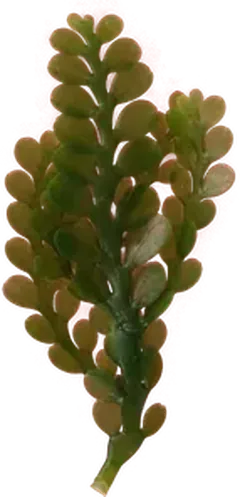
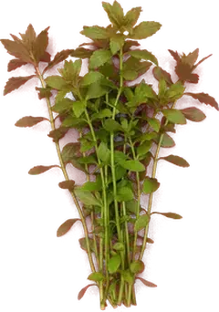
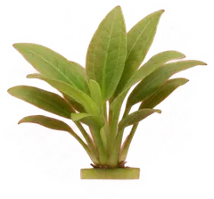

# reeftank-catalog

<!-- species:begin (generated by scripts/make_readme.py, do not edit) -->

> Część [**ekosystemu projektów ReefTech**](https://elwinmage.github.io/reeftank/)

       

Gatunki ryb, koralowców, roślin i bezkręgowców do widoku akwarium [ha-reef-card](https://github.com/Elwinmage/ha-reef-card), dostarczane przez [integrację ReefTank](https://github.com/Elwinmage/ha-reeftank-component).

Integracja pobiera wydania tego repozytorium i aktualizuje je (`update.reeftank_catalog`, domyślnie automatycznie): w Home Assistant nie trzeba nic robić.

## Jak to działa

Każda ryba to arkusz klatek (atlas WebP) i deskryptor z jej klipami: *pływanie*, *postój* i *zawrót*. Karta odtwarza je jeden po drugim, a zawrót odbija lustrzanie, by ryba wróciła tą samą drogą. Oto pływanie, zawrót i powrót dwóch gatunków:

<table><tr><td align="center"> Pokolec cesarski</td><td align="center"> Błazenek</td></tr></table>

## Ryby (102)

**HD**: prawdziwa animacja zrobiona z filmów. Pozostałe mają prostą animację ze zdjęcia albo rybę ogólną.

| &nbsp;&nbsp;&nbsp;&nbsp;&nbsp;&nbsp;&nbsp;&nbsp;&nbsp;&nbsp;&nbsp;&nbsp;&nbsp;&nbsp;&nbsp;&nbsp;&nbsp;&nbsp;&nbsp;&nbsp;&nbsp;&nbsp;&nbsp;&nbsp;&nbsp;&nbsp;&nbsp;&nbsp;&nbsp;&nbsp;&nbsp;&nbsp;&nbsp;&nbsp;&nbsp;&nbsp;&nbsp;&nbsp;&nbsp;&nbsp;&nbsp;&nbsp;&nbsp;&nbsp;&nbsp;&nbsp;&nbsp;&nbsp;&nbsp;&nbsp;&nbsp;&nbsp;&nbsp;&nbsp;&nbsp;&nbsp; | Nazwa | Nazwa naukowa | Woda | Rozmiar | Zachowanie | HD |
|---|---|---|---|---|---|---|
|  | Ancistrus `ancistrus` | *Ancistrus sp.* | Słodkowodna | 10–14 cm | Przydenny · chowa się w nocy |  |
|  | Apistogramma kakadu `apistogramma_cacatuoides` | *Apistogramma cacatuoides* | Słodkowodna | 5–9 cm | Przydenny · chowa się w nocy |  |
|  | Babka fioletowa `gobioides_broussonnetii` | *Gobioides broussonnetii* | Słonawa | 30–50 cm | Żyje na piasku · żyje w norze · odpoczywa w nocy na dnie |  |
|  | Babka koralowa cytrynowa `gobiodon_citrinus` | *Gobiodon citrinus* | Morska | 3–5 cm | Przydenny · chowa się w nocy |  |
|  | Babka neonowa `elacatinus_oceanops` | *Elacatinus oceanops* | Morska | 4–6 cm | Przydenny · chowa się w nocy |  |
|  | Babka ognista `nemateleotris_magnifica` | *Nemateleotris magnifica* | Morska | 8–10 cm | Stoi w miejscu · unosi się w toni w nocy |  |
|  | Babka ognista purpurowa `nemateleotris_decora` | *Nemateleotris decora* | Morska | 8–10 cm | Stoi w miejscu · unosi się w toni w nocy |  |
|  | Babka okinawska `gobiodon_okinawae` | *Gobiodon okinawae* | Morska | 2.5–3.5 cm | Przydenny · chowa się w nocy |  |
|  | Babka pasiasta `amblygobius_phalaena` | *Amblygobius phalaena* | Morska | 8–10 cm | Żyje na piasku · odpoczywa w nocy na dnie |  |
|  | Babka piaskowa `valenciennea` | *Valenciennea sp.* | Morska | 10–16 cm | Żyje na piasku · żyje w norze · odpoczywa w nocy na dnie | ✔ |
|  | Babka rycerska `stigmatogobius_sadanundio` | *Stigmatogobius sadanundio* | Słonawa | 6–8 cm | Przydenny · chowa się w nocy |  |
|  | Babka trzmielowa `brachygobius_xanthozonus` | *Brachygobius xanthozonus* | Słonawa | 3–4 cm | Przydenny · chowa się w nocy |  |
|  | Babka yasha `stonogobiops_yasha` | *Stonogobiops yasha* | Morska | 6–8 cm | Żyje na piasku · żyje w norze · odpoczywa w nocy na dnie |  |
|  | Babka żółta `cryptocentrus_cinctus` | *Cryptocentrus cinctus* | Morska | 8–10 cm | Żyje na piasku · żyje w norze · odpoczywa w nocy na dnie |  |
|  | Bocja clown `chromobotia_macracanthus` | *Chromobotia macracanthus* | Słodkowodna | 15–30 cm | Przydenny · chowa się w nocy |  |
|  | Bojownik wspaniały `betta_splendens` | *Betta splendens* | Słodkowodna | 5–7 cm | Stoi w miejscu · trzyma się swojej kryjówki · unosi się w toni w nocy |  |
|  | Brzanka sumatrzańska `puntigrus_tetrazona` | *Puntigrus tetrazona* | Słodkowodna | 5–7 cm | Ławica · chowa się w nocy |  |
|  | Brzanka wiśniowa `pethia_titteya` | *Pethia titteya* | Słodkowodna | 4–5 cm | Ławica · chowa się w nocy |  |
|  | Błazenek `amphiprion` | *Amphiprion sp.* | Morska | 7–11 cm | Stoi w miejscu · unosi się w toni w nocy | ✔ |
|  | Błazenek kasztanowy `premnas_biaculeatus` | *Premnas biaculeatus* | Morska | 10–15 cm | Stoi w miejscu · unosi się w toni w nocy |  |
|  | Chromis zielony `chromis_viridis` | *Chromis viridis* | Morska | 5–8 cm | Ławica · chowa się w nocy | ✔ |
|  | Danio galaxy `danio_margaritatus` | *Danio margaritatus* | Słodkowodna | 2–3 cm | Ławica · chowa się w nocy |  |
|  | Danio perłowy `danio_albolineatus` | *Danio albolineatus* | Słodkowodna | 4–6 cm | Ławica · chowa się w nocy |  |
|  | Danio pręgowany `danio_rerio` | *Danio rerio* | Słodkowodna | 4–5 cm | Ławica · chowa się w nocy |  |
|  | Dascyllus trójplamisty `dascyllus_trimaculatus` | *Dascyllus trimaculatus* | Morska | 10–14 cm | Stoi w miejscu · unosi się w toni w nocy |  |
|  | Dyskowiec `symphysodon_aequifasciatus` | *Symphysodon aequifasciatus* | Słodkowodna | 15–20 cm | Pływa w toni wodnej · chowa się w nocy |  |
|  | Garbik fidżyjski `chrysiptera_taupou` | *Chrysiptera taupou* | Morska | 6–8 cm | Stoi w miejscu · trzyma się swojej kryjówki · unosi się w toni w nocy |  |
|  | Garbik żółtoogonowy `chrysiptera_parasema` | *Chrysiptera parasema* | Morska | 5–6 cm | Stoi w miejscu · trzyma się swojej kryjówki · unosi się w toni w nocy |  |
|  | Glonojad siamski `crossocheilus_oblongus` | *Crossocheilus oblongus* | Słodkowodna | 10–15 cm | Pływa w toni wodnej · chowa się w nocy |  |
|  | Gramma królewska `gramma_loreto` | *Gramma loreto* | Morska | 7–8 cm | Stoi w miejscu · unosi się w toni w nocy |  |
|  | Gupik `poecilia_reticulata` | *Poecilia reticulata* | Słodkowodna | 3–6 cm | Ławica · chowa się w nocy |  |
|  | Gupik Endlera `poecilia_wingei` | *Poecilia wingei* | Słodkowodna | 2–4 cm | Ławica · chowa się w nocy |  |
|  | Gurami błękitny `trichopodus_trichopterus` | *Trichopodus trichopterus* | Słodkowodna | 10–15 cm | Pływa w toni wodnej · chowa się w nocy |  |
|  | Gurami karłowaty `trichogaster_lalius` | *Trichogaster lalius* | Słodkowodna | 5–8 cm | Pływa w toni wodnej · chowa się w nocy |  |
|  | Gurami perłowy `trichopodus_leerii` | *Trichopodus leerii* | Słodkowodna | 10–12 cm | Pływa w toni wodnej · chowa się w nocy |  |
|  | Jastrzębik pixie `cirrhitichthys_oxycephalus` | *Cirrhitichthys oxycephalus* | Morska | 8–10 cm | Przydenny · chowa się w nocy |  |
|  | Kardynał piżamowy `sphaeramia_nematoptera` | *Sphaeramia nematoptera* | Morska | 8–10 cm | Stoi w miejscu · unosi się w toni w nocy |  |
|  | Kardynał z Banggai `pterapogon_kauderni` | *Pterapogon kauderni* | Morska | 5–8 cm | Stoi w miejscu · unosi się w toni w nocy | ✔ |
|  | Kardynał żółtopręgi `ostorhinchus_cyanosoma` | *Ostorhinchus cyanosoma* | Morska | 7–8 cm | Stoi w miejscu · unosi się w toni w nocy |  |
|  | Kiliasz lirogonowy `aphyosemion_australe` | *Aphyosemion australe* | Słodkowodna | 5–6 cm | Stoi w miejscu · unosi się w toni w nocy |  |
|  | Kirysek brązowy `corydoras_aeneus` | *Corydoras aeneus* | Słodkowodna | 6–7 cm | Przydenny · chowa się w nocy |  |
|  | Kirysek panda `corydoras_panda` | *Corydoras panda* | Słodkowodna | 4–5 cm | Przydenny · chowa się w nocy |  |
|  | Konik morski prążkowany `hippocampus_erectus` | *Hippocampus erectus* | Morska | 10–15 cm | Stoi w miejscu · unosi się w toni w nocy |  |
|  | Kribensis `pelvicachromis_pulcher` | *Pelvicachromis pulcher* | Słodkowodna | 8–10 cm | Przydenny · chowa się w nocy |  |
|  | Mandaryn psychodeliczny `synchiropus_picturatus` | *Synchiropus picturatus* | Morska | 6–8 cm | Przydenny · chowa się w nocy |  |
|  | Mandaryn wspaniały `synchiropus_splendidus` | *Synchiropus splendidus* | Morska | 5–8 cm | Przydenny · chowa się w nocy | ✔ |
|  | Mieczyk Hellera `xiphophorus_hellerii` | *Xiphophorus hellerii* | Słodkowodna | 6–12 cm | Ławica · chowa się w nocy |  |
|  | Molinezja zwyczajna `poecilia_sphenops` | *Poecilia sphenops* | Słodkowodna, Słonawa | 6–10 cm | Ławica · chowa się w nocy |  |
|  | Molinezja żaglowa `poecilia_velifera` | *Poecilia velifera* | Słonawa, Słodkowodna | 10–15 cm | Ławica · chowa się w nocy |  |
|  | Monodaktyl srebrzysty `monodactylus_argenteus` | *Monodactylus argenteus* | Słonawa, Morska | 15–25 cm | Ławica · chowa się w nocy |  |
|  | Motylek miedzianopręgi `chelmon_rostratus` | *Chelmon rostratus* | Morska | 15–20 cm | Pływa w toni wodnej · chowa się w nocy |  |
|  | Neonka czerwona `paracheirodon_axelrodi` | *Paracheirodon axelrodi* | Słodkowodna | 3–5 cm | Ławica · chowa się w nocy |  |
|  | Neonka Innesa `paracheirodon_innesi` | *Paracheirodon innesi* | Słodkowodna | 3–4 cm | Ławica · chowa się w nocy |  |
|  | Oscar `astronotus_ocellatus` | *Astronotus ocellatus* | Słodkowodna | 25–35 cm | Pływa w toni wodnej · chowa się w nocy |  |
|  | Otocinclus `otocinclus_affinis` | *Otocinclus affinis* | Słodkowodna | 3–5 cm | Przydenny · chowa się w nocy |  |
|  | Pielęgniczka Ramireza `mikrogeophagus_ramirezi` | *Mikrogeophagus ramirezi* | Słodkowodna | 5–7 cm | Stoi w miejscu · unosi się w toni w nocy |  |
|  | Piskorz Kuhla `pangio_kuhlii` | *Pangio kuhlii* | Słodkowodna | 8–12 cm | Przydenny · chowa się w nocy |  |
|  | Platy `xiphophorus_maculatus` | *Xiphophorus maculatus* | Słodkowodna | 4–6 cm | Ławica · chowa się w nocy |  |
|  | Pokolec białogardły `acanthurus_leucosternon` | *Acanthurus leucosternon* | Morska | 20–23 cm | Pływa w toni wodnej · chowa się w nocy |  |
|  | Pokolec brązowy `zebrasoma_scopas` | *Zebrasoma scopas* | Morska | 15–20 cm | Pływa w toni wodnej · chowa się w nocy |  |
|  | Pokolec kole `ctenochaetus_strigosus` | *Ctenochaetus strigosus* | Morska | 12–18 cm | Pływa w toni wodnej · chowa się w nocy |  |
|  | Pokolec królewski `paracanthurus_hepatus` | *Paracanthurus hepatus* | Morska | 20–30 cm | Pływa w toni wodnej · chowa się w nocy |  |
|  | Pokolec żaglowy `zebrasoma_veliferum` | *Zebrasoma veliferum* | Morska | 25–40 cm | Pływa w toni wodnej · chowa się w nocy |  |
|  | Pokolec żółty `zebrasoma_flavescens` | *Zebrasoma flavescens* | Morska | 15–20 cm | Pływa w toni wodnej · chowa się w nocy |  |
|  | Pseudanthias `pseudanthias` | *Pseudanthias sp.* | Morska | 8–14 cm | Ławica · chowa się w nocy | ✔ |
|  | Pseudochromis orchidea `pseudochromis_fridmani` | *Pseudochromis fridmani* | Morska | 6–7 cm | Stoi w miejscu · trzyma się swojej kryjówki · unosi się w toni w nocy |  |
|  | Pyszczak Demasoni `pseudotropheus_demasoni` | *Pseudotropheus demasoni* | Słodkowodna | 7–8 cm | Pływa w toni wodnej · chowa się w nocy |  |
|  | Pyszczak żółty `labidochromis_caeruleus` | *Labidochromis caeruleus* | Słodkowodna | 8–10 cm | Pływa w toni wodnej · chowa się w nocy |  |
|  | Razbora klinowa `trigonostigma_heteromorpha` | *Trigonostigma heteromorpha* | Słodkowodna | 3–4.5 cm | Ławica · chowa się w nocy |  |
|  | Rogatnica Picasso `rhinecanthus_aculeatus` | *Rhinecanthus aculeatus* | Morska | 20–25 cm | Pływa w toni wodnej · chowa się w nocy |  |
|  | Rozdymka Valentina `canthigaster_valentini` | *Canthigaster valentini* | Morska | 8–10 cm | Pływa w toni wodnej · chowa się w nocy |  |
|  | Rozdymka zielona `dichotomyctere_nigroviridis` | *Dichotomyctere nigroviridis* | Słonawa | 10–17 cm | Pływa w toni wodnej · chowa się w nocy |  |
|  | Rozdymka ósemkowa `dichotomyctere_biocellatus` | *Dichotomyctere biocellatus* | Słonawa | 5–6.5 cm | Pływa w toni wodnej · chowa się w nocy |  |
|  | Scat cętkowany `scatophagus_argus` | *Scatophagus argus* | Słonawa, Morska | 15–30 cm | Pływa w toni wodnej · chowa się w nocy |  |
|  | Sigan lisi `siganus_vulpinus` | *Siganus vulpinus* | Morska | 15–22 cm | Pływa w toni wodnej · odpoczywa w nocy na dnie | ✔ |
|  | Skalar `pterophyllum_scalare` | *Pterophyllum scalare* | Słodkowodna | 12–15 cm | Pływa w toni wodnej · chowa się w nocy |  |
|  | Skoczek mułowy atlantycki `periophthalmus_barbarus` | *Periophthalmus barbarus* | Słonawa | 10–15 cm | Przydenny · chowa się w nocy |  |
|  | Skrzydlica czerwona `pterois_volitans` | *Pterois volitans* | Morska | 25–35 cm | Pływa w toni wodnej · chowa się w nocy |  |
|  | Skrzydlica zebra `dendrochirus_zebra` | *Dendrochirus zebra* | Morska | 12–18 cm | Pływa w toni wodnej · chowa się w nocy |  |
|  | Strzelec prążkowany `toxotes_jaculatrix` | *Toxotes jaculatrix* | Słonawa | 15–25 cm | Pływa w toni wodnej · chowa się w nocy |  |
|  | Szczękowiec żółtogłowy `opistognathus_aurifrons` | *Opistognathus aurifrons* | Morska | 10–12 cm | Żyje na piasku · żyje w norze · odpoczywa w nocy na dnie |  |
|  | Tanichthys `tanichthys_albonubes` | *Tanichthys albonubes* | Słodkowodna | 3–4 cm | Ławica · chowa się w nocy |  |
|  | Tetra cesarska `nematobrycon_palmeri` | *Nematobrycon palmeri* | Słodkowodna | 4–6 cm | Ławica · chowa się w nocy |  |
|  | Tetra cytrynowa `hyphessobrycon_pulchripinnis` | *Hyphessobrycon pulchripinnis* | Słodkowodna | 3–4.5 cm | Ławica · chowa się w nocy |  |
|  | Tetra czarna `gymnocorymbus_ternetzi` | *Gymnocorymbus ternetzi* | Słodkowodna | 5–6 cm | Ławica · chowa się w nocy |  |
|  | Tetra czerwononosa `hemigrammus_bleheri` | *Hemigrammus bleheri* | Słodkowodna | 4–5 cm | Ławica · chowa się w nocy |  |
|  | Tetra serpae `hyphessobrycon_eques` | *Hyphessobrycon eques* | Słodkowodna | 3–4.5 cm | Ławica · chowa się w nocy |  |
|  | Toporzyk marmurkowy `carnegiella_strigata` | *Carnegiella strigata* | Słodkowodna | 4–5 cm | Ławica · chowa się w nocy |  |
|  | Tęczanka turkusowa `melanotaenia_lacustris` | *Melanotaenia lacustris* | Słodkowodna | 8–12 cm | Ławica · chowa się w nocy |  |
|  | Ustniczek cesarski (dorosły) `pomacanthus_imperator_adult` | *Pomacanthus imperator* | Morska | 25–38 cm | Pływa w toni wodnej · chowa się w nocy | ✔ |
|  | Ustniczek cesarski (młody) `pomacanthus_imperator` | *Pomacanthus imperator* | Morska | 6–12 cm | Pływa w toni wodnej · chowa się w nocy | ✔ |
|  | Ustniczek dwubarwny `centropyge_bicolor` | *Centropyge bicolor* | Morska | 10–15 cm | Stoi w miejscu · unosi się w toni w nocy |  |
|  | Ustniczek królewski `pygoplites_diacanthus` | *Pygoplites diacanthus* | Morska | 20–25 cm | Pływa w toni wodnej · chowa się w nocy |  |
|  | Ustniczek płomienisty `centropyge_loricula` | *Centropyge loricula* | Morska | 8–10 cm | Stoi w miejscu · unosi się w toni w nocy |  |
|  | Wargacz sześciopręgi `pseudocheilinus_hexataenia` | *Pseudocheilinus hexataenia* | Morska | 7–10 cm | Pływa w toni wodnej · chowa się w nocy |  |
|  | Wargacz z Solor `cirrhilabrus_solorensis` | *Cirrhilabrus solorensis* | Morska | 10–12 cm | Pływa w toni wodnej · chowa się w nocy |  |
|  | Wargacz żółty `halichoeres_chrysus` | *Halichoeres chrysus* | Morska | 10–12 cm | Pływa w toni wodnej · odpoczywa w nocy na dnie |  |
|  | Wargatek czyściciel `labroides_dimidiatus` | *Labroides dimidiatus* | Morska | 10–12 cm | Pływa w toni wodnej · chowa się w nocy |  |
|  | Zbrojnik zebra `hypancistrus_zebra` | *Hypancistrus zebra* | Słodkowodna | 7–10 cm | Przydenny · chowa się w nocy |  |
|  | Złota rybka `carassius_auratus` | *Carassius auratus* | Słodkowodna | 10–25 cm | Pływa w toni wodnej · chowa się w nocy |  |
|  | Ślizg dwubarwny `ecsenius_bicolor` | *Ecsenius bicolor* | Morska | 8–10 cm | Przydenny · chowa się w nocy |  |
|  | Ślizg kosiarka `salarias_fasciatus` | *Salarias fasciatus* | Morska | 12–14 cm | Przydenny · chowa się w nocy |  |

## Koralowce (1)

| &nbsp;&nbsp;&nbsp;&nbsp;&nbsp;&nbsp;&nbsp;&nbsp;&nbsp;&nbsp;&nbsp;&nbsp;&nbsp;&nbsp;&nbsp;&nbsp;&nbsp;&nbsp;&nbsp;&nbsp;&nbsp;&nbsp;&nbsp;&nbsp;&nbsp;&nbsp;&nbsp;&nbsp;&nbsp;&nbsp;&nbsp;&nbsp;&nbsp;&nbsp;&nbsp;&nbsp;&nbsp;&nbsp;&nbsp;&nbsp;&nbsp;&nbsp;&nbsp;&nbsp;&nbsp;&nbsp;&nbsp;&nbsp;&nbsp;&nbsp;&nbsp;&nbsp;&nbsp;&nbsp;&nbsp;&nbsp; | Nazwa | Nazwa naukowa | Woda | Rozmiar |
|---|---|---|---|---|
|  | Koral pochodnia `euphyllia_glabrescens` | *Euphyllia glabrescens* | Morska | 10–30 cm |

## Rośliny (29)

| &nbsp;&nbsp;&nbsp;&nbsp;&nbsp;&nbsp;&nbsp;&nbsp;&nbsp;&nbsp;&nbsp;&nbsp;&nbsp;&nbsp;&nbsp;&nbsp;&nbsp;&nbsp;&nbsp;&nbsp;&nbsp;&nbsp;&nbsp;&nbsp;&nbsp;&nbsp;&nbsp;&nbsp;&nbsp;&nbsp;&nbsp;&nbsp;&nbsp;&nbsp;&nbsp;&nbsp;&nbsp;&nbsp;&nbsp;&nbsp;&nbsp;&nbsp;&nbsp;&nbsp;&nbsp;&nbsp;&nbsp;&nbsp;&nbsp;&nbsp;&nbsp;&nbsp;&nbsp;&nbsp;&nbsp;&nbsp; | Nazwa | Nazwa naukowa | Woda | Rozmiar | Strefa |
|---|---|---|---|---|---|
|  | Ambulia `limnophila_sessiliflora` | *Limnophila sessiliflora* | Słodkowodna | 20–40 cm | Tło |
|  | Anubias `anubias_barteri` | *Anubias barteri* | Słodkowodna | 10–25 cm | Epifit |
|  | Bucephalandra `bucephalandra` | *Bucephalandra sp.* | Słodkowodna | 5–15 cm | Epifit |
|  | Caulerpa `caulerpa_prolifera` | *Caulerpa prolifera* | Morska | 5–20 cm | Pierwszy plan |
|  | Chaetomorpha `chaetomorpha_linum` | *Chaetomorpha linum* | Morska | 5–30 cm | Pierwszy plan |
|  | Glossostigma `glossostigma_elatinoides` | *Glossostigma elatinoides* | Słodkowodna | 2–5 cm | Pierwszy plan |
|  | Halimeda `halimeda_opuntia` | *Halimeda opuntia* | Morska | 5–15 cm | Pierwszy plan |
|  | Hemianthus `hemianthus_callitrichoides` | *Hemianthus callitrichoides* | Słodkowodna | 2–5 cm | Pierwszy plan |
|  | Hygrofila `hygrophila_polysperma` | *Hygrophila polysperma* | Słodkowodna | 20–50 cm | Tło |
|  | Kabomba karolińska `cabomba_caroliniana` | *Cabomba caroliniana* | Słodkowodna | 30–60 cm | Tło |
|  | Kryptokoryna drobna `cryptocoryne_parva` | *Cryptocoryne parva* | Słodkowodna | 5–8 cm | Pierwszy plan |
|  | Kryptokoryna orzęsiona `cryptocoryne_ciliata` | *Cryptocoryne ciliata* | Słonawa, Słodkowodna | 20–40 cm | Plan środkowy |
|  | Kryptokoryna Wendta `cryptocoryne_wendtii` | *Cryptocoryne wendtii* | Słodkowodna | 10–20 cm | Plan środkowy |
|  | Limnobium `limnobium_laevigatum` | *Limnobium laevigatum* | Słodkowodna | 5–10 cm | Pływająca |
|  | Ludwigia `ludwigia_repens` | *Ludwigia repens* | Słodkowodna | 20–40 cm | Plan środkowy |
|  | Marimo `aegagropila_linnaei` | *Aegagropila linnaei* | Słodkowodna | 3–10 cm | Pierwszy plan |
|  | Mech jawajski `vesicularia_dubyana` | *Vesicularia dubyana* | Słodkowodna | 3–5 cm | Epifit |
|  | Moczarka argentyńska `egeria_densa` | *Egeria densa* | Słodkowodna | 30–100 cm | Tło |
|  | Namorzyn czerwony `rhizophora_mangle` | *Rhizophora mangle* | Słonawa, Morska | 30–100 cm | Plan środkowy |
|  | Nurzaniec śrubowy `vallisneria_spiralis` | *Vallisneria spiralis* | Słodkowodna, Słonawa | 30–60 cm | Tło |
|  | Paproć jawajska `microsorum_pteropus` | *Microsorum pteropus* | Słodkowodna | 20–30 cm | Epifit |
|  | Ponikło drobne `eleocharis_parvula` | *Eleocharis parvula* | Słodkowodna | 5–10 cm | Pierwszy plan |
|  | Rotala `rotala_rotundifolia` | *Rotala rotundifolia* | Słodkowodna | 20–50 cm | Tło |
|  | Rzęsa drobna `lemna_minor` | *Lemna minor* | Słodkowodna | 0.5–1 cm | Pływająca |
|  | Salata wodna `pistia_stratiotes` | *Pistia stratiotes* | Słodkowodna | 5–15 cm | Pływająca |
|  | Staurogyne `staurogyne_repens` | *Staurogyne repens* | Słodkowodna | 5–10 cm | Pierwszy plan |
|  | Strzałka karłowata `sagittaria_subulata` | *Sagittaria subulata* | Słodkowodna | 10–30 cm | Pierwszy plan |
|  | Trawa żółwia `thalassia_testudinum` | *Thalassia testudinum* | Morska | 10–30 cm | Pierwszy plan |
|  | Żabienica amazońska `echinodorus_bleheri` | *Echinodorus bleheri* | Słodkowodna | 30–50 cm | Plan środkowy |

## Bezkręgowce (32)

| &nbsp;&nbsp;&nbsp;&nbsp;&nbsp;&nbsp;&nbsp;&nbsp;&nbsp;&nbsp;&nbsp;&nbsp;&nbsp;&nbsp;&nbsp;&nbsp;&nbsp;&nbsp;&nbsp;&nbsp;&nbsp;&nbsp;&nbsp;&nbsp;&nbsp;&nbsp;&nbsp;&nbsp;&nbsp;&nbsp;&nbsp;&nbsp;&nbsp;&nbsp;&nbsp;&nbsp;&nbsp;&nbsp;&nbsp;&nbsp;&nbsp;&nbsp;&nbsp;&nbsp;&nbsp;&nbsp;&nbsp;&nbsp;&nbsp;&nbsp;&nbsp;&nbsp;&nbsp;&nbsp;&nbsp;&nbsp; | Nazwa | Nazwa naukowa | Woda | Rozmiar | Rola |
|---|---|---|---|---|---|
|  | Ampularia `pomacea_bridgesii` | *Pomacea bridgesii* | Słodkowodna | 4–5 cm | Padlinożerca · porusza się po dnie |
|  | Jeżowiec kolekcjoner `tripneustes_gratilla` | *Tripneustes gratilla* | Morska | 10–15 cm | Glonojad · żyje na dekoracjach |
|  | Jeżowiec ołówkowy `prionocidaris_baculosa` | *Prionocidaris baculosa* | Morska | 8–10 cm | Glonojad · żyje na dekoracjach |
|  | Krab szmaragdowy `mithraculus_sculptus` | *Mithraculus sculptus* | Morska | 3–4 cm | Glonojad · żyje na dekoracjach |
|  | Krewetka Amano `caridina_multidentata` | *Caridina multidentata* | Słodkowodna | 3–5 cm | Glonojad · porusza się po dnie |
|  | Krewetka arlekin `hymenocera_picta` | *Hymenocera picta* | Morska | 4–6 cm | Drapieżnik · porusza się po dnie |
|  | Krewetka bambusowa `atyopsis_moluccensis` | *Atyopsis moluccensis* | Słodkowodna | 6–8 cm | Filtrator · żyje na dekoracjach |
|  | Krewetka bokser `stenopus_hispidus` | *Stenopus hispidus* | Morska | 6–8 cm | Sprzątacz · żyje na dekoracjach |
|  | Krewetka czyścicielka szkarłatna `lysmata_amboinensis` | *Lysmata amboinensis* | Morska | 5–6 cm | Sprzątacz · żyje na dekoracjach |
|  | Krewetka kryształowa czerwona `caridina_cantonensis` | *Caridina cantonensis* | Słodkowodna | 2–3 cm | Detrytusożerca · porusza się po dnie |
|  | Krewetka marmurkowa `saron_marmoratus` | *Saron marmoratus* | Morska | 5–7 cm | Padlinożerca · żyje na dekoracjach |
|  | Krewetka ognista `lysmata_debelius` | *Lysmata debelius* | Morska | 5–6 cm | Sprzątacz · żyje na dekoracjach |
|  | Krewetka peppermint `lysmata_wurdemanni` | *Lysmata wurdemanni* | Morska | 3–5 cm | Sprzątacz · żyje na dekoracjach |
|  | Krewetka wiśniowa `neocaridina_davidi` | *Neocaridina davidi* | Słodkowodna | 2–3.5 cm | Detrytusożerca · porusza się po dnie |
|  | Nerytka morska `nerita` | *Nerita sp.* | Morska | 2–3 cm | Glonojad · wspina się po szybie |
|  | Nerytka zebra `neritina_natalensis` | *Neritina natalensis* | Słodkowodna | 2–3 cm | Glonojad · wspina się po szybie |
|  | Pióropusznik `sabellastarte` | *Sabellastarte sp.* | Morska | 5–10 cm | Filtrator · osiadły |
|  | Rak pustelnik niebieskonogi `clibanarius_tricolor` | *Clibanarius tricolor* | Morska | 2–3 cm | Padlinożerca · porusza się po dnie |
|  | Rak pustelnik szkarłatny `paguristes_cadenati` | *Paguristes cadenati* | Morska | 3–4 cm | Padlinożerca · porusza się po dnie |
|  | Robak choinkowy `spirobranchus_giganteus` | *Spirobranchus giganteus* | Morska | 3–5 cm | Filtrator · osiadły |
|  | Rozgwiazda piaskowa `archaster_typicus` | *Archaster typicus* | Morska | 6–10 cm | Detrytusożerca · porusza się po dnie |
|  | Strzykwa `holothuria` | *Holothuria sp.* | Morska | 15–30 cm | Detrytusożerca · porusza się po dnie |
|  | Tridakna wiercąca `tridacna_crocea` | *Tridacna crocea* | Morska | 5–15 cm | Filtrator · osiadły |
|  | Wieżyczka `melanoides_tuberculata` | *Melanoides tuberculata* | Słodkowodna | 2–3 cm | Detrytusożerca · porusza się po dnie |
|  | Wężowidło `ophiolepis_superba` | *Ophiolepis superba* | Morska | 8–12 cm | Padlinożerca · porusza się po dnie |
|  | Zatoczek `planorbella_duryi` | *Planorbella duryi* | Słodkowodna | 2–3 cm | Detrytusożerca · wspina się po szybie |
|  | Ślimak Astraea `astraea_tecta` | *Astraea tecta* | Morska | 2–4 cm | Glonojad · żyje na dekoracjach |
|  | Ślimak cerit `cerithium` | *Cerithium sp.* | Morska | 2–3 cm | Detrytusożerca · porusza się po dnie |
|  | Ślimak Nassarius `nassarius` | *Nassarius sp.* | Morska | 2–4 cm | Padlinożerca · porusza się po dnie |
|  | Ślimak trochus `tectus_fenestratus` | *Tectus fenestratus* | Morska | 4–6 cm | Glonojad · żyje na dekoracjach |
|  | Ślimak turbo `turbo_fluctuosus` | *Turbo fluctuosus* | Morska | 4–8 cm | Glonojad · wspina się po szybie |
|  | Ślimak zabójca `clea_helena` | *Clea helena* | Słodkowodna | 2–3 cm | Drapieżnik · porusza się po dnie |

Aby dodać gatunek (generowanie klipów, budowanie, publikacja), zobacz [dokumentację w języku angielskim](README.md).

Zasoby gatunków są na licencji **CC BY 4.0**, skrypty na licencji MIT: zobacz [LICENSE.md](LICENSE.md).

<!-- species:end -->

<!-- ecosystem:start -->

## Powiązane projekty

Projekty ReefTech uzupełniają się: integracje wprowadzają sprzęt do Home Assistant, karta go wyświetla i steruje nim, a zasilanie awaryjne utrzymuje go w ruchu podczas przerwy w zasilaniu. Każdy działa również samodzielnie.

<table>
  <tr>
    <th width="100px"></th>
    <th>Projekt</th>
    <th>Rola</th>
    <th>Współpracuje z</th>
  </tr>
  <tr>
    <td></td>
    <td>🐠 <a href="https://github.com/Elwinmage/ha-reefbeat-component"><b>ha-reefbeat-component</b></a></td>
    <td>Urządzenia Red Sea ReefBeat, sterowane lokalnie bez chmury: ReefATO+, ReefControl, ReefControl-Power, ReefDose, ReefLed, ReefMat, ReefRun i ReefWave. blueprint alertów dla nietypowych trybów, kalibracji i niskiego poziomu baterii. </td>
    <td>ha-reef-card</td>
  </tr>
  <tr>
    <td></td>
    <td>🌊 <a href="https://github.com/Elwinmage/ha-aquamedic-component"><b>ha-aquamedic-component</b></a></td>
    <td>Pompy Aqua Medic przez chmurowe API Gizwits: pompy cyrkulacyjne EcoDrift i SmartDrift, pompy DC Runner obiegowe i do odpieniacza.</td>
    <td>ha-reef-card</td>
  </tr>
  <tr>
    <td></td>
    <td>🐟 <a href="https://github.com/Elwinmage/ha-vson-component"><b>ha-vson-component</b></a></td>
    <td>Automatyczne karmniki VSON przez chmurowe API VSON: karmnik WP8621 (karmienie, bateria, alert niskiego poziomu karmy) i generyczne wykrywanie dowolnego innego urządzenia VSON. WP8621 może też działać w pełni lokalnie na ESPHome.</td>
    <td>ha-reef-card</td>
  </tr>
  <tr>
    <td></td>
    <td>🐙 <a href="https://github.com/Elwinmage/ha-reef-maintenance-component"><b>ha-reef-maintenance-component</b></a></td>
    <td>Śledzenie czyszczenia i zużycia sprzętu, do którego Home Assistant nie ma dostępu: pompy cyrkulacyjne, pompy obiegowe, odpieniacze, reaktory, wszystko co obsługujesz ręcznie.</td>
    <td>ha-reef-card</td>
  </tr>
  <tr>
    <td></td>
    <td>🪸 <a href="https://github.com/Elwinmage/ha-reef-card"><b>ha-reef-card</b></a></td>
    <td>Interaktywny widok graficzny każdego urządzenia na pulpicie i jedyny sposób edycji zaawansowanych harmonogramów. Odczytuje trzy integracje przez wspólny kontrakt <code>reef_role</code>, bez konfiguracji po stronie karty. Rysuje też przepływy energii z reefbeatEnergyBackup. Jej karta akwarium ożywia Twój zbiornik dzięki ha-reeftank-component.</td>
    <td>wszystkie cztery integracje oraz ha-reeftank-component dla akwarium</td>
  </tr>
  <tr>
    <td></td>
    <td>🐟 <a href="https://github.com/Elwinmage/ha-reeftank-component"><b>ha-reeftank-component</b></a></td>
    <td>Żywy obraz Twojego zbiornika na pulpicie: Twoje zdjęcie, oświetlone prawdziwymi lampami, z animowanymi rybami i koralowcami oraz Twoimi urządzeniami i encjami. Przechowuje akwaria i ich obsadę, rejestruje karmienia.</td>
    <td>ha-reef-card</td>
  </tr>
  <tr>
    <td></td>
    <td>🐡 <b>reeftank-catalog</b> <i>(to repozytorium)</i></td>
    <td>Ryby, koralowce i tekstury karty akwarium, pobierane i aktualizowane przez ha-reeftank-component.</td>
    <td>ha-reeftank-component</td>
  </tr>
  <tr>
    <td></td>
    <td>🐬 <a href="https://github.com/Elwinmage/ha-reef-blueprints"><b>ha-reef-blueprints</b></a></td>
    <td>Blueprinty automatyzacji wspólne dla całego ekosystemu: zaległe konserwacje znajdowane przez kontrakt <code>reef_role</code>, urządzenia, które przestały odpowiadać, okresowy test grzałek i nadzór przekaźników. Osiem języków.</td>
    <td>wszystkie cztery integracje</td>
  </tr>
  <tr>
    <td></td>
    <td>⚡ <a href="https://github.com/Elwinmage/reefbeatEnergyBackup"><b>reefbeatEnergyBackup</b></a></td>
    <td>Zasilanie awaryjne na wypadek przerw w zasilaniu. Pakiet 24V LiFePO₄ sterowany przez Raspberry Pi, ze stopniowym obniżaniem prędkości pomp zależnie od stanu naładowania.</td>
    <td>samodzielnie lub razem z ha-reefbeat-component i ha-reef-card</td>
  </tr>
</table>

Wszystkie są udokumentowane razem na [stronie projektu ReefTech](https://elwinmage.github.io/reeftank/).

<!-- ecosystem:end -->
