# reeftank-catalog

<!-- species:begin (generated by scripts/make_readme.py, do not edit) -->

> Parte do [**ecossistema de projetos ReefTech**](https://elwinmage.github.io/reeftank/)

       

Espécies de peixes, corais, plantas e invertebrados para a vista de aquário do [ha-reef-card](https://github.com/Elwinmage/ha-reef-card), fornecidas pela [integração ReefTank](https://github.com/Elwinmage/ha-reeftank-component).

A integração descarrega as versões publicadas deste repositório e mantém-nas atualizadas (`update.reeftank_catalog`, automático por predefinição): nada a fazer no Home Assistant.

## Como funciona

Cada peixe é uma folha de imagens (um atlas WebP) e um descritor com os seus clipes: *nadar*, *parado* e *meia-volta*. O cartão encadeia-os e espelha a meia-volta para que o peixe regresse pelo mesmo caminho. Eis o nado, a meia-volta e o regresso de duas espécies:

Uma espécie sem vídeos tem um atlas mais simples feito a partir de uma só fotografia (*LD*): o corpo todo ondula, as barbatanas não se mexem. Os feitos a partir de vídeos estão assinalados na coluna HD das tabelas abaixo.

<table><tr><th></th><th>Peixe-anjo imperador</th><th>Peixe-palhaço</th></tr><tr><td>HD (vídeos)</td><td align="center"></td><td align="center"></td></tr><tr><td>LD (uma foto)</td><td align="center"></td><td align="center"></td></tr></table>

## Peixes (102)

**HD**: uma animação real, feita a partir de vídeos. Os outros têm uma animação simples feita a partir de uma foto, ou o peixe genérico.

| &nbsp;&nbsp;&nbsp;&nbsp;&nbsp;&nbsp;&nbsp;&nbsp;&nbsp;&nbsp;&nbsp;&nbsp;&nbsp;&nbsp;&nbsp;&nbsp;&nbsp;&nbsp;&nbsp;&nbsp;&nbsp;&nbsp;&nbsp;&nbsp;&nbsp;&nbsp;&nbsp;&nbsp;&nbsp;&nbsp;&nbsp;&nbsp;&nbsp; | Nome | Nome científico | Água | Tamanho | Comportamento | HD |
|---|---|---|---|---|---|---|
|  | Acará-bandeira <code>pterophyllum&#95;<wbr>scalare</code> | *Pterophyllum scalare* | Água doce | 12–15 cm | Nadador de águas abertas · esconde-se à noite | ✔ |
|  | Acará-disco <code>symphysodon&#95;<wbr>aequifasciatus</code> | *Symphysodon aequifasciatus* | Água doce | 15–20 cm | Nadador de águas abertas · esconde-se à noite | ✔ |
|  | Ancistrus <code>ancistrus</code> | *Ancistrus sp.* | Água doce | 10–14 cm | Vive junto ao fundo · esconde-se à noite | ✔ |
|  | Antias <code>pseudanthias</code> | *Pseudanthias sp.* | Marinho | 8–14 cm | Em cardume · esconde-se à noite | ✔ |
| 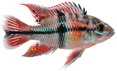 | Apistogramma-cacatua <code>apistogramma&#95;<wbr>cacatuoides</code> | *Apistogramma cacatuoides* | Água doce | 5–9 cm | Vive junto ao fundo · esconde-se à noite | ✔ |
|  | Baiacu-de-Valentin <code>canthigaster&#95;<wbr>valentini</code> | *Canthigaster valentini* | Marinho | 8–10 cm | Nadador de águas abertas · esconde-se à noite | ✔ |
|  | Baiacu-oito <code>dichotomyctere&#95;<wbr>biocellatus</code> | *Dichotomyctere biocellatus* | Salobra | 5–6.5 cm | Nadador de águas abertas · esconde-se à noite | ✔ |
|  | Baiacu-verde <code>dichotomyctere&#95;<wbr>nigroviridis</code> | *Dichotomyctere nigroviridis* | Salobra | 10–17 cm | Nadador de águas abertas · esconde-se à noite | ✔ |
|  | Barbo-cereja <code>pethia&#95;<wbr>titteya</code> | *Pethia titteya* | Água doce | 4–5 cm | Em cardume · esconde-se à noite | ✔ |
|  | Barbo-de-sumatra <code>puntigrus&#95;<wbr>tetrazona</code> | *Puntigrus tetrazona* | Água doce | 5–7 cm | Em cardume · esconde-se à noite | ✔ |
|  | Blênio-bicolor <code>ecsenius&#95;<wbr>bicolor</code> | *Ecsenius bicolor* | Marinho | 8–10 cm | Vive junto ao fundo · esconde-se à noite | ✔ |
|  | Blênio-cortador-de-relva <code>salarias&#95;<wbr>fasciatus</code> | *Salarias fasciatus* | Marinho | 12–14 cm | Vive junto ao fundo · esconde-se à noite | ✔ |
|  | Bodião-amarelo <code>halichoeres&#95;<wbr>chrysus</code> | *Halichoeres chrysus* | Marinho | 10–12 cm | Nadador de águas abertas · descansa no fundo à noite | ✔ |
|  | Bodião-de-seis-listras <code>pseudocheilinus&#95;<wbr>hexataenia</code> | *Pseudocheilinus hexataenia* | Marinho | 7–10 cm | Nadador de águas abertas · esconde-se à noite | ✔ |
|  | Bodião-fada-de-Solor <code>cirrhilabrus&#95;<wbr>solorensis</code> | *Cirrhilabrus solorensis* | Marinho | 10–12 cm | Nadador de águas abertas · esconde-se à noite | ✔ |
|  | Bodião-limpador <code>labroides&#95;<wbr>dimidiatus</code> | *Labroides dimidiatus* | Marinho | 10–12 cm | Nadador de águas abertas · esconde-se à noite | ✔ |
|  | Botia-palhaço <code>chromobotia&#95;<wbr>macracanthus</code> | *Chromobotia macracanthus* | Água doce | 15–30 cm | Vive junto ao fundo · esconde-se à noite | ✔ |
|  | Cascudo-zebra <code>hypancistrus&#95;<wbr>zebra</code> | *Hypancistrus zebra* | Água doce | 7–10 cm | Vive junto ao fundo · esconde-se à noite | ✔ |
|  | Cavalo-marinho-listrado <code>hippocampus&#95;<wbr>erectus</code> | *Hippocampus erectus* | Marinho | 10–15 cm | Estacionário · paira na água à noite | ✔ |
|  | Ciclídeo-amarelo-elétrico <code>labidochromis&#95;<wbr>caeruleus</code> | *Labidochromis caeruleus* | Água doce | 8–10 cm | Nadador de águas abertas · esconde-se à noite | ✔ |
|  | Ciclídeo-demasoni <code>pseudotropheus&#95;<wbr>demasoni</code> | *Pseudotropheus demasoni* | Água doce | 7–8 cm | Nadador de águas abertas · esconde-se à noite | ✔ |
|  | Cirurgião-amarelo <code>zebrasoma&#95;<wbr>flavescens</code> | *Zebrasoma flavescens* | Marinho | 15–20 cm | Nadador de águas abertas · esconde-se à noite | ✔ |
|  | Cirurgião-azul-pó <code>acanthurus&#95;<wbr>leucosternon</code> | *Acanthurus leucosternon* | Marinho | 20–23 cm | Nadador de águas abertas · esconde-se à noite | ✔ |
|  | Cirurgião-castanho <code>zebrasoma&#95;<wbr>scopas</code> | *Zebrasoma scopas* | Marinho | 15–20 cm | Nadador de águas abertas · esconde-se à noite | ✔ |
|  | Cirurgião-kole <code>ctenochaetus&#95;<wbr>strigosus</code> | *Ctenochaetus strigosus* | Marinho | 12–18 cm | Nadador de águas abertas · esconde-se à noite | ✔ |
| 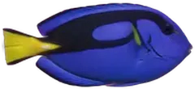 | Cirurgião-patela <code>paracanthurus&#95;<wbr>hepatus</code> | *Paracanthurus hepatus* | Marinho | 20–30 cm | Nadador de águas abertas · esconde-se à noite | ✔ |
|  | Cirurgião-vela <code>zebrasoma&#95;<wbr>veliferum</code> | *Zebrasoma veliferum* | Marinho | 25–40 cm | Nadador de águas abertas · esconde-se à noite | ✔ |
|  | Come-algas-siamês <code>crossocheilus&#95;<wbr>oblongus</code> | *Crossocheilus oblongus* | Água doce | 10–15 cm | Nadador de águas abertas · esconde-se à noite | ✔ |
|  | Corydora-bronze <code>corydoras&#95;<wbr>aeneus</code> | *Corydoras aeneus* | Água doce | 6–7 cm | Vive junto ao fundo · esconde-se à noite | ✔ |
| 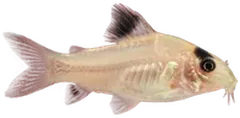 | Corydora-panda <code>corydoras&#95;<wbr>panda</code> | *Corydoras panda* | Água doce | 4–5 cm | Vive junto ao fundo · esconde-se à noite | ✔ |
|  | Cromis-verde <code>chromis&#95;<wbr>viridis</code> | *Chromis viridis* | Marinho | 5–8 cm | Em cardume · esconde-se à noite | ✔ |
|  | Danio-galáxia <code>danio&#95;<wbr>margaritatus</code> | *Danio margaritatus* | Água doce | 2–3 cm | Em cardume · esconde-se à noite | ✔ |
|  | Danio-pérola <code>danio&#95;<wbr>albolineatus</code> | *Danio albolineatus* | Água doce | 4–6 cm | Em cardume · esconde-se à noite | ✔ |
|  | Dascilo-de-três-manchas <code>dascyllus&#95;<wbr>trimaculatus</code> | *Dascyllus trimaculatus* | Marinho | 10–14 cm | Estacionário · paira na água à noite | ✔ |
|  | Donzela-de-cauda-amarela <code>chrysiptera&#95;<wbr>parasema</code> | *Chrysiptera parasema* | Marinho | 5–6 cm | Estacionário · fica perto do seu abrigo · paira na água à noite | ✔ |
|  | Donzela-de-Fiji <code>chrysiptera&#95;<wbr>taupou</code> | *Chrysiptera taupou* | Marinho | 6–8 cm | Estacionário · fica perto do seu abrigo · paira na água à noite | ✔ |
|  | Espadinha <code>xiphophorus&#95;<wbr>hellerii</code> | *Xiphophorus hellerii* | Água doce | 6–12 cm | Em cardume · esconde-se à noite | ✔ |
| 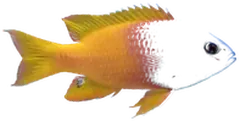 | Gramma-real <code>gramma&#95;<wbr>loreto</code> | *Gramma loreto* | Marinho | 7–8 cm | Estacionário · paira na água à noite | ✔ |
|  | Guppy-de-Endler <code>poecilia&#95;<wbr>wingei</code> | *Poecilia wingei* | Água doce | 2–4 cm | Em cardume · esconde-se à noite | ✔ |
|  | Gurami-anão <code>trichogaster&#95;<wbr>lalius</code> | *Trichogaster lalius* | Água doce | 5–8 cm | Nadador de águas abertas · esconde-se à noite | ✔ |
|  | Gurami-azul <code>trichopodus&#95;<wbr>trichopterus</code> | *Trichopodus trichopterus* | Água doce | 10–15 cm | Nadador de águas abertas · esconde-se à noite | ✔ |
|  | Gurami-pérola <code>trichopodus&#95;<wbr>leerii</code> | *Trichopodus leerii* | Água doce | 10–12 cm | Nadador de águas abertas · esconde-se à noite | ✔ |
|  | Góbio de Okinawa <code>gobiodon&#95;<wbr>okinawae</code> | *Gobiodon okinawae* | Marinho | 2.5–3.5 cm | Vive junto ao fundo · esconde-se à noite | ✔ |
|  | Góbio-abelhão <code>brachygobius&#95;<wbr>xanthozonus</code> | *Brachygobius xanthozonus* | Salobra | 3–4 cm | Vive junto ao fundo · esconde-se à noite | ✔ |
|  | Góbio-anfitrião amarelo <code>cryptocentrus&#95;<wbr>cinctus</code> | *Cryptocentrus cinctus* | Marinho | 8–10 cm | Vive na areia · vive numa toca · descansa no fundo à noite | ✔ |
|  | Góbio-cavaleiro <code>stigmatogobius&#95;<wbr>sadanundio</code> | *Stigmatogobius sadanundio* | Salobra | 6–8 cm | Vive junto ao fundo · esconde-se à noite | ✔ |
|  | Góbio-de-coral-limão <code>gobiodon&#95;<wbr>citrinus</code> | *Gobiodon citrinus* | Marinho | 3–5 cm | Vive junto ao fundo · esconde-se à noite | ✔ |
| 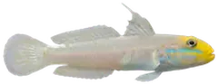 | Góbio-dorminhoco <code>valenciennea</code> | *Valenciennea sp.* | Marinho | 10–16 cm | Vive na areia · vive numa toca · descansa no fundo à noite | ✔ |
|  | Góbio-listrado <code>amblygobius&#95;<wbr>phalaena</code> | *Amblygobius phalaena* | Marinho | 8–10 cm | Vive na areia · descansa no fundo à noite | ✔ |
|  | Góbio-néon <code>elacatinus&#95;<wbr>oceanops</code> | *Elacatinus oceanops* | Marinho | 4–6 cm | Vive junto ao fundo · esconde-se à noite | ✔ |
|  | Góbio-violeta <code>gobioides&#95;<wbr>broussonnetii</code> | *Gobioides broussonnetii* | Salobra | 30–50 cm | Vive na areia · vive numa toca · descansa no fundo à noite | ✔ |
|  | Góbio-yasha <code>stonogobiops&#95;<wbr>yasha</code> | *Stonogobiops yasha* | Marinho | 6–8 cm | Vive na areia · vive numa toca · descansa no fundo à noite | ✔ |
|  | Killi do Cabo Lopez <code>aphyosemion&#95;<wbr>australe</code> | *Aphyosemion australe* | Água doce | 5–6 cm | Estacionário · paira na água à noite | ✔ |
|  | Kribensis <code>pelvicachromis&#95;<wbr>pulcher</code> | *Pelvicachromis pulcher* | Água doce | 8–10 cm | Vive junto ao fundo · esconde-se à noite | ✔ |
|  | Kuhli <code>pangio&#95;<wbr>kuhlii</code> | *Pangio kuhlii* | Água doce | 8–12 cm | Vive junto ao fundo · esconde-se à noite | ✔ |
|  | Lebiste <code>poecilia&#95;<wbr>reticulata</code> | *Poecilia reticulata* | Água doce | 3–6 cm | Em cardume · esconde-se à noite | ✔ |
|  | Molinésia-comum <code>poecilia&#95;<wbr>sphenops</code> | *Poecilia sphenops* | Água doce, Salobra | 6–10 cm | Em cardume · esconde-se à noite | ✔ |
|  | Molinésia-vela <code>poecilia&#95;<wbr>velifera</code> | *Poecilia velifera* | Salobra, Água doce | 10–15 cm | Em cardume · esconde-se à noite | ✔ |
|  | Monodáctilo-prateado <code>monodactylus&#95;<wbr>argenteus</code> | *Monodactylus argenteus* | Salobra, Marinho | 15–25 cm | Em cardume · esconde-se à noite | ✔ |
|  | Oscar <code>astronotus&#95;<wbr>ocellatus</code> | *Astronotus ocellatus* | Água doce | 25–35 cm | Nadador de águas abertas · esconde-se à noite | ✔ |
|  | Otocinclus <code>otocinclus&#95;<wbr>affinis</code> | *Otocinclus affinis* | Água doce | 3–5 cm | Vive junto ao fundo · esconde-se à noite | ✔ |
|  | Peixe-anjo-bicolor <code>centropyge&#95;<wbr>bicolor</code> | *Centropyge bicolor* | Marinho | 10–15 cm | Estacionário · paira na água à noite | ✔ |
|  | Peixe-anjo-chama <code>centropyge&#95;<wbr>loricula</code> | *Centropyge loricula* | Marinho | 8–10 cm | Estacionário · paira na água à noite | ✔ |
|  | Peixe-anjo-imperador (adulto) <code>pomacanthus&#95;<wbr>imperator&#95;<wbr>adult</code> | *Pomacanthus imperator* | Marinho | 25–38 cm | Nadador de águas abertas · esconde-se à noite | ✔ |
|  | Peixe-anjo-imperador (juvenil) <code>pomacanthus&#95;<wbr>imperator</code> | *Pomacanthus imperator* | Marinho | 6–12 cm | Nadador de águas abertas · esconde-se à noite | ✔ |
|  | Peixe-anjo-real <code>pygoplites&#95;<wbr>diacanthus</code> | *Pygoplites diacanthus* | Marinho | 20–25 cm | Nadador de águas abertas · esconde-se à noite | ✔ |
|  | Peixe-arco-íris-turquesa <code>melanotaenia&#95;<wbr>lacustris</code> | *Melanotaenia lacustris* | Água doce | 8–12 cm | Em cardume · esconde-se à noite | ✔ |
|  | Peixe-arqueiro <code>toxotes&#95;<wbr>jaculatrix</code> | *Toxotes jaculatrix* | Salobra | 15–25 cm | Nadador de águas abertas · esconde-se à noite | ✔ |
| 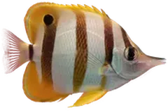 | Peixe-borboleta-cobre <code>chelmon&#95;<wbr>rostratus</code> | *Chelmon rostratus* | Marinho | 15–20 cm | Nadador de águas abertas · esconde-se à noite | ✔ |
|  | Peixe-cardeal-de-Banggai <code>pterapogon&#95;<wbr>kauderni</code> | *Pterapogon kauderni* | Marinho | 5–8 cm | Estacionário · paira na água à noite | ✔ |
|  | Peixe-cardeal-de-listras-amarelas <code>ostorhinchus&#95;<wbr>cyanosoma</code> | *Ostorhinchus cyanosoma* | Marinho | 7–8 cm | Estacionário · paira na água à noite | ✔ |
|  | Peixe-cardeal-pijama <code>sphaeramia&#95;<wbr>nematoptera</code> | *Sphaeramia nematoptera* | Marinho | 8–10 cm | Estacionário · paira na água à noite | ✔ |
|  | Peixe-coelho cara-de-raposa <code>siganus&#95;<wbr>vulpinus</code> | *Siganus vulpinus* | Marinho | 15–22 cm | Nadador de águas abertas · descansa no fundo à noite | ✔ |
|  | Peixe-de-briga <code>betta&#95;<wbr>splendens</code> | *Betta splendens* | Água doce | 5–7 cm | Estacionário · fica perto do seu abrigo · paira na água à noite | ✔ |
|  | Peixe-dourado <code>carassius&#95;<wbr>auratus</code> | *Carassius auratus* | Água doce | 10–25 cm | Nadador de águas abertas · esconde-se à noite | ✔ |
|  | Peixe-falcão-pixie <code>cirrhitichthys&#95;<wbr>oxycephalus</code> | *Cirrhitichthys oxycephalus* | Marinho | 8–10 cm | Vive junto ao fundo · esconde-se à noite | ✔ |
|  | Peixe-fogo <code>nemateleotris&#95;<wbr>magnifica</code> | *Nemateleotris magnifica* | Marinho | 8–10 cm | Estacionário · paira na água à noite | ✔ |
|  | Peixe-fogo-roxo <code>nemateleotris&#95;<wbr>decora</code> | *Nemateleotris decora* | Marinho | 8–10 cm | Estacionário · paira na água à noite | ✔ |
|  | Peixe-gatilho-Picasso <code>rhinecanthus&#95;<wbr>aculeatus</code> | *Rhinecanthus aculeatus* | Marinho | 20–25 cm | Nadador de águas abertas · esconde-se à noite | ✔ |
|  | Peixe-leão-vermelho <code>pterois&#95;<wbr>volitans</code> | *Pterois volitans* | Marinho | 25–35 cm | Nadador de águas abertas · esconde-se à noite | ✔ |
|  | Peixe-leão-zebra <code>dendrochirus&#95;<wbr>zebra</code> | *Dendrochirus zebra* | Marinho | 12–18 cm | Nadador de águas abertas · esconde-se à noite | ✔ |
| 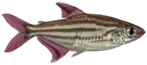 | Peixe-machado-marmoreado <code>carnegiella&#95;<wbr>strigata</code> | *Carnegiella strigata* | Água doce | 4–5 cm | Em cardume · esconde-se à noite | ✔ |
|  | Peixe-mandarim <code>synchiropus&#95;<wbr>splendidus</code> | *Synchiropus splendidus* | Marinho | 5–8 cm | Vive junto ao fundo · esconde-se à noite | ✔ |
|  | Peixe-mandarim-psicadélico <code>synchiropus&#95;<wbr>picturatus</code> | *Synchiropus picturatus* | Marinho | 6–8 cm | Vive junto ao fundo · esconde-se à noite | ✔ |
|  | Peixe-mandíbula-de-cabeça-amarela <code>opistognathus&#95;<wbr>aurifrons</code> | *Opistognathus aurifrons* | Marinho | 10–12 cm | Vive na areia · vive numa toca · descansa no fundo à noite | ✔ |
|  | Peixe-palhaço <code>amphiprion</code> | *Amphiprion sp.* | Marinho | 7–11 cm | Estacionário · paira na água à noite | ✔ |
| 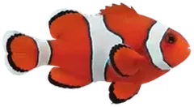 | Peixe-palhaço-castanho <code>premnas&#95;<wbr>biaculeatus</code> | *Premnas biaculeatus* | Marinho | 10–15 cm | Estacionário · paira na água à noite | ✔ |
|  | Peixe-zebra <code>danio&#95;<wbr>rerio</code> | *Danio rerio* | Água doce | 4–5 cm | Em cardume · esconde-se à noite | ✔ |
|  | Platy <code>xiphophorus&#95;<wbr>maculatus</code> | *Xiphophorus maculatus* | Água doce | 4–6 cm | Em cardume · esconde-se à noite | ✔ |
|  | Pseudocromis-orquídea <code>pseudochromis&#95;<wbr>fridmani</code> | *Pseudochromis fridmani* | Marinho | 6–7 cm | Estacionário · fica perto do seu abrigo · paira na água à noite | ✔ |
|  | Ramirezi <code>mikrogeophagus&#95;<wbr>ramirezi</code> | *Mikrogeophagus ramirezi* | Água doce | 5–7 cm | Estacionário · paira na água à noite | ✔ |
|  | Rasbora-arlequim <code>trigonostigma&#95;<wbr>heteromorpha</code> | *Trigonostigma heteromorpha* | Água doce | 3–4.5 cm | Em cardume · esconde-se à noite | ✔ |
|  | Saltador-do-lodo-atlântico <code>periophthalmus&#95;<wbr>barbarus</code> | *Periophthalmus barbarus* | Salobra | 10–15 cm | Vive junto ao fundo · esconde-se à noite | ✔ |
|  | Scat-malhado <code>scatophagus&#95;<wbr>argus</code> | *Scatophagus argus* | Salobra, Marinho | 15–30 cm | Nadador de águas abertas · esconde-se à noite | ✔ |
|  | Tanichthys <code>tanichthys&#95;<wbr>albonubes</code> | *Tanichthys albonubes* | Água doce | 3–4 cm | Em cardume · esconde-se à noite | ✔ |
|  | Tetra-cardinal <code>paracheirodon&#95;<wbr>axelrodi</code> | *Paracheirodon axelrodi* | Água doce | 3–5 cm | Em cardume · esconde-se à noite | ✔ |
|  | Tetra-imperador <code>nematobrycon&#95;<wbr>palmeri</code> | *Nematobrycon palmeri* | Água doce | 4–6 cm | Em cardume · esconde-se à noite | ✔ |
|  | Tetra-limão <code>hyphessobrycon&#95;<wbr>pulchripinnis</code> | *Hyphessobrycon pulchripinnis* | Água doce | 3–4.5 cm | Em cardume · esconde-se à noite | ✔ |
|  | Tetra-nariz-vermelho <code>hemigrammus&#95;<wbr>bleheri</code> | *Hemigrammus bleheri* | Água doce | 4–5 cm | Em cardume · esconde-se à noite | ✔ |
|  | Tetra-neon <code>paracheirodon&#95;<wbr>innesi</code> | *Paracheirodon innesi* | Água doce | 3–4 cm | Em cardume · esconde-se à noite | ✔ |
|  | Tetra-preto <code>gymnocorymbus&#95;<wbr>ternetzi</code> | *Gymnocorymbus ternetzi* | Água doce | 5–6 cm | Em cardume · esconde-se à noite | ✔ |
|  | Tetra-serpae <code>hyphessobrycon&#95;<wbr>eques</code> | *Hyphessobrycon eques* | Água doce | 3–4.5 cm | Em cardume · esconde-se à noite | ✔ |

## Corais (1)

| &nbsp;&nbsp;&nbsp;&nbsp;&nbsp;&nbsp;&nbsp;&nbsp;&nbsp;&nbsp;&nbsp;&nbsp;&nbsp;&nbsp;&nbsp;&nbsp;&nbsp;&nbsp;&nbsp;&nbsp;&nbsp;&nbsp;&nbsp;&nbsp;&nbsp;&nbsp;&nbsp;&nbsp;&nbsp;&nbsp;&nbsp;&nbsp;&nbsp; | Nome | Nome científico | Água | Tamanho |
|---|---|---|---|---|
|  | Coral-tocha <code>euphyllia&#95;<wbr>glabrescens</code> | *Euphyllia glabrescens* | Marinho | 10–30 cm |

## Plantas (29)

| &nbsp;&nbsp;&nbsp;&nbsp;&nbsp;&nbsp;&nbsp;&nbsp;&nbsp;&nbsp;&nbsp;&nbsp;&nbsp;&nbsp;&nbsp;&nbsp;&nbsp;&nbsp;&nbsp;&nbsp;&nbsp;&nbsp;&nbsp;&nbsp;&nbsp;&nbsp;&nbsp;&nbsp;&nbsp;&nbsp;&nbsp;&nbsp;&nbsp; | Nome | Nome científico | Água | Tamanho | Zona |
|---|---|---|---|---|---|
|  | Alface-d'água <code>pistia&#95;<wbr>stratiotes</code> | *Pistia stratiotes* | Água doce | 5–15 cm | Flutuante |
|  | Ambulia <code>limnophila&#95;<wbr>sessiliflora</code> | *Limnophila sessiliflora* | Água doce | 20–40 cm | Fundo |
|  | Anubias <code>anubias&#95;<wbr>barteri</code> | *Anubias barteri* | Água doce | 10–25 cm | Epífita |
|  | Bucephalandra <code>bucephalandra</code> | *Bucephalandra sp.* | Água doce | 5–15 cm | Epífita |
|  | Cabomba <code>cabomba&#95;<wbr>caroliniana</code> | *Cabomba caroliniana* | Água doce | 30–60 cm | Fundo |
|  | Caulerpa <code>caulerpa&#95;<wbr>prolifera</code> | *Caulerpa prolifera* | Marinho | 5–20 cm | Primeiro plano |
|  | Chaetomorpha <code>chaetomorpha&#95;<wbr>linum</code> | *Chaetomorpha linum* | Marinho | 5–30 cm | Primeiro plano |
|  | Cryptocoryne ciliata <code>cryptocoryne&#95;<wbr>ciliata</code> | *Cryptocoryne ciliata* | Salobra, Água doce | 20–40 cm | Plano médio |
|  | Cryptocoryne parva <code>cryptocoryne&#95;<wbr>parva</code> | *Cryptocoryne parva* | Água doce | 5–8 cm | Primeiro plano |
|  | Cryptocoryne wendtii <code>cryptocoryne&#95;<wbr>wendtii</code> | *Cryptocoryne wendtii* | Água doce | 10–20 cm | Plano médio |
|  | Egéria-densa <code>egeria&#95;<wbr>densa</code> | *Egeria densa* | Água doce | 30–100 cm | Fundo |
|  | Eleocharis-anã <code>eleocharis&#95;<wbr>parvula</code> | *Eleocharis parvula* | Água doce | 5–10 cm | Primeiro plano |
|  | Erva-de-tartaruga <code>thalassia&#95;<wbr>testudinum</code> | *Thalassia testudinum* | Marinho | 10–30 cm | Primeiro plano |
|  | Espada-amazônica <code>echinodorus&#95;<wbr>bleheri</code> | *Echinodorus bleheri* | Água doce | 30–50 cm | Plano médio |
|  | Glossostigma <code>glossostigma&#95;<wbr>elatinoides</code> | *Glossostigma elatinoides* | Água doce | 2–5 cm | Primeiro plano |
|  | Halimeda <code>halimeda&#95;<wbr>opuntia</code> | *Halimeda opuntia* | Marinho | 5–15 cm | Primeiro plano |
|  | Hemianthus <code>hemianthus&#95;<wbr>callitrichoides</code> | *Hemianthus callitrichoides* | Água doce | 2–5 cm | Primeiro plano |
|  | Hygrophila <code>hygrophila&#95;<wbr>polysperma</code> | *Hygrophila polysperma* | Água doce | 20–50 cm | Fundo |
|  | Lentilha-d'água <code>lemna&#95;<wbr>minor</code> | *Lemna minor* | Água doce | 0.5–1 cm | Flutuante |
|  | Limnobium <code>limnobium&#95;<wbr>laevigatum</code> | *Limnobium laevigatum* | Água doce | 5–10 cm | Flutuante |
|  | Ludwigia <code>ludwigia&#95;<wbr>repens</code> | *Ludwigia repens* | Água doce | 20–40 cm | Plano médio |
|  | Mangue-vermelho <code>rhizophora&#95;<wbr>mangle</code> | *Rhizophora mangle* | Salobra, Marinho | 30–100 cm | Plano médio |
|  | Marimo <code>aegagropila&#95;<wbr>linnaei</code> | *Aegagropila linnaei* | Água doce | 3–10 cm | Primeiro plano |
|  | Musgo-de-Java <code>vesicularia&#95;<wbr>dubyana</code> | *Vesicularia dubyana* | Água doce | 3–5 cm | Epífita |
|  | Rotala <code>rotala&#95;<wbr>rotundifolia</code> | *Rotala rotundifolia* | Água doce | 20–50 cm | Fundo |
|  | Sagitária-anã <code>sagittaria&#95;<wbr>subulata</code> | *Sagittaria subulata* | Água doce | 10–30 cm | Primeiro plano |
|  | Samambaia-de-Java <code>microsorum&#95;<wbr>pteropus</code> | *Microsorum pteropus* | Água doce | 20–30 cm | Epífita |
|  | Staurogyne <code>staurogyne&#95;<wbr>repens</code> | *Staurogyne repens* | Água doce | 5–10 cm | Primeiro plano |
|  | Vallisneria <code>vallisneria&#95;<wbr>spiralis</code> | *Vallisneria spiralis* | Água doce, Salobra | 30–60 cm | Fundo |

## Invertebrados (33)

| &nbsp;&nbsp;&nbsp;&nbsp;&nbsp;&nbsp;&nbsp;&nbsp;&nbsp;&nbsp;&nbsp;&nbsp;&nbsp;&nbsp;&nbsp;&nbsp;&nbsp;&nbsp;&nbsp;&nbsp;&nbsp;&nbsp;&nbsp;&nbsp;&nbsp;&nbsp;&nbsp;&nbsp;&nbsp;&nbsp;&nbsp;&nbsp;&nbsp; | Nome | Nome científico | Água | Tamanho | Função |
|---|---|---|---|---|---|
|  | Amêijoa-gigante-perfurante <code>tridacna&#95;<wbr>crocea</code> | *Tridacna crocea* | Marinho | 5–15 cm | Filtrador · séssil |
|  | Camarão peppermint <code>lysmata&#95;<wbr>wurdemanni</code> | *Lysmata wurdemanni* | Marinho | 3–5 cm | Limpador · vive na decoração |
|  | Camarão-Amano <code>caridina&#95;<wbr>multidentata</code> | *Caridina multidentata* | Água doce | 3–5 cm | Comedor de algas · desloca-se no fundo |
|  | Camarão-arlequim <code>hymenocera&#95;<wbr>picta</code> | *Hymenocera picta* | Marinho | 4–6 cm | Predador · desloca-se no fundo |
|  | Camarão-bambu <code>atyopsis&#95;<wbr>moluccensis</code> | *Atyopsis moluccensis* | Água doce | 6–8 cm | Filtrador · vive na decoração |
|  | Camarão-boxer <code>stenopus&#95;<wbr>hispidus</code> | *Stenopus hispidus* | Marinho | 6–8 cm | Limpador · vive na decoração |
|  | Camarão-cereja <code>neocaridina&#95;<wbr>davidi</code> | *Neocaridina davidi* | Água doce | 2–3.5 cm | Detritívoro · desloca-se no fundo |
| 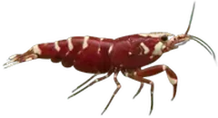 | Camarão-cristal-vermelho <code>caridina&#95;<wbr>cantonensis</code> | *Caridina cantonensis* | Água doce | 2–3 cm | Detritívoro · desloca-se no fundo |
|  | Camarão-fogo <code>lysmata&#95;<wbr>debelius</code> | *Lysmata debelius* | Marinho | 5–6 cm | Limpador · vive na decoração |
|  | Camarão-limpador-escarlate <code>lysmata&#95;<wbr>amboinensis</code> | *Lysmata amboinensis* | Marinho | 5–6 cm | Limpador · vive na decoração |
|  | Camarão-marmoreado <code>saron&#95;<wbr>marmoratus</code> | *Saron marmoratus* | Marinho | 5–7 cm | Necrófago · vive na decoração |
| 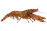 | Camarão-pistola-tigre <code>alpheus&#95;<wbr>bellulus</code> | *Alpheus bellulus* | Marinho | 4–5 cm | Detritívoro · Necrófago · desloca-se no fundo |
|  | Caracol Astraea <code>astraea&#95;<wbr>tecta</code> | *Astraea tecta* | Marinho | 2–4 cm | Comedor de algas · vive na decoração |
|  | Caracol Nassarius <code>nassarius</code> | *Nassarius sp.* | Marinho | 2–4 cm | Necrófago · desloca-se no fundo |
|  | Caracol trochus <code>tectus&#95;<wbr>fenestratus</code> | *Tectus fenestratus* | Marinho | 4–6 cm | Comedor de algas · vive na decoração |
|  | Caracol turbo <code>turbo&#95;<wbr>fluctuosus</code> | *Turbo fluctuosus* | Marinho | 4–8 cm | Comedor de algas · trepa no vidro |
|  | Caracol-assassino <code>clea&#95;<wbr>helena</code> | *Clea helena* | Água doce | 2–3 cm | Predador · desloca-se no fundo |
|  | Caracol-cerite <code>cerithium</code> | *Cerithium sp.* | Marinho | 2–3 cm | Detritívoro · desloca-se no fundo |
|  | Caracol-trombeta-malaio <code>melanoides&#95;<wbr>tuberculata</code> | *Melanoides tuberculata* | Água doce | 2–3 cm | Detritívoro · desloca-se no fundo |
|  | Caramujo-maçã <code>pomacea&#95;<wbr>bridgesii</code> | *Pomacea bridgesii* | Água doce | 4–5 cm | Necrófago · desloca-se no fundo |
| 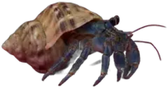 | Caranguejo-eremita-de-patas-azuis <code>clibanarius&#95;<wbr>tricolor</code> | *Clibanarius tricolor* | Marinho | 2–3 cm | Necrófago · desloca-se no fundo |
|  | Caranguejo-eremita-escarlate <code>paguristes&#95;<wbr>cadenati</code> | *Paguristes cadenati* | Marinho | 3–4 cm | Necrófago · desloca-se no fundo |
|  | Caranguejo-esmeralda <code>mithraculus&#95;<wbr>sculptus</code> | *Mithraculus sculptus* | Marinho | 3–4 cm | Comedor de algas · vive na decoração |
|  | Estrela-do-mar-de-areia <code>archaster&#95;<wbr>typicus</code> | *Archaster typicus* | Marinho | 6–10 cm | Detritívoro · desloca-se no fundo |
|  | Nerita-marinha <code>nerita</code> | *Nerita sp.* | Marinho | 2–3 cm | Comedor de algas · trepa no vidro |
| 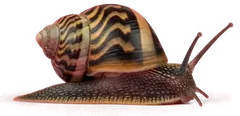 | Nerita-zebra <code>neritina&#95;<wbr>natalensis</code> | *Neritina natalensis* | Água doce | 2–3 cm | Comedor de algas · trepa no vidro |
|  | Ofiúro-serpente <code>ophiolepis&#95;<wbr>superba</code> | *Ophiolepis superba* | Marinho | 8–12 cm | Necrófago · desloca-se no fundo |
|  | Ouriço-coletor <code>tripneustes&#95;<wbr>gratilla</code> | *Tripneustes gratilla* | Marinho | 10–15 cm | Comedor de algas · vive na decoração |
|  | Ouriço-lápis <code>prionocidaris&#95;<wbr>baculosa</code> | *Prionocidaris baculosa* | Marinho | 8–10 cm | Comedor de algas · vive na decoração |
|  | Pepino-do-mar <code>holothuria</code> | *Holothuria sp.* | Marinho | 15–30 cm | Detritívoro · desloca-se no fundo |
|  | Planorbídeo <code>planorbella&#95;<wbr>duryi</code> | *Planorbella duryi* | Água doce | 2–3 cm | Detritívoro · trepa no vidro |
|  | Verme árvore-de-natal <code>spirobranchus&#95;<wbr>giganteus</code> | *Spirobranchus giganteus* | Marinho | 3–5 cm | Filtrador · séssil |
|  | Verme-espanador <code>sabellastarte</code> | *Sabellastarte sp.* | Marinho | 5–10 cm | Filtrador · séssil |

Para adicionar uma espécie (geração dos clips, construção, publicação), ver a [documentação em inglês](README.md).

Os recursos das espécies estão sob **CC BY 4.0**, os scripts sob MIT: ver [LICENSE.md](LICENSE.md).

<!-- species:end -->

<!-- ecosystem:start -->

## Projetos relacionados

Os projetos ReefTech encaixam-se entre si: as integrações trazem o seu equipamento para o Home Assistant, o cartão mostra-o e comanda-o, e o backup mantém-no a funcionar durante um corte. Cada um funciona também sozinho.

<table>
  <tr>
    <th width="100px"></th>
    <th>Projeto</th>
    <th>Função</th>
    <th>Funciona com</th>
  </tr>
  <tr>
    <td></td>
    <td>🐠 <a href="https://github.com/Elwinmage/ha-reefbeat-component"><b>ha-reefbeat-component</b></a></td>
    <td>Aparelhos Red Sea ReefBeat, comandados localmente sem cloud: ReefATO+, ReefControl, ReefControl-Power, ReefDose, ReefLed, ReefMat, ReefRun e ReefWave. blueprint de alertas para modos anómalos, calibrações e bateria fraca. </td>
    <td>ha-reef-card</td>
  </tr>
  <tr>
    <td></td>
    <td>🌊 <a href="https://github.com/Elwinmage/ha-aquamedic-component"><b>ha-aquamedic-component</b></a></td>
    <td>Bombas Aqua Medic através da API cloud Gizwits: bombas de circulação EcoDrift e SmartDrift, bombas DC Runner de retorno e do escumador.</td>
    <td>ha-reef-card</td>
  </tr>
  <tr>
    <td></td>
    <td>🐟 <a href="https://github.com/Elwinmage/ha-vson-component"><b>ha-vson-component</b></a></td>
    <td>Alimentadores automáticos VSON através da API cloud VSON: o alimentador WP8621 (alimentar, bateria, aviso de pouca comida) e deteção genérica de qualquer outro dispositivo VSON. O WP8621 também pode funcionar totalmente local com ESPHome.</td>
    <td>ha-reef-card</td>
  </tr>
  <tr>
    <td></td>
    <td>🐙 <a href="https://github.com/Elwinmage/ha-reef-maintenance-component"><b>ha-reef-maintenance-component</b></a></td>
    <td>Acompanhamento da limpeza e do desgaste do equipamento que o Home Assistant não consegue interrogar: bombas de circulação, bombas de retorno, escumadores, reatores, tudo o que trata à mão.</td>
    <td>ha-reef-card</td>
  </tr>
  <tr>
    <td></td>
    <td>🪸 <a href="https://github.com/Elwinmage/ha-reef-card"><b>ha-reef-card</b></a></td>
    <td>Vista gráfica interativa de cada aparelho no seu painel, e a única forma de editar os programas avançados. Lê as três integrações através do contrato <code>reef_role</code> comum, sem configuração do lado do cartão. Desenha também os fluxos de energia do reefbeatEnergyBackup. O seu cartão de aquário dá vida ao seu aquário com o ha-reeftank-component.</td>
    <td>as quatro integrações, e o ha-reeftank-component para o aquário</td>
  </tr>
  <tr>
    <td></td>
    <td>🐟 <a href="https://github.com/Elwinmage/ha-reeftank-component"><b>ha-reeftank-component</b></a></td>
    <td>Uma imagem viva do seu aquário no painel: a sua foto, iluminada pelas suas lâmpadas reais, com peixes e corais animados, e os seus dispositivos e entidades. Guarda os aquários e a sua fauna, regista as alimentações.</td>
    <td>ha-reef-card</td>
  </tr>
  <tr>
    <td></td>
    <td>🐡 <b>reeftank-catalog</b> <i>(este repositório)</i></td>
    <td>Peixes, corais e texturas do cartão de aquário, transferidos e mantidos atualizados pelo ha-reeftank-component.</td>
    <td>ha-reeftank-component</td>
  </tr>
  <tr>
    <td></td>
    <td>🐬 <a href="https://github.com/Elwinmage/ha-reef-blueprints"><b>ha-reef-blueprints</b></a></td>
    <td>Blueprints de automação comuns a todo o ecossistema: manutenções em atraso encontradas pelo contrato <code>reef_role</code>, aparelhos que ficaram inacessíveis, um teste periódico dos aquecedores e uma vigilância dos relés. Oito idiomas.</td>
    <td>as quatro integrações</td>
  </tr>
  <tr>
    <td></td>
    <td>⚡ <a href="https://github.com/Elwinmage/reefbeatEnergyBackup"><b>reefbeatEnergyBackup</b></a></td>
    <td>Backup por bateria em caso de corte. Um pack 24V LiFePO₄ comandado por um Raspberry Pi, com degradação progressiva da velocidade das bombas conforme o estado de carga.</td>
    <td>sozinho, ou a par do ha-reefbeat-component e do ha-reef-card</td>
  </tr>
</table>

Estão todos documentados em conjunto na [página do projeto ReefTech](https://elwinmage.github.io/reeftank/).

<!-- ecosystem:end -->
