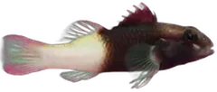
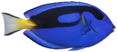
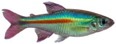
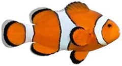

# reeftank-catalog

<!-- species:begin (generated by scripts/make_readme.py, do not edit) -->

> Parte do [**ecossistema de projetos ReefTech**](https://elwinmage.github.io/reeftank/)

       

Espécies de peixes, corais, plantas e invertebrados para a vista de aquário do [ha-reef-card](https://github.com/Elwinmage/ha-reef-card), fornecidas pela [integração ReefTank](https://github.com/Elwinmage/ha-reeftank-component).

A integração descarrega as versões publicadas deste repositório e mantém-nas atualizadas (`update.reeftank_catalog`, automático por predefinição): nada a fazer no Home Assistant.

## Como funciona

Cada peixe é uma folha de imagens (um atlas WebP) e um descritor com os seus clipes: *nadar*, *parado* e *meia-volta*. O cartão encadeia-os e espelha a meia-volta para que o peixe regresse pelo mesmo caminho. Eis o nado, a meia-volta e o regresso de duas espécies:

<table><tr><td align="center"> Peixe-anjo imperador</td><td align="center"> Peixe-palhaço</td></tr></table>

## Peixes (102)

**HD**: uma animação real, feita a partir de vídeos. Os outros têm uma animação simples feita a partir de uma foto, ou o peixe genérico.

| &nbsp;&nbsp;&nbsp;&nbsp;&nbsp;&nbsp;&nbsp;&nbsp;&nbsp;&nbsp;&nbsp;&nbsp;&nbsp;&nbsp;&nbsp;&nbsp;&nbsp;&nbsp;&nbsp;&nbsp;&nbsp;&nbsp;&nbsp;&nbsp;&nbsp;&nbsp;&nbsp;&nbsp;&nbsp;&nbsp;&nbsp;&nbsp;&nbsp;&nbsp;&nbsp;&nbsp;&nbsp;&nbsp;&nbsp;&nbsp;&nbsp;&nbsp;&nbsp;&nbsp;&nbsp;&nbsp;&nbsp;&nbsp;&nbsp;&nbsp;&nbsp;&nbsp;&nbsp;&nbsp;&nbsp;&nbsp; | Nome | Nome científico | Água | Tamanho | Comportamento | HD |
|---|---|---|---|---|---|---|
|  | Acará-bandeira `pterophyllum_scalare` | *Pterophyllum scalare* | Água doce | 12–15 cm | Nadador de águas abertas · esconde-se à noite |  |
|  | Acará-disco `symphysodon_aequifasciatus` | *Symphysodon aequifasciatus* | Água doce | 15–20 cm | Nadador de águas abertas · esconde-se à noite |  |
|  | Ancistrus `ancistrus` | *Ancistrus sp.* | Água doce | 10–14 cm | Vive junto ao fundo · esconde-se à noite |  |
|  | Antias `pseudanthias` | *Pseudanthias sp.* | Marinho | 8–14 cm | Em cardume · esconde-se à noite | ✔ |
|  | Apistogramma-cacatua `apistogramma_cacatuoides` | *Apistogramma cacatuoides* | Água doce | 5–9 cm | Vive junto ao fundo · esconde-se à noite |  |
|  | Baiacu-de-Valentin `canthigaster_valentini` | *Canthigaster valentini* | Marinho | 8–10 cm | Nadador de águas abertas · esconde-se à noite |  |
|  | Baiacu-oito `dichotomyctere_biocellatus` | *Dichotomyctere biocellatus* | Salobra | 5–6.5 cm | Nadador de águas abertas · esconde-se à noite |  |
|  | Baiacu-verde `dichotomyctere_nigroviridis` | *Dichotomyctere nigroviridis* | Salobra | 10–17 cm | Nadador de águas abertas · esconde-se à noite |  |
|  | Barbo-cereja `pethia_titteya` | *Pethia titteya* | Água doce | 4–5 cm | Em cardume · esconde-se à noite |  |
|  | Barbo-de-sumatra `puntigrus_tetrazona` | *Puntigrus tetrazona* | Água doce | 5–7 cm | Em cardume · esconde-se à noite |  |
|  | Blênio-bicolor `ecsenius_bicolor` | *Ecsenius bicolor* | Marinho | 8–10 cm | Vive junto ao fundo · esconde-se à noite |  |
|  | Blênio-cortador-de-relva `salarias_fasciatus` | *Salarias fasciatus* | Marinho | 12–14 cm | Vive junto ao fundo · esconde-se à noite |  |
|  | Bodião-amarelo `halichoeres_chrysus` | *Halichoeres chrysus* | Marinho | 10–12 cm | Nadador de águas abertas · descansa no fundo à noite |  |
|  | Bodião-de-seis-listras `pseudocheilinus_hexataenia` | *Pseudocheilinus hexataenia* | Marinho | 7–10 cm | Nadador de águas abertas · esconde-se à noite |  |
|  | Bodião-fada-de-Solor `cirrhilabrus_solorensis` | *Cirrhilabrus solorensis* | Marinho | 10–12 cm | Nadador de águas abertas · esconde-se à noite |  |
|  | Bodião-limpador `labroides_dimidiatus` | *Labroides dimidiatus* | Marinho | 10–12 cm | Nadador de águas abertas · esconde-se à noite |  |
|  | Botia-palhaço `chromobotia_macracanthus` | *Chromobotia macracanthus* | Água doce | 15–30 cm | Vive junto ao fundo · esconde-se à noite |  |
|  | Cascudo-zebra `hypancistrus_zebra` | *Hypancistrus zebra* | Água doce | 7–10 cm | Vive junto ao fundo · esconde-se à noite |  |
|  | Cavalo-marinho-listrado `hippocampus_erectus` | *Hippocampus erectus* | Marinho | 10–15 cm | Estacionário · paira na água à noite |  |
|  | Ciclídeo-amarelo-elétrico `labidochromis_caeruleus` | *Labidochromis caeruleus* | Água doce | 8–10 cm | Nadador de águas abertas · esconde-se à noite |  |
|  | Ciclídeo-demasoni `pseudotropheus_demasoni` | *Pseudotropheus demasoni* | Água doce | 7–8 cm | Nadador de águas abertas · esconde-se à noite |  |
|  | Cirurgião-amarelo `zebrasoma_flavescens` | *Zebrasoma flavescens* | Marinho | 15–20 cm | Nadador de águas abertas · esconde-se à noite |  |
|  | Cirurgião-azul-pó `acanthurus_leucosternon` | *Acanthurus leucosternon* | Marinho | 20–23 cm | Nadador de águas abertas · esconde-se à noite |  |
|  | Cirurgião-castanho `zebrasoma_scopas` | *Zebrasoma scopas* | Marinho | 15–20 cm | Nadador de águas abertas · esconde-se à noite |  |
|  | Cirurgião-kole `ctenochaetus_strigosus` | *Ctenochaetus strigosus* | Marinho | 12–18 cm | Nadador de águas abertas · esconde-se à noite |  |
|  | Cirurgião-patela `paracanthurus_hepatus` | *Paracanthurus hepatus* | Marinho | 20–30 cm | Nadador de águas abertas · esconde-se à noite |  |
|  | Cirurgião-vela `zebrasoma_veliferum` | *Zebrasoma veliferum* | Marinho | 25–40 cm | Nadador de águas abertas · esconde-se à noite |  |
|  | Come-algas-siamês `crossocheilus_oblongus` | *Crossocheilus oblongus* | Água doce | 10–15 cm | Nadador de águas abertas · esconde-se à noite |  |
|  | Corydora-bronze `corydoras_aeneus` | *Corydoras aeneus* | Água doce | 6–7 cm | Vive junto ao fundo · esconde-se à noite |  |
|  | Corydora-panda `corydoras_panda` | *Corydoras panda* | Água doce | 4–5 cm | Vive junto ao fundo · esconde-se à noite |  |
|  | Cromis-verde `chromis_viridis` | *Chromis viridis* | Marinho | 5–8 cm | Em cardume · esconde-se à noite | ✔ |
|  | Danio-galáxia `danio_margaritatus` | *Danio margaritatus* | Água doce | 2–3 cm | Em cardume · esconde-se à noite |  |
|  | Danio-pérola `danio_albolineatus` | *Danio albolineatus* | Água doce | 4–6 cm | Em cardume · esconde-se à noite |  |
|  | Dascilo-de-três-manchas `dascyllus_trimaculatus` | *Dascyllus trimaculatus* | Marinho | 10–14 cm | Estacionário · paira na água à noite |  |
|  | Donzela-de-cauda-amarela `chrysiptera_parasema` | *Chrysiptera parasema* | Marinho | 5–6 cm | Estacionário · fica perto do seu abrigo · paira na água à noite |  |
|  | Donzela-de-Fiji `chrysiptera_taupou` | *Chrysiptera taupou* | Marinho | 6–8 cm | Estacionário · fica perto do seu abrigo · paira na água à noite |  |
|  | Espadinha `xiphophorus_hellerii` | *Xiphophorus hellerii* | Água doce | 6–12 cm | Em cardume · esconde-se à noite |  |
|  | Gramma-real `gramma_loreto` | *Gramma loreto* | Marinho | 7–8 cm | Estacionário · paira na água à noite |  |
|  | Guppy-de-Endler `poecilia_wingei` | *Poecilia wingei* | Água doce | 2–4 cm | Em cardume · esconde-se à noite |  |
|  | Gurami-anão `trichogaster_lalius` | *Trichogaster lalius* | Água doce | 5–8 cm | Nadador de águas abertas · esconde-se à noite |  |
|  | Gurami-azul `trichopodus_trichopterus` | *Trichopodus trichopterus* | Água doce | 10–15 cm | Nadador de águas abertas · esconde-se à noite |  |
|  | Gurami-pérola `trichopodus_leerii` | *Trichopodus leerii* | Água doce | 10–12 cm | Nadador de águas abertas · esconde-se à noite |  |
|  | Góbio de Okinawa `gobiodon_okinawae` | *Gobiodon okinawae* | Marinho | 2.5–3.5 cm | Vive junto ao fundo · esconde-se à noite |  |
|  | Góbio-abelhão `brachygobius_xanthozonus` | *Brachygobius xanthozonus* | Salobra | 3–4 cm | Vive junto ao fundo · esconde-se à noite |  |
|  | Góbio-anfitrião amarelo `cryptocentrus_cinctus` | *Cryptocentrus cinctus* | Marinho | 8–10 cm | Vive na areia · vive numa toca · descansa no fundo à noite |  |
|  | Góbio-cavaleiro `stigmatogobius_sadanundio` | *Stigmatogobius sadanundio* | Salobra | 6–8 cm | Vive junto ao fundo · esconde-se à noite |  |
|  | Góbio-de-coral-limão `gobiodon_citrinus` | *Gobiodon citrinus* | Marinho | 3–5 cm | Vive junto ao fundo · esconde-se à noite |  |
|  | Góbio-dorminhoco `valenciennea` | *Valenciennea sp.* | Marinho | 10–16 cm | Vive na areia · vive numa toca · descansa no fundo à noite | ✔ |
|  | Góbio-listrado `amblygobius_phalaena` | *Amblygobius phalaena* | Marinho | 8–10 cm | Vive na areia · descansa no fundo à noite |  |
|  | Góbio-néon `elacatinus_oceanops` | *Elacatinus oceanops* | Marinho | 4–6 cm | Vive junto ao fundo · esconde-se à noite |  |
|  | Góbio-violeta `gobioides_broussonnetii` | *Gobioides broussonnetii* | Salobra | 30–50 cm | Vive na areia · vive numa toca · descansa no fundo à noite |  |
|  | Góbio-yasha `stonogobiops_yasha` | *Stonogobiops yasha* | Marinho | 6–8 cm | Vive na areia · vive numa toca · descansa no fundo à noite |  |
|  | Killi do Cabo Lopez `aphyosemion_australe` | *Aphyosemion australe* | Água doce | 5–6 cm | Estacionário · paira na água à noite |  |
|  | Kribensis `pelvicachromis_pulcher` | *Pelvicachromis pulcher* | Água doce | 8–10 cm | Vive junto ao fundo · esconde-se à noite |  |
|  | Kuhli `pangio_kuhlii` | *Pangio kuhlii* | Água doce | 8–12 cm | Vive junto ao fundo · esconde-se à noite |  |
|  | Lebiste `poecilia_reticulata` | *Poecilia reticulata* | Água doce | 3–6 cm | Em cardume · esconde-se à noite |  |
|  | Molinésia-comum `poecilia_sphenops` | *Poecilia sphenops* | Água doce, Salobra | 6–10 cm | Em cardume · esconde-se à noite |  |
|  | Molinésia-vela `poecilia_velifera` | *Poecilia velifera* | Salobra, Água doce | 10–15 cm | Em cardume · esconde-se à noite |  |
|  | Monodáctilo-prateado `monodactylus_argenteus` | *Monodactylus argenteus* | Salobra, Marinho | 15–25 cm | Em cardume · esconde-se à noite |  |
|  | Oscar `astronotus_ocellatus` | *Astronotus ocellatus* | Água doce | 25–35 cm | Nadador de águas abertas · esconde-se à noite |  |
|  | Otocinclus `otocinclus_affinis` | *Otocinclus affinis* | Água doce | 3–5 cm | Vive junto ao fundo · esconde-se à noite |  |
|  | Peixe-anjo-bicolor `centropyge_bicolor` | *Centropyge bicolor* | Marinho | 10–15 cm | Estacionário · paira na água à noite |  |
|  | Peixe-anjo-chama `centropyge_loricula` | *Centropyge loricula* | Marinho | 8–10 cm | Estacionário · paira na água à noite |  |
|  | Peixe-anjo-imperador (adulto) `pomacanthus_imperator_adult` | *Pomacanthus imperator* | Marinho | 25–38 cm | Nadador de águas abertas · esconde-se à noite | ✔ |
|  | Peixe-anjo-imperador (juvenil) `pomacanthus_imperator` | *Pomacanthus imperator* | Marinho | 6–12 cm | Nadador de águas abertas · esconde-se à noite | ✔ |
|  | Peixe-anjo-real `pygoplites_diacanthus` | *Pygoplites diacanthus* | Marinho | 20–25 cm | Nadador de águas abertas · esconde-se à noite |  |
|  | Peixe-arco-íris-turquesa `melanotaenia_lacustris` | *Melanotaenia lacustris* | Água doce | 8–12 cm | Em cardume · esconde-se à noite |  |
|  | Peixe-arqueiro `toxotes_jaculatrix` | *Toxotes jaculatrix* | Salobra | 15–25 cm | Nadador de águas abertas · esconde-se à noite |  |
|  | Peixe-borboleta-cobre `chelmon_rostratus` | *Chelmon rostratus* | Marinho | 15–20 cm | Nadador de águas abertas · esconde-se à noite |  |
|  | Peixe-cardeal-de-Banggai `pterapogon_kauderni` | *Pterapogon kauderni* | Marinho | 5–8 cm | Estacionário · paira na água à noite | ✔ |
|  | Peixe-cardeal-de-listras-amarelas `ostorhinchus_cyanosoma` | *Ostorhinchus cyanosoma* | Marinho | 7–8 cm | Estacionário · paira na água à noite |  |
|  | Peixe-cardeal-pijama `sphaeramia_nematoptera` | *Sphaeramia nematoptera* | Marinho | 8–10 cm | Estacionário · paira na água à noite |  |
|  | Peixe-coelho cara-de-raposa `siganus_vulpinus` | *Siganus vulpinus* | Marinho | 15–22 cm | Nadador de águas abertas · descansa no fundo à noite | ✔ |
|  | Peixe-de-briga `betta_splendens` | *Betta splendens* | Água doce | 5–7 cm | Estacionário · fica perto do seu abrigo · paira na água à noite |  |
|  | Peixe-dourado `carassius_auratus` | *Carassius auratus* | Água doce | 10–25 cm | Nadador de águas abertas · esconde-se à noite |  |
|  | Peixe-falcão-pixie `cirrhitichthys_oxycephalus` | *Cirrhitichthys oxycephalus* | Marinho | 8–10 cm | Vive junto ao fundo · esconde-se à noite |  |
|  | Peixe-fogo `nemateleotris_magnifica` | *Nemateleotris magnifica* | Marinho | 8–10 cm | Estacionário · paira na água à noite |  |
|  | Peixe-fogo-roxo `nemateleotris_decora` | *Nemateleotris decora* | Marinho | 8–10 cm | Estacionário · paira na água à noite |  |
|  | Peixe-gatilho-Picasso `rhinecanthus_aculeatus` | *Rhinecanthus aculeatus* | Marinho | 20–25 cm | Nadador de águas abertas · esconde-se à noite |  |
|  | Peixe-leão-vermelho `pterois_volitans` | *Pterois volitans* | Marinho | 25–35 cm | Nadador de águas abertas · esconde-se à noite |  |
|  | Peixe-leão-zebra `dendrochirus_zebra` | *Dendrochirus zebra* | Marinho | 12–18 cm | Nadador de águas abertas · esconde-se à noite |  |
|  | Peixe-machado-marmoreado `carnegiella_strigata` | *Carnegiella strigata* | Água doce | 4–5 cm | Em cardume · esconde-se à noite |  |
|  | Peixe-mandarim `synchiropus_splendidus` | *Synchiropus splendidus* | Marinho | 5–8 cm | Vive junto ao fundo · esconde-se à noite | ✔ |
|  | Peixe-mandarim-psicadélico `synchiropus_picturatus` | *Synchiropus picturatus* | Marinho | 6–8 cm | Vive junto ao fundo · esconde-se à noite |  |
|  | Peixe-mandíbula-de-cabeça-amarela `opistognathus_aurifrons` | *Opistognathus aurifrons* | Marinho | 10–12 cm | Vive na areia · vive numa toca · descansa no fundo à noite |  |
|  | Peixe-palhaço `amphiprion` | *Amphiprion sp.* | Marinho | 7–11 cm | Estacionário · paira na água à noite | ✔ |
|  | Peixe-palhaço-castanho `premnas_biaculeatus` | *Premnas biaculeatus* | Marinho | 10–15 cm | Estacionário · paira na água à noite |  |
|  | Peixe-zebra `danio_rerio` | *Danio rerio* | Água doce | 4–5 cm | Em cardume · esconde-se à noite |  |
|  | Platy `xiphophorus_maculatus` | *Xiphophorus maculatus* | Água doce | 4–6 cm | Em cardume · esconde-se à noite |  |
|  | Pseudocromis-orquídea `pseudochromis_fridmani` | *Pseudochromis fridmani* | Marinho | 6–7 cm | Estacionário · fica perto do seu abrigo · paira na água à noite |  |
|  | Ramirezi `mikrogeophagus_ramirezi` | *Mikrogeophagus ramirezi* | Água doce | 5–7 cm | Estacionário · paira na água à noite |  |
|  | Rasbora-arlequim `trigonostigma_heteromorpha` | *Trigonostigma heteromorpha* | Água doce | 3–4.5 cm | Em cardume · esconde-se à noite |  |
|  | Saltador-do-lodo-atlântico `periophthalmus_barbarus` | *Periophthalmus barbarus* | Salobra | 10–15 cm | Vive junto ao fundo · esconde-se à noite |  |
|  | Scat-malhado `scatophagus_argus` | *Scatophagus argus* | Salobra, Marinho | 15–30 cm | Nadador de águas abertas · esconde-se à noite |  |
|  | Tanichthys `tanichthys_albonubes` | *Tanichthys albonubes* | Água doce | 3–4 cm | Em cardume · esconde-se à noite |  |
|  | Tetra-cardinal `paracheirodon_axelrodi` | *Paracheirodon axelrodi* | Água doce | 3–5 cm | Em cardume · esconde-se à noite |  |
|  | Tetra-imperador `nematobrycon_palmeri` | *Nematobrycon palmeri* | Água doce | 4–6 cm | Em cardume · esconde-se à noite |  |
|  | Tetra-limão `hyphessobrycon_pulchripinnis` | *Hyphessobrycon pulchripinnis* | Água doce | 3–4.5 cm | Em cardume · esconde-se à noite |  |
|  | Tetra-nariz-vermelho `hemigrammus_bleheri` | *Hemigrammus bleheri* | Água doce | 4–5 cm | Em cardume · esconde-se à noite |  |
|  | Tetra-neon `paracheirodon_innesi` | *Paracheirodon innesi* | Água doce | 3–4 cm | Em cardume · esconde-se à noite |  |
|  | Tetra-preto `gymnocorymbus_ternetzi` | *Gymnocorymbus ternetzi* | Água doce | 5–6 cm | Em cardume · esconde-se à noite |  |
|  | Tetra-serpae `hyphessobrycon_eques` | *Hyphessobrycon eques* | Água doce | 3–4.5 cm | Em cardume · esconde-se à noite |  |

## Corais (1)

| &nbsp;&nbsp;&nbsp;&nbsp;&nbsp;&nbsp;&nbsp;&nbsp;&nbsp;&nbsp;&nbsp;&nbsp;&nbsp;&nbsp;&nbsp;&nbsp;&nbsp;&nbsp;&nbsp;&nbsp;&nbsp;&nbsp;&nbsp;&nbsp;&nbsp;&nbsp;&nbsp;&nbsp;&nbsp;&nbsp;&nbsp;&nbsp;&nbsp;&nbsp;&nbsp;&nbsp;&nbsp;&nbsp;&nbsp;&nbsp;&nbsp;&nbsp;&nbsp;&nbsp;&nbsp;&nbsp;&nbsp;&nbsp;&nbsp;&nbsp;&nbsp;&nbsp;&nbsp;&nbsp;&nbsp;&nbsp; | Nome | Nome científico | Água | Tamanho |
|---|---|---|---|---|
|  | Coral-tocha `euphyllia_glabrescens` | *Euphyllia glabrescens* | Marinho | 10–30 cm |

## Plantas (29)

| &nbsp;&nbsp;&nbsp;&nbsp;&nbsp;&nbsp;&nbsp;&nbsp;&nbsp;&nbsp;&nbsp;&nbsp;&nbsp;&nbsp;&nbsp;&nbsp;&nbsp;&nbsp;&nbsp;&nbsp;&nbsp;&nbsp;&nbsp;&nbsp;&nbsp;&nbsp;&nbsp;&nbsp;&nbsp;&nbsp;&nbsp;&nbsp;&nbsp;&nbsp;&nbsp;&nbsp;&nbsp;&nbsp;&nbsp;&nbsp;&nbsp;&nbsp;&nbsp;&nbsp;&nbsp;&nbsp;&nbsp;&nbsp;&nbsp;&nbsp;&nbsp;&nbsp;&nbsp;&nbsp;&nbsp;&nbsp; | Nome | Nome científico | Água | Tamanho | Zona |
|---|---|---|---|---|---|
|  | Alface-d'água `pistia_stratiotes` | *Pistia stratiotes* | Água doce | 5–15 cm | Flutuante |
|  | Ambulia `limnophila_sessiliflora` | *Limnophila sessiliflora* | Água doce | 20–40 cm | Fundo |
|  | Anubias `anubias_barteri` | *Anubias barteri* | Água doce | 10–25 cm | Epífita |
|  | Bucephalandra `bucephalandra` | *Bucephalandra sp.* | Água doce | 5–15 cm | Epífita |
|  | Cabomba `cabomba_caroliniana` | *Cabomba caroliniana* | Água doce | 30–60 cm | Fundo |
|  | Caulerpa `caulerpa_prolifera` | *Caulerpa prolifera* | Marinho | 5–20 cm | Primeiro plano |
|  | Chaetomorpha `chaetomorpha_linum` | *Chaetomorpha linum* | Marinho | 5–30 cm | Primeiro plano |
|  | Cryptocoryne ciliata `cryptocoryne_ciliata` | *Cryptocoryne ciliata* | Salobra, Água doce | 20–40 cm | Plano médio |
|  | Cryptocoryne parva `cryptocoryne_parva` | *Cryptocoryne parva* | Água doce | 5–8 cm | Primeiro plano |
|  | Cryptocoryne wendtii `cryptocoryne_wendtii` | *Cryptocoryne wendtii* | Água doce | 10–20 cm | Plano médio |
|  | Egéria-densa `egeria_densa` | *Egeria densa* | Água doce | 30–100 cm | Fundo |
|  | Eleocharis-anã `eleocharis_parvula` | *Eleocharis parvula* | Água doce | 5–10 cm | Primeiro plano |
|  | Erva-de-tartaruga `thalassia_testudinum` | *Thalassia testudinum* | Marinho | 10–30 cm | Primeiro plano |
|  | Espada-amazônica `echinodorus_bleheri` | *Echinodorus bleheri* | Água doce | 30–50 cm | Plano médio |
|  | Glossostigma `glossostigma_elatinoides` | *Glossostigma elatinoides* | Água doce | 2–5 cm | Primeiro plano |
|  | Halimeda `halimeda_opuntia` | *Halimeda opuntia* | Marinho | 5–15 cm | Primeiro plano |
|  | Hemianthus `hemianthus_callitrichoides` | *Hemianthus callitrichoides* | Água doce | 2–5 cm | Primeiro plano |
|  | Hygrophila `hygrophila_polysperma` | *Hygrophila polysperma* | Água doce | 20–50 cm | Fundo |
|  | Lentilha-d'água `lemna_minor` | *Lemna minor* | Água doce | 0.5–1 cm | Flutuante |
|  | Limnobium `limnobium_laevigatum` | *Limnobium laevigatum* | Água doce | 5–10 cm | Flutuante |
|  | Ludwigia `ludwigia_repens` | *Ludwigia repens* | Água doce | 20–40 cm | Plano médio |
|  | Mangue-vermelho `rhizophora_mangle` | *Rhizophora mangle* | Salobra, Marinho | 30–100 cm | Plano médio |
|  | Marimo `aegagropila_linnaei` | *Aegagropila linnaei* | Água doce | 3–10 cm | Primeiro plano |
|  | Musgo-de-Java `vesicularia_dubyana` | *Vesicularia dubyana* | Água doce | 3–5 cm | Epífita |
|  | Rotala `rotala_rotundifolia` | *Rotala rotundifolia* | Água doce | 20–50 cm | Fundo |
|  | Sagitária-anã `sagittaria_subulata` | *Sagittaria subulata* | Água doce | 10–30 cm | Primeiro plano |
|  | Samambaia-de-Java `microsorum_pteropus` | *Microsorum pteropus* | Água doce | 20–30 cm | Epífita |
|  | Staurogyne `staurogyne_repens` | *Staurogyne repens* | Água doce | 5–10 cm | Primeiro plano |
|  | Vallisneria `vallisneria_spiralis` | *Vallisneria spiralis* | Água doce, Salobra | 30–60 cm | Fundo |

## Invertebrados (32)

| &nbsp;&nbsp;&nbsp;&nbsp;&nbsp;&nbsp;&nbsp;&nbsp;&nbsp;&nbsp;&nbsp;&nbsp;&nbsp;&nbsp;&nbsp;&nbsp;&nbsp;&nbsp;&nbsp;&nbsp;&nbsp;&nbsp;&nbsp;&nbsp;&nbsp;&nbsp;&nbsp;&nbsp;&nbsp;&nbsp;&nbsp;&nbsp;&nbsp;&nbsp;&nbsp;&nbsp;&nbsp;&nbsp;&nbsp;&nbsp;&nbsp;&nbsp;&nbsp;&nbsp;&nbsp;&nbsp;&nbsp;&nbsp;&nbsp;&nbsp;&nbsp;&nbsp;&nbsp;&nbsp;&nbsp;&nbsp; | Nome | Nome científico | Água | Tamanho | Função |
|---|---|---|---|---|---|
|  | Amêijoa-gigante-perfurante `tridacna_crocea` | *Tridacna crocea* | Marinho | 5–15 cm | Filtrador · séssil |
|  | Camarão peppermint `lysmata_wurdemanni` | *Lysmata wurdemanni* | Marinho | 3–5 cm | Limpador · vive na decoração |
|  | Camarão-Amano `caridina_multidentata` | *Caridina multidentata* | Água doce | 3–5 cm | Comedor de algas · desloca-se no fundo |
|  | Camarão-arlequim `hymenocera_picta` | *Hymenocera picta* | Marinho | 4–6 cm | Predador · desloca-se no fundo |
|  | Camarão-bambu `atyopsis_moluccensis` | *Atyopsis moluccensis* | Água doce | 6–8 cm | Filtrador · vive na decoração |
|  | Camarão-boxer `stenopus_hispidus` | *Stenopus hispidus* | Marinho | 6–8 cm | Limpador · vive na decoração |
|  | Camarão-cereja `neocaridina_davidi` | *Neocaridina davidi* | Água doce | 2–3.5 cm | Detritívoro · desloca-se no fundo |
|  | Camarão-cristal-vermelho `caridina_cantonensis` | *Caridina cantonensis* | Água doce | 2–3 cm | Detritívoro · desloca-se no fundo |
|  | Camarão-fogo `lysmata_debelius` | *Lysmata debelius* | Marinho | 5–6 cm | Limpador · vive na decoração |
|  | Camarão-limpador-escarlate `lysmata_amboinensis` | *Lysmata amboinensis* | Marinho | 5–6 cm | Limpador · vive na decoração |
|  | Camarão-marmoreado `saron_marmoratus` | *Saron marmoratus* | Marinho | 5–7 cm | Necrófago · vive na decoração |
|  | Caracol Astraea `astraea_tecta` | *Astraea tecta* | Marinho | 2–4 cm | Comedor de algas · vive na decoração |
|  | Caracol Nassarius `nassarius` | *Nassarius sp.* | Marinho | 2–4 cm | Necrófago · desloca-se no fundo |
|  | Caracol trochus `tectus_fenestratus` | *Tectus fenestratus* | Marinho | 4–6 cm | Comedor de algas · vive na decoração |
|  | Caracol turbo `turbo_fluctuosus` | *Turbo fluctuosus* | Marinho | 4–8 cm | Comedor de algas · trepa no vidro |
|  | Caracol-assassino `clea_helena` | *Clea helena* | Água doce | 2–3 cm | Predador · desloca-se no fundo |
|  | Caracol-cerite `cerithium` | *Cerithium sp.* | Marinho | 2–3 cm | Detritívoro · desloca-se no fundo |
|  | Caracol-trombeta-malaio `melanoides_tuberculata` | *Melanoides tuberculata* | Água doce | 2–3 cm | Detritívoro · desloca-se no fundo |
|  | Caramujo-maçã `pomacea_bridgesii` | *Pomacea bridgesii* | Água doce | 4–5 cm | Necrófago · desloca-se no fundo |
|  | Caranguejo-eremita-de-patas-azuis `clibanarius_tricolor` | *Clibanarius tricolor* | Marinho | 2–3 cm | Necrófago · desloca-se no fundo |
|  | Caranguejo-eremita-escarlate `paguristes_cadenati` | *Paguristes cadenati* | Marinho | 3–4 cm | Necrófago · desloca-se no fundo |
|  | Caranguejo-esmeralda `mithraculus_sculptus` | *Mithraculus sculptus* | Marinho | 3–4 cm | Comedor de algas · vive na decoração |
|  | Estrela-do-mar-de-areia `archaster_typicus` | *Archaster typicus* | Marinho | 6–10 cm | Detritívoro · desloca-se no fundo |
|  | Nerita-marinha `nerita` | *Nerita sp.* | Marinho | 2–3 cm | Comedor de algas · trepa no vidro |
|  | Nerita-zebra `neritina_natalensis` | *Neritina natalensis* | Água doce | 2–3 cm | Comedor de algas · trepa no vidro |
|  | Ofiúro-serpente `ophiolepis_superba` | *Ophiolepis superba* | Marinho | 8–12 cm | Necrófago · desloca-se no fundo |
|  | Ouriço-coletor `tripneustes_gratilla` | *Tripneustes gratilla* | Marinho | 10–15 cm | Comedor de algas · vive na decoração |
|  | Ouriço-lápis `prionocidaris_baculosa` | *Prionocidaris baculosa* | Marinho | 8–10 cm | Comedor de algas · vive na decoração |
|  | Pepino-do-mar `holothuria` | *Holothuria sp.* | Marinho | 15–30 cm | Detritívoro · desloca-se no fundo |
|  | Planorbídeo `planorbella_duryi` | *Planorbella duryi* | Água doce | 2–3 cm | Detritívoro · trepa no vidro |
|  | Verme árvore-de-natal `spirobranchus_giganteus` | *Spirobranchus giganteus* | Marinho | 3–5 cm | Filtrador · séssil |
|  | Verme-espanador `sabellastarte` | *Sabellastarte sp.* | Marinho | 5–10 cm | Filtrador · séssil |

Para adicionar uma espécie (geração dos clips, construção, publicação), ver a [documentação em inglês](README.md).

Os recursos das espécies estão sob **CC BY 4.0**, os scripts sob MIT: ver [LICENSE.md](LICENSE.md).

<!-- species:end -->

<!-- ecosystem:start -->

## Projetos relacionados

Os projetos ReefTech encaixam-se entre si: as integrações trazem o seu equipamento para o Home Assistant, o cartão mostra-o e comanda-o, e o backup mantém-no a funcionar durante um corte. Cada um funciona também sozinho.

<table>
  <tr>
    <th width="100px"></th>
    <th>Projeto</th>
    <th>Função</th>
    <th>Funciona com</th>
  </tr>
  <tr>
    <td></td>
    <td>🐠 <a href="https://github.com/Elwinmage/ha-reefbeat-component"><b>ha-reefbeat-component</b></a></td>
    <td>Aparelhos Red Sea ReefBeat, comandados localmente sem cloud: ReefATO+, ReefControl, ReefControl-Power, ReefDose, ReefLed, ReefMat, ReefRun e ReefWave. blueprint de alertas para modos anómalos, calibrações e bateria fraca. </td>
    <td>ha-reef-card</td>
  </tr>
  <tr>
    <td></td>
    <td>🌊 <a href="https://github.com/Elwinmage/ha-aquamedic-component"><b>ha-aquamedic-component</b></a></td>
    <td>Bombas Aqua Medic através da API cloud Gizwits: bombas de circulação EcoDrift e SmartDrift, bombas DC Runner de retorno e do escumador.</td>
    <td>ha-reef-card</td>
  </tr>
  <tr>
    <td></td>
    <td>🐟 <a href="https://github.com/Elwinmage/ha-vson-component"><b>ha-vson-component</b></a></td>
    <td>Alimentadores automáticos VSON através da API cloud VSON: o alimentador WP8621 (alimentar, bateria, aviso de pouca comida) e deteção genérica de qualquer outro dispositivo VSON. O WP8621 também pode funcionar totalmente local com ESPHome.</td>
    <td>ha-reef-card</td>
  </tr>
  <tr>
    <td></td>
    <td>🐙 <a href="https://github.com/Elwinmage/ha-reef-maintenance-component"><b>ha-reef-maintenance-component</b></a></td>
    <td>Acompanhamento da limpeza e do desgaste do equipamento que o Home Assistant não consegue interrogar: bombas de circulação, bombas de retorno, escumadores, reatores, tudo o que trata à mão.</td>
    <td>ha-reef-card</td>
  </tr>
  <tr>
    <td></td>
    <td>🪸 <a href="https://github.com/Elwinmage/ha-reef-card"><b>ha-reef-card</b></a></td>
    <td>Vista gráfica interativa de cada aparelho no seu painel, e a única forma de editar os programas avançados. Lê as três integrações através do contrato <code>reef_role</code> comum, sem configuração do lado do cartão. Desenha também os fluxos de energia do reefbeatEnergyBackup. O seu cartão de aquário dá vida ao seu aquário com o ha-reeftank-component.</td>
    <td>as quatro integrações, e o ha-reeftank-component para o aquário</td>
  </tr>
  <tr>
    <td></td>
    <td>🐟 <a href="https://github.com/Elwinmage/ha-reeftank-component"><b>ha-reeftank-component</b></a></td>
    <td>Uma imagem viva do seu aquário no painel: a sua foto, iluminada pelas suas lâmpadas reais, com peixes e corais animados, e os seus dispositivos e entidades. Guarda os aquários e a sua fauna, regista as alimentações.</td>
    <td>ha-reef-card</td>
  </tr>
  <tr>
    <td></td>
    <td>🐡 <b>reeftank-catalog</b> <i>(este repositório)</i></td>
    <td>Peixes, corais e texturas do cartão de aquário, transferidos e mantidos atualizados pelo ha-reeftank-component.</td>
    <td>ha-reeftank-component</td>
  </tr>
  <tr>
    <td></td>
    <td>🐬 <a href="https://github.com/Elwinmage/ha-reef-blueprints"><b>ha-reef-blueprints</b></a></td>
    <td>Blueprints de automação comuns a todo o ecossistema: manutenções em atraso encontradas pelo contrato <code>reef_role</code>, aparelhos que ficaram inacessíveis, um teste periódico dos aquecedores e uma vigilância dos relés. Oito idiomas.</td>
    <td>as quatro integrações</td>
  </tr>
  <tr>
    <td></td>
    <td>⚡ <a href="https://github.com/Elwinmage/reefbeatEnergyBackup"><b>reefbeatEnergyBackup</b></a></td>
    <td>Backup por bateria em caso de corte. Um pack 24V LiFePO₄ comandado por um Raspberry Pi, com degradação progressiva da velocidade das bombas conforme o estado de carga.</td>
    <td>sozinho, ou a par do ha-reefbeat-component e do ha-reef-card</td>
  </tr>
</table>

Estão todos documentados em conjunto na [página do projeto ReefTech](https://elwinmage.github.io/reeftank/).

<!-- ecosystem:end -->
