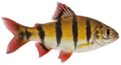
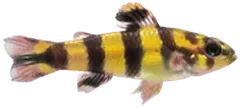
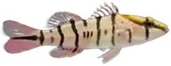
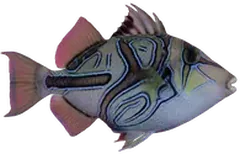
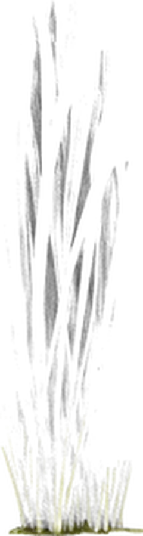

# reeftank-catalog

<!-- species:begin (generated by scripts/make_readme.py, do not edit) -->

> Parte do [**ecossistema de projetos ReefTech**](https://elwinmage.github.io/reeftank/)

       

Espécies de peixes, corais, plantas e invertebrados para a vista de aquário do [ha-reef-card](https://github.com/Elwinmage/ha-reef-card), fornecidas pela [integração ReefTank](https://github.com/Elwinmage/ha-reeftank-component).

A integração descarrega as versões publicadas deste repositório e mantém-nas atualizadas (`update.reeftank_catalog`, automático por predefinição): nada a fazer no Home Assistant.

## Como funciona

Cada peixe é uma folha de imagens (um atlas WebP) e um descritor com os seus clipes: *nadar*, *parado* e *meia-volta*. O cartão encadeia-os e espelha a meia-volta para que o peixe regresse pelo mesmo caminho. Eis o nado, a meia-volta e o regresso de duas espécies:

<table><tr><td align="center"> Peixe-anjo imperador</td><td align="center"> Peixe-palhaço</td></tr></table>

## Peixes (102)

**HD**: uma animação real, feita a partir de vídeos. Os outros têm uma animação simples feita a partir de uma foto, ou o peixe genérico.

| &nbsp;&nbsp;&nbsp;&nbsp;&nbsp;&nbsp;&nbsp;&nbsp;&nbsp;&nbsp;&nbsp;&nbsp;&nbsp;&nbsp;&nbsp;&nbsp;&nbsp;&nbsp;&nbsp;&nbsp;&nbsp;&nbsp;&nbsp;&nbsp;&nbsp;&nbsp;&nbsp;&nbsp;&nbsp;&nbsp;&nbsp;&nbsp;&nbsp;&nbsp;&nbsp;&nbsp;&nbsp;&nbsp;&nbsp; | <small>Nome</small> | <small>Nome científico</small> | <small>Água</small> | <small>Tamanho</small> | <small>Comportamento</small> | HD |
|---|---|---|---|---|---|---|
|  | <small>Acará-bandeira `pterophyllum_scalare`</small> | <small>*Pterophyllum scalare*</small> | <small>Água doce</small> | <small>12–15 cm</small> | <small>Nadador de águas abertas · esconde-se à noite</small> |  |
|  | <small>Acará-disco `symphysodon_aequifasciatus`</small> | <small>*Symphysodon aequifasciatus*</small> | <small>Água doce</small> | <small>15–20 cm</small> | <small>Nadador de águas abertas · esconde-se à noite</small> |  |
|  | <small>Ancistrus `ancistrus`</small> | <small>*Ancistrus sp.*</small> | <small>Água doce</small> | <small>10–14 cm</small> | <small>Vive junto ao fundo · esconde-se à noite</small> |  |
|  | <small>Antias `pseudanthias`</small> | <small>*Pseudanthias sp.*</small> | <small>Marinho</small> | <small>8–14 cm</small> | <small>Em cardume · esconde-se à noite</small> | ✔ |
|  | <small>Apistogramma-cacatua `apistogramma_cacatuoides`</small> | <small>*Apistogramma cacatuoides*</small> | <small>Água doce</small> | <small>5–9 cm</small> | <small>Vive junto ao fundo · esconde-se à noite</small> |  |
|  | <small>Baiacu-de-Valentin `canthigaster_valentini`</small> | <small>*Canthigaster valentini*</small> | <small>Marinho</small> | <small>8–10 cm</small> | <small>Nadador de águas abertas · esconde-se à noite</small> |  |
|  | <small>Baiacu-oito `dichotomyctere_biocellatus`</small> | <small>*Dichotomyctere biocellatus*</small> | <small>Salobra</small> | <small>5–6.5 cm</small> | <small>Nadador de águas abertas · esconde-se à noite</small> |  |
|  | <small>Baiacu-verde `dichotomyctere_nigroviridis`</small> | <small>*Dichotomyctere nigroviridis*</small> | <small>Salobra</small> | <small>10–17 cm</small> | <small>Nadador de águas abertas · esconde-se à noite</small> |  |
|  | <small>Barbo-cereja `pethia_titteya`</small> | <small>*Pethia titteya*</small> | <small>Água doce</small> | <small>4–5 cm</small> | <small>Em cardume · esconde-se à noite</small> |  |
|  | <small>Barbo-de-sumatra `puntigrus_tetrazona`</small> | <small>*Puntigrus tetrazona*</small> | <small>Água doce</small> | <small>5–7 cm</small> | <small>Em cardume · esconde-se à noite</small> |  |
|  | <small>Blênio-bicolor `ecsenius_bicolor`</small> | <small>*Ecsenius bicolor*</small> | <small>Marinho</small> | <small>8–10 cm</small> | <small>Vive junto ao fundo · esconde-se à noite</small> |  |
|  | <small>Blênio-cortador-de-relva `salarias_fasciatus`</small> | <small>*Salarias fasciatus*</small> | <small>Marinho</small> | <small>12–14 cm</small> | <small>Vive junto ao fundo · esconde-se à noite</small> |  |
|  | <small>Bodião-amarelo `halichoeres_chrysus`</small> | <small>*Halichoeres chrysus*</small> | <small>Marinho</small> | <small>10–12 cm</small> | <small>Nadador de águas abertas · descansa no fundo à noite</small> |  |
|  | <small>Bodião-de-seis-listras `pseudocheilinus_hexataenia`</small> | <small>*Pseudocheilinus hexataenia*</small> | <small>Marinho</small> | <small>7–10 cm</small> | <small>Nadador de águas abertas · esconde-se à noite</small> |  |
|  | <small>Bodião-fada-de-Solor `cirrhilabrus_solorensis`</small> | <small>*Cirrhilabrus solorensis*</small> | <small>Marinho</small> | <small>10–12 cm</small> | <small>Nadador de águas abertas · esconde-se à noite</small> |  |
|  | <small>Bodião-limpador `labroides_dimidiatus`</small> | <small>*Labroides dimidiatus*</small> | <small>Marinho</small> | <small>10–12 cm</small> | <small>Nadador de águas abertas · esconde-se à noite</small> |  |
|  | <small>Botia-palhaço `chromobotia_macracanthus`</small> | <small>*Chromobotia macracanthus*</small> | <small>Água doce</small> | <small>15–30 cm</small> | <small>Vive junto ao fundo · esconde-se à noite</small> |  |
|  | <small>Cascudo-zebra `hypancistrus_zebra`</small> | <small>*Hypancistrus zebra*</small> | <small>Água doce</small> | <small>7–10 cm</small> | <small>Vive junto ao fundo · esconde-se à noite</small> |  |
|  | <small>Cavalo-marinho-listrado `hippocampus_erectus`</small> | <small>*Hippocampus erectus*</small> | <small>Marinho</small> | <small>10–15 cm</small> | <small>Estacionário · paira na água à noite</small> |  |
|  | <small>Ciclídeo-amarelo-elétrico `labidochromis_caeruleus`</small> | <small>*Labidochromis caeruleus*</small> | <small>Água doce</small> | <small>8–10 cm</small> | <small>Nadador de águas abertas · esconde-se à noite</small> |  |
|  | <small>Ciclídeo-demasoni `pseudotropheus_demasoni`</small> | <small>*Pseudotropheus demasoni*</small> | <small>Água doce</small> | <small>7–8 cm</small> | <small>Nadador de águas abertas · esconde-se à noite</small> |  |
|  | <small>Cirurgião-amarelo `zebrasoma_flavescens`</small> | <small>*Zebrasoma flavescens*</small> | <small>Marinho</small> | <small>15–20 cm</small> | <small>Nadador de águas abertas · esconde-se à noite</small> |  |
|  | <small>Cirurgião-azul-pó `acanthurus_leucosternon`</small> | <small>*Acanthurus leucosternon*</small> | <small>Marinho</small> | <small>20–23 cm</small> | <small>Nadador de águas abertas · esconde-se à noite</small> |  |
|  | <small>Cirurgião-castanho `zebrasoma_scopas`</small> | <small>*Zebrasoma scopas*</small> | <small>Marinho</small> | <small>15–20 cm</small> | <small>Nadador de águas abertas · esconde-se à noite</small> |  |
|  | <small>Cirurgião-kole `ctenochaetus_strigosus`</small> | <small>*Ctenochaetus strigosus*</small> | <small>Marinho</small> | <small>12–18 cm</small> | <small>Nadador de águas abertas · esconde-se à noite</small> |  |
|  | <small>Cirurgião-patela `paracanthurus_hepatus`</small> | <small>*Paracanthurus hepatus*</small> | <small>Marinho</small> | <small>20–30 cm</small> | <small>Nadador de águas abertas · esconde-se à noite</small> |  |
|  | <small>Cirurgião-vela `zebrasoma_veliferum`</small> | <small>*Zebrasoma veliferum*</small> | <small>Marinho</small> | <small>25–40 cm</small> | <small>Nadador de águas abertas · esconde-se à noite</small> |  |
|  | <small>Come-algas-siamês `crossocheilus_oblongus`</small> | <small>*Crossocheilus oblongus*</small> | <small>Água doce</small> | <small>10–15 cm</small> | <small>Nadador de águas abertas · esconde-se à noite</small> |  |
|  | <small>Corydora-bronze `corydoras_aeneus`</small> | <small>*Corydoras aeneus*</small> | <small>Água doce</small> | <small>6–7 cm</small> | <small>Vive junto ao fundo · esconde-se à noite</small> |  |
|  | <small>Corydora-panda `corydoras_panda`</small> | <small>*Corydoras panda*</small> | <small>Água doce</small> | <small>4–5 cm</small> | <small>Vive junto ao fundo · esconde-se à noite</small> |  |
|  | <small>Cromis-verde `chromis_viridis`</small> | <small>*Chromis viridis*</small> | <small>Marinho</small> | <small>5–8 cm</small> | <small>Em cardume · esconde-se à noite</small> | ✔ |
|  | <small>Danio-galáxia `danio_margaritatus`</small> | <small>*Danio margaritatus*</small> | <small>Água doce</small> | <small>2–3 cm</small> | <small>Em cardume · esconde-se à noite</small> |  |
|  | <small>Danio-pérola `danio_albolineatus`</small> | <small>*Danio albolineatus*</small> | <small>Água doce</small> | <small>4–6 cm</small> | <small>Em cardume · esconde-se à noite</small> |  |
|  | <small>Dascilo-de-três-manchas `dascyllus_trimaculatus`</small> | <small>*Dascyllus trimaculatus*</small> | <small>Marinho</small> | <small>10–14 cm</small> | <small>Estacionário · paira na água à noite</small> |  |
|  | <small>Donzela-de-cauda-amarela `chrysiptera_parasema`</small> | <small>*Chrysiptera parasema*</small> | <small>Marinho</small> | <small>5–6 cm</small> | <small>Estacionário · fica perto do seu abrigo · paira na água à noite</small> |  |
|  | <small>Donzela-de-Fiji `chrysiptera_taupou`</small> | <small>*Chrysiptera taupou*</small> | <small>Marinho</small> | <small>6–8 cm</small> | <small>Estacionário · fica perto do seu abrigo · paira na água à noite</small> |  |
|  | <small>Espadinha `xiphophorus_hellerii`</small> | <small>*Xiphophorus hellerii*</small> | <small>Água doce</small> | <small>6–12 cm</small> | <small>Em cardume · esconde-se à noite</small> |  |
|  | <small>Gramma-real `gramma_loreto`</small> | <small>*Gramma loreto*</small> | <small>Marinho</small> | <small>7–8 cm</small> | <small>Estacionário · paira na água à noite</small> |  |
|  | <small>Guppy-de-Endler `poecilia_wingei`</small> | <small>*Poecilia wingei*</small> | <small>Água doce</small> | <small>2–4 cm</small> | <small>Em cardume · esconde-se à noite</small> |  |
|  | <small>Gurami-anão `trichogaster_lalius`</small> | <small>*Trichogaster lalius*</small> | <small>Água doce</small> | <small>5–8 cm</small> | <small>Nadador de águas abertas · esconde-se à noite</small> |  |
|  | <small>Gurami-azul `trichopodus_trichopterus`</small> | <small>*Trichopodus trichopterus*</small> | <small>Água doce</small> | <small>10–15 cm</small> | <small>Nadador de águas abertas · esconde-se à noite</small> |  |
|  | <small>Gurami-pérola `trichopodus_leerii`</small> | <small>*Trichopodus leerii*</small> | <small>Água doce</small> | <small>10–12 cm</small> | <small>Nadador de águas abertas · esconde-se à noite</small> |  |
|  | <small>Góbio de Okinawa `gobiodon_okinawae`</small> | <small>*Gobiodon okinawae*</small> | <small>Marinho</small> | <small>2.5–3.5 cm</small> | <small>Vive junto ao fundo · esconde-se à noite</small> |  |
|  | <small>Góbio-abelhão `brachygobius_xanthozonus`</small> | <small>*Brachygobius xanthozonus*</small> | <small>Salobra</small> | <small>3–4 cm</small> | <small>Vive junto ao fundo · esconde-se à noite</small> |  |
|  | <small>Góbio-anfitrião amarelo `cryptocentrus_cinctus`</small> | <small>*Cryptocentrus cinctus*</small> | <small>Marinho</small> | <small>8–10 cm</small> | <small>Vive na areia · vive numa toca · descansa no fundo à noite</small> |  |
|  | <small>Góbio-cavaleiro `stigmatogobius_sadanundio`</small> | <small>*Stigmatogobius sadanundio*</small> | <small>Salobra</small> | <small>6–8 cm</small> | <small>Vive junto ao fundo · esconde-se à noite</small> |  |
|  | <small>Góbio-de-coral-limão `gobiodon_citrinus`</small> | <small>*Gobiodon citrinus*</small> | <small>Marinho</small> | <small>3–5 cm</small> | <small>Vive junto ao fundo · esconde-se à noite</small> |  |
|  | <small>Góbio-dorminhoco `valenciennea`</small> | <small>*Valenciennea sp.*</small> | <small>Marinho</small> | <small>10–16 cm</small> | <small>Vive na areia · vive numa toca · descansa no fundo à noite</small> | ✔ |
|  | <small>Góbio-listrado `amblygobius_phalaena`</small> | <small>*Amblygobius phalaena*</small> | <small>Marinho</small> | <small>8–10 cm</small> | <small>Vive na areia · descansa no fundo à noite</small> |  |
|  | <small>Góbio-néon `elacatinus_oceanops`</small> | <small>*Elacatinus oceanops*</small> | <small>Marinho</small> | <small>4–6 cm</small> | <small>Vive junto ao fundo · esconde-se à noite</small> |  |
|  | <small>Góbio-violeta `gobioides_broussonnetii`</small> | <small>*Gobioides broussonnetii*</small> | <small>Salobra</small> | <small>30–50 cm</small> | <small>Vive na areia · vive numa toca · descansa no fundo à noite</small> |  |
|  | <small>Góbio-yasha `stonogobiops_yasha`</small> | <small>*Stonogobiops yasha*</small> | <small>Marinho</small> | <small>6–8 cm</small> | <small>Vive na areia · vive numa toca · descansa no fundo à noite</small> |  |
|  | <small>Killi do Cabo Lopez `aphyosemion_australe`</small> | <small>*Aphyosemion australe*</small> | <small>Água doce</small> | <small>5–6 cm</small> | <small>Estacionário · paira na água à noite</small> |  |
|  | <small>Kribensis `pelvicachromis_pulcher`</small> | <small>*Pelvicachromis pulcher*</small> | <small>Água doce</small> | <small>8–10 cm</small> | <small>Vive junto ao fundo · esconde-se à noite</small> |  |
|  | <small>Kuhli `pangio_kuhlii`</small> | <small>*Pangio kuhlii*</small> | <small>Água doce</small> | <small>8–12 cm</small> | <small>Vive junto ao fundo · esconde-se à noite</small> |  |
|  | <small>Lebiste `poecilia_reticulata`</small> | <small>*Poecilia reticulata*</small> | <small>Água doce</small> | <small>3–6 cm</small> | <small>Em cardume · esconde-se à noite</small> |  |
|  | <small>Molinésia-comum `poecilia_sphenops`</small> | <small>*Poecilia sphenops*</small> | <small>Água doce, Salobra</small> | <small>6–10 cm</small> | <small>Em cardume · esconde-se à noite</small> |  |
|  | <small>Molinésia-vela `poecilia_velifera`</small> | <small>*Poecilia velifera*</small> | <small>Salobra, Água doce</small> | <small>10–15 cm</small> | <small>Em cardume · esconde-se à noite</small> |  |
|  | <small>Monodáctilo-prateado `monodactylus_argenteus`</small> | <small>*Monodactylus argenteus*</small> | <small>Salobra, Marinho</small> | <small>15–25 cm</small> | <small>Em cardume · esconde-se à noite</small> |  |
|  | <small>Oscar `astronotus_ocellatus`</small> | <small>*Astronotus ocellatus*</small> | <small>Água doce</small> | <small>25–35 cm</small> | <small>Nadador de águas abertas · esconde-se à noite</small> |  |
|  | <small>Otocinclus `otocinclus_affinis`</small> | <small>*Otocinclus affinis*</small> | <small>Água doce</small> | <small>3–5 cm</small> | <small>Vive junto ao fundo · esconde-se à noite</small> |  |
|  | <small>Peixe-anjo-bicolor `centropyge_bicolor`</small> | <small>*Centropyge bicolor*</small> | <small>Marinho</small> | <small>10–15 cm</small> | <small>Estacionário · paira na água à noite</small> |  |
|  | <small>Peixe-anjo-chama `centropyge_loricula`</small> | <small>*Centropyge loricula*</small> | <small>Marinho</small> | <small>8–10 cm</small> | <small>Estacionário · paira na água à noite</small> |  |
|  | <small>Peixe-anjo-imperador (adulto) `pomacanthus_imperator_adult`</small> | <small>*Pomacanthus imperator*</small> | <small>Marinho</small> | <small>25–38 cm</small> | <small>Nadador de águas abertas · esconde-se à noite</small> | ✔ |
|  | <small>Peixe-anjo-imperador (juvenil) `pomacanthus_imperator`</small> | <small>*Pomacanthus imperator*</small> | <small>Marinho</small> | <small>6–12 cm</small> | <small>Nadador de águas abertas · esconde-se à noite</small> | ✔ |
|  | <small>Peixe-anjo-real `pygoplites_diacanthus`</small> | <small>*Pygoplites diacanthus*</small> | <small>Marinho</small> | <small>20–25 cm</small> | <small>Nadador de águas abertas · esconde-se à noite</small> |  |
|  | <small>Peixe-arco-íris-turquesa `melanotaenia_lacustris`</small> | <small>*Melanotaenia lacustris*</small> | <small>Água doce</small> | <small>8–12 cm</small> | <small>Em cardume · esconde-se à noite</small> |  |
|  | <small>Peixe-arqueiro `toxotes_jaculatrix`</small> | <small>*Toxotes jaculatrix*</small> | <small>Salobra</small> | <small>15–25 cm</small> | <small>Nadador de águas abertas · esconde-se à noite</small> |  |
|  | <small>Peixe-borboleta-cobre `chelmon_rostratus`</small> | <small>*Chelmon rostratus*</small> | <small>Marinho</small> | <small>15–20 cm</small> | <small>Nadador de águas abertas · esconde-se à noite</small> |  |
|  | <small>Peixe-cardeal-de-Banggai `pterapogon_kauderni`</small> | <small>*Pterapogon kauderni*</small> | <small>Marinho</small> | <small>5–8 cm</small> | <small>Estacionário · paira na água à noite</small> | ✔ |
|  | <small>Peixe-cardeal-de-listras-amarelas `ostorhinchus_cyanosoma`</small> | <small>*Ostorhinchus cyanosoma*</small> | <small>Marinho</small> | <small>7–8 cm</small> | <small>Estacionário · paira na água à noite</small> |  |
|  | <small>Peixe-cardeal-pijama `sphaeramia_nematoptera`</small> | <small>*Sphaeramia nematoptera*</small> | <small>Marinho</small> | <small>8–10 cm</small> | <small>Estacionário · paira na água à noite</small> |  |
|  | <small>Peixe-coelho cara-de-raposa `siganus_vulpinus`</small> | <small>*Siganus vulpinus*</small> | <small>Marinho</small> | <small>15–22 cm</small> | <small>Nadador de águas abertas · descansa no fundo à noite</small> | ✔ |
|  | <small>Peixe-de-briga `betta_splendens`</small> | <small>*Betta splendens*</small> | <small>Água doce</small> | <small>5–7 cm</small> | <small>Estacionário · fica perto do seu abrigo · paira na água à noite</small> |  |
|  | <small>Peixe-dourado `carassius_auratus`</small> | <small>*Carassius auratus*</small> | <small>Água doce</small> | <small>10–25 cm</small> | <small>Nadador de águas abertas · esconde-se à noite</small> |  |
|  | <small>Peixe-falcão-pixie `cirrhitichthys_oxycephalus`</small> | <small>*Cirrhitichthys oxycephalus*</small> | <small>Marinho</small> | <small>8–10 cm</small> | <small>Vive junto ao fundo · esconde-se à noite</small> |  |
|  | <small>Peixe-fogo `nemateleotris_magnifica`</small> | <small>*Nemateleotris magnifica*</small> | <small>Marinho</small> | <small>8–10 cm</small> | <small>Estacionário · paira na água à noite</small> |  |
|  | <small>Peixe-fogo-roxo `nemateleotris_decora`</small> | <small>*Nemateleotris decora*</small> | <small>Marinho</small> | <small>8–10 cm</small> | <small>Estacionário · paira na água à noite</small> |  |
|  | <small>Peixe-gatilho-Picasso `rhinecanthus_aculeatus`</small> | <small>*Rhinecanthus aculeatus*</small> | <small>Marinho</small> | <small>20–25 cm</small> | <small>Nadador de águas abertas · esconde-se à noite</small> |  |
|  | <small>Peixe-leão-vermelho `pterois_volitans`</small> | <small>*Pterois volitans*</small> | <small>Marinho</small> | <small>25–35 cm</small> | <small>Nadador de águas abertas · esconde-se à noite</small> |  |
|  | <small>Peixe-leão-zebra `dendrochirus_zebra`</small> | <small>*Dendrochirus zebra*</small> | <small>Marinho</small> | <small>12–18 cm</small> | <small>Nadador de águas abertas · esconde-se à noite</small> |  |
|  | <small>Peixe-machado-marmoreado `carnegiella_strigata`</small> | <small>*Carnegiella strigata*</small> | <small>Água doce</small> | <small>4–5 cm</small> | <small>Em cardume · esconde-se à noite</small> |  |
|  | <small>Peixe-mandarim `synchiropus_splendidus`</small> | <small>*Synchiropus splendidus*</small> | <small>Marinho</small> | <small>5–8 cm</small> | <small>Vive junto ao fundo · esconde-se à noite</small> | ✔ |
|  | <small>Peixe-mandarim-psicadélico `synchiropus_picturatus`</small> | <small>*Synchiropus picturatus*</small> | <small>Marinho</small> | <small>6–8 cm</small> | <small>Vive junto ao fundo · esconde-se à noite</small> |  |
|  | <small>Peixe-mandíbula-de-cabeça-amarela `opistognathus_aurifrons`</small> | <small>*Opistognathus aurifrons*</small> | <small>Marinho</small> | <small>10–12 cm</small> | <small>Vive na areia · vive numa toca · descansa no fundo à noite</small> |  |
|  | <small>Peixe-palhaço `amphiprion`</small> | <small>*Amphiprion sp.*</small> | <small>Marinho</small> | <small>7–11 cm</small> | <small>Estacionário · paira na água à noite</small> | ✔ |
|  | <small>Peixe-palhaço-castanho `premnas_biaculeatus`</small> | <small>*Premnas biaculeatus*</small> | <small>Marinho</small> | <small>10–15 cm</small> | <small>Estacionário · paira na água à noite</small> |  |
|  | <small>Peixe-zebra `danio_rerio`</small> | <small>*Danio rerio*</small> | <small>Água doce</small> | <small>4–5 cm</small> | <small>Em cardume · esconde-se à noite</small> |  |
|  | <small>Platy `xiphophorus_maculatus`</small> | <small>*Xiphophorus maculatus*</small> | <small>Água doce</small> | <small>4–6 cm</small> | <small>Em cardume · esconde-se à noite</small> |  |
|  | <small>Pseudocromis-orquídea `pseudochromis_fridmani`</small> | <small>*Pseudochromis fridmani*</small> | <small>Marinho</small> | <small>6–7 cm</small> | <small>Estacionário · fica perto do seu abrigo · paira na água à noite</small> |  |
|  | <small>Ramirezi `mikrogeophagus_ramirezi`</small> | <small>*Mikrogeophagus ramirezi*</small> | <small>Água doce</small> | <small>5–7 cm</small> | <small>Estacionário · paira na água à noite</small> |  |
|  | <small>Rasbora-arlequim `trigonostigma_heteromorpha`</small> | <small>*Trigonostigma heteromorpha*</small> | <small>Água doce</small> | <small>3–4.5 cm</small> | <small>Em cardume · esconde-se à noite</small> |  |
|  | <small>Saltador-do-lodo-atlântico `periophthalmus_barbarus`</small> | <small>*Periophthalmus barbarus*</small> | <small>Salobra</small> | <small>10–15 cm</small> | <small>Vive junto ao fundo · esconde-se à noite</small> |  |
|  | <small>Scat-malhado `scatophagus_argus`</small> | <small>*Scatophagus argus*</small> | <small>Salobra, Marinho</small> | <small>15–30 cm</small> | <small>Nadador de águas abertas · esconde-se à noite</small> |  |
|  | <small>Tanichthys `tanichthys_albonubes`</small> | <small>*Tanichthys albonubes*</small> | <small>Água doce</small> | <small>3–4 cm</small> | <small>Em cardume · esconde-se à noite</small> |  |
|  | <small>Tetra-cardinal `paracheirodon_axelrodi`</small> | <small>*Paracheirodon axelrodi*</small> | <small>Água doce</small> | <small>3–5 cm</small> | <small>Em cardume · esconde-se à noite</small> |  |
|  | <small>Tetra-imperador `nematobrycon_palmeri`</small> | <small>*Nematobrycon palmeri*</small> | <small>Água doce</small> | <small>4–6 cm</small> | <small>Em cardume · esconde-se à noite</small> |  |
|  | <small>Tetra-limão `hyphessobrycon_pulchripinnis`</small> | <small>*Hyphessobrycon pulchripinnis*</small> | <small>Água doce</small> | <small>3–4.5 cm</small> | <small>Em cardume · esconde-se à noite</small> |  |
|  | <small>Tetra-nariz-vermelho `hemigrammus_bleheri`</small> | <small>*Hemigrammus bleheri*</small> | <small>Água doce</small> | <small>4–5 cm</small> | <small>Em cardume · esconde-se à noite</small> |  |
|  | <small>Tetra-neon `paracheirodon_innesi`</small> | <small>*Paracheirodon innesi*</small> | <small>Água doce</small> | <small>3–4 cm</small> | <small>Em cardume · esconde-se à noite</small> |  |
|  | <small>Tetra-preto `gymnocorymbus_ternetzi`</small> | <small>*Gymnocorymbus ternetzi*</small> | <small>Água doce</small> | <small>5–6 cm</small> | <small>Em cardume · esconde-se à noite</small> |  |
|  | <small>Tetra-serpae `hyphessobrycon_eques`</small> | <small>*Hyphessobrycon eques*</small> | <small>Água doce</small> | <small>3–4.5 cm</small> | <small>Em cardume · esconde-se à noite</small> |  |

## Corais (1)

| &nbsp;&nbsp;&nbsp;&nbsp;&nbsp;&nbsp;&nbsp;&nbsp;&nbsp;&nbsp;&nbsp;&nbsp;&nbsp;&nbsp;&nbsp;&nbsp;&nbsp;&nbsp;&nbsp;&nbsp;&nbsp;&nbsp;&nbsp;&nbsp;&nbsp;&nbsp;&nbsp;&nbsp;&nbsp;&nbsp;&nbsp;&nbsp;&nbsp;&nbsp;&nbsp;&nbsp;&nbsp;&nbsp;&nbsp; | <small>Nome</small> | <small>Nome científico</small> | <small>Água</small> | <small>Tamanho</small> |
|---|---|---|---|---|
|  | <small>Coral-tocha `euphyllia_glabrescens`</small> | <small>*Euphyllia glabrescens*</small> | <small>Marinho</small> | <small>10–30 cm</small> |

## Plantas (29)

| &nbsp;&nbsp;&nbsp;&nbsp;&nbsp;&nbsp;&nbsp;&nbsp;&nbsp;&nbsp;&nbsp;&nbsp;&nbsp;&nbsp;&nbsp;&nbsp;&nbsp;&nbsp;&nbsp;&nbsp;&nbsp;&nbsp;&nbsp;&nbsp;&nbsp;&nbsp;&nbsp;&nbsp;&nbsp;&nbsp;&nbsp;&nbsp;&nbsp;&nbsp;&nbsp;&nbsp;&nbsp;&nbsp;&nbsp; | <small>Nome</small> | <small>Nome científico</small> | <small>Água</small> | <small>Tamanho</small> | <small>Zona</small> |
|---|---|---|---|---|---|
|  | <small>Alface-d'água `pistia_stratiotes`</small> | <small>*Pistia stratiotes*</small> | <small>Água doce</small> | <small>5–15 cm</small> | <small>Flutuante</small> |
|  | <small>Ambulia `limnophila_sessiliflora`</small> | <small>*Limnophila sessiliflora*</small> | <small>Água doce</small> | <small>20–40 cm</small> | <small>Fundo</small> |
|  | <small>Anubias `anubias_barteri`</small> | <small>*Anubias barteri*</small> | <small>Água doce</small> | <small>10–25 cm</small> | <small>Epífita</small> |
|  | <small>Bucephalandra `bucephalandra`</small> | <small>*Bucephalandra sp.*</small> | <small>Água doce</small> | <small>5–15 cm</small> | <small>Epífita</small> |
|  | <small>Cabomba `cabomba_caroliniana`</small> | <small>*Cabomba caroliniana*</small> | <small>Água doce</small> | <small>30–60 cm</small> | <small>Fundo</small> |
|  | <small>Caulerpa `caulerpa_prolifera`</small> | <small>*Caulerpa prolifera*</small> | <small>Marinho</small> | <small>5–20 cm</small> | <small>Primeiro plano</small> |
|  | <small>Chaetomorpha `chaetomorpha_linum`</small> | <small>*Chaetomorpha linum*</small> | <small>Marinho</small> | <small>5–30 cm</small> | <small>Primeiro plano</small> |
|  | <small>Cryptocoryne ciliata `cryptocoryne_ciliata`</small> | <small>*Cryptocoryne ciliata*</small> | <small>Salobra, Água doce</small> | <small>20–40 cm</small> | <small>Plano médio</small> |
|  | <small>Cryptocoryne parva `cryptocoryne_parva`</small> | <small>*Cryptocoryne parva*</small> | <small>Água doce</small> | <small>5–8 cm</small> | <small>Primeiro plano</small> |
|  | <small>Cryptocoryne wendtii `cryptocoryne_wendtii`</small> | <small>*Cryptocoryne wendtii*</small> | <small>Água doce</small> | <small>10–20 cm</small> | <small>Plano médio</small> |
|  | <small>Egéria-densa `egeria_densa`</small> | <small>*Egeria densa*</small> | <small>Água doce</small> | <small>30–100 cm</small> | <small>Fundo</small> |
|  | <small>Eleocharis-anã `eleocharis_parvula`</small> | <small>*Eleocharis parvula*</small> | <small>Água doce</small> | <small>5–10 cm</small> | <small>Primeiro plano</small> |
|  | <small>Erva-de-tartaruga `thalassia_testudinum`</small> | <small>*Thalassia testudinum*</small> | <small>Marinho</small> | <small>10–30 cm</small> | <small>Primeiro plano</small> |
|  | <small>Espada-amazônica `echinodorus_bleheri`</small> | <small>*Echinodorus bleheri*</small> | <small>Água doce</small> | <small>30–50 cm</small> | <small>Plano médio</small> |
|  | <small>Glossostigma `glossostigma_elatinoides`</small> | <small>*Glossostigma elatinoides*</small> | <small>Água doce</small> | <small>2–5 cm</small> | <small>Primeiro plano</small> |
|  | <small>Halimeda `halimeda_opuntia`</small> | <small>*Halimeda opuntia*</small> | <small>Marinho</small> | <small>5–15 cm</small> | <small>Primeiro plano</small> |
|  | <small>Hemianthus `hemianthus_callitrichoides`</small> | <small>*Hemianthus callitrichoides*</small> | <small>Água doce</small> | <small>2–5 cm</small> | <small>Primeiro plano</small> |
|  | <small>Hygrophila `hygrophila_polysperma`</small> | <small>*Hygrophila polysperma*</small> | <small>Água doce</small> | <small>20–50 cm</small> | <small>Fundo</small> |
|  | <small>Lentilha-d'água `lemna_minor`</small> | <small>*Lemna minor*</small> | <small>Água doce</small> | <small>0.5–1 cm</small> | <small>Flutuante</small> |
|  | <small>Limnobium `limnobium_laevigatum`</small> | <small>*Limnobium laevigatum*</small> | <small>Água doce</small> | <small>5–10 cm</small> | <small>Flutuante</small> |
|  | <small>Ludwigia `ludwigia_repens`</small> | <small>*Ludwigia repens*</small> | <small>Água doce</small> | <small>20–40 cm</small> | <small>Plano médio</small> |
|  | <small>Mangue-vermelho `rhizophora_mangle`</small> | <small>*Rhizophora mangle*</small> | <small>Salobra, Marinho</small> | <small>30–100 cm</small> | <small>Plano médio</small> |
|  | <small>Marimo `aegagropila_linnaei`</small> | <small>*Aegagropila linnaei*</small> | <small>Água doce</small> | <small>3–10 cm</small> | <small>Primeiro plano</small> |
|  | <small>Musgo-de-Java `vesicularia_dubyana`</small> | <small>*Vesicularia dubyana*</small> | <small>Água doce</small> | <small>3–5 cm</small> | <small>Epífita</small> |
|  | <small>Rotala `rotala_rotundifolia`</small> | <small>*Rotala rotundifolia*</small> | <small>Água doce</small> | <small>20–50 cm</small> | <small>Fundo</small> |
|  | <small>Sagitária-anã `sagittaria_subulata`</small> | <small>*Sagittaria subulata*</small> | <small>Água doce</small> | <small>10–30 cm</small> | <small>Primeiro plano</small> |
|  | <small>Samambaia-de-Java `microsorum_pteropus`</small> | <small>*Microsorum pteropus*</small> | <small>Água doce</small> | <small>20–30 cm</small> | <small>Epífita</small> |
|  | <small>Staurogyne `staurogyne_repens`</small> | <small>*Staurogyne repens*</small> | <small>Água doce</small> | <small>5–10 cm</small> | <small>Primeiro plano</small> |
|  | <small>Vallisneria `vallisneria_spiralis`</small> | <small>*Vallisneria spiralis*</small> | <small>Água doce, Salobra</small> | <small>30–60 cm</small> | <small>Fundo</small> |

## Invertebrados (32)

| &nbsp;&nbsp;&nbsp;&nbsp;&nbsp;&nbsp;&nbsp;&nbsp;&nbsp;&nbsp;&nbsp;&nbsp;&nbsp;&nbsp;&nbsp;&nbsp;&nbsp;&nbsp;&nbsp;&nbsp;&nbsp;&nbsp;&nbsp;&nbsp;&nbsp;&nbsp;&nbsp;&nbsp;&nbsp;&nbsp;&nbsp;&nbsp;&nbsp;&nbsp;&nbsp;&nbsp;&nbsp;&nbsp;&nbsp; | <small>Nome</small> | <small>Nome científico</small> | <small>Água</small> | <small>Tamanho</small> | <small>Função</small> |
|---|---|---|---|---|---|
|  | <small>Amêijoa-gigante-perfurante `tridacna_crocea`</small> | <small>*Tridacna crocea*</small> | <small>Marinho</small> | <small>5–15 cm</small> | <small>Filtrador · séssil</small> |
|  | <small>Camarão peppermint `lysmata_wurdemanni`</small> | <small>*Lysmata wurdemanni*</small> | <small>Marinho</small> | <small>3–5 cm</small> | <small>Limpador · vive na decoração</small> |
|  | <small>Camarão-Amano `caridina_multidentata`</small> | <small>*Caridina multidentata*</small> | <small>Água doce</small> | <small>3–5 cm</small> | <small>Comedor de algas · desloca-se no fundo</small> |
|  | <small>Camarão-arlequim `hymenocera_picta`</small> | <small>*Hymenocera picta*</small> | <small>Marinho</small> | <small>4–6 cm</small> | <small>Predador · desloca-se no fundo</small> |
|  | <small>Camarão-bambu `atyopsis_moluccensis`</small> | <small>*Atyopsis moluccensis*</small> | <small>Água doce</small> | <small>6–8 cm</small> | <small>Filtrador · vive na decoração</small> |
|  | <small>Camarão-boxer `stenopus_hispidus`</small> | <small>*Stenopus hispidus*</small> | <small>Marinho</small> | <small>6–8 cm</small> | <small>Limpador · vive na decoração</small> |
|  | <small>Camarão-cereja `neocaridina_davidi`</small> | <small>*Neocaridina davidi*</small> | <small>Água doce</small> | <small>2–3.5 cm</small> | <small>Detritívoro · desloca-se no fundo</small> |
|  | <small>Camarão-cristal-vermelho `caridina_cantonensis`</small> | <small>*Caridina cantonensis*</small> | <small>Água doce</small> | <small>2–3 cm</small> | <small>Detritívoro · desloca-se no fundo</small> |
|  | <small>Camarão-fogo `lysmata_debelius`</small> | <small>*Lysmata debelius*</small> | <small>Marinho</small> | <small>5–6 cm</small> | <small>Limpador · vive na decoração</small> |
|  | <small>Camarão-limpador-escarlate `lysmata_amboinensis`</small> | <small>*Lysmata amboinensis*</small> | <small>Marinho</small> | <small>5–6 cm</small> | <small>Limpador · vive na decoração</small> |
|  | <small>Camarão-marmoreado `saron_marmoratus`</small> | <small>*Saron marmoratus*</small> | <small>Marinho</small> | <small>5–7 cm</small> | <small>Necrófago · vive na decoração</small> |
|  | <small>Caracol Astraea `astraea_tecta`</small> | <small>*Astraea tecta*</small> | <small>Marinho</small> | <small>2–4 cm</small> | <small>Comedor de algas · vive na decoração</small> |
|  | <small>Caracol Nassarius `nassarius`</small> | <small>*Nassarius sp.*</small> | <small>Marinho</small> | <small>2–4 cm</small> | <small>Necrófago · desloca-se no fundo</small> |
|  | <small>Caracol trochus `tectus_fenestratus`</small> | <small>*Tectus fenestratus*</small> | <small>Marinho</small> | <small>4–6 cm</small> | <small>Comedor de algas · vive na decoração</small> |
|  | <small>Caracol turbo `turbo_fluctuosus`</small> | <small>*Turbo fluctuosus*</small> | <small>Marinho</small> | <small>4–8 cm</small> | <small>Comedor de algas · trepa no vidro</small> |
|  | <small>Caracol-assassino `clea_helena`</small> | <small>*Clea helena*</small> | <small>Água doce</small> | <small>2–3 cm</small> | <small>Predador · desloca-se no fundo</small> |
|  | <small>Caracol-cerite `cerithium`</small> | <small>*Cerithium sp.*</small> | <small>Marinho</small> | <small>2–3 cm</small> | <small>Detritívoro · desloca-se no fundo</small> |
|  | <small>Caracol-trombeta-malaio `melanoides_tuberculata`</small> | <small>*Melanoides tuberculata*</small> | <small>Água doce</small> | <small>2–3 cm</small> | <small>Detritívoro · desloca-se no fundo</small> |
|  | <small>Caramujo-maçã `pomacea_bridgesii`</small> | <small>*Pomacea bridgesii*</small> | <small>Água doce</small> | <small>4–5 cm</small> | <small>Necrófago · desloca-se no fundo</small> |
|  | <small>Caranguejo-eremita-de-patas-azuis `clibanarius_tricolor`</small> | <small>*Clibanarius tricolor*</small> | <small>Marinho</small> | <small>2–3 cm</small> | <small>Necrófago · desloca-se no fundo</small> |
|  | <small>Caranguejo-eremita-escarlate `paguristes_cadenati`</small> | <small>*Paguristes cadenati*</small> | <small>Marinho</small> | <small>3–4 cm</small> | <small>Necrófago · desloca-se no fundo</small> |
|  | <small>Caranguejo-esmeralda `mithraculus_sculptus`</small> | <small>*Mithraculus sculptus*</small> | <small>Marinho</small> | <small>3–4 cm</small> | <small>Comedor de algas · vive na decoração</small> |
|  | <small>Estrela-do-mar-de-areia `archaster_typicus`</small> | <small>*Archaster typicus*</small> | <small>Marinho</small> | <small>6–10 cm</small> | <small>Detritívoro · desloca-se no fundo</small> |
|  | <small>Nerita-marinha `nerita`</small> | <small>*Nerita sp.*</small> | <small>Marinho</small> | <small>2–3 cm</small> | <small>Comedor de algas · trepa no vidro</small> |
|  | <small>Nerita-zebra `neritina_natalensis`</small> | <small>*Neritina natalensis*</small> | <small>Água doce</small> | <small>2–3 cm</small> | <small>Comedor de algas · trepa no vidro</small> |
|  | <small>Ofiúro-serpente `ophiolepis_superba`</small> | <small>*Ophiolepis superba*</small> | <small>Marinho</small> | <small>8–12 cm</small> | <small>Necrófago · desloca-se no fundo</small> |
|  | <small>Ouriço-coletor `tripneustes_gratilla`</small> | <small>*Tripneustes gratilla*</small> | <small>Marinho</small> | <small>10–15 cm</small> | <small>Comedor de algas · vive na decoração</small> |
|  | <small>Ouriço-lápis `prionocidaris_baculosa`</small> | <small>*Prionocidaris baculosa*</small> | <small>Marinho</small> | <small>8–10 cm</small> | <small>Comedor de algas · vive na decoração</small> |
|  | <small>Pepino-do-mar `holothuria`</small> | <small>*Holothuria sp.*</small> | <small>Marinho</small> | <small>15–30 cm</small> | <small>Detritívoro · desloca-se no fundo</small> |
|  | <small>Planorbídeo `planorbella_duryi`</small> | <small>*Planorbella duryi*</small> | <small>Água doce</small> | <small>2–3 cm</small> | <small>Detritívoro · trepa no vidro</small> |
|  | <small>Verme árvore-de-natal `spirobranchus_giganteus`</small> | <small>*Spirobranchus giganteus*</small> | <small>Marinho</small> | <small>3–5 cm</small> | <small>Filtrador · séssil</small> |
|  | <small>Verme-espanador `sabellastarte`</small> | <small>*Sabellastarte sp.*</small> | <small>Marinho</small> | <small>5–10 cm</small> | <small>Filtrador · séssil</small> |

Para adicionar uma espécie (geração dos clips, construção, publicação), ver a [documentação em inglês](README.md).

Os recursos das espécies estão sob **CC BY 4.0**, os scripts sob MIT: ver [LICENSE.md](LICENSE.md).

<!-- species:end -->

<!-- ecosystem:start -->

## Projetos relacionados

Os projetos ReefTech encaixam-se entre si: as integrações trazem o seu equipamento para o Home Assistant, o cartão mostra-o e comanda-o, e o backup mantém-no a funcionar durante um corte. Cada um funciona também sozinho.

<table>
  <tr>
    <th width="100px"></th>
    <th>Projeto</th>
    <th>Função</th>
    <th>Funciona com</th>
  </tr>
  <tr>
    <td></td>
    <td>🐠 <a href="https://github.com/Elwinmage/ha-reefbeat-component"><b>ha-reefbeat-component</b></a></td>
    <td>Aparelhos Red Sea ReefBeat, comandados localmente sem cloud: ReefATO+, ReefControl, ReefControl-Power, ReefDose, ReefLed, ReefMat, ReefRun e ReefWave. blueprint de alertas para modos anómalos, calibrações e bateria fraca. </td>
    <td>ha-reef-card</td>
  </tr>
  <tr>
    <td></td>
    <td>🌊 <a href="https://github.com/Elwinmage/ha-aquamedic-component"><b>ha-aquamedic-component</b></a></td>
    <td>Bombas Aqua Medic através da API cloud Gizwits: bombas de circulação EcoDrift e SmartDrift, bombas DC Runner de retorno e do escumador.</td>
    <td>ha-reef-card</td>
  </tr>
  <tr>
    <td></td>
    <td>🐟 <a href="https://github.com/Elwinmage/ha-vson-component"><b>ha-vson-component</b></a></td>
    <td>Alimentadores automáticos VSON através da API cloud VSON: o alimentador WP8621 (alimentar, bateria, aviso de pouca comida) e deteção genérica de qualquer outro dispositivo VSON. O WP8621 também pode funcionar totalmente local com ESPHome.</td>
    <td>ha-reef-card</td>
  </tr>
  <tr>
    <td></td>
    <td>🐙 <a href="https://github.com/Elwinmage/ha-reef-maintenance-component"><b>ha-reef-maintenance-component</b></a></td>
    <td>Acompanhamento da limpeza e do desgaste do equipamento que o Home Assistant não consegue interrogar: bombas de circulação, bombas de retorno, escumadores, reatores, tudo o que trata à mão.</td>
    <td>ha-reef-card</td>
  </tr>
  <tr>
    <td></td>
    <td>🪸 <a href="https://github.com/Elwinmage/ha-reef-card"><b>ha-reef-card</b></a></td>
    <td>Vista gráfica interativa de cada aparelho no seu painel, e a única forma de editar os programas avançados. Lê as três integrações através do contrato <code>reef_role</code> comum, sem configuração do lado do cartão. Desenha também os fluxos de energia do reefbeatEnergyBackup. O seu cartão de aquário dá vida ao seu aquário com o ha-reeftank-component.</td>
    <td>as quatro integrações, e o ha-reeftank-component para o aquário</td>
  </tr>
  <tr>
    <td></td>
    <td>🐟 <a href="https://github.com/Elwinmage/ha-reeftank-component"><b>ha-reeftank-component</b></a></td>
    <td>Uma imagem viva do seu aquário no painel: a sua foto, iluminada pelas suas lâmpadas reais, com peixes e corais animados, e os seus dispositivos e entidades. Guarda os aquários e a sua fauna, regista as alimentações.</td>
    <td>ha-reef-card</td>
  </tr>
  <tr>
    <td></td>
    <td>🐡 <b>reeftank-catalog</b> <i>(este repositório)</i></td>
    <td>Peixes, corais e texturas do cartão de aquário, transferidos e mantidos atualizados pelo ha-reeftank-component.</td>
    <td>ha-reeftank-component</td>
  </tr>
  <tr>
    <td></td>
    <td>🐬 <a href="https://github.com/Elwinmage/ha-reef-blueprints"><b>ha-reef-blueprints</b></a></td>
    <td>Blueprints de automação comuns a todo o ecossistema: manutenções em atraso encontradas pelo contrato <code>reef_role</code>, aparelhos que ficaram inacessíveis, um teste periódico dos aquecedores e uma vigilância dos relés. Oito idiomas.</td>
    <td>as quatro integrações</td>
  </tr>
  <tr>
    <td></td>
    <td>⚡ <a href="https://github.com/Elwinmage/reefbeatEnergyBackup"><b>reefbeatEnergyBackup</b></a></td>
    <td>Backup por bateria em caso de corte. Um pack 24V LiFePO₄ comandado por um Raspberry Pi, com degradação progressiva da velocidade das bombas conforme o estado de carga.</td>
    <td>sozinho, ou a par do ha-reefbeat-component e do ha-reef-card</td>
  </tr>
</table>

Estão todos documentados em conjunto na [página do projeto ReefTech](https://elwinmage.github.io/reeftank/).

<!-- ecosystem:end -->
