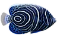
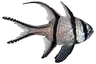

# reeftank-catalog

<!-- species:begin (generated by scripts/make_readme.py, do not edit) -->

> Parte do [**ecossistema de projetos ReefTech**](https://elwinmage.github.io/reeftank/)

       

Espécies de peixes, corais, plantas e invertebrados para a vista de aquário do [ha-reef-card](https://github.com/Elwinmage/ha-reef-card), fornecidas pela [integração ReefTank](https://github.com/Elwinmage/ha-reeftank-component).

A integração descarrega as versões publicadas deste repositório e mantém-nas atualizadas (`update.reeftank_catalog`, automático por predefinição): nada a fazer no Home Assistant.

## Peixes (99)

|  | Nome | Nome científico | Água | Tamanho | Comportamento |
|---|---|---|---|---|---|
|  | Angelfish `pterophyllum_scalare` | *Pterophyllum scalare* | Água doce | 12–15 cm | Nadador de águas abertas · esconde-se à noite |
|  | Antias `pseudanthias` | *Pseudanthias sp.* | Marinho | 8–14 cm | Em cardume · esconde-se à noite |
|  | Atlantic mudskipper `periophthalmus_barbarus` | *Periophthalmus barbarus* | Salobra | 10–15 cm | Vive junto ao fundo · esconde-se à noite |
|  | Banded archerfish `toxotes_jaculatrix` | *Toxotes jaculatrix* | Salobra | 15–25 cm | Nadador de águas abertas · esconde-se à noite |
|  | Banded goby `amblygobius_phalaena` | *Amblygobius phalaena* | Marinho | 8–10 cm | Vive na areia · descansa no fundo à noite |
|  | Bicolor angelfish `centropyge_bicolor` | *Centropyge bicolor* | Marinho | 10–15 cm | Estacionário · paira na água à noite |
|  | Bicolor blenny `ecsenius_bicolor` | *Ecsenius bicolor* | Marinho | 8–10 cm | Vive junto ao fundo · esconde-se à noite |
|  | Black skirt tetra `gymnocorymbus_ternetzi` | *Gymnocorymbus ternetzi* | Água doce | 5–6 cm | Em cardume · esconde-se à noite |
|  | Bluestreak cleaner wrasse `labroides_dimidiatus` | *Labroides dimidiatus* | Marinho | 10–12 cm | Nadador de águas abertas · esconde-se à noite |
|  | Bristlenose pleco `ancistrus` | *Ancistrus sp.* | Água doce | 10–14 cm | Vive junto ao fundo · esconde-se à noite |
|  | Bronze corydoras `corydoras_aeneus` | *Corydoras aeneus* | Água doce | 6–7 cm | Vive junto ao fundo · esconde-se à noite |
|  | Bumblebee goby `brachygobius_xanthozonus` | *Brachygobius xanthozonus* | Salobra | 3–4 cm | Vive junto ao fundo · esconde-se à noite |
|  | Cardinal tetra `paracheirodon_axelrodi` | *Paracheirodon axelrodi* | Água doce | 3–5 cm | Em cardume · esconde-se à noite |
|  | Celestial pearl danio `danio_margaritatus` | *Danio margaritatus* | Água doce | 2–3 cm | Em cardume · esconde-se à noite |
|  | Cherry barb `pethia_titteya` | *Pethia titteya* | Água doce | 4–5 cm | Em cardume · esconde-se à noite |
|  | Citron coral goby `gobiodon_citrinus` | *Gobiodon citrinus* | Marinho | 3–5 cm | Vive junto ao fundo · esconde-se à noite |
|  | Clown loach `chromobotia_macracanthus` | *Chromobotia macracanthus* | Água doce | 15–30 cm | Vive junto ao fundo · esconde-se à noite |
|  | Cockatoo dwarf cichlid `apistogramma_cacatuoides` | *Apistogramma cacatuoides* | Água doce | 5–9 cm | Vive junto ao fundo · esconde-se à noite |
|  | Common molly `poecilia_sphenops` | *Poecilia sphenops* | Água doce, Salobra | 6–10 cm | Em cardume · esconde-se à noite |
|  | Copperband butterflyfish `chelmon_rostratus` | *Chelmon rostratus* | Marinho | 15–20 cm | Nadador de águas abertas · esconde-se à noite |
|  | Cromis-verde `chromis_viridis` | *Chromis viridis* | Marinho | 5–8 cm | Em cardume · esconde-se à noite |
|  | Demasoni cichlid `pseudotropheus_demasoni` | *Pseudotropheus demasoni* | Água doce | 7–8 cm | Nadador de águas abertas · esconde-se à noite |
|  | Discus `symphysodon_aequifasciatus` | *Symphysodon aequifasciatus* | Água doce | 15–20 cm | Nadador de águas abertas · esconde-se à noite |
|  | Dwarf gourami `trichogaster_lalius` | *Trichogaster lalius* | Água doce | 5–8 cm | Nadador de águas abertas · esconde-se à noite |
|  | Electric yellow cichlid `labidochromis_caeruleus` | *Labidochromis caeruleus* | Água doce | 8–10 cm | Nadador de águas abertas · esconde-se à noite |
|  | Emperor tetra `nematobrycon_palmeri` | *Nematobrycon palmeri* | Água doce | 4–6 cm | Em cardume · esconde-se à noite |
|  | Endler's livebearer `poecilia_wingei` | *Poecilia wingei* | Água doce | 2–4 cm | Em cardume · esconde-se à noite |
|  | Figure-eight puffer `dichotomyctere_biocellatus` | *Dichotomyctere biocellatus* | Salobra | 5–6.5 cm | Nadador de águas abertas · esconde-se à noite |
|  | Firefish goby `nemateleotris_magnifica` | *Nemateleotris magnifica* | Marinho | 8–10 cm | Estacionário · paira na água à noite |
|  | Flame angelfish `centropyge_loricula` | *Centropyge loricula* | Marinho | 8–10 cm | Estacionário · paira na água à noite |
|  | Goldfish `carassius_auratus` | *Carassius auratus* | Água doce | 10–25 cm | Nadador de águas abertas · esconde-se à noite |
|  | Green spotted puffer `dichotomyctere_nigroviridis` | *Dichotomyctere nigroviridis* | Salobra | 10–17 cm | Nadador de águas abertas · esconde-se à noite |
|  | Green swordtail `xiphophorus_hellerii` | *Xiphophorus hellerii* | Água doce | 6–12 cm | Em cardume · esconde-se à noite |
|  | Guppy `poecilia_reticulata` | *Poecilia reticulata* | Água doce | 3–6 cm | Em cardume · esconde-se à noite |
|  | Góbio-dorminhoco `valenciennea` | *Valenciennea sp.* | Marinho | 10–16 cm | Vive na areia · vive numa toca · descansa no fundo à noite |
|  | Harlequin rasbora `trigonostigma_heteromorpha` | *Trigonostigma heteromorpha* | Água doce | 3–4.5 cm | Em cardume · esconde-se à noite |
|  | Knight goby `stigmatogobius_sadanundio` | *Stigmatogobius sadanundio* | Salobra | 6–8 cm | Vive junto ao fundo · esconde-se à noite |
|  | Kole tang `ctenochaetus_strigosus` | *Ctenochaetus strigosus* | Marinho | 12–18 cm | Nadador de águas abertas · esconde-se à noite |
|  | Kribensis `pelvicachromis_pulcher` | *Pelvicachromis pulcher* | Água doce | 8–10 cm | Vive junto ao fundo · esconde-se à noite |
|  | Kuhli loach `pangio_kuhlii` | *Pangio kuhlii* | Água doce | 8–12 cm | Vive junto ao fundo · esconde-se à noite |
|  | Lawnmower blenny `salarias_fasciatus` | *Salarias fasciatus* | Marinho | 12–14 cm | Vive junto ao fundo · esconde-se à noite |
|  | Lemon tetra `hyphessobrycon_pulchripinnis` | *Hyphessobrycon pulchripinnis* | Água doce | 3–4.5 cm | Em cardume · esconde-se à noite |
|  | Lined seahorse `hippocampus_erectus` | *Hippocampus erectus* | Marinho | 10–15 cm | Estacionário · paira na água à noite |
|  | Lyretail killifish `aphyosemion_australe` | *Aphyosemion australe* | Água doce | 5–6 cm | Estacionário · paira na água à noite |
|  | Marbled hatchetfish `carnegiella_strigata` | *Carnegiella strigata* | Água doce | 4–5 cm | Em cardume · esconde-se à noite |
|  | Maroon clownfish `premnas_biaculeatus` | *Premnas biaculeatus* | Marinho | 10–15 cm | Estacionário · paira na água à noite |
|  | Neon goby `elacatinus_oceanops` | *Elacatinus oceanops* | Marinho | 4–6 cm | Vive junto ao fundo · esconde-se à noite |
|  | Neon tetra `paracheirodon_innesi` | *Paracheirodon innesi* | Água doce | 3–4 cm | Em cardume · esconde-se à noite |
|  | Orchid dottyback `pseudochromis_fridmani` | *Pseudochromis fridmani* | Marinho | 6–7 cm | Estacionário · fica perto do seu abrigo · paira na água à noite |
|  | Oscar `astronotus_ocellatus` | *Astronotus ocellatus* | Água doce | 25–35 cm | Nadador de águas abertas · esconde-se à noite |
|  | Otocinclus `otocinclus_affinis` | *Otocinclus affinis* | Água doce | 3–5 cm | Vive junto ao fundo · esconde-se à noite |
|  | Pajama cardinalfish `sphaeramia_nematoptera` | *Sphaeramia nematoptera* | Marinho | 8–10 cm | Estacionário · paira na água à noite |
|  | Panda corydoras `corydoras_panda` | *Corydoras panda* | Água doce | 4–5 cm | Vive junto ao fundo · esconde-se à noite |
|  | Pearl danio `danio_albolineatus` | *Danio albolineatus* | Água doce | 4–6 cm | Em cardume · esconde-se à noite |
|  | Pearl gourami `trichopodus_leerii` | *Trichopodus leerii* | Água doce | 10–12 cm | Nadador de águas abertas · esconde-se à noite |
|  | Peixe-anjo-imperador (adulto) `pomacanthus_imperator_adult` | *Pomacanthus imperator* | Marinho | 25–38 cm | Nadador de águas abertas · esconde-se à noite |
|  | Peixe-anjo-imperador (juvenil) `pomacanthus_imperator` | *Pomacanthus imperator* | Marinho | 6–12 cm | Nadador de águas abertas · esconde-se à noite |
|  | Peixe-cardeal-de-Banggai `pterapogon_kauderni` | *Pterapogon kauderni* | Marinho | 5–8 cm | Estacionário · paira na água à noite |
|  | Peixe-coelho cara-de-raposa `siganus_vulpinus` | *Siganus vulpinus* | Marinho | 15–22 cm | Nadador de águas abertas · descansa no fundo à noite |
|  | Peixe-mandarim `synchiropus_splendidus` | *Synchiropus splendidus* | Marinho | 5–8 cm | Vive junto ao fundo · esconde-se à noite |
|  | Peixe-palhaço `amphiprion` | *Amphiprion sp.* | Marinho | 7–11 cm | Estacionário · paira na água à noite |
|  | Picasso triggerfish `rhinecanthus_aculeatus` | *Rhinecanthus aculeatus* | Marinho | 20–25 cm | Nadador de águas abertas · esconde-se à noite |
|  | Pixy hawkfish `cirrhitichthys_oxycephalus` | *Cirrhitichthys oxycephalus* | Marinho | 8–10 cm | Vive junto ao fundo · esconde-se à noite |
|  | Powder blue tang `acanthurus_leucosternon` | *Acanthurus leucosternon* | Marinho | 20–23 cm | Nadador de águas abertas · esconde-se à noite |
|  | Purple firefish `nemateleotris_decora` | *Nemateleotris decora* | Marinho | 8–10 cm | Estacionário · paira na água à noite |
|  | Ram cichlid `mikrogeophagus_ramirezi` | *Mikrogeophagus ramirezi* | Água doce | 5–7 cm | Estacionário · paira na água à noite |
|  | Red lionfish `pterois_volitans` | *Pterois volitans* | Marinho | 25–35 cm | Nadador de águas abertas · esconde-se à noite |
|  | Regal angelfish `pygoplites_diacanthus` | *Pygoplites diacanthus* | Marinho | 20–25 cm | Nadador de águas abertas · esconde-se à noite |
|  | Regal blue tang `paracanthurus_hepatus` | *Paracanthurus hepatus* | Marinho | 20–30 cm | Nadador de águas abertas · esconde-se à noite |
|  | Royal gramma `gramma_loreto` | *Gramma loreto* | Marinho | 7–8 cm | Estacionário · paira na água à noite |
|  | Rummy-nose tetra `hemigrammus_bleheri` | *Hemigrammus bleheri* | Água doce | 4–5 cm | Em cardume · esconde-se à noite |
|  | Sailfin molly `poecilia_velifera` | *Poecilia velifera* | Salobra, Água doce | 10–15 cm | Em cardume · esconde-se à noite |
|  | Sailfin tang `zebrasoma_veliferum` | *Zebrasoma veliferum* | Marinho | 25–40 cm | Nadador de águas abertas · esconde-se à noite |
|  | Scopas tang `zebrasoma_scopas` | *Zebrasoma scopas* | Marinho | 15–20 cm | Nadador de águas abertas · esconde-se à noite |
|  | Serpae tetra `hyphessobrycon_eques` | *Hyphessobrycon eques* | Água doce | 3–4.5 cm | Em cardume · esconde-se à noite |
|  | Siamese algae eater `crossocheilus_oblongus` | *Crossocheilus oblongus* | Água doce | 10–15 cm | Nadador de águas abertas · esconde-se à noite |
|  | Siamese fighting fish `betta_splendens` | *Betta splendens* | Água doce | 5–7 cm | Estacionário · fica perto do seu abrigo · paira na água à noite |
|  | Silver moony `monodactylus_argenteus` | *Monodactylus argenteus* | Salobra, Marinho | 15–25 cm | Em cardume · esconde-se à noite |
|  | Six line wrasse `pseudocheilinus_hexataenia` | *Pseudocheilinus hexataenia* | Marinho | 7–10 cm | Nadador de águas abertas · esconde-se à noite |
|  | Solor fairy wrasse `cirrhilabrus_solorensis` | *Cirrhilabrus solorensis* | Marinho | 10–12 cm | Nadador de águas abertas · esconde-se à noite |
|  | Southern platyfish `xiphophorus_maculatus` | *Xiphophorus maculatus* | Água doce | 4–6 cm | Em cardume · esconde-se à noite |
|  | Spotted mandarin `synchiropus_picturatus` | *Synchiropus picturatus* | Marinho | 6–8 cm | Vive junto ao fundo · esconde-se à noite |
|  | Spotted scat `scatophagus_argus` | *Scatophagus argus* | Salobra, Marinho | 15–30 cm | Nadador de águas abertas · esconde-se à noite |
|  | Three-spot gourami `trichopodus_trichopterus` | *Trichopodus trichopterus* | Água doce | 10–15 cm | Nadador de águas abertas · esconde-se à noite |
|  | Threespot dascyllus `dascyllus_trimaculatus` | *Dascyllus trimaculatus* | Marinho | 10–14 cm | Estacionário · paira na água à noite |
|  | Tiger barb `puntigrus_tetrazona` | *Puntigrus tetrazona* | Água doce | 5–7 cm | Em cardume · esconde-se à noite |
|  | Turquoise rainbowfish `melanotaenia_lacustris` | *Melanotaenia lacustris* | Água doce | 8–12 cm | Em cardume · esconde-se à noite |
|  | Valentini puffer `canthigaster_valentini` | *Canthigaster valentini* | Marinho | 8–10 cm | Nadador de águas abertas · esconde-se à noite |
|  | Violet goby `gobioides_broussonnetii` | *Gobioides broussonnetii* | Salobra | 30–50 cm | Vive na areia · vive numa toca · descansa no fundo à noite |
|  | White cloud mountain minnow `tanichthys_albonubes` | *Tanichthys albonubes* | Água doce | 3–4 cm | Em cardume · esconde-se à noite |
|  | Yasha goby `stonogobiops_yasha` | *Stonogobiops yasha* | Marinho | 6–8 cm | Vive na areia · vive numa toca · descansa no fundo à noite |
|  | Yellow coris wrasse `halichoeres_chrysus` | *Halichoeres chrysus* | Marinho | 10–12 cm | Nadador de águas abertas · descansa no fundo à noite |
|  | Yellow tang `zebrasoma_flavescens` | *Zebrasoma flavescens* | Marinho | 15–20 cm | Nadador de águas abertas · esconde-se à noite |
|  | Yellow-striped cardinalfish `ostorhinchus_cyanosoma` | *Ostorhinchus cyanosoma* | Marinho | 7–8 cm | Estacionário · paira na água à noite |
|  | Yellowhead jawfish `opistognathus_aurifrons` | *Opistognathus aurifrons* | Marinho | 10–12 cm | Vive na areia · vive numa toca · descansa no fundo à noite |
|  | Yellowtail blue damselfish `chrysiptera_parasema` | *Chrysiptera parasema* | Marinho | 5–6 cm | Estacionário · fica perto do seu abrigo · paira na água à noite |
|  | Zebra lionfish `dendrochirus_zebra` | *Dendrochirus zebra* | Marinho | 12–18 cm | Nadador de águas abertas · esconde-se à noite |
|  | Zebra pleco `hypancistrus_zebra` | *Hypancistrus zebra* | Água doce | 7–10 cm | Vive junto ao fundo · esconde-se à noite |
|  | Zebrafish `danio_rerio` | *Danio rerio* | Água doce | 4–5 cm | Em cardume · esconde-se à noite |

## Corais (1)

|  | Nome | Nome científico | Água | Tamanho |
|---|---|---|---|---|
|  | Coral-tocha `euphyllia_glabrescens` | *Euphyllia glabrescens* | Marinho | 10–30 cm |

## Plantas (29)

|  | Nome | Nome científico | Água | Tamanho | Zona |
|---|---|---|---|---|---|
|  | Amazon frogbit `limnobium_laevigatum` | *Limnobium laevigatum* | Água doce | 5–10 cm | Flutuante |
|  | Amazon sword `echinodorus_bleheri` | *Echinodorus bleheri* | Água doce | 30–50 cm | Plano médio |
|  | Ambulia `limnophila_sessiliflora` | *Limnophila sessiliflora* | Água doce | 20–40 cm | Fundo |
|  | Anubias `anubias_barteri` | *Anubias barteri* | Água doce | 10–25 cm | Epífita |
|  | Brazilian waterweed `egeria_densa` | *Egeria densa* | Água doce | 30–100 cm | Fundo |
|  | Bucephalandra `bucephalandra` | *Bucephalandra sp.* | Água doce | 5–15 cm | Epífita |
|  | Carolina fanwort `cabomba_caroliniana` | *Cabomba caroliniana* | Água doce | 30–60 cm | Fundo |
|  | Caulerpa `caulerpa_prolifera` | *Caulerpa prolifera* | Marinho | 5–20 cm | Primeiro plano |
|  | Chaeto `chaetomorpha_linum` | *Chaetomorpha linum* | Marinho | 5–30 cm | Primeiro plano |
|  | Ciliated cryptocoryne `cryptocoryne_ciliata` | *Cryptocoryne ciliata* | Salobra, Água doce | 20–40 cm | Plano médio |
|  | Creeping primrose willow `ludwigia_repens` | *Ludwigia repens* | Água doce | 20–40 cm | Plano médio |
|  | Duckweed `lemna_minor` | *Lemna minor* | Água doce | 0.5–1 cm | Flutuante |
|  | Dwarf baby tears `hemianthus_callitrichoides` | *Hemianthus callitrichoides* | Água doce | 2–5 cm | Primeiro plano |
|  | Dwarf cryptocoryne `cryptocoryne_parva` | *Cryptocoryne parva* | Água doce | 5–8 cm | Primeiro plano |
|  | Dwarf hairgrass `eleocharis_parvula` | *Eleocharis parvula* | Água doce | 5–10 cm | Primeiro plano |
|  | Dwarf sagittaria `sagittaria_subulata` | *Sagittaria subulata* | Água doce | 10–30 cm | Primeiro plano |
|  | Eelgrass `vallisneria_spiralis` | *Vallisneria spiralis* | Água doce, Salobra | 30–60 cm | Fundo |
|  | Halimeda `halimeda_opuntia` | *Halimeda opuntia* | Marinho | 5–15 cm | Primeiro plano |
|  | Indian swampweed `hygrophila_polysperma` | *Hygrophila polysperma* | Água doce | 20–50 cm | Fundo |
|  | Java fern `microsorum_pteropus` | *Microsorum pteropus* | Água doce | 20–30 cm | Epífita |
|  | Java moss `vesicularia_dubyana` | *Vesicularia dubyana* | Água doce | 3–5 cm | Epífita |
|  | Marimo moss ball `aegagropila_linnaei` | *Aegagropila linnaei* | Água doce | 3–10 cm | Primeiro plano |
|  | Mud mudwort `glossostigma_elatinoides` | *Glossostigma elatinoides* | Água doce | 2–5 cm | Primeiro plano |
|  | Red mangrove `rhizophora_mangle` | *Rhizophora mangle* | Salobra, Marinho | 30–100 cm | Plano médio |
|  | Roundleaf toothcup `rotala_rotundifolia` | *Rotala rotundifolia* | Água doce | 20–50 cm | Fundo |
|  | Staurogyne `staurogyne_repens` | *Staurogyne repens* | Água doce | 5–10 cm | Primeiro plano |
|  | Turtle grass `thalassia_testudinum` | *Thalassia testudinum* | Marinho | 10–30 cm | Primeiro plano |
|  | Water lettuce `pistia_stratiotes` | *Pistia stratiotes* | Água doce | 5–15 cm | Flutuante |
|  | Wendt's cryptocoryne `cryptocoryne_wendtii` | *Cryptocoryne wendtii* | Água doce | 10–20 cm | Plano médio |

## Invertebrados (32)

|  | Nome | Nome científico | Água | Tamanho | Função |
|---|---|---|---|---|---|
|  | Amano shrimp `caridina_multidentata` | *Caridina multidentata* | Água doce | 3–5 cm | Comedor de algas · desloca-se no fundo |
|  | Assassin snail `clea_helena` | *Clea helena* | Água doce | 2–3 cm | Predador · desloca-se no fundo |
|  | Astraea snail `astraea_tecta` | *Astraea tecta* | Marinho | 2–4 cm | Comedor de algas · vive na decoração |
|  | Bamboo shrimp `atyopsis_moluccensis` | *Atyopsis moluccensis* | Água doce | 6–8 cm | Filtrador · vive na decoração |
|  | Banded coral shrimp `stenopus_hispidus` | *Stenopus hispidus* | Marinho | 6–8 cm | Limpador · vive na decoração |
|  | Blue-legged hermit crab `clibanarius_tricolor` | *Clibanarius tricolor* | Marinho | 2–3 cm | Necrófago · desloca-se no fundo |
|  | Boring giant clam `tridacna_crocea` | *Tridacna crocea* | Marinho | 5–15 cm | Filtrador · séssil |
|  | Cerith snail `cerithium` | *Cerithium sp.* | Marinho | 2–3 cm | Detritívoro · desloca-se no fundo |
|  | Cherry shrimp `neocaridina_davidi` | *Neocaridina davidi* | Água doce | 2–3.5 cm | Detritívoro · desloca-se no fundo |
|  | Christmas tree worm `spirobranchus_giganteus` | *Spirobranchus giganteus* | Marinho | 3–5 cm | Filtrador · séssil |
|  | Collector urchin `tripneustes_gratilla` | *Tripneustes gratilla* | Marinho | 10–15 cm | Comedor de algas · vive na decoração |
|  | Crystal red shrimp `caridina_cantonensis` | *Caridina cantonensis* | Água doce | 2–3 cm | Detritívoro · desloca-se no fundo |
|  | Emerald crab `mithraculus_sculptus` | *Mithraculus sculptus* | Marinho | 3–4 cm | Comedor de algas · vive na decoração |
|  | Feather duster worm `sabellastarte` | *Sabellastarte sp.* | Marinho | 5–10 cm | Filtrador · séssil |
|  | Fire shrimp `lysmata_debelius` | *Lysmata debelius* | Marinho | 5–6 cm | Limpador · vive na decoração |
|  | Harlequin shrimp `hymenocera_picta` | *Hymenocera picta* | Marinho | 4–6 cm | Predador · desloca-se no fundo |
|  | Malaysian trumpet snail `melanoides_tuberculata` | *Melanoides tuberculata* | Água doce | 2–3 cm | Detritívoro · desloca-se no fundo |
|  | Marbled shrimp `saron_marmoratus` | *Saron marmoratus* | Marinho | 5–7 cm | Necrófago · vive na decoração |
|  | Marine nerite `nerita` | *Nerita sp.* | Marinho | 2–3 cm | Comedor de algas · trepa no vidro |
|  | Mystery snail `pomacea_bridgesii` | *Pomacea bridgesii* | Água doce | 4–5 cm | Necrófago · desloca-se no fundo |
|  | Nassarius snail `nassarius` | *Nassarius sp.* | Marinho | 2–4 cm | Necrófago · desloca-se no fundo |
|  | Pencil urchin `prionocidaris_baculosa` | *Prionocidaris baculosa* | Marinho | 8–10 cm | Comedor de algas · vive na decoração |
|  | Peppermint shrimp `lysmata_wurdemanni` | *Lysmata wurdemanni* | Marinho | 3–5 cm | Limpador · vive na decoração |
|  | Ramshorn snail `planorbella_duryi` | *Planorbella duryi* | Água doce | 2–3 cm | Detritívoro · trepa no vidro |
|  | Sand-sifting starfish `archaster_typicus` | *Archaster typicus* | Marinho | 6–10 cm | Detritívoro · desloca-se no fundo |
|  | Scarlet cleaner shrimp `lysmata_amboinensis` | *Lysmata amboinensis* | Marinho | 5–6 cm | Limpador · vive na decoração |
|  | Scarlet reef hermit `paguristes_cadenati` | *Paguristes cadenati* | Marinho | 3–4 cm | Necrófago · desloca-se no fundo |
|  | Sea cucumber `holothuria` | *Holothuria sp.* | Marinho | 15–30 cm | Detritívoro · desloca-se no fundo |
|  | Serpent star `ophiolepis_superba` | *Ophiolepis superba* | Marinho | 8–12 cm | Necrófago · desloca-se no fundo |
|  | Trochus snail `tectus_fenestratus` | *Tectus fenestratus* | Marinho | 4–6 cm | Comedor de algas · vive na decoração |
|  | Turbo snail `turbo_fluctuosus` | *Turbo fluctuosus* | Marinho | 4–8 cm | Comedor de algas · trepa no vidro |
|  | Zebra nerite `neritina_natalensis` | *Neritina natalensis* | Água doce | 2–3 cm | Comedor de algas · trepa no vidro |

Para adicionar uma espécie (geração dos clips, construção, publicação), ver a [documentação em inglês](README.md).

Os recursos das espécies estão sob **CC BY 4.0**, os scripts sob MIT: ver [LICENSE.md](LICENSE.md).

<!-- species:end -->

<!-- ecosystem:start -->

## Projetos relacionados

Os projetos ReefTech encaixam-se entre si: as integrações trazem o seu equipamento para o Home Assistant, o cartão mostra-o e comanda-o, e o backup mantém-no a funcionar durante um corte. Cada um funciona também sozinho.

<table>
  <tr>
    <th width="100px"></th>
    <th>Projeto</th>
    <th>Função</th>
    <th>Funciona com</th>
  </tr>
  <tr>
    <td></td>
    <td>🐠 <a href="https://github.com/Elwinmage/ha-reefbeat-component"><b>ha-reefbeat-component</b></a></td>
    <td>Aparelhos Red Sea ReefBeat, comandados localmente sem cloud: ReefATO+, ReefControl, ReefControl-Power, ReefDose, ReefLed, ReefMat, ReefRun e ReefWave. blueprint de alertas para modos anómalos, calibrações e bateria fraca. </td>
    <td>ha-reef-card</td>
  </tr>
  <tr>
    <td></td>
    <td>🌊 <a href="https://github.com/Elwinmage/ha-aquamedic-component"><b>ha-aquamedic-component</b></a></td>
    <td>Bombas Aqua Medic através da API cloud Gizwits: bombas de circulação EcoDrift e SmartDrift, bombas DC Runner de retorno e do escumador.</td>
    <td>ha-reef-card</td>
  </tr>
  <tr>
    <td></td>
    <td>🐟 <a href="https://github.com/Elwinmage/ha-vson-component"><b>ha-vson-component</b></a></td>
    <td>Alimentadores automáticos VSON através da API cloud VSON: o alimentador WP8621 (alimentar, bateria, aviso de pouca comida) e deteção genérica de qualquer outro dispositivo VSON. O WP8621 também pode funcionar totalmente local com ESPHome.</td>
    <td>ha-reef-card</td>
  </tr>
  <tr>
    <td></td>
    <td>🐙 <a href="https://github.com/Elwinmage/ha-reef-maintenance-component"><b>ha-reef-maintenance-component</b></a></td>
    <td>Acompanhamento da limpeza e do desgaste do equipamento que o Home Assistant não consegue interrogar: bombas de circulação, bombas de retorno, escumadores, reatores, tudo o que trata à mão.</td>
    <td>ha-reef-card</td>
  </tr>
  <tr>
    <td></td>
    <td>🪸 <a href="https://github.com/Elwinmage/ha-reef-card"><b>ha-reef-card</b></a></td>
    <td>Vista gráfica interativa de cada aparelho no seu painel, e a única forma de editar os programas avançados. Lê as três integrações através do contrato <code>reef_role</code> comum, sem configuração do lado do cartão. Desenha também os fluxos de energia do reefbeatEnergyBackup. O seu cartão de aquário dá vida ao seu aquário com o ha-reeftank-component.</td>
    <td>as quatro integrações, e o ha-reeftank-component para o aquário</td>
  </tr>
  <tr>
    <td></td>
    <td>🐟 <a href="https://github.com/Elwinmage/ha-reeftank-component"><b>ha-reeftank-component</b></a></td>
    <td>Uma imagem viva do seu aquário no painel: a sua foto, iluminada pelas suas lâmpadas reais, com peixes e corais animados, e os seus dispositivos e entidades. Guarda os aquários e a sua fauna, regista as alimentações.</td>
    <td>ha-reef-card</td>
  </tr>
  <tr>
    <td></td>
    <td>🐡 <b>reeftank-catalog</b> <i>(este repositório)</i></td>
    <td>Peixes, corais e texturas do cartão de aquário, transferidos e mantidos atualizados pelo ha-reeftank-component.</td>
    <td>ha-reeftank-component</td>
  </tr>
  <tr>
    <td></td>
    <td>🐬 <a href="https://github.com/Elwinmage/ha-reef-blueprints"><b>ha-reef-blueprints</b></a></td>
    <td>Blueprints de automação comuns a todo o ecossistema: manutenções em atraso encontradas pelo contrato <code>reef_role</code>, aparelhos que ficaram inacessíveis, um teste periódico dos aquecedores e uma vigilância dos relés. Oito idiomas.</td>
    <td>as quatro integrações</td>
  </tr>
  <tr>
    <td></td>
    <td>⚡ <a href="https://github.com/Elwinmage/reefbeatEnergyBackup"><b>reefbeatEnergyBackup</b></a></td>
    <td>Backup por bateria em caso de corte. Um pack 24V LiFePO₄ comandado por um Raspberry Pi, com degradação progressiva da velocidade das bombas conforme o estado de carga.</td>
    <td>sozinho, ou a par do ha-reefbeat-component e do ha-reef-card</td>
  </tr>
</table>

Estão todos documentados em conjunto na [página do projeto ReefTech](https://elwinmage.github.io/reeftank/).

<!-- ecosystem:end -->
